# The Definitive Guide to Linux KVM Internals
## From Operating System Fundamentals to Hardware Hypervisor Mastery

**Canonical Source Tree Reference:** [`https://kernel.googlesource.com/pub/scm/virt/kvm/kvm.git/+/refs/heads/master`](https://kernel.googlesource.com/pub/scm/virt/kvm/kvm.git/+/refs/heads/master) (`refs/heads/master`, commit `c8f4cfe1cf93bce924e27f2abead7a4c4a487505`)

---

## Author's Preface

Every modern cloud platform, confidential computing enclave, serverless container sandbox, and hyperscale virtualization fleet rests on a remarkably compact yet intricately engineered foundation inside the Linux kernel: the **Kernel-based Virtual Machine (KVM)**.

When a systems engineer first opens [`virt/kvm/kvm_main.c`](https://kernel.googlesource.com/pub/scm/virt/kvm/kvm.git/+/refs/heads/master/virt/kvm/kvm_main.c) or [`arch/x86/kvm/x86.c`](https://kernel.googlesource.com/pub/scm/virt/kvm/kvm.git/+/refs/heads/master/arch/x86/kvm/x86.c), the experience can be disorienting. If you already understand standard Operating System internals—how the Linux scheduler switches `struct task_struct` contexts, how a 4-level or 5-level page table translates a virtual address into a physical page frame, how the Virtual File System (VFS) dispatches `ioctl()` system calls through `struct file_operations`, and how spinlocks, mutexes, and Read-Copy-Update (RCU) protect kernel data structures—you possess all the vocabulary required to read normal kernel code. Yet hypervisor code violates the deepest implicit assumption of an operating system kernel: **the assumption that the kernel is the single highest authority on the processor, and that there is only one architectural state per CPU.**

In KVM, a single physical processor core rapidly shifts between two distinct worlds—*Host Mode* (VMX Root / SVM Host) and *Guest Mode* (VMX Non-Root / SVM Guest). A Virtual CPU (`struct kvm_vcpu`) is simultaneously an ordinary schedulable Linux thread and an entire hardware-accelerated processor context with its own privilege rings, its own interrupt controllers, its own Time Stamp Counter (TSC) scaling domain, and its own multi-dimensional address translation trees. Even more challenging, modern KVM is designed for extreme concurrency: hundred-vCPU virtual machines fault in memory simultaneously through lockless Two-Dimensional Paging (`tdp_mmu.c`) using atomic compare-and-exchange (`cmpxchg64`) operations and sentinel `REMOVED_SPTE` markers while the host kernel's memory management subsystem asynchronously migrates, swaps, or compacts the underlying physical pages via `mmu_notifier` callbacks.

### Why This Book Was Written

Existing literature on virtualization almost always falls into one of two unsatisfying extremes. At one end are high-level architectural surveys that explain the concept of a Virtual Machine Control Structure (VMCS) or Extended Page Tables (EPT) with simplified box diagrams, stopping right where the actual C and assembly code begins. At the other end are isolated blog posts or kernel documentation fragments that explain a single mechanism in isolation without showing how all the moving parts interlock across the 113,000+ lines of [`virt/kvm/`](https://kernel.googlesource.com/pub/scm/virt/kvm/kvm.git/+/refs/heads/master/virt/kvm/) and [`arch/x86/kvm/`](https://kernel.googlesource.com/pub/scm/virt/kvm/kvm.git/+/refs/heads/master/arch/x86/kvm/).

This book was written to bridge that chasm completely. It is designed to take an engineer who understands foundational operating system concepts and guide them, step by step and layer by layer, to true mastery of the KVM hypervisor—to the point where you can read any function in `virt/kvm/` or `arch/x86/kvm/`, diagnose subtle nested virtualization or MMU race conditions from a kernel stack trace, trace live VM exits with `bpftrace`, or author upstream-quality patches yourself.

### The Five-Level Depth Methodology

To ensure that no mechanism is treated superficially, every chapter and major subsystem in this book is systematically unpacked across **five distinct levels of technical depth**:

1. **Level 1 — Architectural Foundations & The OS-to-Hypervisor Bridge (`##` Chapter Level):**
   Every topic begins by connecting familiar OS kernel primitives (processes, page tables, traps, file descriptors, waitqueues, RCU) to the new physical and architectural constraints introduced by hardware virtualization.
2. **Level 2 — User-Space ABI (UAPI) & Subsystem Contract (`###` Section Level):**
   Before entering internal kernel functions, we examine the exact contract exposed to Virtual Machine Monitors (VMMs) such as QEMU, Firecracker, or crosvm via [`include/uapi/linux/kvm.h`](https://kernel.googlesource.com/pub/scm/virt/kvm/kvm.git/+/refs/heads/master/include/uapi/linux/kvm.h) and [`arch/x86/include/uapi/asm/kvm.h`](https://kernel.googlesource.com/pub/scm/virt/kvm/kvm.git/+/refs/heads/master/arch/x86/include/uapi/asm/kvm.h).
3. **Level 3 — Generic Hypervisor Core & Object Lifecycles (`####` Subsection Level):**
   We trace the architecture-neutral implementation in [`virt/kvm/`](https://kernel.googlesource.com/pub/scm/virt/kvm/kvm.git/+/refs/heads/master/virt/kvm/) and [`include/linux/kvm_host.h`](https://kernel.googlesource.com/pub/scm/virt/kvm/kvm.git/+/refs/heads/master/include/linux/kvm_host.h): object allocation, reference counting, Sleepable RCU (`srcu`) protection, and cross-architecture dispatch.
4. **Level 4 — Architecture-Specific Engine & State Machines (`#####` Deep-Dive Level):**
   We descend into [`arch/x86/kvm/`](https://kernel.googlesource.com/pub/scm/virt/kvm/kvm.git/+/refs/heads/master/arch/x86/kvm/), [`arch/x86/kvm/mmu/`](https://kernel.googlesource.com/pub/scm/virt/kvm/kvm.git/+/refs/heads/master/arch/x86/kvm/mmu/), [`arch/x86/kvm/vmx/`](https://kernel.googlesource.com/pub/scm/virt/kvm/kvm.git/+/refs/heads/master/arch/x86/kvm/vmx/), and [`arch/x86/kvm/svm/`](https://kernel.googlesource.com/pub/scm/virt/kvm/kvm.git/+/refs/heads/master/arch/x86/kvm/svm/), examining the complete state machines, algorithms, and call chains.
5. **Level 5 — Silicon Control Structures, Bit-Level Encodings, Lockless Protocols, and Edge Cases (`######` Micro-Internals Level):**
   Finally, we inspect the exact bitfields (VMCS encodings, VMCB control offsets, 64-bit SPTE bitmasks, Posted Interrupt descriptors), inline assembly world-switches (`vmenter.S`), memory barriers (`smp_mb__after_atomic`, `rcu_assign_pointer`), and subtle corner cases directly from the upstream source code.

### Hands-On Mastery

Reading kernel code without running experiments leaves knowledge passive. At the conclusion of every chapter, you will find a dedicated **Hands-On Mastery Exercises** laboratory section. These exercises guide you through writing standalone C programs that program `/dev/kvm` directly without QEMU, instrumenting internal KVM functions and tracepoints with `ftrace` and `bpftrace`, and designing targeted kernel experiments that make the internal state machines visible on a live system.

---

## Master Table of Contents

- **[Author's Preface](#authors-preface)**
  - [Why This Book Was Written](#why-this-book-was-written)
  - [The Five-Level Depth Methodology](#the-five-level-depth-methodology)
  - [Hands-On Mastery](#hands-on-mastery)
- **[Prologue: Architectural Blueprint of the KVM Source Tree (`kvm.git`)](#prologue-architectural-blueprint-of-the-kvm-source-tree-kvmgit)**
  - [P.1 The Three-Layer Directory Topology](#p1-the-three-layer-directory-topology)
  - [P.2 Build-System Architecture and Module Packaging (`Makefile.kvm` & `arch/x86/kvm/Makefile`)](#p2-build-system-architecture-and-module-packaging-makefilekvm-archx86kvmmakefile)
    - [Build-Time Symbol Namespace Enforcement (`EXPORT_SYMBOL_FOR_KVM_INTERNAL`)](#build-time-symbol-namespace-enforcement-export_symbol_for_kvm_internal)
  - [P.3 Quantitative Source Tree Inventory (`kvm.git` `refs/heads/master`)](#p3-quantitative-source-tree-inventory-kvmgit-refsheadsmaster)

### [Part I: Foundations of Hardware-Assisted Virtualization and the KVM Architecture](#part-i-foundations-of-hardware-assisted-virtualization-and-the-kvm-architecture)

- **[Chapter 1: From Operating System Kernels to Type-1.5 Hypervisors — The KVM Design Philosophy and Module Architecture](#chapter-1-from-operating-system-kernels-to-type-15-hypervisors-the-kvm-design-philosophy-and-module-architecture)**
  - [1.1 OS Internals to Hypervisor Bridge: From Process Isolation to Full Machine Virtualization](#11-os-internals-to-hypervisor-bridge-from-process-isolation-to-full-machine-virtualization)
    - [1.1.1 Mapping Linux OS Abstractions to KVM Virtual Machine Primitives](#111-mapping-linux-os-abstractions-to-kvm-virtual-machine-primitives)
    - [1.1.2 The Popek and Goldberg Formal Virtualizability Theorem (1974)](#112-the-popek-and-goldberg-formal-virtualizability-theorem-1974)
  - [1.2 The Type-1 vs. Type-2 Debate and KVM's "Type-1.5" Split-Execution Architecture](#12-the-type-1-vs-type-2-debate-and-kvms-type-15-split-execution-architecture)
    - [1.2.1 Why Traditional Hypervisor Taxonomies Fail to Describe KVM](#121-why-traditional-hypervisor-taxonomies-fail-to-describe-kvm)
    - [1.2.2 The Three Execution Contexts of a KVM Virtual Machine](#122-the-three-execution-contexts-of-a-kvm-virtual-machine)
  - [1.3 The Two-Tier Kernel Module Architecture (`kvm.ko` vs. `kvm-intel.ko` / `kvm-amd.ko`)](#13-the-two-tier-kernel-module-architecture-kvmko-vs-kvm-intelko-kvm-amdko)
    - [1.3.1 Build System Topology, Kconfig Dependencies, and Module Namespace Isolation](#131-build-system-topology-kconfig-dependencies-and-module-namespace-isolation)
    - [1.3.2 Inverted Module Initialization and Polymorphic Object Containment Hierarchy](#132-inverted-module-initialization-and-polymorphic-object-containment-hierarchy)
  - [1.4 Zero-Overhead Polymorphism via `kvm-x86-ops.h` and Linux `static_call`](#14-zero-overhead-polymorphism-via-kvm-x86-opsh-and-linux-static_call)
    - [1.4.1 The Microarchitectural Cost of Indirect Calls in a Post-Spectre World](#141-the-microarchitectural-cost-of-indirect-calls-in-a-post-spectre-world)
    - [1.4.2 The X-Macro Architecture of `arch/x86/include/asm/kvm-x86-ops.h`](#142-the-x-macro-architecture-of-archx86includeasmkvm-x86-opsh)
  - [1.5 Per-CPU Virtualization Hardware Enablement, Hotplug, and Emergency Teardown State Machine](#15-per-cpu-virtualization-hardware-enablement-hotplug-and-emergency-teardown-state-machine)
    - [1.5.1 Generic Virtualization Lifecycle: `enable_virt_at_load`, `kvm_usage_count`, and `kvm_usage_lock`](#151-generic-virtualization-lifecycle-enable_virt_at_load-kvm_usage_count-and-kvm_usage_lock)
    - [1.5.2 CPU Hotplug Integration (`CPUHP_AP_KVM_ONLINE`) and System Power/Reboot Transitions (`kvm_syscore_ops`)](#152-cpu-hotplug-integration-cpuhp_ap_kvm_online-and-system-powerreboot-transitions-kvm_syscore_ops)
  - [1.6 Hands-On Mastery Exercises](#16-hands-on-mastery-exercises)
    - [Exercise 1.1: Observing Popek & Goldberg's Non-Trapping Sensitive Instructions in Linux Ring 3](#exercise-11-observing-popek-goldbergs-non-trapping-sensitive-instructions-in-linux-ring-3)
    - [Exercise 1.2: Minimal Userspace VMM in 90 Lines of C — Tracing the Three Execution Contexts](#exercise-12-minimal-userspace-vmm-in-90-lines-of-c-tracing-the-three-execution-contexts)
    - [Exercise 1.3: Inspecting `static_call` Binary Patching in `kvm.ko` Before and After Vendor Module Load](#exercise-13-inspecting-static_call-binary-patching-in-kvmko-before-and-after-vendor-module-load)
    - [Exercise 1.4: Tracing Preemption Notifiers (`kvm_sched_in` / `kvm_sched_out`) and `kvm_enable_virtualization_cpu` with `bpftrace`](#exercise-14-tracing-preemption-notifiers-kvm_sched_in-kvm_sched_out-and-kvm_enable_virtualization_cpu-with-bpftrace)
    - [Exercise 1.5: Lazy vs. Eager Hardware Virtualization Enablement (`enable_virt_at_load`)](#exercise-15-lazy-vs-eager-hardware-virtualization-enablement-enable_virt_at_load)
- **[Chapter 2: Hardware Virtualization Extensions Under the Hood — Intel VMX, AMD SVM, and CPU Virtualization Primitives in KVM](#chapter-2-hardware-virtualization-extensions-under-the-hood-intel-vmx-amd-svm-and-cpu-virtualization-primitives-in-kvm)**
  - [2.1 OS Trap/Context-Switch vs Hardware World-Switch](#21-os-trapcontext-switch-vs-hardware-world-switch)
    - [2.1.1 Orthogonal Privilege Dimensions: Root vs Non-Root and Host vs Guest](#211-orthogonal-privilege-dimensions-root-vs-non-root-and-host-vs-guest)
  - [2.2 Intel VMX Architecture and Hardware Enablement in KVM](#22-intel-vmx-architecture-and-hardware-enablement-in-kvm)
    - [2.2.1 BIOS Lock and Feature Negotiation: `CPUID`, `IA32_FEATURE_CONTROL`, and `CR4.VMXE`](#221-bios-lock-and-feature-negotiation-cpuid-ia32_feature_control-and-cr4vmxe)
    - [2.2.2 Control Register Fixed Bits (`IA32_VMX_CR0_FIXED0/1` and `IA32_VMX_CR4_FIXED0/1`)](#222-control-register-fixed-bits-ia32_vmx_cr0_fixed01-and-ia32_vmx_cr4_fixed01)
  - [2.3 Deep Anatomy of the Intel VMCS and 32-Bit Field Encoding](#23-deep-anatomy-of-the-intel-vmcs-and-32-bit-field-encoding)
    - [2.3.1 The 4 KiB `struct vmcs` Header and the VMCS Lifecycle State Machine](#231-the-4-kib-struct-vmcs-header-and-the-vmcs-lifecycle-state-machine)
    - [2.3.2 The Six Logical VMCS Regions](#232-the-six-logical-vmcs-regions)
  - [2.4 VMX Capability MSR Discovery and Control Bit Negotiation (`setup_vmcs_config`)](#24-vmx-capability-msr-discovery-and-control-bit-negotiation-setup_vmcs_config)
    - [2.4.1 Architecture of the VMX Capability MSRs (`0x480`–`0x492`)](#241-architecture-of-the-vmx-capability-msrs-0x4800x492)
    - [2.4.2 The Split 32/32 Control Negotiation Algorithm (`adjust_vmx_controls`)](#242-the-split-3232-control-negotiation-algorithm-adjust_vmx_controls)
  - [2.5 AMD SVM Architecture and VMCB Layout](#25-amd-svm-architecture-and-vmcb-layout)
    - [2.5.1 SVM Hardware Enablement: `EFER.SVME`, `MSR_VM_CR`, and `MSR_VM_HSAVE_PA`](#251-svm-hardware-enablement-efersvme-msr_vm_cr-and-msr_vm_hsave_pa)
    - [2.5.2 Exact Byte-by-Byte Anatomy of the 4 KiB VMCB (`struct vmcb`)](#252-exact-byte-by-byte-anatomy-of-the-4-kib-vmcb-struct-vmcb)
  - [2.6 Hands-On Mastery Exercises](#26-hands-on-mastery-exercises)
    - [Exercise 2.1: Userspace VMX Capability & Control Negotiation Decoder (`/dev/cpu/0/msr` + `adjust_vmx_controls` Emulator)](#exercise-21-userspace-vmx-capability-control-negotiation-decoder-devcpu0msr-adjust_vmx_controls-emulator)
    - [Exercise 2.2: 32-Bit VMCS Field Encoding & `ROL16` Compression Verifier](#exercise-22-32-bit-vmcs-field-encoding-rol16-compression-verifier)
    - [Exercise 2.3: Minimal `/dev/kvm` Guest That Triggers Unconditional vs Conditional Exits (`CPUID`, `RDTSC`, `HLT`)](#exercise-23-minimal-devkvm-guest-that-triggers-unconditional-vs-conditional-exits-cpuid-rdtsc-hlt)
    - [Exercise 2.4: Live `bpftrace` Inspection of `kvm_entry` and `kvm_exit` Hardware Exit Codes](#exercise-24-live-bpftrace-inspection-of-kvm_entry-and-kvm_exit-hardware-exit-codes)
    - [Exercise 2.5: Kernel Modification Experiment — Auditing VMCB Clean Bits and VMCS Control Shadows](#exercise-25-kernel-modification-experiment-auditing-vmcb-clean-bits-and-vmcs-control-shadows)
- **[Chapter 3: The KVM User-Space ABI (UAPI), File Descriptor Hierarchy, and VM Lifecycle Management](#chapter-3-the-kvm-user-space-abi-uapi-file-descriptor-hierarchy-and-vm-lifecycle-management)**
  - [3.1 From Linux VFS & Anonymous Inodes to the Hypervisor Object Model](#31-from-linux-vfs-anonymous-inodes-to-the-hypervisor-object-model)
    - [3.1.1 Why Hypervisor Objects Are File Descriptors: The POSIX Philosophy Applied to Virtualization](#311-why-hypervisor-objects-are-file-descriptors-the-posix-philosophy-applied-to-virtualization)
  - [3.2 The Four-Tier KVM File Descriptor Hierarchy and `ioctl` Dispatch Architecture](#32-the-four-tier-kvm-file-descriptor-hierarchy-and-ioctl-dispatch-architecture)
    - [3.2.1 Tier 1: The System-Wide `/dev/kvm` Character Device (`kvm_chardev_ops` and `kvm_dev_ioctl`)](#321-tier-1-the-system-wide-devkvm-character-device-kvm_chardev_ops-and-kvm_dev_ioctl)
    - [3.2.2 Tier 2, Tier 3, and Tier 4 Dispatch: VM (`kvm_vm_fops`), vCPU (`kvm_vcpu_fops`), and Device (`kvm_device_fops`) Descriptors](#322-tier-2-tier-3-and-tier-4-dispatch-vm-kvm_vm_fops-vcpu-kvm_vcpu_fops-and-device-kvm_device_fops-descriptors)
  - [3.3 Deep Anatomy of `struct kvm` and `struct kvm_arch`](#33-deep-anatomy-of-struct-kvm-and-struct-kvm_arch)
    - [3.3.1 Dissecting the Architecture-Independent VM Container: `struct kvm`](#331-dissecting-the-architecture-independent-vm-container-struct-kvm)
    - [3.3.2 Dissecting the x86-Specific VM State: `struct kvm_arch`](#332-dissecting-the-x86-specific-vm-state-struct-kvm_arch)
  - [3.4 VM Creation, Initialization, and Capability Gating](#34-vm-creation-initialization-and-capability-gating)
    - [3.4.1 Step-by-Step Execution Trace: `kvm_dev_ioctl_create_vm()` -> `kvm_create_vm()`](#341-step-by-step-execution-trace-kvm_dev_ioctl_create_vm---kvm_create_vm)
    - [3.4.2 x86 VM Initialization: `kvm_arch_init_vm()` and `kvm_mmu_init_vm()`](#342-x86-vm-initialization-kvm_arch_init_vm-and-kvm_mmu_init_vm)
  - [3.5 Zero-Overhead Binary Telemetry and Safe VM Destruction](#35-zero-overhead-binary-telemetry-and-safe-vm-destruction)
    - [3.5.1 The KVM Binary Statistics Engine (`virt/kvm/binary_stats.c` and `KVM_GET_STATS_FD`)](#351-the-kvm-binary-statistics-engine-virtkvmbinary_statsc-and-kvm_get_stats_fd)
    - [3.5.2 Reference Counting and Deterministic Teardown: `kvm_get_kvm()`, `kvm_put_kvm()`, and `kvm_destroy_vm()`](#352-reference-counting-and-deterministic-teardown-kvm_get_kvm-kvm_put_kvm-and-kvm_destroy_vm)
  - [3.6 Hands-On Mastery Exercises](#36-hands-on-mastery-exercises)
    - [Exercise 3.1: Complete Userspace UAPI & Binary Telemetry Inspector (`kvm_uapi_inspector.c`)](#exercise-31-complete-userspace-uapi-binary-telemetry-inspector-kvm_uapi_inspectorc)
    - [Exercise 3.2: Tracing `kvm->users_count` Reference Transitions and `kvm_destroy_vm()` Ordering with `bpftrace`](#exercise-32-tracing-kvm-users_count-reference-transitions-and-kvm_destroy_vm-ordering-with-bpftrace)
    - [Exercise 3.3: Testing the `kvm->mm != current->mm` Security Guard Across `fork()`](#exercise-33-testing-the-kvm-mm-current-mm-security-guard-across-fork)
    - [Exercise 3.4: Kernel Modification Experiment — Adding a Custom VM Binary Telemetry Counter](#exercise-34-kernel-modification-experiment-adding-a-custom-vm-binary-telemetry-counter)

### [Part II: Virtual CPU (vCPU) Execution, Context Switching, and Instruction Emulation](#part-ii-virtual-cpu-vcpu-execution-context-switching-and-instruction-emulation)

- **[Chapter 4: Anatomy of a vCPU — Creation, Scheduling, Preemption Notifiers, vCPU Requests, and the `KVM_RUN` Outer Loop](#chapter-4-anatomy-of-a-vcpu-creation-scheduling-preemption-notifiers-vcpu-requests-and-the-kvm_run-outer-loop)**
  - [4.1 OS Thread Scheduling vs. Virtual Processor Multiplexing](#41-os-thread-scheduling-vs-virtual-processor-multiplexing)
    - [4.1.1 Why a KVM vCPU Is an Ordinary Linux Thread (`struct task_struct`)](#411-why-a-kvm-vcpu-is-an-ordinary-linux-thread-struct-task_struct)
  - [4.2 vCPU Creation (`kvm_vm_ioctl_create_vcpu`) and the Shared `struct kvm_run` Communication Page](#42-vcpu-creation-kvm_vm_ioctl_create_vcpu-and-the-shared-struct-kvm_run-communication-page)
    - [4.2.1 The `KVM_CREATE_VCPU` Contract and Two-Phase Visibility Protocol](#421-the-kvm_create_vcpu-contract-and-two-phase-visibility-protocol)
    - [4.2.2 x86 vCPU Initialization (`kvm_arch_vcpu_create`) and the Shared `vcpu_fd` `mmap()` Layout](#422-x86-vcpu-initialization-kvm_arch_vcpu_create-and-the-shared-vcpu_fd-mmap-layout)
  - [4.3 Deep Anatomy of `struct kvm_vcpu` and `struct kvm_vcpu_arch`](#43-deep-anatomy-of-struct-kvm_vcpu-and-struct-kvm_vcpu_arch)
    - [4.3.1 Generic vCPU State (`struct kvm_vcpu` in `include/linux/kvm_host.h`)](#431-generic-vcpu-state-struct-kvm_vcpu-in-includelinuxkvm_hosth)
    - [4.3.2 x86 Architectural vCPU State (`struct kvm_vcpu_arch` in `arch/x86/include/asm/kvm_host.h`)](#432-x86-architectural-vcpu-state-struct-kvm_vcpu_arch-in-archx86includeasmkvm_hosth)
  - [4.4 The Lockless vCPU Request & IPI Synchronization Protocol](#44-the-lockless-vcpu-request-ipi-synchronization-protocol)
    - [4.4.1 Why KVM Cannot Use Locks for Cross-vCPU Coordination](#441-why-kvm-cannot-use-locks-for-cross-vcpu-coordination)
    - [4.4.2 Encoding of `vcpu->requests`, `KVM_REQUEST_MASK`, and `vcpu->mode`](#442-encoding-of-vcpu-requests-kvm_request_mask-and-vcpu-mode)
  - [4.5 The `KVM_RUN` Execution Loop, Adaptive Halt-Polling, and Directed Yielding](#45-the-kvm_run-execution-loop-adaptive-halt-polling-and-directed-yielding)
    - [4.5.1 The Three-Tier Execution Loop: `kvm_arch_vcpu_ioctl_run` $\to$ `vcpu_run` $\to$ `vcpu_enter_guest`](#451-the-three-tier-execution-loop-kvm_arch_vcpu_ioctl_run-to-vcpu_run-to-vcpu_enter_guest)
    - [4.5.2 Adaptive Halt-Polling (`kvm_vcpu_halt` & `kvm_vcpu_block`) and PLE Directed Yield (`kvm_vcpu_on_spin`)](#452-adaptive-halt-polling-kvm_vcpu_halt-kvm_vcpu_block-and-ple-directed-yield-kvm_vcpu_on_spin)
  - [4.6 Hands-On Mastery Exercises](#46-hands-on-mastery-exercises)
    - [Exercise 4.1: Building a Bare-Metal Multi-Exit `KVM_RUN` Harness with `kvm_sync_regs` and Shared `pio_data`](#exercise-41-building-a-bare-metal-multi-exit-kvm_run-harness-with-kvm_sync_regs-and-shared-pio_data)
    - [Exercise 4.2: Live Tracing the Dekker `vcpu->requests` & `vcpu->mode` Protocol with `bpftrace`](#exercise-42-live-tracing-the-dekker-vcpu-requests-vcpu-mode-protocol-with-bpftrace)
    - [Exercise 4.3: Profiling Adaptive Halt-Polling (`grow_halt_poll_ns` vs. `shrink_halt_poll_ns`)](#exercise-43-profiling-adaptive-halt-polling-grow_halt_poll_ns-vs-shrink_halt_poll_ns)
    - [Exercise 4.4: Tracing Preemption Notifiers (`kvm_sched_out` / `kvm_sched_in`) and PLE Directed Yield (`kvm_vcpu_on_spin`)](#exercise-44-tracing-preemption-notifiers-kvm_sched_out-kvm_sched_in-and-ple-directed-yield-kvm_vcpu_on_spin)
- **[Chapter 5: Intel VMX Backend Internals — VMCS Lifecycle, Host/Guest Context Switching, `__vmx_vcpu_run`, and Exit Dispatch](#chapter-5-intel-vmx-backend-internals-vmcs-lifecycle-hostguest-context-switching-__vmx_vcpu_run-and-exit-dispatch)**
  - [5.1 OS Context Switch vs. VMX World Switch: Hardware Automation and the Eager/Lazy Split](#51-os-context-switch-vs-vmx-world-switch-hardware-automation-and-the-eagerlazy-split)
    - [5.1.1 The Architectural Partition: VMCS-Switched vs. Software-Switched State](#511-the-architectural-partition-vmcs-switched-vs-software-switched-state)
    - [5.1.2 The Rationale for the Eager vs. Lazy State-Switching Split](#512-the-rationale-for-the-eager-vs-lazy-state-switching-split)
  - [5.2 Deep Anatomy of `struct vcpu_vmx`, `struct vcpu_vt`, and `struct loaded_vmcs`](#52-deep-anatomy-of-struct-vcpu_vmx-struct-vcpu_vt-and-struct-loaded_vmcs)
    - [5.2.1 Object Containment Hierarchy: `kvm_vcpu` -> `vcpu_vmx` -> `vcpu_vt` & `loaded_vmcs`](#521-object-containment-hierarchy-kvm_vcpu---vcpu_vmx---vcpu_vt-loaded_vmcs)
  - [5.3 VMCS Initialization (`init_vmcs`) and Per-CPU Migration (`vmx_vcpu_load_vmcs`)](#53-vmcs-initialization-init_vmcs-and-per-cpu-migration-vmx_vcpu_load_vmcs)
    - [5.3.1 Allocating the VMCS and Initializing Control & Host State (`vmx_vcpu_create` -> `init_vmcs`)](#531-allocating-the-vmcs-and-initializing-control-host-state-vmx_vcpu_create---init_vmcs)
    - [5.3.2 The Hardware VMCS State Machine and Per-CPU Migration (`vmx_vcpu_load_vmcs`)](#532-the-hardware-vmcs-state-machine-and-per-cpu-migration-vmx_vcpu_load_vmcs)
  - [5.4 Lazy Host/Guest State Switching (`vmx_prepare_switch_to_guest`) and Register Caching (`regs_avail` / `regs_dirty`)](#54-lazy-hostguest-state-switching-vmx_prepare_switch_to_guest-and-register-caching-regs_avail-regs_dirty)
    - [5.4.1 Lazy Segment, Descriptor Table, and MSR Switching (`vmx_prepare_switch_to_guest` <-> `vmx_prepare_switch_to_host`)](#541-lazy-segment-descriptor-table-and-msr-switching-vmx_prepare_switch_to_guest---vmx_prepare_switch_to_host)
    - [5.4.2 On-Demand VMCS Register Caching: `regs_avail`, `regs_dirty`, and `VMX_REGS_LAZY_LOAD_SET`](#542-on-demand-vmcs-register-caching-regs_avail-regs_dirty-and-vmx_regs_lazy_load_set)
  - [5.5 Instruction-by-Instruction Walkthrough of `__vmx_vcpu_run` (`vmenter.S`), Fastpath Exits, and `__vmx_handle_exit`](#55-instruction-by-instruction-walkthrough-of-__vmx_vcpu_run-vmenters-fastpath-exits-and-__vmx_handle_exit)
    - [5.5.1 Pre-Entry Preparation in `vmx_vcpu_run()` and `vmx_vcpu_enter_exit()`](#551-pre-entry-preparation-in-vmx_vcpu_run-and-vmx_vcpu_enter_exit)
    - [5.5.2 Assembly Dissection of `__vmx_vcpu_run()` and `vmx_vmexit` (`arch/x86/kvm/vmx/vmenter.S`)](#552-assembly-dissection-of-__vmx_vcpu_run-and-vmx_vmexit-archx86kvmvmxvmenters)
    - [5.5.3 The Two-Stage Exit Pipeline: IRQ-Disabled Fastpath vs. Full Exit Dispatch](#553-the-two-stage-exit-pipeline-irq-disabled-fastpath-vs-full-exit-dispatch)
  - [5.6 Hands-On Mastery Exercises](#56-hands-on-mastery-exercises)
    - [Exercise 5.1: Triggering and Decoding a VM-Entry Guest-State Failure (`KVM_EXIT_FAIL_ENTRY` & `dump_vmcs`)](#exercise-51-triggering-and-decoding-a-vm-entry-guest-state-failure-kvm_exit_fail_entry-dump_vmcs)
    - [Exercise 5.2: Tracing Cross-CPU VMCS Migration (`loaded_vmcs_clear` & `VMCLEAR` IPIs)](#exercise-52-tracing-cross-cpu-vmcs-migration-loaded_vmcs_clear-vmclear-ipis)
    - [Exercise 5.3: Measuring Fastpath Exit Latency (`WRMSR` to `MSR_IA32_TSC_DEADLINE` vs. Slowpath `RDMSR`)](#exercise-53-measuring-fastpath-exit-latency-wrmsr-to-msr_ia32_tsc_deadline-vs-slowpath-rdmsr)
    - [Exercise 5.4: Auditing On-Demand Register Caching (`vmx_cache_reg` & `regs_avail`)](#exercise-54-auditing-on-demand-register-caching-vmx_cache_reg-regs_avail)
- **[Chapter 6: AMD SVM Backend Internals — VMCB Architecture, ASID Management, `svm_vcpu_run`, and Exit Dispatch](#chapter-6-amd-svm-backend-internals-vmcb-architecture-asid-management-svm_vcpu_run-and-exit-dispatch)**
  - [6.1 Architectural Contrast: AMD SVM vs. Intel VMX](#61-architectural-contrast-amd-svm-vs-intel-vmx)
    - [6.1.1 Memory-Mapped VMCB vs. Opaque VMCS (`VMREAD`/`VMWRITE`)](#611-memory-mapped-vmcb-vs-opaque-vmcs-vmreadvmwrite)
  - [6.2 Deep Anatomy of `struct vcpu_svm`, `struct kvm_vmcb_info`, and `struct svm_cpu_data`](#62-deep-anatomy-of-struct-vcpu_svm-struct-kvm_vmcb_info-and-struct-svm_cpu_data)
    - [6.2.1 Per-CPU Hardware State: `struct svm_cpu_data` and `svm_enable_virtualization_cpu()`](#621-per-cpu-hardware-state-struct-svm_cpu_data-and-svm_enable_virtualization_cpu)
    - [6.2.2 Complete Field-by-Field Analysis of `struct vcpu_svm` and `struct kvm_vmcb_info`](#622-complete-field-by-field-analysis-of-struct-vcpu_svm-and-struct-kvm_vmcb_info)
    - [6.2.3 Lifecycle of a VMCB: `svm_vcpu_create()` and `init_vmcb()`](#623-lifecycle-of-a-vmcb-svm_vcpu_create-and-init_vmcb)
  - [6.3 ASID Generation, Rollover, and TLB Control (`pre_svm_run` & `new_asid`)](#63-asid-generation-rollover-and-tlb-control-pre_svm_run-new_asid)
    - [6.3.1 Partitioning the Hardware ASID Namespace: Standard SVM vs. SEV/SEV-ES/SEV-SNP](#631-partitioning-the-hardware-asid-namespace-standard-svm-vs-sevsev-essev-snp)
    - [6.3.2 Per-CPU Generation-Based ASID Allocation (`pre_svm_run` and `new_asid`)](#632-per-cpu-generation-based-asid-allocation-pre_svm_run-and-new_asid)
  - [6.4 Instruction-by-Instruction Walkthrough of `svm_vcpu_run` and `__svm_vcpu_run` (`arch/x86/kvm/svm/vmenter.S`)](#64-instruction-by-instruction-walkthrough-of-svm_vcpu_run-and-__svm_vcpu_run-archx86kvmsvmvmenters)
    - [6.4.1 Lazy vs. Eager State Switching: `svm_vcpu_load()`, `svm_prepare_switch_to_guest()`, and `svm_vcpu_put()`](#641-lazy-vs-eager-state-switching-svm_vcpu_load-svm_prepare_switch_to_guest-and-svm_vcpu_put)
    - [6.4.2 C-Level Entry/Exit Orchestration: `svm_vcpu_run()` and `svm_vcpu_enter_exit()`](#642-c-level-entryexit-orchestration-svm_vcpu_run-and-svm_vcpu_enter_exit)
    - [6.4.3 Assembly Line-by-Line Walkthrough of `__svm_vcpu_run` (`arch/x86/kvm/svm/vmenter.S`)](#643-assembly-line-by-line-walkthrough-of-__svm_vcpu_run-archx86kvmsvmvmenters)
  - [6.5 SVM Interrupt/NMI Window Mechanics and Exit Dispatch (`svm_handle_exit` & `svm_exit_handlers[]`)](#65-svm-interruptnmi-window-mechanics-and-exit-dispatch-svm_handle_exit-svm_exit_handlers)
    - [6.5.1 Virtual Interrupt Injection (`event_inj`) vs. Dummy `V_IRQ` Interrupt Window Detection (`svm_set_vintr` & `INTERCEPT_VINTR`)](#651-virtual-interrupt-injection-event_inj-vs-dummy-v_irq-interrupt-window-detection-svm_set_vintr-intercept_vintr)
    - [6.5.2 NMI Injection, `INTERCEPT_IRET`, Single-Stepping, and Hardware Virtual NMI (`vNMI`)](#652-nmi-injection-intercept_iret-single-stepping-and-hardware-virtual-nmi-vnmi)
    - [6.5.3 Hardware Instruction Assists (`NextRIP` & `DecodeAssists`) and Interrupted Event Vectoring (`exit_int_info`)](#653-hardware-instruction-assists-nextrip-decodeassists-and-interrupted-event-vectoring-exit_int_info)
    - [6.5.4 `#VMEXIT` Classification and Dispatch (`svm_exit_handlers_fastpath`, `svm_handle_exit`, and `svm_exit_handlers[]`)](#654-vmexit-classification-and-dispatch-svm_exit_handlers_fastpath-svm_handle_exit-and-svm_exit_handlers)
  - [6.6 Hands-On Mastery Exercises](#66-hands-on-mastery-exercises)
    - [Exercise 6.1: Building a Userspace C `/dev/kvm` Harness to Trigger and Inspect SVM Intercepts (`CPUID`, `IOIO`, `VMMCALL`, and `HLT`)](#exercise-61-building-a-userspace-c-devkvm-harness-to-trigger-and-inspect-svm-intercepts-cpuid-ioio-vmmcall-and-hlt)
    - [Exercise 6.2: Tracing VMCB Clean-Bit Dirtying (`vmcb_mark_dirty`) and ASID Rollovers with `bpftrace`](#exercise-62-tracing-vmcb-clean-bit-dirtying-vmcb_mark_dirty-and-asid-rollovers-with-bpftrace)
    - [Exercise 6.3: Observing the Dummy `V_IRQ` Interrupt Window (`SVM_EXIT_VINTR`) and `IRET` NMI Window (`SVM_EXIT_IRET`)](#exercise-63-observing-the-dummy-v_irq-interrupt-window-svm_exit_vintr-and-iret-nmi-window-svm_exit_iret)
    - [Exercise 6.4: Kernel Modification Experiment — Auditing VMCB Clean Bits by Detecting Unmarked VMCB Mutations](#exercise-64-kernel-modification-experiment-auditing-vmcb-clean-bits-by-detecting-unmarked-vmcb-mutations)
- **[Chapter 7: The x86 Instruction Emulator and Decode Cache (`arch/x86/kvm/emulate.c`)](#chapter-7-the-x86-instruction-emulator-and-decode-cache-archx86kvmemulatec)**
  - [7.1 Why Hardware Virtualization Still Requires a Full x86 CPU Emulator in Software](#71-why-hardware-virtualization-still-requires-a-full-x86-cpu-emulator-in-software)
    - [7.1.1 The Architectural Gap in x86 EPT/NPT MMIO Exits](#711-the-architectural-gap-in-x86-eptnpt-mmio-exits)
    - [7.1.2 Shadow Page Table Write-Trapping and Self-Modifying Page Tables](#712-shadow-page-table-write-trapping-and-self-modifying-page-tables)
    - [7.1.3 Invalid Guest State Emulation, Paravirtualized Backdoors, and Forced Emulation](#713-invalid-guest-state-emulation-paravirtualized-backdoors-and-forced-emulation)
  - [7.2 Entry Pipeline and `EMULTYPE_*` Semantics (`x86_emulate_instruction`)](#72-entry-pipeline-and-emultype_-semantics-x86_emulate_instruction)
    - [7.2.1 Complete Taxonomy of `EMULTYPE_*` Flags in `arch/x86/kvm/x86.h`](#721-complete-taxonomy-of-emultype_-flags-in-archx86kvmx86h)
    - [7.2.2 The Master Orchestrator: `x86_emulate_instruction()` in `arch/x86/kvm/x86.c`](#722-the-master-orchestrator-x86_emulate_instruction-in-archx86kvmx86c)
  - [7.3 Deep Anatomy of `struct x86_emulate_ctxt`, `struct operand`, and `struct x86_emulate_ops`](#73-deep-anatomy-of-struct-x86_emulate_ctxt-struct-operand-and-struct-x86_emulate_ops)
    - [7.3.1 Decoupling the Emulator via `struct x86_emulate_ops`](#731-decoupling-the-emulator-via-struct-x86_emulate_ops)
    - [7.3.2 Inside `struct x86_emulate_ctxt`: The Per-vCPU Decode and Execution State Machine](#732-inside-struct-x86_emulate_ctxt-the-per-vcpu-decode-and-execution-state-machine)
    - [7.3.3 Polymorphic Operand Representation (`struct operand`) and Cache Structures](#733-polymorphic-operand-representation-struct-operand-and-cache-structures)
  - [7.4 The Table-Driven x86 Instruction Decoder (`x86_decode_insn`)](#74-the-table-driven-x86-instruction-decoder-x86_decode_insn)
    - [7.4.1 Descriptor Flag Encoding in `struct opcode` (64-Bit Flags Word)](#741-descriptor-flag-encoding-in-struct-opcode-64-bit-flags-word)
    - [7.4.2 Step-by-Step Execution of `x86_decode_insn()` in `arch/x86/kvm/emulate.c`](#742-step-by-step-execution-of-x86_decode_insn-in-archx86kvmemulatec)
  - [7.5 Linearization, Execution (`x86_emulate_insn`), Fastops/`EM_ASM`, Writeback, and Split-MMIO Fragmentation](#75-linearization-execution-x86_emulate_insn-fastopsem_asm-writeback-and-split-mmio-fragmentation)
    - [7.5.1 Segment Translation, Privilege Enforcement, and Canonical Checks (`__linearize`)](#751-segment-translation-privilege-enforcement-and-canonical-checks-__linearize)
    - [7.5.2 Native Flag Execution via Inline Assembly (`EM_ASM_*` and Fastop Heritage) and `x86_emulate_insn()`](#752-native-flag-execution-via-inline-assembly-em_asm_-and-fastop-heritage-and-x86_emulate_insn)
    - [7.5.3 Operand Writeback, Split-MMIO Fragmentation, and Userspace I/O Resumption](#753-operand-writeback-split-mmio-fragmentation-and-userspace-io-resumption)
  - [7.6 Hands-On Mastery Exercises](#76-hands-on-mastery-exercises)
    - [7.6.1 Exercise 1: Userspace `/dev/kvm` Test Harness for Cross-Page Split-MMIO Read-Modify-Write and Fragmentation Inspection](#761-exercise-1-userspace-devkvm-test-harness-for-cross-page-split-mmio-read-modify-write-and-fragmentation-inspection)
    - [7.6.2 Exercise 2: Exercising the Force Emulation Prefix (`ud2; .ascii "kvm"`) to Test `EM_ASM_2` ALU Flag Fidelity and Division `#DE` Recovery](#762-exercise-2-exercising-the-force-emulation-prefix-ud2-ascii-kvm-to-test-em_asm_2-alu-flag-fidelity-and-division-de-recovery)
    - [7.6.3 Exercise 3: Live Kernel Tracing of `x86_decode_insn()`, `mem_read` Cache Replay, and `EMULTYPE_*` Flags with `bpftrace`](#763-exercise-3-live-kernel-tracing-of-x86_decode_insn-mem_read-cache-replay-and-emultype_-flags-with-bpftrace)
    - [7.6.4 Exercise 4: Adding a Custom Emulated Instruction to `twobyte_table` in `arch/x86/kvm/emulate.c`](#764-exercise-4-adding-a-custom-emulated-instruction-to-twobyte_table-in-archx86kvmemulatec)
- **[Chapter 8: Virtualizing CPU Identity, Registers, MSRs, FPU/XSTATE, Debug, SMM, and PMU](#chapter-8-virtualizing-cpu-identity-registers-msrs-fpuxstate-debug-smm-and-pmu)**
  - [8.1 CPUID Virtualization and Reverse-CPUID Architecture](#81-cpuid-virtualization-and-reverse-cpuid-architecture)
    - [8.1.1 UAPI Contract: `KVM_GET_SUPPORTED_CPUID` and `KVM_SET_CPUID2`](#811-uapi-contract-kvm_get_supported_cpuid-and-kvm_set_cpuid2)
    - [8.1.2 Reverse-CPUID Data Structures and Translation Mechanics](#812-reverse-cpuid-data-structures-and-translation-mechanics)
  - [8.2 Model-Specific Register (MSR) Virtualization and Userspace MSR Filtering](#82-model-specific-register-msr-virtualization-and-userspace-msr-filtering)
    - [8.2.1 UAPI Contract: `KVM_GET_MSR_INDEX_LIST`, `KVM_GET_MSRS`, `KVM_SET_MSRS`, and `KVM_X86_SET_MSR_FILTER`](#821-uapi-contract-kvm_get_msr_index_list-kvm_get_msrs-kvm_set_msrs-and-kvm_x86_set_msr_filter)
    - [8.2.2 Deferred Host Restoration: `user_return_msrs` (`kvm_user_return_msr_values`)](#822-deferred-host-restoration-user_return_msrs-kvm_user_return_msr_values)
    - [8.2.3 Hardware MSR Bitmaps (Intel VMX vs. AMD SVM)](#823-hardware-msr-bitmaps-intel-vmx-vs-amd-svm)
  - [8.3 Control Registers, Extended Processor State (FPU/XSTATE/AMX), and Debug Multiplexing](#83-control-registers-extended-processor-state-fpuxstateamx-and-debug-multiplexing)
    - [8.3.1 UAPI Contract: `KVM_GET_SREGS2`, `KVM_SET_SREGS2`, `KVM_GET_XSAVE2`, and `KVM_SET_GUEST_DEBUG`](#831-uapi-contract-kvm_get_sregs2-kvm_set_sregs2-kvm_get_xsave2-and-kvm_set_guest_debug)
    - [8.3.2 Control Register Shadowing and Split-Bit Ownership (`CR0`, `CR3`, `CR4`, `CR8`, `EFER`)](#832-control-register-shadowing-and-split-bit-ownership-cr0-cr3-cr4-cr8-efer)
  - [8.4 System Management Mode (SMM) Virtualization](#84-system-management-mode-smm-virtualization)
    - [8.4.1 UAPI Contract: `KVM_SMI`, `KVM_CAP_X86_SMM`, and `KVM_VCPU_EVENTS`](#841-uapi-contract-kvm_smi-kvm_cap_x86_smm-and-kvm_vcpu_events)
    - [8.4.2 The SMM State Machine: SMI Injection, SMRAM State-Save Map, and MMU Role Switching](#842-the-smm-state-machine-smi-injection-smram-state-save-map-and-mmu-role-switching)
  - [8.5 Virtual Performance Monitoring Unit (`vPMU`: `pmu.c`, `pmu.h`, `vmx/pmu_intel.c`, `svm/pmu.c`)](#85-virtual-performance-monitoring-unit-vpmu-pmuc-pmuh-vmxpmu_intelc-svmpmuc)
    - [8.5.1 UAPI Contract: `KVM_CAP_PMU_CAPABILITY`, `KVM_SET_PMU_EVENT_FILTER`, and vCPU CPUID Leaf `0xA` / `0x80000022`](#851-uapi-contract-kvm_cap_pmu_capability-kvm_set_pmu_event_filter-and-vcpu-cpuid-leaf-0xa-0x80000022)
    - [8.5.2 Core vPMU Data Structures: `struct kvm_pmu` and `struct kvm_pmc`](#852-core-vpmu-data-structures-struct-kvm_pmu-and-struct-kvm_pmc)
  - [8.6 Hands-On Mastery Exercises](#86-hands-on-mastery-exercises)
    - [Exercise 8.6.1: Dynamic CPUID Verification (`OSXSAVE`, `XSETBV`, and Leaf `0xD` `EBX` Resizing)](#exercise-861-dynamic-cpuid-verification-osxsave-xsetbv-and-leaf-0xd-ebx-resizing)
    - [Exercise 8.6.2: Userspace MSR Interception with `KVM_X86_SET_MSR_FILTER`](#exercise-862-userspace-msr-interception-with-kvm_x86_set_msr_filter)
    - [Exercise 8.6.3: Multiplexing Host Hardware Watchpoints (`KVM_SET_GUEST_DEBUG`) with Guest `DR0`–`DR7`](#exercise-863-multiplexing-host-hardware-watchpoints-kvm_set_guest_debug-with-guest-dr0dr7)
    - [Exercise 8.6.4: Emulating `SMI` Entry, `SMRAM` Inspection, `SMBASE` Relocation, and `RSM` (`KVM_SMI`)](#exercise-864-emulating-smi-entry-smram-inspection-smbase-relocation-and-rsm-kvm_smi)
    - [Exercise 8.6.5: Live Tracing `vPMU` Counter Reprogramming and Overflow PMIs with `bpftrace`](#exercise-865-live-tracing-vpmu-counter-reprogramming-and-overflow-pmis-with-bpftrace)

### [Part III: Memory Virtualization — Memslots, Two-Dimensional Paging (TDP), and Shadow MMU](#part-iii-memory-virtualization-memslots-two-dimensional-paging-tdp-and-shadow-mmu)

- **[Chapter 9: Guest Physical Memory Management — Memslots, Two-Address-Space Model, SRCU, `gfn_to_pfn`, and `guest_memfd`](#chapter-9-guest-physical-memory-management-memslots-two-address-space-model-srcu-gfn_to_pfn-and-guest_memfd)**
  - [9.1 The Four Address Spaces of Virtualization (GVA, GPA, HVA, HPA) & UAPI Entry Contract](#91-the-four-address-spaces-of-virtualization-gva-gpa-hva-hpa-uapi-entry-contract)
    - [9.1.1 Bridging OS Virtual Memory to Hypervisor Address Translation](#911-bridging-os-virtual-memory-to-hypervisor-address-translation)
    - [9.1.2 The Userspace Memory Region UAPI Contract (`KVM_SET_USER_MEMORY_REGION` & `KVM_SET_USER_MEMORY_REGION2`)](#912-the-userspace-memory-region-uapi-contract-kvm_set_user_memory_region-kvm_set_user_memory_region2)
  - [9.2 Deep Anatomy of `struct kvm_memory_slot` and `struct kvm_memslots`](#92-deep-anatomy-of-struct-kvm_memory_slot-and-struct-kvm_memslots)
    - [9.2.1 Triple-Indexed Memslot Containers (`struct kvm_memslots`) and Double-Buffered Node Arrays](#921-triple-indexed-memslot-containers-struct-kvm_memslots-and-double-buffered-node-arrays)
    - [9.2.2 Address Space Multiplexing and x86 Architecture-Specific Memslot Metadata (`struct kvm_arch_memory_slot`)](#922-address-space-multiplexing-and-x86-architecture-specific-memslot-metadata-struct-kvm_arch_memory_slot)
  - [9.3 The Atomic 5-Phase Memslot Update Protocol and SRCU Synchronization](#93-the-atomic-5-phase-memslot-update-protocol-and-srcu-synchronization)
    - [9.3.1 Sleepable RCU (`kvm->srcu`), Active/Inactive Set Swapping, and Generation Counters](#931-sleepable-rcu-kvm-srcu-activeinactive-set-swapping-and-generation-counters)
    - [9.3.2 Step-by-Step State Machine of `kvm_set_memory_region()` and `kvm_set_memslot()`](#932-step-by-step-state-machine-of-kvm_set_memory_region-and-kvm_set_memslot)
  - [9.4 The GFN-to-PFN Resolution Pipeline, `struct kvm_follow_pfn`, and PFN Caches (`pfncache.c`)](#94-the-gfn-to-pfn-resolution-pipeline-struct-kvm_follow_pfn-and-pfn-caches-pfncachec)
    - [9.4.1 From `gfn_t` to `hva_t`: `gfn_to_memslot()`, `last_used_slot` Caching, and Spectre Mitigation](#941-from-gfn_t-to-hva_t-gfn_to_memslot-last_used_slot-caching-and-spectre-mitigation)
    - [9.4.2 From `hva_t` to `kvm_pfn_t`: `kvm_follow_pfn()`, GUP Fast/Slow Paths, and `VM_IO | VM_PFNMAP`](#942-from-hva_t-to-kvm_pfn_t-kvm_follow_pfn-gup-fastslow-paths-and-vm_io-vm_pfnmap)
    - [9.4.3 Direct Guest Memory Access (`kvm_vcpu_read_guest` / `kvm_vcpu_map`) and the GFN-to-PFN Cache (`virt/kvm/pfncache.c`)](#943-direct-guest-memory-access-kvm_vcpu_read_guest-kvm_vcpu_map-and-the-gfn-to-pfn-cache-virtkvmpfncachec)
  - [9.5 Host-Unmapped Private Guest Memory via `guest_memfd` (`virt/kvm/guest_memfd.c`)](#95-host-unmapped-private-guest-memory-via-guest_memfd-virtkvmguest_memfdc)
    - [9.5.1 The Confidential Computing Paradigm Shift: Removing Host Virtual Addresses (`HVA`) from Guest RAM](#951-the-confidential-computing-paradigm-shift-removing-host-virtual-addresses-hva-from-guest-ram)
    - [9.5.2 Folio Allocation, `fallocate` Hole Punching, and Private/Shared Memory Attributes](#952-folio-allocation-fallocate-hole-punching-and-privateshared-memory-attributes)
  - [9.6 Hands-On Mastery Exercises](#96-hands-on-mastery-exercises)
    - [Exercise 9.1: Building a Multi-Memslot & `guest_memfd` VM Harness in C (`KVM_SET_USER_MEMORY_REGION2`, `KVM_CREATE_GUEST_MEMFD`, `KVM_SET_MEMORY_ATTRIBUTES`, and `FALLOC_FL_PUNCH_HOLE`)](#exercise-91-building-a-multi-memslot-guest_memfd-vm-harness-in-c-kvm_set_user_memory_region2-kvm_create_guest_memfd-kvm_set_memory_attributes-and-falloc_fl_punch_hole)
    - [Exercise 9.2: Tracing the 5-Phase Memslot Update State Machine and SRCU Grace Periods with `bpftrace`](#exercise-92-tracing-the-5-phase-memslot-update-state-machine-and-srcu-grace-periods-with-bpftrace)
    - [Exercise 9.3: Profiling `hva_to_pfn_fast()` vs `hva_to_pfn_slow()` and Opportunistic Writable Upgrades](#exercise-93-profiling-hva_to_pfn_fast-vs-hva_to_pfn_slow-and-opportunistic-writable-upgrades)
    - [Exercise 9.4: Inspecting `struct kvm_arch_memory_slot` Large Page Disallowance (`lpage_info[]`) Upon Misaligned HVA-to-GPA Mappings](#exercise-94-inspecting-struct-kvm_arch_memory_slot-large-page-disallowance-lpage_info-upon-misaligned-hva-to-gpa-mappings)
    - [Exercise 9.5: Stress-Testing `struct gfn_to_pfn_cache` (`pfncache.c`) Under Concurrent `madvise(MADV_DONTNEED)` Invalidations](#exercise-95-stress-testing-struct-gfn_to_pfn_cache-pfncachec-under-concurrent-madvisemadv_dontneed-invalidations)
- **[Chapter 10: The KVM x86 MMU Architecture, Page Fault Dispatch, and SPTE Encoding (`arch/x86/kvm/mmu/`)](#chapter-10-the-kvm-x86-mmu-architecture-page-fault-dispatch-and-spte-encoding-archx86kvmmmu)**
  - [10.1 OS Page Tables vs. Hypervisor Two-Dimensional Page Tables](#101-os-page-tables-vs-hypervisor-two-dimensional-page-tables)
    - [10.1.1 The $N \times M + M$ Hardware Page Walk Penalty](#1011-the-n-times-m-m-hardware-page-walk-penalty)
    - [10.1.2 Direct vs. Indirect MMUs: Unifying All x86 Translation Modes](#1012-direct-vs-indirect-mmus-unifying-all-x86-translation-modes)
  - [10.2 Deep Anatomy of `struct kvm_mmu`, `union kvm_mmu_page_role`, and `union kvm_mmu_extended_role`](#102-deep-anatomy-of-struct-kvm_mmu-union-kvm_mmu_page_role-and-union-kvm_mmu_extended_role)
    - [10.2.1 `struct kvm_mmu` and `struct kvm_pagewalk`: Dual Contexts in `kvm_vcpu_arch`](#1021-struct-kvm_mmu-and-struct-kvm_pagewalk-dual-contexts-in-kvm_vcpu_arch)
    - [10.2.2 Bit-by-Bit Anatomy of `union kvm_mmu_page_role` and the $2^{14}$ Upper-Level Bound](#1022-bit-by-bit-anatomy-of-union-kvm_mmu_page_role-and-the-214-upper-level-bound)
    - [10.2.3 `union kvm_mmu_extended_role` and `struct kvm_page_format` Permission Bitmasks](#1023-union-kvm_mmu_extended_role-and-struct-kvm_page_format-permission-bitmasks)
  - [10.3 Bit-by-Bit Anatomy of a 64-Bit Shadow PTE (`SPTE`: `spte.h` & `spte.c`)](#103-bit-by-bit-anatomy-of-a-64-bit-shadow-pte-spte-spteh-sptec)
    - [10.3.1 Hardware Bit-Layout Clash: x86 / AMD NPT vs. Intel EPT](#1031-hardware-bit-layout-clash-x86-amd-npt-vs-intel-ept)
    - [10.3.2 Why `SPTE_MMU_PRESENT_MASK` Lives at Bit 11 (`is_shadow_present_pte`)](#1032-why-spte_mmu_present_mask-lives-at-bit-11-is_shadow_present_pte)
    - [10.3.3 The Software Writability State Machine: `HOST_WRITABLE`, `MMU_WRITABLE`, and `PT_WRITABLE_MASK`](#1033-the-software-writability-state-machine-host_writable-mmu_writable-and-pt_writable_mask)
    - [10.3.4 Accessed/Dirty (A/D) Tracking Modes (`SPTE_TDP_AD_MASK`) and Software Access Tracking](#1034-accesseddirty-ad-tracking-modes-spte_tdp_ad_mask-and-software-access-tracking)
    - [10.3.5 Line-by-Line Walkthrough of `make_spte()`](#1035-line-by-line-walkthrough-of-make_spte)
  - [10.4 Zero-Walk MMIO Caching via Non-Present SPTEs (`make_mmio_spte` & `handle_mmio_page_fault`)](#104-zero-walk-mmio-caching-via-non-present-sptes-make_mmio_spte-handle_mmio_page_fault)
    - [10.4.1 Hardware Trap Mechanics: `#PF(RSVD=1)` vs. `EPT_MISCONFIG`](#1041-hardware-trap-mechanics-pfrsvd1-vs-ept_misconfig)
    - [10.4.2 Bit-Level Encoding of a 64-Bit MMIO SPTE: 18-Bit Generation + L1TF Mitigation](#1042-bit-level-encoding-of-a-64-bit-mmio-spte-18-bit-generation-l1tf-mitigation)
    - [10.4.3 Walkthrough of `handle_mmio_page_fault()` and the Per-vCPU MMIO Cache](#1043-walkthrough-of-handle_mmio_page_fault-and-the-per-vcpu-mmio-cache)
  - [10.5 The Page Fault Dispatch Pipeline (`kvm_mmu_do_page_fault`), `RET_PF_*` State Machine, Hugepage Adjustment, and Lockless `fast_page_fault`](#105-the-page-fault-dispatch-pipeline-kvm_mmu_do_page_fault-ret_pf_-state-machine-hugepage-adjustment-and-lockless-fast_page_fault)
    - [10.5.1 Anatomy of `struct kvm_page_fault`, `PFERR_*` Error Codes, and `RET_PF_*` Return Codes](#1051-anatomy-of-struct-kvm_page_fault-pferr_-error-codes-and-ret_pf_-return-codes)
    - [10.5.2 Lockless Page Fault Resolution: `fast_page_fault()`](#1052-lockless-page-fault-resolution-fast_page_fault)
    - [10.5.3 Resolving the Host PFN: `kvm_mmu_faultin_pfn()` and `mmu_invalidate_seq`](#1053-resolving-the-host-pfn-kvm_mmu_faultin_pfn-and-mmu_invalidate_seq)
    - [10.5.4 Hugepage Geometry Negotiation: `max_level`, `req_level`, and `goal_level` in `kvm_mmu_hugepage_adjust()`](#1054-hugepage-geometry-negotiation-max_level-req_level-and-goal_level-in-kvm_mmu_hugepage_adjust)
    - [10.5.5 MMU Context Initialization, Root Allocation, and Fast Generation Zapping (`kvm_init_mmu`, `kvm_mmu_load`, `kvm_mmu_zap_all_fast`)](#1055-mmu-context-initialization-root-allocation-and-fast-generation-zapping-kvm_init_mmu-kvm_mmu_load-kvm_mmu_zap_all_fast)
  - [10.6 Hands-On Mastery Exercises](#106-hands-on-mastery-exercises)
    - [Exercise 1: Triggering and Tracing Zero-Walk MMIO SPTE Caching (`make_mmio_spte` & `check_mmio_spte`)](#exercise-1-triggering-and-tracing-zero-walk-mmio-spte-caching-make_mmio_spte-check_mmio_spte)
    - [Exercise 2: Observing Lockless `fast_page_fault()` vs. Slow Path During Dirty Logging](#exercise-2-observing-lockless-fast_page_fault-vs-slow-path-during-dirty-logging)
    - [Exercise 3: Decoding Live 64-Bit SPTEs and `union kvm_mmu_page_role` in `bpftrace`](#exercise-3-decoding-live-64-bit-sptes-and-union-kvm_mmu_page_role-in-bpftrace)
    - [Exercise 4: Provoking `kvm_mmu_hugepage_adjust()` and `nx_huge_pages` Splitting (`PG_LEVEL_2M` -> `PG_LEVEL_4K`)](#exercise-4-provoking-kvm_mmu_hugepage_adjust-and-nx_huge_pages-splitting-pg_level_2m---pg_level_4k)
    - [Exercise 5: Pre-Populating EPT/NPT Page Tables Before `KVM_RUN` with `KVM_PRE_FAULT_MEMORY` (`kvm_arch_vcpu_pre_fault_memory`)](#exercise-5-pre-populating-eptnpt-page-tables-before-kvm_run-with-kvm_pre_fault_memory-kvm_arch_vcpu_pre_fault_memory)
- **[Chapter 11: The Two-Dimensional Paging (TDP) MMU — Lockless Page Table Walks, Atomic SPTE Transitions, and Hugepage Splitting](#chapter-11-the-two-dimensional-paging-tdp-mmu-lockless-page-table-walks-atomic-spte-transitions-and-hugepage-splitting)**
  - [11.1 Why KVM Built a Dedicated TDP MMU (`tdp_mmu.c`)](#111-why-kvm-built-a-dedicated-tdp-mmu-tdp_mmuc)
    - [11.1.1 The Scalability Bottleneck of the Legacy Shadow MMU on 100+ vCPU VMs](#1111-the-scalability-bottleneck-of-the-legacy-shadow-mmu-on-100-vcpu-vms)
    - [11.1.2 Architectural Design of the TDP MMU: Direct GPA Indexing, RCU-Protected Page Tables, and Shared Locking](#1112-architectural-design-of-the-tdp-mmu-direct-gpa-indexing-rcu-protected-page-tables-and-shared-locking)
  - [11.2 TDP Root Page Management (`kvm_tdp_mmu_alloc_root`, `tdp_mmu_roots`, & Asynchronous Root Teardown)](#112-tdp-root-page-management-kvm_tdp_mmu_alloc_root-tdp_mmu_roots-asynchronous-root-teardown)
    - [11.2.1 Root Allocation, Reference Counting (`tdp_mmu_root_count`), and `kvm->arch.tdp_mmu_roots`](#1121-root-allocation-reference-counting-tdp_mmu_root_count-and-kvm-archtdp_mmu_roots)
    - [11.2.2 Two-Phase Fast Root Invalidation (`kvm_tdp_mmu_invalidate_roots` & `KVM_REQ_MMU_FREE_OBSOLETE_ROOTS`)](#1122-two-phase-fast-root-invalidation-kvm_tdp_mmu_invalidate_roots-kvm_req_mmu_free_obsolete_roots)
  - [11.3 Deep Anatomy of the TDP Iterator (`struct tdp_iter`, `tdp_iter.c`, `tdp_iter.h`)](#113-deep-anatomy-of-the-tdp-iterator-struct-tdp_iter-tdp_iterc-tdp_iterh)
    - [11.3.1 Data Structure Dissection of `struct tdp_iter`](#1131-data-structure-dissection-of-struct-tdp_iter)
    - [11.3.2 Pre-Order Traversal Algorithm (`tdp_iter_start`, `tdp_iter_next`, `try_step_down`, `try_step_side`, `try_step_up`)](#1132-pre-order-traversal-algorithm-tdp_iter_start-tdp_iter_next-try_step_down-try_step_side-try_step_up)
    - [11.3.3 Safe Lock-Yielding and Forward-Progress Guarantees (`tdp_mmu_iter_cond_resched`)](#1133-safe-lock-yielding-and-forward-progress-guarantees-tdp_mmu_iter_cond_resched)
  - [11.4 Concurrent Page Faults (`kvm_tdp_mmu_map`) and the Atomic `FROZEN_SPTE` (`REMOVED_SPTE`) Freezing Protocol](#114-concurrent-page-faults-kvm_tdp_mmu_map-and-the-atomic-frozen_spte-removed_spte-freezing-protocol)
    - [11.4.1 Bit-Level Anatomy of a 64-Bit TDP SPTE (`arch/x86/kvm/mmu/spte.h`)](#1141-bit-level-anatomy-of-a-64-bit-tdp-spte-archx86kvmmmuspteh)
    - [11.4.2 Atomic vs. Non-Atomic SPTE Updates (`tdp_iter.h` and `spte.c`)](#1142-atomic-vs-non-atomic-spte-updates-tdp_iterh-and-sptec)
    - [11.4.3 End-to-End Walkthrough of a Concurrent TDP Page Fault (`kvm_tdp_mmu_page_fault` -> `kvm_tdp_mmu_map`)](#1143-end-to-end-walkthrough-of-a-concurrent-tdp-page-fault-kvm_tdp_mmu_page_fault---kvm_tdp_mmu_map)
    - [11.4.4 The `FROZEN_SPTE` (`REMOVED_SPTE`) Subtree-Removal Protocol (`handle_removed_pt`)](#1144-the-frozen_spte-removed_spte-subtree-removal-protocol-handle_removed_pt)
  - [11.5 Dynamic Hugepage Splitting (`tdp_mmu_split_huge_page`), Collapsing (`kvm_tdp_mmu_recover_huge_pages`), Dirty Logging, and Zapping (`kvm_tdp_mmu_zap_leafs`)](#115-dynamic-hugepage-splitting-tdp_mmu_split_huge_page-collapsing-kvm_tdp_mmu_recover_huge_pages-dirty-logging-and-zapping-kvm_tdp_mmu_zap_leafs)
    - [11.5.1 In-Place Hugepage Splitting (`tdp_mmu_split_huge_page` & `make_small_spte`)](#1151-in-place-hugepage-splitting-tdp_mmu_split_huge_page-make_small_spte)
    - [11.5.2 Collapsing Split Pages Back into Hugepages (`kvm_tdp_mmu_recover_huge_pages`)](#1152-collapsing-split-pages-back-into-hugepages-kvm_tdp_mmu_recover_huge_pages)
    - [11.5.3 Dirty Logging, Access Tracking, and Subtree/Leaf Zapping](#1153-dirty-logging-access-tracking-and-subtreeleaf-zapping)
  - [11.6 Hands-On Mastery Exercises](#116-hands-on-mastery-exercises)
    - [Exercise 11.1: Benchmarking Concurrent EPT Page Fault Scalability (`tdp_mmu=Y` vs. `tdp_mmu=N`) with a Multi-vCPU Userspace `/dev/kvm` C Harness](#exercise-111-benchmarking-concurrent-ept-page-fault-scalability-tdp_mmuy-vs-tdp_mmun-with-a-multi-vcpu-userspace-devkvm-c-harness)
    - [Exercise 11.2: Tracing `tdp_iter` Pre-Order Radix Walks, Lock Yields, and `FROZEN_SPTE` Transitions with `bpftrace`](#exercise-112-tracing-tdp_iter-pre-order-radix-walks-lock-yields-and-frozen_spte-transitions-with-bpftrace)
    - [Exercise 11.3: Triggering and Observing Live In-Place 2 MiB Hugepage Splitting (`kvm_mmu_split_huge_page`) and Collapsing (`kvm_tdp_mmu_recover_huge_pages`)](#exercise-113-triggering-and-observing-live-in-place-2-mib-hugepage-splitting-kvm_mmu_split_huge_page-and-collapsing-kvm_tdp_mmu_recover_huge_pages)
    - [Exercise 11.4: Inspecting Lockless Fast Page Faults (`fast_page_fault`) and Lockless Page Aging (`kvm_tdp_mmu_age_gfn_range`)](#exercise-114-inspecting-lockless-fast-page-faults-fast_page_fault-and-lockless-page-aging-kvm_tdp_mmu_age_gfn_range)
- **[Chapter 12: The Shadow MMU, `paging_tmpl.h` Multi-Compilation, Reverse Mapping (`rmap`), and Write-Protection (`page_track.c`)](#chapter-12-the-shadow-mmu-paging_tmplh-multi-compilation-reverse-mapping-rmap-and-write-protection-page_trackc)**
  - [12.1 Theory of Shadow Paging, Architectural Roles, and the Write-Protection Invariant](#121-theory-of-shadow-paging-architectural-roles-and-the-write-protection-invariant)
    - [12.1.1 Decoupling Guest Walkers (`struct kvm_pagewalk`) from Shadow Builders (`struct kvm_mmu`)](#1211-decoupling-guest-walkers-struct-kvm_pagewalk-from-shadow-builders-struct-kvm_mmu)
    - [12.1.2 The Fundamental Coherence Problem and the Write-Protection Invariant](#1212-the-fundamental-coherence-problem-and-the-write-protection-invariant)
  - [12.2 The Multi-Compilation Template Engine (`arch/x86/kvm/mmu/paging_tmpl.h`)](#122-the-multi-compilation-template-engine-archx86kvmmmupaging_tmplh)
    - [12.2.1 Triple Inclusion in `mmu.c` and Macro Specialization](#1221-triple-inclusion-in-mmuc-and-macro-specialization)
    - [12.2.2 Anatomy of `struct guest_walker` and `FNAME(walk_addr_generic)`](#1222-anatomy-of-struct-guest_walker-and-fnamewalk_addr_generic)
  - [12.3 Shadow Page Hash Table (`mmu_page_hash`), Roles, `FNAME(fetch)`, and the Unsync State Machine](#123-shadow-page-hash-table-mmu_page_hash-roles-fnamefetch-and-the-unsync-state-machine)
    - [12.3.1 `struct kvm_mmu_page`, `union kvm_mmu_page_role`, and `mmu_page_hash`](#1231-struct-kvm_mmu_page-union-kvm_mmu_page_role-and-mmu_page_hash)
    - [12.3.2 Building the Shadow Tree in `FNAME(fetch)`](#1232-building-the-shadow-tree-in-fnamefetch)
    - [12.3.3 The Unsync Shadow Page State Machine (`sp->unsync` and `unsync_child_bitmap`)](#1233-the-unsync-shadow-page-state-machine-sp-unsync-and-unsync_child_bitmap)
  - [12.4 The Reverse Mapping (`rmap`) Engine](#124-the-reverse-mapping-rmap-engine)
    - [12.4.1 Memslot `rmap` Multi-Level Arrays and Tagged `kvm_rmap_head` Encodings](#1241-memslot-rmap-multi-level-arrays-and-tagged-kvm_rmap_head-encodings)
  - [12.5 The Page-Track Subsystem (`arch/x86/kvm/mmu/page_track.c`), SPTE Write-Protection Bits, and Write-Flooding Detection](#125-the-page-track-subsystem-archx86kvmmmupage_trackc-spte-write-protection-bits-and-write-flooding-detection)
    - [12.5.1 Software-Available SPTE Bits: `shadow_host_writable_mask` vs. `shadow_mmu_writable_mask`](#1251-software-available-spte-bits-shadow_host_writable_mask-vs-shadow_mmu_writable_mask)
    - [12.5.2 Architecture of `arch/x86/kvm/mmu/page_track.c`](#1252-architecture-of-archx86kvmmmupage_trackc)
    - [12.5.3 End-to-End Write-Protection Fault, Unprotect-and-Retry, Emulation, and Write-Flooding Pipeline](#1253-end-to-end-write-protection-fault-unprotect-and-retry-emulation-and-write-flooding-pipeline)
  - [12.6 Hands-On Mastery Exercises](#126-hands-on-mastery-exercises)
    - [Exercise 12.1: Userspace `/dev/kvm` Harness Triggering 64-Bit Shadow Paging, `unsync` Promotion, and Write-Flooding Zaps](#exercise-121-userspace-devkvm-harness-triggering-64-bit-shadow-paging-unsync-promotion-and-write-flooding-zaps)
    - [Exercise 12.2: Live `bpftrace` Inspection of `paging64_walk_addr_generic`, `kvm_unsync_page`, `paging64_sync_spte`, and `kvm_mmu_track_write`](#exercise-122-live-bpftrace-inspection-of-paging64_walk_addr_generic-kvm_unsync_page-paging64_sync_spte-and-kvm_mmu_track_write)
    - [Exercise 12.3: Stress-Testing `struct pte_list_desc` Full-Tail Invariants and `RMAP_RECYCLE_THRESHOLD`](#exercise-123-stress-testing-struct-pte_list_desc-full-tail-invariants-and-rmap_recycle_threshold)
    - [Exercise 12.4: Building an Out-of-Tree `kvm_page_track_notifier_node` Kernel Module (`CONFIG_KVM_EXTERNAL_WRITE_TRACKING`)](#exercise-124-building-an-out-of-tree-kvm_page_track_notifier_node-kernel-module-config_kvm_external_write_tracking)
- **[Chapter 13: Host MMU Integration (`mmu_notifier`), Dirty Page Logging, Dirty Rings, and Asynchronous Page Faults](#chapter-13-host-mmu-integration-mmu_notifier-dirty-page-logging-dirty-rings-and-asynchronous-page-faults)**
  - [13.1 Dual-MMU Coherency: Why Secondary MMUs Must Obey the Host Linux Primary MMU](#131-dual-mmu-coherency-why-secondary-mmus-must-obey-the-host-linux-primary-mmu)
    - [13.1.1 Primary vs. Secondary MMU Divergence Scenarios](#1311-primary-vs-secondary-mmu-divergence-scenarios)
    - [13.1.2 The `kvm_mmu_notifier_ops` Contract and Registration](#1312-the-kvm_mmu_notifier_ops-contract-and-registration)
  - [13.2 The `mmu_invalidate_seq` Sequence-Counter & In-Progress Range Protocol](#132-the-mmu_invalidate_seq-sequence-counter-in-progress-range-protocol)
    - [13.2.1 Anatomy of the Stale-PFN Race Condition](#1321-anatomy-of-the-stale-pfn-race-condition)
    - [13.2.2 Sequence Counter (`mmu_invalidate_seq`) + In-Progress Range State Machine](#1322-sequence-counter-mmu_invalidate_seq-in-progress-range-state-machine)
  - [13.3 Live Migration Dirty Page Tracking: Write-Protection Bitmaps vs. Intel PML (`KVM_GET_DIRTY_LOG` & `KVM_CLEAR_DIRTY_LOG`)](#133-live-migration-dirty-page-tracking-write-protection-bitmaps-vs-intel-pml-kvm_get_dirty_log-kvm_clear_dirty_log)
    - [13.3.1 Enabling `KVM_MEM_LOG_DIRTY_PAGES` and Double-Buffered `dirty_bitmap` Allocation](#1331-enabling-kvm_mem_log_dirty_pages-and-double-buffered-dirty_bitmap-allocation)
    - [13.3.2 Legacy `KVM_GET_DIRTY_LOG` vs. Fine-Grained `KVM_CLEAR_DIRTY_LOG`](#1332-legacy-kvm_get_dirty_log-vs-fine-grained-kvm_clear_dirty_log)
  - [13.4 Per-vCPU Dirty Rings (`virt/kvm/dirty_ring.c` & `KVM_CAP_DIRTY_LOG_RING`)](#134-per-vcpu-dirty-rings-virtkvmdirty_ringc-kvm_cap_dirty_log_ring)
    - [13.4.1 Dirty Ring Architecture, Memory Mapping, and Entry State Machine](#1341-dirty-ring-architecture-memory-mapping-and-entry-state-machine)
    - [13.4.2 Producer, Soft-Full Exit, and Coalesced Reset Implementation](#1342-producer-soft-full-exit-and-coalesced-reset-implementation)
  - [13.5 Asynchronous Page Faults (`virt/kvm/async_pf.c`)](#135-asynchronous-page-faults-virtkvmasync_pfc)
    - [13.5.1 Paravirtualized Handshake: MSRs and `struct kvm_vcpu_pv_apf_data`](#1351-paravirtualized-handshake-msrs-and-struct-kvm_vcpu_pv_apf_data)
    - [13.5.2 End-to-End Lifecycle of an Asynchronous Page Fault](#1352-end-to-end-lifecycle-of-an-asynchronous-page-fault)
  - [13.6 Hands-On Mastery Exercises](#136-hands-on-mastery-exercises)
    - [Exercise 13.1: Tracing Dual-MMU Coherency and `mmu_invalidate_seq` Under `MADV_DONTNEED` and KSM](#exercise-131-tracing-dual-mmu-coherency-and-mmu_invalidate_seq-under-madv_dontneed-and-ksm)
    - [Exercise 13.2: Building a Userspace Live-Migration Dirty Tracker (`KVM_GET_DIRTY_LOG` vs. `KVM_CLEAR_DIRTY_LOG`)](#exercise-132-building-a-userspace-live-migration-dirty-tracker-kvm_get_dirty_log-vs-kvm_clear_dirty_log)
    - [Exercise 13.3: Implementing a Per-vCPU Dirty Ring Harvester (`KVM_CAP_DIRTY_LOG_RING`)](#exercise-133-implementing-a-per-vcpu-dirty-ring-harvester-kvm_cap_dirty_log_ring)
    - [Exercise 13.4: Measuring Intel PML Hardware Batching vs. Write-Protection Faults](#exercise-134-measuring-intel-pml-hardware-batching-vs-write-protection-faults)
    - [Exercise 13.5: Inducing and Tracing Paravirtualized Asynchronous Page Faults (`async_pf`)](#exercise-135-inducing-and-tracing-paravirtualized-asynchronous-page-faults-async_pf)

### [Part IV: Interrupts, Timers, I/O Virtualization, and Paravirtualization](#part-iv-interrupts-timers-io-virtualization-and-paravirtualization)

- **[Chapter 14: Interrupt Controller Virtualization — i8259A PIC, IOAPIC, Local APIC, and Software Interrupt Injection](#chapter-14-interrupt-controller-virtualization-i8259a-pic-ioapic-local-apic-and-software-interrupt-injection)**
  - [14.1 x86 Interrupt Architecture and KVM IRQCHIP Topologies](#141-x86-interrupt-architecture-and-kvm-irqchip-topologies)
    - [14.1.1 Bare-Metal Evolution: Dual 8259A PIC, I/O APIC, Local APIC, and MSI/MSI-X](#1411-bare-metal-evolution-dual-8259a-pic-io-apic-local-apic-and-msimsi-x)
    - [14.1.2 KVM IRQCHIP Modes: Userspace (`KVM_IRQCHIP_NONE`), Full In-Kernel (`KVM_CREATE_IRQCHIP`), and Split (`KVM_CAP_SPLIT_IRQCHIP`)](#1412-kvm-irqchip-modes-userspace-kvm_irqchip_none-full-in-kernel-kvm_create_irqchip-and-split-kvm_cap_split_irqchip)
  - [14.2 The GSI Routing Matrix (`virt/kvm/irqchip.c` & `arch/x86/kvm/irq.c`)](#142-the-gsi-routing-matrix-virtkvmirqchipc-archx86kvmirqc)
    - [14.2.1 UAPI Contract: `KVM_SET_GSI_ROUTING`, `KVM_IRQ_LINE`, and Default Dual-Chip Topology](#1421-uapi-contract-kvm_set_gsi_routing-kvm_irq_line-and-default-dual-chip-topology)
  - [14.3 Dual i8259A PIC (`arch/x86/kvm/i8259.c`) and I/O APIC (`arch/x86/kvm/ioapic.c`) State Machines](#143-dual-i8259a-pic-archx86kvmi8259c-and-io-apic-archx86kvmioapicc-state-machines)
    - [14.3.1 The Virtual Dual i8259A PIC (`struct kvm_pic` & `struct kvm_kpic_state`)](#1431-the-virtual-dual-i8259a-pic-struct-kvm_pic-struct-kvm_kpic_state)
    - [14.3.2 The Virtual 82093AA I/O APIC (`struct kvm_ioapic` & `union kvm_ioapic_redirect_entry`)](#1432-the-virtual-82093aa-io-apic-struct-kvm_ioapic-union-kvm_ioapic_redirect_entry)
  - [14.4 The Virtual Local APIC (`arch/x86/kvm/lapic.c`) and APIC Timer](#144-the-virtual-local-apic-archx86kvmlapicc-and-apic-timer)
    - [14.4.1 Virtual LAPIC Architecture: `struct kvm_lapic` and the 4 KB `regs` Backing Page](#1441-virtual-lapic-architecture-struct-kvm_lapic-and-the-4-kb-regs-backing-page)
    - [14.4.2 O(1) IPI and MSI Destination Resolution: `struct kvm_apic_map`](#1442-o1-ipi-and-msi-destination-resolution-struct-kvm_apic_map)
    - [14.4.3 The Dual-Mode APIC Timer (`struct kvm_timer`)](#1443-the-dual-mode-apic-timer-struct-kvm_timer)
  - [14.5 The Event and Exception Injection Pipeline (`arch/x86/kvm/x86.c` & `arch/x86/kvm/vmx/vmx.c`)](#145-the-event-and-exception-injection-pipeline-archx86kvmx86c-archx86kvmvmxvmxc)
    - [14.5.1 Exception Classification, Double-Fault (`#DF`) Synthesis, and Triple-Fault Shutdown](#1451-exception-classification-double-fault-df-synthesis-and-triple-fault-shutdown)
    - [14.5.2 Pre-Entry Event Prioritization in `kvm_check_and_inject_events()`](#1452-pre-entry-event-prioritization-in-kvm_check_and_inject_events)
  - [14.6 Hands-On Mastery Exercises](#146-hands-on-mastery-exercises)
    - [Exercise 14.1: Full In-Kernel IRQCHIP (`KVM_CREATE_IRQCHIP`) — Observing I/O APIC `remote_irr` Latching, Coalescing, and `APIC_EOI` Broadcast](#exercise-141-full-in-kernel-irqchip-kvm_create_irqchip-observing-io-apic-remote_irr-latching-coalescing-and-apic_eoi-broadcast)
    - [Exercise 14.2: Split IRQCHIP (`KVM_CAP_SPLIT_IRQCHIP`), Custom MSI GSI Routing (`KVM_SET_GSI_ROUTING`), and Intercepting `KVM_EXIT_IOAPIC_EOI`](#exercise-142-split-irqchip-kvm_cap_split_irqchip-custom-msi-gsi-routing-kvm_set_gsi_routing-and-intercepting-kvm_exit_ioapic_eoi)
    - [Exercise 14.3: Live Tracing of GSI Fan-Out, Fast-Path APIC Delivery, and `lapic_timer_advance` Convergence with `bpftrace`](#exercise-143-live-tracing-of-gsi-fan-out-fast-path-apic-delivery-and-lapic_timer_advance-convergence-with-bpftrace)
    - [Exercise 14.4: Triggering the `STI` Interruptibility Shadow and `EXIT_REASON_PENDING_INTERRUPT` (`CPU_BASED_INTR_WINDOW_EXITING`)](#exercise-144-triggering-the-sti-interruptibility-shadow-and-exit_reason_pending_interrupt-cpu_based_intr_window_exiting)
    - [Exercise 14.5: Kernel Experiment — Synthesizing `#DF` and Triple-Fault Shutdown via `IDT_VECTORING_INFO_FIELD` and `kvm_multiple_exception()`](#exercise-145-kernel-experiment-synthesizing-df-and-triple-fault-shutdown-via-idt_vectoring_info_field-and-kvm_multiple_exception)
- **[Chapter 15: Hardware-Accelerated Virtual Interrupts — Intel APICv, Posted Interrupts, AMD AVIC, and IRQ Bypass](#chapter-15-hardware-accelerated-virtual-interrupts-intel-apicv-posted-interrupts-amd-avic-and-irq-bypass)**
  - [15.1 Eliminating Interrupt-Induced VM Exits: From Software LAPIC Emulation to Silicon Acceleration](#151-eliminating-interrupt-induced-vm-exits-from-software-lapic-emulation-to-silicon-acceleration)
    - [15.1.1 The Anatomy of the Software-Emulated Interrupt Tax (2 to 4 VM-Exits per Interrupt)](#1511-the-anatomy-of-the-software-emulated-interrupt-tax-2-to-4-vm-exits-per-interrupt)
    - [15.1.2 The APICv / AVIC Dynamic Inhibit State Machine (`enum kvm_apicv_inhibit`)](#1512-the-apicv-avic-dynamic-inhibit-state-machine-enum-kvm_apicv_inhibit)
  - [15.2 Intel APICv Architecture: Virtual-APIC Page, Register Virtualization, and RVI/SVI Evaluation](#152-intel-apicv-architecture-virtual-apic-page-register-virtualization-and-rvisvi-evaluation)
    - [15.2.1 VMCS Control Fields for APICv (`VIRTUAL_APIC_PAGE_ADDR`, `APIC_ACCESS_ADDR`, and Execution Controls)](#1521-vmcs-control-fields-for-apicv-virtual_apic_page_addr-apic_access_addr-and-execution-controls)
    - [15.2.2 Virtual Interrupt Delivery (VID): The 16-Bit `GUEST_INTR_STATUS` (`RVI` and `SVI`) State Machine](#1522-virtual-interrupt-delivery-vid-the-16-bit-guest_intr_status-rvi-and-svi-state-machine)
  - [15.3 Intel Posted Interrupts (`arch/x86/kvm/vmx/posted_intr.c` & `asm/posted_intr.h`) and IPI Virtualization](#153-intel-posted-interrupts-archx86kvmvmxposted_intrc-asmposted_intrh-and-ipi-virtualization)
    - [15.3.1 Bit-Level Anatomy of the 512-Bit Posted-Interrupt Descriptor (`struct pi_desc`)](#1531-bit-level-anatomy-of-the-512-bit-posted-interrupt-descriptor-struct-pi_desc)
    - [15.3.2 Posting Interrupts in Software and Hardware (`vmx_deliver_posted_interrupt`, `vmx_sync_pir_to_irr`, and Intel IPIV)](#1532-posting-interrupts-in-software-and-hardware-vmx_deliver_posted_interrupt-vmx_sync_pir_to_irr-and-intel-ipiv)
  - [15.4 Posted Interrupt Descriptor Lifecycle Across vCPU Blocking and CPU Migration](#154-posted-interrupt-descriptor-lifecycle-across-vcpu-blocking-and-cpu-migration)
    - [15.4.1 The Sleeping vCPU Problem: Why `POSTED_INTR_VECTOR` Cannot Wake a Blocked `HLT` Thread](#1541-the-sleeping-vcpu-problem-why-posted_intr_vector-cannot-wake-a-blocked-hlt-thread)
    - [15.4.2 Restoring `pi_desc` on Schedule-In and Cross-pCPU Task Migration (`vmx_vcpu_pi_load`)](#1542-restoring-pi_desc-on-schedule-in-and-cross-pcpu-task-migration-vmx_vcpu_pi_load)
  - [15.5 AMD AVIC (`arch/x86/kvm/svm/avic.c`) and IOMMU VT-d / AMD-Vi Direct Device IRQ Bypass](#155-amd-avic-archx86kvmsvmavicc-and-iommu-vt-d-amd-vi-direct-device-irq-bypass)
    - [15.5.1 AMD AVIC Architecture: Backing Page, Logical APIC ID Table, and Physical APIC ID Table](#1551-amd-avic-architecture-backing-page-logical-apic-id-table-and-physical-apic-id-table)
    - [15.5.2 End-to-End VFIO-to-KVM IRQ Bypass (`virt/kvm/eventfd.c` and `arch/x86/kvm/irq.c`)](#1552-end-to-end-vfio-to-kvm-irq-bypass-virtkvmeventfdc-and-archx86kvmirqc)
  - [15.6 Hands-On Mastery Exercises](#156-hands-on-mastery-exercises)
    - [Exercise 15.1: Measuring the Software LAPIC vs. APICv/AVIC IPI & EOI Tax from Userspace (`/dev/kvm` C Harness)](#exercise-151-measuring-the-software-lapic-vs-apicvavic-ipi-eoi-tax-from-userspace-devkvm-c-harness)
    - [Exercise 15.2: Live `bpftrace` Inspection of `struct pi_desc` (`ON`, `SN`, `NV`, `NDST`) Across `HLT` Blocking and Migration](#exercise-152-live-bpftrace-inspection-of-struct-pi_desc-on-sn-nv-ndst-across-hlt-blocking-and-migration)
    - [Exercise 15.3: Triggering and Tracing Dynamic APICv Inhibit Transitions (`trace_kvm_apicv_inhibit_changed`)](#exercise-153-triggering-and-tracing-dynamic-apicv-inhibit-transitions-trace_kvm_apicv_inhibit_changed)
    - [Exercise 15.4: Tracing End-to-End VFIO-to-KVM IOMMU Posted-Interrupt IRTE Programming (`kvm_pi_irte_update`)](#exercise-154-tracing-end-to-end-vfio-to-kvm-iommu-posted-interrupt-irte-programming-kvm_pi_irte_update)
- **[Chapter 16: High-Speed I/O Dispatch — `kvm_io_bus`, `ioeventfd`, `irqfd`, Coalesced MMIO, and VFIO Device Integration](#chapter-16-high-speed-io-dispatch-kvm_io_bus-ioeventfd-irqfd-coalesced-mmio-and-vfio-device-integration)**
  - [16.1 Decoupling the Hypervisor Datapath from the Userspace VMM Control Plane](#161-decoupling-the-hypervisor-datapath-from-the-userspace-vmm-control-plane)
    - [16.1.1 Anatomy of a Synchronous Userspace `KVM_RUN` Exit](#1611-anatomy-of-a-synchronous-userspace-kvm_run-exit)
    - [16.1.2 The Split Control/Data Plane Philosophy in KVM](#1612-the-split-controldata-plane-philosophy-in-kvm)
    - [16.1.3 Linux `eventfd` as the Universal Kernel-to-Kernel and Kernel-to-User IPC Primitive](#1613-linux-eventfd-as-the-universal-kernel-to-kernel-and-kernel-to-user-ipc-primitive)
  - [16.2 The In-Kernel I/O Bus Architecture (`struct kvm_io_bus` & `enum kvm_bus`)](#162-the-in-kernel-io-bus-architecture-struct-kvm_io_bus-enum-kvm_bus)
    - [16.2.1 The Five KVM Buses (`enum kvm_bus`)](#1621-the-five-kvm-buses-enum-kvm_bus)
    - [16.2.2 Core Data Structures: `struct kvm_io_bus`, `struct kvm_io_range`, and `struct kvm_io_device`](#1622-core-data-structures-struct-kvm_io_bus-struct-kvm_io_range-and-struct-kvm_io_device)
    - [16.2.3 Range Comparison, Binary Search, and Overlapping Device Resolution](#1623-range-comparison-binary-search-and-overlapping-device-resolution)
    - [16.2.4 The Zero-Decode Fastpath: `KVM_FAST_MMIO_BUS` on VMX, SVM, and TDX](#1624-the-zero-decode-fastpath-kvm_fast_mmio_bus-on-vmx-svm-and-tdx)
  - [16.3 Asynchronous Guest-to-Host Notifications via `ioeventfd` (`virt/kvm/eventfd.c`)](#163-asynchronous-guest-to-host-notifications-via-ioeventfd-virtkvmeventfdc)
    - [16.3.1 UAPI Contract: `KVM_IOEVENTFD` and `struct kvm_ioeventfd`](#1631-uapi-contract-kvm_ioeventfd-and-struct-kvm_ioeventfd)
    - [16.3.2 Internal Data Structure (`struct _ioeventfd`) and Lifecycle Management](#1632-internal-data-structure-struct-_ioeventfd-and-lifecycle-management)
    - [16.3.3 Hot-Path Execution: `ioeventfd_in_range()` and `ioeventfd_write()`](#1633-hot-path-execution-ioeventfd_in_range-and-ioeventfd_write)
  - [16.4 Asynchronous Host-to-Guest Interrupt Injection via `irqfd` and `resamplefd` (`virt/kvm/eventfd.c`)](#164-asynchronous-host-to-guest-interrupt-injection-via-irqfd-and-resamplefd-virtkvmeventfdc)
    - [16.4.1 UAPI Contract (`KVM_IRQFD`) and Internal Data Structures (`struct kvm_kernel_irqfd`)](#1641-uapi-contract-kvm_irqfd-and-internal-data-structures-struct-kvm_kernel_irqfd)
    - [16.4.2 Hooking the `eventfd` Waitqueue via `vfs_poll()` and Priority Exclusive Waiters](#1642-hooking-the-eventfd-waitqueue-via-vfs_poll-and-priority-exclusive-waiters)
    - [16.4.3 The Lockless Atomic MSI Fastpath (`irqfd_wakeup()` -> `kvm_arch_set_irq_inatomic()`)](#1643-the-lockless-atomic-msi-fastpath-irqfd_wakeup---kvm_arch_set_irq_inatomic)
    - [16.4.4 Level-Triggered Interrupts, EOI Ack Notifiers, and `resamplefd` (`KVM_IRQFD_FLAG_RESAMPLE`)](#1644-level-triggered-interrupts-eoi-ack-notifiers-and-resamplefd-kvm_irqfd_flag_resample)
    - [16.4.5 Race-Free Teardown (`irqfd_deactivate()` and `irqfd_shutdown()`) and Hardware IRQ Bypass](#1645-race-free-teardown-irqfd_deactivate-and-irqfd_shutdown-and-hardware-irq-bypass)
  - [16.5 Coalesced MMIO Rings (`virt/kvm/coalesced_mmio.c`) and the `kvm-vfio` Device (`virt/kvm/vfio.c`)](#165-coalesced-mmio-rings-virtkvmcoalesced_mmioc-and-the-kvm-vfio-device-virtkvmvfioc)
    - [16.5.1 Batching Write-Only MMIO and PIO via Coalesced MMIO Rings](#1651-batching-write-only-mmio-and-pio-via-coalesced-mmio-rings)
    - [16.5.2 The `kvm-vfio` Bridge Device (`virt/kvm/vfio.c`) and Non-Coherent DMA Cache Management](#1652-the-kvm-vfio-bridge-device-virtkvmvfioc-and-non-coherent-dma-cache-management)
  - [16.6 Hands-On Mastery Exercises](#166-hands-on-mastery-exercises)
    - [Exercise 16.1: Building a Zero-Exit In-Kernel Doorbell & Interrupt Loopback Harness in C](#exercise-161-building-a-zero-exit-in-kernel-doorbell-interrupt-loopback-harness-in-c)
    - [Exercise 16.2: Tracing `KVM_FAST_MMIO_BUS` vs. Decoded `KVM_MMIO_BUS` Latency with `bpftrace`](#exercise-162-tracing-kvm_fast_mmio_bus-vs-decoded-kvm_mmio_bus-latency-with-bpftrace)
    - [Exercise 16.3: Batching 169 Framebuffer Writes in Kernel Space with Coalesced MMIO](#exercise-163-batching-169-framebuffer-writes-in-kernel-space-with-coalesced-mmio)
    - [Exercise 16.4: Emulating Level-Triggered PCI INTx Shared GSI Multiplexing with `KVM_IRQFD_FLAG_RESAMPLE`](#exercise-164-emulating-level-triggered-pci-intx-shared-gsi-multiplexing-with-kvm_irqfd_flag_resample)
- **[Chapter 17: Timekeeping, Paravirtualized Clocks (`kvmclock`), Hyper-V / Xen Enlightenments, and PV Subsystems](#chapter-17-timekeeping-paravirtualized-clocks-kvmclock-hyper-v-xen-enlightenments-and-pv-subsystems)**
  - [17.1 The Physics of Virtual Time and Hardware TSC Virtualization](#171-the-physics-of-virtual-time-and-hardware-tsc-virtualization)
    - [17.1.1 The Four Horsemen of Virtual Time Drift: Preemption, Migration, Frequency Mismatch, and Monotonicity](#1711-the-four-horsemen-of-virtual-time-drift-preemption-migration-frequency-mismatch-and-monotonicity)
    - [17.1.2 Hardware TSC Offsetting and TSC Scaling (`kvm_caps.has_tsc_control`)](#1712-hardware-tsc-offsetting-and-tsc-scaling-kvm_capshas_tsc_control)
  - [17.2 Anatomy of `kvmclock` (`struct pvclock_vcpu_time_info`) and the Masterclock Algorithm](#172-anatomy-of-kvmclock-struct-pvclock_vcpu_time_info-and-the-masterclock-algorithm)
    - [17.2.1 The `pvclock` Shared-Memory ABI and MSR Contract (`MSR_KVM_SYSTEM_TIME_NEW`, `MSR_KVM_WALL_CLOCK_NEW`)](#1721-the-pvclock-shared-memory-abi-and-msr-contract-msr_kvm_system_time_new-msr_kvm_wall_clock_new)
    - [17.2.2 The SMP Monotonicity Paradox and the KVM Masterclock Algorithm](#1722-the-smp-monotonicity-paradox-and-the-kvm-masterclock-algorithm)
  - [17.3 Legacy i8254 PIT Emulation (`arch/x86/kvm/i8254.c`)](#173-legacy-i8254-pit-emulation-archx86kvmi8254c)
    - [17.3.1 Architecture of the In-Kernel 8254 Programmable Interval Timer (`struct kvm_pit`)](#1731-architecture-of-the-in-kernel-8254-programmable-interval-timer-struct-kvm_pit)
  - [17.4 KVM Native Paravirtualization (`kvm_para.h`) — Hypercalls, Steal Time, PV EOI, PV Spinlocks, and PV TLB Shootdowns](#174-kvm-native-paravirtualization-kvm_parah-hypercalls-steal-time-pv-eoi-pv-spinlocks-and-pv-tlb-shootdowns)
    - [17.4.1 Hypercall Dispatch Architecture (`kvm_emulate_hypercall()` and `____kvm_emulate_hypercall()`)](#1741-hypercall-dispatch-architecture-kvm_emulate_hypercall-and-____kvm_emulate_hypercall)
    - [17.4.2 Steal Time Accounting (`MSR_KVM_STEAL_TIME`), PV TLB Flush, PV EOI (`MSR_KVM_PV_EOI_EN`), and PV QSpinlocks](#1742-steal-time-accounting-msr_kvm_steal_time-pv-tlb-flush-pv-eoi-msr_kvm_pv_eoi_en-and-pv-qspinlocks)
  - [17.5 In-Kernel Hyper-V (`arch/x86/kvm/hyperv.c`) and Xen (`arch/x86/kvm/xen.c`) Emulation](#175-in-kernel-hyper-v-archx86kvmhypervc-and-xen-archx86kvmxenc-emulation)
    - [17.5.1 Why KVM Emulates Alien Hypervisor ABIs in the Host Kernel](#1751-why-kvm-emulates-alien-hypervisor-abis-in-the-host-kernel)
    - [17.5.2 Hyper-V Top-Level Functional Specification (TLFS) Emulation in `arch/x86/kvm/hyperv.c`](#1752-hyper-v-top-level-functional-specification-tlfs-emulation-in-archx86kvmhypervc)
    - [17.5.3 Native Xen HVM Emulation in `arch/x86/kvm/xen.c`](#1753-native-xen-hvm-emulation-in-archx86kvmxenc)
  - [17.6 Hands-On Mastery Exercises](#176-hands-on-mastery-exercises)
    - [Exercise 17.1: Building a Bare-Metal `kvmclock` + `KVM_HC_CLOCK_PAIRING` Guest in C](#exercise-171-building-a-bare-metal-kvmclock-kvm_hc_clock_pairing-guest-in-c)
    - [Exercise 17.2: Tracing the Masterclock Barrier (`KVM_REQ_MCLOCK_INPROGRESS`) and TSC Matching with `bpftrace`](#exercise-172-tracing-the-masterclock-barrier-kvm_req_mclock_inprogress-and-tsc-matching-with-bpftrace)
    - [Exercise 17.3: Testing Hardware TSC Scaling (`KVM_SET_TSC_KHZ`) and Measuring Guest `RDTSC` Rate](#exercise-173-testing-hardware-tsc-scaling-kvm_set_tsc_khz-and-measuring-guest-rdtsc-rate)
    - [Exercise 17.4: Provoking and Measuring Steal Time (`MSR_KVM_STEAL_TIME`) and `KVM_VCPU_PREEMPTED`](#exercise-174-provoking-and-measuring-steal-time-msr_kvm_steal_time-and-kvm_vcpu_preempted)
    - [Exercise 17.5: Auditing Hyper-V Reference TSC Page and Xen Fast Event Channels](#exercise-175-auditing-hyper-v-reference-tsc-page-and-xen-fast-event-channels)

### [Part V: Advanced Virtualization — Nested Hypervisors, Confidential Computing, and Multi-Architecture Design](#part-v-advanced-virtualization-nested-hypervisors-confidential-computing-and-multi-architecture-design)

- **[Chapter 18: Nested Virtualization (`nVMX` & `nSVM`), Confidential Computing (Intel TDX & AMD SEV-SNP), and Multi-Architecture KVM (`arm64` & `riscv`)](#chapter-18-nested-virtualization-nvmx-nsvm-confidential-computing-intel-tdx-amd-sev-snp-and-multi-architecture-kvm-arm64-riscv)**
  - [18.1 Nested Virtualization Theory and the Three-Layer Hierarchy ($L_0$, $L_1$, $L_2$)](#181-nested-virtualization-theory-and-the-three-layer-hierarchy-l_0-l_1-l_2)
    - [18.1.1 The Control Structure Matrix (`01`, `12`, `02`)](#1811-the-control-structure-matrix-01-12-02)
  - [18.2 Intel `nVMX` Internals (`arch/x86/kvm/vmx/nested.c`)](#182-intel-nvmx-internals-archx86kvmvmxnestedc)
    - [18.2.1 Core `nVMX` Data Structures: `struct nested_vmx` and `struct vmcs12`](#1821-core-nvmx-data-structures-struct-nested_vmx-and-struct-vmcs12)
    - [18.2.2 Emulating VMX Instructions for $L_1$ (`VMXON`, `VMPTRLD`, `VMCLEAR`, `VMREAD`, `VMWRITE`)](#1822-emulating-vmx-instructions-for-l_1-vmxon-vmptrld-vmclear-vmread-vmwrite)
    - [18.2.3 Nested VM-Entry: `nested_vmx_run()`, `prepare_vmcs02()`, and State Merging](#1823-nested-vm-entry-nested_vmx_run-prepare_vmcs02-and-state-merging)
    - [18.2.4 Nested VM-Exit Decision Engine and State Reflection](#1824-nested-vm-exit-decision-engine-and-state-reflection)
  - [18.3 AMD `nSVM` Internals (`arch/x86/kvm/svm/nested.c`)](#183-amd-nsvm-internals-archx86kvmsvmnestedc)
    - [18.3.1 Core `nSVM` Data Structures: `struct svm_nested_state` and TOCTOU Caching](#1831-core-nsvm-data-structures-struct-svm_nested_state-and-toctou-caching)
    - [18.3.2 Emulating `VMRUN` (`nested_svm_vmrun`) and Nested NPT (`nested_svm_init_mmu_context`)](#1832-emulating-vmrun-nested_svm_vmrun-and-nested-npt-nested_svm_init_mmu_context)
  - [18.4 Confidential Computing in KVM: AMD SEV-SNP and Intel TDX](#184-confidential-computing-in-kvm-amd-sev-snp-and-intel-tdx)
    - [18.4.1 AMD SEV, SEV-ES, and SEV-SNP Internals (`arch/x86/kvm/svm/sev.c`)](#1841-amd-sev-sev-es-and-sev-snp-internals-archx86kvmsvmsevc)
    - [18.4.2 Intel TDX Internals (`arch/x86/kvm/vmx/tdx.c` and `main.c`)](#1842-intel-tdx-internals-archx86kvmvmxtdxc-and-mainc)
  - [18.5 Cross-Architecture KVM Internals: `arm64` and `riscv`](#185-cross-architecture-kvm-internals-arm64-and-riscv)
    - [18.5.1 ARM64 (`arch/arm64/kvm/`): Exception Levels, VHE vs. nVHE vs. pKVM, Stage-2 MMU, and VGIC](#1851-arm64-archarm64kvm-exception-levels-vhe-vs-nvhe-vs-pkvm-stage-2-mmu-and-vgic)
    - [18.5.2 RISC-V (`arch/riscv/kvm/`): The Hypervisor (`H`) Extension, G-Stage (`hgatp`), and SBI NACL](#1852-risc-v-archriscvkvm-the-hypervisor-h-extension-g-stage-hgatp-and-sbi-nacl)
  - [18.6 Hands-On Mastery Exercises](#186-hands-on-mastery-exercises)
    - [Exercise 18.1: Userspace C Program — Inspecting and Migrating `KVM_GET_NESTED_STATE` on Intel `nVMX` / AMD `nSVM`](#exercise-181-userspace-c-program-inspecting-and-migrating-kvm_get_nested_state-on-intel-nvmx-amd-nsvm)
    - [Exercise 18.2: Tracing $L_1 \leftrightarrow L_2$ World Switches and Shadow EPT Faults with `bpftrace`](#exercise-182-tracing-l_1-leftrightarrow-l_2-world-switches-and-shadow-ept-faults-with-bpftrace)
    - [Exercise 18.3: Confidential Computing `guest_memfd` and Private/Shared Memory Conversion Lab](#exercise-183-confidential-computing-guest_memfd-and-privateshared-memory-conversion-lab)
    - [Exercise 18.4: Measuring Hardware VMCS Shadowing Efficiency (`enable_shadow_vmcs`)](#exercise-184-measuring-hardware-vmcs-shadowing-efficiency-enable_shadow_vmcs)
    - [Exercise 18.5: Cross-Architecture `KVM_GET_REG_LIST` and `KVM_GET_ONE_REG` Inspection (`arm64` & `riscv`)](#exercise-185-cross-architecture-kvm_get_reg_list-and-kvm_get_one_reg-inspection-arm64-riscv)

### [Part VI: Reference Appendices and Kernel Developer's Laboratory Guide](#part-vi-reference-appendices-and-kernel-developers-laboratory-guide)

- **[Appendix A: Complete Reference of KVM UAPI Ioctls, Capabilities, and `kvm_run` Exit Reasons](#appendix-a-complete-reference-of-kvm-uapi-ioctls-capabilities-and-kvm_run-exit-reasons)**
  - [A.1 Categorized KVM Ioctl Reference (`KVMIO = 0xAE`)](#a1-categorized-kvm-ioctl-reference-kvmio-0xae)
    - [A.1.1 System-Level Ioctls (`/dev/kvm` File Descriptor)](#a11-system-level-ioctls-devkvm-file-descriptor)
  - [A.2 Complete `struct kvm_run` Layout and `KVM_EXIT_*` Union Reference](#a2-complete-struct-kvm_run-layout-and-kvm_exit_-union-reference)
    - [A.2.1 `vcpu_fd` Memory-Mapped Page Layout and `struct kvm_run` Binary Structure](#a21-vcpu_fd-memory-mapped-page-layout-and-struct-kvm_run-binary-structure)
  - [A.3 Essential `KVM_CAP_*` Capabilities and `KVM_X86_QUIRK_*` Quirks Reference](#a3-essential-kvm_cap_-capabilities-and-kvm_x86_quirk_-quirks-reference)
    - [A.3.1 Essential x86 and Generic `KVM_CAP_*` Capabilities](#a31-essential-x86-and-generic-kvm_cap_-capabilities)
  - [A.4 Complete KVM Locking Hierarchy Reference (`Documentation/virt/kvm/locking.rst`)](#a4-complete-kvm-locking-hierarchy-reference-documentationvirtkvmlockingrst)
    - [A.4.1 Global, Per-VM, and Per-vCPU Lock Catalog](#a41-global-per-vm-and-per-vcpu-lock-catalog)
- **[Appendix B: Complete Hardware Control, Exit Reason, and SPTE Bitfield Reference Tables](#appendix-b-complete-hardware-control-exit-reason-and-spte-bitfield-reference-tables)**
  - [B.1 Complete Intel VMX and AMD SVM Exit Reason Dispatch Tables](#b1-complete-intel-vmx-and-amd-svm-exit-reason-dispatch-tables)
    - [B.1.1 Complete Intel VMX `EXIT_REASON_*` Reference (`arch/x86/include/uapi/asm/vmx.h` & `arch/x86/kvm/vmx/vmx.c`)](#b11-complete-intel-vmx-exit_reason_-reference-archx86includeuapiasmvmxh-archx86kvmvmxvmxc)
  - [B.2 Complete `KVM_REQ_*` vCPU Request Bit Reference (`vcpu->requests`)](#b2-complete-kvm_req_-vcpu-request-bit-reference-vcpu-requests)
    - [B.2.1 Request Encoding Format and Synchronization Protocol](#b21-request-encoding-format-and-synchronization-protocol)
  - [B.3 Complete SPTE Bitfield and `PFERR_*` Error Code Reference (`arch/x86/kvm/mmu/spte.h`)](#b3-complete-spte-bitfield-and-pferr_-error-code-reference-archx86kvmmmuspteh)
    - [B.3.1 Bit-Level Layout of 64-Bit SPTEs Across All Four States](#b31-bit-level-layout-of-64-bit-sptes-across-all-four-states)
- **[Appendix C: Mastering KVM Selftests, Tracepoints, and Live Kernel Debugging (`tools/testing/selftests/kvm` & `trace.h`)](#appendix-c-mastering-kvm-selftests-tracepoints-and-live-kernel-debugging-toolstestingselftestskvm-traceh)**
  - [C.1 Architecture and Internals of the KVM Selftests Framework (`tools/testing/selftests/kvm/`)](#c1-architecture-and-internals-of-the-kvm-selftests-framework-toolstestingselftestskvm)
    - [C.1.1 Core Selftest Data Structures (`struct kvm_vm`, `struct kvm_vcpu`, `struct userspace_mem_region`)](#c11-core-selftest-data-structures-struct-kvm_vm-struct-kvm_vcpu-struct-userspace_mem_region)
  - [C.2 Mastering KVM Tracepoints and Live Kernel Diagnostics (`arch/x86/kvm/trace.h` & `mmutrace.h`)](#c2-mastering-kvm-tracepoints-and-live-kernel-diagnostics-archx86kvmtraceh-mmutraceh)
    - [C.2.1 Complete `kvm` Tracepoint Catalog (`arch/x86/kvm/trace.h`)](#c21-complete-kvm-tracepoint-catalog-archx86kvmtraceh)
    - [C.2.2 Complete `kvmmmu` Tracepoint Catalog (`arch/x86/kvm/mmu/mmutrace.h`)](#c22-complete-kvmmmu-tracepoint-catalog-archx86kvmmmummutraceh)
  - [C.3 Hands-On Mastery Exercises](#c3-hands-on-mastery-exercises)
    - [Exercise 1: Authoring a Custom KVM Selftest for Lockless Fast Page Faults and Dirty-Ring Harvesting (`tools/testing/selftests/kvm/`)](#exercise-1-authoring-a-custom-kvm-selftest-for-lockless-fast-page-faults-and-dirty-ring-harvesting-toolstestingselftestskvm)
    - [Exercise 2: DissectingSPTE Bitfields Live with `bpftrace` Across TDP Faults, Hugepage Splits, and MMIO Caching](#exercise-2-dissectingspte-bitfields-live-with-bpftrace-across-tdp-faults-hugepage-splits-and-mmio-caching)
    - [Exercise 3: Triggering and Diagnosing an APICv / AVIC Inhibit Storm](#exercise-3-triggering-and-diagnosing-an-apicv-avic-inhibit-storm)
    - [Exercise 4: Auditing Fastpath vs. Slowpath VM-Exits and `vcpu->requests` Contention](#exercise-4-auditing-fastpath-vs-slowpath-vm-exits-and-vcpu-requests-contention)
    - [Exercise 5: Adding a Custom Tracepoint to `arch/x86/kvm/trace.h` for `KVM_REQ_*` Request Latency](#exercise-5-adding-a-custom-tracepoint-to-archx86kvmtraceh-for-kvm_req_-request-latency)

---

## Prologue: Architectural Blueprint of the KVM Source Tree (`kvm.git`)

Before we embark on Chapter 1, let us establish a clear mental map of how the KVM source code is organized inside [`https://kernel.googlesource.com/pub/scm/virt/kvm/kvm.git/+/refs/heads/master`](https://kernel.googlesource.com/pub/scm/virt/kvm/kvm.git/+/refs/heads/master), how the build system compiles its modules, and how its subsystems interact at runtime.

### P.1 The Three-Layer Directory Topology

In the Linux kernel source tree, KVM is partitioned across three primary directory hierarchies, separating architecture-independent hypervisor services from instruction-set-specific virtualization and hardware vendor backends:

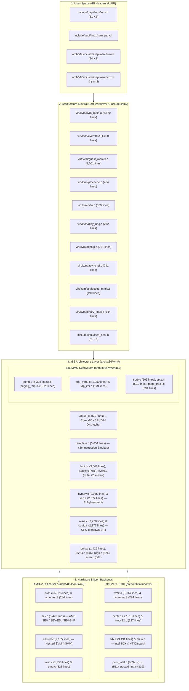

### P.2 Build-System Architecture and Module Packaging (`Makefile.kvm` & `arch/x86/kvm/Makefile`)

A detail that surprises many kernel developers when they first inspect [`virt/kvm/Makefile.kvm`](https://kernel.googlesource.com/pub/scm/virt/kvm/kvm.git/+/refs/heads/master/virt/kvm/Makefile.kvm) and [`arch/x86/kvm/Makefile`](https://kernel.googlesource.com/pub/scm/virt/kvm/kvm.git/+/refs/heads/master/arch/x86/kvm/Makefile) is that `virt/kvm/` does **not** compile into its own standalone kernel module. Instead, `arch/x86/kvm/Makefile` includes `virt/kvm/Makefile.kvm` directly and links all generic object files from `virt/kvm/` together with the architecture-specific files in `arch/x86/kvm/` into a single base module: **`kvm.ko`**.

Let us examine [`virt/kvm/Makefile.kvm`](https://kernel.googlesource.com/pub/scm/virt/kvm/kvm.git/+/refs/heads/master/virt/kvm/Makefile.kvm):

```makefile
# SPDX-License-Identifier: GPL-2.0
#
# Makefile for Kernel-based Virtual Machine module
#

KVM ?= ../../../virt/kvm

kvm-y := $(KVM)/kvm_main.o $(KVM)/eventfd.o $(KVM)/binary_stats.o
kvm-$(CONFIG_KVM_VFIO) += $(KVM)/vfio.o
kvm-$(CONFIG_KVM_MMIO) += $(KVM)/coalesced_mmio.o
kvm-$(CONFIG_KVM_ASYNC_PF) += $(KVM)/async_pf.o
kvm-$(CONFIG_HAVE_KVM_IRQ_ROUTING) += $(KVM)/irqchip.o
kvm-$(CONFIG_HAVE_KVM_DIRTY_RING) += $(KVM)/dirty_ring.o
kvm-$(CONFIG_HAVE_KVM_PFNCACHE) += $(KVM)/pfncache.o
kvm-$(CONFIG_KVM_GUEST_MEMFD) += $(KVM)/guest_memfd.o
```

And now observe how [`arch/x86/kvm/Makefile`](https://kernel.googlesource.com/pub/scm/virt/kvm/kvm.git/+/refs/heads/master/arch/x86/kvm/Makefile) extends `kvm-y` and defines the two vendor modules, **`kvm-intel.ko`** and **`kvm-amd.ko`**:

```makefile
include $(srctree)/virt/kvm/Makefile.kvm

kvm-y			+= x86.o emulate.o irq.o lapic.o cpuid.o msrs.o pmu.o regs.o \
			   mtrr.o debugfs.o mmu/mmu.o mmu/page_track.o mmu/spte.o

kvm-$(CONFIG_X86_64) += mmu/tdp_iter.o mmu/tdp_mmu.o
kvm-$(CONFIG_KVM_IOAPIC) += i8259.o i8254.o ioapic.o
kvm-$(CONFIG_KVM_HYPERV) += hyperv.o
kvm-$(CONFIG_KVM_XEN)	+= xen.o
kvm-$(CONFIG_KVM_SMM)	+= smm.o

kvm-intel-y		+= vmx/vmx.o vmx/vmenter.o vmx/pmu_intel.o vmx/vmcs12.o \
			   vmx/nested.o vmx/posted_intr.o vmx/main.o

kvm-intel-$(CONFIG_X86_SGX_KVM)	+= vmx/sgx.o
kvm-intel-$(CONFIG_KVM_HYPERV)	+= vmx/hyperv.o vmx/hyperv_evmcs.o
kvm-intel-$(CONFIG_KVM_INTEL_TDX)	+= vmx/tdx.o

kvm-amd-y		+= svm/svm.o svm/vmenter.o svm/pmu.o svm/nested.o svm/avic.o

kvm-amd-$(CONFIG_KVM_AMD_SEV)	+= svm/sev.o
kvm-amd-$(CONFIG_KVM_HYPERV)	+= svm/hyperv.o

obj-$(CONFIG_KVM_X86)	+= kvm.o
obj-$(CONFIG_KVM_INTEL)	+= kvm-intel.o
obj-$(CONFIG_KVM_AMD)	+= kvm-amd.o
```

#### Build-Time Symbol Namespace Enforcement (`EXPORT_SYMBOL_FOR_KVM_INTERNAL`)

Notice also the build-time security guard at the bottom of [`arch/x86/kvm/Makefile`](https://kernel.googlesource.com/pub/scm/virt/kvm/kvm.git/+/refs/heads/master/arch/x86/kvm/Makefile): KVM explicitly forbids arbitrary kernel modules from calling internal KVM functions. Every symbol exported from `kvm.ko` for use by `kvm-intel.ko` or `kvm-amd.ko` must use the namespaced macro `EXPORT_SYMBOL_FOR_KVM_INTERNAL` rather than `EXPORT_SYMBOL_GPL` or `EXPORT_SYMBOL`. The Makefile enforces this at compile time via `check_kvm_exports`, permitting only seven explicit external entry points (`kvm_get_kvm`, `kvm_get_kvm_safe`, `kvm_put_kvm`, and the four `kvm_page_track_*` / `kvm_write_track_*` functions used by VFIO and Intel GVT-g).

### P.3 Quantitative Source Tree Inventory (`kvm.git` `refs/heads/master`)

To appreciate the relative weight of each subsystem we will study across the 18 chapters of this book, the following table catalogs the primary source files in [`https://kernel.googlesource.com/pub/scm/virt/kvm/kvm.git/+/refs/heads/master`](https://kernel.googlesource.com/pub/scm/virt/kvm/kvm.git/+/refs/heads/master), their exact line counts at commit `c8f4cfe1cf93`, and the chapters in which they are dissected:

| Subsystem / Directory | Source File | Lines | Primary Responsibility | Book Chapters |
| :--- | :--- | ---: | :--- | :--- |
| **Generic Core (`virt/kvm/`)** | `virt/kvm/kvm_main.c` | 6,620 | `/dev/kvm`, VM/vCPU lifecycle, memslots, `mmu_notifier`, `kvm_io_bus`, halt-polling | Ch 1, 3, 4, 9, 13, 16 |
| | `virt/kvm/eventfd.c` | 1,050 | `irqfd`, `resamplefd`, and `ioeventfd` asynchronous datapath | Ch 16 |
| | `virt/kvm/guest_memfd.c` | 1,001 | Host-unmapped private guest memory (`KVM_CREATE_GUEST_MEMFD`) | Ch 9, 18 |
| | `virt/kvm/pfncache.c` | 484 | Lockless/SRCU GPA-to-PFN/KVA cache for frequent guest structures | Ch 9, 17 |
| | `virt/kvm/vfio.c` | 359 | `kvm-vfio` device bridge and non-coherent DMA tracking | Ch 16 |
| | `virt/kvm/dirty_ring.c` | 272 | Per-vCPU lockless dirty page ring buffer for live migration | Ch 13 |
| | `virt/kvm/irqchip.c` | 261 | Generic GSI routing table management and MSI dispatch | Ch 14 |
| | `virt/kvm/async_pf.c` | 241 | Asynchronous page fault workqueue and completion queuing | Ch 13 |
| | `virt/kvm/coalesced_mmio.c` | 190 | Batched MMIO ring buffer to defer userspace exits | Ch 16 |
| | `virt/kvm/binary_stats.c` | 144 | Binary schema and telemetry read interface (`KVM_GET_STATS_FD`) | Ch 3 |
| **x86 Core (`arch/x86/kvm/`)** | `arch/x86/kvm/x86.c` | 11,025 | `vcpu_run`, `vcpu_enter_guest`, CRs, FPU, timekeeping, hypercalls, event injection | Ch 1, 3, 4, 7, 8, 14, 17 |
| | `arch/x86/kvm/emulate.c` | 5,654 | Full x86 instruction decoder and execution engine | Ch 7 |
| | `arch/x86/kvm/lapic.c` | 3,643 | Virtual Local APIC (xAPIC/x2APIC), ICR IPI fastmap, APIC timer | Ch 14, 15 |
| | `arch/x86/kvm/hyperv.c` | 2,945 | In-kernel Microsoft Hyper-V TLFS emulation (SynIC, Stimer, hypercalls) | Ch 17 |
| | `arch/x86/kvm/msrs.c` | 2,728 | MSR tables, feature MSRs, and serialization | Ch 8 |
| | `arch/x86/kvm/xen.c` | 2,372 | In-kernel Xen HVM emulation (shared_info, evtchn, runstate) | Ch 17 |
| | `arch/x86/kvm/cpuid.c` | 2,177 | Guest CPUID leaf generation, sanitization, and runtime updates | Ch 8 |
| | `arch/x86/kvm/pmu.c` | 1,426 | Core virtual Performance Monitoring Unit (`vPMU`) framework | Ch 8 |
| | `arch/x86/kvm/regs.c` | 875 | Register/segment translation for `KVM_GET_REGS`/`KVM_SET_SREGS2` | Ch 3, 8 |
| | `arch/x86/kvm/i8254.c` | 816 | Programmable Interval Timer (8254 PIT) emulation | Ch 17 |
| | `arch/x86/kvm/ioapic.c` | 781 | I/O APIC redirection table and EOI broadcast state machine | Ch 14 |
| | `arch/x86/kvm/smm.c` | 667 | System Management Mode (`SMI`, SMRAM state save map, `RSM`) | Ch 8, 18 |
| | `arch/x86/kvm/i8259.c` | 656 | Dual 8259A Programmable Interrupt Controller (PIC) emulation | Ch 14 |
| | `arch/x86/kvm/irq.c` | 647 | Interrupt pending evaluation and PIC/APIC arbitration | Ch 14 |
| **x86 MMU (`arch/x86/kvm/mmu/`)** | `arch/x86/kvm/mmu/mmu.c` | 8,308 | MMU setup, page fault dispatcher, shadow MMU, `rmap`, `mmu_notifier` handlers | Ch 10, 12, 13 |
| | `arch/x86/kvm/mmu/tdp_mmu.c` | 1,950 | Scalable RCU/lockless Two-Dimensional Paging MMU (`tdp_mmu`) | Ch 11 |
| | `arch/x86/kvm/mmu/paging_tmpl.h` | 1,023 | Multi-compiled guest page table walker (`PTTYPE` 64, 32, PAE, EPT) | Ch 12 |
| | `arch/x86/kvm/mmu/spte.c` & `.h` | 1,194 | 64-bit Shadow PTE construction, EPT/NPT masks, MMIO generation SPTEs | Ch 10, 11 |
| | `arch/x86/kvm/mmu/page_track.c` | 394 | Guest page write-protection notification framework | Ch 12 |
| | `arch/x86/kvm/mmu/tdp_iter.c` & `.h` | 329 | Pre-order radix tree iterator for TDP page tables | Ch 11 |
| **Intel VMX & TDX (`arch/x86/kvm/vmx/`)** | `arch/x86/kvm/vmx/vmx.c` | 8,914 | Intel VT-x VMCS management, exit handlers, APICv, PML | Ch 2, 5, 13, 15 |
| | `arch/x86/kvm/vmx/nested.c` | 7,513 | Nested VMX (`nVMX`), `vmcs02` construction, shadow VMCS, nested EPT | Ch 18 |
| | `arch/x86/kvm/vmx/tdx.c` | 3,491 | Intel Trust Domain Extensions (TDX) confidential VM backend | Ch 18 |
| | `arch/x86/kvm/vmx/pmu_intel.c` | 863 | Intel architectural and fixed PMU counter virtualization | Ch 8 |
| | `arch/x86/kvm/vmx/sgx.c` | 511 | Intel Software Guard Extensions (`ENCLS`) virtualization | Ch 8 |
| | `arch/x86/kvm/vmx/posted_intr.c` | 319 | Intel Posted Interrupt Descriptor (`pi_desc`) and wakeup lifecycle | Ch 15 |
| | `arch/x86/kvm/vmx/vmenter.S` | 274 | Low-level assembly world-switch (`__vmx_vcpu_run`: `VMLAUNCH`/`VMRESUME`) | Ch 5 |
| **AMD SVM & SEV (`arch/x86/kvm/svm/`)** | `arch/x86/kvm/svm/svm.c` | 5,825 | AMD-V VMCB management, ASID lifecycle, exit handlers | Ch 2, 6 |
| | `arch/x86/kvm/svm/sev.c` | 5,423 | AMD SEV, SEV-ES, and SEV-SNP confidential computing backend | Ch 18 |
| | `arch/x86/kvm/svm/nested.c` | 2,165 | Nested SVM (`nSVM`), `vmcb02` construction, nested NPT | Ch 18 |
| | `arch/x86/kvm/svm/avic.c` | 1,353 | AMD Advanced Virtual Interrupt Controller (AVIC) and IOMMU IRTE | Ch 15 |
| | `arch/x86/kvm/svm/vmenter.S` | 284 | Low-level assembly world-switch (`__svm_vcpu_run` & `__svm_sev_es_vcpu_run`) | Ch 6, 18 |

With this structural map in hand, let us begin Part I and examine how an operating system kernel transforms itself into a hardware-assisted hypervisor.

---

---

# Part I: Foundations of Hardware-Assisted Virtualization and the KVM Architecture

## Chapter 1: From Operating System Kernels to Type-1.5 Hypervisors — The KVM Design Philosophy and Module Architecture

When Avi Kivity submitted the initial RFC patchset for the Kernel-based Virtual Machine (KVM) to the Linux kernel mailing list in October 2006, the systems software community was locked in an architectural orthodoxy. The prevailing wisdom held that a production-grade hypervisor had to be a standalone, purpose-built microkernel that booted directly on bare metal—what Gerald Popek and Robert Goldberg had classified three decades earlier as a Type-1 Virtual Machine Monitor (VMM). Under that model, exemplified by Xen and VMware ESX, the hypervisor owned the physical CPUs, the memory management unit (MMU), the interrupt controllers, and the scheduler, while the general-purpose operating system (such as Linux in Xen's `dom0`) was demoted to a privileged paravirtualized guest.

KVM inverted that paradigm with a deceptively simple engineering insight: **the Linux kernel is already a world-class resource manager**. Over decades of hardware evolution, Linux had accumulated a battle-tested, NUMA-aware scheduler (`kernel/sched/`), a sophisticated virtual memory subsystem capable of demand paging, huge-page coalescing, and page reclamation (`mm/`), a high-performance Virtual File System (`fs/`), fine-grained `cgroup` resource controllers, and driver support for virtually every storage and networking controller on the planet. Writing a second bare-metal kernel from scratch merely to multiplex hardware for virtual machines meant duplicating—and inevitably lagging behind—hundreds of thousands of lines of core operating system infrastructure.

Instead of replacing Linux beneath the operating system, KVM extends the Linux kernel with a new execution mode—**Guest Mode**—alongside classic Kernel Mode and User Mode. Through a clean, UNIX-idiomatic character device interface (`/dev/kvm`), any ordinary userspace process (such as QEMU, `crosvm`, or Firecracker) can instantiate a virtual machine whose guest physical memory is backed by standard Linux virtual memory areas (`struct vm_area_struct`) and whose virtual CPUs (vCPUs) are scheduled as standard POSIX threads (`struct task_struct`).

In this opening chapter, we bridge the conceptual and implementation gap between traditional Linux operating system internals and hardware-assisted hypervisor architecture. We begin by formalizing the relationship between OS process isolation and full machine virtualization through the lens of the Popek and Goldberg theorem, examining why the classical x86 instruction set architecture (ISA) defied formal trap-and-emulate virtualization for nearly thirty years and how Intel Virtual Machine Extensions (VMX / VT-x) and AMD Secure Virtual Machine (SVM / AMD-V) resolved those architectural defects at the silicon level. We then dissect KVM's "Type-1.5" split-execution architecture, trace its two-tier kernel module topology (`kvm.ko` vs. `kvm-intel.ko` and `kvm-amd.ko`), analyze how KVM achieves zero-overhead vendor polymorphism in a post-Spectre world using Linux `static_call` text patching (`arch/x86/include/asm/kvm-x86-ops.h`), and walk line-by-line through the per-CPU hardware enablement, CPU hotplug, and emergency crash-teardown state machines in [`virt/kvm/kvm_main.c`](https://kernel.googlesource.com/pub/scm/virt/kvm/kvm.git/+/refs/heads/master/virt/kvm/kvm_main.c) and [`arch/x86/kvm/x86.c`](https://kernel.googlesource.com/pub/scm/virt/kvm/kvm.git/+/refs/heads/master/arch/x86/kvm/x86.c).

---

### 1.1 OS Internals to Hypervisor Bridge: From Process Isolation to Full Machine Virtualization

To a systems programmer fluent in Linux kernel internals, an operating system kernel is fundamentally an illusionist. It multiplexes a finite set of physical CPU cores and physical DRAM frames across hundreds or thousands of concurrent processes, giving each process the illusion that it owns a dedicated processor and a private, contiguous linear address space.

A hypervisor performs a closely related illusion, but at a lower boundary of abstraction: instead of exporting an **Application Binary Interface (ABI)** composed of unprivileged user-mode instructions and system calls (`SYSCALL`/`SYSENTER`), a hypervisor exports the full **Instruction Set Architecture (ISA)** and platform hardware model (privileged control registers, model-specific registers, interrupt controllers, MMU page-table walkers, and DMA-capable I/O buses) to an untrusted guest operating system kernel.

#### 1.1.1 Mapping Linux OS Abstractions to KVM Virtual Machine Primitives

Because KVM is implemented directly inside the Linux kernel rather than alongside or beneath it, every virtual machine abstraction in KVM has a direct, structural one-to-one mapping to a familiar Linux kernel primitive. Understanding this structural isomorphism is the single most important prerequisite for reading the KVM codebase:

| Virtualization Concept | Classical OS Equivalent | KVM Kernel Data Structure & Mechanism | Source File Reference |
| :--- | :--- | :--- | :--- |
| **Virtual Machine (VM)** | Process (`struct task_struct` thread group + address space) | `struct kvm` embedded in vendor-specific `struct kvm_vmx`, `struct kvm_tdx`, or `struct kvm_svm`; bound to the creator process's `struct mm_struct *mm` (`mmgrab(current->mm)`) | [`include/linux/kvm_host.h`](https://kernel.googlesource.com/pub/scm/virt/kvm/kvm.git/+/refs/heads/master/include/linux/kvm_host.h), [`virt/kvm/kvm_main.c`](https://kernel.googlesource.com/pub/scm/virt/kvm/kvm.git/+/refs/heads/master/virt/kvm/kvm_main.c) |
| **Virtual CPU (vCPU)** | Kernel-scheduled thread (`struct task_struct` created via `clone(CLONE_VM, ...)`) | `struct kvm_vcpu` embedded in `struct vcpu_vmx`, `struct vcpu_tdx`, or `struct vcpu_svm`; coupled to the host scheduler via `struct preempt_notifier` (`kvm_sched_in` / `kvm_sched_out`) | [`include/linux/kvm_host.h`](https://kernel.googlesource.com/pub/scm/virt/kvm/kvm.git/+/refs/heads/master/include/linux/kvm_host.h), [`arch/x86/kvm/vmx/vmx.h`](https://kernel.googlesource.com/pub/scm/virt/kvm/kvm.git/+/refs/heads/master/arch/x86/kvm/vmx/vmx.h) |
| **Guest Physical Memory** | Process Virtual Memory Areas (`struct vm_area_struct` mapped via `mmap()`) | `struct kvm_memslots` & `struct kvm_memory_slot` mapping Guest Frame Numbers (`gfn_t`) to Host Virtual Addresses (`hva_t`) or `guest_memfd` (`CONFIG_KVM_GUEST_MEMFD`) | [`include/linux/kvm_host.h`](https://kernel.googlesource.com/pub/scm/virt/kvm/kvm.git/+/refs/heads/master/include/linux/kvm_host.h), [`virt/kvm/guest_memfd.c`](https://kernel.googlesource.com/pub/scm/virt/kvm/kvm.git/+/refs/heads/master/virt/kvm/guest_memfd.c) |
| **Two-Dimensional Address Translation** | Single-stage radix page tables (`pgd_t` $\to$ `p4d_t` $\to$ `pud_t` $\to$ `pmd_t` $\to$ `pte_t`) | Guest CR3 (`GVA` $\to$ `GPA`) composed with KVM's Two-Dimensional Paging MMU (`struct kvm_mmu`, Intel EPT / AMD NPT translating `GPA` $\to$ `HPA`), synchronized with host `mm` via `struct mmu_notifier` | [`arch/x86/kvm/mmu/mmu.c`](https://kernel.googlesource.com/pub/scm/virt/kvm/kvm.git/+/refs/heads/master/arch/x86/kvm/mmu/mmu.c), [`arch/x86/kvm/mmu/tdp_mmu.c`](https://kernel.googlesource.com/pub/scm/virt/kvm/kvm.git/+/refs/heads/master/arch/x86/kvm/mmu/tdp_mmu.c) |
| **World Switch (Entry / Exit)** | `SYSCALL` / Exception entry (`entry_SYSCALL_64`) and `SYSRET` / `IRETQ` return | Hardware VM-Entry (`VMLAUNCH`/`VMRESUME` or `VMRUN`) and VM-Exit inside the `ioctl(vcpu_fd, KVM_RUN, 0)` loop (`vcpu_run` $\to$ `vcpu_enter_guest`) | [`arch/x86/kvm/x86.c`](https://kernel.googlesource.com/pub/scm/virt/kvm/kvm.git/+/refs/heads/master/arch/x86/kvm/x86.c), [`arch/x86/kvm/vmx/vmenter.S`](https://kernel.googlesource.com/pub/scm/virt/kvm/kvm.git/+/refs/heads/master/arch/x86/kvm/vmx/vmenter.S) |
| **Control Interface (UAPI)** | VFS file descriptors (`open`, `ioctl`, `mmap`, `close`) | Three-level anonymous inode FD hierarchy: System FD (`/dev/kvm`) $\to$ VM FD (`anon_inode:kvm-vm`) $\to$ vCPU FD (`anon_inode:kvm-vcpu`) + shared `struct kvm_run` page | [`include/uapi/linux/kvm.h`](https://kernel.googlesource.com/pub/scm/virt/kvm/kvm.git/+/refs/heads/master/include/uapi/linux/kvm.h), [`virt/kvm/kvm_main.c`](https://kernel.googlesource.com/pub/scm/virt/kvm/kvm.git/+/refs/heads/master/virt/kvm/kvm_main.c) |

Consider what happens when a traditional Linux process executes in user mode (Ring 3 / CPL 3). The CPU's `CR3` register points to the host page global directory (`mm->pgd`) of that process. Every memory reference generated by an instruction is a Host Virtual Address (`HVA`) translated by the hardware page-table walker into a Host Physical Address (`HPA`). If the process attempts to execute a privileged instruction (such as `HLT`, `MOV CR3, %rax`, or `WRMSR`), the CPU raises a General Protection fault (`#GP(0)`, vector 13), transitioning privilege from CPL 3 to CPL 0 via descriptor entry 13 of the host Interrupt Descriptor Table (`IDT`). If the process touches an unmapped virtual address, the MMU raises a Page Fault (`#PF`, vector 14), loading the faulting linear address into `CR2` and invoking `exc_page_fault()` in the host kernel.

In a KVM virtual machine, this trap-and-handle lifecycle is elevated by one architectural dimension. A guest OS kernel and its guest user processes execute natively on the physical CPU, but their execution is governed by a hardware control structure—the **Virtual Machine Control Structure (VMCS)** on Intel VMX or the **Virtual Machine Control Block (VMCB)** on AMD SVM. When the guest OS kernel executes an instruction or encounters an event that the hypervisor has configured to intercept, the processor does not vector through the guest's `IDT`; instead, it performs an atomic **VM-Exit**, saving the guest's architectural state into the VMCS/VMCB, restoring the host kernel's architectural state (`HOST_CR3`, `HOST_RSP`, `HOST_RIP`, `HOST_GDTR`, `HOST_IDTR`), and resuming execution directly inside KVM's assembly exit path in host Ring 0.

#### 1.1.2 The Popek and Goldberg Formal Virtualizability Theorem (1974)

To understand why hardware extensions like Intel VMX and AMD SVM were required at all—and why KVM's x86 implementation is structured around them—we must examine the formal foundation of computer virtualization established by Gerald J. Popek and Robert P. Goldberg in their seminal 1974 *Communications of the ACM* paper, *"Formal Requirements for Virtualizable Third Generation Architectures."*

Popek and Goldberg defined a Virtual Machine Monitor (VMM) as a control program satisfying three properties:
1. **Efficiency (Equivalence / Direct Execution):** All innocuous (non-sensitive) instructions must be executed directly by the hardware processor without VMM intervention.
2. **Resource Control:** It must be impossible for the guest program to affect the allocation or configuration of physical system resources (such as physical memory mappings or CPU privilege state) without invoking the VMM.
3. **Equivalence:** Any program executing under the VMM must exhibit an effect identical to that which it would exhibit if executed directly on the bare machine, barring timing differences and resource availability limits.

To determine whether a processor architecture can support such a VMM via classic **trap-and-emulate** (where the guest OS kernel is de-privileged to run in a non-privileged ring while the VMM runs in Ring 0), Popek and Goldberg partitioned the instruction set $\mathcal{I}$ into three overlapping subsets:

* **Privileged Instructions ($\mathcal{I}_{\text{privileged}}$):** Instructions that trap (generate a synchronous hardware exception into the VMM in Ring 0) if and only if the processor is executing in user mode (non-privileged mode), and do not trap when executed in supervisor mode (Ring 0).
* **Control-Sensitive Instructions ($\mathcal{I}_{\text{control-sensitive}}$):** Instructions that attempt to change the configuration of resources in the system—for instance, modifying the active page table pointer, changing the processor's privilege mode, or enabling/disabling hardware interrupts.
* **Behavior-Sensitive Instructions ($\mathcal{I}_{\text{behavior-sensitive}}$):** Instructions whose behavior or result depends on the configuration of resources in the system (such as the physical memory relocation map or the current processor privilege level `CPL`).

The union of control-sensitive and behavior-sensitive instructions forms the set of **Sensitive Instructions**:

$$\mathcal{I}_{\text{sensitive}} = \mathcal{I}_{\text{control-sensitive}} \cup \mathcal{I}_{\text{behavior-sensitive}}$$

Popek and Goldberg's **Theorem 1** states the necessary and sufficient condition for a classical third-generation computer architecture to be virtualizable via direct execution and trap-and-emulate:

$$\mathcal{I}_{\text{sensitive}} \subseteq \mathcal{I}_{\text{privileged}}$$

In plain systems engineering terms: **every instruction that either reads or modifies privileged machine state must unconditionally trap when executed outside Ring 0**. If even a single instruction is sensitive (its behavior reveals or alters privileged state) but is *not* privileged (it executes in Ring 3 without raising a `#GP` or `#UD` fault), a de-privileged guest OS kernel running in Ring 3 will either silently fail to update virtualized state or read the *host's* true hardware state instead of the virtualized guest state, violating the Equivalence or Resource Control properties.

```
+-------------------------------------------------------------------------+
|                        Entire ISA Instruction Set (I)                   |
|                                                                         |
|   +-----------------------------------------------------------------+   |
|   |                  Privileged Instructions (Traps in Ring > 0)    |   |
|   |   e.g., MOV CR0/CR3/CR4, WRMSR, RDMSR, LGDT, LIDT, HLT, INVLPG  |   |
|   |                                                                 |   |
|   |   +---------------------------------------------------------+   |   |
|   |   |       Popek & Goldberg Ideal: Sensitive Instructions    |   |   |
|   |   |         (I_sensitive is a strict subset of I_privileged)|   |   |
|   |   +---------------------------------------------------------+   |   |
|   +-----------------------------------------------------------------+   |
|                                                                         |
|   +-----------------------------------------------------------------+   |
|   | CLASSICAL x86 DEFECT: Sensitive Instructions OUTSIDE Privileged!|   |
|   | (Execute in Ring 3 without trapping, leaking/dropping state)    |   |
|   |   - SGDT, SIDT, SLDT, STR, SMSW (Leak host descriptor/CR0 state)|   |
|   |   - POPF /POPFD / POPFQ (Silently ignores EFLAGS.IF in Ring 3)  |   |
|   |   - PUSHF / MOV from CS/SS (Leaks de-privileged CPL = 3/1)      |   |
|   |   - LAR, LSL, VERR, VERW (Visibility sensitive to CPL)          |   |
|   +-----------------------------------------------------------------+   |
+-------------------------------------------------------------------------+
```

##### 1.1.2.1 Why Classical x86 Failed Formal Virtualizability: The 17 Non-Trapping Sensitive Instructions

In 2000, John Scott Robin and Cynthia E. Irvine published a landmark formal analysis of the Intel Pentium ISA (*"Analysis of the Intel Pentium's Ability to Support a Secure Virtual Machine Monitor"*) and identified **17 instructions** in the classical IA-32 architecture that violate Popek and Goldberg's Theorem 1 because they are sensitive (either control-sensitive or behavior-sensitive) yet unprivileged. When a hypervisor attempts to run a guest OS kernel by de-privileging it from Ring 0 to Ring 1 or Ring 3 (a technique known as **ring de-privileging** or **ring aliasing**), these instructions break virtualization in four distinct ways:

1. **Unprivileged Reads of Global System Registers (`SGDT`, `SIDT`, `SLDT`, `STR`, `SMSW`):**
   While *loading* the Global Descriptor Table Register (`LGDT`), Interrupt Descriptor Table Register (`LIDT`), Local Descriptor Table Register (`LLDT`), Task Register (`LTR`), and Machine Status Word (`LMSW`, the lower 16 bits of `CR0`) are privileged instructions that `#GP(0)` outside Ring 0, *storing* (reading) those exact same registers via `SGDT`, `SIDT`, `SLDT`, `STR`, and `SMSW` was designed by Intel in the 80286/80386 era to be executable at **any privilege level (`CPL` 0, 1, 2, or 3)** without trapping! If a de-privileged guest OS executes `SIDT` or `SMSW` in Ring 3, the CPU does not trap to the VMM; it writes the *host VMM's* real `IDTR` linear base address or `CR0[15:0]` directly into guest memory.
2. **Silent Privilege-Dependent Semantics (`POPF`, `POPFD`, `POPFQ`, `PUSHF`):**
   The `EFLAGS` (or 64-bit `RFLAGS`) register contains both user-mode arithmetic flags (`CF`, `PF`, `AF`, `ZF`, `SF`, `OF`) and system control flags—most notably bit 9, the **Interrupt Enable Flag (`EFLAGS.IF`)**, and bits 12–13, the **I/O Privilege Level (`EFLAGS.IOPL`)**. A guest OS kernel frequently saves and restores interrupt state across critical sections using `PUSHF` followed by `POPF` (e.g., Linux's `local_irq_save()` and `local_irq_restore()`). In the x86 ISA, `POPF` is *not* a privileged instruction: when executed in Ring 0, `POPF` modifies `EFLAGS.IF` as requested; when executed in Ring 3 (with `CPL > IOPL`), `POPF` **does not trap**—it simply *silently ignores* any modification to `EFLAGS.IF` and `EFLAGS.IOPL`! Consequently, the VMM receives no notification that the guest kernel just attempted to enable or disable interrupts.
3. **Privilege-Level Visibility and Segment Descriptor Inspection (`PUSH CS`, `MOV %cs, %ax`, `LAR`, `LSL`, `VERR`, `VERW`):**
   On x86, the Current Privilege Level (`CPL`) is Architecturally visible in bits `[1:0]` of the `CS` and `SS` segment selectors (`RPL` field). Any unprivileged instruction that reads `CS` or `SS` (such as `MOV %cs, %eax` or `PUSH %cs`) immediately reveals to the guest OS that it is executing in Ring 1 or Ring 3 rather than Ring 0. Furthermore, the instructions `LAR` (Load Access Rights), `LSL` (Load Segment Limit), `VERR` (Verify Segment for Reading), and `VERW` (Verify Segment for Writing) test whether a segment descriptor in the GDT/LDT is accessible at `max(CPL, RPL)`. When the guest OS is de-privileged to Ring 1 or Ring 3, these instructions evaluate descriptor access rights against the de-privileged `CPL` rather than the virtual `CPL 0`, returning false negatives without trapping.
4. **Ring Compression and Protection Loss in 64-Bit Long Mode (`CALL`, `JMP`, `INT`, `RET`):**
   In 32-bit IA-32, hypervisors such as early Xen and VMware Workstation placed the guest OS kernel in Ring 1 and guest applications in Ring 3, using IA-32 segment limits to protect the VMM in the top megabytes of the address space. However, when AMD introduced 64-bit Long Mode (x86-64), **segment limit checking on `CS`, `DS`, `ES`, and `SS` was abolished in 64-bit mode**, and the two-bit page-table User/Supervisor (`U/S`, bit 2) flag only distinguishes between Supervisor rings (`CPL` 0, 1, 2) and User ring (`CPL` 3). If a 64-bit guest kernel is placed in Ring 1 or Ring 2, its memory accesses are treated by the hardware MMU as Supervisor accesses—identical to Ring 0—meaning the guest kernel could read and overwrite the VMM's pages unless the VMM resides in a completely separate `CR3` address space. Conversely, if the 64-bit guest kernel is pushed all the way out to Ring 3 (**0/3/3 ring compression**), it runs in the exact same hardware privilege ring as its own untrusted guest user processes, requiring costly shadow page-table switches on every single guest system call!

###### 1.1.2.1.1 Bit-Level Failure Modes: EFLAGS.IF Silent Drop in Ring-3 `POPF`, `CS.RPL` Leakage, and Hardware Orthogonal Root/Non-Root Split

Let us examine the exact bit-level registers that broke classical x86 trap-and-emulate and see how Intel VMX (2005) and AMD SVM (2006) redesigned the CPU's privilege architecture from first principles:

```
Classical x86 RFLAGS Register (64-bit) & Segment Selector (16-bit):
===================================================================

RFLAGS Register:
 63                  22  21  20  19  18  17  16  15  14  13:12 11  10   9   8  7:0
+----------------------+---+---+---+---+---+---+---+---+------+---+---+---+---+----+
| Reserved (Must be 0) |ID |VIP|VIF|AC |VM |RF | 0 |NT | IOPL |OF |DF |IF |TF | .. |
+----------------------+---+---+---+---+---+---+---+---+------+---+---+---+---+----+
                                                         ^^^^          ^^
                                                    Bits 13:12         Bit 9 (IF)
                                                    Trap-free drop     Silently ignored by
                                                    in CPL > 0 POPF!   POPF when CPL > IOPL!

CS / SS Segment Selector (16-bit):
 15                                                   3   2   1   0
+-------------------------------------------------------+---+-------+
|                  Descriptor Index                     |TI |  RPL  |
+-------------------------------------------------------+---+-------+
                                                             ^^^^^^^
                                                             Bits 1:0 = Current Privilege Level (CPL)
                                                             Readable via unprivileged MOV/PUSH!


Hardware-Assisted Virtualization (Intel VMX & AMD SVM Orthogonal Mode Split):
=============================================================================

                     +-----------------------------------------------+
                     |           x86 Physical CPU Core               |
                     |   Intel: CR4.VMXE (Bit 13) = 1 + VMXON        |
                     |   AMD:   MSR_EFER.SVME (Bit 12) = 1           |
                     +-----------------------+-----------------------+
                                             |
                   VM-Exit (Atomic Trap)     |     VM-Entry (VMLAUNCH / VMRESUME / VMRUN)
              +------------------------------+------------------------------+
              |                                                             |
              v                                                             v
+-------------------------------------------+   +-------------------------------------------+
|       VMX Root Operation / SVM Host       |   |    VMX Non-Root Operation / SVM Guest     |
|       (Linux Host + KVM Hypervisor)       |   |        (Virtual Machine Execution)        |
|                                           |   |                                           |
|  +-------------------------------------+  |   |  +-------------------------------------+  |
|  | Ring 3 (CPL 3): Host Userspace      |  |   |  | Guest Ring 3 (CPL 3): Guest Apps    |  |
|  | - QEMU / crosvm / Firecracker VMM   |  |   |  | - Untrusted guest user processes    |  |
|  | - Normal Linux tasks (nginx, bash)  |  |   |  +------------------+------------------+  |
|  +------------------+------------------+  |   |                     | Guest SYSCALL/Trap  |
|                     | Host SYSCALL/ioctl  |   |                     v (Handled natively!) |
|                     v                     |   |  +-------------------------------------+  |
|  +-------------------------------------+  |   |  | Guest Ring 0 (CPL 0): Guest Kernel  |  |
|  | Ring 0 (CPL 0): Host Linux Kernel   |  |   |  | - CS.RPL == 0! POPF works natively! |  |
|  | - virt/kvm/kvm_main.c               |  |   |  | - SGDT/SIDT read GUEST GDTR/IDTR!   |  |
|  | - arch/x86/kvm/x86.c, vmx/, svm/    |  |   |  | - Configured intercepts trigger     |  |
|  +-------------------------------------+  |   |  |   VM-Exit to Host Ring 0!           |  |
+-------------------------------------------+   +-------------------------------------------+
```

Prior to hardware virtualization, commercial VMMs had to work around the 17 non-trapping sensitive instructions using either **paravirtualization** (modifying the guest Linux kernel source code to replace sensitive instructions with explicit hypercalls) or **dynamic binary translation (BT)** (scanning basic blocks of guest Ring-0 machine code at runtime and rewriting `POPF`, `SGDT`, `SIDT`, `SMSW`, and `PUSH CS` into safe trap sequences before execution).

Intel VMX and AMD SVM eliminated both binary translation and ring compression by introducing a new hardware execution dimension **orthogonal to the four x86 privilege rings (Rings 0–3)**:
* On Intel processors, enabling **Bit 13 of Control Register 4 (`CR4.VMXE`, `0x2000`)** and executing the `VMXON` instruction places the logical processor into VMX operation, which splits execution into **VMX Root Operation** (for the host OS and KVM) and **VMX Non-Root Operation** (for the guest VM).
* On AMD processors, setting **Bit 12 of the Extended Feature Enable Register (`MSR_EFER.SVME`, `0x1000` in MSR `0xc0000080`)** enables the `VMRUN` instruction, which transitions the processor from **SVM Host Mode** into **SVM Guest Mode**.

Because VMX Non-Root / SVM Guest Mode provides its own full set of four privilege rings (Guest Ring 0 through Guest Ring 3) backed by dedicated guest state fields in the VMCS/VMCB:
1. The guest operating system kernel executes in **Guest Ring 0 (`CS.RPL == 0`)**, while guest user applications execute in **Guest Ring 3 (`CS.RPL == 3`)**.
2. When the guest kernel executes `SGDT`, `SIDT`, `SLDT`, `STR`, or `SMSW`, the CPU reads the **guest's** `GDTR`, `IDTR`, `LDTR`, `TR`, and `CR0` shadow registers directly from the active VMCS/VMCB—no trap is required (unless KVM explicitly enables descriptor-table exiting in `SECONDARY_EXEC_DESC` for UMIP emulation or introspection), and no host state is ever leaked.
3. When the guest kernel executes `POPF` in Guest Ring 0, `CPL == 0`, so `EFLAGS.IF` is updated natively in the guest's `RFLAGS` without silent drops. If KVM has a pending virtual interrupt to inject as soon as the guest unmasks interrupts, KVM sets the **Interrupt-Window Exiting** control bit in the VMCS (`CPU_BASED_INTR_WINDOW_EXITING`) or VMCB (`INTERCEPT_VINTR`), causing `POPF` (or `STI`) to trigger a clean VM-Exit the instant `RFLAGS.IF` transitions from `0` to `1`.
4. Guest system calls (`SYSCALL`/`SYSRET` between Guest Ring 3 and Guest Ring 0) and guest page faults (when Two-Dimensional Paging via EPT/NPT is enabled) are handled **entirely inside VMX Non-Root / SVM Guest Mode** at bare-metal speed without ever exiting to KVM.

---

### 1.2 The Type-1 vs. Type-2 Debate and KVM's "Type-1.5" Split-Execution Architecture

Few topics in systems architecture generate more semantic confusion than whether KVM is a "Type-1" (bare-metal) or "Type-2" (hosted) hypervisor.

#### 1.2.1 Why Traditional Hypervisor Taxonomies Fail to Describe KVM

In Popek and Goldberg's original 1974 taxonomy:
* A **Type-1 Hypervisor** runs directly on the host hardware in the highest processor privilege mode (VMX Root Ring 0 / EL2 on ARM64), directly scheduling physical CPUs and managing physical RAM.
* A **Type-2 Hypervisor** runs as an application layer on top of a conventional host operating system, relying on the host OS via user-mode APIs or auxiliary driver callouts to emulate a virtual machine.

Where does KVM fit? When the `kvm.ko` and `kvm-intel.ko` (or `kvm-amd.ko`) modules are loaded, **the Linux kernel itself becomes the hypervisor executing directly in VMX Root Ring 0**. There is no separate hypervisor binary beneath Linux. When a vCPU enters Guest Mode, KVM executes `VMLAUNCH`/`VMRESUME` or `VMRUN` directly from Ring 0 kernel text, and hardware VM-Exits trap directly back into KVM's Ring 0 handler (`vcpu_enter_guest()` in [`arch/x86/kvm/x86.c`](https://kernel.googlesource.com/pub/scm/virt/kvm/kvm.git/+/refs/heads/master/arch/x86/kvm/x86.c)). In terms of hardware privilege, execution path, and MMU management, KVM is indisputably a bare-metal Type-1 hypervisor.

At the same time, KVM deliberately refuses to reimplement a bespoke CPU scheduler, a bespoke physical memory allocator, or a monolithic in-kernel device model for hundreds of legacy PCI/virtio peripherals. Instead, KVM adopts what kernel developers call a **"Type-1.5" or Split-Execution Hypervisor Architecture**:
* Every VM is instantiated by a normal Linux userspace process—the **Userspace Virtual Machine Monitor (VMM)**, such as QEMU, Google's `crosvm`, or AWS's `Firecracker`.
* Every vCPU is created and driven by a dedicated POSIX thread (`pthread`) inside that userspace VMM process.
* To the Linux CFS/EEVDF scheduler (`kernel/sched/fair.c`), a vCPU thread is simply a `struct task_struct`. You can pin it to physical cores with `sched_setaffinity()`, prioritize it with `chrt`, throttle its CPU bandwidth with `cpu.max` in `cgroup v2`, and profile its hardware performance counters with `perf kvm` (`CONFIG_GUEST_PERF_EVENTS`).
* To the Linux memory manager (`mm/`), guest physical RAM is simply a collection of virtual memory mappings (`mmap()`) in the VMM process's `struct mm_struct` (or, for confidential/protected VMs, a file-backed `guest_memfd` instance managed by [`virt/kvm/guest_memfd.c`](https://kernel.googlesource.com/pub/scm/virt/kvm/kvm.git/+/refs/heads/master/virt/kvm/guest_memfd.c)). Linux can back guest memory with Transparent Huge Pages (THP), 1 GiB `hugetlbfs` pages, NUMA memory policies (`mbind()`), or even swap cold guest pages out to NVMe storage via KVM's `mmu_notifier` integration.

#### 1.2.2 The Three Execution Contexts of a KVM Virtual Machine

Because a KVM virtual machine spans both a userspace VMM process and the in-kernel KVM subsystem, a vCPU thread dynamically transitions across **three distinct execution contexts** during its lifetime:

1. **Guest Mode (VMX Non-Root Operation / SVM Guest Mode, Rings 0–3):**
   The physical CPU is executing guest instructions (either the guest OS kernel in Guest Ring 0 or guest user applications in Guest Ring 3). Address translation uses two-stage hardware paging (Guest CR3 + Host EPT/NPT). No host code is running on this hardware thread.
2. **Host Kernel Mode (VMX Root Operation / SVM Host Mode, Ring 0):**
   Entered automatically via a hardware **VM-Exit** from Guest Mode (or via a `syscall`/`ioctl` from Host User Mode). Here, `arch/x86/kvm/` and `virt/kvm/` inspect the VM-Exit reason.
   * **Lightweight (Fast-Path) Exits:** Roughly 85%–99% of all VM-Exits in a tuned production VM—such as EPT/NPT page faults (`EXIT_REASON_EPT_VIOLATION` / `SVM_EXIT_NPF`), `RDMSR`/`WRMSR` emulations, `CPUID` instructions, APIC timer programming, `HLT` polling (`kvm_vcpu_halt()`), and `ioeventfd`-backed `virtio` doorbell kicks—are resolved **entirely inside Host Kernel Mode**. Once resolved, KVM immediately loops back and executes `VMRESUME` / `VMRUN` to re-enter Guest Mode without ever returning to userspace!
   * **Heavyweight (Slow-Path) Exits:** Only when a VM-Exit requires an action outside the kernel's domain—such as emulating an unbacked PCI MMIO bar, a legacy UART `0x3f8` port I/O write, or handling a triple fault/system reset—does KVM populate the shared `struct kvm_run` memory page with exit metadata (e.g., `run->exit_reason = KVM_EXIT_IO` or `KVM_EXIT_MMIO`) and return `0` from the `ioctl(vcpu_fd, KVM_RUN, 0)` system call.
3. **Host User Mode (VMX Root Operation / SVM Host Mode, Ring 3):**
   The userspace VMM thread (QEMU / `crosvm`) wakes up from the blocking `ioctl(vcpu_fd, KVM_RUN, 0)` call, inspects `run->exit_reason` in the `mmap()`-shared `struct kvm_run` page, dispatches the I/O access to its userspace device model (e.g., writing a character to a virtual serial console or updating a virtual VGA framebuffer), and immediately invokes `ioctl(vcpu_fd, KVM_RUN, 0)` again to re-enter Host Kernel Mode and resume the guest.

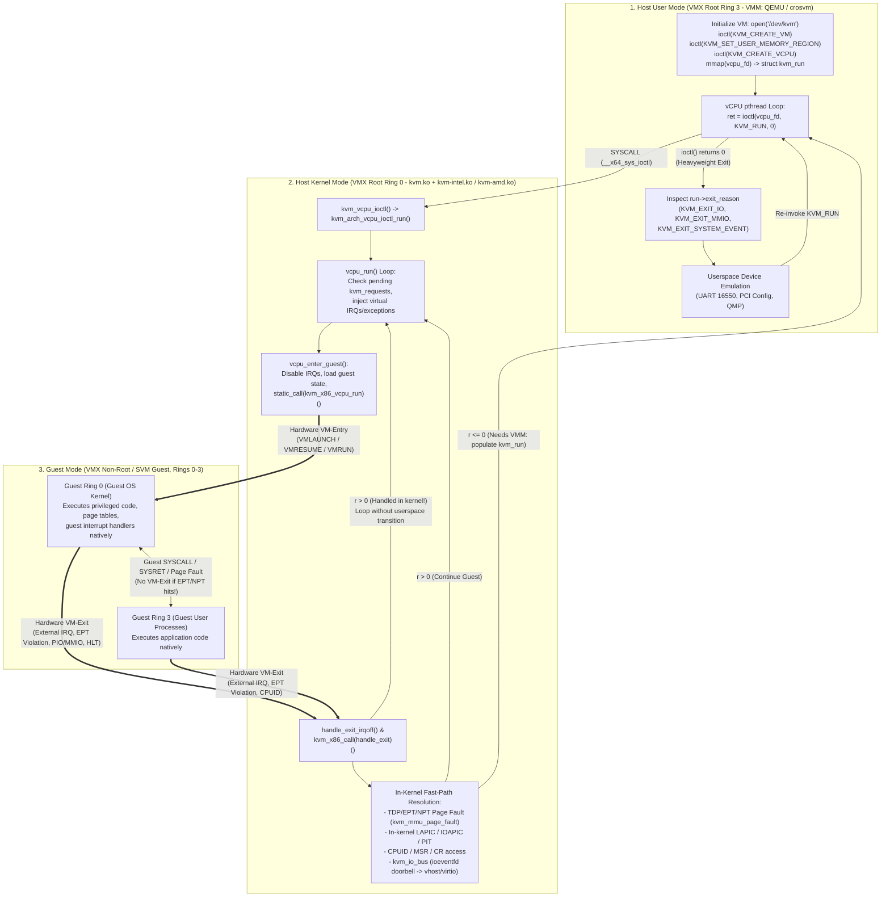

##### 1.2.2.1 Exact Role Separation Between the Userspace VMM and the Kernel Hypervisor

Why split device emulation between the kernel (`virt/kvm/` and `arch/x86/kvm/`) and userspace (QEMU/`crosvm`)? The guiding principle in KVM's design is **Minimize the Trusted Computing Base (TCB) in Ring 0 while Maximizing Hot-Path Performance**:

1. **What Stays in Userspace (The Control Plane & Complex Low-Frequency Device Model):**
   * **Virtual Motherboard & Firmware Construction:** Parsing command-line configuration, constructing ACPI tables (`DSDT`, `MADT`, `SRAT`), loading SeaBIOS or OVMF/EDK2 UEFI firmware into guest RAM, and populating initial `e820` memory maps.
   * **Complex Emulated Devices:** Legacy hardware with intricate state machines and historically high vulnerability rates (such as floppy controllers, IDE/AHCI emulators, USB host controllers, VGA/GPU display adapters, and PCI configuration space bridges) remains in Ring 3 userspace, where it can be sandboxed using `seccomp-bpf`, `namespaces`, and unprivileged UIDs.
   * **Live Migration & Control Orchestration:** Dirty page tracking consumption (`KVM_GET_DIRTY_LOG` or dirty ring buffers), vCPU state serialization (`KVM_GET_REGS`, `KVM_GET_SREGS`, `KVM_GET_MSRS`, `KVM_GET_NESTED_STATE`), and network migration streams.
2. **What Moves into the Kernel (`kvm.ko`, The Execution & High-Frequency Data Plane):**
   * **Interrupt Delivery Infrastructure:** Because guest OS kernels read and write the Local APIC (`LAPIC`, particularly the Task Priority Register `CR8`/`TPR`, End-of-Interrupt `EOI`, and Inter-Processor Interrupt `ICR` registers) tens of thousands of times per second, round-tripping every APIC access to userspace would destroy performance. KVM therefore implements the Local APIC (`arch/x86/kvm/lapic.c`), I/O APIC (`arch/x86/kvm/ioapic.c`), dual 8259A PIC (`arch/x86/kvm/i8259.c`), and 8254 PIT (`arch/x86/kvm/i8254.c`) directly in the kernel, augmented by hardware APIC virtualization (**Intel APICv / Posted Interrupts** and **AMD AVIC**).
   * **In-Kernel Fast I/O Bus (`struct kvm_io_bus`):** As we saw earlier in [`virt/kvm/kvm_main.c`](https://kernel.googlesource.com/pub/scm/virt/kvm/kvm.git/+/refs/heads/master/virt/kvm/kvm_main.c#L5806-L6115), KVM maintains four internal SRCU-protected I/O buses per VM (`KVM_MMIO_BUS`, `KVM_PIO_BUS`, `KVM_VIRTIO_CCW_NOTIFY_BUS`, `KVM_FAST_MMIO_BUS`). When a guest writes to an MMIO or PIO address, `kvm_io_bus_write()` performs a binary search (`bsearch()`) over `bus->range[]` under `kvm->srcu`. If an in-kernel device (such as the LAPIC, IOAPIC, or an `ioeventfd` registered by [`virt/kvm/eventfd.c`](https://kernel.googlesource.com/pub/scm/virt/kvm/kvm.git/+/refs/heads/master/virt/kvm/eventfd.c)) claims the address, KVM handles the write immediately—for `ioeventfd`, signaling an `eventfd` that wakes up a `vhost-net` kernel thread or an asynchronous userspace I/O worker—and immediately resumes the vCPU without blocking on the VMM thread!

###### 1.2.2.1.1 Inside the Preemption Notifier Bridge: `kvm_sched_in()` and `kvm_sched_out()` Context Switching

Because a KVM vCPU is just a normal Linux `task_struct` while executing in Host Kernel Mode, the Linux scheduler can preempt a vCPU thread at any preemption point (for example, while handling a heavyweight VM-Exit, waiting on a mutex, or after interrupts are re-enabled in the `vcpu_run()` loop) and later migrate that thread to a **completely different physical CPU core**.

However, hardware virtualization state is deeply tied to the local physical CPU:
* On Intel VMX, a VMCS structure resides in physical memory, but the physical CPU caches the active VMCS internally when `VMPTRLD` is executed. If the vCPU thread is migrated from `CPU_A` to `CPU_B`, `CPU_A` must first flush its internal VMCS cache back to DRAM via `VMCLEAR`, and `CPU_B` must load the VMCS via `VMPTRLD` and update the `HOST_TR_BASE`, `HOST_GDTR_BASE`, and per-CPU MSRs to match `CPU_B`.
* Furthermore, certain architectural registers (such as `MSR_KERNEL_GS_BASE`, `MSR_SYSCALL_MASK`, `MSR_LSTAR`, or hardware debug registers) are lazily swapped by KVM only when switching *out* of the vCPU thread to another host Linux process, rather than on every tight VM-Exit/VM-Entry loop (`vcpu_load()` vs. `vcpu_enter_guest()`).

How does the generic Linux scheduler know that a `struct task_struct` being switched out or switched in is actually an active KVM vCPU? KVM solves this via the **Preemption Notifier** infrastructure (`CONFIG_PREEMPT_NOTIFIERS`), wired up in [`virt/kvm/kvm_main.c`](https://kernel.googlesource.com/pub/scm/virt/kvm/kvm.git/+/refs/heads/master/virt/kvm/kvm_main.c#L6400-L6460):

```c
// Source: virt/kvm/kvm_main.c (lines 6400-6460)
struct kvm_vcpu *preempt_notifier_to_vcpu(struct preempt_notifier *pn)
{
	return container_of(pn, struct kvm_vcpu, preempt_notifier);
}

static void kvm_sched_in(struct preempt_notifier *pn, int cpu)
{
	struct kvm_vcpu *vcpu = preempt_notifier_to_vcpu(pn);

	WRITE_ONCE(vcpu->preempted, false);
	WRITE_ONCE(vcpu->ready, false);

	__this_cpu_write(kvm_running_vcpu, vcpu);
	kvm_arch_vcpu_load(vcpu, cpu);

	WRITE_ONCE(vcpu->scheduled_out, false);
}

static void kvm_sched_out(struct preempt_notifier *pn,
			  struct task_struct *next)
{
	struct kvm_vcpu *vcpu = preempt_notifier_to_vcpu(pn);

	WRITE_ONCE(vcpu->scheduled_out, true);

	if (task_is_runnable(current) && vcpu->wants_to_run) {
		WRITE_ONCE(vcpu->preempted, true);
		WRITE_ONCE(vcpu->ready, true);
	}
	kvm_arch_vcpu_put(vcpu);
	__this_cpu_write(kvm_running_vcpu, NULL);
}

/**
 * kvm_get_running_vcpu - get the vcpu running on the current CPU.
 *
 * We can disable preemption locally around accessing the per-CPU variable,
 * and use the resolved vcpu pointer after enabling preemption again,
 * because even if the current thread is migrated to another CPU, reading
 * the per-CPU value later will give us the same value as we update the
 * per-CPU variable in the preempt notifier handlers.
 */
struct kvm_vcpu *kvm_get_running_vcpu(void)
{
	struct kvm_vcpu *vcpu;

	preempt_disable();
	vcpu = __this_cpu_read(kvm_running_vcpu);
	preempt_enable();

	return vcpu;
}
EXPORT_SYMBOL_FOR_KVM_INTERNAL(kvm_get_running_vcpu);
```

Look closely at the subtle concurrency mechanics in `kvm_sched_in()`, `kvm_sched_out()`, and `kvm_get_running_vcpu()`:
1. When a vCPU thread enters `vcpu_load(struct kvm_vcpu *vcpu)` (at the beginning of `kvm_vcpu_ioctl()`), KVM registers `&vcpu->preempt_notifier` onto `current->preempt_notifiers` via `preempt_notifier_register(&vcpu->preempt_notifier)` and calls `kvm_arch_vcpu_load(vcpu, cpu)`.
2. If the Linux scheduler (`__schedule()`) preempts `current` while `vcpu_load()` is active, `fire_sched_out_preempt_notifiers()` invokes `kvm_sched_out()`.
   * First, `WRITE_ONCE(vcpu->scheduled_out, true)` marks the vCPU as off-CPU.
   * Next, if `task_is_runnable(current) && vcpu->wants_to_run` is true—meaning the vCPU thread was **involuntarily preempted** by the host scheduler while actively running the guest, rather than voluntarily sleeping in `kvm_vcpu_block()` on a `HLT` instruction—KVM sets `vcpu->preempted = true` and `vcpu->ready = true`. Why? Paravirtualized spinlocks (`arch/x86/include/asm/qspinlock_paravirt.h`) and TLB shootdown optimizations inside the guest inspect this state (via shared paravirt memory) so that another guest vCPU spinning on a lock held by a preempted vCPU yields immediately rather than burning 100% of a physical core spinning on a lock holder that isn't even scheduled!
   * Next, `kvm_arch_vcpu_put(vcpu)` restores any host-lazy state (such as user-return MSRs and segment state) and marks the vCPU as unloaded.
   * Finally, `__this_cpu_write(kvm_running_vcpu, NULL)` clears the per-CPU `kvm_running_vcpu` pointer on the outgoing physical core.
3. When the scheduler later picks the vCPU task to run again (potentially on a different physical `cpu`), `fire_sched_in_preempt_notifiers()` invokes `kvm_sched_in()`, which sets `kvm_running_vcpu` on the new physical CPU and invokes `kvm_arch_vcpu_load(vcpu, cpu)` to migrate the VMCS/VMCB and update per-CPU host state fields.
4. Notice the brilliant invariant documented above `kvm_get_running_vcpu()`: any code running in vCPU task context can call `kvm_get_running_vcpu()`, which disables preemption just long enough to read `__this_cpu_read(kvm_running_vcpu)` and then immediately re-enables preemption. Even if the task is preempted and migrated to another physical CPU one nanosecond after `preempt_enable()`, the `vcpu` pointer returned remains 100% valid because `kvm_sched_out()` and `kvm_sched_in()` moved the exact same `vcpu` pointer to the new CPU's `kvm_running_vcpu` slot!

---

### 1.3 The Two-Tier Kernel Module Architecture (`kvm.ko` vs. `kvm-intel.ko` / `kvm-amd.ko`)

When you inspect a running Linux virtualization host via `lsmod | grep kvm`, you immediately notice that KVM on x86 is not a single monolithic kernel module. Instead, it is split into a **two-tier kernel module hierarchy**:
1. **`kvm.ko` (The Core & Architecture-Common Module):** Combines the architecture-agnostic hypervisor core (`virt/kvm/*`) with the x86 architecture-common layer (`arch/x86/kvm/x86.c`, `mmu/`, `lapic.c`, `emulate.c`, `cpuid.c`, `hyperv.c`, `xen.c`, etc.).
2. **`kvm-intel.ko` or `kvm-amd.ko` (The Hardware Vendor Module):** Implements the silicon-specific virtualization extensions—Intel VMX and Intel TDX in `arch/x86/kvm/vmx/*` (`kvm-intel.ko`), or AMD SVM and AMD SEV/SEV-ES/SEV-SNP in `arch/x86/kvm/svm/*` (`kvm-amd.ko`).

#### 1.3.1 Build System Topology, Kconfig Dependencies, and Module Namespace Isolation

To see how the Linux build system constructs `kvm.ko`, `kvm-intel.ko`, and `kvm-amd.ko`, let us examine [`virt/kvm/Makefile.kvm`](https://kernel.googlesource.com/pub/scm/virt/kvm/kvm.git/+/refs/heads/master/virt/kvm/Makefile.kvm) and [`arch/x86/kvm/Makefile`](https://kernel.googlesource.com/pub/scm/virt/kvm/kvm.git/+/refs/heads/master/arch/x86/kvm/Makefile):

```makefile
# Source: virt/kvm/Makefile.kvm (lines 6-16)
KVM ?= ../../../virt/kvm

kvm-y := $(KVM)/kvm_main.o $(KVM)/eventfd.o $(KVM)/binary_stats.o
kvm-$(CONFIG_KVM_VFIO) += $(KVM)/vfio.o
kvm-$(CONFIG_KVM_MMIO) += $(KVM)/coalesced_mmio.o
kvm-$(CONFIG_KVM_ASYNC_PF) += $(KVM)/async_pf.o
kvm-$(CONFIG_HAVE_KVM_IRQ_ROUTING) += $(KVM)/irqchip.o
kvm-$(CONFIG_HAVE_KVM_DIRTY_RING) += $(KVM)/dirty_ring.o
kvm-$(CONFIG_HAVE_KVM_PFNCACHE) += $(KVM)/pfncache.o
kvm-$(CONFIG_KVM_GUEST_MEMFD) += $(KVM)/guest_memfd.o
```

And in [`arch/x86/kvm/Makefile`](https://kernel.googlesource.com/pub/scm/virt/kvm/kvm.git/+/refs/heads/master/arch/x86/kvm/Makefile#L6-L38):

```makefile
# Source: arch/x86/kvm/Makefile (lines 6-38)
include $(srctree)/virt/kvm/Makefile.kvm

kvm-y			+= x86.o emulate.o irq.o lapic.o cpuid.o msrs.o pmu.o regs.o \
			   mtrr.o debugfs.o mmu/mmu.o mmu/page_track.o mmu/spte.o

kvm-$(CONFIG_X86_64) += mmu/tdp_iter.o mmu/tdp_mmu.o
kvm-$(CONFIG_KVM_IOAPIC) += i8259.o i8254.o ioapic.o
kvm-$(CONFIG_KVM_HYPERV) += hyperv.o
kvm-$(CONFIG_KVM_XEN)	+= xen.o
kvm-$(CONFIG_KVM_SMM)	+= smm.o

kvm-intel-y		+= vmx/vmx.o vmx/vmenter.o vmx/pmu_intel.o vmx/vmcs12.o \
			   vmx/nested.o vmx/posted_intr.o vmx/main.o

kvm-intel-$(CONFIG_X86_SGX_KVM)	+= vmx/sgx.o
kvm-intel-$(CONFIG_KVM_HYPERV)	+= vmx/hyperv.o vmx/hyperv_evmcs.o
kvm-intel-$(CONFIG_KVM_INTEL_TDX)	+= vmx/tdx.o

kvm-amd-y		+= svm/svm.o svm/vmenter.o svm/pmu.o svm/nested.o svm/avic.o

kvm-amd-$(CONFIG_KVM_AMD_SEV)	+= svm/sev.o
kvm-amd-$(CONFIG_KVM_HYPERV)	+= svm/hyperv.o

ifdef CONFIG_HYPERV
kvm-y			+= kvm_onhyperv.o
kvm-intel-y		+= vmx/vmx_onhyperv.o vmx/hyperv_evmcs.o
kvm-amd-y		+= svm/svm_onhyperv.o
endif

obj-$(CONFIG_KVM_X86)	+= kvm.o
obj-$(CONFIG_KVM_INTEL)	+= kvm-intel.o
obj-$(CONFIG_KVM_AMD)	+= kvm-amd.o
```

Notice two crucial architectural details in these Makefiles and their companion headers:
1. **`CONFIG_KVM_X86` Guard:** In [`arch/x86/kvm/Kconfig`](https://kernel.googlesource.com/pub/scm/virt/kvm/kvm.git/+/refs/heads/master/arch/x86/kvm/Kconfig#L20-L21), `config KVM_X86` is defined as `def_tristate KVM if (KVM_INTEL != n || KVM_AMD != n)`. This means `kvm.ko` is only built if at least one hardware vendor module (`CONFIG_KVM_INTEL` or `CONFIG_KVM_AMD`) is enabled!
2. **Strict Module Symbol Visibility (`EXPORT_SYMBOL_FOR_KVM_INTERNAL`):** Historically, `kvm.ko` exported hundreds of internal functions using `EXPORT_SYMBOL_GPL()`, which polluted the global kernel symbol table and allowed random out-of-tree drivers to poke directly at KVM's internal state. Modern KVM enforces strict module-scoped symbol exports via [`arch/x86/include/asm/kvm_types.h`](https://kernel.googlesource.com/pub/scm/virt/kvm/kvm.git/+/refs/heads/master/arch/x86/include/asm/kvm_types.h) and [`include/linux/kvm_types.h`](https://kernel.googlesource.com/pub/scm/virt/kvm/kvm.git/+/refs/heads/master/include/linux/kvm_types.h):

```c
// Source: arch/x86/include/asm/kvm_types.h (lines 5-18)
#if IS_MODULE(CONFIG_KVM_AMD) && IS_MODULE(CONFIG_KVM_INTEL)
#define KVM_SUB_MODULES kvm-amd,kvm-intel
#elif IS_MODULE(CONFIG_KVM_AMD)
#define KVM_SUB_MODULES kvm-amd
#elif IS_MODULE(CONFIG_KVM_INTEL)
#define KVM_SUB_MODULES kvm-intel
#else
#undef KVM_SUB_MODULES
/*
 * Don't export symbols for KVM without vendor modules, as kvm.ko is built iff
 * at least one vendor module is enabled.
 */
#define EXPORT_SYMBOL_FOR_KVM(symbol)
#endif
```

And in [`include/linux/kvm_types.h`](https://kernel.googlesource.com/pub/scm/virt/kvm/kvm.git/+/refs/heads/master/include/linux/kvm_types.h#L11-L18):

```c
// Source: include/linux/kvm_types.h (lines 11-18)
#ifdef KVM_SUB_MODULES
#define EXPORT_SYMBOL_FOR_KVM_INTERNAL(symbol) \
	EXPORT_SYMBOL_FOR_MODULES(symbol, __stringify(KVM_SUB_MODULES))
#define EXPORT_SYMBOL_FOR_KVM(symbol) \
	EXPORT_SYMBOL_FOR_MODULES(symbol, "kvm," __stringify(KVM_SUB_MODULES))
#else
#define EXPORT_SYMBOL_FOR_KVM_INTERNAL(symbol)
```

Using the kernel's `EXPORT_SYMBOL_FOR_MODULES()` mechanism, symbols marked with `EXPORT_SYMBOL_FOR_KVM_INTERNAL` (such as `kvm_init`, `kvm_exit`, `kvm_x86_vendor_init`, `vcpu_load`, `gfn_to_pfn`) can **only** be linked by `kvm-intel` and `kvm-amd`—any other kernel module attempting to resolve them is rejected by the module loader! Even more impressively, lines 56–98 of [`arch/x86/kvm/Makefile`](https://kernel.googlesource.com/pub/scm/virt/kvm/kvm.git/+/refs/heads/master/arch/x86/kvm/Makefile#L56-L98) define a build-time macro `check_kvm_exports` that scans every `.c` and `.h` file in `virt/kvm` and `arch/x86/kvm` during compilation and **fails the kernel build** if any symbol other than the seven explicitly allowlisted external VFIO/KVMGT hooks (`kvm_page_track_register_notifier`, `kvm_page_track_unregister_notifier`, `kvm_write_track_add_gfn`, `kvm_write_track_remove_gfn`, `kvm_get_kvm`, `kvm_get_kvm_safe`, `kvm_put_kvm`) uses `EXPORT_SYMBOL_GPL` or `EXPORT_SYMBOL`.

#### 1.3.2 Inverted Module Initialization and Polymorphic Object Containment Hierarchy

When a kernel newcomer reads `virt/kvm/kvm_main.c` for the first time, they often look for `module_init(kvm_init)` at the bottom of `kvm_main.c`—and are surprised to find that **`kvm_main.c` has no `module_init()` declaration at all!**

Why? Let us trace what happens when `kvm.ko` is loaded into the kernel first, followed by `kvm-intel.ko` (or `kvm-amd.ko`):
1. When `kvm.ko` loads, its `module_init` entry point is `kvm_x86_init()` at the very bottom of [`arch/x86/kvm/x86.c`](https://kernel.googlesource.com/pub/scm/virt/kvm/kvm.git/+/refs/heads/master/arch/x86/kvm/x86.c#L11011-L11019):
   ```c
   // Source: arch/x86/kvm/x86.c (lines 11011-11025)
   static int __init kvm_x86_init(void)
   {
   	kvm_init_xstate_sizes();

   	kvm_mmu_x86_module_init();
   	mitigate_smt_rsb &= boot_cpu_has_bug(X86_BUG_SMT_RSB) && cpu_smt_possible();
   	return 0;
   }
   module_init(kvm_x86_init);

   static void __exit kvm_x86_exit(void)
   {
   	WARN_ON_ONCE(static_branch_unlikely(&kvm_has_noapic_vcpu));
   }
   module_exit(kvm_x86_exit);
   ```
   Notice how minimal `kvm_x86_init()` is: it queries CPUID `0xD` to cache XSAVE state component sizes (`kvm_init_xstate_sizes()`), initializes the x86 MMU module globals (`kvm_mmu_x86_module_init()`), and evaluates the `mitigate_smt_rsb` flag. Crucially, **loading `kvm.ko` alone does NOT create `/dev/kvm`, does NOT allocate the `kvm_vcpu_cache` slab, and does NOT touch CR4.VMXE or EFER.SVME**. Why? Because until a vendor module (`kvm-intel.ko` or `kvm-amd.ko`) attaches, `kvm.ko` does not know:
   * Whether the underlying CPU supports VMX, TDX, or SVM;
   * Which vendor function pointers should populate `kvm_x86_ops`;
   * Most importantly, **how many bytes of memory to allocate for each `struct kvm` VM object (`kvm_x86_ops.vm_size`) and each `struct kvm_vcpu` slab object (`vcpu_size` and `vcpu_align`)!**

Instead of allocating a generic `struct kvm` and a separate heap-allocated `void *vendor_priv` pointer (which would incur an extra pointer dereference and cache-line miss on every single VM and vCPU access), KVM uses **inverted object containment** (C-style zero-cost single inheritance):
* The vendor-specific VM structure (`struct kvm_vmx` or `struct kvm_tdx` in `kvm-intel.ko`, or `struct kvm_svm` in `kvm-amd.ko`) embeds the generic `struct kvm` as its **very first member at offset 0**.
* The vendor-specific vCPU structure (`struct vcpu_vmx` or `struct vcpu_tdx` in `kvm-intel.ko`, or `struct vcpu_svm` in `kvm-amd.ko`) embeds the generic `struct kvm_vcpu` as its **very first member at offset 0** (`BUILD_BUG_ON(offsetof(struct vcpu_vmx, vcpu) != 0)` at [`arch/x86/kvm/vmx/vmx.c:7667`](https://kernel.googlesource.com/pub/scm/virt/kvm/kvm.git/+/refs/heads/master/arch/x86/kvm/vmx/vmx.c#L7667)).
* Furthermore, within `kvm-intel.ko`, because a single system can run both standard Intel VMX virtual machines and confidential Intel Trust Domain Extensions (TDX) virtual machines simultaneously, both `struct vcpu_vmx` and `struct vcpu_tdx` embed a common `struct vcpu_vt` immediately after `struct kvm_vcpu` at the exact same byte offset, verified at compile time in [`arch/x86/kvm/vmx/main.c:14`](https://kernel.googlesource.com/pub/scm/virt/kvm/kvm.git/+/refs/heads/master/arch/x86/kvm/vmx/main.c#L14):
  ```c
  static_assert(offsetof(struct vcpu_vmx, vt) == offsetof(struct vcpu_tdx, vt));
  ```

```
Polymorphic Object Containment Layout in KVM (Zero-Cost Downcasting via container_of):
======================================================================================

1. Per-VM Structure Allocation (kvzalloc(kvm_x86_ops.vm_size, GFP_KERNEL_ACCOUNT)):

  Offset 0x0000 +-------------------------------------------------------------------+
                | struct kvm (Generic VM state: mm, memslots[][], buses[], vcpu_xa) |
                |   +-- struct kvm_arch arch (x86-common VM state: mmu, lapic, tsc) |
  Offset sizeof +-------------------------------------------------------------------+
  (struct kvm)  | Vendor-Specific Tail (determined by loaded vendor module):        |
                |                                                                   |
                |  [Intel VMX: struct kvm_vmx]    |  [Intel TDX: struct kvm_tdx]    |
                |  - tss_addr                     |  - misc_cg, hkid, state         |
                |  - ept_identity_map_addr        |  - attributes, xfam, td         |
                |  - pid_table (IPI virt)         |  - tsc_offset, wait_for_sept_zap|
                |---------------------------------+---------------------------------|
                |  [AMD SVM: struct kvm_svm]                                        |
                |  - avic_vm_id, avic_logical_id_table, avic_physical_id_table      |
                |  - struct kvm_sev_info sev_info (ASID, SEV-ES, SEV-SNP state)     |
                +-------------------------------------------------------------------+


2. Per-vCPU Slab Cache Allocation (kmem_cache_alloc(kvm_vcpu_cache, GFP_KERNEL_ACCOUNT)):

  Offset 0x0000 +-------------------------------------------------------------------+
                | struct kvm_vcpu vcpu (Generic vCPU: preempt_notifier, run, stat)  |
                |   +-- struct kvm_vcpu_arch arch (GPRs, CRs, FPU, kvm_mmu, lapic)  |
  Offset sizeof +-------------------------------------------------------------------+
  (kvm_vcpu)    | [Intel Only: struct vcpu_vt vt] (Common to both VMX & TDX!)       |
                | - pi_desc, pi_wakeup_list, exit_reason, exit_qualification        |
                +-------------------------------------------------------------------+
                | Vendor-Specific Tail:                                             |
                |  [struct vcpu_vmx]              |  [struct vcpu_tdx]              |
                |  - vmcs01, *loaded_vmcs         |  - vp_enter_args, struct tdx_vp |
                |  - guest_uret_msrs[], nested    |  - ext_exit_qualification       |
                |---------------------------------+---------------------------------|
                |  [AMD SVM: struct vcpu_svm] (Starts right after struct kvm_vcpu)  |
                |  - *vmcb, vmcb01, *current_vmcb, asid, *msrpm, nested, sev_es     |
                +-------------------------------------------------------------------+
```

Because `struct kvm` is sizeable (it embeds the `id_hash` memslot hash tables across `KVM_MAX_NR_ADDRESS_SPACES`), KVM guards against accidental memory bloat across all three vendor VM structures (`kvm_vmx`, `kvm_tdx`, `kvm_svm`) using the compile-time assertion macro `KVM_SANITY_CHECK_VM_STRUCT_SIZE` defined in [`arch/x86/kvm/x86.h`](https://kernel.googlesource.com/pub/scm/virt/kvm/kvm.git/+/refs/heads/master/arch/x86/kvm/x86.h#L36-L42):

```c
// Source: arch/x86/kvm/x86.h (lines 22-42)
#define SIZE_OF_MEMSLOTS_HASHTABLE \
	(sizeof(((struct kvm_memslots *)0)->id_hash) * 2 * KVM_MAX_NR_ADDRESS_SPACES)

/* Sanity check the size of the memslot hash tables. */
static_assert(SIZE_OF_MEMSLOTS_HASHTABLE ==
	      (1024 * (1 + IS_ENABLED(CONFIG_X86_64)) * (1 + IS_ENABLED(CONFIG_KVM_SMM))));

/*
 * Assert that "struct kvm_{svm,vmx,tdx}" is an order-0 or order-1 allocation.
 * Spilling over to an order-2 allocation isn't fundamentally problematic, but
 * isn't expected to happen in the foreseeable future (O(years)).  Assert that
 * the size is an order-0 allocation when ignoring the memslot hash tables, to
 * help detect and debug unexpected size increases.
 */
#define KVM_SANITY_CHECK_VM_STRUCT_SIZE(x)						\
do {											\
	BUILD_BUG_ON(get_order(sizeof(struct x) - SIZE_OF_MEMSLOTS_HASHTABLE) &&	\
		     !IS_ENABLED(CONFIG_DEBUG_KERNEL) && !IS_ENABLED(CONFIG_KASAN));	\
	BUILD_BUG_ON(get_order(sizeof(struct x)) > 1 &&					\
		     !IS_ENABLED(CONFIG_DEBUG_KERNEL) && !IS_ENABLED(CONFIG_KASAN));	\
} while (0)
```

##### 1.3.2.1 Vendor Module Entry Points: `vt_init()`, `vmx_init()`, and `svm_init()` vs. Generic `kvm_init()`

Let us compare the exact module initialization entry points of `kvm-intel.ko` and `kvm-amd.ko`.
On Intel platforms, the `module_init` entry point of `kvm-intel.ko` is `vt_init()` in [`arch/x86/kvm/vmx/main.c`](https://kernel.googlesource.com/pub/scm/virt/kvm/kvm.git/+/refs/heads/master/arch/x86/kvm/vmx/main.c#L1058-L1096):

```c
// Source: arch/x86/kvm/vmx/main.c (lines 1042-1096)
struct kvm_x86_init_ops vt_init_ops __initdata = {
	.hardware_setup = vt_op(hardware_setup),
	.handle_intel_pt_intr = NULL,

	.runtime_ops = &vt_x86_ops,
	.pmu_ops = &intel_pmu_ops,
	.nested_ops = &vmx_nested_ops,
};

static void __exit vt_exit(void)
{
	kvm_exit();
	vmx_exit();
}
module_exit(vt_exit);

static int __init vt_init(void)
{
	unsigned vcpu_size, vcpu_align;
	int r;

	r = vmx_init();
	if (r)
		return r;

	/*
	 * TDX and VMX have different vCPU structures.  Calculate the
	 * maximum size/align so that kvm_init() can use the larger
	 * values to create the kmem_vcpu_cache.
	 */
	vcpu_size = sizeof(struct vcpu_vmx);
	vcpu_align = __alignof__(struct vcpu_vmx);
	if (enable_tdx) {
		vcpu_size = max_t(unsigned, vcpu_size,
				sizeof(struct vcpu_tdx));
		vcpu_align = max_t(unsigned, vcpu_align,
				__alignof__(struct vcpu_tdx));
		kvm_caps.supported_vm_types |= BIT(KVM_X86_TDX_VM);
	}

	/*
	 * Common KVM initialization _must_ come last, after this, /dev/kvm is
	 * exposed to userspace!
	 */
	r = kvm_init(vcpu_size, vcpu_align, THIS_MODULE);
	if (r)
		goto err_kvm_init;

	return 0;

err_kvm_init:
	vmx_exit();
	return r;
}
module_init(vt_init);
```

Notice how `vt_init()` orchestrates the initialization of `kvm-intel.ko`:
1. First, it calls `vmx_init()` in [`arch/x86/kvm/vmx/vmx.c`](https://kernel.googlesource.com/pub/scm/virt/kvm/kvm.git/+/refs/heads/master/arch/x86/kvm/vmx/vmx.c#L8870-L8914):
   ```c
   // Source: arch/x86/kvm/vmx/vmx.c (lines 8870-8914)
   int __init vmx_init(void)
   {
   	int r, cpu;

   	KVM_SANITY_CHECK_VM_STRUCT_SIZE(kvm_vmx);

   	if (!kvm_is_vmx_supported())
   		return -EOPNOTSUPP;

   	/*
   	 * Note, VMCS and eVMCS configuration only touch VMX knobs/variables,
   	 * i.e. there's nothing to unwind if a later step fails.
   	 */
   	hv_init_evmcs();

   	/*
   	 * Parse the VMCS config and VMX capabilities before anything else, so
   	 * that the information is available to all setup flows.
   	 */
   	if (setup_vmcs_config(&vmcs_config, &vmx_capability) < 0)
   		return -EIO;

   	r = kvm_x86_vendor_init(&vt_init_ops);
   	if (r)
   		return r;

   	/* Must be called after common x86 init so enable_ept is setup. */
   	r = vmx_setup_l1d_flush();
   	if (r)
   		goto err_l1d_flush;

   	for_each_possible_cpu(cpu) {
   		INIT_LIST_HEAD(&per_cpu(loaded_vmcss_on_cpu, cpu));

   		pi_init_cpu(cpu);
   	}

   	vmx_check_vmcs12_offsets();

   	return 0;

   err_l1d_flush:
   	kvm_x86_vendor_exit();
   	return r;
   }
   ```
   `vmx_init()` verifies hardware support via `kvm_is_vmx_supported()` (checking `CPUID.1:ECX.VMX[bit 5]`, `X86_FEATURE_MSR_IA32_FEAT_CTL`, and `X86_FEATURE_VMX`), parses the reference hardware VMCS capabilities from the `MSR_IA32_VMX_*` MSRs via `setup_vmcs_config(&vmcs_config, &vmx_capability)`, and calls `kvm_x86_vendor_init(&vt_init_ops)`.
2. Inside `kvm_x86_vendor_init(&vt_init_ops)`, KVM invokes `ops->hardware_setup()`, which points to `vt_op(hardware_setup)`. When `CONFIG_KVM_INTEL_TDX` is enabled, `vt_op(name)` expands to `vt_##name` ([`arch/x86/kvm/vmx/main.c:872`](https://kernel.googlesource.com/pub/scm/virt/kvm/kvm.git/+/refs/heads/master/arch/x86/kvm/vmx/main.c#L872)), so `vt_hardware_setup()` runs `vmx_hardware_setup()` followed by `tdx_hardware_setup()`. If the platform supports Intel TDX, `tdx_hardware_setup()` ([`arch/x86/kvm/vmx/tdx.c:3481`](https://kernel.googlesource.com/pub/scm/virt/kvm/kvm.git/+/refs/heads/master/arch/x86/kvm/vmx/tdx.c#L3481)) dynamically enlarges `vt_x86_ops.vm_size`:
   ```c
   vt_x86_ops.vm_size = max_t(unsigned int, vt_x86_ops.vm_size, sizeof(struct kvm_tdx));
   ```
3. Next, returning to `vt_init()`, if `enable_tdx` is true, `vt_init()` sets `vcpu_size = max_t(unsigned, sizeof(struct vcpu_vmx), sizeof(struct vcpu_tdx))` and `vcpu_align = max_t(unsigned, __alignof__(struct vcpu_vmx), __alignof__(struct vcpu_tdx))`, and advertises `BIT(KVM_X86_TDX_VM)` in `kvm_caps.supported_vm_types`.
4. Finally, `vt_init()` invokes `kvm_init(vcpu_size, vcpu_align, THIS_MODULE)`.

Compare this with AMD's `svm_init()` in [`arch/x86/kvm/svm/svm.c`](https://kernel.googlesource.com/pub/scm/virt/kvm/kvm.git/+/refs/heads/master/arch/x86/kvm/svm/svm.c#L5774-L5816), which follows the exact same two-step contract (`kvm_x86_vendor_init()` $\to$ `kvm_init()`):

```c
// Source: arch/x86/kvm/svm/svm.c (lines 5774-5816)
static struct kvm_x86_init_ops svm_init_ops __initdata = {
	.hardware_setup = svm_hardware_setup,

	.runtime_ops = &svm_x86_ops,
	.pmu_ops = &amd_pmu_ops,
	.nested_ops = &svm_nested_ops,
};

static int __init svm_init(void)
{
	int r;

	KVM_SANITY_CHECK_VM_STRUCT_SIZE(kvm_svm);

	__unused_size_checks();

	if (!kvm_is_svm_supported())
		return -EOPNOTSUPP;

	r = kvm_x86_vendor_init(&svm_init_ops);
	if (r)
		return r;

	/*
	 * Common KVM initialization _must_ come last, after this, /dev/kvm is
	 * exposed to userspace!
	 */
	r = kvm_init(sizeof(struct vcpu_svm), __alignof__(struct vcpu_svm),
		     THIS_MODULE);
	if (r)
		goto err_kvm_init;

	return 0;

err_kvm_init:
	__svm_exit();
	return r;
}
```

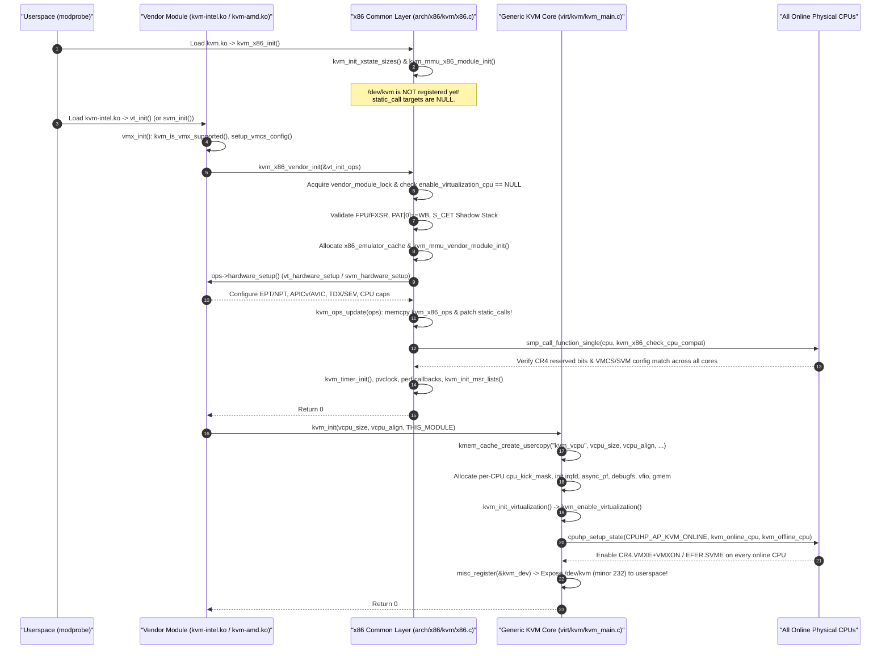

###### 1.3.2.1.1 Line-by-Line Walkthrough of `kvm_x86_vendor_init()` and `kvm_init()`

Let us now examine the exact C implementation of `kvm_x86_vendor_init()` in [`arch/x86/kvm/x86.c`](https://kernel.googlesource.com/pub/scm/virt/kvm/kvm.git/+/refs/heads/master/arch/x86/kvm/x86.c#L6999-L7155) and `kvm_init()` in [`virt/kvm/kvm_main.c`](https://kernel.googlesource.com/pub/scm/virt/kvm/kvm.git/+/refs/heads/master/virt/kvm/kvm_main.c#L6510-L6595). Every check in these two functions encodes a hard-earned lesson from production hardware errata or kernel security hardening:

```c
// Source: arch/x86/kvm/x86.c (lines 6999-7155)
int kvm_x86_vendor_init(struct kvm_x86_init_ops *ops)
{
	u64 host_pat;
	int r, cpu;

	guard(mutex)(&vendor_module_lock);

	if (kvm_x86_ops.enable_virtualization_cpu) {
		pr_err("already loaded vendor module '%s'\n", kvm_x86_ops.name);
		return -EEXIST;
	}

	/*
	 * KVM explicitly assumes that the guest has an FPU and
	 * FXSAVE/FXRSTOR. For example, the KVM_GET_FPU explicitly casts the
	 * vCPU's FPU state as a fxregs_state struct.
	 */
	if (!boot_cpu_has(X86_FEATURE_FPU) || !boot_cpu_has(X86_FEATURE_FXSR)) {
		pr_err("inadequate fpu\n");
		return -EOPNOTSUPP;
	}

	if (IS_ENABLED(CONFIG_PREEMPT_RT) && !boot_cpu_has(X86_FEATURE_CONSTANT_TSC)) {
		pr_err("RT requires X86_FEATURE_CONSTANT_TSC\n");
		return -EOPNOTSUPP;
	}

	/*
	 * KVM assumes that PAT entry '0' encodes WB memtype and simply zeroes
	 * the PAT bits in SPTEs.  Bail if PAT[0] is programmed to something
	 * other than WB.  Note, EPT doesn't utilize the PAT, but don't bother
	 * with an exception.  PAT[0] is set to WB on RESET and also by the
	 * kernel, i.e. failure indicates a kernel bug or broken firmware.
	 */
	if (rdmsrq_safe(MSR_IA32_CR_PAT, &host_pat) ||
	    (host_pat & GENMASK(2, 0)) != 6) {
		pr_err("host PAT[0] is not WB\n");
		return -EIO;
	}

	if (boot_cpu_has(X86_FEATURE_SHSTK) || boot_cpu_has(X86_FEATURE_IBT)) {
		rdmsrq(MSR_IA32_S_CET, kvm_host.s_cet);
		/*
		 * Linux doesn't yet support supervisor shadow stacks (SSS), so
		 * KVM doesn't save/restore the associated MSRs, i.e. KVM may
		 * clobber the host values.  Yell and refuse to load if SSS is
		 * unexpectedly enabled, e.g. to avoid crashing the host.
		 */
		if (WARN_ON_ONCE(kvm_host.s_cet & CET_SHSTK_EN))
			return -EIO;
	}

	memset(&kvm_caps, 0, sizeof(kvm_caps));

	x86_emulator_cache = kvm_alloc_emulator_cache();
	if (!x86_emulator_cache) {
		pr_err("failed to allocate cache for x86 emulator\n");
		return -ENOMEM;
	}

	r = kvm_mmu_vendor_module_init();
	if (r)
		goto out_free_x86_emulator_cache;
...
	r = ops->hardware_setup();
	if (r != 0)
		goto out_mmu_exit;

	kvm_setup_efer_caps();

	enable_device_posted_irqs &= enable_apicv &&
				     irq_remapping_cap(IRQ_POSTING_CAP);

	kvm_ops_update(ops);

	for_each_online_cpu(cpu) {
		smp_call_function_single(cpu, kvm_x86_check_cpu_compat, &r, 1);
		if (r < 0)
			goto out_unwind_ops;
	}

	/*
	 * Point of no return!  DO NOT add error paths below this point unless
	 * absolutely necessary, as most operations from this point forward
	 * require unwinding.
	 */
	kvm_timer_init();
```

Let us dissect each stage of `kvm_x86_vendor_init()`:
1. **Single-Vendor Mutual Exclusion (`lines 7004–7009`):**
   Using the C cleanup attribute helper `guard(mutex)(&vendor_module_lock)`, KVM serializes vendor module initialization. It then checks `if (kvm_x86_ops.enable_virtualization_cpu)`. Why can only one vendor module attach at a time? Because `kvm.ko` has a single global `struct kvm_x86_ops kvm_x86_ops` and a single set of `static_call` call sites patched directly into `kvm.ko`'s executable text! Even if a synthetic environment (such as a weird QEMU CPU model advertising both VMX and SVM flags) tried to load both `kvm-intel.ko` and `kvm-amd.ko` simultaneously, the second module is immediately rejected with `-EEXIST`. Notice that `kvm_x86_ops.enable_virtualization_cpu` serves as the canonical sentinel indicating whether a vendor module is currently bound; on failure (`out_unwind_ops`, line 7147) or unload (`kvm_x86_vendor_exit()`, line 7187), KVM explicitly resets `kvm_x86_ops.enable_virtualization_cpu = NULL`.
2. **Architectural Invariant Checks (`lines 7016–7049`):**
   * **FPU & FXSR (`lines 7016–7019`):** KVM's `KVM_GET_FPU` / `KVM_SET_FPU` UAPI casts the guest FPU buffer directly to `struct fxregs_state`, so a processor lacking `X86_FEATURE_FPU` or `X86_FEATURE_FXSR` is rejected.
   * **Real-Time Kernel TSC Requirement (`lines 7021–7024`):** Under `CONFIG_PREEMPT_RT`, KVM cannot rely on variable-frequency TSC compensation heuristics; it requires `X86_FEATURE_CONSTANT_TSC`.
   * **Page Attribute Table `PAT[0] == WB` Check (`lines 7033–7037`):** When KVM constructs Shadow Page Table Entries (SPTEs) for AMD NPT or shadow paging, it leaves the PAT index bits (`PWT`, `PCD`, `PAT`) zeroed, relying on `MSR_IA32_CR_PAT` entry 0 (`host_pat & GENMASK(2, 0)`) encoding Write-Back (`6`). If broken firmware reprogrammed `PAT[0]` to Uncacheable (`0`), guest memory performance would collapse or cause aliasing bugs, so KVM aborts with `-EIO`.
   * **CET Supervisor Shadow Stack Guard (`lines 7039–7049`):** KVM snapshots `MSR_IA32_S_CET` into `kvm_host.s_cet`. Because Linux does not yet support Supervisor Shadow Stacks (`CET_SHSTK_EN`), KVM does not save/restore the supervisor shadow stack pointer MSRs on VM-Exit; if `CET_SHSTK_EN` were unexpectedly active in `MSR_IA32_S_CET`, running a guest that uses CET would corrupt the host kernel's shadow stack and panic the host.
3. **Hardware Setup, Static Call Patching, and Cross-CPU Compatibility (`lines 7088–7103`):**
   After allocating `x86_emulator_cache` and calling `kvm_mmu_vendor_module_init()`, KVM invokes `ops->hardware_setup()` (which configures EPT/NPT, capabilities, and vendor structures), followed by `kvm_ops_update(ops)` (which copies `ops->runtime_ops` into `kvm_x86_ops` and rewrites all `static_call` sites, as we will detail in Section 1.4). Immediately afterward, KVM iterates over every online CPU (`for_each_online_cpu(cpu)`) and issues a synchronous Inter-Processor Interrupt via `smp_call_function_single(cpu, kvm_x86_check_cpu_compat, &r, 1)`. On each physical core, `kvm_x86_check_processor_compatibility()` verifies that:
   * `__cr4_reserved_bits(cpu_has, c)` matches the boot CPU (`&boot_cpu_data`); and
   * `kvm_x86_call(check_processor_compatibility)()` succeeds (on Intel, `vmx_check_processor_compat()` reads all VMCS capability MSRs on that core and `memcmp`s them word-for-word against the reference `vmcs_config`, dumping any mismatched 32-bit offset if asymmetrical stepping CPUs are installed in a multi-socket server!).

Once `kvm_x86_vendor_init()` returns `0` to `vt_init()` or `svm_init()`, the vendor module calls `kvm_init()` in [`virt/kvm/kvm_main.c`](https://kernel.googlesource.com/pub/scm/virt/kvm/kvm.git/+/refs/heads/master/virt/kvm/kvm_main.c#L6510-L6576):

```c
// Source: virt/kvm/kvm_main.c (lines 6510-6576)
int kvm_init(unsigned vcpu_size, unsigned vcpu_align, struct module *module)
{
	int r;
	int cpu;

	/* A kmem cache lets us meet the alignment requirements of fx_save. */
	if (!vcpu_align)
		vcpu_align = __alignof__(struct kvm_vcpu);
	kvm_vcpu_cache =
		kmem_cache_create_usercopy("kvm_vcpu", vcpu_size, vcpu_align,
					   SLAB_ACCOUNT,
					   offsetof(struct kvm_vcpu, arch),
					   offsetofend(struct kvm_vcpu, stats_id)
					   - offsetof(struct kvm_vcpu, arch),
					   NULL);
	if (!kvm_vcpu_cache)
		return -ENOMEM;

	for_each_possible_cpu(cpu) {
		if (!alloc_cpumask_var_node(&per_cpu(cpu_kick_mask, cpu),
					    GFP_KERNEL, cpu_to_node(cpu))) {
			r = -ENOMEM;
			goto err_cpu_kick_mask;
		}
	}

	r = kvm_irqfd_init();
	if (r)
		goto err_irqfd;

	r = kvm_async_pf_init();
	if (r)
		goto err_async_pf;

	kvm_chardev_ops.owner = module;
	kvm_vm_fops.owner = module;
	kvm_vcpu_fops.owner = module;
	kvm_device_fops.owner = module;

	kvm_preempt_ops.sched_in = kvm_sched_in;
	kvm_preempt_ops.sched_out = kvm_sched_out;

	kvm_init_debug();

	r = kvm_vfio_ops_init();
	if (WARN_ON_ONCE(r))
		goto err_vfio;

	r = kvm_gmem_init(module);
	if (r)
		goto err_gmem;

	r = kvm_init_virtualization();
	if (r)
		goto err_virt;

	/*
	 * Registration _must_ be the very last thing done, as this exposes
	 * /dev/kvm to userspace, i.e. all infrastructure must be setup!
	 */
	r = misc_register(&kvm_dev);
	if (r) {
		pr_err("kvm: misc device register failed\n");
		goto err_register;
	}

	return 0;
```

Look closely at three critical details in `kvm_init()`:
1. **Hardened Usercopy Slab Creation (`lines 6518–6524`):**
   `kvm_vcpu_cache` is created using `kmem_cache_create_usercopy("kvm_vcpu", vcpu_size, vcpu_align, SLAB_ACCOUNT, offsetof(struct kvm_vcpu, arch), offsetofend(struct kvm_vcpu, stats_id) - offsetof(struct kvm_vcpu, arch), NULL)`. Why `kmem_cache_create_usercopy` instead of `kmem_cache_create`? Under `CONFIG_HARDENED_USERCOPY`, the kernel forbids `copy_to_user()` / `copy_from_user()` directly into or out of slab objects unless the specific byte range is whitelisted when the slab cache is created. KVM copies register state and `stats_id` between `vcpu->arch` / `vcpu->stats_id` and userspace buffers during `ioctl` handling, while strictly protecting the generic control fields before `arch` (such as `vcpu->kvm`, `vcpu->preempt_notifier`, and `vcpu->mutex`) and the vendor-specific tail after `stats_id` (such as `vmcs01` or `vmcb01` pointers) from any direct `copy_to_user` / `copy_from_user` bug!
2. **Module Reference Ownership Transfer (`lines 6544–6547` and `6558`):**
   Even though `kvm_chardev_ops`, `kvm_vm_fops`, `kvm_vcpu_fops`, `kvm_device_fops`, and `kvm_gmem_fops` are defined inside `kvm.ko` (`virt/kvm/kvm_main.c` and `virt/kvm/guest_memfd.c`), `kvm_init()` sets their `.owner` field to `module`—which is `THIS_MODULE` passed by `vt_init()` (`kvm-intel.ko`) or `svm_init()` (`kvm-amd.ko`)! Why? Because `kvm-intel.ko` / `kvm-amd.ko` already depends on `kvm.ko` at the module loader level (so `kvm.ko` cannot be unloaded while `kvm-intel.ko` is loaded). By setting `.owner = THIS_MODULE` (the vendor module), opening `/dev/kvm` or holding a VM/vCPU/gmem file descriptor increments the reference count of `kvm-intel.ko` (or `kvm-amd.ko`), preventing `rmmod kvm-intel` while any virtual machine FD is open!
3. **The `/dev/kvm` Publication Ordering Invariant (`line 6570`):**
   `misc_register(&kvm_dev)` is executed as the **very last statement** in `kvm_init()`. The instant `misc_register(&kvm_dev)` returns, `udev` creates `/dev/kvm` (character device major `10`, minor `232`, `KVM_MINOR`) and userspace VMMs can immediately call `open("/dev/kvm", O_RDWR)` and `ioctl(fd, KVM_CREATE_VM, 0)`. Every slab cache, per-CPU kick mask, `static_call` target, and hardware virtualization state must be 100% initialized before line 6570.

---

### 1.4 Zero-Overhead Polymorphism via `kvm-x86-ops.h` and Linux `static_call`

In `arch/x86/kvm/`, the common x86 virtualization logic (`x86.c`, `mmu/mmu.c`, `lapic.c`, `irq.c`) invokes vendor-specific hooks—such as reading a guest register, updating an exception bitmap, flushing a TLB, or entering the guest (`vcpu_run`)—dozens of times during a single VM-Exit/VM-Entry cycle.

#### 1.4.1 The Microarchitectural Cost of Indirect Calls in a Post-Spectre World

In the early years of KVM, invoking a vendor hook meant dereferencing a function pointer inside the global `struct kvm_x86_ops` table:

```c
/* Legacy pre-static_call invocation pattern */
kvm_x86_ops.vcpu_run(vcpu);
```

At the assembly level on x86-64, a function pointer dereference compiles to an **indirect `CALL`** instruction (e.g., `call *kvm_x86_ops+0x210(%rip)` or `mov kvm_x86_ops+0x210(%rip), %rax; call *%rax`). Prior to 2018, an indirect call whose target remained constant (`vmx_vcpu_run` on an Intel host, `svm_vcpu_run` on an AMD host) was predicted with near-100% accuracy by the CPU's Branch Target Buffer (BTB) and cost only 1–2 clock cycles.

Then came **Spectre Variant 2 (Branch Target Injection, CVE-2017-5715)** in January 2018. Because an untrusted guest VM shares the physical CPU core's branch predictors with the host kernel, a malicious guest could poison the BTB prior to triggering a VM-Exit, steering speculative execution of indirect `CALL`/`JMP` instructions inside `kvm.ko` to arbitrary gadgets in host kernel memory.

To mitigate Spectre v2, Linux introduced **Retpolines (`CONFIG_MITIGATION_RETPOLINE`)** (and later, Indirect Branch Restricted Speculation `IBRS`/`eIBRS` and CET Indirect Branch Tracking `IBT`). Under Retpoline, the compiler replaces every indirect `CALL *%rax` with a call to a thunk (`__x86_indirect_thunk_rax`) that deliberately traps speculative execution in an infinite `pause; lfence` loop while overwriting the stack return address and executing a `RET` instruction to jump to `%rax`. On a tight VM-Exit hot path where `kvm_x86_ops` hooks are invoked 15 to 40 times per exit, Retpolines added **hundreds of clock cycles of pure overhead to every single VM-Exit**—all for function pointers that **never change** once `kvm-intel.ko` or `kvm-amd.ko` is loaded!

#### 1.4.2 The X-Macro Architecture of `arch/x86/include/asm/kvm-x86-ops.h`

To eliminate indirect function calls completely from `arch/x86/kvm/` while preserving the clean modularity between `kvm.ko` and `kvm-intel.ko`/`kvm-amd.ko`, KVM uses the Linux kernel's **`static_call` infrastructure (`include/linux/static_call.h`)** driven by an X-Macro header file: [`arch/x86/include/asm/kvm-x86-ops.h`](https://kernel.googlesource.com/pub/scm/virt/kvm/kvm.git/+/refs/heads/master/arch/x86/include/asm/kvm-x86-ops.h).

Let us inspect the structure of [`arch/x86/include/asm/kvm-x86-ops.h`](https://kernel.googlesource.com/pub/scm/virt/kvm/kvm.git/+/refs/heads/master/arch/x86/include/asm/kvm-x86-ops.h#L1-L35):

```c
// Source: arch/x86/include/asm/kvm-x86-ops.h (lines 1-35, 66-72, 162-165)
#if !defined(KVM_X86_OP) || \
    !defined(KVM_X86_OP_OPTIONAL) || \
    !defined(KVM_X86_OP_OPTIONAL_RET0)
#error Missing one or more KVM_X86_OP #defines
#else
/*
 * KVM_X86_OP() and KVM_X86_OP_OPTIONAL() are used to help generate
 * both DECLARE/DEFINE_STATIC_CALL() invocations and
 * "static_call_update()" calls.
 *
 * KVM_X86_OP_OPTIONAL() can be used for those functions that can have
 * a NULL definition.  KVM_X86_OP_OPTIONAL_RET0() can be used likewise
 * to make a definition optional, but in this case the default will
 * be __static_call_return0.
 */
KVM_X86_OP(check_processor_compatibility)
KVM_X86_OP(enable_virtualization_cpu)
KVM_X86_OP(disable_virtualization_cpu)
KVM_X86_OP(hardware_unsetup)
KVM_X86_OP(has_emulated_msr)
KVM_X86_OP(vcpu_after_set_cpuid)
KVM_X86_OP(vm_init)
KVM_X86_OP_OPTIONAL(vm_destroy)
KVM_X86_OP_OPTIONAL(vm_pre_destroy)
KVM_X86_OP_OPTIONAL_RET0(vcpu_precreate)
KVM_X86_OP(vcpu_create)
...
KVM_X86_OP_OPTIONAL_RET0(vcpu_needs_initialization)
KVM_X86_OP(vcpu_run)
KVM_X86_OP(handle_exit)
KVM_X86_OP(skip_emulated_instruction)
KVM_X86_OP_OPTIONAL(update_emulated_instruction)
KVM_X86_OP_OPTIONAL_RET0(unhandleable_emulation_required)
...
#endif

#undef KVM_X86_OP
#undef KVM_X86_OP_OPTIONAL
#undef KVM_X86_OP_OPTIONAL_RET0
```

Notice that `arch/x86/include/asm/kvm-x86-ops.h` has **no `#ifndef` include guard**! Instead, it requires the includer to `#define` three macros—`KVM_X86_OP`, `KVM_X86_OP_OPTIONAL`, and `KVM_X86_OP_OPTIONAL_RET0`—and automatically `#undef`s them at the bottom of the file. This allows KVM to `#include <asm/kvm-x86-ops.h>` at **three distinct locations** in the codebase:

1. **Expansion Site 1 — Declarations in [`arch/x86/include/asm/kvm_host.h:1796–1802`](https://kernel.googlesource.com/pub/scm/virt/kvm/kvm.git/+/refs/heads/master/arch/x86/include/asm/kvm_host.h#L1796-L1802):**
   ```c
   // Source: arch/x86/include/asm/kvm_host.h (lines 1796-1802)
   #define kvm_x86_call(func) static_call(kvm_x86_##func)

   #define KVM_X86_OP(func) \
   	DECLARE_STATIC_CALL(kvm_x86_##func, *(((struct kvm_x86_ops *)0)->func));
   #define KVM_X86_OP_OPTIONAL KVM_X86_OP
   #define KVM_X86_OP_OPTIONAL_RET0 KVM_X86_OP
   #include <asm/kvm-x86-ops.h>
   ```
   Look at the clever C type-extraction expression `*(((struct kvm_x86_ops *)0)->func)`: without ever evaluating a null pointer at runtime (because `DECLARE_STATIC_CALL` uses `typeof()`), it extracts the exact C function prototype of member `func` inside `struct kvm_x86_ops` and declares a typed static call named `kvm_x86_<func>`.

2. **Expansion Site 2 — Definitions in [`arch/x86/kvm/x86.c:168–176`](https://kernel.googlesource.com/pub/scm/virt/kvm/kvm.git/+/refs/heads/master/arch/x86/kvm/x86.c#L168-L176):**
   ```c
   // Source: arch/x86/kvm/x86.c (lines 168-176)
   #define KVM_X86_OP(func)					     \
   	DEFINE_STATIC_CALL_NULL(kvm_x86_##func,			     \
   				*(((struct kvm_x86_ops *)0)->func));
   #define KVM_X86_OP_OPTIONAL KVM_X86_OP
   #define KVM_X86_OP_OPTIONAL_RET0 KVM_X86_OP
   #include <asm/kvm-x86-ops.h>
   EXPORT_STATIC_CALL_GPL(kvm_x86_get_cs_db_l_bits);
   EXPORT_STATIC_CALL_GPL(kvm_x86_cache_reg);
   EXPORT_STATIC_CALL_GPL(kvm_x86_get_cpl);
   ```
   When `kvm.ko` is compiled, this expansion generates the actual `struct static_call_key` and default NULL trampoline in `.static_call.text` for every single operation in `kvm-x86-ops.h`.

3. **Expansion Site 3 — Runtime Code Patching in `kvm_ops_update()` ([`arch/x86/kvm/x86.c:6954–6972`](https://kernel.googlesource.com/pub/scm/virt/kvm/kvm.git/+/refs/heads/master/arch/x86/kvm/x86.c#L6954-L6972)):**
   ```c
   // Source: arch/x86/kvm/x86.c (lines 6954-6972)
   static inline void kvm_ops_update(struct kvm_x86_init_ops *ops)
   {
   	memcpy(&kvm_x86_ops, ops->runtime_ops, sizeof(kvm_x86_ops));

   #define __KVM_X86_OP(func) \
   	static_call_update(kvm_x86_##func, kvm_x86_ops.func);
   #define KVM_X86_OP(func) \
   	WARN_ON(!kvm_x86_ops.func); __KVM_X86_OP(func)
   #define KVM_X86_OP_OPTIONAL __KVM_X86_OP
   #define KVM_X86_OP_OPTIONAL_RET0(func) \
   	static_call_update(kvm_x86_##func, (void *)kvm_x86_ops.func ? : \
   					   (void *)__static_call_return0);
   #include <asm/kvm-x86-ops.h>
   #undef __KVM_X86_OP

   	kvm_nested_ops_update(ops->nested_ops);

   	kvm_pmu_ops_update(ops->pmu_ops);
   }
   ```

##### 1.4.2.1 Static Call Trampolines, Inline Call-Site Patching, and `__static_call_return0`

How does `static_call` actually work under the hood on x86-64? Let us trace [`include/linux/static_call.h`](https://kernel.googlesource.com/pub/scm/virt/kvm/kvm.git/+/refs/heads/master/include/linux/static_call.h) and [`arch/x86/include/asm/static_call.h`](https://kernel.googlesource.com/pub/scm/virt/kvm/kvm.git/+/refs/heads/master/arch/x86/include/asm/static_call.h):

1. When `DEFINE_STATIC_CALL_NULL(kvm_x86_vcpu_run, ...)` is compiled in `arch/x86/kvm/x86.c`, [`arch/x86/include/asm/static_call.h:34–55`](https://kernel.googlesource.com/pub/scm/virt/kvm/kvm.git/+/refs/heads/master/arch/x86/include/asm/static_call.h#L34-L55) emits an 8-byte assembly trampoline in the `.static_call.text` section named `__SCT__kvm_x86_vcpu_run`:
   ```c
   // Source: arch/x86/include/asm/static_call.h (lines 34-55)
   #define __ARCH_DEFINE_STATIC_CALL_TRAMP(name, insns)			\
   	asm(".pushsection .static_call.text, \"ax\"		\n"	\
   	    ".align 4						\n"	\
   	    ".globl " STATIC_CALL_TRAMP_STR(name) "		\n"	\
   	    STATIC_CALL_TRAMP_STR(name) ":			\n"	\
   	    ANNOTATE_NOENDBR "					\n"	\
   	    insns "						\n"	\
   	    ".byte 0x0f, 0xb9, 0xcc				\n"	\
   	    ".type " STATIC_CALL_TRAMP_STR(name) ", @function	\n"	\
   	    ".size " STATIC_CALL_TRAMP_STR(name) ", . - " STATIC_CALL_TRAMP_STR(name) " \n" \
   	    ".popsection					\n")
   ```
   Initially, for `DEFINE_STATIC_CALL_NULL`, `insns` is either `ret; int3; nop; nop; nop` (5 bytes) or `jmp __x86_return_thunk` (5 bytes when `CONFIG_MITIGATION_RETHUNK` is enabled), followed by the 3-byte `ud1 %esp, %ecx` instruction (`.byte 0x0f, 0xb9, 0xcc`), which acts both as a speculative execution barrier and a magic 3-byte signature that `objtool` and `__static_call_fixup()` use to verify that an address is a genuine static call trampoline.
2. Everywhere `kvm.ko` invokes `kvm_x86_call(vcpu_run)(vcpu, run_flags)`, the C compiler emits a standard 5-byte relative direct call instruction (`e8 <disp32>`) targeting the trampoline symbol `__SCT__kvm_x86_vcpu_run`.
3. During the kernel build, `objtool` scans the object files of `kvm.ko`, locates every `call __SCT__kvm_x86_*` or tail-call `jmp __SCT__kvm_x86_*` instruction, and records their exact instruction addresses in the `.static_call_sites` ELF section (`CONFIG_HAVE_STATIC_CALL_INLINE`).

###### 1.4.2.1.1 Byte-Level Code Patching Walkthrough of `kvm_ops_update()` and `kvm_x86_call()`

When `kvm-intel.ko` (or `kvm-amd.ko`) loads and calls `kvm_x86_vendor_init()`, `kvm_ops_update(ops)` executes `static_call_update(kvm_x86_<func>, ...)` for all ~130 operations in `kvm-x86-ops.h`, plus all nested operations in `kvm-x86-nested-ops.h` and PMU operations in `pmu_ops`.

Under `CONFIG_HAVE_STATIC_CALL_INLINE` (standard on x86-64), `__static_call_update()` walks the linked list of `.static_call_sites` in `kvm.ko` and uses `arch_static_call_transform()` (`text_poke_bp()`) to **rewrite the 5-byte machine instruction at every single call site in `kvm.ko`'s executable `.text` segment**:

```
Byte-Level x86-64 Instruction Patching by kvm_ops_update() (arch_static_call_transform):
========================================================================================

Case 1: Mandatory Hook — KVM_X86_OP(vcpu_run)
---------------------------------------------
C Source in x86.c:
    exit_fastpath = kvm_x86_call(vcpu_run)(vcpu, run_flags);

  [Before Vendor Module Load (Compiled in kvm.ko)]
    0xffffffffc0a14210:  e8 eb bd 08 00        call   __SCT__kvm_x86_vcpu_run (Trampoline)

  [After modprobe kvm-intel (Patched in-place by static_call_update)]
    0xffffffffc0a14210:  e8 6b 3e 21 00        call   vt_vcpu_run (or vmx_vcpu_run)
                         ^^ ^^^^^^^^^^^
                         |  32-bit signed PC-relative displacement directly into kvm-intel.ko!
                         Direct near CALL (0xe8) — ZERO indirect branch, ZERO Retpoline!


Case 2: Optional Void Hook — KVM_X86_OP_OPTIONAL(update_emulated_instruction)
-----------------------------------------------------------------------------
C Source in x86.c:
    static_call_cond(kvm_x86_update_emulated_instruction)(vcpu);

  [After modprobe kvm-intel (vt_x86_ops.update_emulated_instruction == vmx_update_emulated_instruction)]
    0xffffffffc0a09140:  e8 2b 1f 22 00        call   vmx_update_emulated_instruction

  [After modprobe kvm-amd (svm_x86_ops.update_emulated_instruction == NULL)]
    0xffffffffc0a09140:  0f 1f 44 00 00        nopl   0x0(%rax,%rax,1)
                         ^^^^^^^^^^^^^^
                         5-byte architectural NOP! The function call disappears completely!


Case 3: Optional Return-0 Hook — KVM_X86_OP_OPTIONAL_RET0(vcpu_precreate)
-------------------------------------------------------------------------
C Source in x86.c:
    r = kvm_x86_call(vcpu_precreate)(kvm);

  [After modprobe kvm-amd when AVIC is disabled (svm_x86_ops.vcpu_precreate == NULL)]
  kvm_ops_update() substitutes __static_call_return0, and x86_64 inline patching writes:
    0xffffffffc0a0b880:  66 66 31 c0           data16 data16 xor %eax, %eax  (or call __static_call_return0)
                         ^^^^^^^^^^^^^^^
                         5-byte inline %rax zeroing! Returns 0 in 1 cycle with no CALL/RET!
```

Wait—if `kvm_ops_update()` patches all `static_call` sites to jump directly to the target functions in `kvm-intel.ko` or `kvm-amd.ko`, why does line 6956 of [`arch/x86/kvm/x86.c`](https://kernel.googlesource.com/pub/scm/virt/kvm/kvm.git/+/refs/heads/master/arch/x86/kvm/x86.c#L6956) still execute:
```c
memcpy(&kvm_x86_ops, ops->runtime_ops, sizeof(kvm_x86_ops));
```
There are two reasons why `struct kvm_x86_ops kvm_x86_ops __read_mostly` is still populated at runtime:
1. **Data Constants Stored in `kvm_x86_ops`:** Look back at `struct kvm_x86_ops` in [`arch/x86/include/asm/kvm_host.h`](https://kernel.googlesource.com/pub/scm/virt/kvm/kvm.git/+/refs/heads/master/arch/x86/include/asm/kvm_host.h#L1505-L1742): alongside function pointers, `kvm_x86_ops` also stores vendor data fields such as `.name` (`"kvm_intel"` or `"kvm_amd"`), `.vm_size` (`sizeof(struct kvm_vmx)` / `sizeof(struct kvm_tdx)` / `sizeof(struct kvm_svm)`), `.HOST_OWNED_DEBUGCTL`, `.x2apic_icr_is_split`, `.required_apicv_inhibits`, and `.emergency_disable_virtualization_cpu`.
2. **Presence Checks on Optional Hooks:** In several places in `arch/x86/kvm/x86.c` (such as `kvm_vm_ioctl_check_extension()` checking `if (kvm_x86_ops.enable_l2_tlb_flush)` at line 2370 or `if (!kvm_x86_ops.mem_enc_ioctl)` at line 4676), KVM tests whether the vendor module supports a feature by checking whether the corresponding function pointer in `kvm_x86_ops` is non-NULL before invoking `kvm_x86_call(...)`! Moreover, because `vt_x86_ops` and `svm_x86_ops` are marked `__initdata` in `kvm-intel.ko` and `kvm-amd.ko` (so their memory is freed by the kernel after `vt_init()` / `svm_init()` finishes), copying the structure into `kvm.ko`'s `__read_mostly` `kvm_x86_ops` preserves those non-NULL indicators and constants for the lifetime of the vendor module while freeing the `__initdata` pages.

---

### 1.5 Per-CPU Virtualization Hardware Enablement, Hotplug, and Emergency Teardown State Machine

Before any vCPU can execute `VMLAUNCH`/`VMRESUME` on an Intel processor or `VMRUN` on an AMD processor, hardware virtualization must be enabled individually on **every online physical CPU core** in the system. Why every online CPU core rather than only the core where a VM is created? Because the Linux scheduler can migrate a vCPU thread (`struct task_struct`) to any online CPU allowed by its affinity mask at any microsecond! If a vCPU thread were migrated to a physical CPU where `CR4.VMXE` + `VMXON` (or `MSR_EFER.SVME` + `MSR_VM_HSAVE_PA`) had not been initialized, the very first `VMPTRLD` or `VMRUN` instruction on that core would immediately fault (`#UD` or `#GP`), crashing the guest or host.

#### 1.5.1 Generic Virtualization Lifecycle: `enable_virt_at_load`, `kvm_usage_count`, and `kvm_usage_lock`

> [!NOTE]
> **Historical Evolution Note (`hardware_enable_all` $\to$ `kvm_enable_virtualization` & `x86_virt_get_ref`):**
> If you have read older 4.x/5.x/early-6.x Linux kernel guides, you may remember functions named `hardware_enable_all()`, `hardware_disable_all()`, `hardware_enable_nolock()`, and a `cpus_hardware_enabled` cpumask in `virt/kvm/kvm_main.c`. In current upstream KVM ([`virt/kvm/kvm_main.c:5600–5785`](https://kernel.googlesource.com/pub/scm/virt/kvm/kvm.git/+/refs/heads/master/virt/kvm/kvm_main.c#L5600-L5785) and [`arch/x86/include/asm/virt.h`](https://kernel.googlesource.com/pub/scm/virt/kvm/kvm.git/+/refs/heads/master/arch/x86/include/asm/virt.h)), this infrastructure was modernized and unified with the core x86 kernel's virtualization reference counter (`x86_virt_get_ref()` / `x86_virt_put_ref()`)—because subsystems outside KVM (such as the Intel TDX host seamcall layer) also require VMX operation (`CR4.VMXE` + `VMXON`) to be active on physical CPUs!

Let us examine the complete generic hardware enablement state machine in [`virt/kvm/kvm_main.c`](https://kernel.googlesource.com/pub/scm/virt/kvm/kvm.git/+/refs/heads/master/virt/kvm/kvm_main.c#L5600-L5785):

```c
// Source: virt/kvm/kvm_main.c (lines 5600-5662, 5715-5785)
bool __ro_after_init enable_virt_at_load = true;
module_param(enable_virt_at_load, bool, 0444);
EXPORT_SYMBOL_FOR_KVM_INTERNAL(enable_virt_at_load);

static DEFINE_PER_CPU(bool, virtualization_enabled);
static DEFINE_MUTEX(kvm_usage_lock);
static int kvm_usage_count;
...
static int kvm_enable_virtualization_cpu(void)
{
	if (__this_cpu_read(virtualization_enabled))
		return 0;

	if (kvm_arch_enable_virtualization_cpu()) {
		pr_info("kvm: enabling virtualization on CPU%d failed\n",
			raw_smp_processor_id());
		return -EIO;
	}

	__this_cpu_write(virtualization_enabled, true);
	return 0;
}

static int kvm_online_cpu(unsigned int cpu)
{
	/*
	 * Abort the CPU online process if hardware virtualization cannot
	 * be enabled. Otherwise running VMs would encounter unrecoverable
	 * errors when scheduled to this CPU.
	 */
	return kvm_enable_virtualization_cpu();
}

static void kvm_disable_virtualization_cpu(void *ign)
{
	if (!__this_cpu_read(virtualization_enabled))
		return;

	kvm_arch_disable_virtualization_cpu();

	__this_cpu_write(virtualization_enabled, false);
}

static int kvm_offline_cpu(unsigned int cpu)
{
	kvm_disable_virtualization_cpu(NULL);
	return 0;
}
...
static int kvm_enable_virtualization(void)
{
	int r;

	guard(mutex)(&kvm_usage_lock);

	if (kvm_usage_count++)
		return 0;

	kvm_arch_enable_virtualization();

	r = cpuhp_setup_state(CPUHP_AP_KVM_ONLINE, "kvm/cpu:online",
			      kvm_online_cpu, kvm_offline_cpu);
	if (r)
		goto err_cpuhp;

	register_syscore(&kvm_syscore);

	if (system_state == SYSTEM_HALT || system_state == SYSTEM_POWER_OFF ||
	    system_state == SYSTEM_RESTART) {
		r = -EBUSY;
		goto err_rebooting;
	}

	return 0;

err_rebooting:
	unregister_syscore(&kvm_syscore);
	cpuhp_remove_state(CPUHP_AP_KVM_ONLINE);
err_cpuhp:
	kvm_arch_disable_virtualization();
	--kvm_usage_count;
	return r;
}

static void kvm_disable_virtualization(void)
{
	guard(mutex)(&kvm_usage_lock);

	if (--kvm_usage_count)
		return;

	unregister_syscore(&kvm_syscore);
	cpuhp_remove_state(CPUHP_AP_KVM_ONLINE);
	kvm_arch_disable_virtualization();
}

static int kvm_init_virtualization(void)
{
	if (enable_virt_at_load)
		return kvm_enable_virtualization();

	return 0;
}

static void kvm_uninit_virtualization(void)
{
	if (enable_virt_at_load)
		kvm_disable_virtualization();
}
```

Look at the elegance of how `enable_virt_at_load`, `kvm_usage_count`, and `kvm_usage_lock` interact:
* **`enable_virt_at_load = true` (The Default Mode):**
  When `kvm_init()` calls `kvm_init_virtualization()`, because `enable_virt_at_load` is `true` by default, `kvm_enable_virtualization()` is called immediately at module load time. `kvm_usage_count` transitions from `0` to `1`, and hardware virtualization is enabled on all online CPUs before `/dev/kvm` is even registered. When subsequent VMs are created via `kvm_create_vm()` ([`virt/kvm/kvm_main.c:1181`](https://kernel.googlesource.com/pub/scm/virt/kvm/kvm.git/+/refs/heads/master/virt/kvm/kvm_main.c#L1181)), each call to `kvm_enable_virtualization()` simply increments `kvm_usage_count` (`1` $\to$ `2` $\to$ `3`...) and returns `0` in $O(1)$ time without issuing any cross-CPU IPIs! When all VMs are destroyed (`kvm_destroy_vm()`, line 1309), `kvm_usage_count` drops back to `1`, keeping hardware virtualization warm on all cores until the vendor module is unloaded (`kvm_exit()` $\to$ `kvm_uninit_virtualization()`, which drops `kvm_usage_count` from `1` to `0`).
* **`enable_virt_at_load = false` (`kvm.enable_virt_at_load=0` Lazy Mode):**
  If an administrator passes `kvm.enable_virt_at_load=0` on the kernel command line or via `modprobe` (for example, on a laptop or workstation where out-of-tree tools or power-saving states conflict with leaving `VMXON` active when no VMs are running), `kvm_init_virtualization()` does nothing (`kvm_usage_count` remains `0`). When the first VM is created via `kvm_create_vm()`, `kvm_enable_virtualization()` sees `kvm_usage_count++ == 0` and enables virtualization across all online CPUs; when the last VM is destroyed in `kvm_destroy_vm()`, `--kvm_usage_count == 0` triggers `cpuhp_remove_state(CPUHP_AP_KVM_ONLINE)`, which automatically runs `kvm_offline_cpu()` on every online core to execute `VMXOFF` / clear `EFER.SVME`!

#### 1.5.2 CPU Hotplug Integration (`CPUHP_AP_KVM_ONLINE`) and System Power/Reboot Transitions (`kvm_syscore_ops`)

Notice that `kvm_enable_virtualization()` does **not** manually call `on_each_cpu(kvm_enable_virtualization_cpu, ...)`! Instead, it calls a single Linux CPU hotplug state registration function at line 5726:

```c
r = cpuhp_setup_state(CPUHP_AP_KVM_ONLINE, "kvm/cpu:online",
		      kvm_online_cpu, kvm_offline_cpu);
```

Because `cpuhp_setup_state()` (unlike `cpuhp_setup_state_nocalls()`) is used:
1. The Linux CPU hotplug core (`kernel/cpu.c`) acquires the global CPU hotplug lock (`cpus_read_lock()`), iterates over **every currently online CPU**, and invokes `kvm_online_cpu(cpu)` on that CPU's own execution context.
2. If any physical CPU is later dynamically hot-plugged (`echo 1 > /sys/devices/system/cpu/cpuX/online`), the CPU hotplug state machine automatically runs `kvm_online_cpu(cpuX)` during the `CPUHP_AP_KVM_ONLINE` bringup stage—*before* the scheduler is allowed to place any userspace tasks or vCPU threads onto `cpuX`.
3. If `kvm_online_cpu(cpuX)` returns a negative error code (`-EIO` because BIOS forgot to enable `MSR_IA32_FEAT_CTL` on the hot-added socket, or because `vmx_check_processor_compat()` detected incompatible VMCS MSR capabilities on the new CPU), **the Linux kernel aborts bringing `cpuX` online**, rolling it back to offline state so running VMs never crash!
4. Conversely, when a CPU is hot-unplugged (`echo 0 > /sys/devices/system/cpu/cpuX/online`) or when `cpuhp_remove_state(CPUHP_AP_KVM_ONLINE)` is called in `kvm_disable_virtualization()`, the hotplug state machine invokes `kvm_offline_cpu()` on that CPU to VMCLEAR any loaded VMCSs and disable virtualization cleanly before the CPU goes offline.

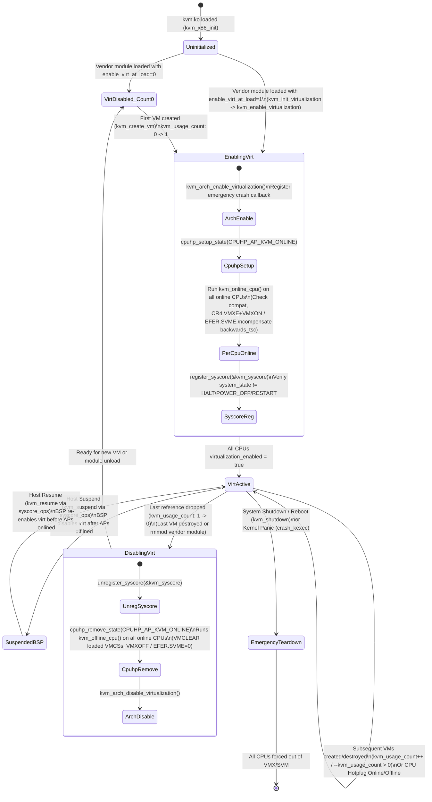

Now examine lines 5731–5748 of `kvm_enable_virtualization()` in [`virt/kvm/kvm_main.c`](https://kernel.googlesource.com/pub/scm/virt/kvm/kvm.git/+/refs/heads/master/virt/kvm/kvm_main.c#L5731-L5748): why does KVM register `kvm_syscore` (`register_syscore(&kvm_syscore)`) and immediately check `if (system_state == SYSTEM_HALT || system_state == SYSTEM_POWER_OFF || system_state == SYSTEM_RESTART)`?
* During normal system suspend-to-RAM (`S3`) or hibernation (`S4`), the kernel freezes userspace tasks, offlines all non-boot Application Processors (APs) via CPU hotplug (which triggers `kvm_offline_cpu()` on every AP!), and then invokes `syscore_suspend()` on the Boot Strap Processor (BSP) with interrupts disabled—which calls `kvm_suspend()` (`line 5680`) to disable virtualization on the BSP before power is cut. Upon wake-up, `syscore_resume()` calls `kvm_resume()` (`line 5697`) on the BSP before the APs are brought back online via `kvm_online_cpu()`.
* During system shutdown or reboot, however, a user might execute an ungraceful forced reboot (`reboot -f`), which does *not* freeze userspace tasks before calling `kernel_restart()` $\to$ `syscore_shutdown()` $\to$ `kvm_shutdown()`. If a concurrent userspace thread was in the middle of `kvm_create_vm()` $\to$ `kvm_enable_virtualization()` on another CPU right after `syscore_shutdown()` finished running, it could re-enable VMX on CPUs right before the kernel jumps to BIOS/UEFI firmware! Because the kernel updates the global `system_state` variable to `SYSTEM_RESTART` / `SYSTEM_HALT` / `SYSTEM_POWER_OFF` *before* invoking `syscore_shutdown()`, registering `kvm_syscore` first and then checking `system_state` guarantees that either `kvm_shutdown()` will see and disable virtualization, or `kvm_enable_virtualization()` will observe the shutdown `system_state` and unwind!

##### 1.5.2.1 Architecture-Specific CPU Enablement: `kvm_arch_enable_virtualization_cpu()`, `x86_virt_get_ref()`, and TSC Backwards Compensation

When `kvm_enable_virtualization_cpu()` in `virt/kvm/kvm_main.c` calls into the x86 architecture layer (`kvm_arch_enable_virtualization_cpu()` in [`arch/x86/kvm/x86.c:9692–9786`](https://kernel.googlesource.com/pub/scm/virt/kvm/kvm.git/+/refs/heads/master/arch/x86/kvm/x86.c#L9692-L9786)), three critical hardware operations take place on the local physical CPU:

```c
// Source: arch/x86/kvm/x86.c (lines 9692-9725, 9764-9786)
int kvm_arch_enable_virtualization_cpu(void)
{
	struct kvm *kvm;
	struct kvm_vcpu *vcpu;
	unsigned long i;
	int ret;
	u64 local_tsc;
	u64 max_tsc = 0;
	bool stable, backwards_tsc = false;

	kvm_user_return_msr_cpu_online();

	ret = kvm_x86_check_processor_compatibility();
	if (ret)
		return ret;

	ret = kvm_x86_call(enable_virtualization_cpu)();
	if (ret != 0)
		return ret;

	local_tsc = rdtsc();
	stable = !kvm_check_tsc_unstable();
	list_for_each_entry(kvm, &vm_list, vm_list) {
		kvm_for_each_vcpu(i, vcpu, kvm) {
			if (!stable && vcpu->cpu == smp_processor_id())
				kvm_make_request(KVM_REQ_CLOCK_UPDATE, vcpu);
			if (stable && vcpu->arch.last_host_tsc > local_tsc) {
				backwards_tsc = true;
				if (vcpu->arch.last_host_tsc > max_tsc)
					max_tsc = vcpu->arch.last_host_tsc;
			}
		}
	}
...
	if (backwards_tsc) {
		u64 delta_cyc = max_tsc - local_tsc;
		list_for_each_entry(kvm, &vm_list, vm_list) {
			kvm->arch.backwards_tsc_observed = true;
			kvm_for_each_vcpu(i, vcpu, kvm) {
				vcpu->arch.tsc_offset_adjustment += delta_cyc;
				vcpu->arch.last_host_tsc = local_tsc;
				kvm_make_request(KVM_REQ_MASTERCLOCK_UPDATE, vcpu);
			}
			kvm->arch.last_tsc_nsec = 0;
			kvm->arch.last_tsc_write = 0;
		}
	}
	return 0;
}
```

Let us trace the three phases of `kvm_arch_enable_virtualization_cpu()`:
1. **User-Return MSR Slot Initialization & Processor Compatibility (`lines 9702–9706`):**
   `kvm_user_return_msr_cpu_online()` snapshots the host CPU's current values of all registered user-return MSRs (such as `MSR_STAR`, `MSR_LSTAR`, `MSR_CSTAR`, `MSR_SYSCALL_MASK`, `MSR_TSC_AUX`, `MSR_IA32_TSX_CTRL`) into the per-CPU `user_return_msrs` array so KVM knows what host values to restore when a vCPU thread returns to host userspace. Then `kvm_x86_check_processor_compatibility()` verifies CR4 reserved bits and VMCS/SVM capability parity on this CPU.
2. **Vendor-Specific Silicon Enablement (`line 9708`, `kvm_x86_call(enable_virtualization_cpu)()`):**
   * **On Intel VMX (`vmx_enable_virtualization_cpu()` in [`arch/x86/kvm/vmx/vmx.c:3009–3021`](https://kernel.googlesource.com/pub/scm/virt/kvm/kvm.git/+/refs/heads/master/arch/x86/kvm/vmx/vmx.c#L3009-L3021)):**
     ```c
     int vmx_enable_virtualization_cpu(void)
     {
     	int cpu = raw_smp_processor_id();

     	if (kvm_is_using_evmcs() && !hv_get_vp_assist_page(cpu))
     		return -EFAULT;

     	return x86_virt_get_ref(X86_FEATURE_VMX);
     }
     ```
     `x86_virt_get_ref(X86_FEATURE_VMX)` increments the per-CPU hardware virtualization reference count on `cpu`; on the `0` $\to$ `1` transition, the core x86 virtualization layer sets `CR4.VMXE = 1` (`cr4_set_bits(X86_CR4_VMXE)`) and executes `VMXON` using the per-CPU 4 KiB VMXON region physical address!
   * **On AMD SVM (`svm_enable_virtualization_cpu()` in [`arch/x86/kvm/svm/svm.c:562–601`](https://kernel.googlesource.com/pub/scm/virt/kvm/kvm.git/+/refs/heads/master/arch/x86/kvm/svm/svm.c#L562-L601)):**
     ```c
     static int svm_enable_virtualization_cpu(void)
     {
     	struct svm_cpu_data *sd;
     	int me = raw_smp_processor_id();
     	int r;

     	r = x86_virt_get_ref(X86_FEATURE_SVM);
     	if (r)
     		return r;

     	sd = per_cpu_ptr(&svm_data, me);
     	sd->asid_generation++;
     	sd->max_asid = cpuid_ebx(SVM_CPUID_FUNC) - 1;
     	sd->next_asid = sd->max_asid + 1;
     	sd->min_asid = max_sev_asid + 1;

     	wrmsrq(MSR_VM_HSAVE_PA, sd->save_area_pa);
     ...
     ```
     Here, `x86_virt_get_ref(X86_FEATURE_SVM)` sets `MSR_EFER.SVME = 1`. Then `svm_enable_virtualization_cpu()` increments `sd->asid_generation++` (forcing any vCPU that previously ran on this CPU to flush and allocate a fresh Address Space Identifier `ASID` so stale TLB tags cannot collide), programs the physical address of the per-CPU 4 KiB Host Save Area (`sd->save_area_pa`) into `MSR_VM_HSAVE_PA` (`0xc0010117`), resets `MSR_AMD64_TSC_RATIO` to `SVM_TSC_RATIO_DEFAULT`, and enables AMD PMU virtualization (`amd_pmu_enable_virt()`).
3. **Backwards TSC Compensation Across Suspend/Hibernate Cycles (`lines 9712–9784`):**
   Even on CPUs with a constant, invariant Time Stamp Counter (`!kvm_check_tsc_unstable()`), suspending the host to S3 RAM or S4 hibernate resets the hardware `TSC` counter back to `0` when the host resumes! When `kvm_arch_enable_virtualization_cpu()` runs during resume/bringup, it reads `local_tsc = rdtsc()` and scans every vCPU of every VM in `vm_list`. If any vCPU recorded a `vcpu->arch.last_host_tsc > local_tsc` before suspend, `backwards_tsc` is detected! KVM computes `delta_cyc = max_tsc - local_tsc`, adds `delta_cyc` to `vcpu->arch.tsc_offset_adjustment` for every vCPU, resets `vcpu->arch.last_host_tsc = local_tsc` (so subsequent CPUs coming online in the same resume cycle do not add `delta_cyc` a second time), and raises `KVM_REQ_MASTERCLOCK_UPDATE` so guest clocks never jump backward!

###### 1.5.2.1.1 Shutdown Synchronization (`virt_rebooting`, `smp_wmb()`) and `crash_kexec` Emergency Virtualization Teardown

What happens when the host machine reboots or suffers a fatal kernel panic (`crash_kexec` into a `kdump` capture kernel)? This is one of the sharpest microarchitectural edge cases in x86 systems programming:

1. **Why VMX Must Be Disabled Before Firmware Reboot (`INIT` Signal Blocking):**
   According to the Intel 64 and IA-32 Architectures Software Developer's Manual (Volume 3C, *"VMXON — Enter VMX Operation"*), **while a logical processor is in VMX operation (`VMXON` has been executed and `VMXOFF` has not), `INIT` signals (Inter-Processor Interrupts with delivery mode `INIT`) are blocked** in VMX root operation! When the host kernel transfers control to BIOS/UEFI firmware to reboot the machine, or when the bootstrap processor attempts to reset secondary Application Processors using `INIT`+`SIPI` IPIs, any CPU still in VMX root operation will completely ignore the `INIT` signal, hanging the physical server during reboot!
2. **Normal/Forced Reboot Synchronization via `virt_rebooting` and `smp_wmb()` ([`arch/x86/kvm/x86.c:9788–9825`](https://kernel.googlesource.com/pub/scm/virt/kvm/kvm.git/+/refs/heads/master/arch/x86/kvm/x86.c#L9788-L9825)):**
   Let us inspect `kvm_arch_shutdown()` and `kvm_arch_disable_virtualization_cpu()`:
   ```c
   // Source: arch/x86/kvm/x86.c (lines 9788-9825)
   void kvm_arch_shutdown(void)
   {
   	/*
   	 * Set virt_rebooting to indicate that KVM has asynchronously disabled
   	 * hardware virtualization, i.e. that errors and/or exceptions on SVM
   	 * and VMX instructions are expected and should be ignored.
   	 */
   	virt_rebooting = true;

   	/*
   	 * Ensure virt_rebooting is visible before IPIs are sent to other CPUs
   	 * to disable virtualization.  Effectively pairs with the reception of
   	 * the IPI (virt_rebooting is read in task/exception context, but only
   	 * _needs_ to be read as %true after the IPI function callback disables
   	 * virtualization).
   	 */
   	smp_wmb();
   }

   void kvm_arch_disable_virtualization_cpu(void)
   {
   	kvm_x86_call(disable_virtualization_cpu)();

   	if (in_task() || WARN_ON_ONCE(!virt_rebooting))
   		drop_user_return_notifiers();
   	else
   		__module_get(THIS_MODULE);
   }
   ```
   When `kvm_shutdown()` in `virt/kvm/kvm_main.c` runs during system shutdown/reboot, it calls `kvm_arch_shutdown()` (setting `virt_rebooting = true` followed by an explicit write memory barrier `smp_wmb()`) and then broadcasts an IPI to all CPUs via `on_each_cpu(kvm_disable_virtualization_cpu, NULL, 1)`.
   Why is `virt_rebooting` needed? On a forced reboot (`reboot -f`), userspace vCPU threads are *not* frozen—a vCPU thread on `CPU_2` might be in the middle of executing `VMWRITE`/`VMREAD` or `VMLAUNCH` in `kvm-intel.ko` when the shutdown IPI arrives on `CPU_2` and executes `vmx_disable_virtualization_cpu()` (`VMCLEAR` + `VMXOFF`) in interrupt context! The instant the IPI handler returns to the interrupted vCPU thread on `CPU_2`, its very next `VMWRITE` or `VMREAD` instruction will fault with `#UD` because `CPU_2` is no longer in VMX operation! Because `virt_rebooting` was set to `true` and ordered before the IPI via `smp_wmb()`, KVM's `#UD` exception fixup handler (`kvm_spurious_fault()` in `arch/x86/kvm/x86.c`) sees `virt_rebooting == true` and cleanly spins instead of triggering a bogus `BUG()` splat during reboot! Furthermore, because `kvm_arch_disable_virtualization_cpu()` is running in IPI interrupt context (`!in_task()`) while a task on that CPU might be concurrently modifying user-return MSR state, it skips `drop_user_return_notifiers()` and instead pins `kvm.ko` via `__module_get(THIS_MODULE)` to prevent any theoretical use-after-free if `rmmod` raced with `reboot -f`.
3. **Emergency Crash Teardown (`crash_kexec` / NMI Panics):**
   What if the host kernel panics and boots a `kdump` crash-capture kernel via `crash_kexec()`? During a panic, the crashing CPU cannot safely take mutexes or run normal CPU hotplug callbacks; it shoots down remote CPUs via NMI (`nmi_shootdown_cpus()`) and calls `x86_virt_emergency_disable_virtualization_cpu()`.
   Recall lines 9682–9690 of [`arch/x86/kvm/x86.c`](https://kernel.googlesource.com/pub/scm/virt/kvm/kvm.git/+/refs/heads/master/arch/x86/kvm/x86.c#L9682-L9690):
   ```c
   void kvm_arch_enable_virtualization(void)
   {
   	x86_virt_register_emergency_callback(kvm_x86_ops.emergency_disable_virtualization_cpu);
   }
   ```
   When `x86_virt_emergency_disable_virtualization_cpu()` runs on each CPU during a crash:
   * On Intel VMX, it invokes `vmx_emergency_disable_virtualization_cpu()` ([`arch/x86/kvm/vmx/vmx.c:800–811`](https://kernel.googlesource.com/pub/scm/virt/kvm/kvm.git/+/refs/heads/master/arch/x86/kvm/vmx/vmx.c#L800-L811)), which walks the per-CPU `loaded_vmcss_on_cpu` list and executes `vmcs_clear(v->vmcs)` (and `vmcs_clear(v->shadow_vmcs)`) on every VMCS loaded on that core before the core x86 layer executes `VMXOFF`. Why must `VMCLEAR` be executed before `kexec` boots the `kdump` kernel? Because the physical CPU caches modified VMCS fields internally and is allowed to lazily write them back to the physical RAM page of the VMCS! If a CPU jumped into the `kdump` kernel without executing `VMCLEAR`, the processor could later flush dirty VMCS cache lines into DRAM on top of whatever data structures the `kdump` kernel allocated at that physical address, silently corrupting the `kdump` kernel's memory!
   * On AMD SVM, it invokes `svm_emergency_disable_virtualization_cpu()` ([`arch/x86/kvm/svm/svm.c:545–548`](https://kernel.googlesource.com/pub/scm/virt/kvm/kvm.git/+/refs/heads/master/arch/x86/kvm/svm/svm.c#L545-L548)), which zeroes `MSR_VM_HSAVE_PA` (`wrmsrq(MSR_VM_HSAVE_PA, 0)`) before the core x86 layer clears `MSR_EFER.SVME`.

---

### 1.6 Hands-On Mastery Exercises

To cement your mastery of Chapter 1's architectural concepts and kernel mechanisms, work through the following five hands-on systems engineering labs on a Linux x86-64 host with KVM enabled.

#### Exercise 1.1: Observing Popek & Goldberg's Non-Trapping Sensitive Instructions in Linux Ring 3

Write a small userspace C program (`popek_goldberg_probe.c`) that executes three of the classical x86 sensitive-but-unprivileged instructions—`SGDT`, `SIDT`, and `SMSW`, plus `PUSHFQ`/`POPFQ` attempting to clear `EFLAGS.IF` (bit 9, `0x200`)—directly from unprivileged Ring 3 userspace without triggering a `SIGSEGV` or `SIGILL`:

```c
// popek_goldberg_probe.c
// Compile: gcc -O2 -Wall -o popek_goldberg_probe popek_goldberg_probe.c
#include <stdio.h>
#include <stdint.h>

struct __attribute__((packed)) desc_ptr {
	uint16_t size;
	uint64_t address;
};

int main(void)
{
	struct desc_ptr gdtr = {0}, idtr = {0};
	uint16_t msw = 0, cs_sel = 0;
	uint64_t rflags_before = 0, rflags_after = 0;

	/* 1. Read CS selector to inspect Current Privilege Level (CPL = CS & 3) */
	asm volatile("mov %%cs, %0" : "=r"(cs_sel));

	/* 2. Execute SGDT, SIDT, SMSW in unprivileged Ring 3 */
	asm volatile("sgdt %0" : "=m"(gdtr));
	asm volatile("sidt %0" : "=m"(idtr));
	asm volatile("smsw %0" : "=r"(msw));

	/* 3. Attempt to clear RFLAGS.IF (bit 9 = 0x200) using POPFQ in Ring 3 */
	asm volatile(
		"pushfq\n\t"
		"popq %0\n\t"
		"movq %0, %%rax\n\t"
		"andq $~0x200, %%rax\n\t"
		"pushq %%rax\n\t"
		"popfq\n\t"
		"pushfq\n\t"
		"popq %1\n\t"
		: "=&r"(rflags_before), "=&r"(rflags_after)
		:
		: "rax", "cc"
	);

	printf("[Ring 3 Probe] CS Selector = 0x%04x (CPL = %u)\n",
	       cs_sel, cs_sel & 0x3);
	printf("[Ring 3 Probe] SGDT -> Base = 0x%016lx, Limit = 0x%04x\n",
	       gdtr.address, gdtr.size);
	printf("[Ring 3 Probe] SIDT -> Base = 0x%016lx, Limit = 0x%04x\n",
	       idtr.address, idtr.size);
	printf("[Ring 3 Probe] SMSW -> CR0[15:0] = 0x%04x (PE=%d, MP=%d, EM=%d, TS=%d)\n",
	       msw, !!(msw & 1), !!(msw & 2), !!(msw & 4), !!(msw & 8));
	printf("[Ring 3 Probe] RFLAGS before POPFQ(&~IF) = 0x%016lx (IF=%d)\n",
	       rflags_before, !!(rflags_before & 0x200));
	printf("[Ring 3 Probe] RFLAGS after  POPFQ(&~IF) = 0x%016lx (IF=%d) -> Silently ignored!\n",
	       rflags_after, !!(rflags_after & 0x200));

	return 0;
}
```

**Analysis Questions:**
1. Run `./popek_goldberg_probe` on a modern Linux kernel (with User-Mode Instruction Prevention `CR4.UMIP` supported on Intel Cannon Lake+ / AMD Zen 2+). Did `SGDT`, `SIDT`, or `SMSW` trap? Why does the Linux kernel's `#GP` trap handler (`arch/x86/kernel/umip.c`) emulate `SGDT`, `SIDT`, and `SMSW` with dummy addresses when `CR4.UMIP` is set, while `POPFQ` still silently drops the `RFLAGS.IF` bit without trapping?
2. Why would a de-privileged guest OS kernel running in Ring 3 break catastrophically if `POPFQ` silently dropped its attempt to clear `RFLAGS.IF` (`CLI` equivalent)?

#### Exercise 1.2: Minimal Userspace VMM in 90 Lines of C — Tracing the Three Execution Contexts

Write a standalone C program (`minimal_type15_vmm.c`) that opens `/dev/kvm`, creates a VM (`KVM_CREATE_VM`), maps a 4 KiB page of guest RAM (`KVM_SET_USER_MEMORY_REGION`), creates a 16-bit Real Mode vCPU (`KVM_CREATE_VCPU`), loads a 6-byte x86 guest program (`mov $0x42, %al; out %al, $0x3f8; hlt`), and runs the `KVM_RUN` loop:

```c
// minimal_type15_vmm.c
// Compile: gcc -O2 -Wall -o minimal_type15_vmm minimal_type15_vmm.c
#include <stdio.h>
#include <stdlib.h>
#include <stdint.h>
#include <string.h>
#include <fcntl.h>
#include <unistd.h>
#include <sys/ioctl.h>
#include <sys/mman.h>
#include <linux/kvm.h>

int main(void)
{
	/* Guest 16-bit real-mode code at GPA 0x1000:
	 *   b0 42        mov $0x42, %al
	 *   e6 f8        out %al, $0xf8
	 *   f4           hlt
	 */
	const uint8_t guest_code[] = { 0xb0, 0x42, 0xe6, 0xf8, 0xf4 };

	int kvm_fd = open("/dev/kvm", O_RDWR | O_CLOEXEC);
	if (kvm_fd < 0) { perror("open /dev/kvm"); return 1; }

	int vm_fd = ioctl(kvm_fd, KVM_CREATE_VM, 0);
	if (vm_fd < 0) { perror("KVM_CREATE_VM"); return 1; }

	void *guest_ram = mmap(NULL, 0x2000, PROT_READ | PROT_WRITE,
			       MAP_SHARED | MAP_ANONYMOUS, -1, 0);
	memcpy((uint8_t *)guest_ram + 0x1000, guest_code, sizeof(guest_code));

	struct kvm_userspace_memory_region region = {
		.slot = 0,
		.guest_phys_addr = 0x0,
		.memory_size = 0x2000,
		.userspace_addr = (uint64_t)guest_ram,
	};
	if (ioctl(vm_fd, KVM_SET_USER_MEMORY_REGION, &region) < 0) {
		perror("KVM_SET_USER_MEMORY_REGION"); return 1;
	}

	int vcpu_fd = ioctl(vm_fd, KVM_CREATE_VCPU, 0);
	if (vcpu_fd < 0) { perror("KVM_CREATE_VCPU"); return 1; }

	int run_size = ioctl(kvm_fd, KVM_GET_VCPU_MMAP_SIZE, 0);
	struct kvm_run *run = mmap(NULL, run_size, PROT_READ | PROT_WRITE,
				   MAP_SHARED, vcpu_fd, 0);

	struct kvm_sregs sregs;
	ioctl(vcpu_fd, KVM_GET_SREGS, &sregs);
	sregs.cs.base = 0;
	sregs.cs.selector = 0;
	ioctl(vcpu_fd, KVM_SET_SREGS, &sregs);

	struct kvm_regs regs = { .rip = 0x1000, .rflags = 0x2 };
	ioctl(vcpu_fd, KVM_SET_REGS, &regs);

	while (1) {
		if (ioctl(vcpu_fd, KVM_RUN, 0) < 0) { perror("KVM_RUN"); return 1; }
		switch (run->exit_reason) {
		case KVM_EXIT_IO:
			printf("[Host User Mode VMM] KVM_EXIT_IO: port=0x%x, val=0x%x ('%c')\n",
			       run->io.port,
			       *((uint8_t *)run + run->io.data_offset),
			       *((uint8_t *)run + run->io.data_offset));
			break;
		case KVM_EXIT_HLT:
			printf("[Host User Mode VMM] KVM_EXIT_HLT: Guest halted cleanly.\n");
			return 0;
		default:
			printf("[Host User Mode VMM] Unexpected exit_reason = %u\n",
			       run->exit_reason);
			return 1;
		}
	}
}
```

**Verification Step:**
Run `minimal_type15_vmm` under `perf kvm stat live` or `trace-cmd record -e kvm:* ./minimal_type15_vmm`. Observe that even though `ioctl(vcpu_fd, KVM_RUN, 0)` only returned to Host User Mode **twice** (`KVM_EXIT_IO` and `KVM_EXIT_HLT`), the kernel tracepoints `kvm:kvm_entry` and `kvm:kvm_exit` show **at least three** hardware VM-Exits! Which VM-Exit was resolved silently inside **Host Kernel Mode** without ever returning to `minimal_type15_vmm`? *(Hint: Look for `kvm:kvm_page_fault` on GPA `0x1000` when the guest fetched its very first instruction from an unpopulated EPT/NPT table!)*

#### Exercise 1.3: Inspecting `static_call` Binary Patching in `kvm.ko` Before and After Vendor Module Load

Verify the byte-level instruction patching performed by `kvm_ops_update()` in [`arch/x86/kvm/x86.c`](https://kernel.googlesource.com/pub/scm/virt/kvm/kvm.git/+/refs/heads/master/arch/x86/kvm/x86.c#L6954-L6972):
1. Unload the vendor module (`sudo modprobe -r kvm_intel` or `sudo modprobe -r kvm_amd`) while leaving `kvm.ko` loaded (`sudo modprobe kvm`).
2. Using `gdb /proc/kcore` (or `drgn`), disassemble `vcpu_enter_guest` or `kvm_arch_vcpu_create` in `kvm.ko` where `kvm_x86_call(...)` is invoked:
   ```bash
   sudo gdb -batch -ex "disassemble /r kvm_arch_vcpu_create" /lib/modules/$(uname -r)/build/vmlinux /proc/kcore | grep -E "__SCT__kvm_x86_|call"
   ```
   Observe that before the vendor module is loaded, the 5-byte `e8 <disp32>` instruction calls the static-call trampoline `__SCT__kvm_x86_vcpu_create` (which contains `ret; int3; nop; nop; nop; ud1 %esp, %ecx` or `jmp __x86_return_thunk`).
3. Now load the vendor module (`sudo modprobe kvm_intel` or `sudo modprobe kvm_amd`) and repeat the exact same `gdb /proc/kcore` disassembly command. Verify that the 5-byte `e8 <disp32>` instruction inside `kvm_arch_vcpu_create` has been rewritten in-place to call `vt_vcpu_create` / `vmx_vcpu_create` (or `svm_vcpu_create`) directly, bypassing the trampoline and any indirect branch!

#### Exercise 1.4: Tracing Preemption Notifiers (`kvm_sched_in` / `kvm_sched_out`) and `kvm_enable_virtualization_cpu` with `bpftrace`

Create a `bpftrace` script (`kvm_sched_and_hotplug.bt`) that hooks `kvm_sched_in`, `kvm_sched_out`, `kvm_enable_virtualization_cpu`, and `kvm_disable_virtualization_cpu`:

```awk
#!/usr/bin/env bpftrace
// kvm_sched_and_hotplug.bt
// Usage: sudo bpftrace kvm_sched_and_hotplug.bt

kprobe:kvm_sched_out {
    @sched_out_cpu[tid] = cpu;
}

kprobe:kvm_sched_in /@sched_out_cpu[tid] != 0/ {
    $old_cpu = @sched_out_cpu[tid];
    if ($old_cpu != cpu) {
        printf("[vCPU Migration] tid=%d (%s) migrated from CPU %d -> CPU %d (triggers kvm_arch_vcpu_load!)\n",
               tid, comm, $old_cpu, cpu);
    }
    delete(@sched_out_cpu[tid]);
}

kprobe:kvm_arch_enable_virtualization_cpu {
    printf("[CPU Virt Enable] CPU %d enabling hardware virtualization (comm=%s, pid=%d)\n",
           cpu, comm, pid);
}

kprobe:kvm_arch_disable_virtualization_cpu {
    printf("[CPU Virt Disable] CPU %d disabling hardware virtualization (comm=%s, pid=%d)\n",
           cpu, comm, pid);
}
```

**Experiment:**
1. Run `sudo bpftrace kvm_sched_and_hotplug.bt` in one terminal while running a multi-vCPU guest in another terminal, and use `taskset -cp 0,1,2,3 <vcpu_tid>` to force vCPU thread migrations across physical cores.
2. Offline and re-online a physical CPU core (`echo 0 | sudo tee /sys/devices/system/cpu/cpu3/online && echo 1 | sudo tee /sys/devices/system/cpu/cpu3/online`) and observe `CPUHP_AP_KVM_ONLINE` invoking `kvm_arch_disable_virtualization_cpu` and `kvm_arch_enable_virtualization_cpu` on `CPU 3`.

#### Exercise 1.5: Lazy vs. Eager Hardware Virtualization Enablement (`enable_virt_at_load`)

Test the `enable_virt_at_load` state machine in [`virt/kvm/kvm_main.c:5600–5785`](https://kernel.googlesource.com/pub/scm/virt/kvm/kvm.git/+/refs/heads/master/virt/kvm/kvm_main.c#L5600-L5785):
1. Unload both `kvm_intel` (or `kvm_amd`) and `kvm`.
2. Reload `kvm` with `enable_virt_at_load=0`, then load `kvm_intel` (or `kvm_amd`):
   ```bash
   sudo modprobe -r kvm_intel kvm
   sudo modprobe kvm enable_virt_at_load=0
   sudo modprobe kvm_intel
   ```
3. With `kvm_sched_and_hotplug.bt` running, verify that **no** `kvm_arch_enable_virtualization_cpu` calls occurred during `modprobe kvm_intel`! You can also inspect `CR4.VMXE` (bit 13) or `EFER.SVME` (bit 12) across cores using `rdmsr` (`0xc0000080` for EFER on AMD).
4. Now run `./minimal_type15_vmm` from Exercise 1.2. Observe `bpftrace` immediately report `kvm_arch_enable_virtualization_cpu` across **all online CPUs** as `kvm_create_vm()` transitions `kvm_usage_count` from `0` to `1`, and then report `kvm_arch_disable_virtualization_cpu` across all online CPUs the instant `./minimal_type15_vmm` exits and `kvm_destroy_vm()` transitions `kvm_usage_count` from `1` back to `0`!

---

## Chapter 2: Hardware Virtualization Extensions Under the Hood — Intel VMX, AMD SVM, and CPU Virtualization Primitives in KVM

Every operating systems engineer has a visceral mental model of how a bare-metal kernel multiplexes a physical CPU across competing user processes. A user thread executes at Current Privilege Level 3 (`CPL=3`), constrained by segment descriptors and page-table entries whose User/Supervisor (`U/S`) bit is cleared for kernel memory. When that thread invokes `SYSCALL`, triggers a page fault (`#PF`), or is preempted by a Local APIC timer interrupt, the processor's trap and interrupt delivery logic consults either the `IA32_LSTAR` Model-Specific Register (MSR) or the Interrupt Descriptor Table (IDT) pointed to by `IDTR`. Hardware atomically transitions `CPL` from 3 to 0, switches the stack pointer (`RSP`) via the Task State Segment (`TSS.RSP0`) or Interrupt Stack Table (`IST`), pushes an exception frame (`SS`, `RSP`, `RFLAGS`, `CS`, `RIP`, and an optional error code), and vectors execution into the OS kernel. If the scheduler chooses a new process, `context_switch()` swaps the page-table root (`MOV CR3`) and the kernel stack pointer, then executes `IRETQ` or `SYSRETQ` to return to `CPL=3`.

Why is that classic ring-transition and `CR3`-switch machinery insufficient to run a guest operating system directly on the CPU? Because a guest operating system kernel is *designed* to run at `CPL=0`. In the classic x86 architecture (prior to 2005–2006), privilege was strictly one-dimensional: `CPL` ranged from 0 (most privileged) to 3 (least privileged). If you de-privileged a guest kernel to run at `CPL=1` or `CPL=3` (the "ring compression" or "trap-and-emulate" technique pioneered by early VMMs), you immediately collided with the classic Popek and Goldberg virtualization holes of the x86 instruction set. Specifically, x86 contained *sensitive, non-privileged instructions*—instructions that read or modify privileged state (or whose behavior depends on the privilege ring) without generating a `#GP(0)` fault when executed at `CPL > 0`:
- `SGDT`, `SIDT`, `SLDT`, and `STR` read the Global, Interrupt, Local, and Task descriptor table registers directly from any ring (`CPL=0..3`) without faulting, exposing host kernel descriptor addresses to a de-privileged guest kernel. (Only much later did Intel add `CR4.UMIP` and `SECONDARY_EXEC_DESC` to trap these in user mode.)
- `SMSW` reads the lower 16 bits of `CR0` from any privilege level without trapping.
- `PUSHF` / `POPF` behave differently depending on `CPL` and `RFLAGS.IOPL`: when a de-privileged guest kernel at `CPL=3` executes `POPF` to clear `RFLAGS.IF` (attempting to disable interrupts), hardware silently ignores the modification of `IF` instead of raising a `#GP` fault if `CPL > IOPL`, leaving the VMM completely unaware that the guest kernel believes interrupts are masked.
- Reading `CS` or `SS` reveals the selector's Requestor Privilege Level (`RPL`), which equals the true `CPL`, allowing the guest kernel to detect that it is running in Ring 1 or Ring 3 instead of Ring 0 ("ring aliasing").

Intel Virtual Machine Extensions (**VMX**, marketed as VT-x) and AMD Secure Virtual Machine (**SVM**, marketed as AMD-V) solved this problem at the silicon level by making CPU privilege **two-dimensional**. Instead of squeezing both the hypervisor and the guest OS into the four rings (`CPL 0..3`) of a single execution mode, VMX and SVM introduce a new hardware execution dimension—**Operation Mode**—that is completely orthogonal to the privilege rings.

---

### 2.1 OS Trap/Context-Switch vs Hardware World-Switch

To understand how KVM turns the Linux kernel into a hypervisor without sacrificing standard Linux process semantics, we must first contrast the two-dimensional state space of hardware virtualization with the one-dimensional ring model of a traditional OS.

```mermaid
flowchart TD
    subgraph HostWorld["Host World: VMX Root Operation / SVM Host Mode"]
        H_R3["Host Userspace (CPL = 3)<br/>QEMU / CrosVM / Firecracker VMM<br/>Regular Linux Processes"]
        H_R0["Host Kernel (CPL = 0)<br/>Linux Kernel + kvm.ko + kvm-intel.ko / kvm-amd.ko"]
        H_R3 -- "SYSCALL: ioctl(vcpu_fd, KVM_RUN)" --> H_R0
        H_R0 -- "SYSRET / IRETQ (Exit to Userspace)" --> H_R3
    end

    subgraph GuestWorld["Guest World: VMX Non-Root Operation / SVM Guest Mode"]
        G_R0["Guest Kernel (CPL = 0)<br/>Unmodified Guest Linux / Windows Kernel<br/>Full Ring 0 Privileges (GDT, IDT, CR3, SYSCALL)"]
        G_R3["Guest Userspace (CPL = 3)<br/>Guest Applications"]
        G_R3 -- "Guest SYSCALL / Guest #PF / Guest IRQ<br/>(Handled directly inside Guest Ring 0!)" --> G_R0
        G_R0 -- "Guest SYSRET / Guest IRETQ" --> G_R3
    end

    H_R0 -- "VM-Entry<br/>Intel: VMLAUNCH / VMRESUME<br/>AMD: VMRUN" ==> G_R0
    H_R0 -. "VM-Entry (if guest was in CPL=3)" .-> G_R3
    G_R0 == "VM-Exit (Intercepted Event/Insn)<br/>CPUID, HLT, I/O, MSR, EPT/NPT Fault, Host IRQ" ==> H_R0
    G_R3 == "VM-Exit (e.g., EPT/NPT Fault, CPUID, Host IRQ)" ==> H_R0
```

#### 2.1.1 Orthogonal Privilege Dimensions: Root vs Non-Root and Host vs Guest

In both Intel VMX and AMD SVM, the processor still maintains the four traditional privilege rings (`CPL 0, 1, 2, 3`), segment descriptors, `GDTR`, `IDTR`, `LDTR`, `TR`, control registers (`CR0`, `CR2`, `CR3`, `CR4`, `CR8`), `EFER`, and `SYSCALL`/`SYSRET` MSRs. However, the processor duplicates or switches the architectural state across an orthogonal mode boundary:

1. **Intel VMX Root Operation / AMD SVM Host Mode**:
   The processor executes with normal x86 semantics plus access to virtualization control instructions (`VMXON`, `VMXOFF`, `VMPTRLD`, `VMCLEAR`, `VMREAD`, `VMWRITE`, `VMLAUNCH`, `VMRESUME`, `INVEPT`, `INVVPID` on Intel; `VMRUN`, `VMLOAD`, `VMSAVE`, `STGI`, `CLGI`, `INVLPGA` on AMD). The Linux kernel (`vmlinux` and `kvm.ko`) runs at `CPL=0` in Root/Host mode, while QEMU and regular Linux processes run at `CPL=3` in Root/Host mode.
2. **Intel VMX Non-Root Operation / AMD SVM Guest Mode**:
   When KVM executes a **VM-Entry** instruction (`VMLAUNCH`/`VMRESUME` on Intel, `VMRUN` on AMD), the processor atomically transitions into Non-Root/Guest mode. Inside this mode, all four privilege rings (`CPL 0..3`) exist independently for the guest!
   - The guest kernel runs at **`CPL=0` in Non-Root/Guest mode**. When a guest userspace process (`CPL=3` in Non-Root mode) executes `SYSCALL`, the CPU switches to `CPL=0` in Non-Root mode and jumps to the guest's `IA32_LSTAR` handler at native hardware speed—**without ever exiting to KVM**.
   - When the guest kernel switches between two guest processes by executing `MOV CR3, RAX` (and Two-Dimensional Paging—Intel EPT or AMD NPT—is enabled), the CPU updates the guest's `CR3` register at `CPL=0` in Non-Root mode without causing a VM-Exit.

##### 2.1.1.1 Why `CPL=0` in Guest Mode Is Still Interceptable

How can hardware allow the guest kernel to execute at `CPL=0` while still preventing it from taking over the physical machine? Because every instruction execution, register access, exception, and external interrupt in Non-Root/Guest mode is evaluated against a hardware control structure—the **Virtual Machine Control Structure (VMCS)** on Intel VMX, or the **Virtual Machine Control Block (VMCB)** on AMD SVM—before or after traditional `CPL` checks:

- **Unconditional Virtualization Exits**: Certain instructions (`CPUID`, `INVD`, `VMCALL`, and all VMX instructions `VMXON`..`VMWRITE`) *always* cause a **VM-Exit** when executed in VMX Non-Root Operation, regardless of `CPL` (with `CPL > 0` checked first for instructions that require Ring 0, so a guest user process attempting `VMCLEAR` gets a guest `#GP(0)` or exits depending on instruction rules, while `CPUID` at `CPL=3` exits directly to the hypervisor).
- **Conditional (Configured) Virtualization Exits**: For instructions and events controlled by execution bitmaps in the VMCS/VMCB (`HLT`, `INVLPG`, `RDPMC`, `RDTSC`, `MOV CRx`, `MOV DRx`, `IN`/`OUT`, `RDMSR`/`WRMSR`, `WBINVD`, `MONITOR`/`MWAIT`, `PAUSE`, `XSETBV`, exceptions `#DE`..`#VE`, and physical interrupts/NMIs), the CPU checks `CPL` *first*. If a guest user program at `CPL=3` executes `HLT` or `RDMSR`, hardware raises a `#GP(0)` directly into the guest's IDT (Guest `CPL=0`) without bothering the hypervisor. Only if the guest is at `CPL=0` (satisfied privilege check) *and* the corresponding intercept bit is set in the VMCS/VMCB does the processor trigger a **VM-Exit** back to Root/Host mode.

###### 2.1.1.1.1 Anatomy of an OS Trap vs a Hardware World-Switch (`VM-Entry` / `VM-Exit`)

To appreciate what hardware does during a `VMLAUNCH`/`VMRESUME` or `VMRUN`, compare the architectural state touched by a normal Linux `SYSCALL` / interrupt versus a KVM world-switch:

```
+========================================================================================+
| ARCHITECTURAL STATE   | STANDARD OS TRAP (SYSCALL / IRQ) | HARDWARE WORLD-SWITCH       |
|                       | (Within Root OR Within Non-Root) | (VM-Entry & VM-Exit)        |
+=======================+==================================+=============================+
| Mode Dimension        | Unchanged (stays Root or Guest)  | Toggles Root <-> Non-Root   |
| Privilege Ring (CPL)  | CPL 3 -> CPL 0                   | Arbitrary Host CPL=0 <->    |
|                       |                                  | Guest CPL=0..3              |
+-----------------------+----------------------------------+-----------------------------+
| RIP, RSP, RFLAGS      | Saved on kernel stack / RCX,R11; | Atomically swapped between  |
|                       | loaded from MSR_LSTAR / IDT+TSS  | Guest State & Host State    |
|                       |                                  | in VMCS / VMCB + HSAVE      |
+-----------------------+----------------------------------+-----------------------------+
| CR0, CR3, CR4         | UNCHANGED by hardware trap       | Atomically swapped between  |
|                       | (OS software may switch CR3)     | Guest CR0/3/4 & Host CR0/3/4|
+-----------------------+----------------------------------+-----------------------------+
| Two-Dimensional MMU   | N/A                              | Activates/Deactivates EPTP  |
| Root (EPTP / nCR3)    |                                  | (VMCS) or nested_cr3 (VMCB) |
+-----------------------+----------------------------------+-----------------------------+
| Segment Registers     | Only CS and SS selectors/caches  | Full swap of CS, SS, DS, ES,|
| (CS,SS,DS,ES,FS,GS,   | updated; GDTR, IDTR, LDTR, TR    | FS, GS, LDTR, TR (selectors,|
|  LDTR, TR, GDTR, IDTR)| remain completely unchanged!     | bases, limits, AR bytes) &  |
|                       |                                  | GDTR / IDTR base + limit!   |
+-----------------------+----------------------------------+-----------------------------+
| System MSRs           | Unchanged                        | Swaps IA32_EFER, IA32_PAT,  |
| (EFER, PAT, SYSENTER, |                                  | SYSENTER_CS/ESP/EIP, CET,   |
|  DEBUGCTL, PERF_CTRL) |                                  | DEBUGCTL, PERF_GLOBAL_CTRL  |
+-----------------------+----------------------------------+-----------------------------+
| General-Purpose Regs  | All GPRs (except RCX/R11 on      | Intel VMX: Hardware does NOT|
| (RAX, RBX, RCX, RDX,  | SYSCALL or RSP) remain in regs;  | switch GPRs (except RSP)!   |
|  RSI, RDI, RBP, R8-15)| kernel pushes them to stack.     | AMD SVM: Hardware switches  |
|                       |                                  | ONLY RAX & RSP (unless SEV- |
|                       |                                  | ES). KVM switches the rest  |
|                       |                                  | in vmenter.S!               |
+=======================+==================================+=============================+
```

Look closely at the last row of that table—it is one of the most important implementation facts in KVM:
- **Intel VMX** swaps `RSP` via the `GUEST_RSP` (`0x681c`) and `HOST_RSP` (`0x6c14`) VMCS fields, and `RIP` via `GUEST_RIP` (`0x681e`) and `HOST_RIP` (`0x6c16`), along with all control registers, segment descriptors, and descriptor tables. However, **Intel VMX does not save or restore `RAX`, `RBX`, `RCX`, `RDX`, `RSI`, `RDI`, `RBP`, or `R8`–`R15` in the VMCS**!
- **AMD SVM** swaps `RSP` and `RAX` inside the VMCB Save Area (`vmcb->save.rsp` at offset `0x1d8` and `vmcb->save.rax` at offset `0x1f8`, because `VMRUN %rax` consumes `RAX` to hold the host physical address of the VMCB), but **for legacy/non-SEV-ES guests, AMD SVM does not save or restore `RBX`, `RCX`, `RDX`, `RSI`, `RDI`, `RBP`, or `R8`–`R15` in the VMCB**!
- Therefore, KVM's low-level assembly world-switch routines—[`__vmx_vcpu_run()`](https://kernel.googlesource.com/pub/scm/virt/kvm/kvm.git/+/refs/heads/master/arch/x86/kvm/vmx/vmenter.S) in [`arch/x86/kvm/vmx/vmenter.S`](https://kernel.googlesource.com/pub/scm/virt/kvm/kvm.git/+/refs/heads/master/arch/x86/kvm/vmx/vmenter.S) and [`__svm_vcpu_run()`](https://kernel.googlesource.com/pub/scm/virt/kvm/kvm.git/+/refs/heads/master/arch/x86/kvm/svm/vmenter.S) in [`arch/x86/kvm/svm/vmenter.S`](https://kernel.googlesource.com/pub/scm/virt/kvm/kvm.git/+/refs/heads/master/arch/x86/kvm/svm/vmenter.S)—must manually load the guest GPRs from `vcpu->arch.regs[]` immediately before `VMLAUNCH`/`VMRESUME`/`VMRUN` and manually store them back into `vcpu->arch.regs[]` immediately upon `VM-Exit`, followed by zeroing all GPRs (`CLEAR_REGS`) and stuffing the Return Stack Buffer (`FILL_RETURN_BUFFER`) to prevent transient speculative execution attacks across the guest/host boundary.

---

### 2.2 Intel VMX Architecture and Hardware Enablement in KVM

Before KVM can create a single VMCS or execute `VMLAUNCH` on an Intel processor, each logical processor (hardware thread) in the system must be transitioned into **VMX operation** (specifically, **VMX root operation**). Unlike AMD SVM—where setting a single MSR bit (`EFER.SVME = 1`) immediately enables `VMRUN`—Intel VMX imposes a strict multi-stage hardware initialization protocol governed by CPUID feature flags, BIOS lock MSRs, control-register fixed-bit constraints, and a per-CPU 4 KiB physical memory region known as the **VMXON region**.

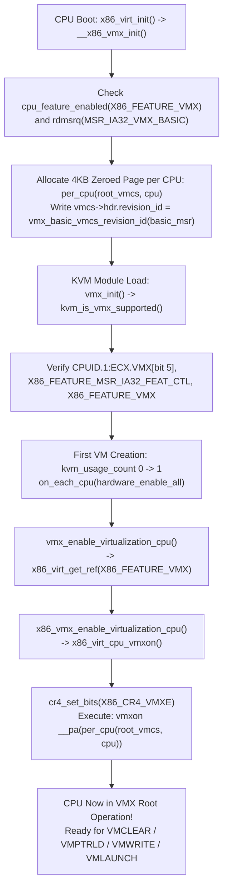

#### 2.2.1 BIOS Lock and Feature Negotiation: `CPUID`, `IA32_FEATURE_CONTROL`, and `CR4.VMXE`

When `kvm-intel.ko` initializes via [`vmx_init()`](https://kernel.googlesource.com/pub/scm/virt/kvm/kvm.git/+/refs/heads/master/arch/x86/kvm/vmx/vmx.c) in [`arch/x86/kvm/vmx/vmx.c`](https://kernel.googlesource.com/pub/scm/virt/kvm/kvm.git/+/refs/heads/master/arch/x86/kvm/vmx/vmx.c), the very first check it performs is [`kvm_is_vmx_supported()`](https://kernel.googlesource.com/pub/scm/virt/kvm/kvm.git/+/refs/heads/master/arch/x86/kvm/vmx/vmx.c):

```c
// Source: arch/x86/kvm/vmx/vmx.c (lines 2939-2970)
static bool __kvm_is_vmx_supported(void)
{
	int cpu = smp_processor_id();

	if (!(cpuid_ecx(1) & feature_bit(VMX))) {
		pr_err("VMX not supported by CPU %d\n", cpu);
		return false;
	}

	if (!this_cpu_has(X86_FEATURE_MSR_IA32_FEAT_CTL)) {
		pr_err("VMX not enabled (by BIOS) in MSR_IA32_FEAT_CTL on CPU %d\n", cpu);
		return false;
	}

	if (!this_cpu_has(X86_FEATURE_VMX)) {
		pr_err("VMX not fully enabled on CPU %d.  Check kernel logs and/or BIOS\n", cpu);
		return false;
	}

	return true;
}

static bool kvm_is_vmx_supported(void)
{
	bool supported;

	migrate_disable();
	supported = __kvm_is_vmx_supported();
	migrate_enable();

	return supported;
}
```

Why are there *three* separate checks here?
1. **`cpuid_ecx(1) & feature_bit(VMX)` (`CPUID.01H:ECX.VMX[bit 5]`)**: Queries the silicon directly to verify whether the processor implements the VMX instruction set extension.
2. **`MSR_IA32_FEAT_CTL` (`0x0000003a`)**: Even if the CPU supports VMX, executing `VMXON` will unconditionally raise a General Protection fault (`#GP(0)`) unless system firmware (BIOS/UEFI) or early kernel boot code has configured and locked `MSR_IA32_FEAT_CTL`:
   - **Bit 0 (`FEAT_CTL_LOCKED`)**: Lock bit. Once set to `1`, any subsequent `WRMSR` to `MSR_IA32_FEAT_CTL` raises `#GP(0)` until a power-on reset, preventing malicious kernel code from toggling VMX or SMX capabilities if BIOS disabled them. If bit 0 is `0`, `VMXON` raises `#GP(0)`!
   - **Bit 1 (`FEAT_CTL_VMX_ENABLED_INSIDE_SMX`)**: Enables `VMXON` inside Safer Mode Extensions (Intel TXT / `CR4.SMXE = 1`) operation.
   - **Bit 2 (`FEAT_CTL_VMX_ENABLED_OUTSIDE_SMX`)**: Enables `VMXON` outside SMX operation (`CR4.SMXE = 0`), which is the standard operating mode for Linux and KVM.
3. **`this_cpu_has(X86_FEATURE_VMX)`**: During early kernel boot (`init_ia32_feat_ctl()` and `x86_virt_init()`), if `MSR_IA32_FEAT_CTL` was locked by BIOS with Bit 2 cleared—or if `__x86_vmx_init()` failed—the kernel explicitly clears `X86_FEATURE_VMX` via `setup_clear_cpu_cap(X86_FEATURE_VMX)`.

#### 2.2.2 Control Register Fixed Bits (`IA32_VMX_CR0_FIXED0/1` and `IA32_VMX_CR4_FIXED0/1`)

Before `VMXON` can succeed—and on every subsequent `VMLAUNCH`/`VMRESUME` and `VM-Exit`—Intel VMX enforces strict invariants on `CR0` and `CR4`. Certain bits in `CR0` and `CR4` are architecturally required to be `1` ("fixed-1") or `0` ("fixed-0") whenever the processor is in VMX operation. Hardware reports these invariants through four 64-bit MSRs defined in [`arch/x86/include/asm/msr-index.h`](https://kernel.googlesource.com/pub/scm/virt/kvm/kvm.git/+/refs/heads/master/arch/x86/include/asm/msr-index.h):
- `MSR_IA32_VMX_CR0_FIXED0` (`0x486`) and `MSR_IA32_VMX_CR0_FIXED1` (`0x487`)
- `MSR_IA32_VMX_CR4_FIXED0` (`0x488`) and `MSR_IA32_VMX_CR4_FIXED1` (`0x489`)

The hardware rule is:
- If a bit position $i$ is `1` in `IA32_VMX_CRx_FIXED0`, then bit $i$ of `CRx` **must be 1** in VMX operation.
- If a bit position $i$ is `0` in `IA32_VMX_CRx_FIXED1`, then bit $i$ of `CRx` **must be 0** in VMX operation.
- Consequently, a bit $i$ is flexible (can be either `0` or `1`) if and only if `FIXED0[i] == 0` and `FIXED1[i] == 1`.

In standard VMX root operation (and in non-root operation unless **Unrestricted Guest** mode, `SECONDARY_EXEC_UNRESTRICTED_GUEST`, is enabled), `IA32_VMX_CR0_FIXED0` requires:
- `X86_CR0_PE` (Bit 0, Protection Enable) = 1
- `X86_CR0_NE` (Bit 5, Numeric Error) = 1
- `X86_CR0_PG` (Bit 31, Paging) = 1
(When `SECONDARY_EXEC_UNRESTRICTED_GUEST` is enabled in the VMCS for a guest, the guest's `GUEST_CR0` is exempted from the `PE` and `PG` fixed-1 requirements so that a guest can boot directly in 16-bit Real Mode or unpaged Protected Mode, though `CR0.NE` remains required in `GUEST_CR0`.)

For `CR4`, `IA32_VMX_CR4_FIXED0` requires `X86_CR4_VMXE` (Bit 13, VMX Enable) = 1. Attempting to execute `VMXON` while `CR4.VMXE == 0` raises `#UD` (Invalid Opcode), and attempting to clear `CR4.VMXE` via `MOV CR4` while in VMX root operation (prior to executing `VMXOFF`) raises `#GP(0)`. Look at how KVM's [`nested_vmx_setup_cr_fixed()`](https://kernel.googlesource.com/pub/scm/virt/kvm/kvm.git/+/refs/heads/master/arch/x86/kvm/vmx/nested.c) in [`arch/x86/kvm/vmx/nested.c`](https://kernel.googlesource.com/pub/scm/virt/kvm/kvm.git/+/refs/heads/master/arch/x86/kvm/vmx/nested.c) encodes these exact constants:

```c
// Source: arch/x86/kvm/vmx/nested.c (lines 7351-7369)
static void nested_vmx_setup_cr_fixed(struct nested_vmx_msrs *msrs)
{
	/*
	 * These MSRs specify bits which the guest must keep fixed on
	 * while L1 is in VMXON mode (in L1's root mode, or running an L2).
	 * We picked the standard core2 setting.
	 */
#define VMXON_CR0_ALWAYSON     (X86_CR0_PE | X86_CR0_PG | X86_CR0_NE)
#define VMXON_CR4_ALWAYSON     X86_CR4_VMXE
	msrs->cr0_fixed0 = VMXON_CR0_ALWAYSON;
	msrs->cr4_fixed0 = VMXON_CR4_ALWAYSON;

	/* These MSRs specify bits which the guest must keep fixed off. */
	rdmsrq(MSR_IA32_VMX_CR0_FIXED1, msrs->cr0_fixed1);
	rdmsrq(MSR_IA32_VMX_CR4_FIXED1, msrs->cr4_fixed1);

	if (vmx_umip_emulated())
		msrs->cr4_fixed1 |= X86_CR4_UMIP;
}
```

##### 2.2.2.1 Per-CPU `VMXON` Region Allocation and `vmx_enable_virtualization_cpu()`

Every logical processor entering VMX root operation requires its own dedicated 4 KiB-aligned physical page—the **VMXON region** (`root_vmcs`). Even though software never accesses fields inside the VMXON region via `VMREAD` or `VMWRITE` after initialization, the CPU uses this 4 KiB physical memory block for internal VMX root microarchitectural state. Before executing `VMXON`, software must zero the page and write the CPU's 31-bit **VMCS Revision Identifier** (bits `30:0` of `MSR_IA32_VMX_BASIC`, `0x480`) into the first 4 bytes (`hdr.revision_id`), ensuring bit 31 (`hdr.shadow_vmcs`) is `0`.

In modern Linux kernels, the per-CPU `root_vmcs` allocation and the `VMXON`/`VMXOFF` reference-counted lifecycle live in the core x86 virtualization layer ([`arch/x86/virt/hw.c`](https://kernel.googlesource.com/pub/scm/virt/kvm/kvm.git/+/refs/heads/master/arch/x86/virt/hw.c), declared in [`arch/x86/include/asm/virt.h`](https://kernel.googlesource.com/pub/scm/virt/kvm/kvm.git/+/refs/heads/master/arch/x86/include/asm/virt.h)) so that both KVM and Intel TDX host code can share VMX root operation cleanly via `x86_virt_get_ref(X86_FEATURE_VMX)` and `x86_virt_put_ref(X86_FEATURE_VMX)`.

###### 2.2.2.1.1 Line-by-Line Walkthrough of `__x86_vmx_init()`, `x86_virt_cpu_vmxon()`, and `vmx_enable_virtualization_cpu()`

Let's examine the exact implementation in [`arch/x86/virt/hw.c`](https://kernel.googlesource.com/pub/scm/virt/kvm/kvm.git/+/refs/heads/master/arch/x86/virt/hw.c) and [`arch/x86/kvm/vmx/vmx.c`](https://kernel.googlesource.com/pub/scm/virt/kvm/kvm.git/+/refs/heads/master/arch/x86/kvm/vmx/vmx.c):

```c
// Source: arch/x86/virt/hw.c (lines 79-214)
#if IS_ENABLED(CONFIG_KVM_INTEL)
static DEFINE_PER_CPU(struct vmcs *, root_vmcs);

static int x86_virt_cpu_vmxon(void)
{
	u64 vmxon_pointer = __pa(per_cpu(root_vmcs, raw_smp_processor_id()));
	u64 msr;

	cr4_set_bits(X86_CR4_VMXE);

	asm goto("1: vmxon %[vmxon_pointer]\n\t"
			  _ASM_EXTABLE(1b, %l[fault])
			  : : [vmxon_pointer] "m"(vmxon_pointer)
			  : : fault);
	return 0;

fault:
	WARN_ONCE(1, "VMXON faulted, MSR_IA32_FEAT_CTL (0x3a) = 0x%llx\n",
		  rdmsrq_safe(MSR_IA32_FEAT_CTL, &msr) ? 0xdeadbeef : msr);
	cr4_clear_bits(X86_CR4_VMXE);

	return -EFAULT;
}

static int x86_vmx_enable_virtualization_cpu(void)
{
	int r;

	if (cr4_read_shadow() & X86_CR4_VMXE)
		return -EBUSY;

	intel_pt_handle_vmx(1);

	r = x86_virt_cpu_vmxon();
	if (r) {
		intel_pt_handle_vmx(0);
		return r;
	}

	return 0;
}
```

And during boot time (`x86_virt_init()` -> `x86_vmx_init()` -> `__x86_vmx_init()`):

```c
// Source: arch/x86/virt/hw.c (lines 166-214)
static __init int __x86_vmx_init(void)
{
	const struct x86_virt_ops vmx_ops = {
		.feature = X86_FEATURE_VMX,
		.enable_virtualization_cpu = x86_vmx_enable_virtualization_cpu,
		.disable_virtualization_cpu = x86_vmx_disable_virtualization_cpu,
		.emergency_disable_virtualization_cpu = x86_vmx_emergency_disable_virtualization_cpu,
	};

	u64 basic_msr;
	u32 rev_id;
	int cpu;

	if (!cpu_feature_enabled(X86_FEATURE_VMX))
		return -EOPNOTSUPP;

	rdmsrq(MSR_IA32_VMX_BASIC, basic_msr);

	/* IA-32 SDM Vol 3B: VMCS size is never greater than 4kB. */
	if (WARN_ON_ONCE(vmx_basic_vmcs_size(basic_msr) > PAGE_SIZE))
		return -EIO;

	/*
	 * Even if eVMCS is enabled (or will be enabled?), and even though not
	 * explicitly documented by TLFS, the root VMCS  passed to VMXON should
	 * still be marked with the revision_id reported by the physical CPU.
	 */
	rev_id = vmx_basic_vmcs_revision_id(basic_msr);

	for_each_possible_cpu(cpu) {
		int node = cpu_to_node(cpu);
		struct page *page;
		struct vmcs *vmcs;

		page = alloc_pages_node(node, GFP_KERNEL | __GFP_ZERO, 0);
		if (WARN_ON_ONCE(!page)) {
			x86_vmx_exit();
			return -ENOMEM;
		}

		vmcs = page_address(page);
		vmcs->hdr.revision_id = rev_id;
		per_cpu(root_vmcs, cpu) = vmcs;
	}

	memcpy(&virt_ops, &vmx_ops, sizeof(virt_ops));
	return 0;
}
```

When KVM enables virtualization on a physical CPU (via `hardware_enable_all()` when the first VM is created, or via CPU hotplug callbacks), KVM invokes [`vmx_enable_virtualization_cpu()`](https://kernel.googlesource.com/pub/scm/virt/kvm/kvm.git/+/refs/heads/master/arch/x86/kvm/vmx/vmx.c) in [`arch/x86/kvm/vmx/vmx.c`](https://kernel.googlesource.com/pub/scm/virt/kvm/kvm.git/+/refs/heads/master/arch/x86/kvm/vmx/vmx.c):

```c
// Source: arch/x86/kvm/vmx/vmx.c (lines 3009-3040)
int vmx_enable_virtualization_cpu(void)
{
	int cpu = raw_smp_processor_id();

	/*
	 * This can happen if we hot-added a CPU but failed to allocate
	 * VP assist page for it.
	 */
	if (kvm_is_using_evmcs() && !hv_get_vp_assist_page(cpu))
		return -EFAULT;

	return x86_virt_get_ref(X86_FEATURE_VMX);
}

static void vmclear_local_loaded_vmcss(void)
{
	int cpu = raw_smp_processor_id();
	struct loaded_vmcs *v, *n;

	list_for_each_entry_safe(v, n, &per_cpu(loaded_vmcss_on_cpu, cpu),
				 loaded_vmcss_on_cpu_link)
		__loaded_vmcs_clear(v);
}

void vmx_disable_virtualization_cpu(void)
{
	vmclear_local_loaded_vmcss();

	x86_virt_put_ref(X86_FEATURE_VMX);

	hv_reset_evmcs();
}
```

Trace the subtle architectural details in this sequence:
1. **NUMA-Local `root_vmcs` Allocation**: `__x86_vmx_init()` iterates across `for_each_possible_cpu(cpu)` and allocates an order-0 (4 KiB) zeroed physical page on that CPU's NUMA node (`alloc_pages_node(node, GFP_KERNEL | __GFP_ZERO, 0)`). It extracts `rev_id = vmx_basic_vmcs_revision_id(basic_msr)` (bits `30:0` of `MSR_IA32_VMX_BASIC`) and writes `vmcs->hdr.revision_id = rev_id`.
2. **Per-CPU Reference Counting (`virtualization_nr_users`)**: `x86_virt_get_ref(X86_FEATURE_VMX)` disables preemption (`guard(preempt)()`), increments `this_cpu_inc_return(virtualization_nr_users)`, and on the `0 -> 1` transition calls `virt_ops.enable_virtualization_cpu()` (`x86_vmx_enable_virtualization_cpu()`).
3. **Intel PT Coordination (`intel_pt_handle_vmx(1)`)**: On older Intel processors where Intel Processor Trace (PT) cannot operate across `VMXON` transitions without special handling, `intel_pt_handle_vmx(1)` notifies the host perf subsystem that the CPU is entering VMX root operation.
4. **`CR4.VMXE` and `VMXON`**: `x86_virt_cpu_vmxon()` sets `X86_CR4_VMXE` in `CR4` (and in the kernel's `cr4` shadow) and executes `vmxon %[vmxon_pointer]`, where `vmxon_pointer` is a 64-bit stack variable containing the host physical address (`__pa(per_cpu(root_vmcs, cpu))`) of the CPU's VMXON region. Note that `vmxon` takes a 64-bit **memory operand** (`"m"(vmxon_pointer)`), not a register!
5. **Why `vmclear_local_loaded_vmcss()` Must Precede `VMXOFF`**: When `vmx_disable_virtualization_cpu()` runs, it *first* iterates over `per_cpu(loaded_vmcss_on_cpu, cpu)` and executes `VMCLEAR` (`__loaded_vmcs_clear(v)`) on every VMCS currently cached by that CPU core before calling `x86_virt_put_ref(X86_FEATURE_VMX)` (which executes `VMXOFF`). Why? Because the Intel processor caches active/launched VMCS data inside internal processor circuitry (the VMCS cache) and flushes it back to DRAM lazily or upon `VMCLEAR`. Executing `VMXOFF` without first executing `VMCLEAR` on all modified VMCSs leaves their in-memory images corrupt/stale, and attempting `VMCLEAR` *after* `VMXOFF` would raise `#UD`!
6. **Reboot and Crash NMI Shootdown (`x86_vmx_emergency_disable_virtualization_cpu`)**: What happens if the host kernel panics (`kexec` crash kernel) or reboots via `INIT` IPI while CPUs are in VMX root operation? **Intel CPUs in VMX root operation (`post-VMXON`) block `INIT` signals!** If an NMI crash handler tried to reset secondary CPUs using `INIT`-`SIPI`-`SIPI` without first executing `VMXOFF`, the secondary CPUs would ignore `INIT` and hang the reboot/kdump! Therefore, `x86_vmx_emergency_disable_virtualization_cpu()` sets `virt_rebooting = true`, invokes `vmx_emergency_disable_virtualization_cpu()` (which runs `vmcs_clear()` on all loaded VMCSs on that CPU), executes `vmxoff`, and clears `CR4.VMXE`.

---

### 2.3 Deep Anatomy of the Intel VMCS and 32-Bit Field Encoding

Once a logical processor is in VMX root operation (`post-VMXON`), it manages virtual machines through **Virtual Machine Control Structures (VMCSs)**. Every vCPU in KVM owns a primary VMCS (`vmx->vmcs01`, of type `struct loaded_vmcs`) for running the L1 guest, and if nested virtualization is active, dynamically allocates a second VMCS (`vmx->nested.vmcs02`) for running L2 guests, plus an optional hardware **Shadow VMCS** (`vmx->vmcs01.shadow_vmcs`) to accelerate L1's `VMREAD`/`VMWRITE` instructions.

#### 2.3.1 The 4 KiB `struct vmcs` Header and the VMCS Lifecycle State Machine

In [`arch/x86/include/asm/vmx.h`](https://kernel.googlesource.com/pub/scm/virt/kvm/kvm.git/+/refs/heads/master/arch/x86/include/asm/vmx.h), the in-memory layout of a VMCS page is defined as:

```c
// Source: arch/x86/include/asm/vmx.h (lines 23-32)
struct vmcs_hdr {
	u32 revision_id:31;
	u32 shadow_vmcs:1;
};

struct vmcs {
	struct vmcs_hdr hdr;
	u32 abort;
	char data[];
};
```

Here is the first architectural surprise for systems programmers new to Intel VT-x: **only the first 8 bytes of the 4 KiB VMCS page have a documented architectural layout in memory!**

```
+-----------------------------------------------------------------------------------+
|                        INTEL 4 KiB VMCS REGION IN HOST RAM                        |
|                        (4 KiB-Aligned Host Physical Address)                      |
+===================================================================================+
| Byte Offset 0x000 .. 0x003 (32 bits): struct vmcs_hdr                             |
|   +-------------------------------------------------------------------+-------+   |
|   | Bit 31: shadow_vmcs                                               | 30..0 |   |
|   | (0 = Ordinary VMCS, 1 = Shadow VMCS)         VMCS Revision ID (from 0x480)|   |
|   +-------------------------------------------------------------------+-------+   |
+-----------------------------------------------------------------------------------+
| Byte Offset 0x004 .. 0x007 (32 bits): u32 abort                                   |
|   VMX-Abort Indicator (Written by CPU on catastrophic VMX-abort; 0 otherwise)     |
+-----------------------------------------------------------------------------------+
| Byte Offset 0x008 .. 0xFFF (up to 4088 bytes): char data[]                        |
|   MICROARCHITECTURALLY OPAQUE DATA AREA!                                          |
|   - Layout varies across Intel CPU families/steppings (identified by revision_id) |
|   - Cached inside CPU internal VMCS cache while Current/Active                    |
|   - NEVER read or written directly via C pointers (except Hyper-V eVMCS)!         |
|   - Accessed EXCLUSIVELY via VMREAD and VMWRITE instructions using 32-bit         |
|     architectural field encodings (enum vmcs_field).                              |
+===================================================================================+
```

Why does Intel forbid software from reading or writing `vmcs->data[]` using ordinary memory loads and stores? Because the processor is allowed to cache the active VMCS in dedicated on-core SRAM registers and reorder or compress fields across CPU microarchitectures (e.g., Skylake vs Sapphire Rapids vs Granite Rapids). Software interacts with a VMCS strictly through its **lifecycle state machine** and the `VMCLEAR`, `VMPTRLD`, `VMREAD`, `VMWRITE`, `VMLAUNCH`, and `VMRESUME` instructions:

```mermaid
stateDiagram-v2
    [*] --> Allocated: alloc_vmcs_cpu() writes hdr.revision_id
    Allocated --> Inactive_Clear: vmcs_clear() [VMCLEAR pa]
    Inactive_Clear --> Current_Clear: vmcs_load() [VMPTRLD pa]
    Current_Clear --> Current_Launched: __vmx_vcpu_run() [VMLAUNCH]\n(loaded_vmcs->launched = true)
    Current_Launched --> Current_Launched: __vmx_vcpu_run() [VMRESUME]\n& subsequent VM-Exits
    Current_Launched --> Active_NotCurrent_Launched: Another VMCS loaded on same pCPU\nvia vmcs_load() [VMPTRLD other_pa]
    Active_NotCurrent_Launched --> Current_Launched: Reloaded on same pCPU\nvia vmcs_load() [VMPTRLD pa]
    Current_Launched --> Inactive_Clear: __loaded_vmcs_clear() [VMCLEAR pa]\n(Flushes CPU cache to RAM; launched = 0)
    Active_NotCurrent_Launched --> Inactive_Clear: __loaded_vmcs_clear() [VMCLEAR pa]
    Current_Clear --> Inactive_Clear: __loaded_vmcs_clear() [VMCLEAR pa]
```

Every VMCS exists in a two-axis hardware state:
1. **Activation State**: **Inactive**, **Active** (bound to a logical processor's internal VMCS cache because `VMPTRLD` was executed on it and `VMCLEAR` has not yet been executed), or **Active & Current** (the single VMCS currently selected on this logical processor by the most recent `VMPTRLD`, which is the implicit target of all `VMREAD`, `VMWRITE`, `VMLAUNCH`, and `VMRESUME` instructions on this logical processor).
2. **Launch State**: **Clear** (`launched == false`) or **Launched** (`launched == true`).
   - When a VMCS is in the **Clear** state, entering the guest *must* use the **`VMLAUNCH`** instruction. Attempting `VMRESUME` on a Clear VMCS fails immediately with `VMXERR_VMRESUME_NONLAUNCHED_VMCS` (Error 5).
   - Once `VMLAUNCH` succeeds, the VMCS transitions to the **Launched** state. Every subsequent VM-Entry on that VMCS *must* use **`VMRESUME`** (which skips certain one-time launch overhead in microcode). Attempting `VMLAUNCH` on a Launched VMCS fails with `VMXERR_VMLAUNCH_NONCLEAR_VMCS` (Error 4).
   - If KVM migrates a vCPU from physical CPU $A$ to physical CPU $B$, CPU $A$ *must* execute `VMCLEAR` on the VMCS (via `loaded_vmcs_clear()` -> `smp_call_function_single(cpu_A, __loaded_vmcs_clear, ...)`), which flushes CPU $A$'s internal VMCS cache back to RAM and resets the VMCS launch state to **Clear** (`loaded_vmcs->launched = 0`). CPU $B$ then executes `VMPTRLD` (`vmcs_load()`) and uses `VMLAUNCH` on its first entry!

Look at [`struct loaded_vmcs`](https://kernel.googlesource.com/pub/scm/virt/kvm/kvm.git/+/refs/heads/master/arch/x86/kvm/vmx/vmcs.h) in [`arch/x86/kvm/vmx/vmcs.h`](https://kernel.googlesource.com/pub/scm/virt/kvm/kvm.git/+/refs/heads/master/arch/x86/kvm/vmx/vmcs.h) and how [`alloc_vmcs_cpu()`](https://kernel.googlesource.com/pub/scm/virt/kvm/kvm.git/+/refs/heads/master/arch/x86/kvm/vmx/vmx.c) and [`vmx_vcpu_load_vmcs()`](https://kernel.googlesource.com/pub/scm/virt/kvm/kvm.git/+/refs/heads/master/arch/x86/kvm/vmx/vmx.c) implement this exact protocol:

```c
// Source: arch/x86/kvm/vmx/vmcs.h (lines 59-74)
struct loaded_vmcs {
	struct vmcs *vmcs;
	struct vmcs *shadow_vmcs;
	int cpu;
	bool launched;
	bool nmi_known_unmasked;
	bool hv_timer_soft_disabled;
	/* Support for vnmi-less CPUs */
	int soft_vnmi_blocked;
	ktime_t entry_time;
	s64 vnmi_blocked_time;
	unsigned long *msr_bitmap;
	struct list_head loaded_vmcss_on_cpu_link;
	struct vmcs_host_state host_state;
	struct vmcs_controls_shadow controls_shadow;
};
```

Look at the memory-barrier synchronization between [`__loaded_vmcs_clear()`](https://kernel.googlesource.com/pub/scm/virt/kvm/kvm.git/+/refs/heads/master/arch/x86/kvm/vmx/vmx.c) on the old pCPU and [`vmx_vcpu_load_vmcs()`](https://kernel.googlesource.com/pub/scm/virt/kvm/kvm.git/+/refs/heads/master/arch/x86/kvm/vmx/vmx.c) on the new pCPU:
- In `__loaded_vmcs_clear()` (lines 823–839 of `arch/x86/kvm/vmx/vmx.c`), the old CPU executes `vmcs_clear(loaded_vmcs->vmcs)`, deletes `loaded_vmcs->loaded_vmcss_on_cpu_link` from its per-CPU list, executes `smp_wmb()`, and only then sets `loaded_vmcs->cpu = -1` and `loaded_vmcs->launched = 0`.
- In `vmx_vcpu_load_vmcs()` (lines 1519–1566 of `arch/x86/kvm/vmx/vmx.c`), if `vmx->loaded_vmcs->cpu != cpu`, the new CPU calls `loaded_vmcs_clear(vmx->loaded_vmcs)` (which IPIs the old CPU via `smp_call_function_single()`), disables local IRQs, executes `smp_rmb()`, adds `loaded_vmcs` to `per_cpu(loaded_vmcss_on_cpu, cpu)`, executes `vmcs_load(vmx->loaded_vmcs->vmcs)` (`VMPTRLD`), updates the per-CPU `HOST_TR_BASE`, `HOST_GDTR_BASE`, and `HOST_IA32_SYSENTER_ESP` fields in the VMCS, and requests `KVM_REQ_TLB_FLUSH`.

#### 2.3.2 The Six Logical VMCS Regions

Architecturally, the fields inside a VMCS are organized into **six logical groups**, defined in `enum vmcs_field` in [`arch/x86/include/asm/vmx.h`](https://kernel.googlesource.com/pub/scm/virt/kvm/kvm.git/+/refs/heads/master/arch/x86/include/asm/vmx.h) (lines 204–406):

1. **Guest-State Area**: Holds the processor state loaded into hardware on `VM-Entry` and saved from hardware on `VM-Exit`:
   - Control and debug registers: `GUEST_CR0` (`0x6800`), `GUEST_CR3` (`0x6802`), `GUEST_CR4` (`0x6804`), `GUEST_DR7` (`0x681a`).
   - Instruction pointer, stack pointer, flags: `GUEST_RSP` (`0x681c`), `GUEST_RIP` (`0x681e`), `GUEST_RFLAGS` (`0x6820`).
   - Segment registers (`CS`, `SS`, `DS`, `ES`, `FS`, `GS`, `LDTR`, `TR`): Each has four separate VMCS fields—a 16-bit Selector (`GUEST_ES_SELECTOR` `0x0800` .. `GUEST_TR_SELECTOR` `0x080e`), a Natural-Width Base (`GUEST_ES_BASE` `0x6806` .. `GUEST_TR_BASE` `0x6814`), a 32-bit Limit (`GUEST_ES_LIMIT` `0x4800` .. `GUEST_TR_LIMIT` `0x480e`), and a 32-bit Access Rights descriptor (`GUEST_ES_AR_BYTES` `0x4814` .. `GUEST_TR_AR_BYTES` `0x4822`).
   - Descriptor Table Registers (`GDTR`, `IDTR`): Natural-width Base (`GUEST_GDTR_BASE` `0x6816`, `GUEST_IDTR_BASE` `0x6818`) and 32-bit Limit (`GUEST_GDTR_LIMIT` `0x4810`, `GUEST_IDTR_LIMIT` `0x4812`).
   - Guest MSRs & Page-Directory-Pointer Table Entries: `GUEST_IA32_DEBUGCTL` (`0x2802`), `GUEST_IA32_PAT` (`0x2804`), `GUEST_IA32_EFER` (`0x2806`), `GUEST_IA32_PERF_GLOBAL_CTRL` (`0x2808`), `GUEST_PDPTR0`..`3` (`0x280a`..`0x2810`), `GUEST_SYSENTER_CS` (`0x482a`), `GUEST_SYSENTER_ESP` (`0x6824`), `GUEST_SYSENTER_EIP` (`0x6826`), `GUEST_S_CET` (`0x6828`), `GUEST_SSP` (`0x682a`), `GUEST_INTR_SSP_TABLE` (`0x682c`).
   - Non-Register State: `GUEST_ACTIVITY_STATE` (`0x4826`: Active, HLT, Shutdown, Wait-for-SIPI), `GUEST_INTERRUPTIBILITY_INFO` (`0x4824`: blocking by `STI`, `MOV SS`, `SMI`, `NMI`), `GUEST_PENDING_DBG_EXCEPTIONS` (`0x6822`), `VMCS_LINK_POINTER` (`0x2800`, set to `INVALID_GPA` (`~0ULL`) unless VMCS shadowing is active), `GUEST_INTR_STATUS` (`0x0810`, holding `RVI` and `SVI` for APICv virtual interrupt delivery), and `GUEST_PML_INDEX` (`0x0812`).
2. **Host-State Area**: Holds the processor state atomically restored when a `VM-Exit` transitions the CPU back to VMX root operation:
   - `HOST_CR0` (`0x6c00`), `HOST_CR3` (`0x6c02`), `HOST_CR4` (`0x6c04`).
   - `HOST_RSP` (`0x6c14`, updated before entry via `vmx_update_host_rsp()`) and `HOST_RIP` (`0x6c16`, initialized to `(unsigned long)vmx_vmexit` in `vmx_set_constant_host_state()`).
   - 16-bit Selectors only (no limit or AR fields—hardware forces flat 64-bit ring-0 attributes on exit!): `HOST_ES_SELECTOR` (`0x0c00`) .. `HOST_TR_SELECTOR` (`0x0c0c`).
   - Base addresses: `HOST_FS_BASE` (`0x6c06`), `HOST_GS_BASE` (`0x6c08`), `HOST_TR_BASE` (`0x6c0a`), `HOST_GDTR_BASE` (`0x6c0c`), `HOST_IDTR_BASE` (`0x6c0e`).
   - Host MSRs: `HOST_IA32_PAT` (`0x2c00`), `HOST_IA32_EFER` (`0x2c02`), `HOST_IA32_PERF_GLOBAL_CTRL` (`0x2c04`), `HOST_IA32_SYSENTER_CS` (`0x4c00`), `HOST_IA32_SYSENTER_ESP` (`0x6c10`), `HOST_IA32_SYSENTER_EIP` (`0x6c12`), `HOST_S_CET` (`0x6c18`), `HOST_SSP` (`0x6c1a`), `HOST_INTR_SSP_TABLE` (`0x6c1c`).
3. **VM-Execution Control Fields**: Govern processor behavior and interception in VMX non-root operation:
   - `PIN_BASED_VM_EXEC_CONTROL` (`0x4000`), `CPU_BASED_VM_EXEC_CONTROL` (`0x4002`), `SECONDARY_VM_EXEC_CONTROL` (`0x401e`), and 64-bit `TERTIARY_VM_EXEC_CONTROL` (`0x2034`).
   - `EXCEPTION_BITMAP` (`0x4004`, 32-bit mask of exceptions `0..31` to intercept), `PAGE_FAULT_ERROR_CODE_MASK` (`0x4006`), and `PAGE_FAULT_ERROR_CODE_MATCH` (`0x4008`).
   - `CR0_GUEST_HOST_MASK` (`0x6000`), `CR4_GUEST_HOST_MASK` (`0x6002`), `CR0_READ_SHADOW` (`0x6004`), `CR4_READ_SHADOW` (`0x6006`): Any bit set to `1` in `CRx_GUEST_HOST_MASK` is "host-owned" (reads by the guest return the corresponding bit from `CRx_READ_SHADOW`, and writes by the guest to that bit position with a value differing from the shadow trigger an `EXIT_REASON_CR_ACCESS` VM-Exit!). Bits cleared to `0` in `CRx_GUEST_HOST_MASK` are "guest-owned" and can be modified by the guest without exiting.
   - Address-space & I/O/MSR bitmaps: `EPT_POINTER` (`0x201a`), `VIRTUAL_PROCESSOR_ID` (`0x0000`), `IO_BITMAP_A`/`B` (`0x2000`/`0x2002`), `MSR_BITMAP` (`0x2004`), `TSC_OFFSET` (`0x2010`), `TSC_MULTIPLIER` (`0x2032`), `VIRTUAL_APIC_PAGE_ADDR` (`0x2012`), `APIC_ACCESS_ADDR` (`0x2014`), `POSTED_INTR_DESC_ADDR` (`0x2016`), `PID_POINTER_TABLE` (`0x2042`), `PML_ADDRESS` (`0x200e`), `VMREAD_BITMAP` (`0x2026`), `VMWRITE_BITMAP` (`0x2028`), `PLE_GAP` (`0x4020`), `PLE_WINDOW` (`0x4022`), `NOTIFY_WINDOW` (`0x4024`).
4. **VM-Exit Control Fields**: Specify processor actions on `VM-Exit`:
   - `VM_EXIT_CONTROLS` (`0x400c`), `VM_EXIT_MSR_STORE_COUNT` (`0x400e`), `VM_EXIT_MSR_STORE_ADDR` (`0x2006`), `VM_EXIT_MSR_LOAD_COUNT` (`0x4010`), `VM_EXIT_MSR_LOAD_ADDR` (`0x2008`).
5. **VM-Entry Control Fields**: Specify processor actions and event injection on `VM-Entry`:
   - `VM_ENTRY_CONTROLS` (`0x4012`), `VM_ENTRY_MSR_LOAD_COUNT` (`0x4014`), `VM_ENTRY_MSR_LOAD_ADDR` (`0x200a`).
   - Event Injection: `VM_ENTRY_INTR_INFO_FIELD` (`0x4016`), `VM_ENTRY_EXCEPTION_ERROR_CODE` (`0x4018`), `VM_ENTRY_INSTRUCTION_LEN` (`0x401a`). When bit 31 (`INTR_INFO_VALID_MASK`, `0x80000000`) of `VM_ENTRY_INTR_INFO_FIELD` is set, the CPU delivers the specified interrupt, NMI, or exception vector (`bits 7:0`) of type (`bits 10:8`) into the guest's IDT as part of `VM-Entry` and automatically clears bit 31!
6. **VM-Exit Information Fields (Read-Only)**: Populated by hardware upon `VM-Exit` to tell KVM why the exit occurred:
   - `VM_EXIT_REASON` (`0x4402`), `EXIT_QUALIFICATION` (`0x6400`), `GUEST_LINEAR_ADDRESS` (`0x640a`), `GUEST_PHYSICAL_ADDRESS` (`0x2400`).
   - `VM_EXIT_INTR_INFO` (`0x4404`), `VM_EXIT_INTR_ERROR_CODE` (`0x4406`).
   - `IDT_VECTORING_INFO_FIELD` (`0x4408`), `IDT_VECTORING_ERROR_CODE` (`0x440a`): Indicates if the `VM-Exit` occurred while the CPU was in the middle of delivering an event through the guest IDT (requiring KVM to re-inject the interrupted event on the next `VM-Entry`).
   - `VM_EXIT_INSTRUCTION_LEN` (`0x440c`), `VMX_INSTRUCTION_INFO` (`0x440e`), and `VM_INSTRUCTION_ERROR` (`0x4400`).

##### 2.3.2.1 Exact 32-Bit VMCS Field Encoding (`enum vmcs_field`)

Look at the hex values in `enum vmcs_field` (`0x0000`, `0x0800`, `0x0c00`, `0x2000`, `0x2400`, `0x2800`, `0x2c00`, `0x4000`, `0x4400`, `0x4800`, `0x4c00`, `0x6000`, `0x6400`, `0x6800`, `0x6c00`). Those numbers are not arbitrary sequential IDs—they are **structured 32-bit bitfields**! Every `VMREAD` and `VMWRITE` instruction decodes the 32-bit register operand according to the Intel SDM VMCS Component Encoding layout:

```
+===================================================================================+
|                   INTEL 32-BIT VMCS COMPONENT FIELD ENCODING                      |
+===================================================================================+
  31                  15 14    13  12  11    10 9                     1      0
 +----------------------+--------+----+--------+-----------------------+------------+
 |       Reserved       | Width  |Rsvd|  Type  |         Index         |Access Type |
 |     (Must be 0)      | (2b)   |(0) |  (2b)  |        (9 bits)       |   (1 bit)  |
 +----------------------+--------+----+--------+-----------------------+------------+
                         ^        ^    ^        ^                       ^
                         |        |    |        |                       |
   Bits [14:13] ---------+        |    |        |                       +-- Bit [0]
   00b (0) = 16-bit field         |    |        |                           0 = Full
   01b (1) = 64-bit field         |    |        |                           1 = High (32-bit upper
   10b (2) = 32-bit field         |    |        |                               half of 64-bit field)
   11b (3) = Natural-width field  |    |        |
             (64b on x86_64)      |    |        +-- Bits [9:1]: 9-bit Field Index within (Width, Type)
                                  |    |            Extracted via VMCS_FIELD_INDEX_MASK = GENMASK(9,1)
   Bit [12]: Reserved (0) --------+    |
                                       +-- Bits [11:10]: Logical Region Type
                                           00b (0) = Control Fields (Exec / Exit / Entry)
                                           01b (1) = Read-Only VM-Exit Information Fields
                                           10b (2) = Guest-State Area Fields
                                           11b (3) = Host-State Area Fields
+===================================================================================+
```

Let's verify this encoding against the helper functions in [`arch/x86/kvm/vmx/vmcs.h`](https://kernel.googlesource.com/pub/scm/virt/kvm/kvm.git/+/refs/heads/master/arch/x86/kvm/vmx/vmcs.h):

```c
// Source: arch/x86/kvm/vmx/vmcs.h (lines 169-195)
enum vmcs_field_width {
	VMCS_FIELD_WIDTH_U16 = 0,
	VMCS_FIELD_WIDTH_U64 = 1,
	VMCS_FIELD_WIDTH_U32 = 2,
	VMCS_FIELD_WIDTH_NATURAL_WIDTH = 3
};

static inline int vmcs_field_width(unsigned long field)
{
	if (0x1 & field)	/* the *_HIGH fields are all 32 bit */
		return VMCS_FIELD_WIDTH_U32;
	return (field >> 13) & 0x3;
}

static inline int vmcs_field_readonly(unsigned long field)
{
	return (((field >> 10) & 0x3) == 1);
}

#define VMCS_FIELD_INDEX_SHIFT		(1)
#define VMCS_FIELD_INDEX_MASK		GENMASK(9, 1)

static inline unsigned int vmcs_field_index(unsigned long field)
{
	return (field & VMCS_FIELD_INDEX_MASK) >> VMCS_FIELD_INDEX_SHIFT;
}
```

And look at how [`arch/x86/kvm/vmx/vmcs.h`](https://kernel.googlesource.com/pub/scm/virt/kvm/kvm.git/+/refs/heads/master/arch/x86/kvm/vmx/vmcs.h) (lines 21–23) compresses this 16-bit encoding space into a compact array index for `vmcs12_field_offsets[]` using a 16-bit left rotation by 6 bits (`ROL16(enc, 6)`):

```c
// Source: arch/x86/kvm/vmx/vmcs.h (lines 21-23)
#define ROL16(val, n) ((u16)(((u16)(val) << (n)) | ((u16)(val) >> (16 - (n)))))
#define VMCS12_IDX_TO_ENC(idx) ROL16(idx, 10)
#define ENC_TO_VMCS12_IDX(enc) ROL16(enc, 6)
```

Why does `ROL16(enc, 6)` compress the VMCS field encoding? Because in any valid VMCS field encoding, bits `15` and `12` are always `0`, and the Index in bits `9:1` only uses the lower 6 bits (`bits 6:1`, since the highest field index is `< 64`), meaning bits `9:7` are also `0`! When you rotate a 16-bit VMCS encoding left by 6 bits (`(enc << 6) | (enc >> 10)`), the zero bits (`bits 15` and `9:7`) are rotated into the top of the 16-bit word, packing the Width (`bits 14:13`), Type (`bits 11:10`), Index (`bits 6:1`), and Access Type (`bit 0`) into a small integer `< 0x400`!

Let's decode four concrete examples from `enum vmcs_field` to see the bitfields in action:
- **`VIRTUAL_PROCESSOR_ID` (`0x0000`)**: Width = `00b` (16-bit), Type = `00b` (Control), Index = `0`, Access = `0` (Full).
- **`EPT_POINTER` (`0x201a`) / `EPT_POINTER_HIGH` (`0x201b`)**: `0x201a` has Width = `01b` (64-bit, `1 << 13 = 0x2000`), Type = `00b` (Control), Index = `0x0d` (`0x0d << 1 = 0x1a`), Access = `0` (Full). `0x201b` is identical with Access = `1` (High 32 bits).
- **`VM_EXIT_REASON` (`0x4402`)**: Width = `10b` (32-bit, `2 << 13 = 0x4000`), Type = `01b` (Read-Only Exit Info, `1 << 10 = 0x0400`), Index = `1` (`1 << 1 = 0x02`), Access = `0`.
- **`HOST_RIP` (`0x6c16`)**: Width = `11b` (Natural-width, `3 << 13 = 0x6000`), Type = `11b` (Host-State, `3 << 10 = 0x0c00`), Index = `0x0b` (`0x0b << 1 = 0x16`), Access = `0`.

###### 2.3.2.1.1 VMCS Accessors in `vmx_ops.h`: `BUILD_BUG_ON_MSG`, `asm_goto_output`, `jna` (VM-Fail), and `kvm_spurious_fault`

How does KVM execute `VMREAD` and `VMWRITE` in C? Let's examine [`arch/x86/kvm/vmx/vmx_ops.h`](https://kernel.googlesource.com/pub/scm/virt/kvm/kvm.git/+/refs/heads/master/arch/x86/kvm/vmx/vmx_ops.h) (lines 43–264). First, KVM enforces **compile-time width checking** via `vmcs_check16()`, `vmcs_check32()`, `vmcs_check64()`, and `vmcs_checkl()`:

```c
// Source: arch/x86/kvm/vmx/vmx_ops.h (lines 43-188)
static __always_inline void vmcs_check16(unsigned long field)
{
	BUILD_BUG_ON_MSG(__builtin_constant_p(field) && ((field) & 0x6001) == 0x2000,
			 "16-bit accessor invalid for 64-bit field");
	BUILD_BUG_ON_MSG(__builtin_constant_p(field) && ((field) & 0x6001) == 0x2001,
			 "16-bit accessor invalid for 64-bit high field");
	BUILD_BUG_ON_MSG(__builtin_constant_p(field) && ((field) & 0x6000) == 0x4000,
			 "16-bit accessor invalid for 32-bit field");
	BUILD_BUG_ON_MSG(__builtin_constant_p(field) && ((field) & 0x6000) == 0x6000,
			 "16-bit accessor invalid for natural width field");
}
/* ... vmcs_check32, vmcs_check64, vmcs_checkl ... */

static __always_inline unsigned long __vmcs_readl(unsigned long field)
{
	unsigned long value;

#ifdef CONFIG_CC_HAS_ASM_GOTO_OUTPUT

	asm_goto_output("1: vmread %[field], %[output]\n\t"
			  "jna %l[do_fail]\n\t"

			  _ASM_EXTABLE(1b, %l[do_exception])

			  : [output] "=r" (value)
			  : [field] "r" (field)
			  : "cc", "memory"
			  : do_fail, do_exception);

	return value;

do_fail:
	instrumentation_begin();
	vmread_error(field);
	instrumentation_end();
	return 0;

do_exception:
	kvm_spurious_fault();
	return 0;
#else
/* ... trampoline fallback for older compilers ... */
#endif
}
```

And for `VMWRITE`, `VMCLEAR`, `VMPTRLD`, `INVVPID`, and `INVEPT`:

```c
// Source: arch/x86/kvm/vmx/vmx_ops.h (lines 190-225)
#define vmx_asm1(insn, op1, error_args...)				\
do {									\
	asm goto("1: " __stringify(insn) " %0\n\t"			\
			  "jna %l[error]\n\t"				\
			  _ASM_EXTABLE(1b, %l[fault])			\
			  : : op1 : "cc", "memory" : error, fault);	\
	return;								\
error:									\
	instrumentation_begin();					\
	insn##_error(error_args);					\
	instrumentation_end();						\
	return;								\
fault:									\
	kvm_spurious_fault();						\
} while (0)

#define vmx_asm2(insn, op1, op2, error_args...)				\
do {									\
	asm goto("1: "  __stringify(insn) " %1, %0\n\t"			\
			  "jna %l[error]\n\t"				\
			  _ASM_EXTABLE(1b, %l[fault])			\
			  : : op1, op2 : "cc", "memory" : error, fault);\
	return;								\
error:									\
	instrumentation_begin();					\
	insn##_error(error_args);					\
	instrumentation_end();						\
	return;								\
fault:									\
	kvm_spurious_fault();						\
} while (0)

static __always_inline void __vmcs_writel(unsigned long field, unsigned long value)
{
	vmx_asm2(vmwrite, "r" (field), ASM_INPUT_RM (value), field, value);
}
```

Every line of `__vmcs_readl()` and `vmx_asm2()` embodies a critical x86/VMX hardware mechanism:
1. **Why `jna %l[do_fail]` (Jump if Not Above, i.e., `CF == 1 || ZF == 1`)?**
   Unlike normal x86 instructions, VMX instructions (`VMREAD`, `VMWRITE`, `VMCLEAR`, `VMPTRLD`, `VMLAUNCH`, `VMRESUME`, `INVEPT`, `INVVPID`) have **two distinct error mechanisms**:
   - **VM-Fail (`CF=1` or `ZF=1` in `RFLAGS`, without raising an exception)**:
     - **VM-FailInvalid (`CF=1, ZF=0`)**: There is no valid current VMCS pointer on this logical processor (or the physical address passed to `VMPTRLD`/`VMCLEAR` is invalid/misaligned). Because there is no current VMCS, no error code can be stored in the VMCS.
     - **VM-FailValid (`CF=0, ZF=1`)**: There *is* a valid current VMCS on this logical processor, but the operation failed a VMX check (e.g., `VMXERR_UNSUPPORTED_VMCS_COMPONENT = 12` when reading/writing an unsupported VMCS field, or `VMXERR_VMWRITE_READ_ONLY_VMCS_COMPONENT = 13` when attempting to `VMWRITE` a read-only exit-info field when `VMX_MISC_VMWRITE_SHADOW_RO_FIELDS` is not used, or `VMXERR_ENTRY_INVALID_CONTROL_FIELD = 7` on `VMLAUNCH`). Hardware writes the specific error number (`enum vm_instruction_error_number`) into the current VMCS's `VM_INSTRUCTION_ERROR` (`0x4400`) field!
     - **VM-Succeeded (`CF=0, ZF=0`)**: The instruction succeeded.
     Notice how the single x86 conditional branch **`jna` (Jump if Not Above, which branches when `CF=1 OR ZF=1`)** simultaneously catches *both* `VM-FailInvalid` and `VM-FailValid` in a single cycle! When `jna` branches to `error`, `vmwrite_error()` reads `vmcs_read32(VM_INSTRUCTION_ERROR)` (`0x4400`) and prints the exact field, value, and hardware error code via `WARN_ONCE`.
2. **Why `_ASM_EXTABLE(1b, %l[do_exception])` and `kvm_spurious_fault()`?**
   When could `VMREAD` or `VMWRITE` raise a hardware exception (`#UD` or `#GP`) in kernel mode? Only if another CPU triggered an emergency reboot/panic NMI shootdown (`x86_virt_emergency_disable_virtualization_cpu()`), which set `virt_rebooting = true` and executed `VMXOFF` while this CPU was in the middle of KVM execution! The kernel exception table (`_ASM_EXTABLE`) catches the `#UD` at label `1b` and redirects execution to `do_exception`, which calls [`kvm_spurious_fault()`](https://kernel.googlesource.com/pub/scm/virt/kvm/kvm.git/+/refs/heads/master/arch/x86/kvm/x86.c) (`BUG_ON(!virt_rebooting)`). If the system is indeed rebooting, `kvm_spurious_fault()` returns silently instead of crashing the reboot path; if not rebooting, it triggers a full kernel `BUG()` trace!
3. **Why `vmcs_controls_shadow` (`BUILD_CONTROLS_SHADOW`)?**
   Even though `VMREAD` and `VMWRITE` access the CPU's internal VMCS cache rather than DRAM, `VMREAD` and `VMWRITE` are microcoded instructions that cost ~15–25 cycles each—significantly slower than a 1-cycle L1 data cache hit. Because KVM frequently inspects and toggles bits in `VM_ENTRY_CONTROLS`, `VM_EXIT_CONTROLS`, `PIN_BASED_VM_EXEC_CONTROL`, `CPU_BASED_VM_EXEC_CONTROL`, `SECONDARY_VM_EXEC_CONTROL`, and `TERTIARY_VM_EXEC_CONTROL` (for example, toggling `CPU_BASED_INTR_WINDOW_EXITING` or updating APICv controls), KVM maintains a write-through C cache (`struct vmcs_controls_shadow` inside `struct loaded_vmcs`) generated by the `BUILD_CONTROLS_SHADOW` macro in [`arch/x86/kvm/vmx/vmx.h`](https://kernel.googlesource.com/pub/scm/virt/kvm/kvm.git/+/refs/heads/master/arch/x86/kvm/vmx/vmx.h) (lines 582–621). Reading a control word via `exec_controls_get(vmx)` is a 1-cycle memory load from `vmx->loaded_vmcs->controls_shadow.exec`, and `exec_controls_set(vmx, val)` only executes `vmcs_write32(CPU_BASED_VM_EXEC_CONTROL, val)` if `val` actually changed!

---

### 2.4 VMX Capability MSR Discovery and Control Bit Negotiation (`setup_vmcs_config`)

Different generations of Intel processors support different subsets of VMX execution, exit, and entry controls. A Nehalem CPU supports EPT and VPID (`SECONDARY_EXEC_ENABLE_EPT`, `SECONDARY_EXEC_ENABLE_VPID`); a Haswell CPU adds VMCS Shadowing (`SECONDARY_EXEC_SHADOW_VMCS`) and APICv (`SECONDARY_EXEC_APIC_REGISTER_VIRT`, `SECONDARY_EXEC_VIRTUAL_INTR_DELIVERY`, `PIN_BASED_POSTED_INTR`); a Broadwell CPU adds Page-Modification Logging (`SECONDARY_EXEC_ENABLE_PML`); an Ice Lake / Sapphire Rapids CPU adds Mode-Based Execute Control (`SECONDARY_EXEC_MODE_BASED_EPT_EXEC`), Bus Lock Detection (`SECONDARY_EXEC_BUS_LOCK_DETECTION`), Notify VM-Exit (`SECONDARY_EXEC_NOTIFY_VM_EXITING`), and 64-bit Tertiary Processor-Based Execution Controls (`CPU_BASED_ACTIVATE_TERTIARY_CONTROLS`, `TERTIARY_EXEC_IPI_VIRT`).

Furthermore, certain legacy VMX control bits are architecturally reserved and **must be set to 1** or **must be cleared to 0** depending on the CPU model. If KVM writes a `0` to a bit that hardware requires to be `1`, or writes a `1` to a bit that hardware requires to be `0`, the next `VMLAUNCH` or `VMRESUME` immediately aborts with `VM-FailValid` (`VMXERR_ENTRY_INVALID_CONTROL_FIELD = 7`)!

#### 2.4.1 Architecture of the VMX Capability MSRs (`0x480`–`0x492`)

To allow hypervisors to discover which VMCS control bits are required, optional, or unsupported on the running CPU, Intel provides the **VMX Capability MSRs** (`0x480` through `0x492`), defined in [`arch/x86/include/asm/msr-index.h`](https://kernel.googlesource.com/pub/scm/virt/kvm/kvm.git/+/refs/heads/master/arch/x86/include/asm/msr-index.h) (lines 1260–1279):

| MSR Name | MSR Index | Width & Encoding | Purpose in KVM |
| :--- | :--- | :--- | :--- |
| `MSR_IA32_VMX_BASIC` | `0x00000480` | 64-bit composite bitfield | Reports 31-bit VMCS Revision ID (`bits 30:0`), VMCS size in bytes (`bits 44:32`, $\le 4096$), 32-bit phys-addr limit (`bit 48`), SMM dual-monitor support (`bit 49`), required VMCS memory type (`bits 53:50`, where `6 = X86_MEMTYPE_WB`), INS/OUTS exit info (`bit 54`), `VMX_BASIC_TRUE_CTLS` (`bit 55`), and `VMX_BASIC_NO_HW_ERROR_CODE_CC` (`bit 56`). |
| `MSR_IA32_VMX_PINBASED_CTLS` | `0x00000481` | Split 32/32 (`Low` = allowed-0, `High` = allowed-1) | Reports default fixed-1 (`Low`) and supported-1 (`High`) bits for `PIN_BASED_VM_EXEC_CONTROL` (`0x4000`). Forces legacy bits `1, 2, 4` (`0x16`) to 1 in `Low`. |
| `MSR_IA32_VMX_PROCBASED_CTLS` | `0x00000482` | Split 32/32 (`Low` / `High`) | Reports default fixed-1 (`Low`) and supported-1 (`High`) bits for Primary `CPU_BASED_VM_EXEC_CONTROL` (`0x4002`). Forces legacy bits (`0x0401e172`) to 1 in `Low`. |
| `MSR_IA32_VMX_EXIT_CTLS` | `0x00000483` | Split 32/32 (`Low` / `High`) | Reports default fixed-1 (`Low`) and supported-1 (`High`) bits for `VM_EXIT_CONTROLS` (`0x400c`). Forces legacy bits (`0x00036dff`) to 1 in `Low`. |
| `MSR_IA32_VMX_ENTRY_CTLS` | `0x00000484` | Split 32/32 (`Low` / `High`) | Reports default fixed-1 (`Low`) and supported-1 (`High`) bits for `VM_ENTRY_CONTROLS` (`0x4012`). Forces legacy bits (`0x000011ff`) to 1 in `Low`. |
| `MSR_IA32_VMX_MISC` | `0x00000485` | 64-bit composite bitfield | Reports VMX preemption timer rate (`bits 4:0`), `VMX_MISC_SAVE_EFER_LMA` (`bit 5`), supported activity states (`bits 8:6`), Intel PT in VMX (`bit 14`), CR3-target count (`bits 24:16`), max MSR list count (`bits 27:25`), `VMX_MISC_VMWRITE_SHADOW_RO_FIELDS` (`bit 29`), zero-length instruction injection (`bit 30`). |
| `MSR_IA32_VMX_CR0_FIXED0` / `1` | `0x486` / `0x487` | 64-bit bitmasks | Mandatory 1-bits (`FIXED0`) and allowed 1-bits (`FIXED1`) in `CR0` during VMX operation. |
| `MSR_IA32_VMX_CR4_FIXED0` / `1` | `0x488` / `0x489` | 64-bit bitmasks | Mandatory 1-bits (`FIXED0`) and allowed 1-bits (`FIXED1`) in `CR4` during VMX operation. |
| `MSR_IA32_VMX_VMCS_ENUM` | `0x0000048a` | 64-bit (`bits 9:1` = max index) | Reports the highest index value in `enum vmcs_field` supported by the processor. |
| `MSR_IA32_VMX_PROCBASED_CTLS2` | `0x0000048b` | Split 32/32 (`Low` / `High`) | Reports fixed-1 (`Low`, always 0) and supported-1 (`High`) bits for `SECONDARY_VM_EXEC_CONTROL` (`0x401e`). |
| `MSR_IA32_VMX_EPT_VPID_CAP` | `0x0000048c` | 64-bit (`Low` = EPT, `High` = VPID) | Reports EPT capabilities (execute-only, 4/5-level walk, WB memtype, 2M/1G pages, `INVEPT` extents, A/D bits, advanced exit info) in `bits 31:0` and `INVVPID` capabilities in `bits 63:32`. |
| `MSR_IA32_VMX_TRUE_PINBASED_CTLS` | `0x0000048d` | Split 32/32 (`Low` / `High`) | Present if `MSR_IA32_VMX_BASIC[55]` (`VMX_BASIC_TRUE_CTLS`) is 1. Relaxes non-reserved legacy default-1 bits in `PIN_BASED_VM_EXEC_CONTROL`. |
| `MSR_IA32_VMX_TRUE_PROCBASED_CTLS`| `0x0000048e` | Split 32/32 (`Low` / `High`) | Relaxes non-reserved legacy default-1 bits (such as `CR3_LOAD_EXITING` and `CR3_STORE_EXITING`) in `CPU_BASED_VM_EXEC_CONTROL`. |
| `MSR_IA32_VMX_TRUE_EXIT_CTLS` | `0x0000048f` | Split 32/32 (`Low` / `High`) | Relaxes non-reserved legacy default-1 bits (such as `VM_EXIT_SAVE_DEBUG_CONTROLS`) in `VM_EXIT_CONTROLS`. |
| `MSR_IA32_VMX_TRUE_ENTRY_CTLS` | `0x00000490` | Split 32/32 (`Low` / `High`) | Relaxes non-reserved legacy default-1 bits (such as `VM_ENTRY_LOAD_DEBUG_CONTROLS`) in `VM_ENTRY_CONTROLS`. |
| `MSR_IA32_VMX_VMFUNC` | `0x00000491` | 64-bit bitmask | Reports allowed `VMFUNC` leaf functions (Bit 0 = `VMX_VMFUNC_EPTP_SWITCHING`). |
| `MSR_IA32_VMX_PROCBASED_CTLS3` | `0x00000492` | 64-bit bitmask (`allowed-1`) | Reports allowed 1-bits for the 64-bit `TERTIARY_VM_EXEC_CONTROL` (`0x2034`, e.g., `TERTIARY_EXEC_IPI_VIRT`). All bits may be 0; no split Low/High encoding! |

#### 2.4.2 The Split 32/32 Control Negotiation Algorithm (`adjust_vmx_controls`)

For all 32-bit VMX control fields (`PIN_BASED`, `CPU_BASED`, `SECONDARY_EXEC`, `VM_EXIT`, `VM_ENTRY`), the corresponding 64-bit capability MSR is divided into two 32-bit halves (`struct msr { union { struct { u32 l; u32 h; }; u64 q; }; }`):

```
+===================================================================================+
|         64-BIT VMX CAPABILITY MSR LAYOUT FOR 32-BIT VMCS CONTROL FIELDS           |
|   (MSR 0x481..0x484, 0x48B, 0x48D..0x490: PIN, PROC, PROC2, EXIT, ENTRY CTLS)     |
+===================================================================================+
  63                                  32 31                                       0
 +--------------------------------------+------------------------------------------+
 |       High 32 Bits (vmx_msr.h)       |          Low 32 Bits (vmx_msr.l)         |
 |     "Allowed 1-Settings" Bitmask     |        "Allowed 0-Settings" Bitmask      |
 +--------------------------------------+------------------------------------------+
   Rule for bit i (0..31):                Rule for bit i (0..31):
   - If High[i] == 0:                     - If Low[i] == 1:
     Control bit i MUST BE 0!               Control bit i MUST BE 1!
     (Feature unsupported or reserved-0)    (Reserved default-1 bit)
   - If High[i] == 1:                     - If Low[i] == 0:
     Control bit i MAY BE 1.                Control bit i MAY BE 0.

   Combined Truth Table for Control Bit i:
   +---------+----------+----------------------------------------------------------+
   | Low[i]  | High[i]  | Hardware Meaning for VMCS Control Bit i                  |
   +---------+----------+----------------------------------------------------------+
   |    0    |    0     | Fixed-0: Bit i is unsupported/reserved; MUST be 0.       |
   |    1    |    1     | Fixed-1: Bit i is mandatory/reserved; MUST be 1.         |
   |    0    |    1     | Flexible: Hypervisor may freely set bit i to 0 or 1.     |
   |    1    |    0     | Architecturally impossible (hardware bug if seen).       |
   +---------+----------+----------------------------------------------------------+
+===================================================================================+
```

Now look at how [`adjust_vmx_controls()`](https://kernel.googlesource.com/pub/scm/virt/kvm/kvm.git/+/refs/heads/master/arch/x86/kvm/vmx/vmx.c) and [`adjust_vmx_controls64()`](https://kernel.googlesource.com/pub/scm/virt/kvm/kvm.git/+/refs/heads/master/arch/x86/kvm/vmx/vmx.c) in [`arch/x86/kvm/vmx/vmx.c`](https://kernel.googlesource.com/pub/scm/virt/kvm/kvm.git/+/refs/heads/master/arch/x86/kvm/vmx/vmx.c) negotiate KVM's required (`ctl_min`) and optional (`ctl_opt`) control masks against the hardware MSRs:

```c
// Source: arch/x86/kvm/vmx/vmx.c (lines 2692-2717)
static int adjust_vmx_controls(u32 ctl_min, u32 ctl_opt, u32 msr, u32 *result)
{
	struct msr vmx_msr;
	u32 ctl = ctl_min | ctl_opt;

	rdmsrq(msr, vmx_msr.q);

	ctl &= vmx_msr.h;  /* bit == 0 in high word ==> must be zero */
	ctl |= vmx_msr.l;  /* bit == 1 in low word  ==> must be one  */

	/* Ensure minimum (required) set of control bits are supported. */
	if (ctl_min & ~ctl)
		return -EIO;

	*result = ctl;
	return 0;
}

static u64 adjust_vmx_controls64(u64 ctl_opt, u32 msr)
{
	u64 allowed;

	rdmsrq(msr, allowed);

	return  ctl_opt & allowed;
}
```

Trace the four steps in `adjust_vmx_controls()`:
1. `u32 ctl = ctl_min | ctl_opt;` — KVM starts by optimistically requesting *both* every control bit KVM strictly requires to function (`ctl_min`, defined by `KVM_REQUIRED_VMX_*` in [`arch/x86/kvm/vmx/vmx.h`](https://kernel.googlesource.com/pub/scm/virt/kvm/kvm.git/+/refs/heads/master/arch/x86/kvm/vmx/vmx.h)) and every optional hardware acceleration feature KVM knows how to use (`ctl_opt`, defined by `KVM_OPTIONAL_VMX_*`).
2. `ctl &= vmx_msr.h;` — Any bit in `ctl` whose corresponding bit in `vmx_msr.h` is `0` is cleared, stripping out optional features (or required features!) that this CPU does not support.
3. `ctl |= vmx_msr.l;` — Any bit in `vmx_msr.l` that is `1` is forced on in `ctl`, satisfying the CPU's mandatory fixed-1 reserved bit requirements.
4. `if (ctl_min & ~ctl) return -EIO;` — If any bit in `ctl_min` was cleared by `ctl &= vmx_msr.h` (meaning the CPU lacks a feature that KVM considers non-negotiable, such as `PIN_BASED_EXT_INTR_MASK`, `PIN_BASED_NMI_EXITING`, `CPU_BASED_HLT_EXITING`, or `VM_EXIT_HOST_ADDR_SPACE_SIZE` on 64-bit kernels), `adjust_vmx_controls()` returns `-EIO` and refuses to load `kvm-intel.ko`!

##### 2.4.2.1 Why Does `setup_vmcs_config()` Query the Non-`TRUE` MSRs While `nested_vmx_setup_ctls_msrs()` Exposes `TRUE` MSRs?

A sharp-eyed reader inspecting [`setup_vmcs_config()`](https://kernel.googlesource.com/pub/scm/virt/kvm/kvm.git/+/refs/heads/master/arch/x86/kvm/vmx/vmx.c) (lines 2747–2937 of [`arch/x86/kvm/vmx/vmx.c`](https://kernel.googlesource.com/pub/scm/virt/kvm/kvm.git/+/refs/heads/master/arch/x86/kvm/vmx/vmx.c)) will notice something fascinating: `setup_vmcs_config()` passes `MSR_IA32_VMX_PROCBASED_CTLS` (`0x482`), `MSR_IA32_VMX_EXIT_CTLS` (`0x483`), `MSR_IA32_VMX_PINBASED_CTLS` (`0x481`), and `MSR_IA32_VMX_ENTRY_CTLS` (`0x484`) to `adjust_vmx_controls()`, rather than `MSR_IA32_VMX_TRUE_*_CTLS` (`0x48d`..`0x490`)! Why?

Let's check which bits are relaxed by the `TRUE` MSRs (`CPU_BASED_ALWAYSON_WITHOUT_TRUE_MSR`, `PIN_BASED_ALWAYSON_WITHOUT_TRUE_MSR`, `VM_EXIT_ALWAYSON_WITHOUT_TRUE_MSR`, `VM_ENTRY_ALWAYSON_WITHOUT_TRUE_MSR` in [`arch/x86/include/asm/vmx.h`](https://kernel.googlesource.com/pub/scm/virt/kvm/kvm.git/+/refs/heads/master/arch/x86/include/asm/vmx.h)):
- In the legacy `MSR_IA32_VMX_PROCBASED_CTLS` (`0x482`), bits `15` (`CPU_BASED_CR3_LOAD_EXITING`) and `16` (`CPU_BASED_CR3_STORE_EXITING`) are reported as `1` in `vmx_msr.l` (because the original 2005 Intel Pentium 4 / Core 2 CPUs lacked EPT and *always* required shadow page tables, which needed `CR3` load/store intercepts).
- In `KVM_REQUIRED_VMX_CPU_BASED_VM_EXEC_CONTROL` (lines 514–535 of `arch/x86/kvm/vmx/vmx.h`), KVM *already* includes `CPU_BASED_CR3_LOAD_EXITING | CPU_BASED_CR3_STORE_EXITING` in `ctl_min` as part of its baseline template (`vmcs_config.cpu_based_exec_ctrl`), and similarly includes `VM_ENTRY_LOAD_DEBUG_CONTROLS` and `VM_EXIT_SAVE_DEBUG_CONTROLS` in `KVM_REQUIRED_VMX_VM_ENTRY_CONTROLS` and `KVM_REQUIRED_VMX_VM_EXIT_CONTROLS`!
- Then later, when configuring a specific vCPU's `vmcs01` in [`vmx_exec_control()`](https://kernel.googlesource.com/pub/scm/virt/kvm/kvm.git/+/refs/heads/master/arch/x86/kvm/vmx/vmx.c) (lines 4673–4676 of `arch/x86/kvm/vmx/vmx.c`), if `enable_ept` is true (which is only possible on Nehalem+ CPUs where `VMX_BASIC_TRUE_CTLS` is always 1 and hardware allows `CR3_LOAD/STORE_EXITING` to be 0), KVM explicitly clears `CPU_BASED_CR3_LOAD_EXITING | CPU_BASED_CR3_STORE_EXITING | CPU_BASED_INVLPG_EXITING`!
- Meanwhile, for **nested virtualization** (`nested_vmx_setup_ctls_msrs()` in [`arch/x86/kvm/vmx/nested.c`](https://kernel.googlesource.com/pub/scm/virt/kvm/kvm.git/+/refs/heads/master/arch/x86/kvm/vmx/nested.c), lines 7129–7232), KVM advertises `VMX_BASIC_TRUE_CTLS` (`bit 55`) in the virtual `MSR_IA32_VMX_BASIC` exposed to L1 (`nested_vmx_setup_basic()`), stores the `TRUE` MSR values in `struct nested_vmx_msrs` (clearing `CPU_BASED_CR3_LOAD_EXITING | CPU_BASED_CR3_STORE_EXITING` from `msrs->procbased_ctls_low`, clearing `VM_EXIT_SAVE_DEBUG_CONTROLS` from `msrs->exit_ctls_low`, and clearing `VM_ENTRY_LOAD_DEBUG_CONTROLS` from `msrs->entry_ctls_low`), and synthesizes the non-`TRUE` MSRs on the fly when L1 reads `0x481`..`0x484` by OR-ing in `*_ALWAYSON_WITHOUT_TRUE_MSR`!

###### 2.4.2.1.1 Complete Walkthrough of `setup_vmcs_config()` and `vmx_check_processor_compat()`

Let's trace the full execution of [`setup_vmcs_config()`](https://kernel.googlesource.com/pub/scm/virt/kvm/kvm.git/+/refs/heads/master/arch/x86/kvm/vmx/vmx.c) in [`arch/x86/kvm/vmx/vmx.c`](https://kernel.googlesource.com/pub/scm/virt/kvm/kvm.git/+/refs/heads/master/arch/x86/kvm/vmx/vmx.c):

```c
// Source: arch/x86/kvm/vmx/vmx.c (lines 2747-2937)
static int setup_vmcs_config(struct vmcs_config *vmcs_conf,
			     struct vmx_capability *vmx_cap)
{
	u32 _pin_based_exec_control = 0;
	u32 _cpu_based_exec_control = 0;
	u32 _cpu_based_2nd_exec_control = 0;
	u64 _cpu_based_3rd_exec_control = 0;
	u32 _vmexit_control = 0;
	u32 _vmentry_control = 0;
	struct msr val;
	u64 basic_msr;
	u64 misc_msr;

	struct {
		u32 entry_control;
		u32 exit_control;
	} const vmcs_entry_exit_pairs[] = {
		{ VM_ENTRY_LOAD_IA32_PERF_GLOBAL_CTRL,	VM_EXIT_LOAD_IA32_PERF_GLOBAL_CTRL },
		{ VM_ENTRY_LOAD_IA32_PAT,		VM_EXIT_LOAD_IA32_PAT },
		{ VM_ENTRY_LOAD_IA32_EFER,		VM_EXIT_LOAD_IA32_EFER },
		{ VM_ENTRY_LOAD_BNDCFGS,		VM_EXIT_CLEAR_BNDCFGS },
		{ VM_ENTRY_LOAD_IA32_RTIT_CTL,		VM_EXIT_CLEAR_IA32_RTIT_CTL },
		{ VM_ENTRY_LOAD_CET_STATE,		VM_EXIT_LOAD_CET_STATE },
	};

	memset(vmcs_conf, 0, sizeof(*vmcs_conf));

	if (adjust_vmx_controls(KVM_REQUIRED_VMX_CPU_BASED_VM_EXEC_CONTROL,
				KVM_OPTIONAL_VMX_CPU_BASED_VM_EXEC_CONTROL,
				MSR_IA32_VMX_PROCBASED_CTLS,
				&_cpu_based_exec_control))
		return -EIO;
	if (_cpu_based_exec_control & CPU_BASED_ACTIVATE_SECONDARY_CONTROLS) {
		if (adjust_vmx_controls(KVM_REQUIRED_VMX_SECONDARY_VM_EXEC_CONTROL,
					KVM_OPTIONAL_VMX_SECONDARY_VM_EXEC_CONTROL,
					MSR_IA32_VMX_PROCBASED_CTLS2,
					&_cpu_based_2nd_exec_control))
			return -EIO;
	}
```

Look at the dependency chain enforced inside `setup_vmcs_config()`:
1. **Primary -> Secondary -> EPT/VPID Capabilities**:
   - First, `adjust_vmx_controls()` negotiates `_cpu_based_exec_control` via `MSR_IA32_VMX_PROCBASED_CTLS` (`0x482`).
   - Only if bit 31 (`CPU_BASED_ACTIVATE_SECONDARY_CONTROLS`) survived in `_cpu_based_exec_control` does KVM read `MSR_IA32_VMX_PROCBASED_CTLS2` (`0x48b`) to negotiate `_cpu_based_2nd_exec_control`.
   - If `CPU_BASED_TPR_SHADOW` was not supported in primary controls, KVM strips `SECONDARY_EXEC_APIC_REGISTER_VIRT`, `SECONDARY_EXEC_VIRTUALIZE_X2APIC_MODE`, and `SECONDARY_EXEC_VIRTUAL_INTR_DELIVERY` from secondary controls (since hardware requires `TPR_SHADOW` for all three).
   - Next, KVM reads `MSR_IA32_VMX_EPT_VPID_CAP` (`0x48c`) using `rdmsrq_safe()` into `vmx_cap->ept` (low 32 bits) and `vmx_cap->vpid` (high 32 bits), cross-checking that `vmx_cap->ept` is zero if `SECONDARY_EXEC_ENABLE_EPT` is unsupported, and `vmx_cap->vpid` is zero if `SECONDARY_EXEC_ENABLE_VPID` is unsupported.
   - If `vmx_cap->ept` lacks `VMX_EPT_ADVANCED_VMEXIT_INFO_BIT` (bit 22), KVM disables `SECONDARY_EXEC_MODE_BASED_EPT_EXEC` (MBEC).
2. **Primary -> Tertiary 64-Bit Controls**:
   - If bit 17 (`CPU_BASED_ACTIVATE_TERTIARY_CONTROLS`) survived in `_cpu_based_exec_control`, KVM calls `adjust_vmx_controls64(KVM_OPTIONAL_VMX_TERTIARY_VM_EXEC_CONTROL, MSR_IA32_VMX_PROCBASED_CTLS3)` (`0x492`) to negotiate `_cpu_based_3rd_exec_control` (such as `TERTIARY_EXEC_IPI_VIRT`).
3. **Pin-Based Controls and Errata Filtering**:
   - KVM negotiates `_pin_based_exec_control` via `MSR_IA32_VMX_PINBASED_CTLS` (`0x481`).
   - It then checks `cpu_has_broken_vmx_preemption_timer()` (which matches CPU family/model/stepping against known Nehalem/Westmere errata `AAX65`, `AAM126`, etc., where the VMX preemption timer counts at the wrong rate or corrupts state) and clears `PIN_BASED_VMX_PREEMPTION_TIMER` if broken.
   - If `SECONDARY_EXEC_VIRTUAL_INTR_DELIVERY` is not enabled, it clears `PIN_BASED_POSTED_INTR`.
4. **VM-Exit and VM-Entry Controls & Pair Consistency (`vmx_check_entry_exit_pairs`)**:
   - After negotiating `_vmexit_control` (`MSR_IA32_VMX_EXIT_CTLS`, `0x483`) and `_vmentry_control` (`MSR_IA32_VMX_ENTRY_CTLS`, `0x484`), KVM runs `vmx_check_entry_exit_pairs(vmcs_entry_exit_pairs, _vmentry_control, _vmexit_control)`. Why? Because for state like `IA32_PERF_GLOBAL_CTRL`, `IA32_PAT`, `IA32_EFER`, `BNDCFGS`, `IA32_RTIT_CTL`, and `CET_STATE`, KVM's world-switch logic relies on hardware *both* loading guest state on VM-Entry *and* restoring/clearing host state on VM-Exit! If a buggy BIOS or nested hypervisor exposed `VM_ENTRY_LOAD_IA32_EFER` without `VM_EXIT_LOAD_IA32_EFER`, the host kernel would run with the guest's `EFER` after a VM-Exit! `vmx_check_entry_exit_pairs()` warns and clears both bits (or fails with `-EIO` if `error_on_inconsistent_vmcs_config` is true).
   - For Nehalem and Westmere CPUs (`INTEL_NEHALEM`, `INTEL_WESTMERE`, etc.), KVM also clears `VM_ENTRY_LOAD_IA32_PERF_GLOBAL_CTRL` and `VM_EXIT_LOAD_IA32_PERF_GLOBAL_CTRL` due to silicon errata (`AAK155`, `AAP115`) where VM-Exit clears bits `34:32` of `IA32_PERF_GLOBAL_CTRL`.
5. **`MSR_IA32_VMX_BASIC` Sanity Checks & Symmetric Multiprocessing Verification (`vmx_check_processor_compat`)**:
   - Finally, `setup_vmcs_config()` reads `MSR_IA32_VMX_BASIC` (`0x480`) and verifies three non-negotiable hardware invariants:
     1. `vmx_basic_vmcs_size(basic_msr) <= PAGE_SIZE` (4096 bytes)
     2. `!(basic_msr & VMX_BASIC_32BIT_PHYS_ADDR_ONLY)` on `CONFIG_X86_64`
     3. `vmx_basic_vmcs_mem_type(basic_msr) == X86_MEMTYPE_WB` (Write-Back cacheable memory)
   - During module init (`vmx_init()`), `setup_vmcs_config(&vmcs_config, &vmx_capability)` populates the global `__ro_after_init` `vmcs_config` structure on the boot/init CPU. Then, as KVM enables virtualization across all online CPUs (and whenever a CPU is hotplugged), [`vmx_check_processor_compat()`](https://kernel.googlesource.com/pub/scm/virt/kvm/kvm.git/+/refs/heads/master/arch/x86/kvm/vmx/vmx.c) (lines 2972–3007) runs `setup_vmcs_config(&vmcs_conf, &vmx_cap)` locally on that CPU and compares the resulting `vmcs_conf` byte-for-byte (`memcmp(&vmcs_config, &vmcs_conf, sizeof(struct vmcs_config))`) against the global reference `vmcs_config`! If any 32-bit word differs across CPUs (for example, due to mismatched microcode revisions or asymmetric BIOS MSR settings across sockets), KVM logs every mismatched offset and aborts virtualization enablement with `-EIO`, because migrating a `struct loaded_vmcs` between two CPUs with different VMCS revision IDs or supported control bitmasks would cause immediate `VMPTRLD` or `VMRESUME` failures!

---

### 2.5 AMD SVM Architecture and VMCB Layout

Where Intel VMX uses an opaque, microcode-managed VMCS accessed through specialized `VMREAD`/`VMWRITE` instructions and a complex two-axis (`Active`/`Current` $\times$ `Clear`/`Launched`) state machine, **AMD Secure Virtual Machine (SVM)** embraces a radically simpler, RISC-like systems design:
1. **Direct Memory-Mapped Control Structure (`struct vmcb`)**: The **Virtual Machine Control Block (VMCB)** is an ordinary 4 KiB page in host physical memory whose exact byte-by-byte layout is architecturally specified by the AMD64 Architecture Programmer's Manual Volume 2. KVM reads and writes VMCB fields using ordinary C struct member dereferences (`svm->vmcb->control.intercepts[...]`, `svm->vmcb->save.rip = ...`)!
2. **Stateless World-Switch (`VMRUN %rax`)**: There is no `VMPTRLD`, no `VMCLEAR`, and no distinction between `VMLAUNCH` and `VMRESUME`. A single instruction—**`VMRUN %rax`**—takes the 4 KiB-aligned host physical address of a VMCB in `RAX`, saves host state to the **Host Save Area** pointed to by `MSR_VM_HSAVE_PA` (`0xc0010117`), loads the guest state and control intercepts from the VMCB in `RAX`, and executes the guest until an intercepted event triggers a **`#VMEXIT`**. Upon `#VMEXIT`, the CPU writes the updated guest state and exit information (`exit_code`, `exit_info_1`, `exit_info_2`, `exit_int_info`) directly back into that VMCB page, restores the host state from the Host Save Area, and resumes host execution at the instruction immediately following `VMRUN %rax`!

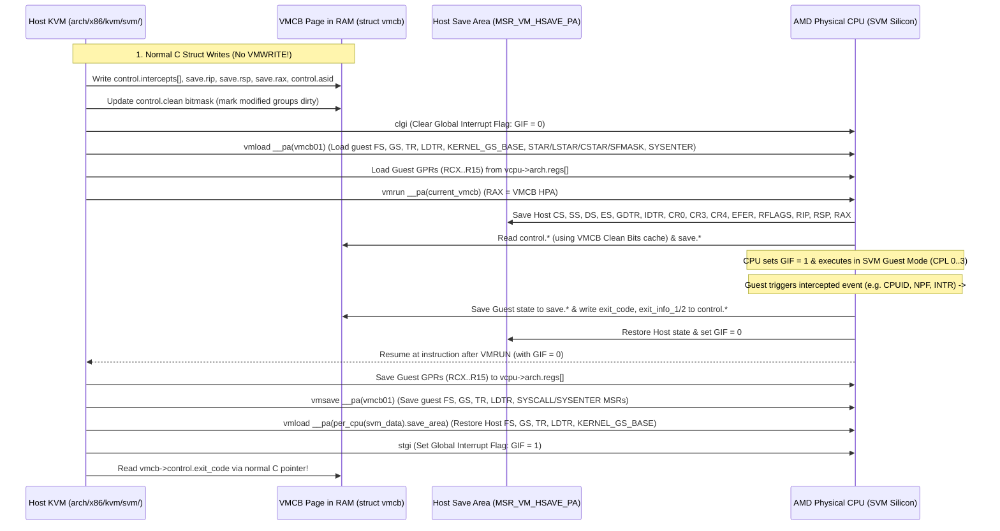

#### 2.5.1 SVM Hardware Enablement: `EFER.SVME`, `MSR_VM_CR`, and `MSR_VM_HSAVE_PA`

Let's trace how KVM verifies and enables AMD SVM on each logical processor across [`arch/x86/virt/hw.c`](https://kernel.googlesource.com/pub/scm/virt/kvm/kvm.git/+/refs/heads/master/arch/x86/virt/hw.c) and [`arch/x86/kvm/svm/svm.c`](https://kernel.googlesource.com/pub/scm/virt/kvm/kvm.git/+/refs/heads/master/arch/x86/kvm/svm/svm.c):

1. **CPUID & BIOS Lock Discovery (`MSR_VM_CR` `0xc0010114`)**:
   - First, the CPU must report `CPUID.80000001H:ECX.SVM[bit 2] == 1` (`X86_FEATURE_SVM`).
   - Second, just as Intel has `MSR_IA32_FEAT_CTL`, AMD provides `MSR_VM_CR` (`0xc0010114`, defined in [`arch/x86/include/asm/msr-index.h`](https://kernel.googlesource.com/pub/scm/virt/kvm/kvm.git/+/refs/heads/master/arch/x86/include/asm/msr-index.h) lines 1302–1308). If bit 4 (`SVM_VM_CR_SVM_DIS_MASK`, `0x0010`) of `MSR_VM_CR` is set to `1`, SVM instructions are disabled and setting `EFER.SVME` raises `#GP(0)`. If bit 3 (`SVM_VM_CR_SVM_LOCK_MASK`, `0x0008`) is also set to `1`, `SVM_DIS` is locked by BIOS and cannot be cleared by software without a platform reset.
2. **Per-CPU Host Save Area Allocation (`svm_cpu_init`)**:
   When `kvm-amd.ko` initializes (`svm_init()` -> `svm_hardware_setup()`), it calls [`svm_cpu_init(cpu)`](https://kernel.googlesource.com/pub/scm/virt/kvm/kvm.git/+/refs/heads/master/arch/x86/kvm/svm/svm.c) for every possible CPU:

```c
// Source: arch/x86/kvm/svm/svm.c (lines 616-639)
static int svm_cpu_init(int cpu)
{
	struct svm_cpu_data *sd = per_cpu_ptr(&svm_data, cpu);
	struct page *save_area_page;
	int ret = -ENOMEM;

	memset(sd, 0, sizeof(struct svm_cpu_data));
	save_area_page = snp_safe_alloc_page_node(cpu_to_node(cpu), GFP_KERNEL);
	if (!save_area_page)
		return ret;

	ret = sev_cpu_init(sd);
	if (ret)
		goto free_save_area;

	sd->save_area = page_address(save_area_page);
	sd->save_area_pa = __sme_page_pa(save_area_page);
	return 0;

free_save_area:
	__free_page(save_area_page);
	return ret;
}
```

Notice two crucial details in `svm_cpu_init()`:
- Why `snp_safe_alloc_page_node()`? On AMD EPYC processors with **SEV-SNP** (Secure Nested Paging) enabled, the Reverse Map Table (RMP) tracks the ownership of every 4 KiB physical page. Pages allocated for hypervisor control structures (like the Host Save Area or a VMCB) must be in the **Hypervisor/Shared** RMP state and 4 KiB-aligned so hardware does not trigger an RMP fault during `VMRUN`/`VMSAVE`.
- Why `__sme_page_pa(save_area_page)`? On systems with **SME** (Secure Memory Encryption) active on the host kernel, physical addresses accessed by the CPU's virtualization engine on behalf of the host must have the hardware C-bit (encryption bit) set in the physical address (`__sme_set(page_to_pfn(page) << PAGE_SHIFT)`).

3. **Per-CPU SVM Enablement (`svm_enable_virtualization_cpu` and `x86_svm_enable_virtualization_cpu`)**:
   When the first VM is created (or a CPU comes online), [`svm_enable_virtualization_cpu()`](https://kernel.googlesource.com/pub/scm/virt/kvm/kvm.git/+/refs/heads/master/arch/x86/kvm/svm/svm.c) executes on that physical CPU:

```c
// Source: arch/x86/kvm/svm/svm.c (lines 562-601)
static int svm_enable_virtualization_cpu(void)
{

	struct svm_cpu_data *sd;
	int me = raw_smp_processor_id();
	int r;

	r = x86_virt_get_ref(X86_FEATURE_SVM);
	if (r)
		return r;

	sd = per_cpu_ptr(&svm_data, me);
	/*
	 * Bump the current asid_generation value to ensure any vCPU that
	 * previously ran on this CPU sees a stale generation and is forced
	 * to acquire a new ASID, preventing a latent ASID collision.
	 */
	sd->asid_generation++;
	sd->max_asid = cpuid_ebx(SVM_CPUID_FUNC) - 1;
	sd->next_asid = sd->max_asid + 1;
	sd->min_asid = max_sev_asid + 1;

	wrmsrq(MSR_VM_HSAVE_PA, sd->save_area_pa);

	if (cpu_feature_enabled(X86_FEATURE_TSCRATEMSR)) {
		/*
		 * Set the default value, even if we don't use TSC scaling
		 * to avoid having stale value in the msr
		 */
		__svm_write_tsc_multiplier(SVM_TSC_RATIO_DEFAULT);
	}

	svm_init_os_visible_workarounds();

	svm_init_erratum_383();

	amd_pmu_enable_virt();

	return 0;
}
```

Trace what happens here:
- `x86_virt_get_ref(X86_FEATURE_SVM)` calls `x86_svm_enable_virtualization_cpu()` (in [`arch/x86/virt/hw.c`](https://kernel.googlesource.com/pub/scm/virt/kvm/kvm.git/+/refs/heads/master/arch/x86/virt/hw.c)), which reads `MSR_EFER` (`0xc0000080`) and sets bit 12 (**`EFER_SVME`**, Secure Virtual Machine Enable):
  ```c
  rdmsrq(MSR_EFER, efer);
  if (efer & EFER_SVME)
      return -EBUSY;
  wrmsrq(MSR_EFER, efer | EFER_SVME);
  ```
- Next, `svm_enable_virtualization_cpu()` initializes the per-CPU **Address Space Identifier (ASID)** allocator (`sd->asid_generation++`, `sd->max_asid = cpuid_ebx(0x8000000a) - 1`, `sd->min_asid = max_sev_asid + 1`). Note how SEV/SEV-ES/SEV-SNP guests consume the low ASIDs (`1 .. max_sev_asid`) because SEV ties each guest's memory encryption key to its ASID, whereas non-SEV guests dynamically rotate through `[max_sev_asid + 1 .. max_asid]`!
- Then, `wrmsrq(MSR_VM_HSAVE_PA, sd->save_area_pa)` writes the physical address of the per-CPU Host Save Area (`struct vmcb *save_area`) into `MSR_VM_HSAVE_PA` (`0xc0010117`). Whenever `VMRUN` executes on this logical processor, hardware automatically writes the host's architectural registers into the `save` area of the page at `MSR_VM_HSAVE_PA` and reloads them from that page on `#VMEXIT`.

#### 2.5.2 Exact Byte-by-Byte Anatomy of the 4 KiB VMCB (`struct vmcb`)

Let's examine [`struct vmcb`](https://kernel.googlesource.com/pub/scm/virt/kvm/kvm.git/+/refs/heads/master/arch/x86/include/asm/svm.h) in [`arch/x86/include/asm/svm.h`](https://kernel.googlesource.com/pub/scm/virt/kvm/kvm.git/+/refs/heads/master/arch/x86/include/asm/svm.h) (lines 124–605). Unlike Intel's opaque VMCS, the AMD VMCB has a strict, compile-time-verified binary layout enforced by `BUILD_BUG_ON` assertions in `__unused_size_checks()`:
- **Region 1: `struct vmcb_control_area` (`0x000` .. `0x3ff`, exactly 1024 bytes / `0x400` bytes)**
- **Region 2: `struct vmcb_save_area` (`0x400` .. `0x6e7`, 744 bytes for standard/SEV guests) or `struct sev_es_save_area` (`0x400` .. `0xa6f`, 1648 bytes for SEV-ES/SNP VMSA and Host Save Area)**

```
+===================================================================================+
|                     AMD 4 KiB VMCB MEMORY LAYOUT (struct vmcb)                    |
|                Defined in arch/x86/include/asm/svm.h (lines 124-573)              |
+===================================================================================+
| VMCB Offset | Field Name & C Type            | Description                        |
+=============+================================+====================================+
|             | PART 1: struct vmcb_control_area (Offsets 0x000 .. 0x3FF, 1024 B)   |
+-------------+--------------------------------+------------------------------------+
| 0x000..0x017| u32 intercepts[6]              | 6 x 32-bit Intercept Words:        |
|   0x000     |   [0] INTERCEPT_CR             |    Bits 15:0 CR0-15 Rd, 31:16 Wr    |
|   0x004     |   [1] INTERCEPT_DR             |    Bits 15:0 DR0-15 Rd, 31:16 Wr    |
|   0x008     |   [2] INTERCEPT_EXCEPTION      |    Bits 31:0 Exception Vectors 0-31 |
|   0x00C     |   [3] INTERCEPT_WORD3          |    INTR,NMI,SMI,CPUID,HLT,IO,MSR... |
|   0x010     |   [4] INTERCEPT_WORD4          |    VMRUN,VMMCALL,STGI,CLGI,TRAP...  |
|   0x014     |   [5] INTERCEPT_WORD5          |    INVLPGB,INVPCID,BUSLOCK,IDLE_HLT |
| 0x018..0x03B| u32 reserved_1[9]              | Reserved (36 bytes)                |
| 0x03C..0x03D| u16 pause_filter_thresh        | Pause loop exit threshold          |
| 0x03E..0x03F| u16 pause_filter_count         | Pause loop filter count            |
| 0x040..0x047| u64 iopm_base_pa               | HPA of 12 KiB I/O Permission Map   |
| 0x048..0x04F| u64 msrpm_base_pa              | HPA of 8 KiB MSR Permission Map    |
| 0x050..0x057| u64 tsc_offset                 | Guest TSC Offset                   |
| 0x058..0x05B| u32 asid                       | Guest Address Space ID (TLB tag)   |
| 0x05C       | u8  tlb_ctl                    | TLB flush control on VMRUN         |
| 0x05D       | u8  erap_ctl                   | Enhanced Return Address Pred Ctrl  |
| 0x060..0x063| u32 int_ctl                    | V_TPR, V_IRQ, V_GIF, V_NMI, AVIC   |
| 0x064..0x067| u32 int_vector                 | Virtual interrupt vector to inject |
| 0x068..0x06B| u32 int_state                  | Interrupt shadow (bit 0) & mask    |
| 0x070..0x077| u64 exit_code                  | #VMEXIT Reason (e.g. SVM_EXIT_NPF) |
| 0x078..0x07F| u64 exit_info_1                | #VMEXIT Qualification / Error Code |
| 0x080..0x087| u64 exit_info_2                | #VMEXIT Faulting GPA (NPF) or Rip  |
| 0x088..0x08B| u32 exit_int_info              | Interrupted IDT event on #VMEXIT   |
| 0x08C..0x08F| u32 exit_int_info_err          | Error code for exit_int_info       |
| 0x090..0x097| u64 misc_ctl                   | Bit 0: NP (NPT), Bit 1: SEV,       |
|             |                                | Bit 2: SEV-ES, Bit 3: GMET         |
| 0x098..0x09F| u64 avic_vapic_bar             | AVIC APIC Base Address             |
| 0x0A0..0x0A7| u64 ghcb_gpa                   | Guest-Hypervisor Comm Block GPA    |
| 0x0A8..0x0AB| u32 event_inj                  | Event Injection (Vector,Type,Valid)|
| 0x0AC..0x0AF| u32 event_inj_err              | Event Injection Error Code         |
| 0x0B0..0x0B7| u64 nested_cr3                 | Nested Page Table Root HPA (nCR3)  |
| 0x0B8..0x0BF| u64 misc_ctl2                  | Bit 0: V_LBR, Bit 1: V_VMLOAD/SAVE |
| 0x0C0..0x0C3| u32 clean                      | VMCB Clean Bits (bits 0..12, 31)   |
| 0x0C8..0x0CF| u64 next_rip                   | Next sequential RIP (NRIPS)        |
| 0x0D0       | u8  insn_len                   | Fetched instruction length (0..15) |
| 0x0D1..0x0DF| u8  insn_bytes[15]             | Fetched instruction bytes on exit  |
| 0x0E0..0x0FF| u64 avic_backing_page, ...     | AVIC Backing Page, Logical/Phys ID |
| 0x108..0x10F| u64 vmsa_pa                    | HPA of encrypted VMSA (SEV-ES/SNP) |
| 0x3E0..0x3FF| u8  reserved_sw[32]            | 32B software/Hyper-V enlightenments|
+=============+================================+====================================+
|             | PART 2: struct vmcb_save_area (VMCB Offset 0x400 + Save Offset)     |
+-------------+--------------------------------+------------------------------------+
| 0x400..0x49F| struct vmcb_seg es..tr (10x16B)| ES,CS,SS,DS,FS,GS,GDTR,LDTR,IDTR,TR|
|             |   {u16 sel, u16 attr, u32 lim, u64 base}                            |
| 0x4CA       | u8  vmpl                       | SEV-SNP VM Permission Level (0..3) |
| 0x4CB       | u8  cpl                        | Guest Current Privilege Level (0..3|
| 0x4D0..0x4D7| u64 efer                       | Guest IA32_EFER                    |
| 0x548..0x55F| u64 cr4, cr3, cr0              | Guest CR4 (0x548), CR3, CR0 (0x558)|
| 0x560..0x56F| u64 dr7, dr6                   | Guest DR7 (0x560), DR6 (0x568)     |
| 0x570..0x57F| u64 rflags, rip                | Guest RFLAGS (0x570), RIP (0x578)  |
| 0x5D8..0x5DF| u64 rsp                        | Guest RSP (Save offset 0x1D8)      |
| 0x5E0..0x5F7| u64 s_cet, ssp, isst_addr      | Guest CET Shadow Stack registers   |
| 0x5F8..0x5FF| u64 rax                        | Guest RAX (Save offset 0x1F8)      |
| 0x600..0x627| u64 star,lstar,cstar,sfmask,   | SYSCALL MSRs & KERNEL_GS_BASE      |
|             |     kernel_gs_base             | (Loaded/saved by VMLOAD / VMSAVE!) |
| 0x628..0x63F| u64 sysenter_cs, esp, eip      | Guest SYSENTER MSRs                |
| 0x640..0x647| u64 cr2                        | Guest CR2 (Page Fault Linear Addr) |
| 0x668..0x697| u64 g_pat, dbgctl, br_from/to  | Guest IA32_PAT & LBR registers     |
| 0x6E0..0x6E7| u64 spec_ctrl                  | Guest SPEC_CTRL (Save offset 0x2E0)|
+===================================================================================+
```

Let's examine the C definition of `struct vmcb_control_area` and `struct vmcb_save_area` in [`arch/x86/include/asm/svm.h`](https://kernel.googlesource.com/pub/scm/virt/kvm/kvm.git/+/refs/heads/master/arch/x86/include/asm/svm.h) to see how cleanly this maps to C:

```c
// Source: arch/x86/include/asm/svm.h (lines 124-177, 324-373, 540-553)
struct __attribute__ ((__packed__)) vmcb_control_area {
	u32 intercepts[MAX_INTERCEPT];
	u32 reserved_1[15 - MAX_INTERCEPT];
	u16 pause_filter_thresh;
	u16 pause_filter_count;
	u64 iopm_base_pa;
	u64 msrpm_base_pa;
	u64 tsc_offset;
	u32 asid;
	u8 tlb_ctl;
	u8 erap_ctl;
	u8 reserved_2[2];
	u32 int_ctl;
	u32 int_vector;
	u32 int_state;
	u8 reserved_3[4];
	u64 exit_code;
	u64 exit_info_1;
	u64 exit_info_2;
	u32 exit_int_info;
	u32 exit_int_info_err;
	u64 misc_ctl;
	u64 avic_vapic_bar;
	u64 ghcb_gpa;
	u32 event_inj;
	u32 event_inj_err;
	u64 nested_cr3;
	u64 misc_ctl2;
	u32 clean;
	u32 reserved_5;
	u64 next_rip;
	u8 insn_len;
	u8 insn_bytes[15];
	u64 avic_backing_page;	/* Offset 0xe0 */
	u8 reserved_6[8];	/* Offset 0xe8 */
	u64 avic_logical_id;	/* Offset 0xf0 */
	u64 avic_physical_id;	/* Offset 0xf8 */
	u8 reserved_7[8];
	u64 vmsa_pa;		/* Used for an SEV-ES guest */
	u8 reserved_8[16];
	u16 bus_lock_counter;		/* Offset 0x120 */
	u8 reserved_9[22];
	u64 allowed_sev_features;	/* Offset 0x138 */
	u64 guest_sev_features;		/* Offset 0x140 */
	u8 reserved_10[664];
	/*
	 * Offset 0x3e0, 32 bytes reserved
	 * for use by hypervisor/software.
	 */
	union {
		struct hv_vmcb_enlightenments hv_enlightenments;
		u8 reserved_sw[32];
	};
};
```

##### 2.5.2.1 VMCB Clean Bits (`vmcb->control.clean`) and Hardware Control Caching

Wait: if AMD SVM stores the entire VMCB in ordinary DRAM and `VMRUN %rax` takes a physical memory address rather than using an on-core VMCS cache via `VMWRITE`, doesn't the AMD CPU have to re-read 1,024 bytes of `vmcb_control_area` and 744 bytes of `vmcb_save_area` from memory on *every single `VMRUN`*?

To avoid reading unchanged VMCB fields on every `VMRUN`, AMD introduced **VMCB Clean Bits** (`vmcb->control.clean` at offset `0x0c0`, advertised by `CPUID.8000000AH:EDX[bit 5]`). Each bit in the 32-bit `vmcb->control.clean` field corresponds to a logical group of VMCB control/save fields, defined in [`arch/x86/kvm/svm/svm.h`](https://kernel.googlesource.com/pub/scm/virt/kvm/kvm.git/+/refs/heads/master/arch/x86/kvm/svm/svm.h) (lines 66–97):

```c
// Source: arch/x86/kvm/svm/svm.h (lines 66-97, 455-470)
enum {
	VMCB_INTERCEPTS, /* Intercept vectors, TSC offset,
			    pause filter count */
	VMCB_PERM_MAP,   /* IOPM Base and MSRPM Base */
	VMCB_ASID,	 /* ASID */
	VMCB_INTR,	 /* int_ctl, int_vector */
	VMCB_NPT,        /* npt_en, nCR3, gPAT */
	VMCB_CR,	 /* CR0, CR3, CR4, EFER */
	VMCB_DR,         /* DR6, DR7 */
	VMCB_DT,         /* GDT, IDT */
	VMCB_SEG,        /* CS, DS, SS, ES, CPL */
	VMCB_CR2,        /* CR2 only */
	VMCB_LBR,        /* DBGCTL, BR_FROM, BR_TO, LAST_EX_FROM, LAST_EX_TO */
	VMCB_AVIC,       /* AVIC APIC_BAR, AVIC APIC_BACKING_PAGE,
			  * AVIC PHYSICAL_TABLE pointer,
			  * AVIC LOGICAL_TABLE pointer
			  */
	VMCB_CET,	 /* S_CET, SSP, ISST_ADDR */
	VMCB_SW = 31,    /* Reserved for hypervisor/software use */
};

#define VMCB_ALL_CLEAN_MASK (					\
	(1U << VMCB_INTERCEPTS) | (1U << VMCB_PERM_MAP) |	\
	(1U << VMCB_ASID) | (1U << VMCB_INTR) |			\
	(1U << VMCB_NPT) | (1U << VMCB_CR) | (1U << VMCB_DR) |	\
	(1U << VMCB_DT) | (1U << VMCB_SEG) | (1U << VMCB_CR2) |	\
	(1U << VMCB_LBR) | (1U << VMCB_AVIC) | (1U << VMCB_CET) | \
	(1U << VMCB_SW))

/* TPR and CR2 are always written before VMRUN */
#define VMCB_ALWAYS_DIRTY_MASK	((1U << VMCB_INTR) | (1U << VMCB_CR2))

static inline void vmcb_mark_all_dirty(struct vmcb *vmcb)
{
	vmcb->control.clean = 0;
}

static inline void vmcb_mark_all_clean(struct vmcb *vmcb)
{
	vmcb->control.clean = VMCB_ALL_CLEAN_MASK
			       & ~VMCB_ALWAYS_DIRTY_MASK;
}

static inline void vmcb_mark_dirty(struct vmcb *vmcb, int bit)
{
	vmcb->control.clean &= ~(1 << bit);
}
```

Here is how the VMCB Clean Bits protocol works between KVM and the AMD CPU:
- When a bit in `vmcb->control.clean` is **`0` (Dirty)** on `VMRUN`, the processor reads that group of fields from the VMCB in memory and caches them inside the CPU core.
- Immediately after `VMRUN` completes and `#VMEXIT` returns to KVM, KVM calls `vmcb_mark_all_clean(svm->vmcb)`, which sets all clean bits to **`1` (Clean)** except `VMCB_INTR` (bit 3) and `VMCB_CR2` (bit 9) (`VMCB_ALWAYS_DIRTY_MASK`, because KVM updates virtual interrupt state and `CR2` inline before `VMRUN`).
- Whenever KVM modifies a VMCB field in C during exit handling—for example, changing an intercept via `svm_set_intercept()`, updating `CR0`/`CR4` via `svm_set_cr0()`, or updating `g_pat` via `vmcb_set_gpat()`—KVM explicitly calls `vmcb_mark_dirty(vmcb, VMCB_*)` to clear the corresponding bit in `vmcb->control.clean` back to `0`!
- On the next `VMRUN`, for any bit in `vmcb->control.clean` that is still **`1` (Clean)**, the CPU completely skips reading those fields from the VMCB in memory and reuses its internal cached values from the previous `VMRUN` on that CPU! And if a vCPU migrates to a different physical CPU, KVM calls `vmcb_mark_all_dirty(svm->vmcb)` (`vmcb->control.clean = 0`) so the new CPU loads every field fresh from memory.

###### 2.5.2.1.1 Low-Level SVM Instructions (`svm_ops.h`) and the Split State Dance (`VMRUN` + `VMLOAD`/`VMSAVE` + `CLGI`/`STGI`)

Why does `__svm_vcpu_run()` in [`arch/x86/kvm/svm/vmenter.S`](https://kernel.googlesource.com/pub/scm/virt/kvm/kvm.git/+/refs/heads/master/arch/x86/kvm/svm/vmenter.S) execute `vmload`, then `vmrun`, then `vmsave`, then a second `vmload`? And why does `svm_vcpu_run()` bracket the world switch with `clgi()` and `stgi()` from [`arch/x86/kvm/svm/svm_ops.h`](https://kernel.googlesource.com/pub/scm/virt/kvm/kvm.git/+/refs/heads/master/arch/x86/kvm/svm/svm_ops.h)?

Let's inspect [`arch/x86/kvm/svm/svm_ops.h`](https://kernel.googlesource.com/pub/scm/virt/kvm/kvm.git/+/refs/heads/master/arch/x86/kvm/svm/svm_ops.h) (lines 9–63) first:

```c
// Source: arch/x86/kvm/svm/svm_ops.h (lines 9-63)
#define svm_asm(insn, clobber...)				\
do {								\
	asm goto("1: " __stringify(insn) "\n\t"	\
			  _ASM_EXTABLE(1b, %l[fault])		\
			  ::: clobber : fault);			\
	return;							\
fault:								\
	kvm_spurious_fault();					\
} while (0)

#define svm_asm1(insn, op1, clobber...)				\
do {								\
	asm goto("1: "  __stringify(insn) " %0\n\t"	\
			  _ASM_EXTABLE(1b, %l[fault])		\
			  :: op1 : clobber : fault);		\
	return;							\
fault:								\
	kvm_spurious_fault();					\
} while (0)

#define svm_asm2(insn, op1, op2, clobber...)				\
do {									\
	asm goto("1: "  __stringify(insn) " %1, %0\n\t"	\
			  _ASM_EXTABLE(1b, %l[fault])			\
			  :: op1, op2 : clobber : fault);		\
	return;								\
fault:									\
	kvm_spurious_fault();						\
} while (0)

static inline void clgi(void)
{
	svm_asm(clgi);
}

static inline void stgi(void)
{
	svm_asm(stgi);
}

static inline void invlpga(unsigned long addr, u32 asid)
{
	svm_asm2(invlpga, "c"(asid), "a"(addr));
}

static __always_inline void vmsave(unsigned long pa)
{
	svm_asm1(vmsave, "a" (pa), "memory");
}
```

Understanding these five instructions reveals the deepest architectural rationale of AMD SVM:

1. **Why Split `VMRUN` from `VMLOAD` / `VMSAVE`?**
   To make `VMRUN` and `#VMEXIT` as fast as possible in hardware, AMD designed `VMRUN` (and `#VMEXIT`) to context-switch **only the subset of processor state required for the hypervisor kernel to execute in 64-bit Ring 0**:
   - `VMRUN` / `#VMEXIT` switches: `CS`, `SS`, `DS`, `ES`, `GDTR`, `IDTR`, `CPL`, `EFER`, `CR0`, `CR2`, `CR3`, `CR4`, `RFLAGS`, `RIP`, `RSP`, `RAX`, `DR6`, `DR7`, `G_PAT`, and `S_CET`/`SSP`/`ISST_ADDR`.
   - `VMRUN` / `#VMEXIT` **intentionally does NOT switch** `FS`, `GS`, `TR`, `LDTR`, `MSR_KERNEL_GS_BASE`, `MSR_IA32_STAR`, `MSR_IA32_LSTAR`, `MSR_IA32_CSTAR`, `MSR_IA32_SFMASK`, `MSR_IA32_SYSENTER_CS`, `MSR_IA32_SYSENTER_ESP`, or `MSR_IA32_SYSENTER_EIP`!
   Why did AMD omit those registers from `VMRUN`? Because if a lightweight hypervisor only needs to handle a quick in-kernel `#VMEXIT` and does not use `FS`, `TR`, `LDTR`, or `SYSCALL`/`SYSENTER` inside its immediate exit handler, hardware saves dozens of clock cycles by not touching them!
   Instead, AMD provides two dedicated companion instructions—**`VMLOAD %rax`** and **`VMSAVE %rax`**—which load and save *specifically* that omitted subset (`FS`, `GS`, `TR`, `LDTR`, `KERNEL_GS_BASE`, `STAR`, `LSTAR`, `CSTAR`, `SFMASK`, `SYSENTER_CS/ESP/EIP`) from/to the VMCB page whose physical address is in `RAX`!
   Because the Linux kernel relies heavily on **`GS.base`** (`PER_CPU_VAR(...)`) for all per-CPU variables (`current`, `smp_processor_id()`, `svm_data`), look at what [`__svm_vcpu_run()`](https://kernel.googlesource.com/pub/scm/virt/kvm/kvm.git/+/refs/heads/master/arch/x86/kvm/svm/vmenter.S) in [`arch/x86/kvm/svm/vmenter.S`](https://kernel.googlesource.com/pub/scm/virt/kvm/kvm.git/+/refs/heads/master/arch/x86/kvm/svm/vmenter.S) (lines 60–134) does:
   - Before overwriting host `GS.base` with the guest's `GS.base`, line 60 pushes `PER_CPU_VAR(svm_data + SD_save_area_pa)` (the host physical address of the per-CPU `save_area` VMCB, where host `FS`/`GS`/`TR`/`LDTR`/`KERNEL_GS_BASE` were saved during `svm_prepare_switch_to_guest()` via `vmsave(sd->save_area_pa)`) onto the host stack!
   - Lines 83–84 execute `mov SVM_vmcb01_pa(%_ASM_DI), %_ASM_AX` followed by **`vmload %_ASM_AX`**, loading the guest's `FS`, `GS`, `TR`, `LDTR`, `KERNEL_GS_BASE`, and `SYSCALL`/`SYSENTER` MSRs from `vmcb01` into the CPU. (Notice that after line 84, `GS.base` holds the *guest's* `GS` base, so the host kernel cannot access any `per_cpu` variables until after exit!)
   - Line 107 executes **`vmrun %_ASM_AX`** (with `RAX = svm->current_vmcb->pa`).
   - Immediately after `#VMEXIT` resumes at line 110, lines 126–127 execute **`vmsave %_ASM_AX`** (`RAX = svm->vmcb01.pa`) to save the guest's updated `FS`, `GS`, `TR`, `LDTR`, `KERNEL_GS_BASE`, and `SYSCALL`/`SYSENTER` MSRs back into `vmcb01`.
   - Lines 131–132 pop `sd->save_area_pa` into `RAX` and execute **`vmload %_ASM_AX`**, immediately restoring the host kernel's `GS.base` (so per-CPU variables work again!), `FS`, `TR`, `LDTR`, and `KERNEL_GS_BASE`!

2. **Why `CLGI` and `STGI` (Global Interrupt Flag, `GIF`)?**
   Consider what happens during that window between `vmload vmcb01` (line 84 of `vmenter.S`) and `vmload sd->save_area_pa` (line 132 of `vmenter.S`): the CPU is in **Host Mode**, `RFLAGS.IF` is `0` (masking normal external interrupts), **but `GS.base` and `TR` belong to the guest**! What if a **Non-Maskable Interrupt (NMI)** or **System Management Interrupt (SMI)** or `INIT` arrived at line 85 or line 115, while `GS.base` still held the guest's `GS.base`? The host Linux NMI handler would execute using a stale or guest-controlled `GS.base` before `SWAPGS` could sort it out, or an interrupt after `#VMEXIT` would fire before KVM finished restoring host state!
   To make the world-switch transition completely atomic with respect to *all* interrupts (including NMIs, SMIs, and `INIT`), AMD SVM provides a hardware **Global Interrupt Flag (`GIF`)** controlled by **`CLGI`** (`GIF = 0`) and **`STGI`** (`GIF = 1`):
   - When `GIF == 0`, **all external interrupts, NMIs, `INIT` signals, and debug traps are held pending in hardware**, regardless of `RFLAGS.IF`!
   - Before entering `__svm_vcpu_run()`, KVM executes `clgi()` (or relies on hardware clearing `GIF = 0` on `#VMEXIT`).
   - When `VMRUN` enters Guest Mode, hardware automatically sets `GIF = 1` (or, when Virtual GIF `vgif` is enabled via `V_GIF_ENABLE_MASK` in `vmcb->control.int_ctl`, hardware sets the physical `GIF = 1` and controls guest interrupts via the virtual `V_GIF_MASK` bit 9 in `int_ctl`).
   - When `#VMEXIT` transitions the CPU from Guest Mode back to Host Mode, **hardware atomically clears `GIF = 0`**! This guarantees that when execution lands at line 110 of `__svm_vcpu_run()`, not even an NMI can interrupt the host CPU until KVM has finished saving guest GPRs, executing `vmsave(vmcb01)`, executing `vmload(sd->save_area_pa)` to restore host `GS.base`, mitigating RETBleed (`UNTRAIN_RET_VM`), and explicitly re-enabling interrupts via `stgi()`!

3. **How `INVLPGA` Flushes Tagged TLB Entries (`invlpga(addr, asid)`)**:
   Whereas Intel VMX requires a 128-bit memory operand for `INVVPID` and `INVEPT`, AMD SVM's **`INVLPGA`** (`svm_asm2(invlpga, "c"(asid), "a"(addr))`) takes the virtual address to invalidate in `RAX` and the 32-bit target `ASID` in `ECX`, invalidating the TLB entry for `(addr, asid)` across the coherence domain in a single register-only instruction! And to flush an entire ASID upon `VMRUN`, KVM simply sets `svm->vmcb->control.tlb_ctl = TLB_CONTROL_FLUSH_ASID` (`3`) or `TLB_CONTROL_FLUSH_ASID_LOCAL` (`7`).

##### 2.5.2.2 Side-by-Side Architectural Synthesis: Intel VMX vs AMD SVM in KVM

Before we move to hands-on exercises, let's compare how Intel VMX and AMD SVM implement the exact same hypervisor primitives inside `arch/x86/kvm/vmx/` and `arch/x86/kvm/svm/`, including MSR permission bitmaps and Confidential Computing extensions (Intel TDX vs AMD SEV-ES/SNP):

| Virtualization Mechanism | Intel VMX (`arch/x86/kvm/vmx/`) | AMD SVM (`arch/x86/kvm/svm/`) |
| :--- | :--- | :--- |
| **Root/Host Mode Enable** | Set `CR4.VMXE = 1`, allocate 4 KiB `root_vmcs` with `hdr.revision_id`, execute `VMXON __pa(root_vmcs)` (`x86_virt_cpu_vmxon()`). | Set `EFER.SVME = 1` (`wrmsrq(MSR_EFER, efer \| EFER_SVME)`), allocate 4 KiB `save_area` and write `wrmsrq(MSR_VM_HSAVE_PA, sd->save_area_pa)`. |
| **Control Structure** | `struct vmcs` (4 KiB, opaque after 8-byte header). Accessed via `VMREAD` / `VMWRITE` using 32-bit `enum vmcs_field` encodings. | `struct vmcb` (4 KiB: 1024-byte `control` + 744-byte `save`). Accessed directly via C struct pointers (`svm->vmcb->...`). |
| **Control Caching** | Hardware VMCS cache managed via `VMPTRLD` (`vmcs_load`) and `VMCLEAR` (`vmcs_clear`), plus software `struct vmcs_controls_shadow`. | Hardware VMCB cache controlled by 32-bit `vmcb->control.clean` bitmask (`VMCB_INTERCEPTS`..`VMCB_CET`, `vmcb_mark_dirty()`). |
| **World-Switch Instructions** | `VMLAUNCH` (if `loaded_vmcs->launched == 0`) or `VMRESUME` (if `launched == 1`). | `VMLOAD vmcb01` $\to$ `VMRUN current_vmcb` $\to$ `VMSAVE vmcb01` $\to$ `VMLOAD host_save_area`, bracketed by `CLGI` / `STGI`. |
| **GPR Context Switch** | Hardware switches only `RSP`. KVM switches `RAX`..`R15` in `__vmx_vcpu_run` (`arch/x86/kvm/vmx/vmenter.S`). | Hardware switches `RSP` and `RAX`. KVM switches `RCX`..`R15` in `__svm_vcpu_run` (`arch/x86/kvm/svm/vmenter.S`). |
| **MSR Permission Bitmap** | 4 KiB page (`loaded_vmcs->msr_bitmap`, 1 bit per MSR per direction):<br/>• `0x000..0x3ff`: Read-Low (`0x00000000..0x00001fff`)<br/>• `0x400..0x7ff`: Read-High (`0xc0000000..0xc0001fff`)<br/>• `0x800..0xbff`: Write-Low (`0x00000000..0x00001fff`)<br/>• `0xc00..0xfff`: Write-High (`0xc0000000..0xc0001fff`) | 8 KiB allocation (`svm->msrpm`, `MSRPM_SIZE = PAGE_SIZE * 2`, **2 bits per MSR** interleaved `[Read=bit 0, Write=bit 1]` across three 2 KiB ranges):<br/>• Range 0 (`0x0000..0x07ff`): `0x00000000..0x00001fff`<br/>• Range 1 (`0x0800..0x0fff`): `0xc0000000..0xc0001fff`<br/>• Range 2 (`0x1000..0x17ff`): `0xc0010000..0xc0011fff` |
| **I/O Permission Bitmap** | Two 4 KiB pages (`IO_BITMAP_A` for ports `0x0000..0x7fff`, `IO_BITMAP_B` for ports `0x8000..0xffff`), or `CPU_BASED_UNCOND_IO_EXITING`. | 12 KiB allocation (`IOPM_SIZE = PAGE_SIZE * 3`, `iopm_base_pa`): 8 KiB (65,536 bits) for ports `0x0000..0xffff` + trailing padding for multi-byte port reads at `0xffff`. |
| **Partial `CR0`/`CR4` Ownership** | Fine-grained per-bit ownership via `CR0_GUEST_HOST_MASK` (`0x6000`), `CR0_READ_SHADOW` (`0x6004`), `CR4_GUEST_HOST_MASK` (`0x6002`), and `CR4_READ_SHADOW` (`0x6006`). | Coarse `INTERCEPT_CR0_READ/WRITE` & `INTERCEPT_CR4_READ/WRITE`, plus `INTERCEPT_SELECTIVE_CR0` (which intercepts writes to any `CR0` bit *other* than `CR0.TS` and `CR0.MP`, `SVM_CR0_SELECTIVE_MASK`) and post-execution `TRAP_CR0_WRITE`/`TRAP_CR4_WRITE`. |
| **TLB Tagging & Flush** | 16-bit `VIRTUAL_PROCESSOR_ID` (`VPID`, `0x0000`) + `INVVPID` (`__invvpid`) and `INVEPT` (`__invept`) with 128-bit memory descriptors. | 32-bit `vmcb->control.asid` (`0x058`) + `vmcb->control.tlb_ctl` on `VMRUN` + register-based `INVLPGA %rax, %ecx` (`invlpga(addr, asid)`). |
| **Confidential Computing** | **Intel TDX**: Dispatches via `vt_x86_ops` in `arch/x86/kvm/vmx/main.c` (`is_td_vcpu(vcpu)`), using `SEAMCALL` (`tdx.c`) and an encrypted TD-VMCS managed by the TDX Module in SEAM root mode. | **AMD SEV / SEV-ES / SEV-SNP**: Uses `vmcb->control.vmsa_pa` (`0x108`) pointing to an encrypted 1648-byte `struct sev_es_save_area` (VMSA) and an unencrypted 4 KiB `struct ghcb` (`vmcb->control.ghcb_gpa`, `0x0a0`) with `#VMGEXIT` (`0x403`). |

###### 2.5.2.2.1 Comparing MSR Bitmap Encoding in C (`__BUILD_VMX_MSR_BITMAP_HELPER` vs `svm_msrpm_bit_nr`)

To see how a seemingly minor hardware layout difference translates directly into KVM C code, compare how Intel VMX (`arch/x86/kvm/vmx/vmx.h`) and AMD SVM (`arch/x86/kvm/svm/svm.h`) calculate the bit offset for an MSR intercept:

In **Intel VMX** ([`arch/x86/kvm/vmx/vmx.h`](https://kernel.googlesource.com/pub/scm/virt/kvm/kvm.git/+/refs/heads/master/arch/x86/kvm/vmx/vmx.h), lines 438–456), the 4 KiB MSR bitmap separates read bitmaps (`base = 0x000`) and write bitmaps (`base = 0x800`), with 1 bit per MSR:

```c
// Source: arch/x86/kvm/vmx/vmx.h (lines 438-456)
#define __BUILD_VMX_MSR_BITMAP_HELPER(rtype, action, bitop, access, base)      \
static inline rtype vmx_##action##_msr_bitmap_##access(unsigned long *bitmap,  \
						       u32 msr)		       \
{									       \
	int f = sizeof(unsigned long);					       \
									       \
	if (msr <= 0x1fff)						       \
		return bitop##_bit(msr, bitmap + base / f);		       \
	else if ((msr >= 0xc0000000) && (msr <= 0xc0001fff))		       \
		return bitop##_bit(msr & 0x1fff, bitmap + (base + 0x400) / f); \
	return (rtype)true;						       \
}
#define BUILD_VMX_MSR_BITMAP_HELPERS(ret_type, action, bitop)		       \
	__BUILD_VMX_MSR_BITMAP_HELPER(ret_type, action, bitop, read,  0x0)     \
	__BUILD_VMX_MSR_BITMAP_HELPER(ret_type, action, bitop, write, 0x800)
```

In **AMD SVM** ([`arch/x86/kvm/svm/svm.h`](https://kernel.googlesource.com/pub/scm/virt/kvm/kvm.git/+/refs/heads/master/arch/x86/kvm/svm/svm.h), lines 739–788), the 8 KiB MSRPM covers *three* MSR ranges (`0x00000000..0x00001fff`, `0xc0000000..0xc0001fff`, and AMD's `0xc0010000..0xc0011fff`) and interleaves 2 bits per MSR (`bit 0 = read`, `bit 1 = write`):

```c
// Source: arch/x86/kvm/svm/svm.h (lines 739-783)
#define SVM_MSRPM_BYTES_PER_RANGE 2048
#define SVM_BITS_PER_MSR 2
#define SVM_MSRS_PER_BYTE (BITS_PER_BYTE / SVM_BITS_PER_MSR)
#define SVM_MSRS_PER_RANGE (SVM_MSRPM_BYTES_PER_RANGE * SVM_MSRS_PER_BYTE)
static_assert(SVM_MSRS_PER_RANGE == 8192);
#define SVM_MSRPM_OFFSET_MASK (SVM_MSRS_PER_RANGE - 1)

static __always_inline int svm_msrpm_bit_nr(u32 msr)
{
	int range_nr;

	switch (msr & ~SVM_MSRPM_OFFSET_MASK) {
	case 0:
		range_nr = 0;
		break;
	case 0xc0000000:
		range_nr = 1;
		break;
	case 0xc0010000:
		range_nr = 2;
		break;
	default:
		return -EINVAL;
	}

	return range_nr * SVM_MSRPM_BYTES_PER_RANGE * BITS_PER_BYTE +
	       (msr & SVM_MSRPM_OFFSET_MASK) * SVM_BITS_PER_MSR;
}
```

Notice that on both architectures, when KVM allocates a vCPU's MSR bitmap (`alloc_loaded_vmcs()` on Intel, `svm_alloc_permissions_map()` on AMD), it initializes the entire bitmap with `memset(..., 0xff, ...)` so that **every MSR read and write is intercepted by default**, and then selectively clears bits (`vmx_disable_intercept_for_msr()` / `svm_disable_intercept_for_msr()`) only for performance-critical MSRs that are safe for the guest to access directly (`MSR_FS_BASE`, `MSR_GS_BASE`, `MSR_KERNEL_GS_BASE`, `MSR_IA32_STAR`, `MSR_IA32_LSTAR`, `MSR_IA32_CSTAR`, `MSR_IA32_SFMASK`, `MSR_IA32_SYSENTER_*`, `MSR_IA32_SPEC_CTRL`, and x2APIC MSRs when APICv/x2AVIC is active).

---

### 2.6 Hands-On Mastery Exercises

To cement your understanding of Intel VMX and AMD SVM hardware primitives in KVM, complete the following five hands-on engineering exercises. Each exercise builds directly on the structures, bitfields, and algorithms we dissected in this chapter.

---

#### Exercise 2.1: Userspace VMX Capability & Control Negotiation Decoder (`/dev/cpu/0/msr` + `adjust_vmx_controls` Emulator)

**Objective**: Write a standalone C userspace diagnostic tool (`vmx_cap_decoder.c`) that reads the physical Intel VMX capability MSRs (`0x480`..`0x492`) from `/dev/cpu/0/msr` and runs KVM's exact `adjust_vmx_controls()` and `adjust_vmx_controls64()` algorithms from [`arch/x86/kvm/vmx/vmx.c`](https://kernel.googlesource.com/pub/scm/virt/kvm/kvm.git/+/refs/heads/master/arch/x86/kvm/vmx/vmx.c) to compute `struct vmcs_config` and report which VMX controls are Fixed-0, Fixed-1, Flexible, and Enabled by KVM on your CPU.

##### Step 1: Complete C Source Code (`vmx_cap_decoder.c`)

```c
// File: vmx_cap_decoder.c
// Compile: gcc -O2 -Wall -Wextra -o vmx_cap_decoder vmx_cap_decoder.c
// Run:     sudo ./vmx_cap_decoder
#include <stdio.h>
#include <stdint.h>
#include <stdlib.h>
#include <stdbool.h>
#include <fcntl.h>
#include <unistd.h>
#include <errno.h>
#include <string.h>

#define MSR_IA32_FEAT_CTL                0x0000003a
#define MSR_IA32_VMX_BASIC               0x00000480
#define MSR_IA32_VMX_PINBASED_CTLS       0x00000481
#define MSR_IA32_VMX_PROCBASED_CTLS      0x00000482
#define MSR_IA32_VMX_EXIT_CTLS           0x00000483
#define MSR_IA32_VMX_ENTRY_CTLS          0x00000484
#define MSR_IA32_VMX_MISC                0x00000485
#define MSR_IA32_VMX_CR0_FIXED0          0x00000486
#define MSR_IA32_VMX_CR0_FIXED1          0x00000487
#define MSR_IA32_VMX_CR4_FIXED0          0x00000488
#define MSR_IA32_VMX_CR4_FIXED1          0x00000489
#define MSR_IA32_VMX_VMCS_ENUM           0x0000048a
#define MSR_IA32_VMX_PROCBASED_CTLS2     0x0000048b
#define MSR_IA32_VMX_EPT_VPID_CAP        0x0000048c
#define MSR_IA32_VMX_TRUE_PINBASED_CTLS  0x0000048d
#define MSR_IA32_VMX_TRUE_PROCBASED_CTLS 0x0000048e
#define MSR_IA32_VMX_TRUE_EXIT_CTLS      0x0000048f
#define MSR_IA32_VMX_TRUE_ENTRY_CTLS     0x00000490
#define MSR_IA32_VMX_VMFUNC              0x00000491
#define MSR_IA32_VMX_PROCBASED_CTLS3     0x00000492

/* Subset of KVM control bit definitions from arch/x86/include/asm/vmx.h */
#define PIN_BASED_EXT_INTR_MASK          (1U << 0)
#define PIN_BASED_NMI_EXITING            (1U << 3)
#define PIN_BASED_VIRTUAL_NMIS           (1U << 5)
#define PIN_BASED_VMX_PREEMPTION_TIMER   (1U << 6)
#define PIN_BASED_POSTED_INTR            (1U << 7)

#define CPU_BASED_INTR_WINDOW_EXITING    (1U << 2)
#define CPU_BASED_USE_TSC_OFFSETTING     (1U << 3)
#define CPU_BASED_HLT_EXITING            (1U << 7)
#define CPU_BASED_INVLPG_EXITING         (1U << 9)
#define CPU_BASED_MWAIT_EXITING          (1U << 10)
#define CPU_BASED_RDPMC_EXITING          (1U << 11)
#define CPU_BASED_RDTSC_EXITING          (1U << 12)
#define CPU_BASED_CR3_LOAD_EXITING       (1U << 15)
#define CPU_BASED_CR3_STORE_EXITING      (1U << 16)
#define CPU_BASED_ACTIVATE_TERTIARY_CONTROLS (1U << 17)
#define CPU_BASED_CR8_LOAD_EXITING       (1U << 19)
#define CPU_BASED_CR8_STORE_EXITING      (1U << 20)
#define CPU_BASED_TPR_SHADOW             (1U << 21)
#define CPU_BASED_NMI_WINDOW_EXITING     (1U << 22)
#define CPU_BASED_MOV_DR_EXITING         (1U << 23)
#define CPU_BASED_UNCOND_IO_EXITING      (1U << 24)
#define CPU_BASED_USE_IO_BITMAPS         (1U << 25)
#define CPU_BASED_MONITOR_TRAP_FLAG      (1U << 27)
#define CPU_BASED_USE_MSR_BITMAPS        (1U << 28)
#define CPU_BASED_MONITOR_EXITING        (1U << 29)
#define CPU_BASED_PAUSE_EXITING          (1U << 30)
#define CPU_BASED_ACTIVATE_SECONDARY_CONTROLS (1U << 31)

static bool read_msr(int fd, uint32_t msr, uint64_t *val)
{
	if (pread(fd, val, sizeof(*val), msr) != sizeof(*val))
		return false;
	return true;
}

/* Exact replica of adjust_vmx_controls() from arch/x86/kvm/vmx/vmx.c */
static int adjust_vmx_controls(int fd, uint32_t ctl_min, uint32_t ctl_opt,
			       uint32_t msr, uint32_t *result)
{
	uint64_t raw;
	if (!read_msr(fd, msr, &raw))
		return -EIO;

	uint32_t low  = (uint32_t)(raw & 0xffffffffULL);
	uint32_t high = (uint32_t)(raw >> 32);
	uint32_t ctl  = ctl_min | ctl_opt;

	ctl &= high; /* bit == 0 in high word ==> must be zero */
	ctl |= low;  /* bit == 1 in low word  ==> must be one  */

	if (ctl_min & ~ctl)
		return -EIO;

	*result = ctl;
	printf("  MSR 0x%03x: raw=0x%016llx (fixed1_low=0x%08x, allow1_high=0x%08x)\n"
	       "             flexible_mask=0x%08x -> KVM negotiated ctl=0x%08x\n",
	       msr, (unsigned long long)raw, low, high, (~low) & high, ctl);
	return 0;
}

int main(void)
{
	int fd = open("/dev/cpu/0/msr", O_RDONLY);
	if (fd < 0) {
		perror("open(/dev/cpu/0/msr) failed (run modprobe msr && sudo)");
		return 1;
	}

	uint64_t basic = 0, feat_ctl = 0;
	if (!read_msr(fd, MSR_IA32_VMX_BASIC, &basic)) {
		fprintf(stderr, "Failed to read MSR_IA32_VMX_BASIC (not an Intel VMX CPU?)\n");
		close(fd);
		return 1;
	}
	read_msr(fd, MSR_IA32_FEAT_CTL, &feat_ctl);

	uint32_t rev_id   = basic & 0x7fffffffU;
	uint32_t vmcs_sz  = (basic >> 32) & 0x1fffU;
	uint32_t mem_type = (basic >> 50) & 0xfU;
	bool true_ctls    = (basic >> 55) & 1;

	printf("=== Intel VMX Hardware Capability Report ===\n");
	printf("MSR_IA32_FEAT_CTL  (0x03a) = 0x%016llx (Locked=%llu, OutsideSMX=%llu)\n",
	       (unsigned long long)feat_ctl,
	       (unsigned long long)(feat_ctl & 1),
	       (unsigned long long)((feat_ctl >> 2) & 1));
	printf("MSR_IA32_VMX_BASIC (0x480) = 0x%016llx\n", (unsigned long long)basic);
	printf("  -> VMCS Revision ID : 0x%08x\n", rev_id);
	printf("  -> VMCS Size (bytes): %u\n", vmcs_sz);
	printf("  -> VMCS Memory Type : %u (%s)\n", mem_type,
	       mem_type == 6 ? "Write-Back (WB)" : "Non-WB");
	printf("  -> TRUE Controls MSR: %s\n\n", true_ctls ? "Yes" : "No");

	uint32_t pin_ctl = 0, cpu_ctl = 0;
	uint32_t pin_min = PIN_BASED_EXT_INTR_MASK | PIN_BASED_NMI_EXITING;
	uint32_t pin_opt = PIN_BASED_VIRTUAL_NMIS | PIN_BASED_POSTED_INTR |
			   PIN_BASED_VMX_PREEMPTION_TIMER;

	uint32_t cpu_min = CPU_BASED_HLT_EXITING | CPU_BASED_CR3_LOAD_EXITING |
			   CPU_BASED_CR3_STORE_EXITING | CPU_BASED_UNCOND_IO_EXITING |
			   CPU_BASED_MOV_DR_EXITING | CPU_BASED_USE_TSC_OFFSETTING |
			   CPU_BASED_MWAIT_EXITING | CPU_BASED_MONITOR_EXITING |
			   CPU_BASED_INVLPG_EXITING | CPU_BASED_RDPMC_EXITING |
			   CPU_BASED_INTR_WINDOW_EXITING | CPU_BASED_CR8_LOAD_EXITING |
			   CPU_BASED_CR8_STORE_EXITING;
	uint32_t cpu_opt = CPU_BASED_RDTSC_EXITING | CPU_BASED_TPR_SHADOW |
			   CPU_BASED_USE_IO_BITMAPS | CPU_BASED_MONITOR_TRAP_FLAG |
			   CPU_BASED_USE_MSR_BITMAPS | CPU_BASED_NMI_WINDOW_EXITING |
			   CPU_BASED_PAUSE_EXITING | CPU_BASED_ACTIVATE_SECONDARY_CONTROLS |
			   CPU_BASED_ACTIVATE_TERTIARY_CONTROLS;

	printf("Negotiating Pin-Based Controls:\n");
	adjust_vmx_controls(fd, pin_min, pin_opt, MSR_IA32_VMX_PINBASED_CTLS, &pin_ctl);
	if (true_ctls)
		adjust_vmx_controls(fd, pin_min, pin_opt, MSR_IA32_VMX_TRUE_PINBASED_CTLS, &pin_ctl);

	printf("\nNegotiating Primary Processor-Based Controls:\n");
	adjust_vmx_controls(fd, cpu_min, cpu_opt, MSR_IA32_VMX_PROCBASED_CTLS, &cpu_ctl);
	if (true_ctls)
		adjust_vmx_controls(fd, cpu_min, cpu_opt, MSR_IA32_VMX_TRUE_PROCBASED_CTLS, &cpu_ctl);

	close(fd);
	return 0;
}
```

##### Step 2: Verification & Analysis

1. Compare the `flexible_mask` (`(~low) & high`) printed for `MSR_IA32_VMX_PROCBASED_CTLS` (`0x482`) versus `MSR_IA32_VMX_TRUE_PROCBASED_CTLS` (`0x48e`). Observe that bits 15 and 16 (`CPU_BASED_CR3_LOAD_EXITING` and `CPU_BASED_CR3_STORE_EXITING`) are fixed-1 (`low=1`) in `0x482`, but become flexible (`low=0, high=1`) in `0x48e`!

---

#### Exercise 2.2: 32-Bit VMCS Field Encoding & `ROL16` Compression Verifier

**Objective**: Write a C program (`vmcs_encoding_lab.c`) that decodes the 32-bit VMCS field encodings from [`arch/x86/include/asm/vmx.h`](https://kernel.googlesource.com/pub/scm/virt/kvm/kvm.git/+/refs/heads/master/arch/x86/include/asm/vmx.h) using the exact bitfield extractors from [`arch/x86/kvm/vmx/vmcs.h`](https://kernel.googlesource.com/pub/scm/virt/kvm/kvm.git/+/refs/heads/master/arch/x86/kvm/vmx/vmcs.h) (`vmcs_field_width`, `vmcs_field_readonly`, `vmcs_field_index`, `ENC_TO_VMCS12_IDX`, and `VMCS12_IDX_TO_ENC`) and proves that `ROL16(enc, 6)` is lossless and collision-free across all VMCS fields.

```c
// File: vmcs_encoding_lab.c
// Compile: gcc -O2 -Wall -Wextra -o vmcs_encoding_lab vmcs_encoding_lab.c
// Run:     ./vmcs_encoding_lab
#include <stdio.h>
#include <stdint.h>
#include <assert.h>

#define ROL16(val, n) ((uint16_t)(((uint16_t)(val) << (n)) | ((uint16_t)(val) >> (16 - (n)))))
#define VMCS12_IDX_TO_ENC(idx) ROL16(idx, 10)
#define ENC_TO_VMCS12_IDX(enc) ROL16(enc, 6)

static const char * const width_names[4] = {
	"16-bit (U16)",
	"64-bit (U64)",
	"32-bit (U32)",
	"Natural-Width"
};

static const char * const type_names[4] = {
	"Control",
	"Read-Only Exit Info",
	"Guest-State",
	"Host-State"
};

struct sample_field {
	const char *name;
	uint32_t enc;
};

static const struct sample_field fields[] = {
	{ "VIRTUAL_PROCESSOR_ID",       0x00000000 },
	{ "GUEST_CS_SELECTOR",          0x00000802 },
	{ "HOST_CS_SELECTOR",           0x00000c02 },
	{ "EPT_POINTER",                0x0000201a },
	{ "EPT_POINTER_HIGH",           0x0000201b },
	{ "TERTIARY_VM_EXEC_CONTROL",   0x00002034 },
	{ "GUEST_PHYSICAL_ADDRESS",     0x00002400 },
	{ "GUEST_IA32_EFER",            0x00002806 },
	{ "HOST_IA32_EFER",             0x00002c02 },
	{ "PIN_BASED_VM_EXEC_CONTROL",  0x00004000 },
	{ "CPU_BASED_VM_EXEC_CONTROL",  0x00004002 },
	{ "SECONDARY_VM_EXEC_CONTROL",  0x0000401e },
	{ "VM_EXIT_REASON",             0x00004402 },
	{ "GUEST_INTERRUPTIBILITY_INFO",0x00004824 },
	{ "CR0_GUEST_HOST_MASK",        0x00006000 },
	{ "EXIT_QUALIFICATION",         0x00006400 },
	{ "GUEST_RIP",                  0x0000681e },
	{ "HOST_RIP",                   0x00006c16 },
};

int main(void)
{
	printf("%-28s | %-6s | %-5s | %-19s | %-13s | %-5s | %-7s\n",
	       "VMCS Field Name", "Hex", "Acc", "Logical Type", "Width", "Index", "ROL16(6)");
	printf("--------------------------------------------------------------------------------------------------------\n");

	for (size_t i = 0; i < sizeof(fields) / sizeof(fields[0]); i++) {
		uint32_t f = fields[i].enc;
		unsigned int access = f & 0x1;
		unsigned int index  = (f >> 1) & 0x1ff;
		unsigned int type   = (f >> 10) & 0x3;
		unsigned int width  = (f >> 13) & 0x3;
		uint16_t vmcs12_idx = ENC_TO_VMCS12_IDX(f);
		uint16_t roundtrip  = VMCS12_IDX_TO_ENC(vmcs12_idx);

		assert(roundtrip == f);

		printf("%-28s | 0x%04x | %-5s | %-19s | %-13s | %-5u | 0x%04x\n",
		       fields[i].name, f, access ? "High" : "Full",
		       type_names[type], width_names[width], index, vmcs12_idx);
	}
	return 0;
}
```

---

#### Exercise 2.3: Minimal `/dev/kvm` Guest That Triggers Unconditional vs Conditional Exits (`CPUID`, `RDTSC`, `HLT`)

**Objective**: Write a complete, self-contained C program (`kvm_worldswitch_lab.c`) that creates a KVM VM and vCPU in 16-bit Real Mode (relying on `SECONDARY_EXEC_UNRESTRICTED_GUEST` on Intel VMX or native unpaged Guest Mode on AMD SVM), loads a 16-byte machine code payload that executes `CPUID`, `RDTSC`, `OUT 0x42, AL`, and `HLT`, and observes which instructions exit to userspace versus which are handled transparently in the kernel or executed natively in Non-Root/Guest mode.

```c
// File: kvm_worldswitch_lab.c
// Compile: gcc -O2 -Wall -Wextra -o kvm_worldswitch_lab kvm_worldswitch_lab.c
// Run:     ./kvm_worldswitch_lab
#include <stdio.h>
#include <stdint.h>
#include <stdlib.h>
#include <string.h>
#include <fcntl.h>
#include <unistd.h>
#include <sys/ioctl.h>
#include <sys/mman.h>
#include <linux/kvm.h>

int main(void)
{
	int kvm_fd = open("/dev/kvm", O_RDWR | O_CLOEXEC);
	if (kvm_fd < 0) {
		perror("open /dev/kvm");
		return 1;
	}

	int vm_fd = ioctl(kvm_fd, KVM_CREATE_VM, 0);
	if (vm_fd < 0) {
		perror("KVM_CREATE_VM");
		return 1;
	}

	void *guest_mem = mmap(NULL, 0x1000, PROT_READ | PROT_WRITE,
			       MAP_SHARED | MAP_ANONYMOUS, -1, 0);
	if (guest_mem == MAP_FAILED) {
		perror("mmap guest_mem");
		return 1;
	}

	/*
	 * 16-bit Real Mode guest payload at GPA 0x0000:
	 *   xor eax, eax          ; 31 c0
	 *   cpuid                 ; 0f a2  -> Causes KVM in-kernel VM-Exit (CPUID)!
	 *   rdtsc                 ; 0f 31  -> Runs natively in guest (RDTSC_EXITING=0)!
	 *   mov al, 0x5a          ; b0 5a
	 *   out 0x42, al          ; e6 42  -> Causes VM-Exit -> Userspace KVM_EXIT_IO!
	 *   hlt                   ; f4     -> Causes VM-Exit -> Userspace KVM_EXIT_HLT!
	 */
	const uint8_t code[] = {
		0x31, 0xc0,
		0x0f, 0xa2,
		0x0f, 0x31,
		0xb0, 0x5a,
		0xe6, 0x42,
		0xf4
	};
	memcpy(guest_mem, code, sizeof(code));

	struct kvm_userspace_memory_region region = {
		.slot = 0,
		.guest_phys_addr = 0x0,
		.memory_size = 0x1000,
		.userspace_addr = (uint64_t)guest_mem,
	};
	if (ioctl(vm_fd, KVM_SET_USER_MEMORY_REGION, &region) < 0) {
		perror("KVM_SET_USER_MEMORY_REGION");
		return 1;
	}

	int vcpu_fd = ioctl(vm_fd, KVM_CREATE_VCPU, 0);
	if (vcpu_fd < 0) {
		perror("KVM_CREATE_VCPU");
		return 1;
	}

	int run_size = ioctl(kvm_fd, KVM_GET_VCPU_MMAP_SIZE, 0);
	struct kvm_run *run = mmap(NULL, run_size, PROT_READ | PROT_WRITE,
				   MAP_SHARED, vcpu_fd, 0);

	/* Configure flat CS=0x0000, RIP=0x0000 */
	struct kvm_sregs sregs;
	ioctl(vcpu_fd, KVM_GET_SREGS, &sregs);
	sregs.cs.base = 0;
	sregs.cs.selector = 0;
	ioctl(vcpu_fd, KVM_SET_SREGS, &sregs);

	struct kvm_regs regs = { .rip = 0x0, .rflags = 0x2 };
	ioctl(vcpu_fd, KVM_SET_REGS, &regs);

	/* Supply a default CPUID table so KVM's in-kernel CPUID handler succeeds */
	struct {
		struct kvm_cpuid2 hdr;
		struct kvm_cpuid_entry2 entries[32];
	} cpuid = { .hdr.nent = 32 };
	if (ioctl(kvm_fd, KVM_GET_SUPPORTED_CPUID, &cpuid) == 0)
		ioctl(vcpu_fd, KVM_SET_CPUID2, &cpuid);

	while (1) {
		if (ioctl(vcpu_fd, KVM_RUN, 0) < 0) {
			perror("KVM_RUN");
			break;
		}
		ioctl(vcpu_fd, KVM_GET_REGS, &regs);
		if (run->exit_reason == KVM_EXIT_IO) {
			uint8_t val = *((uint8_t *)run + run->io.data_offset);
			printf("[Userspace Exit] KVM_EXIT_IO port=0x%x val=0x%x "
			       "(Guest RIP=0x%llx, Guest RDX:RAX TSC/CPUID observed)\n",
			       run->io.port, val, (unsigned long long)regs.rip);
		} else if (run->exit_reason == KVM_EXIT_HLT) {
			printf("[Userspace Exit] KVM_EXIT_HLT at Guest RIP=0x%llx\n",
			       (unsigned long long)regs.rip);
			break;
		} else {
			printf("[Userspace Exit] reason=%u\n", run->exit_reason);
			break;
		}
	}
	return 0;
}
```

---

#### Exercise 2.4: Live `bpftrace` Inspection of `kvm_entry` and `kvm_exit` Hardware Exit Codes

**Objective**: While running `kvm_worldswitch_lab` from Exercise 2.3, use `bpftrace` to attach to the kernel's `tracepoint:kvm:kvm_entry` and `tracepoint:kvm:kvm_exit` tracepoints and prove that **`CPUID` (`EXIT_REASON_CPUID = 10` on Intel VMX, `SVM_EXIT_CPUID = 0x72` on AMD SVM)** caused a hardware VM-Exit into KVM that KVM resolved inside the kernel without returning to userspace, whereas **`RDTSC`** executed inside the guest without even causing a hardware VM-Exit!

##### Step 1: Run the `bpftrace` Script

```bash
sudo bpftrace -e '
tracepoint:kvm:kvm_entry /comm == "kvm_worldswitch"/ {
    printf("[HW VM-ENTRY] vcpu=%u rip=0x%lx\n", args->vcpu_id, args->rip);
}
tracepoint:kvm:kvm_exit /comm == "kvm_worldswitch"/ {
    printf("[HW VM-EXIT ] reason=%u (0x%x) guest_rip=0x%lx isa=%u info1=0x%lx info2=0x%lx\n",
           args->exit_reason, args->exit_reason, args->guest_rip,
           args->isa, args->info1, args->info2);
}'
```

##### Step 2: Expected Trace Output and Architectural Verification

When you run `./kvm_worldswitch_lab` in a second terminal, you will observe **exactly three** `[HW VM-ENTRY]` / `[HW VM-EXIT]` pairs:
1. **Exit 1 (`guest_rip = 0x2`, the `CPUID` instruction)**:
   - On Intel VMX (`isa = 1`): `reason = 10 (0xa)` (`EXIT_REASON_CPUID` in [`arch/x86/include/uapi/asm/vmx.h`](https://kernel.googlesource.com/pub/scm/virt/kvm/kvm.git/+/refs/heads/master/arch/x86/include/uapi/asm/vmx.h)).
   - On AMD SVM (`isa = 2`): `reason = 114 (0x72)` (`SVM_EXIT_CPUID` in [`arch/x86/include/uapi/asm/svm.h`](https://kernel.googlesource.com/pub/scm/virt/kvm/kvm.git/+/refs/heads/master/arch/x86/include/uapi/asm/svm.h)).
   - Notice that `kvm_worldswitch_lab` in userspace **never saw this exit**! KVM emulated `CPUID` inside Ring 0 (`kvm_emulate_cpuid()`), advanced `GUEST_RIP` by `VM_EXIT_INSTRUCTION_LEN` (2 bytes, to `0x4`), and immediately re-entered the guest via `VMRESUME` / `VMRUN`!
2. **Where is `RDTSC` (`guest_rip = 0x4`)?**
   - It is completely absent from `tracepoint:kvm:kvm_exit`! Because `vmx_exec_control()` clears `CPU_BASED_RDTSC_EXITING` (and `init_vmcb()` leaves `INTERCEPT_RDTSC` cleared), hardware executed `RDTSC` at native speed in Non-Root/Guest mode, adding `TSC_OFFSET` in silicon without a VM-Exit!
3. **Exit 2 (`guest_rip = 0x8`, the `OUT 0x42, AL` instruction)**:
   - On Intel VMX: `reason = 30 (0x1e)` (`EXIT_REASON_IO_INSTRUCTION`), `info1 = 0x00420000` (port `0x42`, 1-byte `OUT`).
   - On AMD SVM: `reason = 123 (0x7b)` (`SVM_EXIT_IOIO`).
   - KVM cannot handle port `0x42` in kernel, so it populates `run->exit_reason = KVM_EXIT_IO` and returns from `ioctl(KVM_RUN)` to userspace.
4. **Exit 3 (`guest_rip = 0xa`, the `HLT` instruction)**:
   - On Intel VMX: `reason = 12 (0xc)` (`EXIT_REASON_HLT`).
   - On AMD SVM: `reason = 120 (0x78)` (`SVM_EXIT_HLT`) or `166 (0xa6)` (`SVM_EXIT_IDLE_HLT`).

---

#### Exercise 2.5: Kernel Modification Experiment — Auditing VMCB Clean Bits and VMCS Control Shadows

**Objective**: Instrument KVM's VMX control shadow (`BUILD_CONTROLS_SHADOW` in [`arch/x86/kvm/vmx/vmx.h`](https://kernel.googlesource.com/pub/scm/virt/kvm/kvm.git/+/refs/heads/master/arch/x86/kvm/vmx/vmx.h)) or SVM VMCB Clean Bits (`vmcb_mark_dirty` in [`arch/x86/kvm/svm/svm.h`](https://kernel.googlesource.com/pub/scm/virt/kvm/kvm.git/+/refs/heads/master/arch/x86/kvm/svm/svm.h)) to measure the hit rate of hardware control caching during a real guest workload.

##### Step 1: Instrumenting `BUILD_CONTROLS_SHADOW` (Intel VMX)

In [`arch/x86/kvm/vmx/vmx.h`](https://kernel.googlesource.com/pub/scm/virt/kvm/kvm.git/+/refs/heads/master/arch/x86/kvm/vmx/vmx.h) (lines 582–589), inspect `lname##_controls_set`:

```c
// Source: arch/x86/kvm/vmx/vmx.h (lines 582-589)
#define BUILD_CONTROLS_SHADOW(lname, uname, bits)						\
static inline void lname##_controls_set(struct vcpu_vmx *vmx, u##bits val)			\
{												\
	if (vmx->loaded_vmcs->controls_shadow.lname != val) {					\
		vmcs_write##bits(uname, val);							\
		vmx->loaded_vmcs->controls_shadow.lname = val;					\
	}											\
}
```

Modify `lname##_controls_set()` in a test kernel build (or probe `vmx_refresh_apicv_exec_ctrl` / `vmx_update_exception_bitmap` via `kprobe`) to count how often `vmx->loaded_vmcs->controls_shadow.lname == val` elides a redundant `VMWRITE`, and on AMD SVM, inspect `svm->vmcb->control.clean` immediately prior to `__svm_vcpu_run()` in [`arch/x86/kvm/svm/svm.c`](https://kernel.googlesource.com/pub/scm/virt/kvm/kvm.git/+/refs/heads/master/arch/x86/kvm/svm/svm.c). You will observe that on over 98% of steady-state VM-Entries, `vmcb->control.clean` equals `0x80001df7` (`VMCB_ALL_CLEAN_MASK & ~VMCB_ALWAYS_DIRTY_MASK`), proving that the AMD processor skips re-reading intercepts, permission map pointers, ASID, NPT `nested_cr3`, `CR0`/`CR3`/`CR4`/`EFER`, `DR6`/`DR7`, `GDTR`/`IDTR`, segments, LBRs, AVIC, and CET fields from DRAM on almost every `VMRUN`!

---

## Chapter 3: The KVM User-Space ABI (UAPI), File Descriptor Hierarchy, and VM Lifecycle Management

When a systems programmer first inspects a production Virtual Machine Monitor (VMM) such as QEMU, Firecracker, or Cloud Hypervisor, the most striking architectural detail is what is *missing*: there are no custom hypercalls invoked from userspace, no specialized system calls added to the Linux syscall table (`sys_create_vm` or `sys_run_vcpu` do not exist), and no proprietary kernel scheduler queues. Instead, a multi-terabyte, 256-vCPU confidential virtual machine is instantiated, configured, executed, monitored, and torn down entirely through standard POSIX file operations—`open()`, `ioctl()`, `mmap()`, `pread()`, and `close()`—issued against anonymous file descriptors.

To master KVM internals, you must understand how KVM bridges the gap between the Linux Virtual File System (VFS) and hardware virtualization extensions. In a traditional monolithic Type-1 hypervisor (such as Xen or VMware ESXi), the hypervisor owns the physical machine and implements its own process model, memory allocator, and IPC primitives to expose control interfaces to a privileged management domain. KVM inverts this design. Because KVM is a kernel module residing inside the Linux kernel (`virt/kvm/` and `arch/x86/kvm/`), it leverages the battle-tested Linux VFS, process address space (`struct mm_struct`), reference-counting infrastructure (`struct file`, `refcount_t`), and synchronization primitives (SRCU, RCU, mutexes, rwlocks) as the object model for hypervisor resources.

In this chapter, we trace the complete lifecycle of a KVM virtual machine from the moment a userspace VMM opens `/dev/kvm` to the final `mmdrop()` when the VM is destroyed. We will dissect the four-tier file descriptor hierarchy, walk line-by-line through the `ioctl` dispatch engines in [`virt/kvm/kvm_main.c`](https://kernel.googlesource.com/pub/scm/virt/kvm/kvm.git/+/refs/heads/master/virt/kvm/kvm_main.c) and [`arch/x86/kvm/x86.c`](https://kernel.googlesource.com/pub/scm/virt/kvm/kvm.git/+/refs/heads/master/arch/x86/kvm/x86.c), examine every field and lock ordering invariant inside [`struct kvm`](https://kernel.googlesource.com/pub/scm/virt/kvm/kvm.git/+/refs/heads/master/include/linux/kvm_host.h) and [`struct kvm_arch`](https://kernel.googlesource.com/pub/scm/virt/kvm/kvm.git/+/refs/heads/master/arch/x86/include/asm/kvm_host.h), analyze the zero-parsing binary telemetry subsystem in [`virt/kvm/binary_stats.c`](https://kernel.googlesource.com/pub/scm/virt/kvm/kvm.git/+/refs/heads/master/virt/kvm/binary_stats.c), and uncover the subtle teardown ordering rules that prevent use-after-free bugs during asynchronous VM destruction.

---

### 3.1 From Linux VFS & Anonymous Inodes to the Hypervisor Object Model

In the Linux kernel, `struct file` is the universal handle for lifetime-managed kernel objects exposed to userspace. Every open file descriptor in a process's file descriptor table (`current->files->fdt`) points to a `struct file` instance in kernel memory, which in turn holds a pointer to a dispatch table (`const struct file_operations *f_op`), an opaque state pointer (`void *private_data`), and an atomic reference counter (`f_count`).

#### 3.1.1 Why Hypervisor Objects Are File Descriptors: The POSIX Philosophy Applied to Virtualization

By representing every hypervisor abstraction—the KVM subsystem handle, a Virtual Machine instance, a Virtual CPU (vCPU), an emulated in-kernel device (such as a VFIO bridge or an interrupt controller), a binary telemetry stream, and even guest-private physical memory (`guest_memfd`)—as a distinct `struct file`, KVM inherits five foundational OS guarantees without writing a single line of custom resource-tracking code:

1. **Automatic Cleanup on Process Crash (`SIGKILL` / Segfault)**: If a userspace VMM crashes or is killed by the OOM killer, the kernel's `do_exit() -> exit_files() -> close_files()` path systematically invokes `fput()` on every open file descriptor in the process's `files_struct`. When the last reference to each `struct file` drops to zero, `__fput()` invokes `file->f_op->release(inode, file)`, guaranteeing deterministic hypervisor resource reclamation even when userspace dies ungracefully.
2. **Fine-Grained Capability Passing via `SCM_RIGHTS`**: A privileged management daemon can open `/dev/kvm` or create device descriptors and pass them over a UNIX domain socket (`SCM_RIGHTS`) to an unprivileged, sandboxed VMM process running inside a `chroot` or user/mount namespace that lacks `/dev/kvm` device node access.
3. **Zero-Copy Shared Memory Channels via `mmap()`**: Because a `struct file` can implement `.mmap` in its `struct file_operations`, KVM exposes per-vCPU control blocks (`struct kvm_run`), Port I/O data pages, coalesced MMIO rings, and dirty-page tracking rings (`struct kvm_dirty_gfn`) directly into the VMM's virtual address space, eliminating `copy_to_user()` / `copy_from_user()` overhead on the ultra-hot `KVM_RUN` VM-exit path.
4. **Pollable Event Notification Integration**: Subsystems such as `irqfd` and `ioeventfd` bind standard Linux `eventfd` file descriptors to KVM interrupt injection and MMIO/PIO exits, allowing VMM I/O threads and `vhost` kernel workers to wake each other through standard `epoll` loops.
5. **Security and SELinux/LSM Auditing**: Every `ioctl` and `mmap` operation passes through VFS security hooks (`security_file_ioctl()`, `security_mmap_file()`), enabling mandatory access control policies to inspect or restrict VMM operations.

##### 3.1.1.1 VFS Indirection: `struct file`, `struct file_operations`, and `private_data`

In [`virt/kvm/kvm_main.c`](https://kernel.googlesource.com/pub/scm/virt/kvm/kvm.git/+/refs/heads/master/virt/kvm/kvm_main.c) and [`virt/kvm/guest_memfd.c`](https://kernel.googlesource.com/pub/scm/virt/kvm/kvm.git/+/refs/heads/master/virt/kvm/guest_memfd.c), KVM defines six distinct `struct file_operations` tables, each binding `file->private_data` to a specific kernel data structure:

| File Descriptor Tier | `anon_inode` / VFS Name | `file->f_op` Symbol | `file->private_data` Type | Primary VFS Callbacks Implemented |
| :--- | :--- | :--- | :--- | :--- |
| **System (`/dev/kvm`)** | `/dev/kvm` (misc char dev, minor `232`) | `kvm_chardev_ops` | `NULL` (unused) | `.unlocked_ioctl`, `.compat_ioctl`, `.llseek` |
| **VM Instance** | `"kvm-vm"` | `kvm_vm_fops` | `struct kvm *` | `.release`, `.unlocked_ioctl`, `.compat_ioctl`, `.llseek` |
| **vCPU Instance** | `"kvm-vcpu:%d"` | `kvm_vcpu_fops` | `struct kvm_vcpu *` | `.release`, `.unlocked_ioctl`, `.compat_ioctl`, `.mmap`, `.llseek` |
| **In-Kernel Device** | `ops->name` (e.g., `"kvm-vfio"`) | `kvm_device_fops` | `struct kvm_device *` | `.release`, `.unlocked_ioctl`, `.compat_ioctl`, `.mmap` |
| **Telemetry Stream** | `"kvm-vm-stats"` / `"kvm-vcpu-stats:%d"` | `kvm_vm_stats_fops` / `kvm_vcpu_stats_fops` | `struct kvm *` / `struct kvm_vcpu *` | `.read`, `.release`, `.llseek` (`FMODE_PREAD`) |
| **Guest Private Memory** | `"[kvm-gmem]"` | `kvm_gmem_fops` | `struct gmem_file *` | `.mmap`, `.fallocate`, `.release` |

Notice how `kvm_init()` in [`virt/kvm/kvm_main.c`](https://kernel.googlesource.com/pub/scm/virt/kvm/kvm.git/+/refs/heads/master/virt/kvm/kvm_main.c) dynamically stamps the owning kernel module (`kvm_intel.ko` or `kvm_amd.ko`) onto the four primary `file_operations` structures before registering `/dev/kvm`:

```c
// virt/kvm/kvm_main.c (lines 6544-6570)
	kvm_chardev_ops.owner = module;
	kvm_vm_fops.owner = module;
	kvm_vcpu_fops.owner = module;
	kvm_device_fops.owner = module;
...
	/*
	 * Registration _must_ be the very last thing done, as this exposes
	 * /dev/kvm to userspace, i.e. all infrastructure must be setup!
	 */
	r = misc_register(&kvm_dev);
```

Why does `kvm_init()` assign `.owner = module` (which points to the vendor module, such as `kvm_intel`, rather than `THIS_MODULE` which is `kvm.ko`)? Because on x86, the vendor module (`kvm-intel.ko` or `kvm-amd.ko`) calls `kvm_x86_vendor_init() -> kvm_init(..., THIS_MODULE)`. By setting `.owner` to the vendor module, the VFS increments the reference count of `kvm_intel.ko` (which implicitly holds a module dependency on `kvm.ko`) whenever `/dev/kvm`, a VM fd, a vCPU fd, or a device fd is open, preventing `rmmod kvm_intel` while any KVM file descriptor is alive in any process!

###### 3.1.1.1.1 Anonymous Inode Allocation Mechanics: `anon_inode_getfile()`, `anon_inode_getfd()`, and `guest_memfd` Pseudo-Filesystems

Only `/dev/kvm` has a visible directory entry (`dentry`) and inode on `devtmpfs`. Every subsequent file descriptor returned by KVM (`KVM_CREATE_VM`, `KVM_CREATE_VCPU`, `KVM_CREATE_DEVICE`, `KVM_GET_STATS_FD`) is backed by the Linux kernel's singleton anonymous inode filesystem (`anon_inode_mnt`, implemented in `fs/anon_inodes.c`).

When KVM creates a child descriptor, it uses one of three VFS patterns depending on the required error-recovery semantics and file mode flags:

1. **Single-Step `anon_inode_getfd()` (Used by `create_vcpu_fd()` and `kvm_ioctl_create_device()`)**:
   ```c
   // virt/kvm/kvm_main.c (lines 4143-4149)
   static int create_vcpu_fd(struct kvm_vcpu *vcpu)
   {
   	char name[8 + 1 + ITOA_MAX_LEN + 1];

   	snprintf(name, sizeof(name), "kvm-vcpu:%d", vcpu->vcpu_id);
   	return anon_inode_getfd(name, &kvm_vcpu_fops, vcpu, O_RDWR | O_CLOEXEC);
   }
   ```
   `anon_inode_getfd()` allocates an unused file descriptor slot (`get_unused_fd_flags(O_CLOEXEC)`), allocates a `struct file` pointing to the shared singleton `anon_inode_inode`, binds `file->f_op = &kvm_vcpu_fops` and `file->private_data = vcpu`, and immediately publishes the `file` into `current->files` via `fd_install(fd, file)`. Because `fd_install()` makes the file descriptor immediately visible to other threads in the same userspace process *before* `create_vcpu_fd()` even returns, the caller must already hold all necessary locks (`vcpu->mutex`) and reference counts (`kvm_get_kvm(kvm)`) prior to calling `anon_inode_getfd()`.

2. **Two-Phase `get_unused_fd_flags()` + `anon_inode_getfile()` + `fd_install()` (Used by `kvm_dev_ioctl_create_vm()` and `kvm_vm_ioctl_get_stats_fd()`)**:
   ```c
   // virt/kvm/kvm_main.c (lines 5516-5543)
   	fd = get_unused_fd_flags(O_CLOEXEC);
   	if (fd < 0)
   		return fd;

   	snprintf(fdname, sizeof(fdname), "%d", fd);

   	kvm = kvm_create_vm(type, fdname);
   	if (IS_ERR(kvm)) {
   		r = PTR_ERR(kvm);
   		goto put_fd;
   	}

   	file = anon_inode_getfile("kvm-vm", &kvm_vm_fops, kvm, O_RDWR);
   	if (IS_ERR(file)) {
   		r = PTR_ERR(file);
   		goto put_kvm;
   	}
   ...
   	kvm_uevent_notify_change(KVM_EVENT_CREATE_VM, kvm);

   	fd_install(fd, file);
   	return fd;
   ```
   Here, KVM needs the integer `fd` number *before* calling `kvm_create_vm(type, fdname)` so it can name the per-VM `debugfs` directory `<pid>-<fd>` (e.g., `/sys/kernel/debug/kvm/14922-3/`). Furthermore, KVM must emit the uevent notification (`KVM_EVENT_CREATE_VM`) before exposing the descriptor to userspace via `fd_install(fd, file)`. For `KVM_GET_STATS_FD`, KVM uses `anon_inode_getfile_fmode(..., O_RDONLY, FMODE_PREAD)` so that userspace can invoke `pread(stats_fd, ...)` at arbitrary byte offsets even though `.llseek` is set to `noop_llseek`.

3. **Dedicated Inode Allocation via `alloc_file_pseudo()` (Used by `__kvm_gmem_create()` in `virt/kvm/guest_memfd.c`)**:
   Unlike `struct kvm` or `struct kvm_vcpu`, which have no page cache (`i_mapping`), `guest_memfd` manages physical pages of guest-private memory via the Linux page cache (`struct address_space`). Because all files created via `anon_inode_getfile()` share a *single* global `anon_inode_inode` (and therefore share a single `i_mapping`), `guest_memfd` cannot use `anon_inode_getfile()`. Instead, `__kvm_gmem_create()` allocates a dedicated, private `struct inode` using `anon_inode_make_secure_inode(kvm_gmem_mnt->mnt_sb, "[kvm-gmem]", NULL)`, attaches its own `address_space_operations` (`kvm_gmem_aops`), marks the mapping inaccessible and unevictable (`mapping_set_inaccessible(inode->i_mapping)`), and wraps it in a `struct file` via `alloc_file_pseudo()`.

##### 3.1.1.2 Process Address Space Binding and Reference Counting: `mmgrab()`, `mmdrop()`, and `current->mm`

A KVM virtual machine does not allocate guest RAM out of an isolated hypervisor heap (except for confidential/private `guest_memfd` regions). Instead, standard guest physical memory is backed by ordinary virtual memory areas (`struct vm_area_struct`, or VMAs) inside the userspace VMM's address space (`current->mm`). When KVM handles a Two-Dimensional Paging (TDP / EPT / NPT) page fault on a Guest Physical Address (GPA), it translates the GPA to a Host Virtual Address (HVA) using the VM's `kvm_memslots` table and resolves the HVA to a Host Page Frame Number (PFN) by walking the VMM's page tables in `kvm->mm`.

Consequently, a `struct kvm` instance is inextricably bound to the `struct mm_struct` of the process that invoked `KVM_CREATE_VM`:

```c
// virt/kvm/kvm_main.c (lines 1109-1110)
	mmgrab(current->mm);
	kvm->mm = current->mm;
```

In Linux memory management (`include/linux/sched/mm.h`), `struct mm_struct` maintains two distinct reference counters:
* `mm->mm_users` (manipulated via `mmget()` / `mmput()`): Counts the number of threads actively using the virtual address space (i.e., the VMAs and user page tables). When `mm_users` drops to `0` (for example, when the VMM process exits), `exit_mmap()` tears down all VMAs, fires `mmu_notifier_release()` to flush all KVM shadow/EPT page tables, and frees the user page frames.
* `mm->mm_count` (manipulated via `mmgrab()` / `mmdrop()`): Counts the number of kernel references to the `struct mm_struct` object itself (including 1 reference representing all positive `mm_users`). Only when `mm_count` drops to `0` is the `struct mm_struct` slab object freed back to `mm_cachep`.

Why does `kvm_create_vm()` call `mmgrab(current->mm)` instead of `mmget(current->mm)`? If `kvm_create_vm()` called `mmget()`, then `mm->mm_users` would be incremented by the `struct kvm` object, which is itself kept alive by the VM file descriptor (`kvm-vm`) stored inside `current->files`! This would create an unbreakable reference cycle: when the VMM process exits or is killed, `exit_mm()` runs *before* `exit_files()` in `do_exit()`. If `struct kvm` held an `mm_users` reference, `mmput()` during `exit_mm()` would never reach zero, `exit_mmap()` would never run, and the VM would leak forever. By calling `mmgrab()`, KVM pins only the `struct mm_struct` shell (so `kvm->mm` remains a valid pointer for `mmu_notifier_unregister(&kvm->mmu_notifier, kvm->mm)` during `kvm_destroy_vm()`), while allowing `mm_users` to drop to zero normally on process exit.

```
+-----------------------------------------------------------------------------------+
|                   Linux Process & Address Space Lifetimes                         |
+-----------------------------------------------------------------------------------+
|                                                                                   |
|   struct task_struct (VMM Process)                                                |
|     +---> files (struct files_struct)                                             |
|     |       +---> fd[3]: struct file ("kvm-vm")                                   |
|     |       |              +---> private_data -----------------+                  |
|     |       +---> fd[4]: struct file ("kvm-vcpu:0")            |                  |
|     |                      +---> private_data ---> kvm_vcpu    |                  |
|     |                                                +--- kvm -+                  |
|     |                                                          |                  |
|     +---> mm (struct mm_struct) <------------------------------+                  |
|             |  [mm_users: 1 (threads), mm_count: 2 (mm_users + mmgrab)]           |
|             |                                                  |                  |
|             +---> mmu_notifier_subscriptions                   v                  |
|                     +---> &kvm->mmu_notifier <--------- struct kvm                |
|                                                         [users_count: 2]          |
+-----------------------------------------------------------------------------------+
```

###### 3.1.1.2.1 Defending Against Cross-Process FD Passing and `fork()` Corruption: The `kvm->mm == current->mm` Guard

Because file descriptors can be duplicated across `fork()` or transmitted across processes via `SCM_RIGHTS`, a child process or an external process with a different `struct mm_struct` could theoretically invoke `ioctl()` on an inherited VM, vCPU, or device file descriptor. If KVM processed a `KVM_RUN` or `KVM_SET_USER_MEMORY_REGION` ioctl in the context of a process whose `current->mm` differed from `kvm->mm`, `get_user_pages()` and HVA-to-PFN walks would resolve virtual addresses against the wrong page tables, while `kvm->mmu_notifier` would remain registered on the original `kvm->mm`—resulting in catastrophic physical memory corruption and host kernel use-after-free vulnerabilities.

To prevent this, every VM, vCPU, and device `ioctl` entry point in [`virt/kvm/kvm_main.c`](https://kernel.googlesource.com/pub/scm/virt/kvm/kvm.git/+/refs/heads/master/virt/kvm/kvm_main.c) enforces a strict address-space and liveness guard as its very first check:

```c
// virt/kvm/kvm_main.c
// In kvm_vm_ioctl() (lines 5184-5185):
	if (kvm->mm != current->mm || kvm->vm_dead)
		return -EIO;

// In kvm_vcpu_ioctl() (lines 4444-4445):
	if (vcpu->kvm->mm != current->mm || vcpu->kvm->vm_dead)
		return -EIO;

// In kvm_device_ioctl() (lines 4759-4760):
	if (dev->kvm->mm != current->mm || dev->kvm->vm_dead)
		return -EIO;
```

This two-part check guarantees two critical invariants:
1. **`kvm->mm != current->mm`**: Any thread invoking a VM, vCPU, or device `ioctl` must share the exact `struct mm_struct` (`CLONE_VM`) of the thread that created the VM. Multi-threaded VMMs (where each vCPU runs in a `pthread` created with `CLONE_VM`) pass this check naturally; a `fork()`ed child process with its own `mm_struct` immediately receives `-EIO`.
2. **`kvm->vm_dead`**: If KVM encounters an unrecoverable hypervisor invariant violation (triggered via the `KVM_BUG()` or `KVM_BUG_ON()` macros in [`include/linux/kvm_host.h`](https://kernel.googlesource.com/pub/scm/virt/kvm/kvm.git/+/refs/heads/master/include/linux/kvm_host.h), lines 907–930), it calls `kvm_vm_dead(kvm)`, which sets `kvm->vm_dead = true` and broadcasts `KVM_REQ_VM_DEAD` to kick all running vCPUs out of guest mode. Once `vm_dead` is set, all subsequent `ioctl` calls on the VM, its vCPUs, and its devices fail immediately with `-EIO`, containing the blast radius of the bug to the single guest VM without panicking the host kernel.

---

### 3.2 The Four-Tier KVM File Descriptor Hierarchy and `ioctl` Dispatch Architecture

The KVM User-Space ABI (UAPI), defined in [`include/uapi/linux/kvm.h`](https://kernel.googlesource.com/pub/scm/virt/kvm/kvm.git/+/refs/heads/master/include/uapi/linux/kvm.h) and [`arch/x86/include/uapi/asm/kvm.h`](https://kernel.googlesource.com/pub/scm/virt/kvm/kvm.git/+/refs/heads/master/arch/x86/include/uapi/asm/kvm.h), organizes hypervisor operations into a strict four-tier object hierarchy. Each tier is represented by a file descriptor created from the tier above it (with telemetry and guest memory descriptors branching off the VM and vCPU tiers).

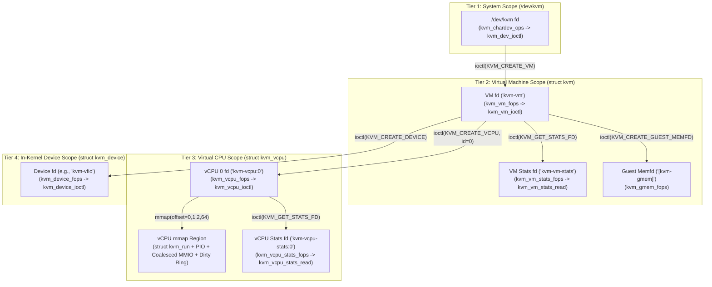

#### 3.2.1 Tier 1: The System-Wide `/dev/kvm` Character Device (`kvm_chardev_ops` and `kvm_dev_ioctl`)

When userspace opens `/dev/kvm` (`open("/dev/kvm", O_RDWR | O_CLOEXEC)`), the VFS resolves character device major `10` (`MISC_MAJOR`), minor `232` (`KVM_MINOR`), which is registered via `static struct miscdevice kvm_dev` in [`virt/kvm/kvm_main.c`](https://kernel.googlesource.com/pub/scm/virt/kvm/kvm.git/+/refs/heads/master/virt/kvm/kvm_main.c) (lines 5593–5597). Notice that `kvm_chardev_ops` does not even implement an `.open` or `.release` callback: opening `/dev/kvm` allocates no per-open state (`filp->private_data` remains `NULL`). Instead, `/dev/kvm` serves as a stateless factory and host-capability query endpoint.

##### 3.2.1.1 Generic System `ioctl`s: `KVM_GET_API_VERSION`, `KVM_CREATE_VM`, `KVM_CHECK_EXTENSION`, and `KVM_GET_VCPU_MMAP_SIZE`

All `ioctl` calls on the `/dev/kvm` file descriptor enter `kvm_dev_ioctl()` in [`virt/kvm/kvm_main.c`](https://kernel.googlesource.com/pub/scm/virt/kvm/kvm.git/+/refs/heads/master/virt/kvm/kvm_main.c). Let us examine its exact implementation:

```c
// virt/kvm/kvm_main.c (lines 5552-5591)
static long kvm_dev_ioctl(struct file *filp,
			  unsigned int ioctl, unsigned long arg)
{
	int r = -EINVAL;

	switch (ioctl) {
	case KVM_GET_API_VERSION:
		if (arg)
			goto out;
		r = KVM_API_VERSION;
		break;
	case KVM_CREATE_VM:
		r = kvm_dev_ioctl_create_vm(arg);
		break;
	case KVM_CHECK_EXTENSION:
		r = kvm_vm_ioctl_check_extension_generic(NULL, arg);
		break;
	case KVM_GET_VCPU_MMAP_SIZE:
		if (arg)
			goto out;
		r = PAGE_SIZE;     /* struct kvm_run */
#ifdef CONFIG_X86
		r += PAGE_SIZE;    /* pio data page */
#endif
#ifdef CONFIG_KVM_MMIO
		r += PAGE_SIZE;    /* coalesced mmio ring page */
#endif
		break;
	default:
		return kvm_arch_dev_ioctl(filp, ioctl, arg);
	}
out:
	return r;
}

static struct file_operations kvm_chardev_ops = {
	.unlocked_ioctl = kvm_dev_ioctl,
	.llseek		= noop_llseek,
	KVM_COMPAT(kvm_dev_ioctl),
};
```

###### 3.2.1.1.1 Exact C Implementation of `kvm_dev_ioctl()` and Per-vCPU VMA Layout Calculation

Every branch of `kvm_dev_ioctl()` establishes a critical part of the UAPI contract between the kernel and the VMM:

1. **`KVM_GET_API_VERSION` (`_IO(KVMIO, 0x00)`)**:
   Requires `arg == 0` (returning `-EINVAL` otherwise) and returns `KVM_API_VERSION`, which is hardcoded to `12` in [`include/uapi/linux/kvm.h`](https://kernel.googlesource.com/pub/scm/virt/kvm/kvm.git/+/refs/heads/master/include/uapi/linux/kvm.h) (line 22). Versions 1 through 11 existed only in pre-mainline out-of-tree KVM releases prior to Linux 2.6.20 (2007). Since Linux 2.6.22, the ABI version has been frozen at `12`: KVM never increments `KVM_API_VERSION`, and instead evolves its ABI exclusively through `KVM_CHECK_EXTENSION` capabilities. A VMM must verify `ioctl(kvm_fd, KVM_GET_API_VERSION, 0) == 12` before issuing any other calls.
2. **`KVM_CREATE_VM` (`_IO(KVMIO, 0x01)`)**:
   Takes an architecture-specific machine type in `arg` (on x86, `0` corresponds to `KVM_X86_DEFAULT_VM`, `1` to `KVM_X86_SW_PROTECTED_VM`, `2` to `KVM_X86_SEV_VM`, `3` to `KVM_X86_SEV_ES_VM`, `4` to `KVM_X86_SNP_VM`, and `5` to `KVM_X86_TDX_VM`, defined in [`arch/x86/include/uapi/asm/kvm.h`](https://kernel.googlesource.com/pub/scm/virt/kvm/kvm.git/+/refs/heads/master/arch/x86/include/uapi/asm/kvm.h), lines 970–975) and returns a new anonymous file descriptor bound to `kvm_vm_fops`.
3. **`KVM_CHECK_EXTENSION` (`_IO(KVMIO, 0x03)`)**:
   Queries whether a `KVM_CAP_*` extension is supported by passing `NULL` as the `struct kvm *` pointer to `kvm_vm_ioctl_check_extension_generic(NULL, arg)`. Note a crucial subtlety: some capabilities depend on the specific VM configuration (for example, `KVM_CAP_SYNC_REGS` returns `0` if `kvm->arch.has_protected_state` is true, and `KVM_CAP_MAX_VCPUS` returns `kvm->max_vcpus` if `kvm` is non-NULL). Therefore, modern VMMs check `KVM_CAP_CHECK_EXTENSION_VM` (`105`) and prefer invoking `KVM_CHECK_EXTENSION` directly on the **VM file descriptor** (`ioctl(vm_fd, KVM_CHECK_EXTENSION, cap)`) rather than on `/dev/kvm`.
4. **`KVM_GET_VCPU_MMAP_SIZE` (`_IO(KVMIO, 0x04)`)**:
   Returns the exact byte size of the contiguous primary region that userspace should `mmap()` at offset `0` of each vCPU file descriptor. On x86 (`CONFIG_X86` and `CONFIG_KVM_MMIO` both enabled), `KVM_GET_VCPU_MMAP_SIZE` returns `3 * PAGE_SIZE` (`12,288` bytes on 4 KiB page systems). How are these pages laid out when `kvm_vcpu_mmap()` faults them in? Using the page offsets defined in [`arch/x86/include/uapi/asm/kvm.h`](https://kernel.googlesource.com/pub/scm/virt/kvm/kvm.git/+/refs/heads/master/arch/x86/include/uapi/asm/kvm.h) (lines 16–18):

```
+-----------------------------------------------------------------------------------+
|                Per-vCPU File Descriptor mmap() Virtual Address Space              |
+-----------------------------------------------------------------------------------+
| Page Offset 0  (Bytes 0x0000 .. 0x0FFF): struct kvm_run                           |
|   - Backing page: vcpu->run (allocated in kvm_vm_ioctl_create_vcpu)               |
|   - Contains exit_reason, immediate_exit, union of exit structs, and              |
|     s.regs (2048-byte struct kvm_sync_regs at offset 0x800).                      |
+-----------------------------------------------------------------------------------+
| Page Offset 1  (Bytes 0x1000 .. 0x1FFF): KVM_PIO_PAGE_OFFSET (x86 only)           |
|   - Backing page: vcpu->arch.pio_data (allocated in kvm_arch_vcpu_create)         |
|   - Used as the data buffer for string Port I/O (REP INS / REP OUTS) exits,       |
|     referenced via run->io.data_offset.                                           |
+-----------------------------------------------------------------------------------+
| Page Offset 2  (Bytes 0x2000 .. 0x2FFF): KVM_COALESCED_MMIO_PAGE_OFFSET           |
|   - Backing page: kvm->coalesced_mmio_ring (shared across all vCPUs of the VM!)   |
|   - Contains struct kvm_coalesced_mmio_ring (first, last, coalesced_mmio[]),      |
|     buffering up to KVM_COALESCED_MMIO_MAX (170) MMIO/PIO writes without exiting. |
+-----------------------------------------------------------------------------------+
| Pages 3 .. 63  (Bytes 0x3000 .. 0x3FFFF): Unmapped Guard Hole (-EFAULT on fault)  |
+-----------------------------------------------------------------------------------+
| Page Offset 64 (Bytes 0x40000+):         KVM_DIRTY_LOG_PAGE_OFFSET                |
|   - Mapped separately when KVM_CAP_DIRTY_LOG_RING is enabled on the VM.           |
|   - Backing pages: vcpu->dirty_ring.dirty_gfns (array of struct kvm_dirty_gfn).   |
+-----------------------------------------------------------------------------------+
```

##### 3.2.1.2 Architecture-Specific System `ioctl`s on x86: `kvm_arch_dev_ioctl()`

If an `ioctl` on `/dev/kvm` is not one of the four generic commands, `kvm_dev_ioctl()` delegates to `kvm_arch_dev_ioctl()` in [`arch/x86/kvm/x86.c`](https://kernel.googlesource.com/pub/scm/virt/kvm/kvm.git/+/refs/heads/master/arch/x86/kvm/x86.c) (lines 2456–2526).

###### 3.2.1.2.1 Host CPUID, MSR Feature Lists, MCE Capabilities, and System Device Attributes

On x86, before a VMM can configure a guest's virtual CPU model, it must query `/dev/kvm` via `kvm_arch_dev_ioctl()` to discover what architectural features the host CPU and KVM module can virtualize or emulate:

1. **`KVM_GET_SUPPORTED_CPUID` (`_IOWR(KVMIO, 0x05, struct kvm_cpuid2)`) and `KVM_GET_EMULATED_CPUID` (`_IOWR(KVMIO, 0x09, struct kvm_cpuid2)`)**:
   Dispatches to `kvm_dev_ioctl_get_cpuid(&cpuid, cpuid_arg->entries, ioctl)`. `KVM_GET_SUPPORTED_CPUID` returns the array of `struct kvm_cpuid_entry2` leaves and bitmasks that KVM supports natively without severe performance penalties, whereas `KVM_GET_EMULATED_CPUID` returns features (such as `X86_FEATURE_MOVBE` or `X86_FEATURE_MONITOR`) that KVM can emulate in software via instruction trapping even if the underlying host CPU lacks them or intercepts them.
2. **`KVM_GET_MSR_INDEX_LIST` (`_IOWR(KVMIO, 0x02, struct kvm_msr_list)`) and `KVM_GET_MSR_FEATURE_INDEX_LIST` (`_IOWR(KVMIO, 0x0a, struct kvm_msr_list)`)**:
   * `KVM_GET_MSR_INDEX_LIST` calls `kvm_get_msr_index_list(argp)` to return the list of guest Model-Specific Registers (MSRs) that userspace should save and restore during live migration via `KVM_GET_MSRS` / `KVM_SET_MSRS` on a vCPU.
   * `KVM_GET_MSR_FEATURE_INDEX_LIST` calls `kvm_get_feature_msr_index_list(argp)` to enumerate *feature* MSRs (such as `MSR_IA32_ARCH_CAPABILITIES`, `MSR_IA32_UCODE_REV`, and VMX capability MSRs `MSR_IA32_VMX_BASIC` .. `MSR_IA32_VMX_VMFUNC`) whose supported bitmasks can then be read by calling `KVM_GET_MSRS` (`_IOWR(KVMIO, 0x88, struct kvm_msrs)`) directly on the **system `/dev/kvm` fd** (handled via `kvm_get_feature_msrs(argp)` at line 2497). Both index-list ioctls use a two-step sizing protocol: if the userspace `nmsrs` count is smaller than the kernel's list, KVM writes the required count back to `user_msr_list->nmsrs` and returns `-E2BIG`, prompting userspace to reallocate and retry.
3. **`KVM_X86_GET_MCE_CAP_SUPPORTED` (`_IOR(KVMIO, 0x9d, __u64)`)**:
   Copies `kvm_caps.supported_mce_cap` (`MCG_CTL_P | MCG_SER_P | MCG_TES_P | MCG_LMCE_P | KVM_MAX_MCE_BANKS`) to userspace so the VMM knows which Machine Check Architecture (MCA) capabilities it can configure on vCPUs via `KVM_X86_SETUP_MCE`.
4. **`KVM_GET_SUPPORTED_HV_CPUID` (`_IOWR(KVMIO, 0xc1, struct kvm_cpuid2)`)**:
   Returns the supported Microsoft Hyper-V enlightenment CPUID leaves (`0x40000000` .. `0x40000082`) without requiring a vCPU fd first.
5. **`KVM_GET_DEVICE_ATTR` / `KVM_HAS_DEVICE_ATTR`**:
   Queries system-level attributes via `kvm_x86_dev_get_attr()`. Group `0` (`KVM_X86_GRP_SYSTEM`), attribute `0` (`KVM_X86_XCOMP_GUEST_SUPP`) returns `kvm_caps.supported_xcr0`, allowing the VMM to query supported XSAVE state components (`XCR0` bitmask); Group `1` (`KVM_X86_GRP_SEV`) delegates to `kvm_x86_call(dev_get_attr)` to query AMD SEV-ES VMSA features and SEV-SNP policy bits.

#### 3.2.2 Tier 2, Tier 3, and Tier 4 Dispatch: VM (`kvm_vm_fops`), vCPU (`kvm_vcpu_fops`), and Device (`kvm_device_fops`) Descriptors

Once a VM file descriptor is obtained via `KVM_CREATE_VM`, hypervisor control branches into the remaining three tiers of the hierarchy.

##### 3.2.2.1 VM-Level Dispatch (`kvm_vm_ioctl` & `kvm_arch_vm_ioctl`) and Capability Negotiation (`KVM_CHECK_EXTENSION` vs. `KVM_ENABLE_CAP`)

When userspace invokes `ioctl(vm_fd, cmd, arg)`, the VFS dispatches to `kvm_vm_ioctl()` in [`virt/kvm/kvm_main.c`](https://kernel.googlesource.com/pub/scm/virt/kvm/kvm.git/+/refs/heads/master/virt/kvm/kvm_main.c) (lines 5177–5414). `kvm_vm_ioctl()` handles architecture-neutral VM operations directly:
* **vCPU & Sub-Object Creation**: `KVM_CREATE_VCPU`, `KVM_CREATE_DEVICE`, `KVM_GET_STATS_FD`, `KVM_CREATE_GUEST_MEMFD`.
* **Physical Memory Management**: `KVM_SET_USER_MEMORY_REGION`, `KVM_SET_USER_MEMORY_REGION2`, `KVM_SET_MEMORY_ATTRIBUTES`, `KVM_GET_DIRTY_LOG`, `KVM_CLEAR_DIRTY_LOG`, `KVM_RESET_DIRTY_RINGS`, `KVM_REGISTER_COALESCED_MMIO`, `KVM_UNREGISTER_COALESCED_MMIO`.
* **Interrupt & Eventfd Plumbing**: `KVM_IRQFD`, `KVM_IOEVENTFD`, `KVM_SIGNAL_MSI`, `KVM_IRQ_LINE`, `KVM_IRQ_LINE_STATUS`, `KVM_SET_GSI_ROUTING`.
* **Capability Discovery & Activation**: `KVM_CHECK_EXTENSION` and `KVM_ENABLE_CAP`.

Any command not matched in `kvm_vm_ioctl()` falls through the `default:` label to `kvm_arch_vm_ioctl(filp, ioctl, arg)` in [`arch/x86/kvm/x86.c`](https://kernel.googlesource.com/pub/scm/virt/kvm/kvm.git/+/refs/heads/master/arch/x86/kvm/x86.c) (lines 4374–4775), which handles x86-specific VM configuration:
* **Real-Mode / VM86 Legacy Support**: `KVM_SET_TSS_ADDR`, `KVM_SET_IDENTITY_MAP_ADDR`.
* **In-Kernel Interrupt & Timer Chips**: `KVM_CREATE_IRQCHIP`, `KVM_GET_IRQCHIP`, `KVM_SET_IRQCHIP`, `KVM_CREATE_PIT`, `KVM_CREATE_PIT2`, `KVM_GET_PIT2`, `KVM_SET_PIT2`, `KVM_SET_BOOT_CPU_ID`.
* **Timekeeping**: `KVM_SET_CLOCK`, `KVM_GET_CLOCK`, `KVM_SET_TSC_KHZ`, `KVM_GET_TSC_KHZ`.
* **Security & Paravirt Filtering**: `KVM_X86_SET_MSR_FILTER`, `KVM_SET_PMU_EVENT_FILTER`, `KVM_XEN_HVM_CONFIG`, `KVM_MEMORY_ENCRYPT_OP` (AMD SEV / Intel TDX commands).

Both `KVM_CHECK_EXTENSION` and `KVM_ENABLE_CAP` follow a two-layer **Generic-then-Arch** chain of responsibility:
1. `KVM_CHECK_EXTENSION` calls `kvm_vm_ioctl_check_extension_generic(kvm, arg)` in [`virt/kvm/kvm_main.c`](https://kernel.googlesource.com/pub/scm/virt/kvm/kvm.git/+/refs/heads/master/virt/kvm/kvm_main.c) (line 4893). If the capability is not one of the generic capabilities (such as `KVM_CAP_USER_MEMORY2`, `KVM_CAP_BINARY_STATS_FD`, `KVM_CAP_GUEST_MEMFD`, `KVM_CAP_DIRTY_LOG_RING`), it delegates at line 4967 to `kvm_vm_ioctl_check_extension(kvm, arg)` in [`arch/x86/kvm/x86.c`](https://kernel.googlesource.com/pub/scm/virt/kvm/kvm.git/+/refs/heads/master/arch/x86/kvm/x86.c) (line 2203).
2. Similarly, `KVM_ENABLE_CAP` copies a 104-byte `struct kvm_enable_cap` from userspace:
   ```c
   // include/uapi/linux/kvm.h (lines 674-680)
   struct kvm_enable_cap {
   	/* in */
   	__u32 cap;
   	__u32 flags;
   	__u64 args[4];
   	__u8  pad[64];
   };
   ```
   It first invokes `kvm_vm_ioctl_enable_cap_generic(kvm, &cap)` in [`virt/kvm/kvm_main.c`](https://kernel.googlesource.com/pub/scm/virt/kvm/kvm.git/+/refs/heads/master/virt/kvm/kvm_main.c) (line 5054) to handle generic opt-in features (`KVM_CAP_MANUAL_DIRTY_LOG_PROTECT2`, `KVM_CAP_HALT_POLL`, `KVM_CAP_DIRTY_LOG_RING`, `KVM_CAP_DIRTY_LOG_RING_WITH_BITMAP`), and delegates all other capabilities to `kvm_vm_ioctl_enable_cap(kvm, cap)` in [`arch/x86/kvm/x86.c`](https://kernel.googlesource.com/pub/scm/virt/kvm/kvm.git/+/refs/heads/master/arch/x86/kvm/x86.c) (line 3947).
   Notice how x86 capabilities that alter fundamental VM invariants—such as `KVM_CAP_SPLIT_IRQCHIP`, `KVM_CAP_X86_DISABLE_EXITS`, `KVM_CAP_PMU_CAPABILITY`, `KVM_CAP_X86_NOTIFY_VMEXIT`, and `KVM_CAP_VM_DISABLE_NX_HUGE_PAGES`—acquire `mutex_lock(&kvm->lock)` and verify `if (kvm->created_vcpus) return -EINVAL;`. Once even a single vCPU has been created (incrementing `kvm->created_vcpus`), these VM-wide architectural modes are permanently locked in for the life of the VM.

###### 3.2.2.1.1 Bit-Level `_IO`/`_IOR`/`_IOW`/`_IOWR` Encoding (`KVMIO = 0xAE`) and 32/64-Bit Compat Thunking

Every KVM `ioctl` command number is a 32-bit integer constructed using the standard Linux `<linux/ioctl.h>` bitfield encoding with magic type byte `KVMIO` (`0xAE`, defined at line 682 of [`include/uapi/linux/kvm.h`](https://kernel.googlesource.com/pub/scm/virt/kvm/kvm.git/+/refs/heads/master/include/uapi/linux/kvm.h)):

```
 31   30 29                   16 15            8 7             0
+-------+-----------------------+---------------+---------------+
|  dir  |    size (14 bits)     |  type (8 bits)|  nr (8 bits)  |
| 2 bits| sizeof(arg_struct)    | KVMIO = 0xAE  | Command ID    |
+-------+-----------------------+---------------+---------------+
  00 = _IO   (no payload / immediate integer in arg)
  01 = _IOW  (userspace writes struct to kernel)
  10 = _IOR  (userspace reads struct from kernel)
  11 = _IOWR (bidirectional struct read/write)
```

The command number space (`nr`, bits `7:0`) in [`include/uapi/linux/kvm.h`](https://kernel.googlesource.com/pub/scm/virt/kvm/kvm.git/+/refs/heads/master/include/uapi/linux/kvm.h) is partitioned by tier:
* `0x00 .. 0x0f`: System (`/dev/kvm`) ioctls (e.g., `KVM_GET_API_VERSION = 0x00`, `KVM_CREATE_VM = 0x01`).
* `0x40 .. 0x7f`: VM memory and device-model ioctls (e.g., `KVM_CREATE_VCPU = 0x41`, `KVM_SET_USER_MEMORY_REGION = 0x46`, `KVM_CREATE_IRQCHIP = 0x60`).
* `0x80 .. 0xdf`: vCPU and extended VM ioctls (e.g., `KVM_RUN = 0x80`, `KVM_GET_REGS = 0x81`, `KVM_GET_STATS_FD = 0xce`, `KVM_CREATE_GUEST_MEMFD = 0xd4`).
* `0xe0 .. 0xe3`: Generic device control API (`KVM_CREATE_DEVICE = 0xe0`, `KVM_SET_DEVICE_ATTR = 0xe1`).

Because the `size` field (`bits 29:16`) embeds `sizeof(struct ...)` directly into the 32-bit `ioctl` command number, any UAPI structure that contains a raw C pointer (`void __user *` or `__u8 *`) or `unsigned long` has a *different* `sizeof()`—and therefore a different `ioctl` number and field layout—when compiled in a 32-bit userspace binary running on a 64-bit kernel (`CONFIG_KVM_COMPAT`). Most KVM UAPI structs wisely use explicit-width `__u64` fields for pointers (e.g., `__u64 userspace_addr`), making them naturally ABI-identical between 32-bit and 64-bit builds. However, four historical structures contain raw pointers or `sigset_t` differences and require explicit compat translation in `.compat_ioctl`:
1. `struct kvm_dirty_log` and `struct kvm_clear_dirty_log` (contain `void __user *dirty_bitmap` inside a union, handled by `kvm_vm_compat_ioctl()` in [`virt/kvm/kvm_main.c`](https://kernel.googlesource.com/pub/scm/virt/kvm/kvm.git/+/refs/heads/master/virt/kvm/kvm_main.c), lines 5442–5493).
2. `struct kvm_msr_filter_range` (contains `__u8 *bitmap`, changing the size of `struct kvm_msr_filter` from 392 bytes on 64-bit to 264 bytes on 32-bit, handled by `KVM_X86_SET_MSR_FILTER_COMPAT` in `kvm_arch_vm_compat_ioctl()` in [`arch/x86/kvm/x86.c`](https://kernel.googlesource.com/pub/scm/virt/kvm/kvm.git/+/refs/heads/master/arch/x86/kvm/x86.c), lines 4221–4273).
3. `KVM_SET_SIGNAL_MASK` (uses `compat_sigset_t`, handled by `kvm_vcpu_compat_ioctl()` in [`virt/kvm/kvm_main.c`](https://kernel.googlesource.com/pub/scm/virt/kvm/kvm.git/+/refs/heads/master/virt/kvm/kvm_main.c), lines 4686–4725).

##### 3.2.2.2 vCPU-Level (`kvm_vcpu_ioctl`) and In-Kernel Device-Level (`kvm_device_ioctl`) Dispatch Contracts

Let us now examine the dispatch mechanics for Tier 3 (`kvm_vcpu_ioctl`) and Tier 4 (`kvm_device_ioctl`) in [`virt/kvm/kvm_main.c`](https://kernel.googlesource.com/pub/scm/virt/kvm/kvm.git/+/refs/heads/master/virt/kvm/kvm_main.c).

###### 3.2.2.2.1 Asynchronous Unlocked vCPU `ioctl`s, Mutex Serialization, and Speculation-Safe Device Creation (`array_index_nospec`)

When `kvm_vcpu_ioctl()` (lines 4435–4683 of [`virt/kvm/kvm_main.c`](https://kernel.googlesource.com/pub/scm/virt/kvm/kvm.git/+/refs/heads/master/virt/kvm/kvm_main.c)) is invoked, it executes a carefully ordered four-step prologue before entering its `switch (ioctl)` statement:

1. **Address Space & Liveness Verification**: Checks `vcpu->kvm->mm != current->mm || vcpu->kvm->vm_dead` (returning `-EIO`) and `_IOC_TYPE(ioctl) != KVMIO` (returning `-EINVAL`).
2. **Online Barrier (`kvm_wait_for_vcpu_online(vcpu)`)**:
   As we saw in `kvm_vm_ioctl_create_vcpu()` (lines 4265–4277), `create_vcpu_fd(vcpu)` calls `fd_install()` *before* `atomic_inc(&kvm->online_vcpus)` is executed. If a malicious or buggy multi-threaded userspace process guesses the newly allocated `fd` number and invokes a vCPU `ioctl` from another thread before `KVM_CREATE_VCPU` finishes incrementing `online_vcpus`, internal KVM loops that rely on `online_vcpus` could malfunction. `kvm_wait_for_vcpu_online()` checks `likely(vcpu->vcpu_idx < atomic_read(&kvm->online_vcpus))`; if false, it blocks on `mutex_lock_killable(&vcpu->mutex)` (which `kvm_vm_ioctl_create_vcpu()` holds across `create_vcpu_fd()` and `atomic_inc(&kvm->online_vcpus)`), guaranteeing the vCPU is fully online before any `ioctl` proceeds.
3. **Unlocked Architecture Hook (`kvm_arch_vcpu_unlocked_ioctl()`)**:
   Almost all vCPU `ioctl`s must be serialized by `vcpu->mutex` because a vCPU's architectural state (VMCS/VMCB, general-purpose registers, FPU, LAPIC) can only be loaded onto one physical CPU at a time via `vcpu_load(vcpu)`. However, certain confidential computing operations—specifically `KVM_MEMORY_ENCRYPT_OP` on x86 (lines 4361–4372 of [`arch/x86/kvm/x86.c`](https://kernel.googlesource.com/pub/scm/virt/kvm/kvm.git/+/refs/heads/master/arch/x86/kvm/x86.c))—must be able to run asynchronously without blocking on `vcpu->mutex`. If `kvm_arch_vcpu_unlocked_ioctl()` returns anything other than `-ENOIOCTLCMD`, `kvm_vcpu_ioctl()` returns immediately without acquiring `vcpu->mutex`.
4. **Mutex Acquisition & PID Tracking (`mutex_lock_killable(&vcpu->mutex)`)**:
   Once `vcpu->mutex` is acquired, `kvm_vcpu_ioctl()` processes `KVM_RUN`, `KVM_GET_REGS`, `KVM_SET_REGS`, `KVM_GET_SREGS`, `KVM_SET_SREGS`, `KVM_GET_MP_STATE`, `KVM_SET_MP_STATE`, `KVM_TRANSLATE`, `KVM_SET_GUEST_DEBUG`, `KVM_SET_SIGNAL_MASK`, `KVM_GET_FPU`, `KVM_SET_FPU`, `KVM_GET_STATS_FD`, `KVM_PRE_FAULT_MEMORY`, and delegates x86-specific vCPU ioctls (`KVM_GET_LAPIC`, `KVM_SET_CPUID2`, `KVM_GET_MSRS`, `KVM_VCPU_EVENTS`, `KVM_GET_NESTED_STATE`, etc.) to `kvm_arch_vcpu_ioctl()`. Notice that on `KVM_RUN` (lines 4482–4497), KVM checks `if (unlikely(oldpid != task_pid(current)))` and updates `vcpu->pid` under `write_lock(&vcpu->pid_lock)`. This allows other vCPUs executing PLE (Pause-Loop Exiting) directed yield (`kvm_vcpu_on_spin()`) to read `vcpu->pid` under `read_lock(&vcpu->pid_lock)` without contending on `vcpu->mutex`.

For Tier 4 (`KVM_CREATE_DEVICE`), `kvm_ioctl_create_device()` in [`virt/kvm/kvm_main.c`](https://kernel.googlesource.com/pub/scm/virt/kvm/kvm.git/+/refs/heads/master/virt/kvm/kvm_main.c) (lines 4834–4891) validates `cd->type >= ARRAY_SIZE(kvm_device_ops_table)` and immediately sanitizes the user-controlled index against Spectre Variant 1 (Bounds Check Bypass) speculative execution attacks:

```c
// virt/kvm/kvm_main.c (lines 4843-4852)
	if (cd->type >= ARRAY_SIZE(kvm_device_ops_table))
		return -ENODEV;

	type = array_index_nospec(cd->type, ARRAY_SIZE(kvm_device_ops_table));
	ops = kvm_device_ops_table[type];
	if (ops == NULL)
		return -ENODEV;

	if (test)
		return 0;
```

If `KVM_CREATE_DEVICE_TEST` is not set in `cd->flags`, KVM allocates `struct kvm_device`, calls `ops->create(dev, type)` under `kvm->lock`, adds `dev->vm_node` to the RCU-protected `kvm->devices` list via `list_add_rcu()`, calls `ops->init(dev)` outside the lock, increments the VM reference count via `kvm_get_kvm(kvm)`, and installs the anonymous file descriptor bound to `kvm_device_fops`. Subsequent `KVM_SET_DEVICE_ATTR`, `KVM_GET_DEVICE_ATTR`, and `KVM_HAS_DEVICE_ATTR` calls on that device fd route through `kvm_device_ioctl()` directly to `dev->ops->{set,get,has}_attr()`.

---

### 3.3 Deep Anatomy of `struct kvm` and `struct kvm_arch`

At the heart of every KVM virtual machine is [`struct kvm`](https://kernel.googlesource.com/pub/scm/virt/kvm/kvm.git/+/refs/heads/master/include/linux/kvm_host.h), defined in [`include/linux/kvm_host.h`](https://kernel.googlesource.com/pub/scm/virt/kvm/kvm.git/+/refs/heads/master/include/linux/kvm_host.h) (lines 770–879), which embeds the architecture-specific [`struct kvm_arch`](https://kernel.googlesource.com/pub/scm/virt/kvm/kvm.git/+/refs/heads/master/arch/x86/include/asm/kvm_host.h) (defined in [`arch/x86/include/asm/kvm_host.h`](https://kernel.googlesource.com/pub/scm/virt/kvm/kvm.git/+/refs/heads/master/arch/x86/include/asm/kvm_host.h), lines 1161–1416) directly by value as `kvm->arch`. Furthermore, on x86, vendor modules (`kvm-intel.ko` and `kvm-amd.ko`) embed `struct kvm` as the first member inside their own vendor-specific outer container—`struct kvm_vmx` (in `arch/x86/kvm/vmx/vmx.h`) or `struct kvm_svm` (in `arch/x86/kvm/svm/svm.h`)—implementing zero-overhead C-style inheritance via `container_of()`.

```
+-----------------------------------------------------------------------------------+
|            Polymorphic Memory Layout of a KVM VM Instance on x86                  |
+-----------------------------------------------------------------------------------+
| Offset 0x0000: struct kvm_vmx (Intel VMX) OR struct kvm_svm (AMD SVM)             |
|   +---------------------------------------------------------------------------+   |
|   | Offset 0x0000: struct kvm (Generic VM State - include/linux/kvm_host.h)   |   |
|   |   - mmu_lock (rwlock_t on x86)                                            |   |
|   |   - slots_lock, slots_arch_lock (struct mutex)                            |   |
|   |   - mm (struct mm_struct *)                                               |   |
|   |   - __memslots[KVM_MAX_NR_ADDRESS_SPACES][2] (Active/Inactive double buf) |   |
|   |   - memslots[KVM_MAX_NR_ADDRESS_SPACES] (__rcu pointers)                  |   |
|   |   - vcpu_array (struct xarray)                                            |   |
|   |   - buses[KVM_NR_BUSES] (MMIO, PIO, VIRTIO_CCW, FAST_MMIO __rcu *)        |   |
|   |   - stat (struct kvm_vm_stat: generic + x86 MMU counters)                 |   |
|   |   +-------------------------------------------------------------------+   |   |
|   |   | struct kvm_arch arch (x86 VM State - arch/x86/include/asm/...)    |   |   |
|   |   |   - mmu_page_hash, active_mmu_pages, tdp_mmu_roots                |   |   |
|   |   |   - vpic, vioapic, vpit, apic_map (__rcu *)                       |   |   |
|   |   |   - ____cacheline_aligned apicv_update_lock, apicv_inhibit_reasons|   |   |
|   |   |   - tsc_write_lock, pvclock_sc, kvmclock_offset                   |   |   |
|   |   |   - hyperv (struct kvm_hv), xen (struct kvm_xen)                  |   |   |
|   |   |   - msr_filter (__rcu *), pmu_event_filter (__rcu *)              |   |   |
|   |   |   - split_shadow_page_cache, split_page_header_cache, ...         |   |   |
|   |   +-------------------------------------------------------------------+   |   |
|   |   - users_count (refcount_t)                                              |   |
|   |   - mmu_notifier (struct mmu_notifier)                                    |   |
|   |   - srcu, irq_srcu (struct srcu_struct)                                   |   |
|   +---------------------------------------------------------------------------+   |
|   | Vendor-Specific Tail Fields:                                              |   |
|   |   - Intel VMX (struct kvm_vmx): tss_addr, ept_identity_map_addr, PID tab  |   |
|   |   - AMD SVM   (struct kvm_svm): asid, avic_logical_id_table_page, sev_info|   |
+-----------------------------------------------------------------------------------+
```

#### 3.3.1 Dissecting the Architecture-Independent VM Container: `struct kvm`

Let us examine the complete definition of `struct kvm` from [`include/linux/kvm_host.h`](https://kernel.googlesource.com/pub/scm/virt/kvm/kvm.git/+/refs/heads/master/include/linux/kvm_host.h):

```c
// include/linux/kvm_host.h (lines 770-879)
struct kvm {
#ifdef KVM_HAVE_MMU_RWLOCK
	rwlock_t mmu_lock;
#else
	spinlock_t mmu_lock;
#endif /* KVM_HAVE_MMU_RWLOCK */

	struct mutex slots_lock;

	/*
	 * Protects the arch-specific fields of struct kvm_memory_slots in
	 * use by the VM. To be used under the slots_lock (above) or in a
	 * kvm->srcu critical section where acquiring the slots_lock would
	 * lead to deadlock with the synchronize_srcu in
	 * kvm_swap_active_memslots().
	 */
	struct mutex slots_arch_lock;
	struct mm_struct *mm; /* userspace tied to this vm */
	unsigned long nr_memslot_pages;
	/* The two memslot sets - active and inactive (per address space) */
	struct kvm_memslots __memslots[KVM_MAX_NR_ADDRESS_SPACES][2];
	/* The current active memslot set for each address space */
	struct kvm_memslots __rcu *memslots[KVM_MAX_NR_ADDRESS_SPACES];
	struct xarray vcpu_array;
	/*
	 * Protected by slots_lock, but can be read outside if an
	 * incorrect answer is acceptable.
	 */
	atomic_t nr_memslots_dirty_logging;

	/* Used to wait for completion of MMU notifiers.  */
	spinlock_t mn_invalidate_lock;
	unsigned long mn_active_invalidate_count;
	struct rcuwait mn_memslots_update_rcuwait;

	/* For management / invalidation of gfn_to_pfn_caches */
	spinlock_t gpc_lock;
	struct list_head gpc_list;

	/*
	 * created_vcpus is protected by kvm->lock, and is incremented
	 * at the beginning of KVM_CREATE_VCPU.  online_vcpus is only
	 * incremented after storing the kvm_vcpu pointer in vcpus,
	 * and is accessed atomically.
	 */
	atomic_t online_vcpus;
	int max_vcpus;
	int created_vcpus;
	int last_boosted_vcpu;
	struct list_head vm_list;
	struct mutex lock;
	struct kvm_io_bus __rcu *buses[KVM_NR_BUSES];
#ifdef CONFIG_HAVE_KVM_IRQCHIP
	struct {
		spinlock_t        lock;
		struct list_head  items;
		/* resampler_list update side is protected by resampler_lock. */
		struct list_head  resampler_list;
		struct mutex      resampler_lock;
	} irqfds;
#endif
	struct list_head ioeventfds;
	struct kvm_vm_stat stat;
	struct kvm_arch arch;
	refcount_t users_count;
#ifdef CONFIG_KVM_MMIO
	struct kvm_coalesced_mmio_ring *coalesced_mmio_ring;
	spinlock_t ring_lock;
	struct list_head coalesced_zones;
#endif

	struct mutex irq_lock;
#ifdef CONFIG_HAVE_KVM_IRQCHIP
	/*
	 * Update side is protected by irq_lock.
	 */
	struct kvm_irq_routing_table __rcu *irq_routing;

	struct hlist_head irq_ack_notifier_list;
#endif

	struct mmu_notifier mmu_notifier;
	unsigned long mmu_invalidate_seq;
	long mmu_invalidate_in_progress;
	gfn_t mmu_invalidate_range_start;
	gfn_t mmu_invalidate_range_end;

	struct list_head devices;
	u64 manual_dirty_log_protect;
	struct dentry *debugfs_dentry;
	struct kvm_stat_data **debugfs_stat_data;
	struct srcu_struct srcu;
	struct srcu_struct irq_srcu;
	pid_t userspace_pid;
	bool override_halt_poll_ns;
	unsigned int max_halt_poll_ns;
	u32 dirty_ring_size;
	bool dirty_ring_with_bitmap;
	bool vm_bugged;
	bool vm_dead;

#ifdef CONFIG_HAVE_KVM_PM_NOTIFIER
	struct notifier_block pm_notifier;
#endif
#ifdef CONFIG_KVM_GENERIC_MEMORY_ATTRIBUTES
	/* Protected by slots_lock (for writes) and RCU (for reads) */
	struct xarray mem_attr_array;
#endif
	char stats_id[KVM_STATS_NAME_SIZE];
};
```

##### 3.3.1.1 Synchronization Hierarchy: `mmu_lock`, `slots_lock`, `slots_arch_lock`, `lock`, `irq_lock`, `srcu`, and `irq_srcu`

A multi-vCPU virtual machine is one of the most concurrency-intensive workloads in the Linux kernel. Dozens or hundreds of vCPU threads simultaneously take EPT/NPT page faults, decode MMIO instructions, inject MSIs, and poll I/O buses, while host memory management threads (such as `kswapd`, `khugepaged`, or NUMA balancing) asynchronously invoke `mmu_notifier` callbacks and VMM I/O threads mutate memory slots or GSI routing tables.

To prevent deadlocks across these intersecting paths, `struct kvm` defines a strict locking hierarchy (documented in `Documentation/virt/kvm/locking.rst` and enforced by `lockdep` assertions throughout `virt/kvm/` and `arch/x86/kvm/`):

```
+-----------------------------------------------------------------------------------+
|                  KVM VM-Wide Lock Ordering Hierarchy (Outer -> Inner)             |
+-----------------------------------------------------------------------------------+
|   1. kvm_lock (Global mutex protecting global vm_list)                            |
|        |                                                                          |
|        v                                                                          |
|   2. kvm->lock (VM-wide mutex: vCPU creation, irqchip init, device list, caps)    |
|        |                                                                          |
|        v                                                                          |
|   3. vcpu->mutex (Per-vCPU mutex: serializes vCPU ioctls & vcpu_load)             |
|        |                                                                          |
|        +----------------------------+----------------------------+                |
|        v                            v                            v                |
|   4a. kvm->slots_lock          4b. kvm->irq_lock            4c. kvm->srcu         |
|       (Mutex: memslot updates)     (Mutex: irq_routing)         (Sleepable RCU)   |
|        |                            |                            |                |
|        v                            v                            |                |
|   5. kvm->slots_arch_lock      kvm->irq_srcu <-------------------+                |
|      (Mutex: arch memslot)     (Sleepable RCU for IRQ delivery)                   |
|        |                                                                          |
|        v                                                                          |
|   6. kvm->mn_invalidate_lock / kvm->mmu_lock (rwlock_t / spinlock_t: MMU trees)   |
|        |                                                                          |
|        v                                                                          |
|   7. kvm->arch.tdp_mmu_pages_lock / kvm->arch.mmu_unsync_pages_lock (spinlock_t)  |
+-----------------------------------------------------------------------------------+
```

Notice that on x86 (`KVM_HAVE_MMU_RWLOCK` defined), `kvm->mmu_lock` is an `rwlock_t` rather than a `spinlock_t`. This allows the x86 TDP MMU (`arch/x86/kvm/mmu/tdp_mmu.c`) to acquire `read_lock(&kvm->mmu_lock)` during concurrent vCPU EPT/NPT page faults and update SPTEs using atomic `cmpxchg64` operations, eliminating the massive spinlock contention that historically bottlenecked large VMs during boot and memory-intensive workloads.

###### 3.3.1.1.1 Why Two Separate SRCU Domains (`srcu` vs. `irq_srcu`) and Two Memslot Mutexes Exist

Two design details in `struct kvm`'s synchronization fields deserve special attention from kernel engineers:

1. **Why `kvm->srcu` and `kvm->irq_srcu` are separate Sleepable RCU (`srcu_struct`) domains**:
   When a vCPU thread executes in guest mode or handles a VM-exit that translates GPAs to HVAs, it holds a read lock on `kvm->srcu` (`srcu_read_lock(&kvm->srcu)`). Why SRCU instead of standard kernel RCU (`rcu_read_lock()`)? Because resolving a guest page fault inside an SRCU read-side critical section may call `get_user_pages()` / `faultin_pfn()`, which can *sleep* waiting for disk swap-in or page allocation! Standard RCU forbids sleeping inside read-side critical sections; SRCU permits arbitrary sleeping by tracking per-CPU reader counts in a dedicated `struct srcu_struct`.
   However, why does `struct kvm` need a *second* SRCU domain, `kvm->irq_srcu`? Consider what happens when userspace updates a memslot (`kvm_swap_active_memslots()`): the writer swaps the active `kvm->memslots` pointer and calls `synchronize_srcu_expedited(&kvm->srcu)`, which blocks until all in-flight `kvm->srcu` readers finish. Meanwhile, an interrupt injection path (`kvm_irq_delivery_to_apic_fast()` or `irqfd_wakeup()`) might be triggered from an `eventfd` or a vCPU holding `kvm->srcu` to read `kvm->irq_routing` and `kvm->buses[KVM_IOEVENTFD_BUS]`. Conversely, updating the GSI routing table (`KVM_SET_GSI_ROUTING` -> `kvm_set_irq_routing()`) holds `kvm->irq_lock` and calls `synchronize_srcu_expedited(&kvm->irq_srcu)`. Isolating interrupt routing/bus readers into `kvm->irq_srcu` ensures that frequent MSI/GSI routing table updates (e.g., when a guest OS rebalances IRQs via `irqbalance` or programs MSI-X vectors) do not wait for slow, sleeping MMU page faults in `kvm->srcu`, and prevents lock-ordering cycles between `slots_lock`, `irq_lock`, and SRCU grace periods.

2. **Why `kvm->slots_arch_lock` exists alongside `kvm->slots_lock`**:
   Look closely at the comment on `slots_arch_lock` in [`include/linux/kvm_host.h`](https://kernel.googlesource.com/pub/scm/virt/kvm/kvm.git/+/refs/heads/master/include/linux/kvm_host.h) (lines 780–786). During `KVM_RUN`, a vCPU holds `srcu_read_lock(&kvm->srcu)`. Suppose an architecture-specific path inside `KVM_RUN` (while already holding `kvm->srcu`) needs to modify architecture-specific memslot metadata (for example, allocating shadow root page-tracking metadata when `shadow_root_allocated` transitions to `true`). If that vCPU tried to acquire `mutex_lock(&kvm->slots_lock)` while holding `kvm->srcu`, it would **deadlock** against another thread that already holds `kvm->slots_lock` and is waiting in `synchronize_srcu_expedited(&kvm->srcu)` inside `kvm_swap_active_memslots()`!
   * Thread A (`KVM_SET_USER_MEMORY_REGION`): Holds `slots_lock` $\rightarrow$ waits for `synchronize_srcu(&kvm->srcu)`.
   * Thread B (`KVM_RUN`): Holds `srcu_read_lock(&kvm->srcu)` $\rightarrow$ if it waited for `slots_lock`, classic AB-BA deadlock!
   By introducing `kvm->slots_arch_lock` (which is acquired *inside* `slots_lock` by memslot writers, or *inside* `kvm->srcu` by vCPU readers, and is *released* before `synchronize_srcu(&kvm->srcu)`), KVM allows vCPUs holding `kvm->srcu` to safely serialize updates to `slot->arch` without ever acquiring `slots_lock`.

##### 3.3.1.2 Memory, vCPU, and I/O Bus Subsystems: `__memslots[][2]`, `vcpu_array` XArray, `buses[KVM_NR_BUSES]`, and `mmu_notifier`

Let us examine the core resource containers inside `struct kvm`:

* **Double-Buffered Memslot Sets (`__memslots[KVM_MAX_NR_ADDRESS_SPACES][2]` and `memslots[]`)**:
  On x86, `KVM_MAX_NR_ADDRESS_SPACES` is `2`: address space `0` is the normal guest physical address space, and address space `1` (`KVM_X86_SMM_ADDRESS_SPACE`) is the System Management Mode (SMM) physical address space used when a vCPU enters SMM upon receiving an SMI. For each address space `i`, KVM pre-allocates two `struct kvm_memslots` instances in `__memslots[i][0]` and `__memslots[i][1]`. At any instant, `kvm->memslots[i]` points (`__rcu`) to the *active* set, while the other is the *inactive* staging set. Each `struct kvm_memslots` (lines 753–768 of [`include/linux/kvm_host.h`](https://kernel.googlesource.com/pub/scm/virt/kvm/kvm.git/+/refs/heads/master/include/linux/kvm_host.h)) indexes the VM's `struct kvm_memory_slot` objects in three simultaneous data structures for $O(1)$ or $O(\log N)$ lookup:
  1. `id_hash` (a 7-bit, 128-bucket hash table mapping `slot_id -> struct kvm_memory_slot`).
  2. `gfn_tree` (a red-black tree `rb_root` ordered by Guest Frame Number range `[base_gfn, base_gfn + npages)`, used during GPA-to-HVA translation in `gfn_to_memslot()`).
  3. `hva_tree` (a cached interval red-black tree `rb_root_cached` ordered by Host Virtual Address range `[userspace_addr, userspace_addr + npages * PAGE_SIZE)`, used by `mmu_notifier` callbacks to quickly locate all memslots overlapping an invalidated host VMA range).

###### 3.3.1.2.1 Active/Inactive Memslot Double-Buffering, Generation Counters, and `xarray` Memory Attributes

Why does `struct kvm_memory_slot` contain 2-element arrays for its tree and hash nodes (`struct rb_node gfn_node[2]`, `struct interval_tree_node hva_node[2]`, `struct hlist_node id_node[2]`) alongside `__memslots[as_id][2]`? Because when userspace modifies a memslot via `KVM_SET_USER_MEMORY_REGION2`, KVM cannot mutate the red-black trees or hash table of the *active* `kvm_memslots` while vCPUs are concurrently traversing them locklessly under `kvm->srcu`. Instead:
1. Under `kvm->slots_lock`, KVM mutates the *inactive* `kvm_memslots` (using node index `idx = slots->node_idx`, either `0` or `1`), increments the memslot `generation` counter, and atomically flips `rcu_assign_pointer(kvm->memslots[as_id], inactive_slots)`.
2. KVM calls `synchronize_srcu_expedited(&kvm->srcu)` to wait for all readers on the old active set to drain.
3. Finally, KVM applies the exact same tree/hash structural change to the *now-inactive* (formerly active) `kvm_memslots` set so both sets are identical again prior to releasing `slots_lock`!

Alongside memslots, `struct kvm` manages:
* **`vcpu_array` (`struct xarray`)**: Maps dense 0-based creation indices (`0 .. online_vcpus - 1`) to `struct kvm_vcpu *` pointers, enabling fast, lockless iteration via `kvm_for_each_vcpu(idx, vcpu, kvm)`.
* **`buses[KVM_NR_BUSES]` (`struct kvm_io_bus __rcu *`)**: An array of four RCU-protected sorted range tables (`KVM_MMIO_BUS`, `KVM_PIO_BUS`, `KVM_VIRTIO_CCW_NOTIFY_BUS`, `KVM_FAST_MMIO_BUS`) used to dispatch in-kernel MMIO/PIO accesses (to LAPIC, IOAPIC, PIT, coalesced MMIO, or `ioeventfd` doorbells) without exiting to userspace.
* **`mem_attr_array` (`struct xarray`)**: When `CONFIG_KVM_GENERIC_MEMORY_ATTRIBUTES` is enabled (used by `guest_memfd` and confidential VMs via `KVM_SET_MEMORY_ATTRIBUTES`), this XArray maps every Guest Frame Number (`gfn_t`) to its memory attribute flags (specifically `KVM_MEMORY_ATTRIBUTE_PRIVATE = (1ULL << 3)` vs. `0` for shared memory).

#### 3.3.2 Dissecting the x86-Specific VM State: `struct kvm_arch`

Embedded directly inside `struct kvm` as `kvm->arch`, [`struct kvm_arch`](https://kernel.googlesource.com/pub/scm/virt/kvm/kvm.git/+/refs/heads/master/arch/x86/include/asm/kvm_host.h) (defined in [`arch/x86/include/asm/kvm_host.h`](https://kernel.googlesource.com/pub/scm/virt/kvm/kvm.git/+/refs/heads/master/arch/x86/include/asm/kvm_host.h), lines 1161–1416) holds all x86-specific hypervisor state for the virtual machine. We can group its ~85 fields into two major functional domains: the x86 MMU / DMA / APICv subsystem and the Timekeeping / Interrupt / Paravirt / Filtering subsystem.

##### 3.3.2.1 x86 MMU, TDP/Shadow Roots, and Eager Page Splitting Caches

In [`arch/x86/include/asm/kvm_host.h`](https://kernel.googlesource.com/pub/scm/virt/kvm/kvm.git/+/refs/heads/master/arch/x86/include/asm/kvm_host.h), `struct kvm_arch` tracks both the legacy Shadow MMU (`KVM_SHADOW_MMU`, which also handles nested TDP shadow pages) and the scalable Two-Dimensional Paging MMU (`KVM_TDP_MMU`):

| `struct kvm_arch` Field | Type | Architectural Role in `arch/x86/kvm/` |
| :--- | :--- | :--- |
| `vm_type` | `u8` | Stores the x86 VM type (`KVM_X86_DEFAULT_VM` .. `KVM_X86_TDX_VM`) passed to `KVM_CREATE_VM`. |
| `has_private_mem` / `has_protected_state` | `bool` | Set for `KVM_X86_SW_PROTECTED_VM`, SEV-ES, SEV-SNP, and TDX VMs to enable `guest_memfd` private mappings and block host VMM inspection of encrypted guest CPU registers. |
| `mmu_page_hash` / `active_mmu_pages` | `struct hlist_head *` / `struct list_head` | Hash table (`1 << KVM_MMU_HASH_SHIFT` buckets) and doubly-linked list of active `struct kvm_mmu_page` shadow page tables in the Shadow MMU. |
| `tdp_mmu_roots` / `tdp_mmu_pages_lock` | `struct list_head` / `spinlock_t` | RCU-traversed list of TDP MMU root `struct kvm_mmu_page` structures (e.g., 4-level or 5-level EPT/NPT roots) and the inner spinlock protecting root list mutations when `mmu_lock` is held in read mode. |
| `possible_nx_huge_pages[KVM_NR_MMU_TYPES]` | `struct kvm_possible_nx_huge_pages` | Tracks 4 KiB-split shadow/TDP pages created to mitigate the Intel iTLB Multihit hardware vulnerability (`CVE-2018-12207`) that are eligible to be collapsed back into 2 MiB/1 GiB huge pages by `nx_huge_page_recovery_thread`. |
| `split_shadow_page_cache`, `split_page_header_cache`, `split_desc_cache` | `struct kvm_mmu_memory_cache` | Pre-allocated memory caches protected by `kvm->slots_lock` used during eager huge-page splitting (`KVM_CLEAR_DIRTY_LOG` / dirty logging enablement) so KVM can split 1 GiB / 2 MiB EPT/NPT leaves into 512 4 KiB SPTEs under `mmu_lock` without sleeping on `GFP_KERNEL` allocations. |

###### 3.3.2.1.1 Cache-Line Alignment of `apicv_update_lock`, APICv Inhibit Bitmasks, and Non-Coherent DMA Tracking

Look closely at lines 1206–1223 of [`arch/x86/include/asm/kvm_host.h`](https://kernel.googlesource.com/pub/scm/virt/kvm/kvm.git/+/refs/heads/master/arch/x86/include/asm/kvm_host.h):

```c
// arch/x86/include/asm/kvm_host.h (lines 1206-1223)
	/*
	 * Force apicv_update_lock and apicv_nr_irq_window_req to reside in a
	 * dedicated cacheline.  They are write-mostly, whereas most everything
	 * else in kvm_arch is read-mostly.  Note that apicv_inhibit_reasons is
	 * read-mostly: toggling VM-wide inhibits is rare; _checking_ for
	 * inhibits is common.
	 */
	____cacheline_aligned
	/*
	 * Protects apicv_inhibit_reasons and apicv_nr_irq_window_req (with an
	 * asterisk, see kvm_inc_or_dec_irq_window_inhibit() for details).
	 */
	struct rw_semaphore apicv_update_lock;
	atomic_t apicv_nr_irq_window_req;
	____cacheline_aligned

	unsigned long apicv_inhibit_reasons;
```

Why did the KVM x86 maintainers place two explicit `____cacheline_aligned` compiler attributes around `apicv_update_lock` and `apicv_nr_irq_window_req`, physically isolating them into their own 64-byte CPU cache line away from `apicv_inhibit_reasons` and `apic_map`?
* Hardware APIC virtualization (Intel APICv and AMD AVIC) allows the CPU to deliver virtual interrupts and handle EOIs directly in guest mode without VM-exits. However, certain dynamic conditions (such as a vCPU requesting an ExtINT/PIC interrupt window via `apicv_nr_irq_window_req`, or userspace changing APIC ID mappings) require temporarily inhibiting APICv/AVIC across the VM.
* Every single interrupt delivery path (`kvm_apic_set_irq()`, `kvm_lapic_reg_write()`) and VM-entry checks `kvm_vcpu_apicv_active(vcpu)`, which reads `kvm->arch.apicv_inhibit_reasons` and `kvm->arch.apic_map`.
* If `apicv_nr_irq_window_req` or `apicv_update_lock` (which are mutated via `LOCK XADD` / `CMPXCHG` whenever an IRQ window is requested) shared a 64-byte L1/L2 cache line with `apicv_inhibit_reasons` or `apic_map`, every atomic write to `apicv_nr_irq_window_req` on one physical core would invalidate the cache line (MESI `Modified` $\rightarrow$ `Invalid`) on all other physical cores running vCPUs of the same VM! Placing `apicv_update_lock` and `apicv_nr_irq_window_req` between two `____cacheline_aligned` directives completely eliminates false sharing on the hot interrupt path.

Similarly, `atomic_t noncoherent_dma_count` (line 1189) tracks how many VFIO devices attached to the VM have non-coherent DMA (i.e., DMA that bypasses CPU cache coherency). When `noncoherent_dma_count > 0`, KVM must enable `WBINVD` exiting on all vCPUs and honor guest PAT (Page Attribute Table) cacheability attributes in EPT/NPT entries so guest device drivers can flush CPU caches properly.

##### 3.3.2.2 Paravirtual Clocks, Timekeeping, Interrupt Controllers, and Security Filters

The second half of `struct kvm_arch` manages timekeeping, interrupt routing, paravirtualization emulations, and security filters:

1. **In-Kernel Interrupt Controllers (`vpic`, `vioapic`, `vpit`, `apic_map`, `irqchip_mode`)**:
   * `irqchip_mode` (`enum kvm_irqchip_mode`): Tracks whether the VM has no in-kernel irqchip (`KVM_IRQCHIP_NONE`), a full in-kernel PIC + IOAPIC + LAPIC (`KVM_IRQCHIP_KERNEL`, created via `KVM_CREATE_IRQCHIP`), or a split irqchip (`KVM_IRQCHIP_SPLIT`, enabled via `KVM_CAP_SPLIT_IRQCHIP`, where LAPIC lives in the kernel for fast timer/IPI/MSI delivery while PIC and IOAPIC remain in userspace VMM to reduce the kernel's attack surface).
   * `apic_map` (`struct kvm_apic_map __rcu *`): RCU-protected lookup table translating physical and logical APIC destination IDs (xAPIC flat/cluster mode and x2APIC 32-bit cluster mode) directly to `struct kvm_lapic *` pointers for $O(1)$ MSI and IPI delivery.
2. **Paravirtual Contexts (`struct kvm_hv hyperv`, `struct kvm_xen xen`)**:
   Holds VM-wide state for Microsoft Hyper-V enlightenments (reference TSC page, SynIC event/message connections, Partition Assist page `hv_pa_pg`, and nested Hyper-V `hv_root_tdp`) and Xen HVM emulation (shared_info page, event channel ports, and hypercall MSR configuration).

###### 3.3.2.2.1 Masterclock Synchronization (`pvclock_sc`, `tsc_write_lock`), IRQChip Modes, and RCU-Protected MSR/PMU Filters

Timekeeping across dozens of physical cores is notoriously treacherous if host or guest TSCs drift. `struct kvm_arch` solves this via a lockless sequence-counted masterclock protocol:
* `tsc_write_lock` (`raw_spinlock_t`) and `pvclock_sc` (`seqcount_raw_spinlock_t`):
  When guests write to `MSR_IA32_TSC` or `MSR_IA32_TSC_ADJUST`, KVM tracks how many vCPUs have synchronized TSCs in `nr_vcpus_matched_tsc` under `tsc_write_lock` (which is a `raw_spinlock_t` because it is read from preemption-disabled regions). When `nr_vcpus_matched_tsc == atomic_read(&kvm->online_vcpus)` and the host clocksource is `TSC`, KVM sets `use_master_clock = true` and records a single reference snapshot (`master_kernel_ns` and `master_cycle_now`) protected by the `pvclock_sc` sequence counter. All vCPUs then compute `kvmclock` updates relative to this single snapshot, guaranteeing strictly monotonic `pvclock` readings across all guest vCPUs.
* **`msr_filter` (`struct kvm_x86_msr_filter __rcu *`) and `pmu_event_filter` (`struct kvm_x86_pmu_event_filter __rcu *`)**:
  Cloud hypervisors use `KVM_X86_SET_MSR_FILTER` and `KVM_SET_PMU_EVENT_FILTER` to restrict which MSRs and hardware performance monitoring events a guest can access, or to deflect unknown/filtered `RDMSR`/`WRMSR` instructions to userspace (`KVM_EXIT_X86_RDMSR` / `KVM_EXIT_X86_WRMSR`) when `user_space_msr_mask` is enabled via `KVM_CAP_X86_USER_SPACE_MSR`. Because vCPUs read `kvm->arch.msr_filter` on every emulated MSR access without taking a VM-wide mutex, both pointers are annotated `__rcu`, read under `srcu_read_lock(&kvm->srcu)`, and swapped atomically via `rcu_replace_pointer()` followed by `synchronize_srcu_expedited(&kvm->srcu)`.

---

### 3.4 VM Creation, Initialization, and Capability Gating

Let us now trace the exact execution path inside the kernel when a userspace VMM executes `int vm_fd = ioctl(kvm_fd, KVM_CREATE_VM, type);`.

```mermaid
sequenceDiagram
    autonumber
    participant VMM as Userspace VMM
    participant Dev as kvm_dev_ioctl_create_vm()<br/>(virt/kvm/kvm_main.c)
    participant Core as kvm_create_vm()<br/>(virt/kvm/kvm_main.c)
    participant Arch as kvm_arch_init_vm()<br/>(arch/x86/kvm/x86.c)
    participant MMU as kvm_mmu_init_vm()<br/>(arch/x86/kvm/mmu/mmu.c)
    participant Vendor as vmx_vm_init() / svm_vm_init()<br/>(arch/x86/kvm/vmx|svm/)

    VMM->>Dev: ioctl(kvm_fd, KVM_CREATE_VM, type)
    Dev->>Dev: fd = get_unused_fd_flags(O_CLOEXEC)
    Dev->>Core: kvm_create_vm(type, fdname)
    Core->>Core: kvm = kvm_arch_alloc_vm() [kvzalloc(kvm_x86_ops.vm_size)]
    Core->>Core: mmgrab(current->mm); kvm->mm = current->mm
    Core->>Core: Init locks, XArrays (vcpu_array, mem_attr_array)
    Core->>Core: init_srcu_struct(&kvm->srcu) & init_srcu_struct(&kvm->irq_srcu)
    Core->>Core: kvm_init_irq_routing(kvm); refcount_set(&kvm->users_count, 1)
    Core->>Core: Init __memslots[as][0..1] & kzalloc 4 kvm_io_bus structs
    Core->>Arch: kvm_arch_init_vm(kvm, type)
    Arch->>Arch: Validate kvm_is_vm_type_supported(type); kvm_page_track_init(kvm)
    Arch->>MMU: kvm_mmu_init_vm(kvm)
    MMU-->>Arch: Init tdp_mmu_roots / mmu_page_hash & split caches
    Arch->>Vendor: kvm_x86_call(vm_init)(kvm)
    Vendor-->>Arch: Init VMX/SVM VM state
    Arch->>Arch: Init pvclock, tsc_write_lock, apicv, hyperv, xen
    Arch-->>Core: return 0
    Core->>Core: kvm_enable_virtualization()
    Core->>Core: kvm_init_mmu_notifier(kvm) & kvm_coalesced_mmio_init(kvm)
    Core->>Core: kvm_create_vm_debugfs(kvm, fdname) & list_add(&kvm->vm_list, &vm_list)
    Core->>Core: preempt_notifier_inc(); kvm_init_pm_notifier(kvm)
    Core-->>Dev: return kvm
    Dev->>Dev: file = anon_inode_getfile("kvm-vm", &kvm_vm_fops, kvm, O_RDWR)
    Dev->>Dev: kvm_uevent_notify_change(KVM_EVENT_CREATE_VM, kvm)
    Dev->>Dev: fd_install(fd, file)
    Dev-->>VMM: return vm_fd
```

#### 3.4.1 Step-by-Step Execution Trace: `kvm_dev_ioctl_create_vm()` -> `kvm_create_vm()`

When `kvm_dev_ioctl()` receives `KVM_CREATE_VM`, it calls `kvm_dev_ioctl_create_vm(arg)` (lines 5509–5550 of [`virt/kvm/kvm_main.c`](https://kernel.googlesource.com/pub/scm/virt/kvm/kvm.git/+/refs/heads/master/virt/kvm/kvm_main.c)), which allocates an `O_CLOEXEC` file descriptor number, formats it as a string (`fdname`), and invokes `kvm_create_vm(type, fdname)` (lines 1099–1232 of [`virt/kvm/kvm_main.c`](https://kernel.googlesource.com/pub/scm/virt/kvm/kvm.git/+/refs/heads/master/virt/kvm/kvm_main.c)).

##### 3.4.1.1 Polymorphic VM Allocation (`kvm_arch_alloc_vm` / `kvm_x86_ops.vm_size`), SRCU Setup, and Bus Allocation

Let us trace the first half of `kvm_create_vm()` (lines 1101–1176 of [`virt/kvm/kvm_main.c`](https://kernel.googlesource.com/pub/scm/virt/kvm/kvm.git/+/refs/heads/master/virt/kvm/kvm_main.c)):

1. **Polymorphic Allocation via `kvm_arch_alloc_vm()` (Line 1101)**:
   On x86, [`arch/x86/include/asm/kvm_host.h`](https://kernel.googlesource.com/pub/scm/virt/kvm/kvm.git/+/refs/heads/master/arch/x86/include/asm/kvm_host.h) (lines 1812–1816) overrides the generic allocator with:
   ```c
   #define __KVM_HAVE_ARCH_VM_ALLOC
   static inline struct kvm *kvm_arch_alloc_vm(void)
   {
   	return kvzalloc(kvm_x86_ops.vm_size, GFP_KERNEL_ACCOUNT);
   }
   ```
   Here, `kvm_x86_ops.vm_size` is set during vendor module initialization to `sizeof(struct kvm_vmx)` on Intel or `sizeof(struct kvm_svm)` on AMD. Why does it use `kvzalloc(..., GFP_KERNEL_ACCOUNT)` instead of `kzalloc()`?
   * `kvzalloc()` first attempts physically contiguous slab/page allocation (`kmalloc`), and seamlessly falls back to virtually contiguous `vmalloc` if `sizeof(struct kvm_vmx)` exceeds a high-order page or if physical memory is fragmented.
   * `GFP_KERNEL_ACCOUNT` charges all kernel memory allocated for `struct kvm` (and its SRCU structures, XArrays, I/O buses, debugfs nodes, and shadow page tables) to the VMM process's `cgroup` memory controller (`memcg` `kmem` accounting). This prevents a compromised or runaway containerized VMM from exhausting host kernel memory outside its container's `memory.max` cgroup limit.
2. **Lock, XArray, and SRCU Initialization (Lines 1108–1149)**:
   KVM initializes `mmu_lock`, pins `current->mm` via `mmgrab()`, initializes `irqfds` and `ioeventfds` lists via `kvm_eventfd_init(kvm)`, initializes `lock`, `irq_lock`, `slots_lock`, `slots_arch_lock`, `mn_invalidate_lock`, `mn_memslots_update_rcuwait`, `vcpu_array`, `mem_attr_array`, and `gpc_list`. It then initializes both SRCU domains (`init_srcu_struct(&kvm->srcu)` and `init_srcu_struct(&kvm->irq_srcu)`) and allocates an initial empty dummy `kvm_irq_routing_table` via `kvm_init_irq_routing(kvm)`.
3. **Reference Count, Memslots, and I/O Buses (Lines 1150–1175)**:
   * `refcount_set(&kvm->users_count, 1);` sets the initial reference count of the VM to `1` (representing the `kvm-vm` file descriptor being created).
   * For each address space `i` (`0 .. kvm_arch_nr_memslot_as_ids(kvm) - 1`, which is `2` on x86) and each buffer `j` (`0` and `1`), KVM initializes `hva_tree = RB_ROOT_CACHED`, `gfn_tree = RB_ROOT`, `hash_init(slots->id_hash)`, sets `slots->node_idx = j`, sets `slots->generation = i`, and publishes buffer `0` as the active memslot set via `rcu_assign_pointer(kvm->memslots[i], &kvm->__memslots[i][0])`.
   * Next, KVM allocates four empty `struct kvm_io_bus` objects (`KVM_NR_BUSES = 4`) using `kzalloc_obj(struct kvm_io_bus, GFP_KERNEL_ACCOUNT)` and assigns them to `kvm->buses[0..3]`.

###### 3.4.1.1.1 Hardware Virtualization Reference Counting (`kvm_enable_virtualization`), MMU Notifier Registration, and Error Rollback Ladder

After `kvm_arch_init_vm(kvm, type)` succeeds at line 1177, `kvm_create_vm()` executes the second half of generic initialization (lines 1181–1208):

1. **`kvm_enable_virtualization()` (Line 1181)**:
   Protected by the global `kvm_usage_lock` mutex, KVM maintains a global `kvm_usage_count` of active VMs across the host. Unless the module parameter `enable_virt_at_load` (line 5600, default `true`) already turned on hardware virtualization when `kvm.ko` loaded, the transition of `kvm_usage_count` from `0` to `1` invokes `on_each_cpu()` and CPU hotplug callbacks to execute `VMXON` ( setting `CR4.VMXE = 1` on Intel) or set `MSR_VM_CR` / `EFER.SVME = 1` (on AMD) across every online physical CPU on the host.
2. **`kvm_init_mmu_notifier(kvm)` (Line 1189)**:
   Registers `kvm->mmu_notifier` (with callbacks `kvm_mmu_notifier_ops` defined at lines 879–886 of [`virt/kvm/kvm_main.c`](https://kernel.googlesource.com/pub/scm/virt/kvm/kvm.git/+/refs/heads/master/virt/kvm/kvm_main.c)) onto `current->mm` via `mmu_notifier_register(&kvm->mmu_notifier, current->mm)`. From this moment onward, any host page table unmap, write-protection, or page aging event in `current->mm` automatically invokes KVM's `.invalidate_range_start` / `.invalidate_range_end` / `.clear_flush_young` hooks to synchronize secondary EPT/NPT/shadow page tables.
3. **Coalesced MMIO, Debugfs, Global `vm_list`, and Notifiers (Lines 1193–1208)**:
   * `kvm_coalesced_mmio_init(kvm)` allocates a single page (`kvm->coalesced_mmio_ring`) shared across all vCPUs for buffered MMIO/PIO writes.
   * `kvm_create_vm_debugfs(kvm, fdname)` creates `/sys/kernel/debug/kvm/<pid>-<fd>/` and populates debugfs files for every VM and vCPU stat descriptor.
   * Under `mutex_lock(&kvm_lock)`, `list_add(&kvm->vm_list, &vm_list)` links the new VM into the global `vm_list`.
   * `preempt_notifier_inc()` enables kernel scheduler preemption notifiers (`kvm_sched_in` / `kvm_sched_out`), and `kvm_init_pm_notifier(kvm)` registers a host power-management suspend/hibernation hook (`priority = INT_MAX`) so KVM marks guest `kvmclock` as paused before the host suspends.

Notice the precision of the error rollback ladder at lines 1210–1231 (`out_err_no_debugfs` down to `out_err_no_srcu`): every step is unwound in exact reverse order, including `WARN_ON_ONCE(!refcount_dec_and_test(&kvm->users_count))` before calling `kvm_get_bus_for_destruction(kvm, i)`, because `kvm_get_bus_for_destruction()` contains a lockdep assertion verifying `!refcount_read(&kvm->users_count)`.

#### 3.4.2 x86 VM Initialization: `kvm_arch_init_vm()` and `kvm_mmu_init_vm()`

Let us zoom into `kvm_arch_init_vm(struct kvm *kvm, unsigned long type)` in [`arch/x86/kvm/x86.c`](https://kernel.googlesource.com/pub/scm/virt/kvm/kvm.git/+/refs/heads/master/arch/x86/kvm/x86.c) (lines 9847–9918), which is called from `kvm_create_vm()` at line 1177.

##### 3.4.2.1 VM Types (`KVM_X86_DEFAULT_VM` to `KVM_X86_TDX_VM`), Page Track Init, and Vendor Callbacks (`kvm_x86_call(vm_init)`)

```c
// arch/x86/kvm/x86.c (lines 9847-9910)
int kvm_arch_init_vm(struct kvm *kvm, unsigned long type)
{
	int ret;
	unsigned long flags;

	if (!kvm_is_vm_type_supported(type))
		return -EINVAL;

	kvm->arch.vm_type = type;
	kvm->arch.has_private_mem =
		(type == KVM_X86_SW_PROTECTED_VM);
	/* Decided by the vendor code for other VM types.  */
	kvm->arch.pre_fault_allowed =
		type == KVM_X86_DEFAULT_VM || type == KVM_X86_SW_PROTECTED_VM;
	kvm->arch.disabled_quirks = kvm_caps.inapplicable_quirks & kvm_caps.supported_quirks;

	ret = kvm_page_track_init(kvm);
	if (ret)
		goto out;

	ret = kvm_mmu_init_vm(kvm);
	if (ret)
		goto out_cleanup_page_track;

	ret = kvm_x86_call(vm_init)(kvm);
	if (ret)
		goto out_uninit_mmu;
```

Let us trace each step inside `kvm_arch_init_vm()`:
1. **VM Type Validation (`kvm_is_vm_type_supported(type)`)**:
   Checks whether `BIT(type)` is set in `kvm_caps.supported_vm_types`. On all x86 hosts, `KVM_X86_DEFAULT_VM` (`0`) and `KVM_X86_SW_PROTECTED_VM` (`1`, software-protected VMs used for testing `guest_memfd` without confidential computing hardware) are supported. When AMD SEV/SEV-ES/SEV-SNP or Intel TDX is enabled in the vendor module, bits `2..5` are added to `kvm_caps.supported_vm_types`.
2. **Page-Write Tracking (`kvm_page_track_init(kvm)`)**:
   Initializes `kvm->arch.track_notifier_head` (`srcu_struct` and notifier list) in `arch/x86/kvm/mmu/page_track.c`, which allows internal consumers (the Shadow MMU write-protection engine) and external consumers (such as Intel GVT-g vGPU mediated pass-through when `CONFIG_KVM_EXTERNAL_WRITE_TRACKING` is enabled) to intercept guest writes to specific GPAs.
3. **x86 MMU Initialization (`kvm_mmu_init_vm(kvm)` in [`arch/x86/kvm/mmu/mmu.c`](https://kernel.googlesource.com/pub/scm/virt/kvm/kvm.git/+/refs/heads/master/arch/x86/kvm/mmu/mmu.c), lines 7040–7066)**:
   * Copies the global randomized `shadow_mmio_value` into `kvm->arch.shadow_mmio_value` (used to mark non-present MMIO cache SPTEs while mitigating L1TF / Meltdown-style speculative probing).
   * Initializes `active_mmu_pages`, `possible_nx_huge_pages[0..1].pages`, and `mmu_unsync_pages_lock`.
   * If `tdp_mmu_enabled` is true (the default on 64-bit x86 when EPT or NPT is supported), it calls `kvm_mmu_init_tdp_mmu(kvm)`, which initializes `kvm->arch.tdp_mmu_roots` and `kvm->arch.tdp_mmu_pages_lock` (and delays allocating `mmu_page_hash` until a shadow root is actually needed, e.g., for nested virtualization!). Otherwise, it calls `kvm_mmu_alloc_page_hash(kvm)` immediately.
   * Binds `split_page_header_cache`, `split_shadow_page_cache`, and `split_desc_cache` to their respective slab caches (`mmu_page_header_cache` and `pte_list_desc_cache`) with `__GFP_ZERO`.
4. **Static-Call Vendor Hook (`kvm_x86_call(vm_init)(kvm)`)**:
   Invokes `vmx_vm_init(kvm)` on Intel or `svm_vm_init(kvm)` on AMD via Linux's zero-branch-overhead `static_call` mechanism (`DECLARE_STATIC_CALL(kvm_x86_vm_init, ...)`). On Intel VMX, `vmx_vm_init()` configures PLE (Pause-Loop Exiting) parameters and TDX VM state if `type == KVM_X86_TDX_VM`; on AMD SVM, `svm_vm_init()` initializes AVIC (Advanced Virtual Interrupt Controller) logical/physical APIC tables (`avic_init_vm()`) or SEV/SNP ASID state (`sev_vm_init()`).
5. **Clocks, APICv, Hyper-V, and Xen Initialization (Lines 9875–9910)**:
   Initializes `tsc_write_lock`, `apic_map_lock`, `pvclock_sc`, `kvmclock_offset = -get_kvmclock_base_ns()`, `default_tsc_khz`, `apic_bus_cycle_ns = APIC_BUS_CYCLE_NS_DEFAULT` (`1` ns), `kvm_apicv_init(kvm)` (which sets the initial `APICV_INHIBIT_REASON_ABSENT` bit until an in-kernel or split irqchip is created), `kvm_hv_init_vm(kvm)`, and `kvm_xen_init_vm(kvm)`.

###### 3.4.2.1.1 Internal Memory Slots (`__x86_set_memory_region`): APIC Access Page, Identity Map, and TSS Private Slots

Immediately below `kvm_arch_init_vm()` in [`arch/x86/kvm/x86.c`](https://kernel.googlesource.com/pub/scm/virt/kvm/kvm.git/+/refs/heads/master/arch/x86/kvm/x86.c) (lines 9942–9994) sits a fascinating helper: `__x86_set_memory_region(struct kvm *kvm, int id, gpa_t gpa, u32 size)`.

Why does KVM need *internal* memory slots that userspace never passed to `KVM_SET_USER_MEMORY_REGION`? On Intel VMX, hardware virtualization requires up to three special physical pages mapped into the guest's EPT tables:
1. **`APIC_ACCESS_PAGE_PRIVATE_MEMSLOT` (Slot ID `KVM_USER_MEM_SLOTS + 0`)**: A 4 KiB dummy page mapped at GPA `0xFEE00000` (`APIC_DEFAULT_PHYS_BASE`). When Intel VMX "Virtualize APIC Accesses" is enabled in the VMCS, the CPU compares the physical address of any guest memory access after EPT translation against the `APIC_ACCESS_ADDR` VMCS field; if they match, the CPU intercepts or virtualizes the LAPIC register access in hardware!
2. **`IDENTITY_PAGETABLE_PRIVATE_MEMSLOT` (Slot ID `KVM_USER_MEM_SLOTS + 1`)**: A 4 KiB page (default GPA `0xFFFC0000`, configurable via `KVM_SET_IDENTITY_MAP_ADDR`) holding a 32-bit 4 MiB-page identity-mapped page directory used only on early first-generation Intel VT-x CPUs that lacked "Unrestricted Guest" support and had to emulate 16-bit Real Mode using Virtual-8086 (vm86) paging mode.
3. **`TSS_PRIVATE_MEMSLOT` (Slot ID `KVM_USER_MEM_SLOTS + 2`)**: A 3-page (`12 KiB`) region (configured via `KVM_SET_TSS_ADDR`, typically GPA `0xFFFD0000`) holding the dummy Task State Segment (TSS) and I/O permission bitmap required by Virtual-8086 mode on pre-Westmere Intel CPUs.

Look at how `__x86_set_memory_region()` (lines 9964–9965) allocates the host backing memory for these internal slots:
```c
		/*
		 * MAP_SHARED to prevent internal slot pages from being moved
		 * by fork()/COW.
		 */
		hva = vm_mmap(NULL, 0, size, PROT_READ | PROT_WRITE,
			      MAP_SHARED | MAP_ANONYMOUS, 0);
```
KVM calls `vm_mmap(..., MAP_SHARED | MAP_ANONYMOUS, 0)` directly on the VMM process's address space (`current->mm`) to create an anonymous shared VMA, and then installs the internal slot across all address spaces via `kvm_set_internal_memslot(kvm, &m)`. Why `MAP_SHARED | MAP_ANONYMOUS` instead of `MAP_PRIVATE | MAP_ANONYMOUS`? Because if the userspace VMM later calls `fork()` (for example, to spawn a helper process using `system()`), Linux marks all `MAP_PRIVATE` pages Copy-On-Write (COW). If the parent VMM touched a `MAP_PRIVATE` page, a COW fault would replace the physical page frame at that HVA, potentially desynchronizing the physical address programmed into the VMCS `APIC_ACCESS_ADDR` field! Marking the VMA `MAP_SHARED` disables COW across `fork()`, guaranteeing the physical page frame never moves.

---

### 3.5 Zero-Overhead Binary Telemetry and Safe VM Destruction

In a production cloud hypervisor fleet running hundreds of VMs per physical host, observability and clean resource teardown are mission-critical. Historically, KVM exposed per-VM and per-vCPU counters (`exits`, `pf_taken`, `pf_fast`, `tlb_flush`, `mmu_shadow_zapped`) exclusively through `debugfs` files under `/sys/kernel/debug/kvm/<pid>-<fd>/` (created by `kvm_create_vm_debugfs()` in [`virt/kvm/kvm_main.c`](https://kernel.googlesource.com/pub/scm/virt/kvm/kvm.git/+/refs/heads/master/virt/kvm/kvm_main.c), lines 998–1068). However, `debugfs` proved disastrous for high-frequency production telemetry:
1. **Global Lock Contention and Inode Allocation Storms**: Creating a VM with 128 vCPUs required allocating thousands of `dentry`, `inode`, and `kvm_stat_data` objects under `kvm_debugfs_lock`.
2. **Syscall and String-Formatting Overhead**: Reading 50 counters required 50 `open()` + `read()` + `close()` syscall triples and 50 `snprintf()` ASCII conversions inside the kernel.
3. **Security Lockdowns**: `debugfs` cannot be safely mounted inside unprivileged VMM sandboxes or when the Linux kernel is booted in `lockdown` mode (`LOCKDOWN_DEBUGFS`).

To solve this, Linux 5.13 introduced the **KVM Binary Statistics Interface** (`KVM_CAP_BINARY_STATS_FD`, capability `203`), implemented in [`virt/kvm/binary_stats.c`](https://kernel.googlesource.com/pub/scm/virt/kvm/kvm.git/+/refs/heads/master/virt/kvm/binary_stats.c).

#### 3.5.1 The KVM Binary Statistics Engine (`virt/kvm/binary_stats.c` and `KVM_GET_STATS_FD`)

When a VMM invokes `ioctl(vm_fd, KVM_GET_STATS_FD, 0)` (handled by `kvm_vm_ioctl_get_stats_fd()` at line 5147 of [`virt/kvm/kvm_main.c`](https://kernel.googlesource.com/pub/scm/virt/kvm/kvm.git/+/refs/heads/master/virt/kvm/kvm_main.c)) or `ioctl(vcpu_fd, KVM_GET_STATS_FD, 0)` (handled by `kvm_vcpu_ioctl_get_stats_fd()` at line 4337), KVM returns a read-only anonymous file descriptor (`"kvm-vm-stats"` or `"kvm-vcpu-stats:%d"`) with `FMODE_PREAD` enabled.

##### 3.5.1.1 Schema Discovery and Memory Layout: `struct kvm_stats_header` and `struct kvm_stats_desc`

The virtual file exposed by a KVM stats file descriptor is structured into four contiguous logical blocks:

```
+-----------------------------------------------------------------------------------+
|               Virtual Byte Layout of a KVM_GET_STATS_FD Stream                    |
+-----------------------------------------------------------------------------------+
| Offset 0x0000: Block 1 - struct kvm_stats_header (24 bytes)                       |
|   +---------------+---------------+---------------+---------------+               |
|   | flags (u32)   |name_size (u32)| num_desc (u32)|id_offset (u32)|               |
|   | 0x00000000    | 48 (0x30)     | e.g., 16 (VM) | 24 (0x18)     |               |
|   +---------------+---------------+---------------+---------------+               |
|   |desc_offset    |data_offset    |                                               |
|   | 72 (0x48)     |72 + N*sizeof  |                                               |
|   +---------------+---------------+                                               |
+-----------------------------------------------------------------------------------+
| Offset id_offset (0x0018): Block 2 - Identification String (48 bytes)             |
|   char stats_id[KVM_STATS_NAME_SIZE]                                              |
|   - VM format:   "kvm-<pid>\0..."          (e.g., "kvm-14922")                    |
|   - vCPU format: "kvm-<pid>/vcpu-<id>\0..." (e.g., "kvm-14922/vcpu-0")            |
+-----------------------------------------------------------------------------------+
| Offset desc_offset (0x0048): Block 3 - Array of struct kvm_stats_desc             |
|   num_desc entries * 64 bytes each (16-byte metadata + 48-byte char name[48]):    |
|   +---------------+---------------+---------------+---------------+               |
|   | flags (u32)   | exponent (s16)| size (u16)    | offset (u32)  |               |
|   +---------------+---------------+---------------+---------------+               |
|   |bucket_size    | char name[48] (e.g., "remote_tlb_flush\0...") |               |
|   +---------------+-----------------------------------------------+               |
+-----------------------------------------------------------------------------------+
| Offset data_offset: Block 4 - Raw Binary Stats Data Block                         |
|   Direct copy_to_user() of struct kvm_vm_stat (kvm->stat) or                      |
|   struct kvm_vcpu_stat (vcpu->stat). Every scalar item or histogram bucket is u64.|
+-----------------------------------------------------------------------------------+
```

Because the schema (Blocks 1, 2, and 3) is completely static for the lifetime of the VM or vCPU, a monitoring agent or VMM reads the header, ID string, and descriptor array **once** when the VM starts. Thereafter, polling all counters for a VM or vCPU requires **a single `pread(stats_fd, buf, size_stats, header.data_offset)` system call**, which executes a single `copy_to_user()` directly from `&kvm->stat` or `&vcpu->stat` with zero string formatting and zero lock acquisition!

###### 3.5.1.1.1 Bit-Level Descriptor Flag Encoding (Type, Unit, Base, Exponent), Linear/Log Histograms, and `kvm_stats_read()` Implementation

Let us inspect the exact UAPI definition of `struct kvm_stats_desc` and its bitfield encodings in [`include/uapi/linux/kvm.h`](https://kernel.googlesource.com/pub/scm/virt/kvm/kvm.git/+/refs/heads/master/include/uapi/linux/kvm.h) (lines 1581–1629):

```c
// include/uapi/linux/kvm.h (lines 1581-1629)
#define KVM_STATS_TYPE_SHIFT		0
#define KVM_STATS_TYPE_MASK		(0xF << KVM_STATS_TYPE_SHIFT)
#define KVM_STATS_TYPE_CUMULATIVE	(0x0 << KVM_STATS_TYPE_SHIFT)
#define KVM_STATS_TYPE_INSTANT		(0x1 << KVM_STATS_TYPE_SHIFT)
#define KVM_STATS_TYPE_PEAK		(0x2 << KVM_STATS_TYPE_SHIFT)
#define KVM_STATS_TYPE_LINEAR_HIST	(0x3 << KVM_STATS_TYPE_SHIFT)
#define KVM_STATS_TYPE_LOG_HIST		(0x4 << KVM_STATS_TYPE_SHIFT)
#define KVM_STATS_TYPE_MAX		KVM_STATS_TYPE_LOG_HIST

#define KVM_STATS_UNIT_SHIFT		4
#define KVM_STATS_UNIT_MASK		(0xF << KVM_STATS_UNIT_SHIFT)
#define KVM_STATS_UNIT_NONE		(0x0 << KVM_STATS_UNIT_SHIFT)
#define KVM_STATS_UNIT_BYTES		(0x1 << KVM_STATS_UNIT_SHIFT)
#define KVM_STATS_UNIT_SECONDS		(0x2 << KVM_STATS_UNIT_SHIFT)
#define KVM_STATS_UNIT_CYCLES		(0x3 << KVM_STATS_UNIT_SHIFT)
#define KVM_STATS_UNIT_BOOLEAN		(0x4 << KVM_STATS_UNIT_SHIFT)
#define KVM_STATS_UNIT_MAX		KVM_STATS_UNIT_BOOLEAN

#define KVM_STATS_BASE_SHIFT		8
#define KVM_STATS_BASE_MASK		(0xF << KVM_STATS_BASE_SHIFT)
#define KVM_STATS_BASE_POW10		(0x0 << KVM_STATS_BASE_SHIFT)
#define KVM_STATS_BASE_POW2		(0x1 << KVM_STATS_BASE_SHIFT)
#define KVM_STATS_BASE_MAX		KVM_STATS_BASE_POW2

struct kvm_stats_desc {
	__u32 flags;
	__s16 exponent;
	__u16 size;
	__u32 offset;
	__u32 bucket_size;
#ifdef __KERNEL__
	char name[KVM_STATS_NAME_SIZE];
#else
	__DECLARE_FLEX_ARRAY(char, name);
#endif
};
```

How do `flags`, `exponent`, `size`, `offset`, and `bucket_size` work together?
1. **Scale Factor Calculation**: The unit of measurement is given by `flags & KVM_STATS_UNIT_MASK` (`NONE`, `BYTES`, `SECONDS`, `CYCLES`, `BOOLEAN`), scaled by $\text{base}^{\text{exponent}}$ where $\text{base}$ is $10$ (`KVM_STATS_BASE_POW10`) or $2$ (`KVM_STATS_BASE_POW2`). For example, `STATS_DESC_TIME_NSEC(VCPU_GENERIC, halt_poll_success_ns)` in [`include/linux/kvm_host.h`](https://kernel.googlesource.com/pub/scm/virt/kvm/kvm.git/+/refs/heads/master/include/linux/kvm_host.h) (lines 2069–2071) encodes `KVM_STATS_UNIT_SECONDS`, `KVM_STATS_BASE_POW10`, and `exponent = -9` ($10^{-9}\text{ seconds} = 1\text{ nanosecond}$).
2. **Scalar vs. Histogram Semantics (`size` and `bucket_size`)**:
   * For `CUMULATIVE` (monotonically increasing event count, e.g., `exits`), `INSTANT` (current gauge, e.g., `pages_4k`), and `PEAK` (high-water mark, e.g., `max_mmu_rmap_size`), `desc.size == 1`, meaning a single `__u64` value resides at byte offset `header.data_offset + desc.offset`.
   * For `KVM_STATS_TYPE_LINEAR_HIST` and `KVM_STATS_TYPE_LOG_HIST`, `desc.size` specifies the number of `__u64` histogram buckets (`HALT_POLL_HIST_COUNT = 32` for `halt_poll_success_hist`). As we saw in `kvm_stats_log_hist_update()` (lines 2132–2138 of [`include/linux/kvm_host.h`](https://kernel.googlesource.com/pub/scm/virt/kvm/kvm.git/+/refs/heads/master/include/linux/kvm_host.h)), KVM computes the bucket index in $O(1)$ CPU cycles using the `BSR`/`LZCNT` instruction via `size_t index = min((size_t)fls64(value), size - 1); ++data[index];`, where bucket $k$ ($k \ge 1$) counts observations in $[2^{k-1}, 2^k - 1]$.

Let us examine `kvm_stats_read()` in [`virt/kvm/binary_stats.c`](https://kernel.googlesource.com/pub/scm/virt/kvm/kvm.git/+/refs/heads/master/virt/kvm/binary_stats.c) (lines 52–144) to see how KVM serves arbitrary `pread()` slices across these four regions:

```c
// virt/kvm/binary_stats.c (lines 52-144)
ssize_t kvm_stats_read(char *id, const struct kvm_stats_header *header,
		       const struct kvm_stats_desc *desc,
		       void *stats, size_t size_stats,
		       char __user *user_buffer, size_t size, loff_t *offset)
{
	ssize_t len;
	ssize_t copylen;
	ssize_t remain = size;
	size_t size_desc;
	size_t size_header;
	void *src;
	loff_t pos = *offset;
	char __user *dest = user_buffer;

	size_header = sizeof(*header);
	size_desc = header->num_desc * sizeof(*desc);

	len = KVM_STATS_NAME_SIZE + size_header + size_desc + size_stats - pos;
	len = min(len, remain);
	if (len <= 0)
		return 0;
	remain = len;

	/* Copy kvm stats header. */
	copylen = size_header - pos;
	copylen = min(copylen, remain);
	if (copylen > 0) {
		src = (void *)header + pos;
		if (copy_to_user(dest, src, copylen))
			return -EFAULT;
		remain -= copylen;
		pos += copylen;
		dest += copylen;
	}

	/* Copy kvm stats header id string. */
	copylen = header->id_offset + KVM_STATS_NAME_SIZE - pos;
	copylen = min(copylen, remain);
	if (copylen > 0) {
		src = id + pos - header->id_offset;
		if (copy_to_user(dest, src, copylen))
			return -EFAULT;
		remain -= copylen;
		pos += copylen;
		dest += copylen;
	}

	/* Copy kvm stats descriptors. */
	copylen = header->desc_offset + size_desc - pos;
	copylen = min(copylen, remain);
	if (copylen > 0) {
		src = (void *)desc + pos - header->desc_offset;
		if (copy_to_user(dest, src, copylen))
			return -EFAULT;
		remain -= copylen;
		pos += copylen;
		dest += copylen;
	}

	/* Copy kvm stats values */
	copylen = header->data_offset + size_stats - pos;
	copylen = min(copylen, remain);
	if (copylen > 0) {
		src = stats + pos - header->data_offset;
		if (copy_to_user(dest, src, copylen))
			return -EFAULT;
		pos += copylen;
	}

	*offset = pos;
	return len;
}
```

Notice the elegance of the four sequential `copylen` calculations: when userspace executes a steady-state `pread(stats_fd, buf, size_stats, header.data_offset)`, `pos` starts at `header->data_offset`. The first three `copylen` computations (`size_header - pos`, `header->id_offset + KVM_STATS_NAME_SIZE - pos`, and `header->desc_offset + size_desc - pos`) all evaluate to $\le 0$, so their `if (copylen > 0)` branches are skipped without touching the header or descriptor arrays, and only the fourth block (`stats + pos - header->data_offset`) executes a single `copy_to_user()`!

#### 3.5.2 Reference Counting and Deterministic Teardown: `kvm_get_kvm()`, `kvm_put_kvm()`, and `kvm_destroy_vm()`

Because a single `struct kvm` instance is referenced by the VM file descriptor, every vCPU file descriptor, every in-kernel `kvm_device` file descriptor, every binary stats file descriptor (`kvm-vm-stats` and `kvm-vcpu-stats`), every `guest_memfd` file descriptor, and any open `debugfs` stat file, KVM cannot destroy the VM simply when the VMM closes `vm_fd`. Instead, `kvm->users_count` (`refcount_t`) tracks all active object references to `struct kvm`.

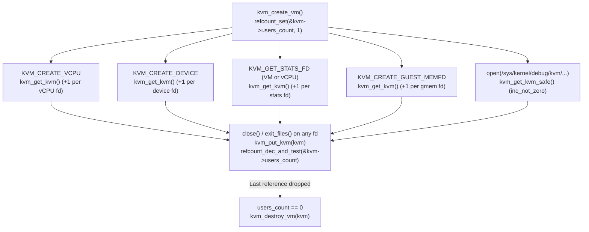

##### 3.5.2.1 The Reference Counting Contract: `kvm_get_kvm_safe()` vs. `kvm_put_kvm_no_destroy()`

In [`virt/kvm/kvm_main.c`](https://kernel.googlesource.com/pub/scm/virt/kvm/kvm.git/+/refs/heads/master/virt/kvm/kvm_main.c) (lines 1313–1347), KVM provides four functions to manipulate `kvm->users_count`:

1. **`kvm_get_kvm(struct kvm *kvm)`**: Calls `refcount_inc(&kvm->users_count)`. Used when the caller already holds a valid reference to `kvm` (such as inside `kvm_vm_ioctl()` when creating a vCPU, device, stats fd, or `guest_memfd`).
2. **`kvm_get_kvm_safe(struct kvm *kvm)`**: Calls `refcount_inc_not_zero(&kvm->users_count)`. Why is this needed? Consider `debugfs` files in `/sys/kernel/debug/kvm/<pid>-<fd>/` (`kvm_stat_fops_open()` at line 6129 of `virt/kvm/kvm_main.c`): `stat_data->kvm` is a weak pointer that does *not* hold a reference on `kvm->users_count` (otherwise `kvm->users_count` would never reach zero and `kvm_destroy_vm()` would never be called to remove the `debugfs` directory!). Therefore, a monitoring tool in userspace might `open()` a `debugfs` file at the exact microsecond that `kvm->users_count` drops to `0` and `kvm_destroy_vm()` begins before `debugfs_remove_recursive()` completes. `kvm_get_kvm_safe()` atomically checks if `users_count != 0` before incrementing; if `users_count` is already `0`, it returns `false` and `open()` fails safely with `-ENOENT`.
3. **`kvm_put_kvm(struct kvm *kvm)`**: Calls `if (refcount_dec_and_test(&kvm->users_count)) kvm_destroy_vm(kvm);`. Invoked from the `.release` callback of `kvm_vm_fops`, `kvm_vcpu_fops`, `kvm_device_fops`, `kvm_vm_stats_fops`, `kvm_vcpu_stats_fops`, and `kvm_gmem_fops`.
4. **`kvm_put_kvm_no_destroy(struct kvm *kvm)`**: Calls `WARN_ON(refcount_dec_and_test(&kvm->users_count))`. Used on error paths during child fd creation (e.g., if `create_vcpu_fd()` or `anon_inode_getfd()` fails after `kvm_get_kvm(kvm)` was called). Because the caller is executing inside a VM `ioctl`, the VM fd itself is still open (`users_count >= 2`), so dropping the child's tentative reference must *never* reach zero.

###### 3.5.2.1.1 Exact Teardown Ordering in `kvm_destroy_vm()` and `kvm_arch_destroy_vm()`: Preventing Use-After-Free Across SRCU, MMU Notifiers, and vCPUs

When the last open file descriptor referencing a VM is closed, `kvm_put_kvm()` invokes `kvm_destroy_vm(struct kvm *kvm)` in [`virt/kvm/kvm_main.c`](https://kernel.googlesource.com/pub/scm/virt/kvm/kvm.git/+/refs/heads/master/virt/kvm/kvm_main.c) (lines 1255–1311). Every single line of `kvm_destroy_vm()` and `kvm_arch_destroy_vm()` is ordered to prevent subtle concurrency bugs:

```c
// virt/kvm/kvm_main.c (lines 1255-1311)
static void kvm_destroy_vm(struct kvm *kvm)
{
	int i;
	struct mm_struct *mm = kvm->mm;

	kvm_destroy_pm_notifier(kvm);
	kvm_uevent_notify_change(KVM_EVENT_DESTROY_VM, kvm);
	kvm_destroy_vm_debugfs(kvm);
	mutex_lock(&kvm_lock);
	list_del(&kvm->vm_list);
	mutex_unlock(&kvm_lock);
	kvm_arch_pre_destroy_vm(kvm);

	kvm_free_irq_routing(kvm);
	for (i = 0; i < KVM_NR_BUSES; i++) {
		struct kvm_io_bus *bus = kvm_get_bus_for_destruction(kvm, i);

		if (bus)
			kvm_io_bus_destroy(bus);
		kvm->buses[i] = NULL;
	}
	kvm_coalesced_mmio_free(kvm);
	mmu_notifier_unregister(&kvm->mmu_notifier, kvm->mm);
	/*
	 * At this point, pending calls to invalidate_range_start()
	 * have completed but no more MMU notifiers will run, so
	 * mn_active_invalidate_count may remain unbalanced.
	 * No threads can be waiting in kvm_swap_active_memslots() as the
	 * last reference on KVM has been dropped, but freeing
	 * memslots would deadlock without this manual intervention.
	 *
	 * If the count isn't unbalanced, i.e. KVM did NOT unregister its MMU
	 * notifier between a start() and end(), then there shouldn't be any
	 * in-progress invalidations.
	 */
	WARN_ON(rcuwait_active(&kvm->mn_memslots_update_rcuwait));
	if (kvm->mn_active_invalidate_count)
		kvm->mn_active_invalidate_count = 0;
	else
		WARN_ON(kvm->mmu_invalidate_in_progress);
	kvm_arch_destroy_vm(kvm);
	kvm_destroy_devices(kvm);
	for (i = 0; i < kvm_arch_nr_memslot_as_ids(kvm); i++) {
		kvm_free_memslots(kvm, &kvm->__memslots[i][0]);
		kvm_free_memslots(kvm, &kvm->__memslots[i][1]);
	}
	cleanup_srcu_struct(&kvm->irq_srcu);
	srcu_barrier(&kvm->srcu);
	cleanup_srcu_struct(&kvm->srcu);
#ifdef CONFIG_KVM_GENERIC_MEMORY_ATTRIBUTES
	xa_destroy(&kvm->mem_attr_array);
#endif
	kvm_arch_free_vm(kvm);
	preempt_notifier_dec();
	kvm_disable_virtualization();
	mmdrop(mm);
}
```

Let us trace the seven critical ordering invariants in this teardown sequence:

1. **Unlinking from `debugfs` and `vm_list` First (Lines 1260–1265)**:
   Before freeing any internal structures, KVM unregisters the PM notifier, removes the `debugfs` directory (`kvm_destroy_vm_debugfs(kvm)`), and removes `kvm->vm_list` from the global `vm_list` under `kvm_lock` so global iterators (such as `/dev/kvm` stats or module-wide walks) can no longer discover the dying VM.
2. **Stopping Background Workers in `kvm_arch_pre_destroy_vm(kvm)` (Line 1266)**:
   In [`arch/x86/kvm/x86.c`](https://kernel.googlesource.com/pub/scm/virt/kvm/kvm.git/+/refs/heads/master/arch/x86/kvm/x86.c) (lines 9996–10016), `kvm_arch_pre_destroy_vm()` destroys the in-kernel PIT (`kvm_free_pit(kvm)`), cancels any delayed EOI work on the IOAPIC (`cancel_delayed_work_sync(&kvm->arch.vioapic->eoi_inject)`), and stops the NX huge-page recovery kthread (`kvm_mmu_pre_destroy_vm(kvm)`). Why must the PIT be stopped *before* `kvm_free_irq_routing(kvm)` at line 1268, while `vpic` and `vioapic` are kept alive until `kvm_arch_destroy_vm()`? Because the PIT runs an asynchronous `hrtimer` worker thread that injects timer interrupts through `kvm->irq_routing` and iterates over `vcpu_array`! Stopping the PIT timer thread and the NX recovery thread first ensures no background kernel thread is touching `irq_routing` or `vcpu_array` during teardown.
3. **Unregistering `mmu_notifier` *Before* `kvm_arch_destroy_vm()` and Balancing `mn_active_invalidate_count` (Lines 1277–1294)**:
   Even after all KVM file descriptors are closed, the VMM process's `mm_struct` (`kvm->mm`) may still be alive and running other threads (or tearing down VMAs in `exit_mmap()`). Calling `mmu_notifier_unregister(&kvm->mmu_notifier, kvm->mm)` detaches KVM from `kvm->mm` and waits via SRCU for any in-flight `kvm_mmu_notifier_invalidate_range_start()` or `release()` callbacks to finish.
   Look closely at lines 1291–1292: `if (kvm->mn_active_invalidate_count) kvm->mn_active_invalidate_count = 0;`. Why can `mn_active_invalidate_count` be non-zero after `mmu_notifier_unregister()` returns? Because a host thread on `kvm->mm` might have called `.invalidate_range_start()` (incrementing `mn_active_invalidate_count`) just before `mmu_notifier_unregister()` detached the notifier, meaning KVM will *never* receive the matching `.invalidate_range_end()` call! And in `kvm_arch_destroy_vm()` (lines 10020–10033 of [`arch/x86/kvm/x86.c`](https://kernel.googlesource.com/pub/scm/virt/kvm/kvm.git/+/refs/heads/master/arch/x86/kvm/x86.c)), if `current->mm == kvm->mm`, KVM removes the three internal x86 memslots (`APIC_ACCESS_PAGE_PRIVATE_MEMSLOT`, `IDENTITY_PAGETABLE_PRIVATE_MEMSLOT`, `TSS_PRIVATE_MEMSLOT`), which calls `kvm_swap_active_memslots()`. `kvm_swap_active_memslots()` waits on `rcuwait_wait_event(&kvm->mn_memslots_update_rcuwait, !kvm->mn_active_invalidate_count, ...)`! Without manually resetting `mn_active_invalidate_count = 0` at line 1292, removing the internal x86 memslots in `kvm_arch_destroy_vm()` would sleep forever waiting for an `.invalidate_range_end()` that will never arrive.
4. **Destroying vCPUs and x86 MMU in `kvm_arch_destroy_vm()` (Line 1295)**:
   In [`arch/x86/kvm/x86.c`](https://kernel.googlesource.com/pub/scm/virt/kvm/kvm.git/+/refs/heads/master/arch/x86/kvm/x86.c) (lines 10018–10049), `kvm_arch_destroy_vm()` unmaps the internal x86 memslots (if `current->mm == kvm->mm`), calls `kvm_destroy_vcpus(kvm)` (which frees every `vcpu`'s VMCS/VMCB, LAPIC, `vcpu->run` page, and erases it from `vcpu_array`), frees `msr_filter`, `vpic`, `vioapic`, `apic_map`, and `pmu_event_filter`, calls `kvm_mmu_uninit_vm(kvm)` to zap and free all remaining TDP/Shadow MMU roots and page caches, and invokes `kvm_x86_call(vm_destroy)(kvm)`.
5. **Destroying Devices and Double-Buffered Memslots (Lines 1296–1300)**:
   `kvm_destroy_devices(kvm)` invokes `dev->ops->destroy(dev)` on any remaining devices in `kvm->devices`, and `kvm_free_memslots()` frees all `struct kvm_memory_slot` structs (including unbinding `guest_memfd` slots via `kvm_gmem_unbind(slot)`, freeing `dirty_bitmap`, and freeing x86 `rmap` and `lpage_info` arrays via `kvm_arch_free_memslot()`). Recall from `kvm_free_memslots()` (lines 948–965 of `virt/kvm/kvm_main.c`) that because the same `struct kvm_memory_slot` pointers are linked into both `__memslots[i][0]` and `__memslots[i][1]`, `kvm_free_memslots()` checks `if (!slots->node_idx) return;` so each `kvm_memory_slot` is freed exactly once when called on `__memslots[i][1]`!
6. **Draining Deferred Callbacks with `srcu_barrier(&kvm->srcu)` Before `cleanup_srcu_struct()` (Lines 1301–1303)**:
   When `kvm_mmu_uninit_tdp_mmu(kvm)` zaps TDP MMU roots during `kvm_arch_destroy_vm()`, TDP MMU page table structures (`struct kvm_mmu_page`) are queued for asynchronous RCU destruction via `call_srcu(&kvm->srcu, &sp->rcu_head, tdp_mmu_free_sp_rcu_callback)`. Calling `srcu_barrier(&kvm->srcu)` at line 1302 blocks until every pending `call_srcu()` callback queued on `kvm->srcu` has finished executing, before `cleanup_srcu_struct(&kvm->srcu)` tears down the SRCU per-CPU structures.
7. **Freeing `struct kvm` and Dropping `mm->mm_count` (Lines 1307–1310)**:
   Finally, `kvm_arch_free_vm(kvm)` calls `kvfree(kvm)`, `preempt_notifier_dec()` and `kvm_disable_virtualization()` decrement the global usage counters, and `mmdrop(mm)` releases KVM's reference on `struct mm_struct` (captured in a local variable `struct mm_struct *mm = kvm->mm` at the top of `kvm_destroy_vm()` because `kvm` itself has just been freed!).

---

### 3.6 Hands-On Mastery Exercises

#### Exercise 3.1: Complete Userspace UAPI & Binary Telemetry Inspector (`kvm_uapi_inspector.c`)

**Objective**: Write a standalone, production-grade C program that exercises all four tiers of the KVM UAPI: opening `/dev/kvm`, validating `KVM_GET_API_VERSION`, querying system and VM capabilities (`KVM_CHECK_EXTENSION`), discovering the `vcpu` `mmap` layout (`KVM_GET_VCPU_MMAP_SIZE`), enumerating supported host CPUID leaves (`KVM_GET_SUPPORTED_CPUID`), creating a VM and vCPU, and parsing the complete binary telemetry schema and live counters from `KVM_GET_STATS_FD` using `pread()`.

```c
// kvm_uapi_inspector.c
// Compile: gcc -O2 -Wall -Wextra -o kvm_uapi_inspector kvm_uapi_inspector.c
// Run:     ./kvm_uapi_inspector
#define _GNU_SOURCE
#include <stdio.h>
#include <stdlib.h>
#include <stdint.h>
#include <string.h>
#include <unistd.h>
#include <fcntl.h>
#include <errno.h>
#include <sys/ioctl.h>
#include <sys/mman.h>
#include <linux/kvm.h>

static const char *stats_type_str(uint32_t flags)
{
	switch (flags & KVM_STATS_TYPE_MASK) {
	case KVM_STATS_TYPE_CUMULATIVE:  return "CUMULATIVE";
	case KVM_STATS_TYPE_INSTANT:     return "INSTANT";
	case KVM_STATS_TYPE_PEAK:        return "PEAK";
	case KVM_STATS_TYPE_LINEAR_HIST: return "LINEAR_HIST";
	case KVM_STATS_TYPE_LOG_HIST:    return "LOG_HIST";
	default:                         return "UNKNOWN";
	}
}

static const char *stats_unit_str(uint32_t flags)
{
	switch (flags & KVM_STATS_UNIT_MASK) {
	case KVM_STATS_UNIT_NONE:    return "count";
	case KVM_STATS_UNIT_BYTES:   return "bytes";
	case KVM_STATS_UNIT_SECONDS: return "sec";
	case KVM_STATS_UNIT_CYCLES:  return "cycles";
	case KVM_STATS_UNIT_BOOLEAN: return "bool";
	default:                     return "unknown";
	}
}

static void dump_binary_stats(int stats_fd, const char *label)
{
	struct kvm_stats_header hdr;
	if (pread(stats_fd, &hdr, sizeof(hdr), 0) != sizeof(hdr)) {
		perror("pread(kvm_stats_header)");
		return;
	}

	char *id_str = calloc(1, hdr.name_size + 1);
	if (pread(stats_fd, id_str, hdr.name_size, hdr.id_offset) != (ssize_t)hdr.name_size) {
		perror("pread(stats_id)");
		free(id_str);
		return;
	}

	printf("\n=== Binary Telemetry Stream [%s] (id='%s') ===\n", label, id_str);
	printf("Header: name_size=%u, num_desc=%u, id_off=0x%x, desc_off=0x%x, data_off=0x%x\n",
	       hdr.name_size, hdr.num_desc, hdr.id_offset, hdr.desc_offset, hdr.data_offset);

	size_t desc_stride = sizeof(struct kvm_stats_desc) + hdr.name_size;
	size_t total_desc_bytes = (size_t)hdr.num_desc * desc_stride;
	uint8_t *desc_buf = malloc(total_desc_bytes);

	if (pread(stats_fd, desc_buf, total_desc_bytes, hdr.desc_offset) != (ssize_t)total_desc_bytes) {
		perror("pread(descriptors)");
		free(desc_buf);
		free(id_str);
		return;
	}

	/* Compute total size of data block from descriptors */
	size_t max_data_end = 0;
	for (uint32_t i = 0; i < hdr.num_desc; i++) {
		struct kvm_stats_desc *d = (struct kvm_stats_desc *)(desc_buf + i * desc_stride);
		size_t end = d->offset + (size_t)d->size * sizeof(uint64_t);
		if (end > max_data_end)
			max_data_end = end;
	}

	uint8_t *data_buf = calloc(1, max_data_end);
	if (pread(stats_fd, data_buf, max_data_end, hdr.data_offset) != (ssize_t)max_data_end) {
		perror("pread(data)");
		free(data_buf);
		free(desc_buf);
		free(id_str);
		return;
	}

	printf("%-32s %-12s %-8s %-8s %-6s %s\n",
	       "STAT_NAME", "TYPE", "UNIT", "SCALE", "ITEMS", "VALUE[0]");
	printf("--------------------------------------------------------------------------------\n");
	for (uint32_t i = 0; i < hdr.num_desc; i++) {
		struct kvm_stats_desc *d = (struct kvm_stats_desc *)(desc_buf + i * desc_stride);
		uint64_t *vals = (uint64_t *)(data_buf + d->offset);
		uint32_t base = ((d->flags & KVM_STATS_BASE_MASK) == KVM_STATS_BASE_POW2) ? 2 : 10;

		printf("%-32s %-12s %-8s %u^%-5d %-6u %llu\n",
		       d->name, stats_type_str(d->flags), stats_unit_str(d->flags),
		       base, d->exponent, d->size, (unsigned long long)vals[0]);
	}

	free(data_buf);
	free(desc_buf);
	free(id_str);
}

int main(void)
{
	int kvm_fd = open("/dev/kvm", O_RDWR | O_CLOEXEC);
	if (kvm_fd < 0) {
		perror("open(/dev/kvm)");
		return EXIT_FAILURE;
	}

	int api_ver = ioctl(kvm_fd, KVM_GET_API_VERSION, 0);
	printf("[Tier 1] KVM_GET_API_VERSION       = %d (expected %d)\n", api_ver, KVM_API_VERSION);

	int mmap_size = ioctl(kvm_fd, KVM_GET_VCPU_MMAP_SIZE, 0);
	printf("[Tier 1] KVM_GET_VCPU_MMAP_SIZE    = %d bytes (%d pages)\n",
	       mmap_size, mmap_size / (int)sysconf(_SC_PAGESIZE));

	/* Query supported CPUID leaves */
	size_t cpuid_nent = 128;
	struct kvm_cpuid2 *cpuid = calloc(1, sizeof(*cpuid) + cpuid_nent * sizeof(cpuid->entries[0]));
	cpuid->nent = cpuid_nent;
	if (ioctl(kvm_fd, KVM_GET_SUPPORTED_CPUID, cpuid) == 0) {
		printf("[Tier 1] KVM_GET_SUPPORTED_CPUID   = %u leaves returned\n", cpuid->nent);
	}
	free(cpuid);

	/* Create a VM instance (Tier 2) */
	int vm_fd = ioctl(kvm_fd, KVM_CREATE_VM, 0);
	if (vm_fd < 0) {
		perror("ioctl(KVM_CREATE_VM)");
		close(kvm_fd);
		return EXIT_FAILURE;
	}

	printf("[Tier 2] Created VM fd             = %d\n", vm_fd);
	printf("[Tier 2] KVM_CAP_NR_MEMSLOTS       = %d\n", ioctl(vm_fd, KVM_CHECK_EXTENSION, KVM_CAP_NR_MEMSLOTS));
	printf("[Tier 2] KVM_CAP_MAX_VCPUS         = %d\n", ioctl(vm_fd, KVM_CHECK_EXTENSION, KVM_CAP_MAX_VCPUS));
	printf("[Tier 2] KVM_CAP_MAX_VCPU_ID       = %d\n", ioctl(vm_fd, KVM_CHECK_EXTENSION, KVM_CAP_MAX_VCPU_ID));
	printf("[Tier 2] KVM_CAP_BINARY_STATS_FD   = %d\n", ioctl(vm_fd, KVM_CHECK_EXTENSION, KVM_CAP_BINARY_STATS_FD));

	/* Create vCPU 0 (Tier 3) */
	int vcpu_fd = ioctl(vm_fd, KVM_CREATE_VCPU, 0);
	if (vcpu_fd < 0) {
		perror("ioctl(KVM_CREATE_VCPU)");
		close(vm_fd);
		close(kvm_fd);
		return EXIT_FAILURE;
	}
	printf("[Tier 3] Created vCPU 0 fd         = %d\n", vcpu_fd);

	struct kvm_run *run = mmap(NULL, mmap_size, PROT_READ | PROT_WRITE, MAP_SHARED, vcpu_fd, 0);
	if (run == MAP_FAILED) {
		perror("mmap(vcpu_fd)");
	} else {
		printf("[Tier 3] Mapped struct kvm_run at %p (apic_base=0x%llx)\n",
		       (void *)run, (unsigned long long)run->apic_base);
		munmap(run, mmap_size);
	}

	/* Obtain and parse VM and vCPU binary telemetry fds */
	int vm_stats_fd = ioctl(vm_fd, KVM_GET_STATS_FD, 0);
	if (vm_stats_fd >= 0) {
		dump_binary_stats(vm_stats_fd, "VM Stats");
		close(vm_stats_fd);
	}

	int vcpu_stats_fd = ioctl(vcpu_fd, KVM_GET_STATS_FD, 0);
	if (vcpu_stats_fd >= 0) {
		dump_binary_stats(vcpu_stats_fd, "vCPU 0 Stats");
		close(vcpu_stats_fd);
	}

	/* Intentionally close vm_fd BEFORE vcpu_fd to verify refcount-based lifetime! */
	printf("\nClosing vm_fd (%d) first, then vcpu_fd (%d)...\n", vm_fd, vcpu_fd);
	close(vm_fd);
	close(vcpu_fd);
	close(kvm_fd);
	return EXIT_SUCCESS;
}
```

#### Exercise 3.2: Tracing `kvm->users_count` Reference Transitions and `kvm_destroy_vm()` Ordering with `bpftrace`

**Objective**: Observe in real time how closing `vm_fd` *before* `vcpu_fd` in Exercise 3.1 keeps `struct kvm` alive (`users_count > 0`) until the final child `vcpu_fd` is closed, and verify that `kvm_destroy_vm()` is triggered only by `kvm_vcpu_release() -> kvm_put_kvm()`.

1. Save the following `bpftrace` script as `trace_kvm_lifecycle.bt`:
   ```awk
   #!/usr/bin/env bpftrace
   // trace_kvm_lifecycle.bt

   kprobe:kvm_create_vm {
       printf("[%s pid=%d] kvm_create_vm(type=%lu, fdname=%s)\n",
              comm, pid, arg0, str(arg1));
   }

   kretprobe:kvm_create_vm {
       printf("[%s pid=%d] kvm_create_vm returned struct kvm * = %p\n",
              comm, pid, retval);
   }

   kprobe:kvm_get_kvm {
       printf("[%s pid=%d] kvm_get_kvm(kvm=%p) caller=%s\n",
              comm, pid, arg0, ksym(*(reg("sp"))));
   }

   kprobe:kvm_put_kvm {
       printf("[%s pid=%d] kvm_put_kvm(kvm=%p) caller=%s\n",
              comm, pid, arg0, ksym(*(reg("sp"))));
   }

   kprobe:kvm_destroy_vm {
       printf("[%s pid=%d] >>> kvm_destroy_vm(kvm=%p) TRIGGERED! <<<\n%s\n",
              comm, pid, arg0, kstack(5));
   }
   ```
2. Run `sudo bpftrace trace_kvm_lifecycle.bt` in one terminal and execute `./kvm_uapi_inspector` in a second terminal.
3. **Walkthrough of Expected Output**:
   * `kvm_create_vm` initializes `users_count = 1`.
   * `kvm_vm_ioctl_create_vcpu` calls `kvm_get_kvm()` (`users_count` $\rightarrow 2$).
   * `kvm_vm_ioctl_get_stats_fd` calls `kvm_get_kvm()` (`users_count` $\rightarrow 3$), and `close(vm_stats_fd)` calls `kvm_vm_stats_release -> kvm_put_kvm()` (`users_count` $\rightarrow 2`).
   * `kvm_vcpu_ioctl_get_stats_fd` calls `kvm_get_kvm()` (`users_count` $\rightarrow 3$), and `close(vcpu_stats_fd)` calls `kvm_vcpu_stats_release -> kvm_put_kvm()` (`users_count` $\rightarrow 2`).
   * When `close(vm_fd)` executes, `kvm_vm_release -> kvm_put_kvm()` decrements `users_count` from `2` to `1`—notice that `kvm_destroy_vm` is **not** called!
   * Only when `close(vcpu_fd)` executes does `kvm_vcpu_release -> kvm_put_kvm()` decrement `users_count` from `1` to `0`, firing the `kprobe:kvm_destroy_vm` probe with `kvm_vcpu_release` at the top of the kernel stack trace.

#### Exercise 3.3: Testing the `kvm->mm != current->mm` Security Guard Across `fork()`

**Objective**: Empirically verify that an inherited `vm_fd` or `vcpu_fd` across a POSIX `fork()` (which creates a new `struct mm_struct` for the child process) is rejected by the `-EIO` guard in `kvm_vm_ioctl()` and `kvm_vcpu_ioctl()`.

1. Add the following test block to `kvm_uapi_inspector.c` right after `vcpu_fd` is created:
   ```c
   pid_t child = fork();
   if (child == 0) {
       /* Child process has a distinct current->mm != kvm->mm */
       int ret_vm = ioctl(vm_fd, KVM_CHECK_EXTENSION, KVM_CAP_NR_VCPUS);
       printf("[Child pid=%d] ioctl(vm_fd)   returned %d (errno=%d: %s)\n",
              getpid(), ret_vm, errno, strerror(errno));

       struct kvm_regs regs;
       int ret_vcpu = ioctl(vcpu_fd, KVM_GET_REGS, &regs);
       printf("[Child pid=%d] ioctl(vcpu_fd) returned %d (errno=%d: %s)\n",
              getpid(), ret_vcpu, errno, strerror(errno));
       _exit(0);
   }
   waitpid(child, NULL, 0);
   ```
2. Compile and run the binary. Observe that both `ioctl` calls in the child process immediately return `-1` with `errno = 5` (`EIO: Input/output error`), proving that lines 5184 (`if (kvm->mm != current->mm || kvm->vm_dead) return -EIO;`) and 4444 of [`virt/kvm/kvm_main.c`](https://kernel.googlesource.com/pub/scm/virt/kvm/kvm.git/+/refs/heads/master/virt/kvm/kvm_main.c) prevent cross-address-space hypervisor state manipulation.

#### Exercise 3.4: Kernel Modification Experiment — Adding a Custom VM Binary Telemetry Counter

**Objective**: Modify the KVM x86 kernel source tree to add a new cumulative VM statistic `vm_ioctl_calls` that counts how many times `kvm_vm_ioctl()` is invoked on a VM, and observe it automatically appear in both `/sys/kernel/debug/kvm/<pid>-<fd>/vm_ioctl_calls` and the `KVM_GET_STATS_FD` binary descriptor table without changing a single line of `virt/kvm/binary_stats.c` or `kvm_uapi_inspector.c`.

1. **Step 1 — Add the counter field to `struct kvm_vm_stat_generic` in [`include/linux/kvm_types.h`](https://kernel.googlesource.com/pub/scm/virt/kvm/kvm.git/+/refs/heads/master/include/linux/kvm_types.h)**:
   Locate `struct kvm_vm_stat_generic` and append `u64 vm_ioctl_calls;`:
   ```c
   struct kvm_vm_stat_generic {
   	u64 remote_tlb_flush;
   	u64 remote_tlb_flush_requests;
   	u64 vm_ioctl_calls;
   };
   ```
2. **Step 2 — Register the descriptor in `KVM_GENERIC_VM_STATS()` in [`include/linux/kvm_host.h`](https://kernel.googlesource.com/pub/scm/virt/kvm/kvm.git/+/refs/heads/master/include/linux/kvm_host.h) (lines 2081–2083)**:
   ```c
   #define KVM_GENERIC_VM_STATS()						       \
   	STATS_DESC_COUNTER(VM_GENERIC, remote_tlb_flush),		       \
   	STATS_DESC_COUNTER(VM_GENERIC, remote_tlb_flush_requests),	       \
   	STATS_DESC_COUNTER(VM_GENERIC, vm_ioctl_calls)
   ```
   Because `kvm_vm_stats_desc[]` in [`arch/x86/kvm/x86.c`](https://kernel.googlesource.com/pub/scm/virt/kvm/kvm.git/+/refs/heads/master/arch/x86/kvm/x86.c) (line 238) expands `KVM_GENERIC_VM_STATS()`, and `kvm_vm_stats_header` (lines 255–262) computes `.num_desc = ARRAY_SIZE(kvm_vm_stats_desc)` and `.data_offset = ... + sizeof(kvm_vm_stats_desc)` at compile time, the binary stats header and descriptor table automatically adjust their offsets and counts!
3. **Step 3 — Increment the counter in `kvm_vm_ioctl()` in [`virt/kvm/kvm_main.c`](https://kernel.googlesource.com/pub/scm/virt/kvm/kvm.git/+/refs/heads/master/virt/kvm/kvm_main.c) (line 5186)**:
   Right after the `if (kvm->mm != current->mm || kvm->vm_dead) return -EIO;` check, add:
   ```c
   	kvm->stat.generic.vm_ioctl_calls++;
   ```
4. **Step 4 — Rebuild `kvm.ko` and `kvm-intel.ko`/`kvm-amd.ko` and Run `kvm_uapi_inspector`**:
   Recompile the `virt/kvm` and `arch/x86/kvm` modules, reload them, and run `./kvm_uapi_inspector`. In the `=== Binary Telemetry Stream [VM Stats] ===` output, `hdr.num_desc` increases from `16` to `17`, and `vm_ioctl_calls` is automatically discovered and printed with its exact live invocation count.

---

# Part II: Virtual CPU (vCPU) Execution, Context Switching, and Instruction Emulation

## Chapter 4: Anatomy of a vCPU — Creation, Scheduling, Preemption Notifiers, vCPU Requests, and the `KVM_RUN` Outer Loop

In Part I, we saw how KVM transforms the Linux kernel into a hardware-assisted hypervisor (`kvm.ko` + `kvm-intel.ko` / `kvm-amd.ko`) and exposes a four-tier file descriptor hierarchy anchored at `/dev/kvm`. A Virtual Machine (`struct kvm`), however, is merely an inert container of address spaces (`struct kvm_memslots`), I/O buses (`struct kvm_io_bus`), and interrupt routing tables (`struct kvm_irq_routing_table`) until it is populated with **Virtual CPUs (`struct kvm_vcpu`)**.

Every instruction a guest operating system executes, every page fault it incurs, every interrupt it receives, and every I/O port it touches is driven by the execution loop of a `struct kvm_vcpu`. In this chapter, we bridge the gap between a standard Linux kernel thread (`struct task_struct`) and a hardware-accelerated virtual processor. We will dissect how a vCPU is allocated, initialized, and mapped into userspace via `mmap()`; how it integrates seamlessly with the Linux Completely Fair Scheduler (CFS) / EEVDF scheduler via **Preemption Notifiers** (`struct preempt_notifier`); how KVM coordinates lockless cross-processor actions using the **Dekker-ordered vCPU Request & Mode State Machine** (`vcpu->requests` and `vcpu->mode`); how KVM balances microsecond wake latency against CPU burn via **Adaptive Halt-Polling** (`kvm_vcpu_halt()`) and **Directed Yielding** (`kvm_vcpu_on_spin()`); and finally, how the outer `KVM_RUN` loop (`kvm_arch_vcpu_ioctl_run()` $\to$ `vcpu_run()` $\to$ `vcpu_enter_guest()`) orchestrates the transition from host kernel context to hardware guest mode and back.

---

### 4.1 OS Thread Scheduling vs. Virtual Processor Multiplexing

#### 4.1.1 Why a KVM vCPU Is an Ordinary Linux Thread (`struct task_struct`)

In a traditional monolithic Type-1 hypervisor (such as Xen or VMware ESXi), the hypervisor implements its own bespoke CPU scheduler from scratch, complete with custom runqueues, NUMA load balancers, CPU affinity masks, and power-management governors. KVM's foundational architectural insight is that **a Virtual CPU does not need a separate hypervisor scheduler**: from the perspective of the host Linux kernel, a vCPU is simply a normal POSIX thread (`pthread`) created by the userspace Virtual Machine Monitor (QEMU, crosvm, or Firecracker) that happens to spend most of its life inside the `ioctl(vcpu_fd, KVM_RUN, 0)` system call.

Because each vCPU is bound 1-to-1 to a standard host thread (`current`), KVM inherits the entire industrial-strength machinery of the Linux kernel for free:
- **CPU Scheduling & Load Balancing:** EEVDF / CFS scheduling, real-time `SCHED_FIFO` / `SCHED_DEADLINE` priorities for low-latency telco/automotive VMs, CPU affinity (`sched_setaffinity()`), and automatic NUMA balancing (`numa_Migrate`).
- **Resource Control:** Linux Control Groups (`cgroup v2` `cpu.max`, `cpu.weight`, `cpuset.cpus`) throttle, pin, or isolate vCPU threads using the exact same kernel paths used for containers and ordinary processes.
- **Signal Delivery & Process Accounting:** Standard POSIX signals (`SIGUSR1`, `SIGALRM`, `SIGTERM`) interrupt `KVM_RUN` cleanly (`-EINTR` / `KVM_EXIT_INTR`), and `/proc/<pid>/task/<tid>/stat` tracks guest execution time (`PF_VCPU` / `vtime_account_guest_enter()`).

```
+-----------------------------------------------------------------------------------+
|                      HOST USERSPACE (VMM Process: QEMU / crosvm)                  |
|                                                                                   |
|   pthread #0 (vCPU 0)               pthread #1 (vCPU 1)               I/O Thread  |
|   +-----------------------+         +-----------------------+         +---------+ |
|   | while (running) {     |         | while (running) {     |         | epoll() | |
|   |   ioctl(fd0, KVM_RUN);|         |   ioctl(fd1, KVM_RUN);|         | eventfd | |
|   |   handle_exit(run0);  |         |   handle_exit(run1);  |         +---------+ |
|   | }                     |         | }                     |                     |
+---+-----------------------+---------+-----------------------+---------------------+
    | syscall (ioctl)                 | syscall (ioctl)
====|=================================|==============================================
    v                                 v                HOST KERNEL MODE (Ring 0 Root)
+---------------------------+         +---------------------------+
| task_struct (TID 4102)    |         | task_struct (TID 4103)    |
|  +- preempt_notifier      |         |  +- preempt_notifier      |
|  |   (kvm_preempt_ops)    |         |  |   (kvm_preempt_ops)    |
|  v                        |         |  v                        |
| struct kvm_vcpu (vcpu 0)  |         | struct kvm_vcpu (vcpu 1)  |
|  +- vcpu_load()           |         |  +- vcpu_load()           |
|  +- vcpu_run()            |         |  +- vcpu_run()            |
|  +- vcpu_enter_guest()    |         |  +- vcpu_enter_guest()    |
+-------------+-------------+         +-------------+-------------+
              | VMLAUNCH/VMRESUME                   | VMLAUNCH/VMRESUME
==============|=====================================|================================
              v (World Switch)                      v (World Switch)
+---------------------------+         +---------------------------+
|   GUEST MODE (Non-Root)   |         |   GUEST MODE (Non-Root)   |
|   Guest OS CPU #0         |         |   Guest OS CPU #1         |
+---------------------------+         +---------------------------+
```

##### 4.1.1.1 The Fundamental Context-Multiplexing Problem: Host Preemption While Holding Hardware State

There is, however, a profound difference between an ordinary Linux thread executing in kernel mode and a thread executing `vcpu_load(vcpu)` inside `KVM_RUN`. When an ordinary thread blocks on a mutex or is preempted by a timer interrupt inside a `read()` syscall, the Linux scheduler's `context_switch()` (`kernel/sched/core.c`) saves and restores only the **standard host Linux thread state**:
1. General-purpose registers and kernel stack pointer (`RSP`, `RIP`, callee-saved registers via `switch_to()`).
2. Host process address space (`CR3` via `switch_mm_irqs_off()`).
3. Host thread-local storage (`FSBASE`, `GSBASE`) and FPU state (`switch_fpu_prepare()`).

The Linux scheduler knows *nothing* about the extra virtualization hardware state that KVM has loaded onto the physical CPU core for the active `struct kvm_vcpu`:
- **Intel VMX per-pCPU state:** The active VMCS pointer (`VMPTRLD`) cached in the physical core's internal silicon VMCS cache, lazy host/guest segment descriptors (`TR`, `LDT`, `FS`, `GS`), and lazy `MSR_KERNEL_GS_BASE` / `MSR_STAR` / `MSR_LSTAR` / `MSR_SYSCALL_MASK` registers (`vmx_prepare_switch_to_guest()`), plus the Posted Interrupt Descriptor's (`struct pi_desc`) notification vector (`POSTED_INTR_VECTOR` vs. `POSTED_INTR_WAKEUP_VECTOR`) and physical APIC destination (`ndst`).
- **AMD SVM per-pCPU state:** Guest host-save state swapped via `VMLOAD`/`VMSAVE`, AVIC Physical APIC Table `IsRunning` bit and physical CPU APIC ID (`avic_vcpu_load()`), and user-return MSRs.
- **Generic per-pCPU state:** The per-CPU `kvm_running_vcpu` pointer (`__this_cpu_read(kvm_running_vcpu)`), guest vs. host `struct fpu_guest` (`guest_fpu`) XSTATE buffers, and KVM steal-time accounting (`vcpu->preempted`).

If the Linux scheduler were to preempt `task_struct` TID 4102 (running `vcpu 0` on physical CPU 3) and migrate it to physical CPU 7 *without* notifying KVM:
- Physical CPU 3 would still hold `vcpu 0`'s active VMCS in its silicon cache while running an unrelated host process (whose `SYSCALL` MSRs or `FS`/`GS` bases might still hold guest values!), and
- Physical CPU 7 would attempt to execute `VMRESUME` on a VMCS that was never `VMCLEAR`ed from CPU 3 nor `VMPTRLD`ed onto CPU 7!

###### 4.1.1.1.1 Bridging the Gap: `vcpu_load()`, `vcpu_put()`, and `struct preempt_notifier`

KVM solves this cleanly without polluting the core Linux scheduler by registering a **per-thread Preemption Notifier** (`CONFIG_PREEMPT_NOTIFIERS`) strictly for the duration of `vcpu_load()` $\to$ `vcpu_put()`. Let us inspect the exact implementation in [`virt/kvm/kvm_main.c`](https://kernel.googlesource.com/pub/scm/virt/kvm/kvm.git/+/refs/heads/master/virt/kvm/kvm_main.c) (lines 165–184 and 6250–6288):

```c
/* virt/kvm/kvm_main.c:165-184 */
/*
 * Switches to specified vcpu, until a matching vcpu_put()
 */
void vcpu_load(struct kvm_vcpu *vcpu)
{
	int cpu = get_cpu();

	__this_cpu_write(kvm_running_vcpu, vcpu);
	preempt_notifier_register(&vcpu->preempt_notifier);
	kvm_arch_vcpu_load(vcpu, cpu);
	put_cpu();
}
EXPORT_SYMBOL_FOR_KVM_INTERNAL(vcpu_load);

void vcpu_put(struct kvm_vcpu *vcpu)
{
	preempt_disable();
	kvm_arch_vcpu_put(vcpu);
	preempt_notifier_unregister(&vcpu->preempt_notifier);
	__this_cpu_write(kvm_running_vcpu, NULL);
	preempt_enable();
}
EXPORT_SYMBOL_FOR_KVM_INTERNAL(vcpu_put);
```

And here are the scheduler callbacks invoked directly from `__schedule()` (`fire_sched_out_preempt_notifiers()` and `fire_sched_in_preempt_notifiers()`):

```c
/* virt/kvm/kvm_main.c:6250-6288 */
static void kvm_sched_in(struct preempt_notifier *pn, int cpu)
{
	struct kvm_vcpu *vcpu = preempt_notifier_to_vcpu(pn);

	WRITE_ONCE(vcpu->preempted, false);
	WRITE_ONCE(vcpu->ready, false);

	__this_cpu_write(kvm_running_vcpu, vcpu);
	kvm_arch_vcpu_load(vcpu, cpu);
	vcpu->scheduled_out = false;
}

static void kvm_sched_out(struct preempt_notifier *pn,
			  struct task_struct *next)
{
	struct kvm_vcpu *vcpu = preempt_notifier_to_vcpu(pn);

	vcpu->scheduled_out = true;

	if (current_is_runnable()) {
		WRITE_ONCE(vcpu->preempted, true);
		WRITE_ONCE(vcpu->ready, true);
	}
	kvm_arch_vcpu_put(vcpu);
	__this_cpu_write(kvm_running_vcpu, NULL);
}
```

Trace the exact invariants enforced by these four functions:
1. **Caller Precondition (`vcpu->mutex`):** Every call to `vcpu_load(vcpu)` in `kvm_vcpu_ioctl()`, `kvm_arch_vcpu_ioctl_run()`, or `kvm_vm_ioctl_create_vcpu()` is serialized by `mutex_lock(&vcpu->mutex)`. Thus, two host threads can never concurrently `vcpu_load()` the same `vcpu`.
2. **Entering the Loaded Window (`vcpu_load`):**
   - `get_cpu()` disables kernel preemption on the current physical CPU (`cpu`).
   - `__this_cpu_write(kvm_running_vcpu, vcpu)` publishes `vcpu` as the active vCPU on this pCPU (allowing `kvm_get_running_vcpu()` to identify the current vCPU in $O(1)$ from interrupt, `mmu_notifier`, or dirty-ring contexts).
   - `preempt_notifier_register(&vcpu->preempt_notifier)` attaches `vcpu->preempt_notifier` (`kvm_preempt_ops`) to `current->preempt_notifiers`.
   - `kvm_arch_vcpu_load(vcpu, cpu)` loads the architecture-specific state onto `cpu` (e.g., on x86, `vmx_vcpu_load()` or `svm_vcpu_load()`, which issues a cross-CPU `VMCLEAR` IPI if `vcpu->cpu != cpu`, executes `VMPTRLD`, updates Posted Interrupt / AVIC routing tables to point at `cpu`, and applies TSC catchup if needed).
   - `put_cpu()` re-enables kernel preemption!
3. **Preemption / Sleep Inside the Loaded Window (`kvm_sched_out` $\to$ `kvm_sched_in`):**
   - Once `put_cpu()` re-enables preemption, the vCPU thread might sleep (for instance, in `kvm_vcpu_block()` waiting for an interrupt, or inside `__gfn_to_pfn_memslot()` waiting for host swap I/O) or be involuntary preempted by a higher-priority task when returning from a VM-Exit.
   - The instant `__schedule()` switches `current` off the CPU, `fire_sched_out_preempt_notifiers()` calls `kvm_sched_out()`.
   - Notice the subtle distinction in `kvm_sched_out()`: it checks `if (current_is_runnable())` (i.e. `current->__state == TASK_RUNNING`, meaning the vCPU thread was **involuntarily preempted** rather than voluntarily sleeping in `TASK_INTERRUPTIBLE` inside `kvm_vcpu_block()`). Only on involuntary preemption does it set `vcpu->preempted = true` and `vcpu->ready = true`, which informs peer vCPUs in `kvm_vcpu_on_spin()` (Pause-Loop Exiting directed yield) and the guest OS via `KVM_VCPU_PREEMPTED` in the steal-time structure (`kvm_steal_time_set_preempted()`) that this vCPU wants to run but lost its pCPU!
   - `kvm_sched_out()` then calls `kvm_arch_vcpu_put(vcpu)` (which restores host `FS`/`GS`/`KERNEL_GS_BASE`/`SYSCALL` MSRs via `vmx_prepare_switch_to_host()`, clears the AVIC `IsRunning` bit or sets the Posted Interrupt `SN`/wakeup state, and saves user-return MSRs) and clears `kvm_running_vcpu = NULL`.
   - When the Linux scheduler later schedules the vCPU thread back onto physical CPU `new_cpu` (which may or may not equal the old `cpu`!), `fire_sched_in_preempt_notifiers()` invokes `kvm_sched_in()`, restoring `kvm_running_vcpu`, calling `kvm_arch_vcpu_load(vcpu, new_cpu)`, and clearing `vcpu->preempted`, `vcpu->ready`, and `vcpu->scheduled_out`.

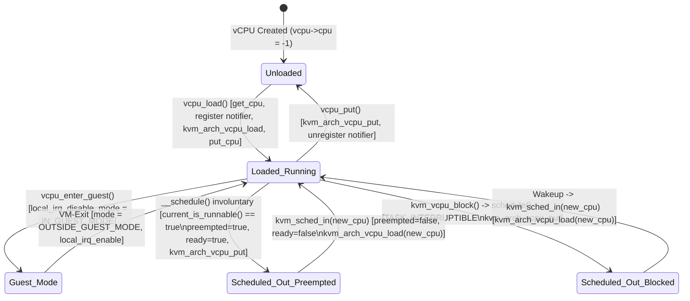

---

### 4.2 vCPU Creation (`kvm_vm_ioctl_create_vcpu`) and the Shared `struct kvm_run` Communication Page

#### 4.2.1 The `KVM_CREATE_VCPU` Contract and Two-Phase Visibility Protocol

Userspace creates a vCPU by issuing `ioctl(vm_fd, KVM_CREATE_VCPU, vcpu_id)` on the VM file descriptor. While `vcpu_id` is an architectural identifier chosen by userspace (on x86, typically the initial APIC ID `0..KVM_MAX_VCPU_IDS - 1`), KVM internally maintains a dense, zero-based sequential index `vcpu->vcpu_idx` into the VM's XArray (`kvm->vcpu_array`) bounded by `atomic_read(&kvm->online_vcpus)`.

Let us trace `kvm_vm_ioctl_create_vcpu()` in [`virt/kvm/kvm_main.c`](https://kernel.googlesource.com/pub/scm/virt/kvm/kvm.git/+/refs/heads/master/virt/kvm/kvm_main.c) (lines 4185–4299) across all five levels of depth to understand why vCPU creation is much more subtle than a simple `kzalloc()`.

##### 4.2.1.1 Step-by-Step Walkthrough of `kvm_vm_ioctl_create_vcpu()`

```c
/* virt/kvm/kvm_main.c:4185-4282 */
static int kvm_vm_ioctl_create_vcpu(struct kvm *kvm, unsigned long id)
{
	int r;
	struct kvm_vcpu *vcpu;
	struct page *page;

	guard(mutex)(&kvm->lock);

	BUILD_BUG_ON(KVM_MAX_VCPU_IDS > INT_MAX);
	if (id >= KVM_MAX_VCPU_IDS)
		return -EINVAL;

	if (kvm->created_vcpus >= kvm->max_vcpus)
		return -EINVAL;

	if (kvm_get_vcpu_by_id(kvm, id))
		return -EEXIST;

	r = kvm_arch_vcpu_precreate(kvm, id);
	if (r)
		return r;

	kvm->created_vcpus++;

	vcpu = kmem_cache_zalloc(kvm_vcpu_cache, GFP_KERNEL_ACCOUNT);
	if (!vcpu) {
		r = -ENOMEM;
		goto vcpu_decrement;
	}

	vcpu->vcpu_idx = -1;

	BUILD_BUG_ON(sizeof(struct kvm_run) > PAGE_SIZE);
	page = alloc_page(GFP_KERNEL_ACCOUNT | __GFP_ZERO);
	if (!page) {
		r = -ENOMEM;
		goto vcpu_free;
	}
	vcpu->run = page_address(page);

	kvm_vcpu_init(vcpu, kvm, id);

	r = kvm_arch_vcpu_create(vcpu);
	if (r)
		goto vcpu_free_run_page;

	if (kvm->dirty_ring_size) {
		r = kvm_dirty_ring_alloc(kvm, &vcpu->dirty_ring,
					 id, kvm->dirty_ring_size);
		if (r)
			goto arch_vcpu_destroy;
	}

	vcpu->vcpu_idx = atomic_read(&kvm->online_vcpus);
	r = xa_insert(&kvm->vcpu_array, vcpu->vcpu_idx, vcpu, GFP_KERNEL_ACCOUNT);
	WARN_ON_ONCE(r == -EBUSY);
	if (r)
		goto unlock_vcpu_destroy;

	mutex_lock(&vcpu->mutex);
	kvm_get_kvm(kvm);
	r = create_vcpu_fd(vcpu);
	if (r < 0)
		goto kvm_put_xa_erase;

	/*
	 * Pairs with smp_rmb() in kvm_get_vcpu.  Store the vcpu
	 * pointer before kvm->online_vcpu's incremented value.
	 */
	smp_wmb();
	atomic_inc(&kvm->online_vcpus);
	mutex_unlock(&vcpu->mutex);

	kvm_arch_vcpu_postcreate(vcpu);
	kvm_create_vcpu_debugfs(vcpu);
	return r;
```

###### 4.2.1.1.1 Why `created_vcpus` vs. `online_vcpus` and Why `vcpu->mutex` Is Held Across `create_vcpu_fd()`

Look closely at lines 4215–4277 of `kvm_vm_ioctl_create_vcpu()`. Why does KVM maintain **two** counters (`kvm->created_vcpus` and `kvm->online_vcpus`), and why does it acquire `mutex_lock(&vcpu->mutex)` *before* calling `create_vcpu_fd(vcpu)`?

1. **Polymorphic Slab Allocation (`kvm_vcpu_cache`):**
   Look at line 4217: `vcpu = kmem_cache_zalloc(kvm_vcpu_cache, GFP_KERNEL_ACCOUNT)`. As we saw in Chapter 1, `kvm_vcpu_cache` is a dedicated slab cache created during vendor module initialization (`kvm_x86_vendor_init()`) whose object size is **not** `sizeof(struct kvm_vcpu)`, but the full vendor-specific structure size (`sizeof(struct vcpu_vmx)`, `sizeof(struct vcpu_tdx)`, or `sizeof(struct vcpu_svm)`), where `struct kvm_vcpu` is embedded at offset 0! Furthermore, because `vcpu->arch.guest_fpu` contains hardware XSAVE state buffers and `vcpu_vmx` contains a 64-byte-aligned Posted Interrupt Descriptor (`struct pi_desc`), `kvm_vcpu_cache` is created with hardware cacheline alignment and `GFP_KERNEL_ACCOUNT` (charging the allocation to the VMM process's `memcg` cgroup).
2. **The `fd_install()` Race Window in `create_vcpu_fd()`:**
   Inside `create_vcpu_fd(vcpu)` $\to$ `anon_inode_getfd("kvm-vcpu:%d", &kvm_vcpu_fops, vcpu, O_RDWR | O_CLOEXEC)`, the VFS installs the new file descriptor integer into the VMM process's file descriptor table (`current->files`). The **exact microsecond** `fd_install()` completes inside `anon_inode_getfd()`, another malicious or buggy thread in the same VMM process can guess the newly allocated `fd` number and invoke `ioctl(fd, KVM_RUN, 0)`—*before* `create_vcpu_fd()` has even returned to `kvm_vm_ioctl_create_vcpu()` and before `atomic_inc(&kvm->online_vcpus)` has executed!
   - If that racing thread entered `kvm_vcpu_ioctl()` while `online_vcpus` was still `0`, any internal helper iterating via `kvm_for_each_vcpu()` (which bounds its loop by `atomic_read(&kvm->online_vcpus)`) would think the currently running vCPU does not exist!
   - To close this race completely, `kvm_vm_ioctl_create_vcpu()` acquires `mutex_lock(&vcpu->mutex)` *before* calling `create_vcpu_fd(vcpu)`, executes `smp_wmb()`, increments `atomic_inc(&kvm->online_vcpus)`, and only then calls `mutex_unlock(&vcpu->mutex)`.
   - On the receiving side, `kvm_vcpu_ioctl()` calls `kvm_wait_for_vcpu_online(vcpu)` (lines 4408–4433): if `unlikely(vcpu->vcpu_idx >= atomic_read(&kvm->online_vcpus))`, it blocks on `mutex_lock_killable(&vcpu->mutex)` until `kvm_vm_ioctl_create_vcpu()` finishes publishing `online_vcpus`!
3. **Lockless `kvm_get_vcpu(kvm, idx)` Memory Barrier Pairing:**
   Let us check how `smp_wmb()` on line 4275 pairs with `kvm_get_vcpu()` in [`include/linux/kvm_host.h`](https://kernel.googlesource.com/pub/scm/virt/kvm/kvm.git/+/refs/heads/master/include/linux/kvm_host.h) (lines 1031–1044):
   ```c
   static inline struct kvm_vcpu *kvm_get_vcpu(struct kvm *kvm, int i)
   {
   	int num_vcpus = atomic_read(&kvm->online_vcpus);

   	/*
   	 * Explicitly verify the target vCPU is online, as the anti-speculation
   	 * logic only limits the CPU's ability to speculate, e.g. given a
   	 * negative index, array_index_nospec() will clamp the index to 0,
   	 * not abort the lookup if 0 >= num_vcpus.
   	 */
   	if (unlikely(i < 0 || i >= num_vcpus))
   		return NULL;

   	/* Pairs with smp_wmb() in kvm_vm_ioctl_create_vcpu. */
   	smp_rmb();
   	return xa_load(&kvm->vcpu_array, i);
   }
   ```
   Because `xa_insert(&kvm->vcpu_array, vcpu->vcpu_idx, vcpu, ...)` happens *before* `smp_wmb()`, and `atomic_inc(&kvm->online_vcpus)` happens *after* `smp_wmb()`, any reader that observes `i < atomic_read(&kvm->online_vcpus)` followed by `smp_rmb()` is architecturally guaranteed to see the non-NULL `vcpu` pointer in `xa_load(&kvm->vcpu_array, i)` without taking `kvm->lock`!

#### 4.2.2 x86 vCPU Initialization (`kvm_arch_vcpu_create`) and the Shared `vcpu_fd` `mmap()` Layout

During `kvm_vm_ioctl_create_vcpu()`, `kvm_arch_vcpu_create(vcpu)` in [`arch/x86/kvm/x86.c`](https://kernel.googlesource.com/pub/scm/virt/kvm/kvm.git/+/refs/heads/master/arch/x86/kvm/x86.c) allocates and initializes all x86-specific per-vCPU subsystems:
1. Allocates the 4 KiB **PIO Data Page** (`vcpu->arch.pio_data = page_address(alloc_page(GFP_KERNEL_ACCOUNT | __GFP_ZERO))`).
2. Allocates the x86 instruction emulator context (`vcpu->arch.emulate_ctxt = kzalloc(sizeof(*vcpu->arch.emulate_ctxt), GFP_KERNEL_ACCOUNT)`).
3. Initializes the in-kernel Local APIC (`kvm_create_lapic(vcpu)` if `irqchip_in_kernel(vcpu->kvm)`), the MMU structures (`kvm_mmu_create(vcpu)`), the virtual PMU (`kvm_pmu_init(vcpu)`), MSR filtering/MTRR state, and guest FPU state (`fpstate_realloc()`).
4. Invokes the vendor backend constructor `kvm_x86_call(vcpu_create)(vcpu)` (`vmx_vcpu_create()` or `svm_vcpu_create()`), which allocates the hardware VMCS (`alloc_loaded_vmcs()`) or VMCB (`svm_create_vmcb()`), MSR bitmaps, and PID/AVIC descriptors.
5. Resets the vCPU to its architectural power-on state (`kvm_vcpu_reset(vcpu, false)`): `RIP = 0xfff0`, `CS.selector = 0xf000`, `CS.base = 0xffff0000`, `RFLAGS = 0x2`, `CR0 = X86_CR0_ET | X86_CR0_NW | X86_CR0_CD` (`0x60000010`), and sets `vcpu->arch.mp_state = KVM_MP_STATE_RUNNABLE` for the Bootstrap Processor (`BSP`, `vcpu_id == 0`) or `KVM_MP_STATE_UNINITIALIZED` for Application Processors (`APs`).

##### 4.2.2.1 How `kvm_vcpu_mmap()` and `kvm_vcpu_fault()` Map Kernel Pages into Userspace

If `KVM_RUN` had to `copy_to_user()` exit metadata on every VM-Exit and `copy_from_user()` I/O responses on every re-entry, the system call overhead would be prohibitive. Instead, userspace calls `mmap(NULL, mmap_size, PROT_READ | PROT_WRITE, MAP_SHARED, vcpu_fd, 0)` to map `vcpu->run` (and optional sub-pages) directly into the VMM's virtual address space.

Look at `kvm_vcpu_fault()` in [`virt/kvm/kvm_main.c`](https://kernel.googlesource.com/pub/scm/virt/kvm/kvm.git/+/refs/heads/master/virt/kvm/kvm_main.c) (lines 4080–4104):

```c
/* virt/kvm/kvm_main.c:4080-4104 */
static vm_fault_t kvm_vcpu_fault(struct vm_fault *vmf)
{
	struct kvm_vcpu *vcpu = vmf->vma->vm_file->private_data;
	struct page *page;

	if (vmf->pgoff == 0)
		page = virt_to_page(vcpu->run);
#ifdef CONFIG_X86
	else if (vmf->pgoff == KVM_PIO_PAGE_OFFSET)
		page = virt_to_page(vcpu->arch.pio_data);
#endif
#ifdef CONFIG_KVM_MMIO
	else if (vmf->pgoff == KVM_COALESCED_MMIO_PAGE_OFFSET)
		page = virt_to_page(vcpu->kvm->coalesced_mmio_ring);
#endif
	else if (kvm_page_in_dirty_ring(vcpu->kvm, vmf->pgoff))
		page = kvm_dirty_ring_get_page(
		    &vcpu->dirty_ring,
		    vmf->pgoff - KVM_DIRTY_LOG_PAGE_OFFSET);
	else
		return kvm_arch_vcpu_fault(vcpu, vmf);
	get_page(page);
	vmf->page = page;
	return 0;
}
```

This page-offset multiplexing defines the exact virtual memory layout of a `vcpu_fd` mapping on x86:

```
+-----------------------------------------------------------------------------------+
|                 VIRTUAL MEMORY LAYOUT OF mmap(vcpu_fd) ON X86                     |
+-----------------------+------------------------+----------------------------------+
| Page Offset (vm_pgoff)| Byte Offset            | Kernel Backing Page              |
+-----------------------+------------------------+----------------------------------+
| pgoff = 0             | 0x0000 .. 0x0FFF (4 KB)| vcpu->run (struct kvm_run)       |
|                       |                        | - exit_reason, mmio, io,         |
|                       |                        |   kvm_valid_regs, kvm_dirty_regs,|
|                       |                        |   s.regs (struct kvm_sync_regs)  |
+-----------------------+------------------------+----------------------------------+
| pgoff = 1             | 0x1000 .. 0x1FFF (4 KB)| vcpu->arch.pio_data              |
| (KVM_PIO_PAGE_OFFSET) |                        | - Payload buffer for IN/OUT and  |
|                       |                        |   REP INS/OUTS string I/O exits  |
+-----------------------+------------------------+----------------------------------+
| pgoff = 2             | 0x2000 .. 0x2FFF (4 KB)| vcpu->kvm->coalesced_mmio_ring   |
| (KVM_COALESCED_MMIO_  |                        | - Shared across all vCPUs in VM; |
|  PAGE_OFFSET)         |                        |   batches write-only MMIOs       |
+-----------------------+------------------------+----------------------------------+
| pgoff = 65536 ..      | 0x100000000 ..         | vcpu->dirty_ring.dirty_gfns      |
| (KVM_DIRTY_LOG_       | (up to dirty_ring_size)| - Per-vCPU array of              |
|  PAGE_OFFSET)         |                        |   struct kvm_dirty_gfn entries   |
+-----------------------+------------------------+----------------------------------+
```

 Note that `KVM_GET_VCPU_MMAP_SIZE` on x86 returns `3 * PAGE_SIZE` (`12,288` bytes) so that a single `mmap()` at offset `0` covers `vcpu->run` (page 0), `pio_data` (page 1), and `coalesced_mmio_ring` (page 2), whereas the per-vCPU dirty ring is mapped separately at byte offset `KVM_DIRTY_LOG_PAGE_OFFSET * PAGE_SIZE` (`0x100000000`).

---

### 4.3 Deep Anatomy of `struct kvm_vcpu` and `struct kvm_vcpu_arch`

#### 4.3.1 Generic vCPU State (`struct kvm_vcpu` in `include/linux/kvm_host.h`)

Let us examine `struct kvm_vcpu` in [`include/linux/kvm_host.h`](https://kernel.googlesource.com/pub/scm/virt/kvm/kvm.git/+/refs/heads/master/include/linux/kvm_host.h) (lines 325–401) and group its fields by functional subsystem:

| Field(s) in `struct kvm_vcpu` | Type | Subsystem & Synchronizing Invariant |
| :--- | :--- | :--- |
| `kvm` | `struct kvm *` | Back-pointer to parent VM container. |
| `preempt_notifier` | `struct preempt_notifier` | Hooks `kvm_sched_in()` / `kvm_sched_out()` into `current` while between `vcpu_load()` and `vcpu_put()`. |
| `cpu` | `int` | Physical host CPU ID (`smp_processor_id()`) on which this vCPU is currently loaded, or `-1` if unloaded. Read locklessly via `READ_ONCE(vcpu->cpu)` by IPI kickers (`__kvm_vcpu_kick`). |
| `vcpu_id`, `vcpu_idx` | `int`, `int` | `vcpu_id`: architectural ID passed to `KVM_CREATE_VCPU`. `vcpu_idx`: 0-based index in `kvm->vcpu_array`. |
| `____srcu_idx` | `int` | Saved SRCU read-lock index when `kvm_vcpu_srcu_read_lock(vcpu)` is held across `vcpu_run()`, allowing `vcpu_enter_guest()` and `vcpu_block()` to drop and re-acquire `kvm->srcu` cleanly. |
| `mode` | `int` | Lockless execution state (`OUTSIDE_GUEST_MODE`, `IN_GUEST_MODE`, `EXITING_GUEST_MODE`, `READING_SHADOW_PAGE_TABLES`). Paired with `requests` via Dekker barriers. |
| `requests` | `u64` | 64-bit atomic bitmap of pending cross-vCPU and local maintenance tasks (bits 0..7 generic, bits 8..63 architecture-specific). |
| `mutex` | `struct mutex` | Serializes all `kvm_vcpu_ioctl()` calls on this vCPU. |
| `run` | `struct kvm_run *` | Kernel virtual address of the 4 KiB page shared with userspace via `mmap(vcpu_fd, 0)`. |
| `wait` | `struct rcuwait` | Lightweight single-task RCU waitqueue used by `kvm_vcpu_block()` and `kvm_vcpu_wake_up()`. |
| `pid`, `pid_lock` | `struct pid *`, `rwlock_t` | Tracks the `struct pid` of the host thread running `KVM_RUN`, used by `kvm_vcpu_yield_to()` during directed yield. |
| `halt_poll_ns` | `unsigned int` | Current dynamic busy-wait duration (nanoseconds) before sleeping in `kvm_vcpu_halt()`. |
| `mmio_fragments[]` | `struct kvm_mmio_fragment[2]` | Tracks split multi-piece or cross-page MMIO reads/writes across `KVM_EXIT_MMIO` round-trips. |
| `async_pf` | `struct { ... }` | Workqueue list (`queue`, `done`) of Asynchronous Page Faults pending for this vCPU. |
| `spin_loop` | `struct { bool in_spin_loop, dy_eligible; }` | Tracks Pause-Loop Exiting (PLE) state for directed yield in `kvm_vcpu_on_spin()`. |
| `wants_to_run`, `preempted`, `ready`, `scheduled_out` | `bool` | Scheduling state flags used by `KVM_RUN`, `kvm_sched_out()`, and `kvm_vcpu_on_spin()`. |
| `last_used_slot`, `last_used_slot_gen` | `struct kvm_memory_slot *`, `u64` | Single-entry MRU cache accelerating `kvm_vcpu_gfn_to_memslot()` when `last_used_slot_gen == slots->generation`. |

#### 4.3.2 x86 Architectural vCPU State (`struct kvm_vcpu_arch` in `arch/x86/include/asm/kvm_host.h`)

Embedded directly inside `struct kvm_vcpu` is `struct kvm_vcpu_arch arch`, defined in [`arch/x86/include/asm/kvm_host.h`](https://kernel.googlesource.com/pub/scm/virt/kvm/kvm.git/+/refs/heads/master/arch/x86/include/asm/kvm_host.h) (lines 790–1175). Let us inspect its core structural regions directly from `kvm_repo`:

```c
/* arch/x86/include/asm/kvm_host.h:790-885 (selected core fields) */
struct kvm_vcpu_arch {
	/*
	 * rip and regs accesses must go through
	 * kvm_{register,rip}_{read,write} functions.
	 */
	unsigned long regs[NR_VCPU_REGS];
	u32 regs_avail;
	u32 regs_dirty;

	unsigned long cr0;
	unsigned long cr0_guest_owned_bits;
	unsigned long cr2;
	unsigned long cr3;
	unsigned long cr4;
	unsigned long cr4_guest_owned_bits;
	unsigned long cr4_guest_rsvd_bits;
	unsigned long cr8;
	u32 host_pkru;
	u32 pkru;
	u32 hflags;
	u64 efer;
	u64 host_debugctl;
	u64 apic_base;
	struct kvm_lapic *apic;    /* kernel irqchip context */
	bool load_eoi_exitmap_pending;
	DECLARE_BITMAP(ioapic_handled_vectors, 256);
	unsigned long apic_attention;
	int32_t apic_arb_prio;
	int mp_state;
	u64 ia32_misc_enable_msr;
	u64 smbase;
	u64 smi_count;
	bool at_instruction_boundary;
	bool tpr_access_reporting;
	bool xsaves_enabled;
	bool xfd_no_write_intercept;
	u64 ia32_xss;
	u64 microcode_version;
	u64 arch_capabilities;
	u64 perf_capabilities;

	/*
	 * Paging state of the vcpu
	 *
	 * If the vcpu runs in real mode withivo EPT/NPT, it is still
	 * using a shadow mmu.
	 */
	struct kvm_mmu *mmu;

	/* Non-nested MMU for L1 */
	struct kvm_mmu root_mmu;
	/* L1 MMU when running nested */
	struct kvm_mmu guest_mmu;

	/*
	 * Paging state of an L2 guest (used for nested npt)
	 *
	 * This context will save all necessary information to walk page tables
	 * of an L2 guest. This context is only initialized for page table
	 * walking and not for-shadowing since the shadow page tables of an
	 * L2 guest are handled by the root_mmu.
	 */
	struct kvm_pagewalk gva_walk;
	struct kvm_pagewalk ngpa_walk;
	struct kvm_mmu_memory_cache mmu_pte_list_desc_cache;
	struct kvm_mmu_memory_cache mmu_shadow_page_cache;
	struct kvm_mmu_memory_cache mmu_shadowed_info_cache;
	struct kvm_mmu_memory_cache mmu_page_header_cache;

	struct fpu_guest guest_fpu;
	u64 xcr0;
	u64 guest_supported_xcr0;
```

##### 4.3.2.1 Multi-Processor Activity State (`vcpu->arch.mp_state`)

On x86 SMP systems, only the Bootstrap Processor (`BSP`) begins executing BIOS reset code at `0xFFFFFFF0` (`CS:RIP = F000:FFF0`) immediately upon power-on. All Application Processors (`APs`) power up in a halted **Wait-for-SIPI (`WFS`)** state until the BSP sends an `INIT` Inter-Processor Interrupt followed by a `SIPI` (Startup IPI) via its Local APIC Interrupt Command Register (`ICR`).

KVM models this hardware state machine via `vcpu->arch.mp_state`:
- `KVM_MP_STATE_RUNNABLE` (`0`): The vCPU is actively executing instructions (or ready to enter the guest in `vcpu_enter_guest()`).
- `KVM_MP_STATE_UNINITIALIZED` (`1`): Initial state of an AP (`vcpu_id != bsp_vcpu_id`) when the Local APIC is in-kernel. In `kvm_arch_vcpu_ioctl_run()`, an `UNINITIALIZED` vCPU sleeps in `kvm_vcpu_block()` until an `INIT` IPI transitions it to `KVM_MP_STATE_INIT_RECEIVED`.
- `KVM_MP_STATE_INIT_RECEIVED` (`2`): The vCPU is in the architectural **Wait-for-SIPI** state. It sleeps in `vcpu_block()` (`kvm_vcpu_block()`) until `KVM_APIC_SIPI` is set in `vcpu->arch.apic->pending_events`, at which point `kvm_apic_accept_events()` calls `kvm_vcpu_deliver_sipi_vector(vcpu, vector)` (setting `CS.selector = vector << 8`, `CS.base = vector << 12`, `RIP = 0`) and transitions `mp_state` to `KVM_MP_STATE_RUNNABLE`!
- `KVM_MP_STATE_HALTED` (`3`): The vCPU executed the `HLT` instruction with `lapic_in_kernel(vcpu) == true`. In `vcpu_run()`, `!kvm_vcpu_running(vcpu)` directs the vCPU into `vcpu_block()` $\to$ `kvm_vcpu_halt(vcpu)` (performing adaptive halt-polling followed by `kvm_vcpu_block()`) until an unmasked interrupt, NMI, SMI, or reset wakes it.
- `KVM_MP_STATE_AP_RESET_HOLD` (`5`): Used by AMD SEV-ES / SEV-SNP APs awaiting an AP Jump Table wakeup vector.

---

### 4.4 The Lockless vCPU Request & IPI Synchronization Protocol

#### 4.4.1 Why KVM Cannot Use Locks for Cross-vCPU Coordination

Consider what happens in a 64-vCPU virtual machine when:
- vCPU 0 modifies a memslot or zaps a range of EPT/NPT page tables and must flush the guest TLBs on vCPUs 1..63 (`kvm_flush_remote_tlbs()`), or
- A host `hrtimer` or `irqfd` interrupt handler running on host CPU 12 queues a virtual interrupt into vCPU 5's Local APIC (`kvm_apic_set_irq()`) and must ensure vCPU 5 injects that interrupt immediately, or
- Userspace updates the Masterclock (`KVM_REQ_MASTERCLOCK_UPDATE`) or toggles APICv (`KVM_REQ_APICV_UPDATE`).

Because vCPU 5 is holding `mutex_lock(&vcpu5->mutex)` for the entire duration of `KVM_RUN`, no other thread or interrupt handler can acquire `vcpu5->mutex`! Even a spinlock inside `struct kvm_vcpu` would cause catastrophic cache-line bouncing on every VM-Entry and VM-Exit across 64 cores. Instead, KVM implements one of the most elegant lockless synchronization protocols in the Linux kernel: the **Dekker-Ordered `vcpu->requests` and `vcpu->mode` State Machine**.

#### 4.4.2 Encoding of `vcpu->requests`, `KVM_REQUEST_MASK`, and `vcpu->mode`

In [`include/linux/kvm_host.h`](https://kernel.googlesource.com/pub/scm/virt/kvm/kvm.git/+/refs/heads/master/include/linux/kvm_host.h) (lines 147–215), a vCPU request identifier is a 32-bit integer whose low 8 bits (`0xFF`, `KVM_REQUEST_MASK`) specify the bit index (`0..63`) in the 64-bit `vcpu->requests` bitmap, and whose upper bits carry behavioral flags for the request sender:

```
 31                18       17               16       15         8 7              0
+--------------------+----------------+--------------+------------+----------------+
|   Unused (0)       | NO_ACTION (1)  |   WAIT (1)   |NO_WAKEUP(1)| Bit Index (0..63)|
+--------------------+----------------+--------------+------------+----------------+
                      Bit 17           Bit 16         Bit 8        KVM_REQUEST_MASK
                                                                   (0..7: Generic)
                                                                   (8..63: Arch x86)
```

Let us examine the exact definitions in [`include/linux/kvm_host.h`](https://kernel.googlesource.com/pub/scm/virt/kvm/kvm.git/+/refs/heads/master/include/linux/kvm_host.h):

```c
/* include/linux/kvm_host.h:147-182 */
#define KVM_REQUEST_MASK           GENMASK(7, 0)
#define KVM_REQUEST_NO_WAKEUP      BIT(8)
#define KVM_REQUEST_WAIT           BIT(16)
/*
 * Wait for the target vCPU(s) to exit guest mode, without logging a request
 * for the target.
 */
#define KVM_REQUEST_NO_ACTION      BIT(17)

#define KVM_ARCH_REQ_FLAGS(nr, flags) ({ \
	BUILD_BUG_ON((unsigned)(nr) >= (sizeof_field(struct kvm_vcpu, requests) * 8) - KVM_NR_ARCH_REQ_OFFSET); \
	(unsigned)(((nr) + KVM_NR_ARCH_REQ_OFFSET) | (flags)); \
})
#define KVM_ARCH_REQ(nr)           KVM_ARCH_REQ_FLAGS(nr, 0)

#define KVM_REQ_TLB_FLUSH          (0 | KVM_REQUEST_WAIT | KVM_REQUEST_NO_WAKEUP)
#define KVM_REQ_VM_DEAD            1
#define KVM_REQ_UNBLOCK            2
#define KVM_REQ_OUTSIDE_GUEST_MODE (3 | KVM_REQUEST_WAIT | KVM_REQUEST_NO_WAKEUP | KVM_REQUEST_NO_ACTION)
#define KVM_NR_ARCH_REQ_OFFSET     8
```

And alongside `vcpu->requests`, every `struct kvm_vcpu` tracks its instantaneous execution phase in `vcpu->mode`:

```c
/* include/linux/kvm_host.h:280-285 */
enum {
	OUTSIDE_GUEST_MODE,
	IN_GUEST_MODE,
	EXITING_GUEST_MODE,
	READING_SHADOW_PAGE_TABLES,
};
```

##### 4.4.2.1 The Four `vcpu->mode` States and Atomic Transitions (`kvm_vcpu_exiting_guest_mode`)

What do each of the four `vcpu->mode` states mean, and how do they transition?
1. **`OUTSIDE_GUEST_MODE` (`0`):** The vCPU thread is executing normal C code in the host kernel (or is blocked in `kvm_vcpu_block()`, or is in userspace outside `KVM_RUN`). It is guaranteed to pass through `vcpu_enter_guest()`—and therefore check `kvm_request_pending(vcpu)`—before it can ever execute another guest instruction. Thus, a sender posting a request to a vCPU in `OUTSIDE_GUEST_MODE` does **not** need to send an IPI!
2. **`IN_GUEST_MODE` (`1`):** The vCPU has disabled local interrupts (`local_irq_disable()`) and is either about to execute `VMLAUNCH`/`VMRESUME`/`VMRUN` or is actively running inside non-root guest mode on `vcpu->cpu`. Because it may remain in guest mode indefinitely, a sender posting a request *must* send an Inter-Processor Interrupt (IPI) to `vcpu->cpu` to force an immediate VM-Exit (`EXIT_REASON_EXTERNAL_INTERRUPT` / `SVM_EXIT_INTR`).
3. **`EXITING_GUEST_MODE` (`2`):** A transitional state used for **IPI Coalescing**. Look at `kvm_vcpu_exiting_guest_mode()` in [`include/linux/kvm_host.h`](https://kernel.googlesource.com/pub/scm/virt/kvm/kvm.git/+/refs/heads/master/include/linux/kvm_host.h) (lines 713–726):
   ```c
   static inline int kvm_vcpu_exiting_guest_mode(struct kvm_vcpu *vcpu)
   {
   	/*
   	 * The memory barrier implicit in cmpxchg() pairs with the smp_mb()
   	 * after setting vcpu->mode to IN_GUEST_MODE in vcpu_enter_guest(),
   	 * and ensures that the caller observes any changes to the state that
   	 * is being synchronized via vcpu->mode, e.g. ensures the caller sees
   	 * a valid vcpu->cpu.
   	 */
   	return cmpxchg(&vcpu->mode, IN_GUEST_MODE, EXITING_GUEST_MODE);
   }
   ```
   When CPU $A$ calls `__kvm_vcpu_kick(vcpu)` (via `kvm_arch_vcpu_should_kick(vcpu)`), it executes `cmpxchg(&vcpu->mode, IN_GUEST_MODE, EXITING_GUEST_MODE)`. If `vcpu->mode` was `IN_GUEST_MODE` (`1`), the `cmpxchg` atomically flips `vcpu->mode` to `EXITING_GUEST_MODE` (`2`) and returns `IN_GUEST_MODE` (`1`), causing CPU $A$ to send a reschedule IPI (`smp_send_reschedule(cpu)`). If CPU $B$ simultaneously kicks the same `vcpu` a nanosecond later, its `cmpxchg` sees `EXITING_GUEST_MODE` (`2`) and returns `2 != IN_GUEST_MODE`—saving a redundant cross-CPU IPI!
4. **`READING_SHADOW_PAGE_TABLES` (`3`):** Set by `walk_shadow_page_lockless_begin(vcpu)` when a vCPU walks EPT/shadow page tables locklessly in host kernel context (such as inside `fast_page_fault()`) with local interrupts disabled (`local_irq_disable()`). While a vCPU is in `READING_SHADOW_PAGE_TABLES`, it is not in guest mode, so normal requests (`!KVM_REQUEST_WAIT`) do not need to IPI it. However, a synchronous TLB flush (`KVM_REQ_TLB_FLUSH`, which carries `KVM_REQUEST_WAIT`) **must** wait for any lockless page table walker to finish before freeing the unlinked shadow page table page! Because `READING_SHADOW_PAGE_TABLES != OUTSIDE_GUEST_MODE` and local IRQs are disabled during the walk, `kvm_request_needs_ipi()` (`if (req & KVM_REQUEST_WAIT) return mode != OUTSIDE_GUEST_MODE;`) sends a synchronous `smp_call_function_many(..., wait=true)` IPI (`ack_kick`), which spins until the target CPU finishes `walk_shadow_page_lockless_end()` and re-enables interrupts!

###### 4.4.2.1.1 Proving Absence of Lost Wakeups/Exits: Dual-Barrier Pairing in `kvm_make_request`, `kvm_check_request`, and `vcpu_enter_guest`

There are **two distinct memory-ordering problems** that the vCPU request subsystem must solve on weakly ordered / store-buffered SMP architectures:

1. **Problem 1: Message-and-Flag Ordering (`kvm_make_request` $\leftrightarrow$ `kvm_check_request`):**
   Suppose CPU 0 updates shared state $X$ (e.g., `kvm->arch.use_master_clock = 0` or `vcpu->arch.apic->irr`) and then sets a request bit in `vcpu->requests`. When the target vCPU sees the request bit set, it must be guaranteed to see the new value of $X$.
   Let us inspect `kvm_make_request()` and `kvm_check_request()` in [`include/linux/kvm_host.h`](https://kernel.googlesource.com/pub/scm/virt/kvm/kvm.git/+/refs/heads/master/include/linux/kvm_host.h) (lines 1126–1165):
   ```c
   static inline void __kvm_make_request(int req, struct kvm_vcpu *vcpu)
   {
   	/*
   	 * Ensure the rest of the request is published to kvm_check_request's
   	 * caller.  Paired with the smp_mb__after_atomic in kvm_check_request.
   	 */
   	smp_wmb();
   	set_bit(req & KVM_REQUEST_MASK, (void *)&vcpu->requests);
   }

   static inline void kvm_make_request(int req, struct kvm_vcpu *vcpu)
   {
   	if (likely(!(req & KVM_REQUEST_NO_ACTION)))
   		__kvm_make_request(req, vcpu);
   }

   static inline bool kvm_check_request(int req, struct kvm_vcpu *vcpu)
   {
   	if (kvm_test_request(req, vcpu)) {
   		kvm_clear_request(req, vcpu);

   		/*
   		 * Ensure the rest of the request is visible to kvm_check_request's
   		 * caller.  Paired with the smp_wmb in kvm_make_request.
   		 */
   		smp_mb__after_atomic();
   		return true;
   	} else {
   		return false;
   	}
   }
   ```
   - `smp_wmb()` before `set_bit()` orders all prior stores to shared state $X$ before the store to `vcpu->requests`.
   - `smp_mb__after_atomic()` after `clear_bit()` in `kvm_check_request()` orders the load/clear of `vcpu->requests` before any subsequent loads of shared state $X$.

2. **Problem 2: The Dekker Store-Buffering Ordering (`vcpu->requests` $\leftrightarrow$ `vcpu->mode`):**
   Suppose the target vCPU (on CPU 1) is in the final nanoseconds of `vcpu_enter_guest()`, right after checking `if (kvm_request_pending(vcpu))` at the top of the function, while CPU 0 simultaneously calls `kvm_make_request(REQ, vcpu)` followed by `kvm_vcpu_kick(vcpu)`.
   - If CPU 1 checks `vcpu->requests` *before* CPU 0 sets `REQ`, AND CPU 0 reads `vcpu->mode` *before* CPU 1 sets `vcpu->mode = IN_GUEST_MODE`, then:
     - CPU 1 sees `requests == 0` and enters guest mode (`VMRESUME`), AND
     - CPU 0 sees `mode == OUTSIDE_GUEST_MODE` and skips sending an IPI!
     - Result: **Lost IPI / Hung vCPU!**
   Look at how KVM closes this window completely using the classic **Dekker Store-Buffer (`SB`) full memory barrier pattern** across `vcpu_enter_guest()` (`arch/x86/kvm/x86.c:8269-8308`) and `kvm_make_all_cpus_request()` / `__kvm_vcpu_kick()`:

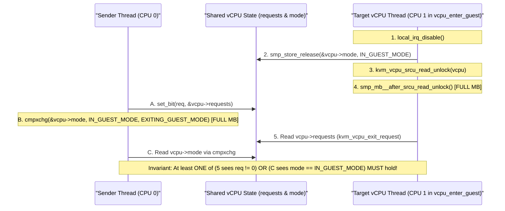

   Let us verify both branches of the Dekker proof in `vcpu_enter_guest()` (`arch/x86/kvm/x86.c:8269-8308`):
   - **Step 1 (`local_irq_disable()`):** CPU 1 disables local interrupts *before* setting `vcpu->mode = IN_GUEST_MODE`. Why? Because if an IPI arrives *after* `vcpu->mode = IN_GUEST_MODE` is visible to CPU 0, that IPI will be held pending at the local APIC until hardware atomically enables interrupts upon `VMLAUNCH`/`VMRESUME` (`VMX` External-Interrupt Exiting) or `STGI` (`SVM`), immediately forcing a VM-Exit!
   - **Step 2 (`smp_store_release(&vcpu->mode, IN_GUEST_MODE)` + `smp_mb__after_srcu_read_unlock()`):** CPU 1 writes `vcpu->mode = IN_GUEST_MODE` and executes a full `smp_mb()` (`lock; addl $0, -4(%rsp)` on x86) *before* re-checking `kvm_vcpu_exit_request(vcpu)` (which checks `kvm_request_pending(vcpu)`).
   - **Step 3 (`set_bit` + `cmpxchg` in `kvm_vcpu_exiting_guest_mode`):** CPU 0 writes `vcpu->requests` via `set_bit()` and then executes `cmpxchg(&vcpu->mode, IN_GUEST_MODE, EXITING_GUEST_MODE)` (which carries an implicit full `smp_mb()`).
   - Because both CPUs execute `Store -> Full Memory Barrier -> Load of the other variable`, total store order guarantees that either CPU 1's load of `vcpu->requests` at line 8300 sees the new request and aborts guest entry (`goto cancel_injection`), OR CPU 0's `cmpxchg` of `vcpu->mode` sees `IN_GUEST_MODE` and sends the IPI!

---

### 4.5 The `KVM_RUN` Execution Loop, Adaptive Halt-Polling, and Directed Yielding

#### 4.5.1 The Three-Tier Execution Loop: `kvm_arch_vcpu_ioctl_run` $\to$ `vcpu_run` $\to$ `vcpu_enter_guest`

When a userspace VMM thread invokes `ioctl(vcpu_fd, KVM_RUN, 0)`, execution flows through a carefully structured three-tier hierarchy:

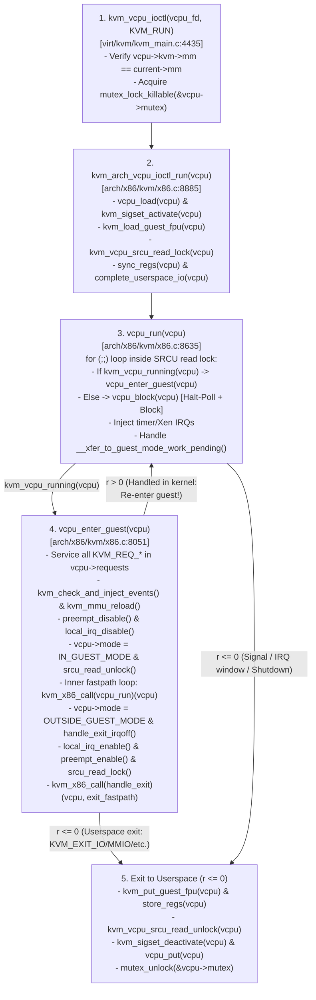

Let us examine each of the three tiers in detail.

##### 4.5.1.1 Tier 1: Setup, Deferred I/O Completion, and Teardown in `kvm_arch_vcpu_ioctl_run()`

Look at `kvm_arch_vcpu_ioctl_run()` in [`arch/x86/kvm/x86.c`](https://kernel.googlesource.com/pub/scm/virt/kvm/kvm.git/+/refs/heads/master/arch/x86/kvm/x86.c) (lines 8885–9002), which we read earlier:
1. **Per-Ioctl Context Setup (lines 8896–8901):**
   - Calls `vcpu_load(vcpu)` to bind the vCPU to the current pCPU and arm `preempt_notifier`.
   - Calls `kvm_sigset_activate(vcpu)` to swap in the vCPU's signal mask (`KVM_SET_SIGNAL_MASK`), unblocking signals like `SIG_IPI` (`SIGUSR1`) only while inside `KVM_RUN`.
   - Calls `kvm_load_guest_fpu(vcpu)` (`fpu_swap_kvm_fpstate(&vcpu->arch.guest_fpu, true)`), swapping the host thread's FPU/AVX/AMX buffer with the guest's `fpstate` container once per `KVM_RUN` syscall (rather than on every VM-Exit!).
   - Acquires `kvm_vcpu_srcu_read_lock(vcpu)` (storing the SRCU index in `vcpu->____srcu_idx`).
2. **Synchronizing Shared Registers (`kvm_dirty_regs` / `sync_regs`, lines 8935–8946):**
   - Instead of calling `KVM_SET_REGS` / `KVM_SET_SREGS` via extra `ioctl()` calls, userspace can modify `vcpu->run->s.regs` directly in the `mmap`ped `kvm_run` page and set `KVM_SYNC_X86_REGS` / `KVM_SYNC_X86_SREGS` / `KVM_SYNC_X86_EVENTS` in `kvm_run->kvm_dirty_regs`. `sync_regs(vcpu)` pulls those registers into `vcpu->arch` before entering the guest.
3. **Resuming Split / Userspace I/O (`vcpu->arch.complete_userspace_io`, lines 8970–8979):**
   - When the previous `KVM_RUN` call returned `0` to userspace with `KVM_EXIT_IO` (port I/O `IN` or string `INS`/`OUTS`), `KVM_EXIT_MMIO` (memory-mapped I/O read or multi-fragment write), or `KVM_EXIT_X86_RDMSR`/`WRMSR`, the guest instruction was paused mid-execution!
   - Before Returning `0` on that previous exit, KVM set the function pointer `vcpu->arch.complete_userspace_io` (e.g., to `complete_emulated_pio`, `complete_emulated_mmio`, or `complete_userspace_rdmsr`).
   - Now that userspace has placed the read data into `vcpu->run->mmio.data` (or `pio_data`) and called `KVM_RUN` again, lines 8970–8975 invoke `cui(vcpu)` to finish writing back the operand to the guest's target register or memory and advance `RIP`—*before* entering the `vcpu_run(vcpu)` loop!

##### 4.5.1.2 Tier 2: The `vcpu_run()` Loop and `xfer_to_guest_mode_handle_work()`

Inside `vcpu_run(struct kvm_vcpu *vcpu)` (`arch/x86/kvm/x86.c:8635-8683`), KVM spins in an infinite `for (;;)` loop for as long as VM-Exits can be handled inside the kernel (`r > 0`):
- If `kvm_vcpu_running(vcpu)` is true (`mp_state == KVM_MP_STATE_RUNNABLE && !vcpu->arch.apf.halted`), it calls `r = vcpu_enter_guest(vcpu)`.
- Otherwise (the vCPU executed `HLT` or is in `KVM_MP_STATE_INIT_RECEIVED` / `apf.halted`), it calls `r = vcpu_block(vcpu)`.
- If `r <= 0` (`r == 0` meaning a userspace exit is populated in `vcpu->run->exit_reason`, or `r < 0` meaning an `-EINTR`/`-EIO`/`-EFAULT` errno), `vcpu_run()` breaks out of the loop and returns to userspace.
- If `r > 0`, it checks `__xfer_to_guest_mode_work_pending()` (lines 8673–8679):
  ```c
  if (__xfer_to_guest_mode_work_pending()) {
  	kvm_vcpu_srcu_read_unlock(vcpu);
  	r = kvm_xfer_to_guest_mode_handle_work(vcpu);
  	kvm_vcpu_srcu_read_lock(vcpu);
  	if (r)
  		return r;
  }
  ```
  What is `__xfer_to_guest_mode_work_pending()`? It checks the Linux kernel's generic `_TIF_NEED_RESCHED`, `_TIF_SIGPENDING`, `_TIF_NOTIFY_SIGNAL`, and `_TIF_NOTIFY_RESUME` thread flags on `current`! Notice that KVM **must drop `kvm->srcu`** (`kvm_vcpu_srcu_read_unlock(vcpu)`) before calling `kvm_xfer_to_guest_mode_handle_work(vcpu)` (which calls `schedule()` if `need_resched()` is set), because holding an SRCU read lock across an unbounded scheduler preemption would block `synchronize_srcu_expedited(&kvm->srcu)` in memslot/I/O-bus updates across the entire VM!

##### 4.5.1.3 Tier 3: Dissecting `vcpu_enter_guest()` (`arch/x86/kvm/x86.c:8051-8506`)

`vcpu_enter_guest()` is the beating heart of x86 KVM. Every single entry into non-root guest mode passes through its five sequential stages:

###### 4.5.1.3.1 Stage A — Servicing the `vcpu->requests` Waterfall (Lines 8062–8226)

If `kvm_request_pending(vcpu)` (`READ_ONCE(vcpu->requests) != 0`) is true, `vcpu_enter_guest()` processes pending request bits in a strictly ordered cascade! Why does the order of `if (kvm_check_request(...))` statements in lines 8063–8226 matter?
1. **`KVM_REQ_VM_DEAD` (line 8063):** Checked first with `kvm_test_request` (leaving the bit set permanently) so a dead VM immediately aborts with `-EIO`.
2. **`KVM_REQ_DIRTY_RING_SOFT_FULL` (`kvm_dirty_ring_check_request`, line 8068):** Checked before any guest memory access that might push another dirty page onto a full ring (`KVM_EXIT_DIRTY_RING_FULL`).
3. **`KVM_REQ_MMU_FREE_OBSOLETE_ROOTS` (line 8083) $\to$ `KVM_REQ_MMU_SYNC` (line 8096) $\to$ `KVM_REQ_LOAD_MMU_PGD` (line 8098) $\to$ `KVM_REQ_TLB_FLUSH` (line 8106):**
   - Obsolete roots must be released before synchronizing or loading the current MMU root PGD, and loading the new PGD must happen *before* `KVM_REQ_TLB_FLUSH` (`kvm_vcpu_flush_tlb_all`) and `kvm_service_local_tlb_flush_requests()` so TLB invalidations apply to the active root!
4. **`KVM_REQ_MASTERCLOCK_UPDATE` (line 8087) $\to$ `KVM_REQ_GLOBAL_CLOCK_UPDATE` (line 8089) $\to$ `KVM_REQ_CLOCK_UPDATE` (line 8091) $\to$ `KVM_REQ_HV_STIMER` (line 8203):**
   - Masterclock updates must compute the VM-wide `pvclock_gtod_data` snapshot *before* `KVM_REQ_CLOCK_UPDATE` writes this vCPU's `pvclock_vcpu_time_info` guest page, and `KVM_REQ_HV_STIMER` must run *after* `KVM_REQ_CLOCK_UPDATE` because Hyper-V Synthetic Timers compare expiration deadlines against the newly updated guest reference clock!

###### 4.5.1.3.2 Stage B — Event Injection (`KVM_REQ_EVENT`) and MMU Reload (Lines 8228–8258)

Next, if `kvm_check_request(KVM_REQ_EVENT, vcpu) || req_int_win || kvm_xen_has_interrupt(vcpu)` is true:
- `kvm_apic_accept_events(vcpu)` processes pending APIC `INIT` or `SIPI` events.
- `kvm_check_and_inject_events(vcpu, &req_immediate_exit)` arbitrates pending exceptions, SMIs, NMIs, and interrupts, programming VMCS `VM_ENTRY_INTR_INFO_FIELD` or VMCB `event_inj`, and arming interrupt/NMI window exiting if an event is blocked by guest masking.
- `kvm_mmu_reload(vcpu)` ensures `VALID_PAGE(vcpu->arch.mmu->root.hpa)` holds a valid EPT/NPT/shadow root HPA (calling `kvm_mmu_load(vcpu)` to allocate a root if `root.hpa == INVALID_PAGE`).

###### 4.5.1.3.3 Stage C — Entering the Non-Instrumentable Guest Window & The Fastpath Inner Loop (Lines 8260–8387)

Once `kvm_mmu_reload(vcpu)` succeeds, `vcpu_enter_guest()` transitions into the critical atomic entry sequence:
1. `preempt_disable()` and `kvm_x86_call(prepare_switch_to_guest)(vcpu)` load lazy host-to-guest state (`FS`/`GS`/`KERNEL_GS_BASE`/etc.).
2. `local_irq_disable()` disables host interrupts on this physical CPU.
3. `smp_store_release(&vcpu->mode, IN_GUEST_MODE)` publishes guest mode, followed by `kvm_vcpu_srcu_read_unlock(vcpu)` and `smp_mb__after_srcu_read_unlock()`.
4. `kvm_x86_call(sync_pir_to_irr)(vcpu)` synchronizes any Posted Interrupt bits (`pi_desc.pir`) into the virtual APIC `IRR`, and `if (kvm_vcpu_exit_request(vcpu))` checks for any last-nanosecond request/signal/work arrival, aborting to `cancel_injection` if set.
5. Loads guest `XFEATURES` (`XCR0` / `MSR_IA32_XSS`), debug registers (`DR0..DR7`), `PKRU`, and mediated PMU state, and starts guest vtime accounting (`guest_timing_enter_irqoff()`).
6. Enters the **Inner Fastpath Loop** (lines 8361–8387):
   ```c
   for (;;) {
   	exit_fastpath = kvm_x86_call(vcpu_run)(vcpu, run_flags);
   	if (likely(exit_fastpath != EXIT_FASTPATH_REENTER_GUEST))
   		break;

   	if (kvm_lapic_enabled(vcpu))
   		kvm_x86_call(sync_pir_to_irr)(vcpu);

   	if (unlikely(kvm_vcpu_exit_request(vcpu))) {
   		exit_fastpath = EXIT_FASTPATH_EXIT_HANDLED;
   		break;
   	}

   	run_flags = 0;
   	++vcpu->stat.exits;
   }
   ```
   Look at the power of that inner `for (;;)` loop! When a VM-Exit is handled by the ultra-fastpath (`EXIT_FASTPATH_REENTER_GUEST`—such as a `WRMSR` to `MSR_IA32_TSC_DEADLINE` or `X2APIC` ICR, or a fastpath `HLT` when an event is already pending), KVM **does not even re-enable host interrupts, does not re-acquire `kvm->srcu`, does not restore `PKRU` or `XCR0`, and does not exit `vcpu_enter_guest()`**—it immediately calls `kvm_x86_call(vcpu_run)` (`vmx_vcpu_run` / `svm_vcpu_run`) to `VMRESUME` the guest in a few hundred cycles!

###### 4.5.1.3.4 Stage D — Post-Exit IRQ Window, SRCU Re-Acquisition, and Slowpath Dispatch (Lines 8389–8496)

When `exit_fastpath != EXIT_FASTPATH_REENTER_GUEST`, the vCPU leaves the inner loop:
1. Restores host `PKRU`, mediated PMU, and host hardware breakpoints (`hw_breakpoint_restore()`).
2. Records `vcpu->arch.last_vmentry_cpu = vcpu->cpu` and `last_guest_tsc`, sets `vcpu->mode = OUTSIDE_GUEST_MODE`, and issues `smp_wmb()`.
3. Restores host `XCR0`/`XSS` (`kvm_load_xfeatures(vcpu, false)`) and calls `kvm_x86_call(handle_exit_irqoff)(vcpu)` to handle external interrupts, NMIs, machine checks (`#MC`), and exception exits that must run before `local_irq_enable()`.
4. Opens a 1-instruction interrupt window (`local_irq_enable(); ++vcpu->stat.exits; local_irq_disable();`) so any pending host hardware interrupt that caused the VM-Exit (especially on AMD SVM) is serviced by the host IDT before `guest_timing_exit_irqoff()` stops guest time accounting.
5. Re-enables host interrupts (`local_irq_enable()`) and kernel preemption (`preempt_enable()`), re-acquires `kvm_vcpu_srcu_read_lock(vcpu)`, issues `smp_mb__after_srcu_read_lock()`, and dispatches the slowpath exit handler `r = kvm_x86_call(handle_exit)(vcpu, exit_fastpath)` (`vmx_handle_exit` / `svm_handle_exit`).

---

#### 4.5.2 Adaptive Halt-Polling (`kvm_vcpu_halt` & `kvm_vcpu_block`) and PLE Directed Yield (`kvm_vcpu_on_spin`)

##### 4.5.2.1 The Adaptive Halt-Polling Algorithm (`kvm_vcpu_halt`, `grow_halt_poll_ns`, `shrink_halt_poll_ns`)

When a guest OS idle thread has no runnable tasks, it executes `HLT`. Going to sleep in the host kernel via `kvm_vcpu_block()` (`schedule()`) and later waking up via `kvm_vcpu_wake_up()` (`rcuwait_wake_up()`) incurs two host context switches, C-state exit latencies, and runqueue locking—typically costing **3 to 15 microseconds**. For high-frequency request-response workloads (such as Redis, NVMe storage, or RPC microservices where an `irqfd` completion arrives just 4 $\mu$s after `HLT`), sleeping in `schedule()` doubles tail latency!

To eliminate this scheduling tax for short halts without burning 100% host CPU on genuinely idle VMs, `kvm_vcpu_halt()` (`virt/kvm/kvm_main.c:3754-3824`, which we read earlier) implements **Adaptive Halt-Polling**:

```
   vCPU executes HLT -> kvm_vcpu_halt(vcpu)
   start = ktime_get()
   |
   +---> Busy-Wait Poll Loop (up to vcpu->halt_poll_ns):
   |     while (single_task_running() && !need_resched() && cur < start + halt_poll_ns) {
   |         if (kvm_vcpu_check_block(vcpu) < 0)  // Event arrived during poll!
   |             goto out; (waited = false)
   |         cpu_relax();
   |     }
   |
   +---> Poll Timed Out -> Sleep in Scheduler:
   |     waited = kvm_vcpu_block(vcpu)  // rcuwait + TASK_INTERRUPTIBLE + schedule()
   |
   v
   out: halt_ns = cur - start (Total duration vCPU was halted)
   +-----------------------------------------------------------------------+
   | Adaptive Window Update (Target Ceiling: max_halt_poll_ns = 200,000ns) |
   +-----------------------------------------------------------------------+
   | Case 1: halt_ns <= vcpu->halt_poll_ns                                 |
   |   -> Poll succeeded! Current halt_poll_ns was sufficient; KEEP AS IS. |
   | Case 2: halt_ns > max_halt_poll_ns                                    |
   |   -> Long idle block! Polling was futile; SHRINK:                     |
   |      shrink_halt_poll_ns(): halt_poll_ns /= halt_poll_ns_shrink (2)   |
   |      (if < halt_poll_ns_grow_start [10,000 ns], reset to 0)           |
   | Case 3: vcpu->halt_poll_ns < halt_ns < max_halt_poll_ns               |
   |   -> Short block, but poll window was too small! GROW:                |
   |      grow_halt_poll_ns(): halt_poll_ns *= halt_poll_ns_grow (2)       |
   |      (starting from halt_poll_ns_grow_start = 10,000 ns)              |
   +-----------------------------------------------------------------------+
```

Notice two crucial safety guards in `kvm_vcpu_halt()` and `kvm_vcpu_block()`:
1. **Zero Starvation of Sibling Host Tasks (`kvm_vcpu_can_poll`):**
   Look at `kvm_vcpu_can_poll(cur, stop)` in `include/linux/kvm_host.h:309`:
   ```c
   static inline bool kvm_vcpu_can_poll(ktime_t cur, ktime_t stop)
   {
   	return single_task_running() && !need_resched() && ktime_before(cur, stop);
   }
   ```
   The busy-wait poll loop calls `single_task_running()` on every iteration! If *any* other task is runnable on this host CPU's runqueue (`nr_running > 1`), halt-polling aborts on the very first iteration and immediately yields the CPU in `kvm_vcpu_block()`.
2. **Guest-Controlled Poll Disabling (`MSR_KVM_POLL_CONTROL`):**
   Look at `kvm_arch_no_poll(vcpu)` in `arch/x86/kvm/x86.c:10638`: if the guest OS already performed its own guest-side `cpuidle` halt-poll (`guest_halt_poll` driver) and cleared bit 0 of `MSR_KVM_POLL_CONTROL` before executing `HLT`, KVM skips host-side halt-polling (`halt_poll_allowed = false`) to avoid double-polling!

##### 4.5.2.2 Lock-Holder Preemption and Pause-Loop Exiting (PLE) Directed Yield (`kvm_vcpu_on_spin`)

What happens when a VM is overcommitted (e.g., 8 vCPUs sharing 4 physical CPUs) and vCPU 0 acquires a guest spinlock in guest kernel mode, but the host Linux scheduler preempts vCPU 0's thread right before it can release the spinlock?
- Now vCPU 1 gets scheduled onto a physical CPU and tries to acquire the same guest spinlock, executing a tight `PAUSE` loop (`rep; nop`).
- Without hardware intervention, vCPU 1 would burn its entire multi-millisecond CFS/EEVDF time slice spinning on a lock held by the sleeping vCPU 0 thread (**Lock-Holder Preemption / LHP**)!
- Both Intel VMX (**Pause-Loop Exiting / PLE**, `SECONDARY_EXEC_PAUSE_LOOP_EXITING`, `PLE_GAP`, `PLE_WINDOW`) and AMD SVM (**Pause Filter Threshold / Count**, `INTERCEPT_PAUSE`) detect when a guest vCPU executes excessive `PAUSE` instructions within a short TSC window and trigger a VM-Exit (`handle_pause()` in `vmx.c` / `pause_interception()` in `svm.c`), which calls `kvm_vcpu_on_spin(vcpu, yield_to_kernel_mode)` (`virt/kvm/kvm_main.c:3993-4066`).

Look at how `kvm_vcpu_on_spin()` (which we read earlier at lines 3993–4066 of `virt/kvm/kvm_main.c`) selects the best candidate vCPU to boost via `kvm_vcpu_yield_to(vcpu)` $\to$ `yield_to(task, 1)`:
1. It starts scanning `kvm->vcpu_array` in round-robin order starting after `kvm->last_boosted_vcpu`.
2. It skips any candidate `vcpu` where `!READ_ONCE(vcpu->ready)` (recall from Section 4.1.1.1.1 that `vcpu->ready` is set to `true` only when a vCPU is involuntarily preempted in `kvm_sched_out()` or newly woken in `kvm_vcpu_wake_up()`!).
3. If `READ_ONCE(vcpu->preempted) && yield_to_kernel_mode` is true (because the spinning vCPU `me` is spinning at `CPL == 0`), it prioritizes candidates that either have a pending interrupt (`kvm_arch_dy_has_pending_interrupt`) or were preempted while in guest kernel mode (`kvm_arch_vcpu_preempted_in_kernel(vcpu)` — tracked via `vcpu->arch.preempted_in_kernel` saved during `kvm_arch_vcpu_put()`!).
4. It checks `kvm_vcpu_eligible_for_directed_yield(vcpu)` (toggling `vcpu->spin_loop.dy_eligible` so the same candidate isn't boosted twice in a row) and calls `kvm_vcpu_yield_to(vcpu)`, donating CPU time directly to the preempted lock-holder's `task_struct`!

---

### 4.6 Hands-On Mastery Exercises

#### Exercise 4.1: Building a Bare-Metal Multi-Exit `KVM_RUN` Harness with `kvm_sync_regs` and Shared `pio_data`

**Objective:** Write a standalone C program (`kvm_vcpu_loop_lab.c`) that creates a VM and a vCPU, maps all 3 pages of the `vcpu_fd` (`struct kvm_run` at page 0, `pio_data` at page 1, and `coalesced_mmio_ring` at page 2), uses `KVM_SYNC_X86_REGS` (`kvm_dirty_regs` / `kvm_valid_regs`) to initialize and inspect guest registers without calling `KVM_SET_REGS` or `KVM_GET_REGS`, and executes a 16-bit guest loop that performs string Port I/O (`REP OUTSB`) followed by `HLT`.

##### Step 1: Complete Userspace C Source (`kvm_vcpu_loop_lab.c`)

```c
/*
 * kvm_vcpu_loop_lab.c - Demonstrates vcpu_fd 3-page mmap layout,
 * zero-ioctl register syncing via kvm_sync_regs (sync_regs / store_regs),
 * string PIO via pio_data (KVM_PIO_PAGE_OFFSET), and HLT handling.
 *
 * Compile: gcc -O2 -Wall -Wextra -o kvm_vcpu_loop_lab kvm_vcpu_loop_lab.c
 */
#include <stdio.h>
#include <stdlib.h>
#include <stdint.h>
#include <string.h>
#include <fcntl.h>
#include <unistd.h>
#include <sys/ioctl.h>
#include <sys/mman.h>
#include <linux/kvm.h>

#define GUEST_RAM_SIZE 0x10000

/*
 * 16-bit Real Mode Guest Code at GPA 0x1000:
 *   mov si, 0x2000      ; BE 00 20  (Source string address in guest RAM)
 *   mov cx, 6           ; B9 06 00  (6 bytes: "HELLO\n")
 *   mov dx, 0x3f8       ; BA F8 03  (COM1 port)
 *   cld                 ; FC
 *   rep outsb           ; F3 6E     (Writes 6 bytes to pio_data page in 1 exit!)
 *   inc ax              ; 40        (Increment AX so we verify store_regs)
 *   hlt                 ; F4
 */
static const uint8_t guest_code[] = {
    0xbe, 0x00, 0x20,
    0xb9, 0x06, 0x00,
    0xba, 0xf8, 0x03,
    0xfc,
    0xf3, 0x6e,
    0x40,
    0xf4
};

int main(void)
{
    int kvm_fd = open("/dev/kvm", O_RDWR | O_CLOEXEC);
    if (kvm_fd < 0) { perror("open /dev/kvm"); return 1; }

    int mmap_size = ioctl(kvm_fd, KVM_GET_VCPU_MMAP_SIZE, 0);
    printf("[+] KVM_GET_VCPU_MMAP_SIZE = %d bytes (%d pages)\n",
           mmap_size, mmap_size / 4096);

    int vm_fd = ioctl(kvm_fd, KVM_CREATE_VM, 0);
    if (vm_fd < 0) { perror("KVM_CREATE_VM"); return 1; }

    void *guest_ram = mmap(NULL, GUEST_RAM_SIZE, PROT_READ | PROT_WRITE,
                           MAP_SHARED | MAP_ANONYMOUS, -1, 0);
    memcpy((uint8_t *)guest_ram + 0x1000, guest_code, sizeof(guest_code));
    memcpy((uint8_t *)guest_ram + 0x2000, "HELLO\n", 6);

    struct kvm_userspace_memory_region region = {
        .slot = 0,
        .guest_phys_addr = 0,
        .memory_size = GUEST_RAM_SIZE,
        .userspace_addr = (uint64_t)guest_ram,
    };
    if (ioctl(vm_fd, KVM_SET_USER_MEMORY_REGION, &region) < 0) {
        perror("KVM_SET_USER_MEMORY_REGION");
        return 1;
    }

    int vcpu_fd = ioctl(vm_fd, KVM_CREATE_VCPU, 0);
    if (vcpu_fd < 0) { perror("KVM_CREATE_VCPU"); return 1; }

    struct kvm_run *run = mmap(NULL, mmap_size, PROT_READ | PROT_WRITE,
                               MAP_SHARED, vcpu_fd, 0);
    if (run == MAP_FAILED) { perror("mmap vcpu_fd"); return 1; }

    /*
     * Use kvm_sync_regs embedded in run->s.regs to set CS=0, RIP=0x1000,
     * RAX=0x41 WITHOUT calling KVM_GET_SREGS/KVM_SET_SREGS or KVM_SET_REGS!
     */
    if (ioctl(vcpu_fd, KVM_GET_SREGS, &run->s.regs.sregs) < 0) {
        perror("KVM_GET_SREGS");
        return 1;
    }
    run->s.regs.sregs.cs.base = 0;
    run->s.regs.sregs.cs.selector = 0;

    memset(&run->s.regs.regs, 0, sizeof(run->s.regs.regs));
    run->s.regs.regs.rip = 0x1000;
    run->s.regs.regs.rax = 0x41;
    run->s.regs.regs.rflags = 0x2;

    /*
     * Mark both REGS and SREGS dirty in kvm_dirty_regs so sync_regs(vcpu)
     * in kvm_arch_vcpu_ioctl_run() loads them on entry, and set kvm_valid_regs
     * so store_regs(vcpu) writes updated registers back on every exit!
     */
    run->kvm_dirty_regs = KVM_SYNC_X86_REGS | KVM_SYNC_X86_SREGS;
    run->kvm_valid_regs = KVM_SYNC_X86_REGS | KVM_SYNC_X86_SREGS;

    for (;;) {
        if (ioctl(vcpu_fd, KVM_RUN, 0) < 0) {
            perror("KVM_RUN");
            return 1;
        }
        if (run->exit_reason == KVM_EXIT_IO) {
            char *pio_ptr = (char *)run + run->io.data_offset;
            printf("[KVM_EXIT_IO] port=0x%x size=%u count=%u data_offset=0x%llx "
                   "(Page %llu: pio_data) payload=\"%.*s\"\n",
                   run->io.port, run->io.size, run->io.count,
                   (unsigned long long)run->io.data_offset,
                   (unsigned long long)(run->io.data_offset / 4096),
                   (int)(run->io.size * run->io.count), pio_ptr);
        } else if (run->exit_reason == KVM_EXIT_HLT) {
            printf("[KVM_EXIT_HLT] RIP=0x%llx RAX=0x%llx (read via store_regs in kvm_run!)\n",
                   (unsigned long long)run->s.regs.regs.rip,
                   (unsigned long long)run->s.regs.regs.rax);
            break;
        } else {
            printf("Unexpected exit_reason = %u\n", run->exit_reason);
            break;
        }
    }
    return 0;
}
```

##### Step 2: Expected Output & Kernel Internal Verification

When you run `./kvm_vcpu_loop_lab`, observe two internal mechanisms from `virt/kvm/kvm_main.c` and `arch/x86/kvm/x86.c`:
1. `run->io.data_offset` equals `0x1000` (`4096`), which is `KVM_PIO_PAGE_OFFSET * PAGE_SIZE`—causing a page fault on the second page of `run` that invokes `kvm_vcpu_fault()` (`vmf->pgoff == KVM_PIO_PAGE_OFFSET`) and maps `vcpu->arch.pio_data` directly into userspace!
2. Even though `REP OUTSB` outputs 6 bytes, `emulator_pio_out()` coalesces all 6 bytes into `vcpu->arch.pio_data` and exits to userspace **only once** (`run->io.count = 6`).
3. On `KVM_EXIT_HLT`, `run->s.regs.regs.rax` is `0x42` (`0x41 + 1`), populated automatically by `store_regs(vcpu)` at line 8995 of `kvm_arch_vcpu_ioctl_run()` without a single `KVM_GET_REGS` ioctl!

---

#### Exercise 4.2: Live Tracing the Dekker `vcpu->requests` & `vcpu->mode` Protocol with `bpftrace`

**Objective:** Observe cross-CPU vCPU requests (`kvm_make_all_cpus_request`, `__kvm_vcpu_kick`), `vcpu->mode` transitions (`OUTSIDE_GUEST_MODE`, `IN_GUEST_MODE`, `EXITING_GUEST_MODE`), and `vcpu->requests` bitmasks in real time on a running multi-vCPU VM.

##### Step 1: Write `trace_vcpu_requests.bt`

```bpftrace
#!/usr/bin/env bpftrace
/*
 * trace_vcpu_requests.bt - Traces vcpu->requests bitmasks, vcpu->mode
 * transitions, and IPI coalescing in __kvm_vcpu_kick().
 */

kprobe:__kvm_vcpu_kick
{
    $vcpu = (struct kvm_vcpu *)arg0;
    $wait = arg1;
    $id = $vcpu->vcpu_id;
    $mode = $vcpu->mode;
    $reqs = $vcpu->requests;
    $target_cpu = $vcpu->cpu;

    @kick_by_mode[$mode] = count();
    printf("[pCPU %2d -> vCPU %2d (on pCPU %2d)] __kvm_vcpu_kick(wait=%d) mode=%d requests=0x%llx\n",
           cpu, $id, $target_cpu, $wait, $mode, $reqs);
}

kprobe:kvm_make_all_cpus_request
{
    $req = arg1;
    $bit = $req & 0xff;
    $no_wakeup = ($req >> 8) & 1;
    $wait = ($req >> 16) & 1;
    @all_cpu_reqs[$bit] = count();
    printf("[pCPU %2d] kvm_make_all_cpus_request: req_bit=%u (NO_WAKEUP=%d, WAIT=%d)\n",
           cpu, $bit, $no_wakeup, $wait);
}
```

##### Step 2: Analytical Verification Questions
1. Compare the count of `@kick_by_mode[1]` (`IN_GUEST_MODE`) vs. `@kick_by_mode[2]` (`EXITING_GUEST_MODE`) and `@kick_by_mode[0]` (`OUTSIDE_GUEST_MODE`). Why does `__kvm_vcpu_kick()` skip `smp_send_reschedule()` when `$mode == 2` (`EXITING_GUEST_MODE`)?
2. Trigger a remote TLB flush in the guest (e.g., `munmap()` across threads) and verify `req_bit=0` (`KVM_REQ_TLB_FLUSH & KVM_REQUEST_MASK`) with `NO_WAKEUP=1, WAIT=1`.

---

#### Exercise 4.3: Profiling Adaptive Halt-Polling (`grow_halt_poll_ns` vs. `shrink_halt_poll_ns`)

**Objective:** Measure how `kvm_vcpu_halt()` dynamically adjusts `vcpu->halt_poll_ns` as a guest workload shifts from a 50 $\mu$s periodic timer/IPI ping-pong (below `halt_poll_ns = 200000`) to a 5 ms sleep (above `max_halt_poll_ns`).

##### Step 1: `bpftrace` Script (`trace_halt_poll.bt`)

```bpftrace
#!/usr/bin/env bpftrace

tracepoint:kvm:kvm_halt_poll_ns
{
    printf("[vCPU %d] halt_poll_ns %s: %u ns -> %u ns\n",
           args->vcpu_id,
           args->grow ? "GROW  " : "SHRINK",
           args->old, args->new);
}

tracepoint:kvm:kvm_vcpu_wakeup
{
    @wakeup_latency_ns[args->waited ? "slept_in_schedule" : "caught_by_poll"] =
        hist(args->ns);
}
```

##### Step 2: Experiment with `KVM_CAP_HALT_POLL` and `MSR_KVM_POLL_CONTROL`
1. Enable per-VM halt-poll override in your C harness via `KVM_ENABLE_CAP` with `.cap = KVM_CAP_HALT_POLL, .args[0] = 50000` (50 $\mu$s ceiling) and verify in `virt/kvm/kvm_main.c:3730` (`kvm_vcpu_max_halt_poll_ns()`) that `kvm->override_halt_poll_ns` overrides `/sys/module/kvm/parameters/halt_poll_ns`.
2. Have the guest execute `WRMSR(MSR_KVM_POLL_CONTROL, 0)` (`0x4b564d05`) before `HLT`, and verify that `kvm_arch_no_poll(vcpu)` returns `true`, suppressing host halt-polling completely.

---

#### Exercise 4.4: Tracing Preemption Notifiers (`kvm_sched_out` / `kvm_sched_in`) and PLE Directed Yield (`kvm_vcpu_on_spin`)

**Objective:** Pin 4 vCPU threads of an SMP guest onto a single host physical CPU (`taskset -c 0`), run a spinlock stress workload inside the guest, and trace how `kvm_sched_out()` sets `vcpu->preempted = true` and `vcpu->ready = true`, enabling `kvm_vcpu_on_spin()` to boost the preempted lock holder via `kvm_vcpu_yield_to()`.

##### Step 1: `bpftrace` Script (`trace_ple_directed_yield.bt`)

```bpftrace
#!/usr/bin/env bpftrace

kprobe:kvm_sched_out
{
    $pn = (struct preempt_notifier *)arg0;
    @sched_out[comm, tid] = count();
}

kprobe:kvm_vcpu_on_spin
{
    $me = (struct kvm_vcpu *)arg0;
    $yield_to_kernel = arg1;
    @ple_spins[$me->vcpu_id, $yield_to_kernel] = count();
}

kprobe:kvm_vcpu_yield_to
{
    $target = (struct kvm_vcpu *)arg0;
    @directed_yields_to[$target->vcpu_id] = count();
}

kretprobe:kvm_vcpu_yield_to
{
    @yield_to_result[retval] = count();
}
```

##### Step 2: Analysis
Inspect `@yield_to_result[1]` (successful `yield_to()` runqueue buddy boosts) vs. `@yield_to_result[0]` and verify in `virt/kvm/kvm_main.c:4046` why `kvm_vcpu_on_spin()` checks `kvm_arch_vcpu_preempted_in_kernel(vcpu)` when `yield_to_kernel_mode == true`.

---

## Chapter 5: Intel VMX Backend Internals — VMCS Lifecycle, Host/Guest Context Switching, `__vmx_vcpu_run`, and Exit Dispatch

When an operating system kernel switches execution from Process A to Process B inside `__switch_to()`, both processes inhabit the same architectural privilege domain: user threads execute at Ring 3 (`CPL=3`), kernel threads and system call handlers execute at Ring 0 (`CPL=0`), and both share a single set of control registers, Global Descriptor Table (`GDTR`), Interrupt Descriptor Table (`IDTR`), and syscall entry MSRs (`MSR_LSTAR`, `MSR_STAR`, `MSR_SYSCALL_MASK`). The kernel's scheduler only needs to save and restore the outgoing and incoming kernel stack pointers (`RSP`), callee-saved general-purpose registers (`RBX`, `RBP`, `R12`–`R15`), thread-local storage segment bases (`FS.base`, `GS.base`), `CR3` (if switching `mm_struct`s), and extended floating-point/vector state (`FPU`/`AVX`/`AMX`).

Crossing the boundary between the Linux host kernel and a hardware-virtualized guest on Intel processors via **Virtual Machine Extensions (VMX)** is fundamentally different. A guest operating system is not merely another thread sharing the host kernel's Ring 0 environment—it *is* a Ring 0 kernel in its own right, with its own `CR0`, `CR3`, `CR4`, `GDTR`, `IDTR`, `LDTR`, `TR`, `MSR_EFER`, `SYSCALL`/`SYSENTER` entry points, interruptibility state, and page tables. Intel VT-x solves this by introducing an orthogonal privilege dimension: **VMX Root Operation** (where the KVM hypervisor and host Linux kernel run) versus **VMX Non-Root Operation** (where the guest OS and its applications run, each with its own orthogonal Ring 0–3 hierarchy).

Transitioning between VMX Root and VMX Non-Root operation—via the `VMLAUNCH` and `VMRESUME` instructions (**VM-Entry**) and hardware-triggered traps back to the hypervisor (**VM-Exit**)—is a **world switch** governed by a 4-KiB hardware control block known as the **Virtual Machine Control Structure (VMCS)**. Yet even the VMCS does not switch everything. Designing a production hypervisor that can execute millions of world switches per second without crippling system call or context-switch latency requires an intricate division of labor between silicon microcode, assembly trampolines, per-vCPU register caches, and Linux scheduler hooks.

In this chapter, we dissect the Intel VMX backend (`kvm-intel.ko`) in [`arch/x86/kvm/vmx/`](https://kernel.googlesource.com/pub/scm/virt/kvm/kvm.git/+/refs/heads/master/arch/x86/kvm/vmx/). We trace the complete lifecycle of a VMCS from allocation and initialization (`init_vmcs()`) through cross-CPU migration (`vmx_vcpu_load_vmcs()`), examine how KVM partitions register and MSR switching between eager per-entry paths and lazy scheduler-driven hooks (`vmx_prepare_switch_to_guest()`), walk instruction-by-instruction through the non-instrumentable assembly world-switch core [`__vmx_vcpu_run()`](https://kernel.googlesource.com/pub/scm/virt/kvm/kvm.git/+/refs/heads/master/arch/x86/kvm/vmx/vmenter.S#L23) in [`arch/x86/kvm/vmx/vmenter.S`](https://kernel.googlesource.com/pub/scm/virt/kvm/kvm.git/+/refs/heads/master/arch/x86/kvm/vmx/vmenter.S), and follow a VM-Exit from its first instruction at `vmx_vmexit` through IRQ-disabled fastpath handlers (`vmx_exit_handlers_fastpath()`) to the full dispatch table `kvm_vmx_exit_handlers[]`.

---

### 5.1 OS Context Switch vs. VMX World Switch: Hardware Automation and the Eager/Lazy Split

To understand why [`arch/x86/kvm/vmx/vmx.c`](https://kernel.googlesource.com/pub/scm/virt/kvm/kvm.git/+/refs/heads/master/arch/x86/kvm/vmx/vmx.c) and [`arch/x86/kvm/vmx/vmenter.S`](https://kernel.googlesource.com/pub/scm/virt/kvm/kvm.git/+/refs/heads/master/arch/x86/kvm/vmx/vmenter.S) are structured the way they are, we must first ask a foundational architectural question: *When the CPU executes `VMLAUNCH` or `VMRESUME`, and when it subsequently takes a `VM-Exit`, what architectural state is switched automatically by Intel silicon, and what state is left untouched in physical registers?*

#### 5.1.1 The Architectural Partition: VMCS-Switched vs. Software-Switched State

When Intel architects designed VT-x in the mid-2000s, they faced a tension between hardware complexity (microcode ROM footprint and world-switch latency in clock cycles) and hypervisor software flexibility. Loading or storing a register in microcode during every `VMRESUME` and `VM-Exit` costs cycles unconditionally, even if the hypervisor never touches that register during a lightweight exit handler (or conversely, if the guest never uses that feature).

Consequently, the Intel Architecture Software Developer's Manual (SDM Volume 3, Chapters 25–28) partitions CPU state into two strict categories across VMX transitions:

1. **State Automatically Switched by the CPU via the VMCS**: The VMCS contains a **Guest-State Area** and a **Host-State Area**, supplemented by optional VM-Entry/VM-Exit MSR-load and MSR-store lists. On `VMLAUNCH`/`VMRESUME`, the processor atomically loads guest control registers (`CR0`, `CR3`, `CR4`), debug control (`DR7`, `IA32_DEBUGCTL`), instruction and stack pointers (`RIP`, `RSP`), flags (`RFLAGS`), segment selectors/bases/limits/access-rights (`CS`, `SS`, `DS`, `ES`, `FS`, `GS`, `LDTR`, `TR`), descriptor table registers (`GDTR`, `IDTR`), `SYSENTER` MSRs, and optionally `IA32_EFER`, `IA32_PAT`, `IA32_PERF_GLOBAL_CTRL`, `IA32_RTIT_CTL`, `BNDCFGS`, and CET shadow-stack registers (`IA32_S_CET`, `SSP`, `IA32_INTERRUPT_SSP_TABLE_ADDR`). On `VM-Exit`, the processor saves the updated guest values back into the VMCS Guest-State Area and loads the hypervisor's environment from the VMCS Host-State Area.
2. **State NOT Switched by the CPU (Untouched Across VM-Entry/VM-Exit)**: The processor does **not** save or restore General-Purpose Registers (`RAX`, `RBX`, `RCX`, `RDX`, `RSI`, `RDI`, `RBP`, `R8`–`R15` — note that `RSP` *is* in the VMCS!), Page Fault Linear Address (`CR2`), Task Priority Register (`CR8`, unless virtualized via TPR shadow), address debug registers (`DR0`–`DR3`, `DR6`), Extended Control Register `XCR0` and Supervisor XSAVE mask `IA32_XSS`, Floating-Point/SSE/AVX/AVX-512/AMX state (`XMM`/`YMM`/`ZMM`/`TMM`), Protection Key Rights for User Pages (`PKRU`), Speculation Control (`IA32_SPEC_CTRL`), or the 64-bit `SYSCALL` and `SWAPGS` MSRs (`MSR_STAR`, `MSR_LSTAR`, `MSR_CSTAR`, `MSR_SYSCALL_MASK`, `MSR_KERNEL_GS_BASE`, `MSR_TSC_AUX`).

```
+======================================================================================+
|                    INTEL VMX WORLD SWITCH STATE PARTITIONING                         |
+======================================================================================+
|                                                                                      |
|  1. HARDWARE-SWITCHED (VMCS Guest-State <-> Host-State Areas, Atomic in Microcode)   |
|  +----------------------------------------+---------------------------------------+  |
|  | Control & Execution Pointers           | Segmentation & Descriptor Tables      |  |
|  | - CR0, CR3, CR4                        | - CS, SS, DS, ES, FS, GS:             |  |
|  | - RIP, RSP, RFLAGS                     |   (Selector, Base, Limit, AR Bytes)   |  |
|  | - DR7, IA32_DEBUGCTL                   | - LDTR, TR (Sel, Base, Limit, AR)     |  |
|  | - IA32_SYSENTER_{CS,ESP,EIP}           | - GDTR, IDTR (Base, Limit)            |  |
|  | - Optional: EFER, PAT, CET, RTIT_CTL   | - Non-Register State (Activity, Intr) |  |
|  +----------------------------------------+---------------------------------------+  |
|                                                                                      |
|  2. EAGER SOFTWARE-SWITCHED (Every VM-Entry / VM-Exit in Tight Loop)                 |
|  +----------------------------------------+---------------------------------------+  |
|  | Assembly Core (__vmx_vcpu_run)         | C Noinstr Wrapper / Inner Loop        |  |
|  | - GPRs: RAX, RBX, RCX, RDX, RSI, RDI,  | - CR2 (Page Fault Linear Address)     |  |
|  |         RBP, R8..R15                   | - PKRU (User Protection Keys)         |  |
|  | - MSR_IA32_SPEC_CTRL (IBRS/STIBP/SSBD) | - XCR0 & IA32_XSS (kvm_load_xfeatures)|  |
|  | - MDS/MMIO VERW & BHB/RSB Mitigations  | - DR0..DR3, DR6 (if debug active)     |  |
|  +----------------------------------------+---------------------------------------+  |
|                                                                                      |
|  3. LAZY SOFTWARE-SWITCHED (Once per vcpu_load / prepare_switch_to_guest -> vcpu_put)|
|  +----------------------------------------+---------------------------------------+  |
|  | Deferred Until Preemption / Userspace  | User-Return MSR Infrastructure        |  |
|  | - MSR_KERNEL_GS_BASE (inactive GS)     | - MSR_STAR, MSR_LSTAR, MSR_SYSCALL_MASK|
|  | - Host DS, ES, FS, GS, LDTR selectors  | - MSR_TSC_AUX (RDTSCP / RDPID)        |  |
|  | - Host TR limit & GDT fixmap reload    | - MSR_IA32_TSX_CTRL                   |  |
|  +----------------------------------------+---------------------------------------+  |
+======================================================================================+
```

##### 5.1.1.1 Why VMCS Host-State Area Is Asymmetric with Guest-State Area

A subtle detail that surprises many systems engineers reading the Intel SDM for the first time is that the **VMCS Host-State Area** is significantly smaller and more restrictive than the **VMCS Guest-State Area**. In the Guest-State Area, every segment register (`CS`, `SS`, `DS`, `ES`, `FS`, `GS`, `LDTR`, `TR`) has four distinct fields: a 16-bit Selector, a natural-width Base address (64-bit on x86-64), a 32-bit Segment Limit, and a 32-bit Access Rights (AR) descriptor cache field. Similarly, `GDTR` and `IDTR` each have both a Base and a 32-bit Limit.

In the **VMCS Host-State Area**, however:
- There are **no Limit or Access Rights fields** for any segment or descriptor table!
- `CS`, `SS`, `DS`, `ES`, `FS`, `GS`, and `TR` only have 16-bit **Selector** fields (`HOST_CS_SELECTOR` through `HOST_TR_SELECTOR`). There is **no** `HOST_LDTR_SELECTOR` field at all—on every VM-Exit, the processor unconditionally clears the host `LDTR` selector to `0x0000` and marks `LDTR` unusable.
- Only `FS`, `GS`, `TR`, `GDTR`, and `IDTR` have natural-width **Base** fields (`HOST_FS_BASE`, `HOST_GS_BASE`, `HOST_TR_BASE`, `HOST_GDTR_BASE`, `HOST_IDTR_BASE`).
- On `VM-Exit`, the CPU hardcodes the host descriptor caches: `CS`, `SS`, `DS`, `ES`, `FS`, and `GS` limits are forced to `0xffffffff` (flat 4 GiB / 64-bit canonical), `GDTR.limit` and `IDTR.limit` are forced to `0xffff` (64 KiB), and the host `TR.limit` is forced to `0x67` (103 bytes, the minimum architectural size of a 64-bit TSS!).
- Furthermore, Intel SDM Volume 3 Section 27.2.3 enforces strict consistency checks on Host-State segment selectors: `HOST_FS_SELECTOR` and `HOST_GS_SELECTOR` **cannot** have their Table Indicator bit set (`TI == 1`, referencing the LDT) or Requestor Privilege Level non-zero (`RPL > 0`). If a 32-bit or wine/dosemu userspace process on the host loaded an LDT-backed or Ring-3 selector into `%fs` or `%gs`, writing that raw selector into `HOST_FS_SELECTOR` would cause `VMLAUNCH`/`VMRESUME` to fail immediately with a VM-Entry consistency error!

This hardware asymmetry directly explains why KVM must maintain `struct vmcs_host_state` inside `struct loaded_vmcs` and execute manual restoration logic in [`vmx_prepare_switch_to_host()`](https://kernel.googlesource.com/pub/scm/virt/kvm/kvm.git/+/refs/heads/master/arch/x86/kvm/vmx/vmx.c#L1409) (such as calling `invalidate_tss_limit()` and `load_fixmap_gdt()` to restore the true GDT limit and TSS limit before returning to the rest of the Linux kernel).

###### 5.1.1.1.1 Complete Architectural State Matrix Across VMX World Switches

The following reference table maps every major architectural register group on x86-64 to its switching mechanism, storage location, and timing in KVM's VMX backend:

| Architectural State / Register Group | Switched by VMCS Hardware? | KVM Storage Location | Switching Timing & Function |
| :--- | :--- | :--- | :--- |
| **`RIP`, `RSP`, `RFLAGS`** | **Yes** (`GUEST_RIP`, `GUEST_RSP`, `GUEST_RFLAGS` <-> `HOST_RIP`, `HOST_RSP`, fixed host `RFLAGS=0x2`) | Cached lazily in `vcpu->arch.rip`, `vcpu->arch.regs[VCPU_REGS_RSP]`, `vmx->rflags` | Hardware on VM-Entry/Exit; software `VMREAD`/`VMWRITE` gated by `regs_avail` / `regs_dirty` |
| **GPRs (`RAX`, `RBX`, `RCX`, `RDX`, `RSI`, `RDI`, `RBP`, `R8`–`R15`)** | **No** | `vcpu->arch.regs[0..15]` (host callee-saved on kernel stack) | **Eager** (Every VM-Entry/Exit in [`__vmx_vcpu_run()`](https://kernel.googlesource.com/pub/scm/virt/kvm/kvm.git/+/refs/heads/master/arch/x86/kvm/vmx/vmenter.S#L23) via `LOAD_REGS` / `STORE_REGS`) |
| **`CR0`, `CR3`, `CR4`** | **Yes** (`GUEST_CR0/3/4` <-> `HOST_CR0/3/4`, filtered by `CR0/4_GUEST_HOST_MASK`) | `vcpu->arch.cr0/3/4`, `loaded_vmcs->host_state.cr3/4` | Hardware on VM-Entry/Exit; host `CR3`/`CR4` refreshed in [`vmx_vcpu_run()`](https://kernel.googlesource.com/pub/scm/virt/kvm/kvm.git/+/refs/heads/master/arch/x86/kvm/vmx/vmx.c#L7553) if changed |
| **`CR2` (Page Fault Linear Addr)** | **No** | `vcpu->arch.cr2` | **Eager** (Every VM-Entry/Exit in [`vmx_vcpu_enter_exit()`](https://kernel.googlesource.com/pub/scm/virt/kvm/kvm.git/+/refs/heads/master/arch/x86/kvm/vmx/vmx.c#L7464)) |
| **`FS.base`, `GS.base` (Active)** | **Yes** (`GUEST_FS/GS_BASE` <-> `HOST_FS/GS_BASE`) | VMCS fields; host cached in `loaded_vmcs->host_state` | Hardware on VM-Entry/Exit; `HOST_FS/GS_BASE` populated lazily in [`vmx_prepare_switch_to_guest()`](https://kernel.googlesource.com/pub/scm/virt/kvm/kvm.git/+/refs/heads/master/arch/x86/kvm/vmx/vmx.c#L1336) |
| **`MSR_KERNEL_GS_BASE` (Inactive `GS.base` swapped by `SWAPGS`)** | **No** | `vmx->msr_guest_kernel_gs_base` & `vt->msr_host_kernel_gs_base` | **Lazy** (`wrmsrq` in [`vmx_prepare_switch_to_guest()`](https://kernel.googlesource.com/pub/scm/virt/kvm/kvm.git/+/refs/heads/master/arch/x86/kvm/vmx/vmx.c#L1397), restored in [`vmx_prepare_switch_to_host()`](https://kernel.googlesource.com/pub/scm/virt/kvm/kvm.git/+/refs/heads/master/arch/x86/kvm/vmx/vmx.c#L1421)) |
| **`MSR_STAR`, `MSR_LSTAR`, `MSR_SYSCALL_MASK`, `MSR_TSC_AUX`** | **No** | `vmx->guest_uret_msrs[]` & per-CPU `user_return_notifier` | **Lazy** (Loaded via `kvm_set_user_return_msr()` in [`vmx_prepare_switch_to_guest()`](https://kernel.googlesource.com/pub/scm/virt/kvm/kvm.git/+/refs/heads/master/arch/x86/kvm/vmx/vmx.c#L1353); restored only on return to userspace or preemption) |
| **`MSR_IA32_SPEC_CTRL`** | **No** (on current generations without virtualized `SPEC_CTRL`) | `vmx->spec_ctrl` & per-CPU `x86_spec_ctrl_current` | **Eager** (Conditional `WRMSR`/`RDMSR` in [`__vmx_vcpu_run()`](https://kernel.googlesource.com/pub/scm/virt/kvm/kvm.git/+/refs/heads/master/arch/x86/kvm/vmx/vmenter.S#L53)) |
| **FPU / SSE / AVX / AMX & `XCR0` / `IA32_XSS`** | **No** | `vcpu->arch.guest_fpu`, `vcpu->arch.xcr0` | FPU loaded on `vcpu_load()`; `XCR0`/`XSS` switched in `vcpu_enter_guest()` (`kvm_load_xfeatures()`) |

#### 5.1.2 The Rationale for the Eager vs. Lazy State-Switching Split

Why doesn't KVM simply switch `MSR_KERNEL_GS_BASE`, `MSR_LSTAR`, `MSR_STAR`, `MSR_SYSCALL_MASK`, `MSR_TSC_AUX`, and the host's user-mode segment selectors (`DS`, `ES`, `FS`, `GS`, `LDTR`) on every single `VM-Entry` and `VM-Exit`?

Consider what happens when a vCPU exits to the KVM hypervisor because of an EPT violation, an in-kernel `ioeventfd` doorbell write, a local APIC timer reprogramming, or an external interrupt. During the entire time the vCPU thread executes in VMX Root Mode inside the Linux kernel (`vcpu_enter_guest()` -> `vmx_handle_exit()` -> `vcpu_enter_guest()`), **the CPU never leaves Ring 0 (`CPL=0`) in the host**.
- Because the host kernel is already executing at Ring 0 with the kernel's `GS.base` active (stored in `MSR_GS_BASE` and automatically restored from `HOST_GS_BASE` on VM-Exit), the host kernel **never executes `SWAPGS`** and **never touches `MSR_KERNEL_GS_BASE`** while handling a VM-Exit in kernel space!
- Similarly, while executing inside the host kernel, no host userspace `SYSCALL` instruction can occur on that CPU unless the vCPU thread returns to userspace (`qemu-system-x86_64`) or is preempted by the Linux scheduler in favor of another task that returns to userspace. Therefore, the host kernel has zero need for `MSR_LSTAR`, `MSR_STAR`, or `MSR_SYSCALL_MASK` while spinning inside the `vcpu_run()` loop!
- Each `WRMSR` to an architectural MSR like `MSR_KERNEL_GS_BASE` or `MSR_LSTAR` is serializing and costs dozens of processor cycles. Multiplying 5–7 `RDMSR`/`WRMSR` pairs by 100,000+ VM-Exits per second would burn millions of CPU cycles restoring host MSRs that nothing in the host kernel ever reads before the next `VMRESUME` overwrites them again.

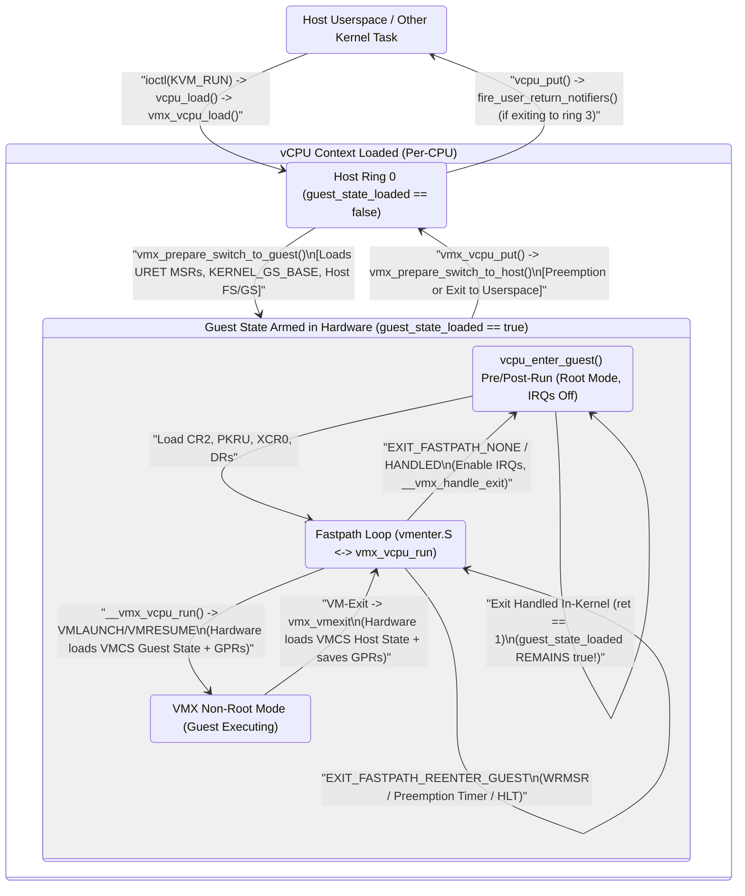

By splitting the world switch into three concentric rings—(1) the **Fastpath Inner Loop** (`vcpu_run()` / `vmenter.S`, where interrupts remain disabled and even `XCR0`/`PKRU` stay loaded), (2) the **Standard In-Kernel `vcpu_enter_guest()` Loop** (where `guest_state_loaded` and `guest_uret_msrs_loaded` remain `true` across thousands of consecutive exits), and (3) the **Outer `vcpu_load()` / `vcpu_put()` Boundary** (invoked only on thread preemption or return from `ioctl(KVM_RUN)`)—KVM amortizes the cost of heavy MSR and segment switching across entire scheduler quanta.

---

### 5.2 Deep Anatomy of `struct vcpu_vmx`, `struct vcpu_vt`, and `struct loaded_vmcs`

Before tracing the C and assembly functions that manipulate VMX state, we must examine the exact data structures that represent a VMX virtual CPU and its hardware control blocks in memory.

#### 5.2.1 Object Containment Hierarchy: `kvm_vcpu` -> `vcpu_vmx` -> `vcpu_vt` & `loaded_vmcs`

Recall from Chapter 2 that KVM uses compile-time object embedding (`container_of`) rather than pointer indirection to associate vendor-specific vCPU state with the generic `struct kvm_vcpu`. When `kvm-intel.ko` registers its `struct kvm_x86_init_ops`, it sets `.runtime_ops->vcpu_size = sizeof(struct vcpu_vmx)` and `.runtime_ops->vcpu_align = __alignof__(struct vcpu_vmx)`.

```
+-----------------------------------------------------------------------------------+
| struct vcpu_vmx (Allocated in kmem_cache 'kvm_vcpu_cache' per vCPU)               |
|                                                                                   |
| +-------------------------------------------------------------------------------+ |
| | offset 0: struct kvm_vcpu vcpu (BUILD_BUG_ON(offsetof(vcpu_vmx, vcpu) != 0))  | |
| |   +-- struct kvm_vcpu_arch arch                                               | |
| |         +-- unsigned long regs[NR_VCPU_REGS]  <-- Accessed by vmenter.S       | |
| |         +-- unsigned long rip, cr0, cr2, cr3, cr4, dr6, dr7, efer             | |
| |         +-- DECLARE_BITMAP(regs_avail, ...), DECLARE_BITMAP(regs_dirty, ...)  | |
| +-------------------------------------------------------------------------------+ |
| | struct vcpu_vt vt (Common Intel VT-x / TDX state: arch/x86/kvm/vmx/common.h)  | |
| |   +-- struct pi_desc pi_desc (64-byte aligned Posted Interrupt Descriptor)    | |
| |   +-- union vmx_exit_reason exit_reason                                       | |
| |   +-- unsigned long exit_qualification; u32 exit_intr_info;                   | |
| |   +-- bool guest_state_loaded; bool emulation_required;                       | |
| |   +-- u64 msr_host_kernel_gs_base;                                            | |
| +-------------------------------------------------------------------------------+ |
| | struct loaded_vmcs vmcs01 (L1 Guest VMCS tracking: arch/x86/kvm/vmx/vmcs.h)   | |
| |   +-- struct vmcs *vmcs  ------------------> [ 4-KiB Page: Hardware VMCS01 ]  | |
| |   +-- struct vmcs *shadow_vmcs ------------> [ 4-KiB Page: Shadow VMCS     ]  | |
| |   +-- unsigned long *msr_bitmap -----------> [ 4-KiB Page: MSR Bitmap      ]  | |
| |   +-- int cpu; bool launched; struct list_head loaded_vmcss_on_cpu_link;      | |
| |   +-- struct vmcs_host_state host_state;                                      | |
| |   +-- struct vmcs_controls_shadow controls_shadow;                            | |
| +-------------------------------------------------------------------------------+ |
| | struct loaded_vmcs *loaded_vmcs  (Points to &vmcs01 in L1, or &nested.vmcs02) | |
| +-------------------------------------------------------------------------------+ |
| | struct vmx_uret_msr guest_uret_msrs[MAX_NR_USER_RETURN_MSRS]                  | |
| | struct msr_autoload msr_autoload (guest/host); struct vmx_msrs msr_autostore; | |
| | struct segment_cache segment_cache;                                           | |
| | struct nested_vmx nested (Contains struct loaded_vmcs vmcs02, cached_vmcs12)  | |
| +-------------------------------------------------------------------------------+ |
+-----------------------------------------------------------------------------------+
```

Notice in [`vmx_vcpu_create()`](https://kernel.googlesource.com/pub/scm/virt/kvm/kvm.git/+/refs/heads/master/arch/x86/kvm/vmx/vmx.c#L7667) the compile-time assertion:
```c
BUILD_BUG_ON(offsetof(struct vcpu_vmx, vcpu) != 0);
```
Because `vcpu` is guaranteed to sit at byte offset `0` of `struct vcpu_vmx`, `to_vmx(vcpu)` is a zero-cost pointer cast in compiled machine code, and assembly routines like [`__vmx_vcpu_run()`](https://kernel.googlesource.com/pub/scm/virt/kvm/kvm.git/+/refs/heads/master/arch/x86/kvm/vmx/vmenter.S#L23) can index directly from the `struct vcpu_vmx *` pointer (`%rdi`) into `vcpu.arch.regs` using the constant offset `VMX_vcpu_arch_regs` generated by `arch/x86/kvm/kvm-asm-offsets.c`.

##### 5.2.1.1 Dissecting `struct vcpu_vt` and `union vmx_exit_reason` (`arch/x86/kvm/vmx/common.h`)

To support both classic Intel VMX and Intel Trust Domain Extensions (TDX) within the same kernel module, KVM factors state shared between VMX and TDX into `struct vcpu_vt` in [`arch/x86/kvm/vmx/common.h`](https://kernel.googlesource.com/pub/scm/virt/kvm/kvm.git/+/refs/heads/master/arch/x86/kvm/vmx/common.h#L10):

```c
union vmx_exit_reason {
	struct {
		u32	basic			: 16;
		u32	reserved16		: 1;
		u32	reserved17		: 1;
		u32	reserved18		: 1;
		u32	reserved19		: 1;
		u32	reserved20		: 1;
		u32	reserved21		: 1;
		u32	reserved22		: 1;
		u32	reserved23		: 1;
		u32	reserved24		: 1;
		u32	reserved25		: 1;
		u32	bus_lock_detected	: 1;
		u32	enclave_mode		: 1;
		u32	smi_pending_mtf		: 1;
		u32	smi_from_vmx_root	: 1;
		u32	reserved30		: 1;
		u32	failed_vmentry		: 1;
	};
	u32 full;
};

struct vcpu_vt {
	/* Posted interrupt descriptor */
	struct pi_desc pi_desc;

	/* Used if this vCPU is waiting for PI notification wakeup. */
	struct list_head pi_wakeup_list;

	union vmx_exit_reason exit_reason;

	unsigned long	exit_qualification;
	u32		exit_intr_info;

	/*
	 * If true, guest state has been loaded into hardware, and host state
	 * saved into vcpu_{vt,vmx,tdx}.  If false, host state is loaded into
	 * hardware.
	 */
	bool		guest_state_loaded;
	bool		emulation_required;

#ifdef CONFIG_X86_64
	u64		msr_host_kernel_gs_base;
#endif
};
```

Let us examine each field in `struct vcpu_vt`:
- **`pi_desc` (`struct pi_desc`)**: The 64-byte hardware **Posted Interrupt Descriptor** (PID) whose physical address (`__pa(&vmx->vt.pi_desc)`) is written into the VMCS `POSTED_INTR_DESC_ADDR` field. It contains the 256-bit Posted Interrupt Request (`pir`) bitmap and control bits (`ON` — Outstanding Notification, `SN` — Suppress Notification, `NV` — Notification Vector, and `NDST` — Notification Destination APIC ID). Because hardware (both the CPU and the VT-d IOMMU) atomically modifies `pi_desc` via locked 64-byte cache-line transactions, `struct pi_desc` is aligned to 64 bytes (`__aligned(64)`), which in turn forces `struct vcpu_vt` and `struct vcpu_vmx` to be 64-byte aligned.
- **`exit_reason` (`union vmx_exit_reason`)**: Captures the 32-bit `VM_EXIT_REASON` field (`0x4402`) immediately upon `VM-Exit` in `vmx_vcpu_enter_exit()`. Bits `15:0` (`basic`) hold the primary exit reason index (0–75+, used to index `kvm_vmx_exit_handlers[]`). Bit `26` (`bus_lock_detected`) indicates that a split lock (bus lock) occurred in the guest before or during the exit. Bit `31` (`failed_vmentry`) is critical: when `1`, the `VMLAUNCH`/`VMRESUME` instruction did *not* enter the guest at all; instead, it detected an invalid guest-state or MSR-loading error during VM-Entry and aborted back to `HOST_RIP` without executing a single guest instruction.
- **`exit_qualification` and `exit_intr_info`**: On-demand caches of the VMCS `EXIT_QUALIFICATION` (`0x6400`) and `VM_EXIT_INTR_INFO` (`0x4404`) fields. Rather than executing two extra `VMREAD` instructions on every single VM-Exit (many of which, like `CPUID`, `HLT`, or `RDMSR`, do not use `EXIT_QUALIFICATION`), KVM marks `VCPU_REG_EXIT_INFO_1` and `VCPU_REG_EXIT_INFO_2` unavailable on exit and reads them lazily via [`vmx_get_exit_qual()`](https://kernel.googlesource.com/pub/scm/virt/kvm/kvm.git/+/refs/heads/master/arch/x86/kvm/vmx/vmx.h#L322) and [`vmx_get_intr_info()`](https://kernel.googlesource.com/pub/scm/virt/kvm/kvm.git/+/refs/heads/master/arch/x86/kvm/vmx/vmx.h#L333).
- **`guest_state_loaded`**: The master boolean governing lazy host/guest state switching between [`vmx_prepare_switch_to_guest()`](https://kernel.googlesource.com/pub/scm/virt/kvm/kvm.git/+/refs/heads/master/arch/x86/kvm/vmx/vmx.c#L1336) and [`vmx_prepare_switch_to_host()`](https://kernel.googlesource.com/pub/scm/virt/kvm/kvm.git/+/refs/heads/master/arch/x86/kvm/vmx/vmx.c#L1409).
- **`emulation_required`**: Set whenever the guest's architectural state violates VMX non-root mode constraints (most notably on pre-Westmere CPUs lacking the `SECONDARY_EXEC_UNRESTRICTED_GUEST` capability when the guest transitions between Real Mode and Protected Mode). When `true`, `vmx_vcpu_run()` short-circuits hardware VM-Entry and synthesizes `EXIT_REASON_INVALID_STATE` so `handle_invalid_guest_state()` can emulate guest instructions in software.

##### 5.2.1.2 Dissecting `struct vcpu_vmx` (`arch/x86/kvm/vmx/vmx.h`)

Let us now examine the VMX-specific fields of [`struct vcpu_vmx`](https://kernel.googlesource.com/pub/scm/virt/kvm/kvm.git/+/refs/heads/master/arch/x86/kvm/vmx/vmx.h#L206) in [`arch/x86/kvm/vmx/vmx.h`](https://kernel.googlesource.com/pub/scm/virt/kvm/kvm.git/+/refs/heads/master/arch/x86/kvm/vmx/vmx.h):

```c
struct vcpu_vmx {
	struct kvm_vcpu       vcpu;
	struct vcpu_vt	      vt;
	u8                    fail;
	u8		      x2apic_msr_bitmap_mode;

	u32                   idt_vectoring_info;
	ulong                 rflags;

	struct vmx_uret_msr   guest_uret_msrs[MAX_NR_USER_RETURN_MSRS];
	bool                  guest_uret_msrs_loaded;
#ifdef CONFIG_X86_64
	u64		      msr_guest_kernel_gs_base;
#endif

	u64		      spec_ctrl;
	u32		      msr_ia32_umwait_control;

	/*
	 * loaded_vmcs points to the VMCS currently used in this vcpu. For a
	 * non-nested (L1) guest, it always points to vmcs01. For a nested
	 * guest (L2), it points to a different VMCS.
	 */
	struct loaded_vmcs    vmcs01;
	struct loaded_vmcs   *loaded_vmcs;

	struct msr_autoload {
		struct vmx_msrs guest;
		struct vmx_msrs host;
	} msr_autoload;

	struct vmx_msrs msr_autostore;
...
	struct {
		u32 bitmask; /* 4 bits per segment (1 bit per field) */
		struct kvm_save_segment {
			u16 selector;
			unsigned long base;
			u32 limit;
			u32 ar;
		} seg[8];
	} segment_cache;
	int vpid;

	/* Support for a guest hypervisor (nested VMX) */
	struct nested_vmx nested;
```

Every group of fields in `struct vcpu_vmx` serves a distinct performance or correctness requirement:
1. **`fail` (`u8`)**: Stores the boolean return value of `__vmx_vcpu_run()`. In Intel VMX, a VM-Entry can fail in two completely different ways:
   - **VM-Fail (`CF=1` or `ZF=1`)**: The `VMLAUNCH` or `VMRESUME` instruction detects an error in the **Host-State Area**, the **VM-Execution Control Fields**, or the **VMCS pointer** itself *before* loading any guest state. Execution does *not* jump to `HOST_RIP`; instead, it falls through to the instruction immediately following `vmlaunch`/`vmresume` with `RFLAGS.CF=1` (VMFailInvalid, no valid current VMCS) or `RFLAGS.ZF=1` (VMFailValid, error code recorded in `VM_INSTRUCTION_ERROR`, field `0x4400`). In this case, `__vmx_vcpu_run()` returns `1`, stored in `vmx->fail`.
   - **VM-Entry Failure during Guest-State Loading (`exit_reason.failed_vmentry = 1`)**: The control and host-state checks succeed, and the CPU begins checking the **Guest-State Area** and **VM-Entry MSR-load list**. If a guest-state check fails, the CPU aborts the entry by triggering a synthetic VM-Exit to `HOST_RIP` (`vmx_vmexit`) with bit 31 of `VM_EXIT_REASON` set. Here, `vmx->fail` is `0`, and `vmx->vt.exit_reason.failed_vmentry` is `1`.
2. **`idt_vectoring_info` (`u32`)**: Read eagerly from `IDT_VECTORING_INFO_FIELD` (`0x4408`) on every normal VM-Exit in `vmx_vcpu_enter_exit()`. If a VM-Exit occurs while the processor was in the middle of delivering an injected event or guest exception through the guest IDT (for example, delivering a hardware interrupt caused an EPT violation when reading the guest's IDT or pushing the interrupt frame onto the guest stack), bit 31 (`VECTORING_INFO_VALID_MASK`) of `idt_vectoring_info` is set. `vmx_complete_interrupts()` inspects this field right after VM-Exit to re-queue the interrupted exception or IRQ into `vcpu->arch.exception` or `vcpu->arch.interrupt` so it will be re-injected once the page fault or EPT violation is resolved.
3. **`vmcs01` and `loaded_vmcs`**: `vmcs01` is the embedded `struct loaded_vmcs` used to run the L1 guest. `loaded_vmcs` is a pointer to whichever `struct loaded_vmcs` is currently active on this vCPU. When running L1, `vmx->loaded_vmcs == &vmx->vmcs01`. When L1 launches a nested L2 guest (Chapter 8), `vmx_switch_loaded_vmcs()` switches `vmx->loaded_vmcs` to point to `&vmx->nested.vmcs02`. All VMCS helper macros (`exec_controls_get(vmx)`, `vmx_vcpu_load_vmcs()`, etc.) operate through `vmx->loaded_vmcs`, allowing the vast majority of `vmx.c` to remain agnostic to whether L1 or L2 is running!
4. **`msr_autoload` and `msr_autostore`**: Hardware arrays of `struct vmx_msr_entry` (16-byte entries: `{ u32 index; u32 reserved; u64 value; }`, up to `MAX_NR_LOADSTORE_MSRS = 8`). Their physical addresses are programmed into `VM_ENTRY_MSR_LOAD_ADDR`, `VM_EXIT_MSR_LOAD_ADDR`, and `VM_EXIT_MSR_STORE_ADDR`. KVM uses these lists (`add_atomic_switch_msr()`) when an MSR (such as `MSR_EFER` on older CPUs without dedicated `VM_ENTRY_LOAD_IA32_EFER` support, or cross-mapped PMU counter/event-select MSRs in `atomic_switch_perf_msrs()`) *must* be switched atomically with the world switch. Note that KVM prefers dedicated VMCS fields or software switching whenever possible because each entry in the hardware MSR load/store list adds significant microcode latency (~50–100+ cycles per entry) to every VM-Entry and VM-Exit.
5. **`segment_cache`**: Because reading segment fields (`SELECTOR`, `BASE`, `LIMIT`, `AR_BYTES`) from the VMCS via `VMREAD` is relatively expensive when the instruction emulator (`x86_emulate_insn()`) queries multiple segment properties in a row, `vmx->segment_cache` caches all 4 fields across all 8 segments (`CS`, `CX`, `DS`, `ES`, `FS`, `GS`, `TR`, `LDTR`), tracked by a 32-bit `bitmask` (4 bits per segment) and invalidated lazily via `VCPU_REG_SEGMENTS` on every VM-Exit.

##### 5.2.1.3 Dissecting `struct loaded_vmcs` (`arch/x86/kvm/vmx/vmcs.h`)

Let us inspect [`struct loaded_vmcs`](https://kernel.googlesource.com/pub/scm/virt/kvm/kvm.git/+/refs/heads/master/arch/x86/kvm/vmx/vmcs.h#L59), `struct vmcs_host_state`, and `struct vmcs_controls_shadow` in [`arch/x86/kvm/vmx/vmcs.h`](https://kernel.googlesource.com/pub/scm/virt/kvm/kvm.git/+/refs/heads/master/arch/x86/kvm/vmx/vmcs.h#L32):

```c
struct vmcs_host_state {
	unsigned long cr3;	/* May not match real cr3 */
	unsigned long cr4;	/* May not match real cr4 */
	unsigned long gs_base;
	unsigned long fs_base;
	unsigned long rsp;

	u16           fs_sel, gs_sel, ldt_sel;
#ifdef CONFIG_X86_64
	u16           ds_sel, es_sel;
#endif
};

struct vmcs_controls_shadow {
	u32 vm_entry;
	u32 vm_exit;
	u32 pin;
	u32 exec;
	u32 secondary_exec;
	u64 tertiary_exec;
};

struct loaded_vmcs {
	struct vmcs *vmcs;
	struct vmcs *shadow_vmcs;
	int cpu;
	bool launched;
	bool nmi_known_unmasked;
	bool hv_timer_soft_disabled;
	/* Support for vnmi-less CPUs */
	int soft_vnmi_blocked;
	ktime_t entry_time;
	s64 vnmi_blocked_time;
	unsigned long *msr_bitmap;
	struct list_head loaded_vmcss_on_cpu_link;
	struct vmcs_host_state host_state;
	struct vmcs_controls_shadow controls_shadow;
};
```

Why does `struct loaded_vmcs` exist as a separate abstraction from the raw 4-KiB `struct vmcs *vmcs` page?
- **`vmcs` (`struct vmcs *`)**: Points to the page-aligned 4-KiB physical memory region allocated by `alloc_vmcs_cpu()`. As defined in [`arch/x86/include/asm/vmx.h`](https://kernel.googlesource.com/pub/scm/virt/kvm/kvm.git/+/refs/heads/master/arch/x86/include/asm/vmx.h), the only architecturally visible layout of `struct vmcs` in normal RAM is its first 8 bytes: a 32-bit `hdr.revision_id` (bits `30:0` from `MSR_IA32_VMX_BASIC`, plus bit `31` `shadow_vmcs` indicator) and a 32-bit `abort` indicator. The remaining 4,088 bytes of the page are an **opaque, microarchitecture-specific data area** that software is strictly forbidden from reading or writing with normal memory loads/stores (`MOV`) while the VMCS is active; all accesses must go through `VMREAD` and `VMWRITE` against the current VMCS pointer on the local CPU!
- **`cpu` (`int`) and `loaded_vmcss_on_cpu_link` (`struct list_head`)**: Tracks which physical CPU (`0..nr_cpu_ids-1`, or `-1` if clear/unloaded) currently holds this VMCS in its internal processor cache (`Active` state). Every physical CPU maintains a per-CPU linked list `DEFINE_PER_CPU(struct list_head, loaded_vmcss_on_cpu)`. Whenever a VMCS is made active on `cpu`, its `loaded_vmcss_on_cpu_link` is linked into `per_cpu(loaded_vmcss_on_cpu, cpu)` so that if `cpu` is hot-unplugged (`vmx_disable_virtualization_cpu()`) or kexec/panic reboots (`vmx_emergency_disable_virtualization_cpu()`), that CPU can iterate over its local list and execute `VMCLEAR` on every active VMCS.
- **`launched` (`bool`)**: Tracks the hardware launch state of `vmcs` on `cpu` (`0` = Clear / Needs `VMLAUNCH`, `1` = Launched / Needs `VMRESUME`). Executing `VMCLEAR` transitions the VMCS back to the Clear state and requires `launched = 0`.
- **`host_state` (`struct vmcs_host_state`)**: A write-through software cache of the VMCS Host-State fields (`HOST_CR3`, `HOST_CR4`, `HOST_FS_BASE`, `HOST_GS_BASE`, `HOST_RSP`, `HOST_FS_SELECTOR`, `HOST_GS_SELECTOR`). Before executing an expensive `VMWRITE` to update `HOST_RSP` (in `vmx_update_host_rsp()`) or `HOST_CR3`/`HOST_CR4` (in `vmx_vcpu_run()`), KVM compares the new value against `loaded_vmcs->host_state`. Because a vCPU thread almost always enters `__vmx_vcpu_run()` at the exact same kernel stack depth (`HOST_RSP`) and with the same `CR3`/`CR4`, this write-through cache eliminates 3–5 `VMWRITE` instructions on >99.9% of VM-Entries!
- **`controls_shadow` (`struct vmcs_controls_shadow`)**: Similarly, `BUILD_CONTROLS_SHADOW` in [`arch/x86/kvm/vmx/vmx.h`](https://kernel.googlesource.com/pub/scm/virt/kvm/kvm.git/+/refs/heads/master/arch/x86/kvm/vmx/vmx.h#L582) generates `pin_controls_set()`, `exec_controls_set()`, `secondary_exec_controls_set()`, `tertiary_exec_controls_set()`, `vm_entry_controls_set()`, and `vm_exit_controls_set()`. Reading a VMCS control field via `exec_controls_get(vmx)` reads `loaded_vmcs->controls_shadow.exec` from L1 data cache in 1 cycle rather than issuing a ~15–25 cycle `VMREAD` instruction, and `exec_controls_setbit()` only issues a `VMWRITE` if the bit value actually changed.

###### 5.2.1.3.1 Bit-Level VMCS Field Encoding and Compile-Time Type Checking (`arch/x86/kvm/vmx/vmx_ops.h`)

How does the CPU identify which field inside the opaque 4-KiB VMCS a `VMREAD` or `VMWRITE` instruction is targeting? Every VMCS field is addressed by a 16-bit architectural **VMCS Field Encoding** passed in a general-purpose register to `VMREAD` or `VMWRITE`:

```
 31                15  14  13  12  11  10   9                           1   0
+--------------------+-------+---+-------+-------------------------------+---+
|  Reserved (Must 0) | Width | R | Type  |          Field Index          | H |
+--------------------+-------+---+-------+-------------------------------+---+
                       |   |   |   |   |     |                         |   |
                       +---+   |   +---+     +-------------------------+   +-> Bit 0 (Access Type):
                         |     |     |                    |                    0 = Full field
                         |     |     |                    |                    1 = High 32 bits (64-bit fields on 32-bit OS)
                         |     |     |                    +------------------> Bits 9:1: 9-bit Field Index within group
                         |     |     +---------------------------------------> Bits 11:10 (Field Type / Category):
                         |     |                                               00 (0) = Control Field
                         |     |                                               01 (1) = Read-Only VM-Exit Information Field
                         |     |                                               10 (2) = Guest-State Field
                         |     |                                               11 (3) = Host-State Field
                         |     +---------------------------------------------> Bit 12: Reserved (0)
                         +---------------------------------------------------> Bits 14:13 (Field Width):
                                                                               00 (0) = 16-bit field (0x0xxx)
                                                                               01 (1) = 64-bit field (0x2xxx)
                                                                               10 (2) = 32-bit field (0x4xxx)
                                                                               11 (3) = Natural-width field (0x6xxx)
```

Look closely at [`arch/x86/kvm/vmx/vmcs.h`](https://kernel.googlesource.com/pub/scm/virt/kvm/kvm.git/+/refs/heads/master/arch/x86/kvm/vmx/vmcs.h#L169) and [`arch/x86/kvm/vmx/vmx_ops.h`](https://kernel.googlesource.com/pub/scm/virt/kvm/kvm.git/+/refs/heads/master/arch/x86/kvm/vmx/vmx_ops.h#L43). Because bits `14:13` encode the width of the field (`0x0000` for 16-bit, `0x2000` for 64-bit, `0x4000` for 32-bit, `0x6000` for natural-width) and bit `0` indicates a `_HIGH` 32-bit half, KVM enforces **compile-time width checking** on every `vmcs_read{16,32,64,l}()` and `vmcs_write{16,32,64,l}()` call:

```c
static __always_inline void vmcs_check32(unsigned long field)
{
	BUILD_BUG_ON_MSG(__builtin_constant_p(field) && ((field) & 0x6000) == 0,
			 "32-bit accessor invalid for 16-bit field");
	BUILD_BUG_ON_MSG(__builtin_constant_p(field) && ((field) & 0x6001) == 0x2000,
			 "32-bit accessor invalid for 64-bit field");
	BUILD_BUG_ON_MSG(__builtin_constant_p(field) && ((field) & 0x6001) == 0x2001,
			 "32-bit accessor invalid for 64-bit high field");
	BUILD_BUG_ON_MSG(__builtin_constant_p(field) && ((field) & 0x6000) == 0x6000,
			 "32-bit accessor invalid for natural width field");
}
```
If a developer accidentally calls `vmcs_write32(GUEST_RSP, val)` instead of `vmcs_writel(GUEST_RSP, val)` (since `GUEST_RSP = 0x681c` has bits `14:13 == 0b11`, natural width), `vmcs_check32()` triggers a `BUILD_BUG_ON_MSG` at compile time! Furthermore, look at how `__vmcs_readl()` is implemented in [`arch/x86/kvm/vmx/vmx_ops.h`](https://kernel.googlesource.com/pub/scm/virt/kvm/kvm.git/+/refs/heads/master/arch/x86/kvm/vmx/vmx_ops.h#L91):
```c
static __always_inline unsigned long __vmcs_readl(unsigned long field)
{
	unsigned long value;

#ifdef CONFIG_CC_HAS_ASM_GOTO_OUTPUT

	asm_goto_output("1: vmread %[field], %[output]\n\t"
			  "jna %l[do_fail]\n\t"

			  _ASM_EXTABLE(1b, %l[do_exception])

			  : [output] "=r" (value)
			  : [field] "r" (field)
			  : "cc", "memory"
			  : do_fail, do_exception);

	return value;

do_fail:
	instrumentation_begin();
	vmread_error(field);
	instrumentation_end();
	return 0;

do_exception:
	kvm_spurious_fault();
	return 0;
```
Notice the `jna %l[do_fail]` instruction right after `vmread` (and `vmwrite`, `vmclear`, `vmptrld`). In Intel VMX, all VMX instructions report execution failures by setting either `RFLAGS.CF = 1` (VMFailInvalid) or `RFLAGS.ZF = 1` (VMFailValid). The x86 `JNA` (*Jump if Not Above*, synonymous with `JBE` — *Jump if Below or Equal*) branches if and only if `CF == 1 || ZF == 1`! Thus a single conditional branch instruction checks both VMX failure conditions simultaneously, jumping out-of-line to `vmread_error(field)` while keeping the hot path a single inline `vmread` instruction.

---

### 5.3 VMCS Initialization (`init_vmcs`) and Per-CPU Migration (`vmx_vcpu_load_vmcs`)

With the data structures in place, let us trace how a VMCS is born during `KVM_CREATE_VCPU`, how its hundreds of control and host-state fields are populated in `init_vmcs()`, and how KVM coordinates with physical processor caches when the Linux scheduler migrates a vCPU thread from physical CPU $A$ to physical CPU $B$.

#### 5.3.1 Allocating the VMCS and Initializing Control & Host State (`vmx_vcpu_create` -> `init_vmcs`)

When userspace invokes `ioctl(vm_fd, KVM_CREATE_VCPU, id)`, the generic x86 layer (`kvm_arch_vcpu_create()`) calls `vmx_vcpu_create()`, followed by `kvm_vcpu_reset()` -> `vmx_vcpu_reset()` -> `__vmx_vcpu_reset()` -> `init_vmcs()`.

First, inside [`vmx_vcpu_create()`](https://kernel.googlesource.com/pub/scm/virt/kvm/kvm.git/+/refs/heads/master/arch/x86/kvm/vmx/vmx.c#L7661), KVM allocates a 16-bit Virtual Processor ID (`vmx->vpid = allocate_vpid()`), an optional 4-KiB Page Modification Logging page (`vmx->pml_pg`), and then calls [`alloc_loaded_vmcs(&vmx->vmcs01)`](https://kernel.googlesource.com/pub/scm/virt/kvm/kvm.git/+/refs/heads/master/arch/x86/kvm/vmx/vmx.c#L3085):

```c
struct vmcs *alloc_vmcs_cpu(bool shadow, int cpu, gfp_t flags)
{
	int node = cpu_to_node(cpu);
	struct page *pages;
	struct vmcs *vmcs;

	pages = alloc_pages_node(node, flags, 0);
	if (!pages)
		return NULL;
	vmcs = page_address(pages);
	memset(vmcs, 0, vmx_basic_vmcs_size(vmcs_config.basic));

	/* KVM supports Enlightened VMCS v1 only */
	if (kvm_is_using_evmcs())
		vmcs->hdr.revision_id = KVM_EVMCS_VERSION;
	else
		vmcs->hdr.revision_id = vmx_basic_vmcs_revision_id(vmcs_config.basic);

	if (shadow)
		vmcs->hdr.shadow_vmcs = 1;
	return vmcs;
}
```
Look at what `alloc_loaded_vmcs()` does immediately after allocating the NUMA-local 4-KiB `vmcs` page and writing `vmcs->hdr.revision_id`:
1. It executes `vmcs_clear(loaded_vmcs->vmcs)` (`VMCLEAR`), ensuring the newly allocated physical page is initialized to the hardware **Clear** state.
2. It sets `loaded_vmcs->cpu = -1` and `loaded_vmcs->launched = 0`.
3. It allocates a 4-KiB `msr_bitmap` page and fills it with `0xff` (`memset(loaded_vmcs->msr_bitmap, 0xff, PAGE_SIZE)`), meaning **all MSR reads and writes are intercepted by default** until explicitly un-intercepted via `vmx_disable_intercept_for_msr()`.

Next, still inside `kvm_arch_vcpu_create()`, KVM calls `vcpu_load(vcpu)` -> `vmx_vcpu_load()` -> `vmx_vcpu_load_vmcs()`, which executes `VMPTRLD` on the current CPU to make `vmx->vmcs01.vmcs` the active, current VMCS on this physical processor, and then calls `kvm_vcpu_reset(vcpu, false)` -> `vmx_vcpu_reset()` -> `__vmx_vcpu_reset()` -> [`init_vmcs(vmx)`](https://kernel.googlesource.com/pub/scm/virt/kvm/kvm.git/+/refs/heads/master/arch/x86/kvm/vmx/vmx.c#L4886).

##### 5.3.1.1 Dissecting `init_vmcs()` and `vmx_set_constant_host_state()`

Because `VMREAD` and `VMWRITE` implicitly operate on whichever VMCS was most recently loaded via `VMPTRLD` on the current physical CPU, `init_vmcs()` can only be called while the vCPU is loaded (`vcpu_load()`). Let us trace the key stages of [`init_vmcs()`](https://kernel.googlesource.com/pub/scm/virt/kvm/kvm.git/+/refs/heads/master/arch/x86/kvm/vmx/vmx.c#L4886) and [`vmx_set_constant_host_state()`](https://kernel.googlesource.com/pub/scm/virt/kvm/kvm.git/+/refs/heads/master/arch/x86/kvm/vmx/vmx.c#L4454):

```c
static void init_vmcs(struct vcpu_vmx *vmx)
{
	struct kvm *kvm = vmx->vcpu.kvm;
	struct kvm_vmx *kvm_vmx = to_kvm_vmx(kvm);

	if (nested)
		nested_vmx_set_vmcs_shadowing_bitmap();

	if (cpu_has_vmx_msr_bitmap())
		vmcs_write64(MSR_BITMAP, __pa(vmx->vmcs01.msr_bitmap));

	vmcs_write64(VMCS_LINK_POINTER, INVALID_GPA); /* 22.3.1.5 */

	/* Control */
	pin_controls_set(vmx, vmx_pin_based_exec_ctrl(vmx));

	exec_controls_set(vmx, vmx_exec_control(vmx));

	if (cpu_has_secondary_exec_ctrls()) {
		secondary_exec_controls_set(vmx, vmx_secondary_exec_control(vmx));
		if (vmx->ve_info)
			vmcs_write64(VE_INFORMATION_ADDRESS,
				     __pa(vmx->ve_info));
	}

	if (cpu_has_tertiary_exec_ctrls())
		tertiary_exec_controls_set(vmx, vmx_tertiary_exec_control(vmx));
```

1. **MSR Bitmap and Link Pointer**: `MSR_BITMAP` (`0x2004`) is loaded with the host physical address (`__pa`) of `vmx->vmcs01.msr_bitmap`. `VMCS_LINK_POINTER` (`0x2800`) is initialized to `INVALID_GPA` (`~0ULL`), because VMCS shadowing is not active for L1 until L1 enters VMX operation (`VMXON`) and loads a `VMCS12` (`VMPTRLD`).
2. **The Four Execution Control Vectors**:
   - **Pin-Based Controls (`PIN_BASED_VM_EXEC_CONTROL`, `0x4000`)**: Configured by `vmx_pin_based_exec_ctrl(vmx)` with `PIN_BASED_EXT_INTR_MASK` (external interrupts cause VM-Exits), `PIN_BASED_NMI_EXITING`, `PIN_BASED_VIRTUAL_NMIS`, `PIN_BASED_POSTED_INTR` (if APICv is active), and `PIN_BASED_VMX_PREEMPTION_TIMER`.
   - **Primary Processor-Based Controls (`CPU_BASED_VM_EXEC_CONTROL`, `0x4002`)**: Configured by `vmx_exec_control(vmx)`. Notice lines 4673–4676: when EPT (`enable_ept`) is enabled, KVM **clears** `CPU_BASED_CR3_LOAD_EXITING`, `CPU_BASED_CR3_STORE_EXITING`, and `CPU_BASED_INVLPG_EXITING`! Thus, under EPT, the guest OS switches its own `CR3` on every guest process context switch and executes `INVLPG` at native hardware speed with **zero VM-Exits**.
   - **Secondary Processor-Based Controls (`SECONDARY_VM_EXEC_CONTROL`, `0x401e`)**: Configured by `vmx_secondary_exec_control(vmx)` to enable `SECONDARY_EXEC_ENABLE_EPT`, `SECONDARY_EXEC_ENABLE_VPID`, `SECONDARY_EXEC_UNRESTRICTED_GUEST`, `SECONDARY_EXEC_PAUSE_LOOP_EXITING`, `SECONDARY_EXEC_APIC_REGISTER_VIRT`, `SECONDARY_EXEC_VIRTUAL_INTR_DELIVERY`, and guest-CPUID-dependent features (`XSAVES`, `RDTSCP`/`RDPID`, `INVPCID`, `WAITPKG`).
   - **Tertiary Processor-Based Controls (`TERTIARY_VM_EXEC_CONTROL`, `0x2034`)**: Configured with `TERTIARY_EXEC_IPI_VIRT` if Intel IPI virtualization (`enable_ipiv`) is active.
3. **APICv, Posted Interrupts, and IPI Virtualization**: When `enable_apicv && lapic_in_kernel(&vmx->vcpu)` holds, `init_vmcs()` zeroes the 256-bit `EOI_EXIT_BITMAP0..3`, clears `GUEST_INTR_STATUS` (which holds the 8-bit Requesting Virtual Interrupt `RVI` in bits `7:0` and Servicing Virtual Interrupt `SVI` in bits `15:8`), sets `POSTED_INTR_NV` to `POSTED_INTR_VECTOR` (`0xf2` on x86-64 Linux), and writes `__pa(&vmx->vt.pi_desc)` into `POSTED_INTR_DESC_ADDR`.
4. **Constant Host State (`vmx_set_constant_host_state()`)**:
   Look at [`vmx_set_constant_host_state()`](https://kernel.googlesource.com/pub/scm/virt/kvm/kvm.git/+/refs/heads/master/arch/x86/kvm/vmx/vmx.c#L4454):
   ```c
	vmcs_write16(HOST_CS_SELECTOR, __KERNEL_CS);  /* 22.2.4 */
#ifdef CONFIG_X86_64
	/*
	 * Load null selectors, so we can avoid reloading them in
	 * vmx_prepare_switch_to_host(), in case userspace uses
	 * the null selectors too (the expected case).
	 */
	vmcs_write16(HOST_DS_SELECTOR, 0);
	vmcs_write16(HOST_ES_SELECTOR, 0);
#else
	vmcs_write16(HOST_DS_SELECTOR, __KERNEL_DS);  /* 22.2.4 */
	vmcs_write16(HOST_ES_SELECTOR, __KERNEL_DS);  /* 22.2.4 */
#endif
	vmcs_write16(HOST_SS_SELECTOR, __KERNEL_DS);  /* 22.2.4 */
	vmcs_write16(HOST_TR_SELECTOR, GDT_ENTRY_TSS*8);  /* 22.2.4 */

	vmcs_writel(HOST_IDTR_BASE, host_idt_base);   /* 22.2.4 */

	vmcs_writel(HOST_RIP, (unsigned long)vmx_vmexit); /* 22.2.5 */
   ```
   Here we see `HOST_RIP` (`0x6c16`) programmed with `(unsigned long)vmx_vmexit`—the exact global symbol inside [`arch/x86/kvm/vmx/vmenter.S`](https://kernel.googlesource.com/pub/scm/virt/kvm/kvm.git/+/refs/heads/master/arch/x86/kvm/vmx/vmenter.S#L116) where the CPU will teleport its instruction pointer on every single VM-Exit! Notice also why `HOST_DS_SELECTOR` and `HOST_ES_SELECTOR` are set to `0` on x86-64: 64-bit Linux kernel code ignores `DS`/`ES`, and modern 64-bit userspace (`glibc`) also keeps `DS` and `ES` set to `0x0000`. By making the VM-Exit hardware load `0` into `DS` and `ES`, `vmx_prepare_switch_to_host()` does not have to execute slow `mov %ds` / `mov %es` instructions when returning to a standard 64-bit process!

###### 5.3.1.1.1 `CR0` and `CR4` Guest/Host Masks and Read Shadows (`CR0_GUEST_HOST_MASK`, `CR0_READ_SHADOW`)

One of the cleverest hardware optimizations in the VMCS is the split control register mechanism for `CR0` and `CR4`, configured at lines 4968–4971 of `init_vmcs()`:
```c
	vmx->vcpu.arch.cr0_guest_owned_bits = vmx_l1_guest_owned_cr0_bits();
	vmcs_writel(CR0_GUEST_HOST_MASK, ~vmx->vcpu.arch.cr0_guest_owned_bits);

	set_cr4_guest_host_mask(vmx);
```
Why does a hypervisor need *three* VMCS fields (`GUEST_CR0`, `CR0_GUEST_HOST_MASK`, `CR0_READ_SHADOW`) just to virtualize a single control register `CR0` (and likewise for `CR4`)?
- Suppose the guest OS runs with EPT enabled, or even with legacy paging disabled, while Intel VMX hardware requires `GUEST_CR0.NE` (Numeric Error, bit 5) to be `1`, or KVM's shadow paging requires `GUEST_CR0.WP` (Write Protect, bit 16) to be `1` even if the guest kernel thinks `CR0.WP == 0`.
- Meanwhile, the guest OS might frequently toggle `CR0.TS` (Task Switched, bit 3, via `CLTS`) or `CR4.PGE` / `CR4.OSFXSR` / `CR4.FSGSBASE` without KVM needing to intercept those changes.
- Intel VMX solves this with `CR0_GUEST_HOST_MASK` (`0x6000`) and `CR0_READ_SHADOW` (`0x6004`):
  - For any bit position $i$ where `CR0_GUEST_HOST_MASK[i] == 1` (**Host-Owned Bit**):
    1. When the guest executes `MOV RAX, CR0` (reads `CR0`), the processor does **not** return bit $i$ from the real hardware `GUEST_CR0`; instead, it returns bit $i$ from **`CR0_READ_SHADOW[i]`**!
    2. When the guest executes `MOV CR0, RAX` (writes `CR0`), if the new value of bit $i$ differs from `CR0_READ_SHADOW[i]`, the processor triggers an immediate `EXIT_REASON_CR_ACCESS` VM-Exit!
  - For any bit position $i$ where `CR0_GUEST_HOST_MASK[i] == 0` (**Guest-Owned Bit**, defined by `KVM_POSSIBLE_CR0_GUEST_BITS` = `X86_CR0_TS | X86_CR0_WP` when EPT is enabled, and `KVM_POSSIBLE_CR4_GUEST_BITS` in [`arch/x86/kvm/regs.h`](https://kernel.googlesource.com/pub/scm/virt/kvm/kvm.git/+/refs/heads/master/arch/x86/kvm/regs.h#L7)):
    1. Guest reads (`MOV RAX, CR0`) return the actual hardware bit `GUEST_CR0[i]`.
    2. Guest writes (`MOV CR0, RAX` or `CLTS`) directly modify `GUEST_CR0[i]` in hardware **without causing a VM-Exit**!

Because the guest can modify guest-owned bits in `GUEST_CR0` and `GUEST_CR4` behind KVM's back without a VM-Exit, KVM's cached `vcpu->arch.cr0` and `vcpu->arch.cr4` may become stale with respect to those guest-owned bits while the guest runs. That is why `VCPU_REG_CR0` and `VCPU_REG_CR4` are included in `VMX_REGS_LAZY_LOAD_SET`: if KVM needs to inspect a guest-owned bit (like `X86_CR0_WP` or `X86_CR4_PGE`) after a VM-Exit, `kvm_read_cr0_bits()` calls `vmx_cache_reg(vcpu, VCPU_REG_CR0)` to merge `vmcs_readl(GUEST_CR0) & guest_owned_bits` into `vcpu->arch.cr0` on demand!

#### 5.3.2 The Hardware VMCS State Machine and Per-CPU Migration (`vmx_vcpu_load_vmcs`)

Why does KVM need `vmx_vcpu_load_vmcs()` every time a vCPU thread is scheduled onto a CPU, and why can't two CPUs simply read or write the 4-KiB `struct vmcs` page in RAM?

To achieve ~200-cycle world switches, an Intel processor core does **not** read and write the 4-KiB VMCS region in DRAM directly on every `VMREAD`, `VMWRITE`, `VMRESUME`, and `VM-Exit`. Instead, when a CPU executes `VMPTRLD <phys_addr>`, the processor's VMX hardware **caches the active VMCS inside internal, core-private SRAM buffers** (the processor's internal VMCS cache). Modifications made via `VMWRITE` or saved by `VM-Exit` may sit dirty inside CPU $A$'s internal silicon VMCS cache for millions of cycles without being written back to the 4-KiB page in DRAM!

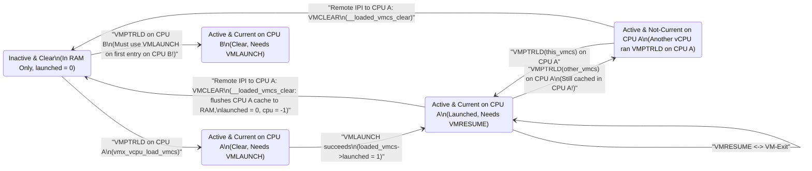

##### 5.3.2.1 Why Cross-CPU Migration Requires Remote `VMCLEAR` (`loaded_vmcs_clear` -> `__loaded_vmcs_clear`)

Suppose vCPU 0 is running on physical CPU $A$ (`loaded_vmcs->cpu == A`, `loaded_vmcs->launched == 1`). Now the Linux scheduler preempts the vCPU 0 thread on CPU $A$ (`kvm_sched_out()` -> `vmx_vcpu_put()`) and later wakes or migrates the vCPU 0 thread onto physical CPU $B$ (`kvm_sched_in()` -> `vmx_vcpu_load(vcpu, B)`).

Notice that `vmx_vcpu_put()` does **not** execute `VMCLEAR` when the vCPU thread is preempted! Why? Because 95%+ of the time, when the vCPU thread is scheduled back in a few microseconds later, it wakes up on the **same** physical CPU $A$. Leaving the VMCS Active and Launched in CPU $A$'s internal cache allows CPU $A$ to resume the guest with `VMRESUME` (`launched == 1`) without ever flushing the VMCS to DRAM or re-initializing per-CPU host state (`HOST_TR_BASE`, `HOST_GDTR_BASE`).

However, when the Linux scheduler *does* migrate the vCPU thread from CPU $A$ to CPU $B$, CPU $A$'s internal VMCS cache still holds dirty VMCS state for this vCPU! If CPU $B$ were to execute `VMPTRLD` on the physical address of `loaded_vmcs->vmcs` while the VMCS is still Active on CPU $A$, CPU $B$ would read stale garbage from DRAM, corrupting the guest state and violating Intel SDM Volume 3 Section 25.11.3. And because `VMCLEAR` only flushes the internal VMCS cache of the **local** physical processor where `VMCLEAR` is executed, CPU $B$ **cannot** execute `VMCLEAR` for CPU $A$'s cache—CPU $B$ must send a synchronous Inter-Processor Interrupt (IPI) to CPU $A$ via `smp_call_function_single()` to force CPU $A$ to execute `VMCLEAR`!

Let us inspect [`__loaded_vmcs_clear()`](https://kernel.googlesource.com/pub/scm/virt/kvm/kvm.git/+/refs/heads/master/arch/x86/kvm/vmx/vmx.c#L813), [`loaded_vmcs_clear()`](https://kernel.googlesource.com/pub/scm/virt/kvm/kvm.git/+/refs/heads/master/arch/x86/kvm/vmx/vmx.c#L842), and [`vmx_vcpu_load_vmcs()`](https://kernel.googlesource.com/pub/scm/virt/kvm/kvm.git/+/refs/heads/master/arch/x86/kvm/vmx/vmx.c#L1513) in [`arch/x86/kvm/vmx/vmx.c`](https://kernel.googlesource.com/pub/scm/virt/kvm/kvm.git/+/refs/heads/master/arch/x86/kvm/vmx/vmx.c):

```c
static void __loaded_vmcs_clear(void *arg)
{
	struct loaded_vmcs *loaded_vmcs = arg;
	int cpu = raw_smp_processor_id();

	if (loaded_vmcs->cpu != cpu)
		return; /* vcpu migration can race with cpu offline */
	if (per_cpu(current_vmcs, cpu) == loaded_vmcs->vmcs)
		per_cpu(current_vmcs, cpu) = NULL;

	vmcs_clear(loaded_vmcs->vmcs);
	if (loaded_vmcs->shadow_vmcs && loaded_vmcs->launched)
		vmcs_clear(loaded_vmcs->shadow_vmcs);

	list_del(&loaded_vmcs->loaded_vmcss_on_cpu_link);

	/*
	 * Ensure all writes to loaded_vmcs, including deleting it from its
	 * current percpu list, complete before setting loaded_vmcs->cpu to
	 * -1, otherwise a different cpu can see loaded_vmcs->cpu == -1 first
	 * and add loaded_vmcs to its percpu list before it's deleted from this
	 * cpu's list. Pairs with the smp_rmb() in vmx_vcpu_load_vmcs().
	 */
	smp_wmb();

	loaded_vmcs->cpu = -1;
	loaded_vmcs->launched = 0;
}

static void loaded_vmcs_clear(struct loaded_vmcs *loaded_vmcs)
{
	int cpu = loaded_vmcs->cpu;

	if (cpu != -1)
		smp_call_function_single(cpu,
			 __loaded_vmcs_clear, loaded_vmcs, 1);
}
```

And now trace [`vmx_vcpu_load_vmcs()`](https://kernel.googlesource.com/pub/scm/virt/kvm/kvm.git/+/refs/heads/master/arch/x86/kvm/vmx/vmx.c#L1513) executing on the destination CPU (`cpu`):

```c
void vmx_vcpu_load_vmcs(struct kvm_vcpu *vcpu, int cpu)
{
	struct vcpu_vmx *vmx = to_vmx(vcpu);
	bool already_loaded = vmx->loaded_vmcs->cpu == cpu;
	struct vmcs *prev;

	if (!already_loaded) {
		loaded_vmcs_clear(vmx->loaded_vmcs);
		local_irq_disable();

		/*
		 * Ensure loaded_vmcs->cpu is read before adding loaded_vmcs to
		 * this cpu's percpu list, otherwise it may not yet be deleted
		 * from its previous cpu's percpu list.  Pairs with the
		 * smb_wmb() in __loaded_vmcs_clear().
		 */
		smp_rmb();

		list_add(&vmx->loaded_vmcs->loaded_vmcss_on_cpu_link,
			 &per_cpu(loaded_vmcss_on_cpu, cpu));
		local_irq_enable();
	}

	prev = per_cpu(current_vmcs, cpu);
	if (prev != vmx->loaded_vmcs->vmcs) {
		per_cpu(current_vmcs, cpu) = vmx->loaded_vmcs->vmcs;
		vmcs_load(vmx->loaded_vmcs->vmcs);
	}

	if (!already_loaded) {
		void *gdt = get_current_gdt_ro();

		/*
		 * Flush all EPTP/VPID contexts, the new pCPU may have stale
		 * TLB entries from its previous association with the vCPU.
		 */
		kvm_make_request(KVM_REQ_TLB_FLUSH, vcpu);

		/*
		 * Linux uses per-cpu TSS and GDT, so set these when switching
		 * processors.  See 22.2.4.
		 */
		vmcs_writel(HOST_TR_BASE,
			    (unsigned long)&get_cpu_entry_area(cpu)->tss.x86_tss);
		vmcs_writel(HOST_GDTR_BASE, (unsigned long)gdt);   /* 22.2.4 */

		if (IS_ENABLED(CONFIG_IA32_EMULATION) || IS_ENABLED(CONFIG_X86_32)) {
			/* 22.2.3 */
			vmcs_writel(HOST_IA32_SYSENTER_ESP,
				    (unsigned long)(cpu_entry_stack(cpu) + 1));
		}

		vmx->loaded_vmcs->cpu = cpu;
	}
}
```

###### 5.3.2.1.1 Memory-Barrier Protocol Between `__loaded_vmcs_clear()` (`smp_wmb`) and `vmx_vcpu_load_vmcs()` (`smp_rmb`)

Let us examine the five critical steps that occur inside `vmx_vcpu_load_vmcs()` when `already_loaded` is `false` (i.e., the vCPU is either being loaded for the first time or migrating from CPU $A$ to CPU $B$):
1. **Remote `VMCLEAR` and Launch State Reset**: `loaded_vmcs_clear()` sends a synchronous IPI (`wait = 1`) to CPU $A$. On CPU $A$, `__loaded_vmcs_clear()` executes `vmcs_clear(loaded_vmcs->vmcs)` (`VMCLEAR`), which flushes CPU $A$'s internal VMCS cache back to physical RAM and sets the hardware state of the VMCS to **Clear**. It also sets `loaded_vmcs->launched = 0` so that the next VM-Entry on CPU $B$ will execute `VMLAUNCH` instead of `VMRESUME`!
2. **Lockless Race Against CPU Hotplug (`smp_wmb()` <-> `smp_rmb()`)**: Why is there an `smp_wmb()` in `__loaded_vmcs_clear()` paired with an `smp_rmb()` in `vmx_vcpu_load_vmcs()`, if `smp_call_function_single(..., 1)` is already synchronous? Consider what happens if CPU $A$ is being taken **offline** (`vmx_disable_virtualization_cpu()` -> `vmclear_local_loaded_vmcss()`) at the exact same moment that the vCPU is migrating to CPU $B$!
   - If CPU $A$'s hotplug teardown runs `__loaded_vmcs_clear()` concurrently, `loaded_vmcs->cpu` might become `-1` *just* as `loaded_vmcs_clear()` on CPU $B$ reads `int cpu = loaded_vmcs->cpu`.
   - If `loaded_vmcs_clear()` on CPU $B$ observes `cpu == -1`, it skips `smp_call_function_single()` and immediately proceeds to `list_add(&vmx->loaded_vmcs->loaded_vmcss_on_cpu_link, &per_cpu(loaded_vmcss_on_cpu, B))`.
   - Without `smp_wmb()` on CPU $A$ (ordering `list_del()` *before* `loaded_vmcs->cpu = -1`) and `smp_rmb()` on CPU $B$ (ordering the read of `loaded_vmcs->cpu == -1` *before* `list_add()`), CPU $B$ could corrupt the doubly linked list by calling `list_add()` before CPU $A$'s `list_del()` stores have completed!
3. **`VMPTRLD` on Destination CPU $B$**: `vmcs_load(vmx->loaded_vmcs->vmcs)` executes `VMPTRLD` on CPU $B$ and updates `per_cpu(current_vmcs, B)`. Notice that even when `already_loaded == true` (the vCPU stayed on CPU $B$), another vCPU thread $V_2$ may have run on CPU $B$ in the meantime, changing `per_cpu(current_vmcs, B)`. The check `if (prev != vmx->loaded_vmcs->vmcs)` ensures `VMPTRLD` is executed whenever a different VMCS was current on CPU $B$, while avoiding redundant `VMPTRLD` executions when the same vCPU runs back-to-back.
4. **Flushing Stale EPTP/VPID TLB Contexts**: Why does line 1549 call `kvm_make_request(KVM_REQ_TLB_FLUSH, vcpu)` when migrating to CPU $B$? Suppose this vCPU (with `VPID = 1`) ran on CPU $B$ ten seconds ago, migrated to CPU $A$ where the guest invalidated a page (`INVLPG`), and now migrates back to CPU $B$. CPU $B$'s physical TLB might still retain ancient translations tagged with `VPID = 1` or this VM's `EPTP` from ten seconds ago! Requesting `KVM_REQ_TLB_FLUSH` forces `vcpu_enter_guest()` to execute `INVEPT` / `INVVPID` on CPU $B$ before entering the guest.
5. **Updating Per-CPU Host State in the VMCS**: In Linux, every physical CPU has its own GDT (`get_current_gdt_ro()`), its own TSS inside the per-CPU cpu_entry_area (`&get_cpu_entry_area(cpu)->tss.x86_tss`), and its own `SYSENTER` stack (`cpu_entry_stack(cpu)`). Because the VMCS is now bound to CPU $B$, `vmx_vcpu_load_vmcs()` updates `HOST_TR_BASE`, `HOST_GDTR_BASE`, and `HOST_IA32_SYSENTER_ESP` to point to CPU $B$'s structures.

---

### 5.4 Lazy Host/Guest State Switching (`vmx_prepare_switch_to_guest`) and Register Caching (`regs_avail` / `regs_dirty`)

Once `vcpu_load()` has bound the VMCS to the current physical CPU and `vcpu_enter_guest()` in [`arch/x86/kvm/x86.c`](https://kernel.googlesource.com/pub/scm/virt/kvm/kvm.git/+/refs/heads/master/arch/x86/kvm/x86.c#L8260) has disabled preemption (`preempt_disable()`), KVM calls `kvm_x86_call(prepare_switch_to_guest)(vcpu)` -> [`vmx_prepare_switch_to_guest(vcpu)`](https://kernel.googlesource.com/pub/scm/virt/kvm/kvm.git/+/refs/heads/master/arch/x86/kvm/vmx/vmx.c#L1336).

#### 5.4.1 Lazy Segment, Descriptor Table, and MSR Switching (`vmx_prepare_switch_to_guest` <-> `vmx_prepare_switch_to_host`)

Let us examine the complete implementation of [`vmx_prepare_switch_to_guest()`](https://kernel.googlesource.com/pub/scm/virt/kvm/kvm.git/+/refs/heads/master/arch/x86/kvm/vmx/vmx.c#L1336) and its counterpart [`vmx_prepare_switch_to_host()`](https://kernel.googlesource.com/pub/scm/virt/kvm/kvm.git/+/refs/heads/master/arch/x86/kvm/vmx/vmx.c#L1409) in [`arch/x86/kvm/vmx/vmx.c`](https://kernel.googlesource.com/pub/scm/virt/kvm/kvm.git/+/refs/heads/master/arch/x86/kvm/vmx/vmx.c):

```c
void vmx_prepare_switch_to_guest(struct kvm_vcpu *vcpu)
{
	struct vcpu_vmx *vmx = to_vmx(vcpu);
	struct vcpu_vt *vt = to_vt(vcpu);
	struct vmcs_host_state *host_state;
#ifdef CONFIG_X86_64
	int cpu = raw_smp_processor_id();
#endif
	unsigned long fs_base, gs_base;
	u16 fs_sel, gs_sel;
	int i;

	/*
	 * Note that guest MSRs to be saved/restored can also be changed
	 * when guest state is loaded. This happens when guest transitions
	 * to/from long-mode by setting MSR_EFER.LMA.
	 */
	if (!vmx->guest_uret_msrs_loaded) {
		vmx->guest_uret_msrs_loaded = true;
		for (i = 0; i < kvm_nr_uret_msrs; ++i) {
			if (!vmx->guest_uret_msrs[i].load_into_hardware)
				continue;

			kvm_set_user_return_msr(i,
						vmx->guest_uret_msrs[i].data,
						vmx->guest_uret_msrs[i].mask);
		}
	}

	if (vmx->nested.need_vmcs12_to_shadow_sync)
		nested_sync_vmcs12_to_shadow(vcpu);

	if (vt->guest_state_loaded)
		return;

	host_state = &vmx->loaded_vmcs->host_state;

	/*
	 * Set host fs and gs selectors.  Unfortunately, 22.2.3 does not
	 * allow segment selectors with cpl > 0 or ti == 1.
	 */
	host_state->ldt_sel = vmx_store_ldt();

#ifdef CONFIG_X86_64
	savesegment(ds, host_state->ds_sel);
	savesegment(es, host_state->es_sel);

	gs_base = cpu_kernelmode_gs_base(cpu);
	if (likely(is_64bit_mm(current->mm))) {
		current_save_fsgs();
		fs_sel = current->thread.fsindex;
		gs_sel = current->thread.gsindex;
		fs_base = current->thread.fsbase;
		vt->msr_host_kernel_gs_base = current->thread.gsbase;
	} else {
		savesegment(fs, fs_sel);
		savesegment(gs, gs_sel);
		fs_base = read_msr(MSR_FS_BASE);
		vt->msr_host_kernel_gs_base = read_msr(MSR_KERNEL_GS_BASE);
	}

	wrmsrq(MSR_KERNEL_GS_BASE, vmx->msr_guest_kernel_gs_base);
#else
	savesegment(fs, fs_sel);
	savesegment(gs, gs_sel);
	fs_base = segment_base(fs_sel);
	gs_base = segment_base(gs_sel);
#endif

	vmx_set_host_fs_gs(host_state, fs_sel, gs_sel, fs_base, gs_base);
	vt->guest_state_loaded = true;
}
```

##### 5.4.1.1 User-Return MSRs (`guest_uret_msrs`) and `MSR_KERNEL_GS_BASE`

Look at the two boolean guards in `vmx_prepare_switch_to_guest()`: `if (!vmx->guest_uret_msrs_loaded)` and `if (vt->guest_state_loaded) return;`.
1. **The User-Return MSR Mechanism (`guest_uret_msrs`)**:
   In `vmx_setup_uret_msrs()` (lines 2006–2041 of `vmx.c`), KVM configures up to `MAX_NR_USER_RETURN_MSRS` (7 on x86-64):
   - `MSR_STAR`, `MSR_LSTAR`, `MSR_SYSCALL_MASK` (loaded into hardware only if the guest is in 64-bit long mode with `EFER.SCE == 1`, because `SYSCALL` triggers `#UD` otherwise!)
   - `MSR_EFER` (only if the CPU lacks hardware `VM_ENTRY_LOAD_IA32_EFER` and EPT is not forcing atomic `EFER_NX` transitions)
   - `MSR_TSC_AUX` (loaded only if `RDTSCP` or `RDPID` is exposed to the guest)
   - `MSR_IA32_TSX_CTRL` (if host supports RTM)
   When `kvm_set_user_return_msr(slot, value, mask)` is called in `arch/x86/kvm/x86.c`:
   - It compares `(value & mask)` against the current value in the physical MSR on this CPU (`per_cpu(user_return_msrs, cpu)->values[slot].curr`). If they differ, it executes `wrmsrq()` and registers a kernel `user_return_notifier` on this CPU.
   - Remarkably, **even when `vmx_vcpu_put()` runs on preemption**, KVM does *not* immediately restore the host's `MSR_LSTAR`, `MSR_STAR`, or `MSR_SYSCALL_MASK` if the CPU is merely switching to another kernel thread (like `kworker` or another vCPU thread)! Those MSRs remain loaded with the previous vCPU's values until the Linux kernel actually prepares to exit Ring 0 back to Ring 3 userspace (`exit_to_user_mode_loop()` -> `fire_user_return_notifiers()` -> `kvm_on_user_return()`), at which point the host values are finally written back to hardware!
2. **Saving Host `FS`/`GS` and Loading `MSR_KERNEL_GS_BASE`**:
   When `vt->guest_state_loaded` is `false` (the first entry after `vcpu_load()`), KVM saves the host thread's `LDTR`, `DS`, `ES`, `FS`, and `GS` state. Notice the fast path on x86-64 when `is_64bit_mm(current->mm)` is true: calling `current_save_fsgs()` uses the fast `RDFSBASE`/`RDGSBASE` instructions (when `X86_FEATURE_FSGSBASE` is supported) instead of slow `RDMSR`s to snapshot the userspace thread's `fsbase` and `gsbase` (which, while in Ring 0 after `SWAPGS`, resides in `MSR_KERNEL_GS_BASE`) into `current->thread`, copies `current->thread.gsbase` into `vt->msr_host_kernel_gs_base`, and executes `wrmsrq(MSR_KERNEL_GS_BASE, vmx->msr_guest_kernel_gs_base)` to load the guest's inactive `GS.base` into hardware.
3. **Staying Armed Across Exits**: At line 1406, KVM sets `vt->guest_state_loaded = true`. On the next 10,000 iterations of `vcpu_enter_guest()` (handling EPT violations, APIC timer exits, I/O exits handled in-kernel), `vmx_prepare_switch_to_guest()` sees `vt->guest_state_loaded == true` and **returns immediately in ~2 clock cycles**!

###### 5.4.1.1.1 Host Segment Selector Sanitization (`vmx_set_host_fs_gs`) and TSS/GDT Limit Restoration (`invalidate_tss_limit`)

Now look at [`vmx_set_host_fs_gs()`](https://kernel.googlesource.com/pub/scm/virt/kvm/kvm.git/+/refs/heads/master/arch/x86/kvm/vmx/vmx.c#L1309) and [`vmx_prepare_switch_to_host()`](https://kernel.googlesource.com/pub/scm/virt/kvm/kvm.git/+/refs/heads/master/arch/x86/kvm/vmx/vmx.c#L1409):

```c
void vmx_set_host_fs_gs(struct vmcs_host_state *host, u16 fs_sel, u16 gs_sel,
			unsigned long fs_base, unsigned long gs_base)
{
	if (unlikely(fs_sel != host->fs_sel)) {
		if (!(fs_sel & 7))
			vmcs_write16(HOST_FS_SELECTOR, fs_sel);
		else
			vmcs_write16(HOST_FS_SELECTOR, 0);
		host->fs_sel = fs_sel;
	}
	if (unlikely(gs_sel != host->gs_sel)) {
		if (!(gs_sel & 7))
			vmcs_write16(HOST_GS_SELECTOR, gs_sel);
		else
			vmcs_write16(HOST_GS_SELECTOR, 0);
		host->gs_sel = gs_sel;
	}
	if (unlikely(fs_base != host->fs_base)) {
		vmcs_writel(HOST_FS_BASE, fs_base);
		host->fs_base = fs_base;
	}
	if (unlikely(gs_base != host->gs_base)) {
		vmcs_writel(HOST_GS_BASE, gs_base);
		host->gs_base = gs_base;
	}
}
```
Look at the test `if (!(fs_sel & 7))` (and `!(gs_sel & 7)`). In an x86 segment selector, bit 2 is the Table Indicator (`TI`, `1` = LDT, `0` = GDT) and bits `1:0` are the Requestor Privilege Level (`RPL`, `0..3`). Thus `!(fs_sel & 7)` tests that `TI == 0 && RPL == 0`. As we noted in Section 5.1.1.1, the Intel VMX specification forbids `HOST_FS_SELECTOR` and `HOST_GS_SELECTOR` from having `TI == 1` or `RPL > 0`! Because a normal Linux userspace thread that uses a non-zero `%fs` or `%gs` selector always uses a Ring-3 selector (`RPL == 3`, so `fs_sel & 7 != 0`), `vmx_set_host_fs_gs()` writes `0` into the VMCS `HOST_FS_SELECTOR` / `HOST_GS_SELECTOR`, while recording the real `fs_sel` and `gs_sel` in `host->fs_sel` and `host->gs_sel`.

Then, when the vCPU finally exits `vcpu_run()` or is preempted (`vmx_vcpu_put()` -> [`vmx_prepare_switch_to_host()`](https://kernel.googlesource.com/pub/scm/virt/kvm/kvm.git/+/refs/heads/master/arch/x86/kvm/vmx/vmx.c#L1409)), KVM reverses the process:
```c
static void vmx_prepare_switch_to_host(struct vcpu_vmx *vmx)
{
	struct vmcs_host_state *host_state;

	if (!vmx->vt.guest_state_loaded)
		return;

	host_state = &vmx->loaded_vmcs->host_state;

	++vmx->vcpu.stat.host_state_reload;

#ifdef CONFIG_X86_64
	rdmsrq(MSR_KERNEL_GS_BASE, vmx->msr_guest_kernel_gs_base);
#endif
	if (host_state->ldt_sel || (host_state->gs_sel & 7)) {
		vmx_load_ldt(host_state->ldt_sel);
#ifdef CONFIG_X86_64
		load_gs_index(host_state->gs_sel);
#else
		loadsegment(gs, host_state->gs_sel);
#endif
	}
	if (host_state->fs_sel & 7)
		loadsegment(fs, host_state->fs_sel);
#ifdef CONFIG_X86_64
	if (unlikely(host_state->ds_sel | host_state->es_sel)) {
		loadsegment(ds, host_state->ds_sel);
		loadsegment(es, host_state->es_sel);
	}
#endif
	invalidate_tss_limit();
#ifdef CONFIG_X86_64
	wrmsrq(MSR_KERNEL_GS_BASE, vmx->vt.msr_host_kernel_gs_base);
#endif
	load_fixmap_gdt(raw_smp_processor_id());
	vmx->vt.guest_state_loaded = false;
	vmx->guest_uret_msrs_loaded = false;
}
```
Notice three microarchitectural subtleties in `vmx_prepare_switch_to_host()`:
1. **Saving Guest `MSR_KERNEL_GS_BASE`**: The guest OS may have executed `SWAPGS` or `WRMSR(MSR_KERNEL_GS_BASE)` hundreds of times while in non-root mode without causing a single VM-Exit. Reading `MSR_KERNEL_GS_BASE` into `vmx->msr_guest_kernel_gs_base` here captures the latest guest value before restoring `vmx->vt.msr_host_kernel_gs_base`.
2. **`invalidate_tss_limit()`**: On every VM-Exit, Intel VMX hardware resets the host Task Register (`TR`) limit to `0x67` (103 bytes), stripping away the host TSS's I/O permission bitmap! If the host task or a sibling process uses `ioperm()` (which relies on the TSS limit extending across `io_bitmap`), leaving `TR.limit == 0x67` would cause `#GP` faults in host userspace. Calling `invalidate_tss_limit()` marks the CPU's TSS limit dirty so the kernel reloads `TR` if an I/O bitmap task runs.
3. **`load_fixmap_gdt(raw_smp_processor_id())`**: Similarly, VM-Exit forces `GDTR.limit` to `0xffff` (64 KiB) instead of `GDT_SIZE - 1` (`0xfff`, 4 KiB). Reloading the host's read-only fixmap GDT restores the true `GDTR.limit` so unauthorized GDT indices above `GDT_ENTRIES` cannot be dereferenced.

#### 5.4.2 On-Demand VMCS Register Caching: `regs_avail`, `regs_dirty`, and `VMX_REGS_LAZY_LOAD_SET`

We saw in Section 5.1 that `RIP`, `RSP`, `RFLAGS`, `CR0`, `CR3`, `CR4`, `PDPTR0..3`, segment registers, `EXIT_QUALIFICATION`, and `VM_EXIT_INTR_INFO` reside in the VMCS on Intel VT-x. By contrast, on AMD SVM (Chapter 6), all of those fields sit in regular memory inside the VMCB (`struct vmcb_save_area` and `struct vmcb_control_area`), where the CPU can read and write them with ordinary 1-cycle L1 cache `MOV` instructions.

On Intel VMX, however, every `VMREAD` and `VMWRITE` instruction takes ~15–25 clock cycles. If KVM executed `VMREAD` on `GUEST_RIP`, `GUEST_RSP`, `GUEST_CR0`, `GUEST_CR3`, `GUEST_CR4`, `EXIT_QUALIFICATION`, and `VM_EXIT_INTR_INFO` on every single VM-Exit—and then `VMWRITE` on `GUEST_RIP` and `GUEST_RSP` on every single VM-Entry—it would waste ~200+ clock cycles on every world switch for registers that many exit handlers never touch or only read without modifying!

##### 5.4.2.1 The 2-Bit Register Cache State Machine in `arch/x86/kvm/regs.h`

To eliminate unnecessary `VMREAD` and `VMWRITE` instructions, KVM maintains two bitmaps inside `vcpu->arch`: `regs_avail` and `regs_dirty`, indexed by `enum kvm_reg` (`VCPU_REGS_RAX = 0` .. `VCPU_REGS_R15 = 15`, `VCPU_REG_RIP`, `VCPU_REG_RFLAGS`, `VCPU_REG_PDPTR`, `VCPU_REG_SEGMENTS`, `VCPU_REG_CR0`, `VCPU_REG_CR3`, `VCPU_REG_CR4`, `VCPU_REG_EXIT_INFO_1`, `VCPU_REG_EXIT_INFO_2`).

As documented in [`arch/x86/kvm/regs.h`](https://kernel.googlesource.com/pub/scm/virt/kvm/kvm.git/+/refs/heads/master/arch/x86/kvm/regs.h#L168), each register `reg` in `enum kvm_reg` transitions through a 3-state machine governed by `(regs_avail[reg], regs_dirty[reg])`:

```
+-----------------------------------------------------------------------------------+
|                KVM REGISTER CACHE STATE MACHINE (regs_avail / regs_dirty)         |
+-----------------------------------------------------------------------------------+
|                                                                                   |
|   +---------------------------------------------------------------------------+   |
|   | State (0, 0): IN_VMCS_ONLY (avail = 0, dirty = 0)                         |   |
|   | - Authoritative value lives ONLY in hardware VMCS.                        |   |
|   | - Entered immediately after VM-Exit via:                                  |   |
|   |   kvm_clear_available_registers(vcpu, VMX_REGS_LAZY_LOAD_SET)             |   |
|   +---------------------------------------------------------------------------+   |
|                  |                                             |                  |
|   Read Access    | kvm_rip_read() / kvm_rsp_read()             | Write Access     |
|   (Cache Miss)   | -> vmx_cache_reg(vcpu, reg)                 | kvm_rip_write() /|
|                  |    executes VMREAD, sets avail = 1          | kvm_rsp_write()  |
|                  v                                             | (No VMREAD!)     |
|   +------------------------------------------+                 |                  |
|   | State (1, 0): CACHED_CLEAN               |                 |                  |
|   | (avail = 1, dirty = 0)                   |                 |                  |
|   | - vcpu->arch matches VMCS.               |                 |                  |
|   | - Subsequent reads hit vcpu->arch (0     |                 |                  |
|   |   VMREADs); VM-Entry needs 0 VMWRITEs!   |                 |                  |
|   +------------------------------------------+                 |                  |
|                  |                                             |                  |
|                  | Write Access: kvm_rip_write()               |                  |
|                  | sets avail = 1, dirty = 1                   |                  |
|                  v                                             v                  |
|   +---------------------------------------------------------------------------+   |
|   | State (1, 1): CACHED_DIRTY (avail = 1, dirty = 1)                         |   |
|   | - vcpu->arch holds newer value than VMCS.                                 |   |
|   | - On next VM-Entry, vmx_vcpu_run() checks kvm_register_is_dirty(),        |   |
|   |   executes VMWRITE(GUEST_RIP / GUEST_RSP), and calls                      |   |
|   |   kvm_reset_dirty_registers(vcpu) -> transitions to (1, 0).               |   |
|   +---------------------------------------------------------------------------+   |
+-----------------------------------------------------------------------------------+
```

Notice the elegance of this state machine:
- For `RAX`..`R15` (excluding `RSP`, bit 4), they are eagerly saved and restored by `vmenter.S` on every VM-Exit and VM-Entry, so their bits in `VMX_REGS_LAZY_LOAD_SET` (`arch/x86/kvm/vmx/vmx.h:628`) are `0`. Their `regs_avail` bits remain `1` permanently!
- For `RSP`, `RIP`, `RFLAGS`, `PDPTR`, `SEGMENTS`, `CR0`, `CR3`, `CR4`, `EXIT_INFO_1` (`EXIT_QUALIFICATION`), and `EXIT_INFO_2` (`VM_EXIT_INTR_INFO`), their bits are included in `VMX_REGS_LAZY_LOAD_SET`:
```c
#define VMX_REGS_LAZY_LOAD_SET	(BIT(VCPU_REGS_RSP) |		\
				 BIT(VCPU_REG_RIP) |		\
				 BIT(VCPU_REG_RFLAGS) |		\
				 BIT(VCPU_REG_PDPTR) |		\
				 BIT(VCPU_REG_SEGMENTS) |	\
				 BIT(VCPU_REG_CR0) |		\
				 BIT(VCPU_REG_CR3) |		\
				 BIT(VCPU_REG_CR4) |		\
				 BIT(VCPU_REG_EXIT_INFO_1) |	\
				 BIT(VCPU_REG_EXIT_INFO_2))
```

###### 5.4.2.1.1 Line-by-Line Walkthrough of `vmx_cache_reg()` and Dirty Register Flushing in `vmx_vcpu_run()`

Let us trace what happens across a complete exit-and-reentry cycle for two common exit types:
1. **Case A: An External Interrupt Exit (`EXIT_REASON_EXTERNAL_INTERRUPT`)**:
   - Immediately after `__vmx_vcpu_run()` returns in `vmx_vcpu_enter_exit()` (line 7470 of `vmx.c`), KVM executes:
     ```c
     kvm_clear_available_registers(vcpu, VMX_REGS_LAZY_LOAD_SET);
     ```
     This single bitwise-AND instruction (`vcpu->arch.regs_avail[0] &= ~VMX_REGS_LAZY_LOAD_SET`) marks `RSP`, `RIP`, `RFLAGS`, `CR0/3/4`, `SEGMENTS`, and `EXIT_INFO_1/2` as `(avail=0, dirty=0)`.
   - Next, `vmx_handle_exit_irqoff()` calls `vmx_get_intr_info(vcpu)`, which tests-and-sets `VCPU_REG_EXIT_INFO_2` in `regs_avail` and executes **one** `vmcs_read32(VM_EXIT_INTR_INFO)` to get the interrupt vector.
   - The host interrupt is dispatched, and on the next iteration of `vcpu_enter_guest()` -> `vmx_vcpu_run()` (lines 7534–7538):
     ```c
     if (kvm_register_is_dirty(vcpu, VCPU_REGS_RSP))
         vmcs_writel(GUEST_RSP, vcpu->arch.regs[VCPU_REGS_RSP]);
     if (kvm_register_is_dirty(vcpu, VCPU_REG_RIP))
         vmcs_writel(GUEST_RIP, vcpu->arch.rip);
     kvm_reset_dirty_registers(vcpu);
     ```
     Because neither `RSP` nor `RIP` was read or modified during the interrupt exit, KVM executes **zero `VMREAD`s and zero `VMWRITE`s** for `RIP`, `RSP`, `RFLAGS`, `CR0/3/4`, or `EXIT_QUALIFICATION`!
2. **Case B: A Fastpath `WRMSR` Exit (`EXIT_REASON_MSR_WRITE`)**:
   - The guest executes `WRMSR` to `MSR_IA32_TSC_DEADLINE`. `RCX`, `RDX`, and `RAX` were already saved into `vcpu->arch.regs[]` by `vmenter.S`.
   - `handle_fastpath_wrmsr()` updates the timer and calls `kvm_skip_emulated_instruction(vcpu)` to advance the guest's `RIP` past the 2-byte `WRMSR` (`0F 30`) instruction.
   - `kvm_skip_emulated_instruction()` calls `kvm_rip_read(vcpu)`: since `VCPU_REG_RIP` has `avail == 0`, it invokes [`vmx_cache_reg(vcpu, VCPU_REG_RIP)`](https://kernel.googlesource.com/pub/scm/virt/kvm/kvm.git/+/refs/heads/master/arch/x86/kvm/vmx/vmx.c#L2638), which executes `vcpu->arch.rip = vmcs_readl(GUEST_RIP)` and sets `avail = 1`.
   - It then adds `vmcs_read32(VM_EXIT_INSTRUCTION_LEN)` (`2`) and calls `kvm_rip_write(vcpu, rip + 2)`, which updates `vcpu->arch.rip` and sets `dirty = 1`.
   - When `vcpu_enter_guest()` immediately loops back into `vmx_vcpu_run()`, `kvm_register_is_dirty(vcpu, VCPU_REG_RIP)` is `true`, so line 7537 writes the updated `vcpu->arch.rip` back to `GUEST_RIP` via `vmcs_writel(GUEST_RIP, vcpu->arch.rip)` and clears `regs_dirty`. Meanwhile, `GUEST_RSP` was never touched, saving both a `VMREAD(GUEST_RSP)` and a `VMWRITE(GUEST_RSP)`!


---

### 5.5 Instruction-by-Instruction Walkthrough of `__vmx_vcpu_run` (`vmenter.S`), Fastpath Exits, and `__vmx_handle_exit`

We now arrive at the inner sanctum of the Intel VMX backend: the exact sequence of C and assembly instructions that transition a physical CPU core from VMX Root Operation into VMX Non-Root Operation (`VMLAUNCH` / `VMRESUME`) and catch it when it traps back to `vmx_vmexit`.

#### 5.5.1 Pre-Entry Preparation in `vmx_vcpu_run()` and `vmx_vcpu_enter_exit()`

Inside [`vcpu_enter_guest()`](https://kernel.googlesource.com/pub/scm/virt/kvm/kvm.git/+/refs/heads/master/arch/x86/kvm/x86.c#L8361), after disabling interrupts (`local_irq_disable()`), setting `vcpu->mode = IN_GUEST_MODE`, syncing Posted Interrupts (`vmx_sync_pir_to_irr()`), and loading extended state (`kvm_load_xfeatures()`, `kvm_load_guest_pkru()`), KVM enters the tight `for (;;)` fastpath loop and invokes `kvm_x86_call(vcpu_run)(vcpu, run_flags)` -> [`vmx_vcpu_run(vcpu, run_flags)`](https://kernel.googlesource.com/pub/scm/virt/kvm/kvm.git/+/refs/heads/master/arch/x86/kvm/vmx/vmx.c#L7493).

Let us examine the pre-entry steps in [`vmx_vcpu_run()`](https://kernel.googlesource.com/pub/scm/virt/kvm/kvm.git/+/refs/heads/master/arch/x86/kvm/vmx/vmx.c#L7493) and [`vmx_vcpu_enter_exit()`](https://kernel.googlesource.com/pub/scm/virt/kvm/kvm.git/+/refs/heads/master/arch/x86/kvm/vmx/vmx.c#L7453):

```c
static noinstr void vmx_vcpu_enter_exit(struct kvm_vcpu *vcpu,
					unsigned int flags)
{
	struct vcpu_vmx *vmx = to_vmx(vcpu);

	guest_state_enter_irqoff();

	vmx_l1d_flush(vcpu);

	vmx_disable_fb_clear(vmx);

	if (vcpu->arch.cr2 != native_read_cr2())
		native_write_cr2(vcpu->arch.cr2);

	vmx->fail = __vmx_vcpu_run(vmx, flags);

	vcpu->arch.cr2 = native_read_cr2();
	kvm_clear_available_registers(vcpu, VMX_REGS_LAZY_LOAD_SET);

	vmx->idt_vectoring_info = 0;

	vmx_enable_fb_clear(vmx);

	if (unlikely(vmx->fail)) {
		vmx->vt.exit_reason.full = 0xdead;
		goto out;
	}

	vmx->vt.exit_reason.full = vmcs_read32(VM_EXIT_REASON);
	if (likely(!vmx_get_exit_reason(vcpu).failed_vmentry))
		vmx->idt_vectoring_info = vmcs_read32(IDT_VECTORING_INFO_FIELD);

	vmx_handle_nmi(vcpu);

out:
	guest_state_exit_irqoff();
}
```

##### 5.5.1.1 Why `vmx_vcpu_enter_exit()` and `__vmx_vcpu_run()` Live in `.noinstr.text`

Notice the `noinstr` attribute on `vmx_vcpu_enter_exit()`, `vmx_update_host_rsp()`, and `vmx_handle_nmi()`, and the `.section .noinstr.text, "ax"` directive at the top of [`arch/x86/kvm/vmx/vmenter.S`](https://kernel.googlesource.com/pub/scm/virt/kvm/kvm.git/+/refs/heads/master/arch/x86/kvm/vmx/vmenter.S#L11).

Why must the entire code window between `guest_state_enter_irqoff()` and `guest_state_exit_irqoff()` be strictly non-instrumentable (prohibiting `kprobes`, `ftrace`, `KCSAN`, `KASAN`, or ` UBSAN` callbacks)?
1. **Live Guest Registers (`CR2`, GPRs, `SPEC_CTRL`)**: Right after `native_write_cr2(vcpu->arch.cr2)` at line 7465, the physical `CR2` register holds the **guest's** page-fault linear address, and inside `__vmx_vcpu_run()`, physical registers `RAX` through `R15` and `MSR_IA32_SPEC_CTRL` hold the **guest's** register state. If a `kprobe` or `ftrace` handler were to trigger inside this window, or if an instrumentation callback triggered a minor fault or accessed per-CPU tracing buffers while registers held guest values, it would either corrupt `CR2` or crash the host kernel.
2. **RCU and Context Tracking State**: `guest_state_enter_irqoff()` notifies Linux's RCU and lockdep subsystems that the CPU is entering an extended quiescent state (guest context) where RCU read-side critical sections and normal kernel tracing are forbidden until `guest_state_exit_irqoff()` restores host context.
3. **NMI Handling Before Re-entering C Code**: Notice line 7485: `vmx_handle_nmi(vcpu)` is called *inside* the `noinstr` region before `guest_state_exit_irqoff()`. Why? When `PIN_BASED_NMI_EXITING` is set in the VMCS, a physical Non-Maskable Interrupt (NMI) arriving while the guest is in VMX Non-Root Mode does **not** vector through the host's IDT NMI gate! Instead, the CPU intercepts the physical NMI and causes a VM-Exit with `EXIT_REASON_EXCEPTION_NMI` (`0`) and `VM_EXIT_INTR_INFO` indicating `INTR_TYPE_NMI_INTR` (`vector = 2`). Because the host IDT was bypassed, KVM must explicitly invoke `x86_entry_from_kvm(EVENT_TYPE_NMI, NMI_VECTOR)` inside `vmx_handle_nmi()` while still in `noinstr` context so the host kernel's NMI handler (`exc_nmi()`) runs with exact entry semantics.

###### 5.5.1.1.1 Refreshing `HOST_CR3`, `HOST_CR4`, and `PLE_WINDOW` Before Entry

Look back at lines 7523–7563 of [`vmx_vcpu_run()`](https://kernel.googlesource.com/pub/scm/virt/kvm/kvm.git/+/refs/heads/master/arch/x86/kvm/vmx/vmx.c#L7523):
1. **Dynamic Pause-Loop Exiting (`PLE_WINDOW`)**: When a guest vCPU spins on a spinlock (`PAUSE`), `handle_pause()` calls `grow_ple_window(vcpu)` (and `vmx_vcpu_load()` calls `shrink_ple_window(vcpu)`), which sets `vmx->ple_window_dirty = true` without immediately issuing a `VMWRITE`. Only when `vmx_vcpu_run()` is actually about to enter the guest does it flush `vmcs_write32(PLE_WINDOW, vmx->ple_window)`.
2. **Refreshing `HOST_CR3` and `HOST_CR4`**:
   ```c
	cr3 = __get_current_cr3_fast();
	if (unlikely(cr3 != vmx->loaded_vmcs->host_state.cr3)) {
		vmcs_writel(HOST_CR3, cr3);
		vmx->loaded_vmcs->host_state.cr3 = cr3;
	}

	cr4 = cr4_read_shadow();
	if (unlikely(cr4 != vmx->loaded_vmcs->host_state.cr4)) {
		vmcs_writel(HOST_CR4, cr4);
		vmx->loaded_vmcs->host_state.cr4 = cr4;
	}
   ```
   Why might the host's `CR3` change while the vCPU thread is already loaded on the current CPU? Even though the vCPU thread belongs to a single `current->mm`, the Linux kernel's `text_poke()` infrastructure (used when toggling a `static_key` / jump label during a VM-Exit handler) temporarily switches `CR3` to a special patching `mm` and then switches back to `current->mm`, potentially assigning a new PCID/ASID in the low 12 bits of `CR3`! Checking `__get_current_cr3_fast()` against `host_state.cr3` right before VM-Entry guarantees that `HOST_CR3` in the VMCS always has the exact live `CR3` (including PCID bits) at the cost of a 1-cycle register comparison when unchanged.

#### 5.5.2 Assembly Dissection of `__vmx_vcpu_run()` and `vmx_vmexit` (`arch/x86/kvm/vmx/vmenter.S`)

Now let us step into [`__vmx_vcpu_run(struct vcpu_vmx *vmx, unsigned int flags)`](https://kernel.googlesource.com/pub/scm/virt/kvm/kvm.git/+/refs/heads/master/arch/x86/kvm/vmx/vmenter.S#L23) in [`arch/x86/kvm/vmx/vmenter.S`](https://kernel.googlesource.com/pub/scm/virt/kvm/kvm.git/+/refs/heads/master/arch/x86/kvm/vmx/vmenter.S). Under the System V x86-64 ABI, `__vmx_vcpu_run` is called from C with:
- `%rdi` (`%_ASM_ARG1`): `struct vcpu_vmx *vmx`
- `%esi` (`%_ASM_ARG2`): `unsigned int flags` (a bitmask of `KVM_ENTER_VMRESUME = BIT(0)`, `KVM_ENTER_SAVE_SPEC_CTRL = BIT(1)`, and `KVM_ENTER_CLEAR_CPU_BUFFERS_FOR_MMIO = BIT(2)` computed by `__vmx_vcpu_enter_flags(vmx)`).

Here is the core assembly implementation from [`arch/x86/kvm/vmx/vmenter.S`](https://kernel.googlesource.com/pub/scm/virt/kvm/kvm.git/+/refs/heads/master/arch/x86/kvm/vmx/vmenter.S#L23):

```assembly
SYM_FUNC_START(__vmx_vcpu_run)
	push %_ASM_BP
	mov  %_ASM_SP, %_ASM_BP
#ifdef CONFIG_X86_64
	push %r15
	push %r14
	push %r13
	push %r12
#else
	push %edi
	push %esi
#endif
	push %_ASM_BX

	/* Save @vmx for SPEC_CTRL handling */
	push %_ASM_ARG1

	/* Save @flags (used for VMLAUNCH vs. VMRESUME and mitigations). */
	push %_ASM_ARG2

	lea (%_ASM_SP), %_ASM_ARG2
	call vmx_update_host_rsp

	/* Reload @vmx, _ASM_ARG1 may be modified by vmx_update_host_rsp().  */
	mov WORD_SIZE(%_ASM_SP), %_ASM_DI
...
	/*
	 * Load guest registers.  Don't clobber flags. Intentionally omit
	 * %_ASM_SP as it's context switched by hardware
	 */
	LOAD_REGS %_ASM_DI, VMX_vcpu_arch_regs, \
		  %_ASM_AX, %_ASM_CX, %_ASM_DX, %_ASM_BX, %_ASM_BP, %_ASM_SI
#ifdef CONFIG_X86_64
	LOAD_REGS %_ASM_DI, VMX_vcpu_arch_regs, \
		  %r8, %r9, %r10, %r11, %r12, %r13, %r14, %r15
#endif
	/* Load guest RDI.  This kills the @vmx pointer! */
	LOAD_REGS %_ASM_DI, VMX_vcpu_arch_regs, %_ASM_DI
...
	/* Check @flags to see if VMLAUNCH or VMRESUME is needed. */
	testl $KVM_ENTER_VMRESUME, (%_ASM_SP)
	jz .Lvmlaunch

	UNWIND_HINT_SAVE

.Lvmresume:
	vmresume
	jmp .Lvmfail

.Lvmlaunch:
	vmlaunch
	jmp .Lvmfail

	_ASM_EXTABLE(.Lvmresume, .Lfixup)
	_ASM_EXTABLE(.Lvmlaunch, .Lfixup)

SYM_INNER_LABEL_ALIGN(vmx_vmexit, SYM_L_GLOBAL)

	/* Restore unwind state from before the VMRESUME/VMLAUNCH. */
	UNWIND_HINT_RESTORE
	ENDBR

	/* Temporarily save guest's RDI. */
	push %_ASM_DI

	/* Reload @vmx to RDI. */
	mov 2*WORD_SIZE(%_ASM_SP), %_ASM_DI

	/*
	 * Save all guest registers, including RDI from the stack. Intentionally
	 * omit %_ASM_SP as it's context switched by hardware
	 */
	STORE_REGS %_ASM_DI, VMX_vcpu_arch_regs, \
		   %_ASM_AX, %_ASM_CX, %_ASM_DX, %_ASM_BX, %_ASM_BP, %_ASM_SI
	POP_REGS   %_ASM_DI, VMX_vcpu_arch_regs, %_ASM_DI
#ifdef CONFIG_X86_64
	STORE_REGS %_ASM_DI, VMX_vcpu_arch_regs, \
		   %r8, %r9, %r10, %r11, %r12, %r13, %r14, %r15
#endif

	/* Clear return value to indicate VM-Exit (as opposed to VM-Fail). */
	xor %ebx, %ebx
```

##### 5.5.2.1 Host Kernel Stack Frame Construction and `vmx_update_host_rsp()`

Let us trace every single `push` and `pop` on the host kernel stack across `__vmx_vcpu_run()` and `vmx_vmexit` so that the stack arithmetic (`WORD_SIZE(%rsp)` vs `2*WORD_SIZE(%rsp)`) is crystal clear:

```
+======================================================================================+
|            HOST KERNEL STACK LAYOUT DURING __vmx_vcpu_run / vmx_vmexit               |
+======================================================================================+
|                                                                                      |
|  High Addresses (Caller Frame: vmx_vcpu_enter_exit)                                  |
|  +--------------------------------------------------------------------------------+  |
|  | Return Address to vmx_vcpu_enter_exit()                                        |  |
|  +--------------------------------------------------------------------------------+  |
|  | Saved Host %rbp         <-- Pushed at line 24; %rbp points here                |  |
|  +--------------------------------------------------------------------------------+  |
|  | Saved Host %r15         <-- Pushed at line 27 (Callee-saved GPRs per SysV ABI) |  |
|  | Saved Host %r14         <-- Pushed at line 28                                  |  |
|  | Saved Host %r13         <-- Pushed at line 29                                  |  |
|  | Saved Host %r12         <-- Pushed at line 30                                  |  |
|  | Saved Host %rbx         <-- Pushed at line 35                                  |  |
|  +--------------------------------------------------------------------------------+  |
|  | Saved @vmx (%rdi)       <-- Pushed at line 38 [Offset +8 from HOST_RSP]        |  |
|  +--------------------------------------------------------------------------------+  |
|  | Saved @flags (%rsi)     <-- Pushed at line 41 [Offset  0 from HOST_RSP]        |  |
|  +================================================================================+  |
|  ^                                                                                   |
|  |--- VMCS HOST_RSP points right here! (Set via vmx_update_host_rsp(vmx, %rsp))      |
|       When VM-Exit occurs, hardware sets %rsp = HOST_RSP and %rip = vmx_vmexit.      |
|                                                                                      |
|  +--------------------------------------------------------------------------------+  |
|  | Temporary Guest %rdi    <-- Pushed at line 123 (`push %_ASM_DI` at vmx_vmexit) |  |
|  |                             Now @flags is at +8(%rsp), and @vmx is at +16(%rsp)|  |
|  |                             Line 126: `mov 2*WORD_SIZE(%rsp), %rdi` reloads    |  |
|  |                             @vmx into %rdi!                                    |  |
|  |                             Line 134: `POP_REGS %rdi, VMX_vcpu_arch_regs, %rdi`|  |
|  |                             pops Guest %rdi directly into vcpu->arch.regs[RDI] |  |
|  |                             and restores %rsp back to HOST_RSP!                |  |
|  +--------------------------------------------------------------------------------+  |
|  Low Addresses                                                                       |
+======================================================================================+
```

Walk through this sequence step by step:
1. **Saving Host Callee-Saved Registers (Lines 24–35)**: Under the System V x86-64 calling convention, `RAX`, `RCX`, `RDX`, `RSI`, `RDI`, `R8`, `R9`, `R10`, and `R11` are caller-saved (volatile)—the C compiler calling `__vmx_vcpu_run()` already knows they will be clobbered across the function call! Therefore, `__vmx_vcpu_run()` only needs to save the 6 callee-saved registers (`RBP`, `R15`, `R14`, `R13`, `R12`, `RBX`) onto the host kernel stack.
2. **Pushing `@vmx` and `@flags` and Updating `HOST_RSP` (Lines 38–47)**:
   - `__vmx_vcpu_run()` pushes `%rdi` (`@vmx`) and `%rsi` (`@flags`) onto the stack.
   - It then loads the current stack pointer `lea (%rsp), %rsi` as the second argument (`host_rsp`) and calls `vmx_update_host_rsp(vmx, host_rsp)`.
   - Inside `vmx_update_host_rsp()`, if `host_rsp != vmx->loaded_vmcs->host_state.rsp`, KVM updates the cached `rsp` and executes `vmcs_writel(HOST_RSP, host_rsp)`.
   - After `call vmx_update_host_rsp` returns, `%rsp` is once again pointing at the saved `@flags` slot (`0(%rsp)`), and `@vmx` sits one word above it at `8(%rsp)` (`WORD_SIZE(%_ASM_SP)`). Line 47 reloads `@vmx` into `%rdi` via `mov WORD_SIZE(%_ASM_SP), %_ASM_DI`.

###### 5.5.2.1.1 Loading Guest GPRs, `VMLAUNCH` vs. `VMRESUME`, and the `RDI` Bootstrap Trick at `vmx_vmexit`

Now look at how lines 66–73 load the guest's 15 non-stack general-purpose registers from `vmx->vcpu.arch.regs` (using the `LOAD_REGS` macro from [`arch/x86/kvm/vmenter.h`](https://kernel.googlesource.com/pub/scm/virt/kvm/kvm.git/+/refs/heads/master/arch/x86/kvm/vmenter.h#L83), which resolves each register name via `REG_NUM` in [`arch/x86/include/asm/kvm_vcpu_regs.h`](https://kernel.googlesource.com/pub/scm/virt/kvm/kvm.git/+/refs/heads/master/arch/x86/include/asm/kvm_vcpu_regs.h#L105)):
- Because `%rdi` holds the base pointer `struct vcpu_vmx *vmx`, KVM **must** load `%rax`, `%rcx`, `%rdx`, `%rbx`, `%rbp`, `%rsi`, and `%r8`–`%r15` *first* while `%rdi` still points to `vmx`.
- Only at line 73—the very last `LOAD_REGS` instruction—does KVM execute:
  ```assembly
  LOAD_REGS %_ASM_DI, VMX_vcpu_arch_regs, %_ASM_DI
  ```
  which expands to `mov (VMX_vcpu_arch_regs + 7 * 8)(%rdi), %rdi`. At that instant, `%rdi` is overwritten with the guest's `RDI` value, and **all 15 general-purpose registers (`RAX`..`R15` except `RSP`) hold live guest values**!
- How can lines 90–91 (`testl $KVM_ENTER_VMRESUME, (%_ASM_SP)` / `jz .Lvmlaunch`) still check `@flags` without corrupting any guest register? Because `%rsp` is still the **host's** kernel stack pointer (`HOST_RSP`), pointing directly at `@flags` (`0(%rsp)`), and `RFLAGS` is not a general-purpose register—the guest's `RFLAGS` and the guest's `RSP` will both be loaded atomically from the VMCS (`GUEST_RFLAGS` and `GUEST_RSP`) by the `vmresume` or `vmlaunch` instruction itself!
- When `vmresume` (if `KVM_ENTER_VMRESUME` was set) or `vmlaunch` (if `loaded_vmcs->launched` was `0`) executes:
  - **If VM-Entry succeeds**: The processor atomically loads `GUEST_RSP`, `GUEST_RIP`, `GUEST_RFLAGS`, and all other VMCS guest-state fields, switches to VMX Non-Root Operation, and begins executing guest code at `GUEST_RIP`.
  - **When a VM-Exit subsequently occurs**: The processor atomically saves the guest's `RSP`, `RIP`, `RFLAGS`, and segment/control state into the VMCS Guest-State Area, loads the host's control/segment registers from the VMCS Host-State Area, sets `%rsp = vmcs.HOST_RSP`, and sets `%rip = vmcs.HOST_RIP` (`vmx_vmexit`, line 116).
- Now look at the bootstrap puzzle at `vmx_vmexit` (lines 116–139):
  - At the instant the CPU lands at `vmx_vmexit`, `%rsp` is restored to `HOST_RSP`, but **all 15 other GPRs (`RAX`..`R15`, including `RDI`) hold the guest's live register values**! KVM needs a base register (`%rdi`) pointing to `struct vcpu_vmx *vmx` in order to save the guest's GPRs into `vmx->vcpu.arch.regs[]`, yet it cannot overwrite `%rdi` without losing the guest's `RDI`!
  - Line 123 solves this in one instruction: `push %_ASM_DI` pushes the guest's `RDI` onto the host stack (decrementing `%rsp` by 8 bytes, so `@flags` is now at `8(%rsp)` and `@vmx` is at `16(%rsp)` = `2*WORD_SIZE(%rsp)`).
  - Line 126 (`mov 2*WORD_SIZE(%_ASM_SP), %_ASM_DI`) loads `@vmx` from the stack into `%rdi`.
  - Lines 132–133 (`STORE_REGS`) store the guest's `RAX`, `RCX`, `RDX`, `RBX`, `RBP`, and `RSI` into `vmx->vcpu.arch.regs[]`.
  - Line 134 (`POP_REGS %_ASM_DI, VMX_vcpu_arch_regs, %_ASM_DI`) expands to a single memory-destination pop instruction:
    ```assembly
    pop (VMX_vcpu_arch_regs + 7 * 8)(%rdi)
    ```
    which pops the guest's saved `RDI` off the top of the host stack directly into `vmx->vcpu.arch.regs[VCPU_REGS_RDI]` while simultaneously advancing `%rsp` back to `HOST_RSP`!
  - Lines 136–137 (`STORE_REGS`) store `R8`–`R15` into `vmx->vcpu.arch.regs[]`, line 141 sets `%ebx = 0` (indicating a normal VM-Exit rather than VM-Fail), lines 154–156 zero out all scratch/guest GPRs (`CLEAR_REGS`), lines 175–178 restore the host `MSR_IA32_SPEC_CTRL` value, and lines 193–211 move `%rbx` (the return value: `0` on VM-Exit, `1` on VM-Fail) into `%rax`, pop `@flags`, `@vmx`, and the 6 callee-saved host registers (`%rbx`, `%r12`–`%r15`, `%rbp`), and `RET` back to `vmx_vcpu_enter_exit()`.

#### 5.5.3 The Two-Stage Exit Pipeline: IRQ-Disabled Fastpath vs. Full Exit Dispatch

Once `vmx_vcpu_enter_exit()` returns to [`vmx_vcpu_run()`](https://kernel.googlesource.com/pub/scm/virt/kvm/kvm.git/+/refs/heads/master/arch/x86/kvm/vmx/vmx.c#L7587), interrupts on the local physical CPU are **still disabled** (`IRQs off`), `vcpu->mode` is still `IN_GUEST_MODE`, and the guest's `XCR0`, `IA32_XSS`, `PKRU`, and debug registers are still loaded in hardware.

Rather than immediately restoring all of that state and enabling interrupts on every exit, KVM uses a **Three-Phase Exit Pipeline**:
1. **Phase 1: The Inner-Loop Fastpath (`vmx_exit_handlers_fastpath()`)** — Executed at the end of `vmx_vcpu_run()` *inside* the `for (;;)` loop of `vcpu_enter_guest()`, with IRQs disabled and guest extended state still loaded. If `vmx_exit_handlers_fastpath()` returns `EXIT_FASTPATH_REENTER_GUEST`, `vcpu_enter_guest()` syncs PIR-to-IRR, checks for pending exit requests, and **immediately loops back into `vmx_vcpu_run()`** without ever leaving `IN_GUEST_MODE` or enabling host interrupts!
2. **Phase 2: The IRQ-Off Exit Handler (`vmx_handle_exit_irqoff()`)** — Executed after breaking out of the inner fastpath loop, while IRQs are still disabled (`local_irq_disable()`), to dispatch external interrupts (`EXIT_REASON_EXTERNAL_INTERRUPT`), page-fault/XFD exceptions (`EXIT_REASON_EXCEPTION_NMI`), and machine checks (`EXIT_REASON_MCE_DURING_VMENTRY`) in a controlled context before `local_irq_enable()`.
3. **Phase 3: The Full Preemptible/IRQ-Enabled Exit Dispatcher (`vmx_handle_exit()` -> `__vmx_handle_exit()`)** — Executed after re-enabling interrupts (`local_irq_enable()`), re-enabling preemption (`preempt_enable()`), and re-acquiring the vCPU SRCU lock (`kvm_vcpu_srcu_read_lock(vcpu)`).

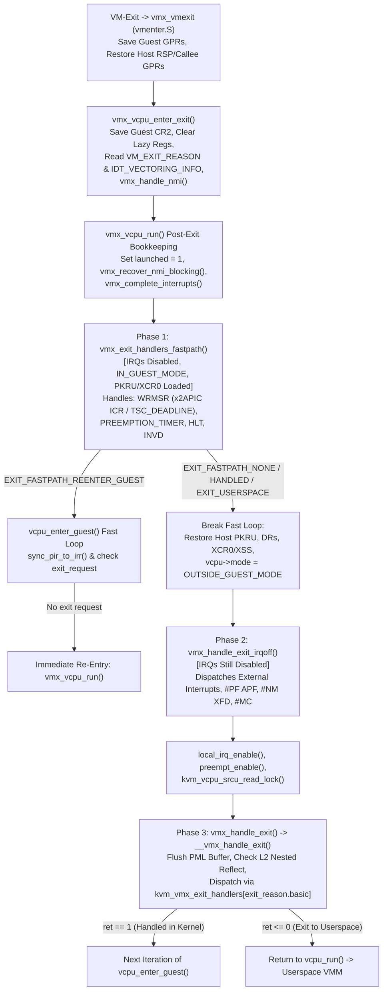

##### 5.5.3.1 Dissecting Phase 1 (`vmx_exit_handlers_fastpath`) and Phase 2 (`vmx_handle_exit_irqoff`)

Look at [`vmx_exit_handlers_fastpath()`](https://kernel.googlesource.com/pub/scm/virt/kvm/kvm.git/+/refs/heads/master/arch/x86/kvm/vmx/vmx.c#L7414) in [`arch/x86/kvm/vmx/vmx.c`](https://kernel.googlesource.com/pub/scm/virt/kvm/kvm.git/+/refs/heads/master/arch/x86/kvm/vmx/vmx.c):

```c
static fastpath_t vmx_exit_handlers_fastpath(struct kvm_vcpu *vcpu,
					     bool force_immediate_exit)
{
	/*
	 * If L2 is active, some VMX preemption timer exits can be handled in
	 * the fastpath even, all other exits must use the slow path.
	 */
	if (is_guest_mode(vcpu) &&
	    vmx_get_exit_reason(vcpu).basic != EXIT_REASON_PREEMPTION_TIMER)
		return EXIT_FASTPATH_NONE;

	switch (vmx_get_exit_reason(vcpu).basic) {
	case EXIT_REASON_MSR_WRITE:
		return handle_fastpath_wrmsr(vcpu);
	case EXIT_REASON_MSR_WRITE_IMM:
		return handle_fastpath_wrmsr_imm(vcpu, vmx_get_exit_qual(vcpu),
						 vmx_get_msr_imm_reg(vcpu));
	case EXIT_REASON_PREEMPTION_TIMER:
		return handle_fastpath_preemption_timer(vcpu, force_immediate_exit);
	case EXIT_REASON_HLT:
		return handle_fastpath_hlt(vcpu);
	case EXIT_REASON_INVD:
		return handle_fastpath_invd(vcpu);
	default:
		return EXIT_FASTPATH_NONE;
	}
}
```
Why are `EXIT_REASON_MSR_WRITE` (`handle_fastpath_wrmsr()`), `EXIT_REASON_PREEMPTION_TIMER`, `EXIT_REASON_HLT`, and `EXIT_REASON_INVD` placed in this IRQ-disabled fastpath?
- Look at [`__handle_fastpath_wrmsr()`](https://kernel.googlesource.com/pub/scm/virt/kvm/kvm.git/+/refs/heads/master/arch/x86/kvm/msrs.c#L906) in [`arch/x86/kvm/msrs.c`](https://kernel.googlesource.com/pub/scm/virt/kvm/kvm.git/+/refs/heads/master/arch/x86/kvm/msrs.c): it accelerates the two highest-frequency MSR writes in modern SMP Linux guests:
  1. **`APIC_BASE_MSR + (APIC_ICR >> 4)` (`0x830`, x2APIC Interrupt Command Register)**: Every time a guest vCPU sends an IPI (e.g., `smp_call_function` or scheduler wakeups) without hardware IPI virtualization, it writes to MSR `0x830`. Handling `kvm_x2apic_icr_write_fast()` and advancing `GUEST_RIP` inside the IRQ-disabled fastpath saves hundreds of clock cycles per IPI!
  2. **`MSR_IA32_TSC_DEADLINE` (`0x6e0`)**: Every time the guest kernel reprograms its local APIC timer (`lapic_next_deadline()`), it writes a 64-bit TSC deadline to `MSR_IA32_TSC_DEADLINE`. `kvm_set_lapic_tscdeadline_msr()` updates the vCPU's `hv_timer` deadline in a few dozen instructions, advances `GUEST_RIP`, and returns `EXIT_FASTPATH_REENTER_GUEST`, reprogramming the VMX preemption timer on the immediate re-entry in `vmx_vcpu_run()`!

Now look at Phase 2: [`vmx_handle_exit_irqoff()`](https://kernel.googlesource.com/pub/scm/virt/kvm/kvm.git/+/refs/heads/master/arch/x86/kvm/vmx/vmx.c#L7196):
```c
static void handle_external_interrupt_irqoff(struct kvm_vcpu *vcpu,
					     u32 intr_info)
{
	unsigned int vector = intr_info & INTR_INFO_VECTOR_MASK;

	if (KVM_BUG(!is_external_intr(intr_info), vcpu->kvm,
	    "unexpected VM-Exit interrupt info: 0x%x", intr_info))
		return;

	kvm_before_interrupt(vcpu, KVM_HANDLING_IRQ);
	x86_entry_from_kvm(EVENT_TYPE_EXTINT, vector);
	kvm_after_interrupt(vcpu);

	vcpu->arch.at_instruction_boundary = true;
}

void vmx_handle_exit_irqoff(struct kvm_vcpu *vcpu)
{
	if (to_vt(vcpu)->emulation_required)
		return;

	switch (vmx_get_exit_reason(vcpu).basic) {
	case EXIT_REASON_EXTERNAL_INTERRUPT:
		handle_external_interrupt_irqoff(vcpu, vmx_get_intr_info(vcpu));
		break;
	case EXIT_REASON_EXCEPTION_NMI:
		handle_exception_irqoff(vcpu, vmx_get_intr_info(vcpu));
		break;
	case EXIT_REASON_MCE_DURING_VMENTRY:
		kvm_machine_check();
		break;
	default:
		break;
	}
}
```
Why must `EXIT_REASON_EXTERNAL_INTERRUPT` be dispatched here while host interrupts are still disabled?
Recall from `arch/x86/kvm/vmx/vmx.h:484` that KVM always sets **`VM_EXIT_ACK_INTR_ON_EXIT`** in `VM_EXIT_CONTROLS`!
- Without `VM_EXIT_ACK_INTR_ON_EXIT`, when a physical interrupt arrives while the guest is running, the CPU exits to VMX Root Mode with `RFLAGS.IF = 0` (interrupts masked), leaving the interrupt pending in the physical local APIC until KVM executes `local_irq_enable()` (`STI`), at which point the CPU takes a second hardware interrupt gate transition through the host IDT.
- With `VM_EXIT_ACK_INTR_ON_EXIT` set, the processor **acknowledges the interrupt controller (local APIC) during the VM-Exit itself**, moves the physical interrupt vector from `IRR` to `ISR` in the physical local APIC, and stores the 8-bit vector in `VM_EXIT_INTR_INFO` (`bits 7:0`)! Because the local APIC has already acknowledged the interrupt, simply executing `STI` (`local_irq_enable()`) will **not** trigger the host IDT gate for that interrupt! Instead, `handle_external_interrupt_irqoff()` extracts `vector = intr_info & INTR_INFO_VECTOR_MASK` and directly invokes `x86_entry_from_kvm(EVENT_TYPE_EXTINT, vector)` while IRQs are still disabled, dispatching the host C interrupt handler (`sysvec_*` or `common_interrupt`) without taking a second hardware trap!

###### 5.5.3.1.1 Dissecting Phase 3 (`__vmx_handle_exit`, Direct Call Optimization, and `kvm_vmx_exit_handlers[]`)

Finally, after `vcpu_enter_guest()` enables host interrupts and preemption and re-acquires the SRCU read lock, it invokes `kvm_x86_call(handle_exit)(vcpu, exit_fastpath)` -> [`vmx_handle_exit()`](https://kernel.googlesource.com/pub/scm/virt/kvm/kvm.git/+/refs/heads/master/arch/x86/kvm/vmx/vmx.c#L6867) -> [`__vmx_handle_exit()`](https://kernel.googlesource.com/pub/scm/virt/kvm/kvm.git/+/refs/heads/master/arch/x86/kvm/vmx/vmx.c#L6708):

```c
static int __vmx_handle_exit(struct kvm_vcpu *vcpu, fastpath_t exit_fastpath)
{
	struct vcpu_vmx *vmx = to_vmx(vcpu);
	union vmx_exit_reason exit_reason = vmx_get_exit_reason(vcpu);
	u32 vectoring_info = vmx->idt_vectoring_info;
	u16 exit_handler_index;

	if (enable_pml && !is_guest_mode(vcpu))
		vmx_flush_pml_buffer(vcpu);

	if (unlikely(exit_fastpath == EXIT_FASTPATH_EXIT_USERSPACE))
		return 0;

	if (KVM_BUG_ON(vcpu->arch.nested_run_pending, vcpu->kvm))
		return -EIO;

	if (is_guest_mode(vcpu)) {
		if (exit_reason.basic == EXIT_REASON_PML_FULL)
			goto unexpected_vmexit;

		nested_vmx_mark_all_vmcs12_pages_dirty(vcpu);

		if (vmx->vt.emulation_required) {
			nested_vmx_vmexit(vcpu, EXIT_REASON_TRIPLE_FAULT, 0, 0);
			return 1;
		}

		if (nested_vmx_reflect_vmexit(vcpu))
			return 1;
	}

	/* If guest state is invalid, start emulating.  L2 is handled above. */
	if (vmx->vt.emulation_required)
		return handle_invalid_guest_state(vcpu);

	if (exit_reason.failed_vmentry) {
		dump_vmcs(vcpu);
		vcpu->run->exit_reason = KVM_EXIT_FAIL_ENTRY;
		vcpu->run->fail_entry.hardware_entry_failure_reason
			= exit_reason.full;
		vcpu->run->fail_entry.cpu = vcpu->arch.last_vmentry_cpu;
		return 0;
	}

	if (unlikely(vmx->fail)) {
		dump_vmcs(vcpu);
		vcpu->run->exit_reason = KVM_EXIT_FAIL_ENTRY;
		vcpu->run->fail_entry.hardware_entry_failure_reason
			= vmcs_read32(VM_INSTRUCTION_ERROR);
		vcpu->run->fail_entry.cpu = vcpu->arch.last_vmentry_cpu;
		return 0;
	}
...
	if (exit_fastpath != EXIT_FASTPATH_NONE)
		return 1;

	if (exit_reason.basic >= kvm_vmx_max_exit_handlers)
		goto unexpected_vmexit;
#ifdef CONFIG_MITIGATION_RETPOLINE
	if (exit_reason.basic == EXIT_REASON_MSR_WRITE)
		return kvm_emulate_wrmsr(vcpu);
	else if (exit_reason.basic == EXIT_REASON_MSR_WRITE_IMM)
		return handle_wrmsr_imm(vcpu);
	else if (exit_reason.basic == EXIT_REASON_PREEMPTION_TIMER)
		return handle_preemption_timer(vcpu);
	else if (exit_reason.basic == EXIT_REASON_INTERRUPT_WINDOW)
		return handle_interrupt_window(vcpu);
	else if (exit_reason.basic == EXIT_REASON_EXTERNAL_INTERRUPT)
		return handle_external_interrupt(vcpu);
	else if (exit_reason.basic == EXIT_REASON_HLT)
		return kvm_emulate_halt(vcpu);
	else if (exit_reason.basic == EXIT_REASON_EPT_MISCONFIG)
		return handle_ept_misconfig(vcpu);
#endif

	exit_handler_index = array_index_nospec((u16)exit_reason.basic,
						kvm_vmx_max_exit_handlers);
	if (!kvm_vmx_exit_handlers[exit_handler_index])
		goto unexpected_vmexit;

	return kvm_vmx_exit_handlers[exit_handler_index](vcpu);
```

Trace the seven logical gates of `__vmx_handle_exit()`:
1. **PML Buffer Flushing (`vmx_flush_pml_buffer(vcpu)`)**: When Intel Page Modification Logging (`enable_pml`) is enabled, the CPU automatically logs the 4-KiB Guest Physical Address (GPA) of every newly dirtied EPT leaf page into the 512-entry `vmx->pml_pg` buffer (starting from index `511` downwards to `0`) without causing a VM-Exit until the buffer fills up (`EXIT_REASON_PML_FULL`). By flushing `vmx->pml_pg` into KVM's `dirty_bitmap` / dirty ring at the very start of `__vmx_handle_exit()` on *every* L1 exit, KVM guarantees that whenever a vCPU is in VMX Root Mode (outside guest mode), its PML log has already been drained!
2. **Nested L2 VM-Exit Reflection (`is_guest_mode(vcpu)`)**: If the vCPU was running a nested L2 guest (`vmcs02`), `nested_vmx_reflect_vmexit(vcpu)` checks `vmcs12` to see whether L1 requested to intercept this exit reason. If L1 owns the exit, KVM synthesizes a nested VM-Exit from L2 back to L1 (`nested_vmx_vmexit()`) and returns `1` so `vcpu_enter_guest()` immediately resumes L1 at `vmcs12->host_rip`! If L0 (KVM) owns the exit (for instance, an EPT violation in L0's shadow/nested EPT tables or a physical host interrupt), `nested_vmx_reflect_vmexit()` returns `0` and execution falls through to L0's handlers below.
3. **Failure Diagnostics (`exit_reason.failed_vmentry` and `vmx->fail`)**: If hardware VM-Entry failed either during guest-state loading (`failed_vmentry == 1`) or during instruction execution (`vmx->fail == 1`), KVM dumps the entire VMCS to `dmesg` via `dump_vmcs(vcpu)` (if `kvm_intel.dump_invalid_vmcs=1` is set) and returns `0` to userspace with `KVM_EXIT_FAIL_ENTRY`.
4. **Unexpected Event Vectoring Check (`vectoring_info & VECTORING_INFO_VALID_MASK`)**: If a VM-Exit occurred while the CPU was vectoring an event through the guest IDT, only a specific set of exits (exceptions/NMIs, EPT violations, EPT misconfigs, PML full, APIC access, task switch, notify) can legitimately happen during IDT vectoring. Any other exit reason indicates an unrecoverable architectural state and triggers `kvm_prepare_event_vectoring_exit()` (`KVM_EXIT_INTERNAL_ERROR`).
5. **Fastpath Completion Check**: If Phase 1 (`vmx_exit_handlers_fastpath()`) already handled the exit (`exit_fastpath == EXIT_FASTPATH_EXIT_HANDLED`, such as a fastpath `HLT` that put the vCPU into a non-runnable state or a forced preemption timer exit), `__vmx_handle_exit()` returns `1` immediately—after having flushed the PML buffer and checked NMI blocking!
6. **Direct-Call Unrolling (`#ifdef CONFIG_MITIGATION_RETPOLINE`)**: Indexing the function pointer table `kvm_vmx_exit_handlers[exit_handler_index](vcpu)` compiles to an indirect `CALL *%rax`, which under `CONFIG_MITIGATION_RETPOLINE` invokes a retpoline thunk (~20–30 cycles). For the seven most latency-critical exit reasons (`EXIT_REASON_MSR_WRITE`, `EXIT_REASON_MSR_WRITE_IMM`, `EXIT_REASON_PREEMPTION_TIMER`, `EXIT_REASON_INTERRUPT_WINDOW`, `EXIT_REASON_EXTERNAL_INTERRUPT`, `EXIT_REASON_HLT`, and `EXIT_REASON_EPT_MISCONFIG` — recall that fast MMIO `ioeventfd` doorbells intentionally use EPT misconfigurations!), `__vmx_handle_exit()` uses an explicit `if / else if` chain of direct `CALL` instructions!
7. **Table Dispatch (`kvm_vmx_exit_handlers[]`)**: For all remaining exit reasons (`EXIT_REASON_CPUID`, `EXIT_REASON_IO_INSTRUCTION`, `EXIT_REASON_EPT_VIOLATION`, `EXIT_REASON_CR_ACCESS`, `EXIT_REASON_VMCALL`, etc.), `__vmx_handle_exit()` bounds-checks `exit_reason.basic` with `array_index_nospec()` and invokes `kvm_vmx_exit_handlers[exit_handler_index](vcpu)`. By convention across all of KVM:
   - Returning **`1`** means the exit was completely handled inside the kernel; `vcpu_run()` continues its loop and calls `vcpu_enter_guest()` again.
   - Returning **`0`** (or **`< 0`** on error) means the exit requires userspace intervention (e.g., `vcpu->run->exit_reason = KVM_EXIT_IO` or `KVM_EXIT_MMIO`) or a fatal error occurred; `vcpu_run()` breaks out of its loop, calls `vcpu_put(vcpu)` (which calls `vmx_vcpu_put()` -> `vmx_prepare_switch_to_host()`), and returns from `ioctl(KVM_RUN)` to userspace.

---

### 5.6 Hands-On Mastery Exercises

These five progressive engineering labs let you observe, measure, and modify the exact VMX world-switch, VMCS migration, and exit-dispatch mechanisms covered in this chapter.

---

#### Exercise 5.1: Triggering and Decoding a VM-Entry Guest-State Failure (`KVM_EXIT_FAIL_ENTRY` & `dump_vmcs`)

**Objective**: Write a standalone C `/dev/kvm` program that intentionally violates an Intel SDM Volume 3 Section 27.3.1 Guest-State consistency check, catches `KVM_EXIT_FAIL_ENTRY` (`exit_reason.failed_vmentry = 1`), and triggers `dump_vmcs()` in the host kernel log.

##### Step 1: Enable `dump_invalid_vmcs` in `kvm_intel`
By default, `dump_vmcs()` suppresses its full VMCS register dump unless the `dump_invalid_vmcs` module parameter is enabled:
```bash
echo Y | sudo tee /sys/module/kvm_intel/parameters/dump_invalid_vmcs
```

##### Step 2: Build and Run the Invalid Guest-State Test Program (`vmx_fail_entry_lab.c`)
Create `vmx_fail_entry_lab.c`. We will configure a vCPU in Protected Mode (`CR0.PE = 1`), but intentionally set its Code Segment (`CS`) selector's Requestor Privilege Level (`RPL = 3`, `selector = 0x000b`) while leaving Stack Segment (`SS`) DPL at `0` (`dpl = 0`), violating the Intel VMX Guest-State check that `CS.RPL` must equal `SS.DPL` for non-conforming code segments:

```c
// SPDX-License-Identifier: GPL-2.0
#include <stdio.h>
#include <stdlib.h>
#include <stdint.h>
#include <string.h>
#include <fcntl.h>
#include <unistd.h>
#include <sys/ioctl.h>
#include <sys/mman.h>
#include <linux/kvm.h>

int main(void)
{
	int kvm_fd = open("/dev/kvm", O_RDWR | O_CLOEXEC);
	if (kvm_fd < 0) { perror("open /dev/kvm"); return 1; }

	int vm_fd = ioctl(kvm_fd, KVM_CREATE_VM, 0);
	if (vm_fd < 0) { perror("KVM_CREATE_VM"); return 1; }

	void *mem = mmap(NULL, 0x1000, PROT_READ | PROT_WRITE,
			 MAP_SHARED | MAP_ANONYMOUS, -1, 0);
	((uint8_t *)mem)[0] = 0xf4; /* HLT */

	struct kvm_userspace_memory_region region = {
		.slot = 0,
		.guest_phys_addr = 0x0,
		.memory_size = 0x1000,
		.userspace_addr = (uintptr_t)mem,
	};
	ioctl(vm_fd, KVM_SET_USER_MEMORY_REGION, &region);

	int vcpu_fd = ioctl(vm_fd, KVM_CREATE_VCPU, 0);
	int run_size = ioctl(kvm_fd, KVM_GET_VCPU_MMAP_SIZE, 0);
	struct kvm_run *run = mmap(NULL, run_size, PROT_READ | PROT_WRITE,
				   MAP_SHARED, vcpu_fd, 0);

	struct kvm_sregs sregs;
	ioctl(vcpu_fd, KVM_GET_SREGS, &sregs);

	/*
	 * Force a VMX Guest-State consistency check failure (SDM Vol 3 27.3.1.2):
	 * Set TR.unusable = 1! Intel VMX strictly requires the guest Task Register
	 * (TR) to be usable (bit 16 of GUEST_TR_AR_BYTES == 0) on every VM-Entry!
	 */
	sregs.tr.unusable = 1;
	if (ioctl(vcpu_fd, KVM_SET_SREGS, &sregs) < 0) {
		perror("KVM_SET_SREGS");
		return 1;
	}

	if (ioctl(vcpu_fd, KVM_RUN, 0) < 0) {
		perror("KVM_RUN");
		return 1;
	}

	printf("KVM_RUN returned exit_reason = %u (KVM_EXIT_FAIL_ENTRY is %u)\n",
	       run->exit_reason, KVM_EXIT_FAIL_ENTRY);
	if (run->exit_reason == KVM_EXIT_FAIL_ENTRY) {
		printf("hardware_entry_failure_reason = 0x%llx (bit 31 failed_vmentry=%llu, basic=%llu)\n",
		       run->fail_entry.hardware_entry_failure_reason,
		       (run->fail_entry.hardware_entry_failure_reason >> 31) & 1,
		       run->fail_entry.hardware_entry_failure_reason & 0xffff);
		printf("failed on physical CPU = %u\n", run->fail_entry.cpu);
	}
	return 0;
}
```

##### Step 3: Analyze the Output and `dmesg` VMCS Dump
Compile and run `gcc -O2 vmx_fail_entry_lab.c -o vmx_fail_entry_lab && ./vmx_fail_entry_lab`, then inspect `sudo dmesg | tail -n 50`. You will see `hardware_entry_failure_reason = 0x80000021` (`failed_vmentry = 1`, `basic = 33` = `EXIT_REASON_INVALID_STATE`) and the complete output of `dump_vmcs()` showing `TR: sel=0x0000, attr=0x10000 (unusable)` alongside the exact `Host State` (`RIP = vmx_vmexit`) and `Control State` fields programmed by `init_vmcs()`.

---

#### Exercise 5.2: Tracing Cross-CPU VMCS Migration (`loaded_vmcs_clear` & `VMCLEAR` IPIs)

**Objective**: Use `bpftrace` and `sched_setaffinity()` to observe KVM's cross-CPU VMCS migration protocol (`vmx_vcpu_load_vmcs()` -> `loaded_vmcs_clear()` -> `smp_call_function_single()` -> `__loaded_vmcs_clear()`) in real time.

##### Step 1: Write a vCPU Thread Ping-Pong Harness (`vmx_migrate_lab.c`)
Write a userspace C program that runs a guest executing an `outb %al, $0x80` loop (`EXIT_REASON_IO_INSTRUCTION`), and on every 1,000th exit calls `sched_setaffinity()` to bounce the vCPU thread between physical CPU 0 and physical CPU 1:

```c
// SPDX-License-Identifier: GPL-2.0
#define _GNU_SOURCE
#include <stdio.h>
#include <stdint.h>
#include <fcntl.h>
#include <unistd.h>
#include <sched.h>
#include <sys/ioctl.h>
#include <sys/mman.h>
#include <linux/kvm.h>

static void pin_to_cpu(int cpu)
{
	cpu_set_t set;
	CPU_ZERO(&set);
	CPU_SET(cpu, &set);
	sched_setaffinity(0, sizeof(set), &set);
}

int main(void)
{
	int kvm_fd = open("/dev/kvm", O_RDWR | O_CLOEXEC);
	int vm_fd = ioctl(kvm_fd, KVM_CREATE_VM, 0);
	void *mem = mmap(NULL, 0x1000, PROT_READ | PROT_WRITE,
			 MAP_SHARED | MAP_ANONYMOUS, -1, 0);
	/* Guest 16-bit real mode code at 0x0: out $0x80, %al; jmp 0x0 */
	uint8_t code[] = { 0xe6, 0x80, 0xeb, 0xfc };
	__builtin_memcpy(mem, code, sizeof(code));

	struct kvm_userspace_memory_region region = {
		.slot = 0, .guest_phys_addr = 0, .memory_size = 0x1000,
		.userspace_addr = (uintptr_t)mem,
	};
	ioctl(vm_fd, KVM_SET_USER_MEMORY_REGION, &region);

	int vcpu_fd = ioctl(vm_fd, KVM_CREATE_VCPU, 0);
	int run_size = ioctl(kvm_fd, KVM_GET_VCPU_MMAP_SIZE, 0);
	struct kvm_run *run = mmap(NULL, run_size, PROT_READ | PROT_WRITE,
				   MAP_SHARED, vcpu_fd, 0);

	struct kvm_sregs sregs;
	ioctl(vcpu_fd, KVM_GET_SREGS, &sregs);
	sregs.cs.base = 0; sregs.cs.selector = 0;
	ioctl(vcpu_fd, KVM_SET_SREGS, &sregs);

	struct kvm_regs regs = { .rip = 0x0, .rflags = 0x2 };
	ioctl(vcpu_fd, KVM_SET_REGS, &regs);

	int cur_cpu = 0;
	pin_to_cpu(cur_cpu);

	for (int i = 1; i <= 10000; i++) {
		ioctl(vcpu_fd, KVM_RUN, 0);
		if (i % 1000 == 0) {
			cur_cpu ^= 1;
			pin_to_cpu(cur_cpu);
		}
	}
	printf("Completed 10,000 exits with 10 cross-CPU migrations.\n");
	return 0;
}
```

##### Step 2: Trace `vmx_vcpu_load_vmcs` and `__loaded_vmcs_clear` with `bpftrace`
Run the following `bpftrace` script while executing `./vmx_migrate_lab`:
```bash
sudo bpftrace -e '
kprobe:vmx_vcpu_load_vmcs {
    printf("CPU %d: vmx_vcpu_load_vmcs(vcpu=%p, target_cpu=%d)\n", cpu, arg0, arg1);
}
kprobe:__loaded_vmcs_clear {
    printf("  -> Remote IPI on CPU %d: __loaded_vmcs_clear(loaded_vmcs=%p) executing VMCLEAR!\n",
           cpu, arg0);
}'
```
Observe how the 999 exits on the same CPU never trigger `__loaded_vmcs_clear`, and only when `sched_setaffinity()` migrates the vCPU thread from CPU 0 to CPU 1 does `vmx_vcpu_load_vmcs` on CPU 1 send an IPI to CPU 0 (`__loaded_vmcs_clear`), resetting `loaded_vmcs->launched = 0` so the first entry on CPU 1 executes `VMLAUNCH` while the next 999 entries on CPU 1 execute `VMRESUME`.

---

#### Exercise 5.3: Measuring Fastpath Exit Latency (`WRMSR` to `MSR_IA32_TSC_DEADLINE` vs. Slowpath `RDMSR`)

**Objective**: Quantify the cycle-count difference between a Phase 1 IRQ-disabled fastpath exit (`handle_fastpath_wrmsr` for `MSR_IA32_TSC_DEADLINE`) and a Phase 3 full exit (`kvm_emulate_rdmsr`) using guest `RDTSC` serialization and host tracepoints (`kvm:kvm_entry`, `kvm:kvm_exit`).

##### Step 1: Guest Microbenchmark Design
In a guest kernel module or `/dev/kvm` 64-bit harness (with `KVM_CREATE_IRQCHIP` and `X86_FEATURE_TSC_DEADLINE_TIMER` enabled in `KVM_SET_CPUID2`):
1. Execute 100,000 iterations of `LFENCE; RDTSC; WRMSR(0x6e0, 0); LFENCE; RDTSC` (`MSR_IA32_TSC_DEADLINE`).
2. Execute 100,000 iterations of `LFENCE; RDTSC; RDMSR(0x6e0); LFENCE; RDTSC`.

##### Step 2: Observe `vcpu->stat.exits` vs. `host_state_reload`
Query `/sys/kernel/debug/kvm/<pid>-<fd>/vcpu0/` (or use `KVM_GET_STATS_FD`) before and after both loops:
- Notice that `exits` increments by 100,000 in both cases, while **`host_state_reload` increments by 0** during in-kernel exits because `vmx->vt.guest_state_loaded` remains `true` throughout `vcpu_enter_guest()`!
- Furthermore, during the `WRMSR(MSR_IA32_TSC_DEADLINE)` loop, `vmx_exit_handlers_fastpath()` returns `EXIT_FASTPATH_REENTER_GUEST`, bypassing `kvm_load_host_pkru()`, `kvm_load_xfeatures()`, `local_irq_enable()`, `srcu_read_lock()`, and `__vmx_handle_exit()`, reducing round-trip world-switch latency by ~150–300 clock cycles per exit.

---

#### Exercise 5.4: Auditing On-Demand Register Caching (`vmx_cache_reg` & `regs_avail`)

**Objective**: Use `bpftrace` to verify which VM-Exit reasons trigger `vmx_cache_reg()` (`VMREAD` of `GUEST_RIP`, `GUEST_RSP`, `GUEST_CR0`, `GUEST_CR3`, `GUEST_CR4`, `GUEST_PDPTR0..3`) and which exits complete with zero `vmx_cache_reg()` calls.

##### Step 1: Run the `vmx_cache_reg` Histogram Script Against a Running VM
Attach `bpftrace` to `tracepoint:kvm:kvm_exit` and `kprobe:vmx_cache_reg`:
```bash
sudo bpftrace -e '
tracepoint:kvm:kvm_exit {
    @last_reason[tid] = args->exit_reason;
    @exits[args->exit_reason] = count();
}
kprobe:vmx_cache_reg {
    @cache_misses[@last_reason[tid], arg1] = count();
}
interval:s:5 {
    print(@exits);
    print(@cache_misses);
    clear(@exits);
    clear(@cache_misses);
}'
```

##### Step 2: Interpret the `enum kvm_reg` Cache Miss Matrix
Compare `@exits[reason]` against `@cache_misses[reason, reg]`:
- For `EXIT_REASON_EXTERNAL_INTERRUPT` (`1`), notice that `vmx_cache_reg` is **never called** (`0` calls for `VCPU_REG_RIP = 16` or `VCPU_REGS_RSP = 4`)!
- For instruction-emulating or instruction-skipping exits (`EXIT_REASON_CPUID = 10`, `EXIT_REASON_MSR_WRITE = 31`, `EXIT_REASON_IO_INSTRUCTION = 30`), `VCPU_REG_RIP` (`16`) is cached exactly once per exit (to advance `GUEST_RIP` by `VM_EXIT_INSTRUCTION_LEN`), while `VCPU_REGS_RSP` (`4`) is still never read via `VMREAD` unless the instruction itself modifies `RSP`!

---

## Chapter 6: AMD SVM Backend Internals — VMCB Architecture, ASID Management, `svm_vcpu_run`, and Exit Dispatch

When AMD engineers designed Secure Virtual Machine (SVM, marketed as AMD-V) for the K8 Revision F (Pacifica) microarchitecture and extended it across Zen through Zen 5, they approached the x86 virtualization problem from a fundamentally different philosophical starting point than Intel's VT-x (VMX) architects. Where Intel treated the Virtual Machine Control Structure (VMCS) as an opaque, microcode-managed hardware resource accessible only through specialized instructions (`VMPTRLD`, `VMCLEAR`, `VMREAD`, `VMWRITE`) that operate on an implicit "current VMCS" pointer per logical processor, AMD designed the **Virtual Machine Control Block (VMCB)** as an ordinary, architecturally defined 4 KiB physical memory page. The hypervisor reads and writes VMCB fields using standard x86 load and store instructions (`mov`), and passes the physical address of the VMCB in the `RAX` register directly to the `VMRUN` instruction.

At first glance, a memory-mapped control block seems strictly simpler than VMX's instruction-gated VMCS. And in many ways, it is: KVM's AMD backend (`kvm-amd.ko`, implemented in [`arch/x86/kvm/svm/`](https://kernel.googlesource.com/pub/scm/virt/kvm/kvm.git/+/refs/heads/master/arch/x86/kvm/svm/)) does not need VMX's complex per-CPU loaded-VMCS linked lists, IPI-based remote `VMCLEAR` shootdowns when a vCPU migrates across physical CPUs, or instruction-level error flag checking (`CF`/`ZF` after `VMWRITE`). Yet this architectural simplicity shifts several critical responsibilities onto software and introduces unique hardware invariants that every KVM maintainer must master:

1. **Explicit Cache-Coherency Hints (`VMCB Clean Bits`)**: Because the CPU reads the VMCB from memory on `VMRUN` and may cache unmodified VMCB fields in internal microarchitectural latches across world switches, software must explicitly clear bitflags in `vmcb->control.clean` (`vmcb_mark_dirty()`) whenever it mutates cached control or state-save groups. Forgetting a single `vmcb_mark_dirty()` call causes the processor to silently execute the guest with stale hardware state.
2. **Split World-Switch Granularity (`VMRUN` vs. `VMLOAD`/`VMSAVE`)**: To keep `VMRUN` and `#VMEXIT` fast for lightweight exits, AMD hardware only switches a core subset of CPU state during `VMRUN` and `#VMEXIT`. Heavyweight OS-level registers—`FS`, `GS`, `TR`, `LDTR`, `MSR_KERNEL_GS_BASE`, and the `SYSCALL`/`SYSENTER` MSRs—are deliberately left untouched by `VMRUN` and must be explicitly context-switched using the companion `VMLOAD` and `VMSAVE` instructions (or offloaded via `svm_prepare_switch_to_guest()` and Virtual `VMLOAD`/`VMSAVE`).
3. **The Global Interrupt Flag (`GIF`)**: Instead of automatically masking physical interrupts and NMIs in hardware upon `#VMEXIT` via host control bits, SVM introduces a dedicated processor flag—the **Global Interrupt Flag (`GIF`)**, manipulated via `CLGI` (Clear GIF) and `STGI` (Set GIF). When `GIF=0`, *all* external interrupts, NMIs, SMIs, and INIT signals are held pending at the silicon boundary, even if `RFLAGS.IF=1`.
4. **Mandatory Non-Zero ASIDs**: Unlike Intel VMX—where Virtual Processor Identifiers (VPIDs) are an optional performance feature and VPID `0` is shared with the host when disabled—AMD SVM *requires* every guest execution to carry a non-zero **Address Space Identifier (ASID)** in `vmcb->control.asid` (launching with `asid == 0` immediately aborts `VMRUN` with `SVM_EXIT_ERR`).

In this chapter, we dissect the AMD SVM backend in [`arch/x86/kvm/svm/svm.c`](https://kernel.googlesource.com/pub/scm/virt/kvm/kvm.git/+/refs/heads/master/arch/x86/kvm/svm/svm.c), [`arch/x86/kvm/svm/svm.h`](https://kernel.googlesource.com/pub/scm/virt/kvm/kvm.git/+/refs/heads/master/arch/x86/kvm/svm/svm.h), [`arch/x86/kvm/svm/vmenter.S`](https://kernel.googlesource.com/pub/scm/virt/kvm/kvm.git/+/refs/heads/master/arch/x86/kvm/svm/vmenter.S), [`arch/x86/include/asm/svm.h`](https://kernel.googlesource.com/pub/scm/virt/kvm/kvm.git/+/refs/heads/master/arch/x86/include/asm/svm.h), and [`arch/x86/include/uapi/asm/svm.h`](https://kernel.googlesource.com/pub/scm/virt/kvm/kvm.git/+/refs/heads/master/arch/x86/include/uapi/asm/svm.h), tracing every structure, bitfield, assembly macro, and state machine from vCPU creation through `VMRUN` and `#VMEXIT` dispatch.

---

### 6.1 Architectural Contrast: AMD SVM vs. Intel VMX

To build an accurate mental model of `kvm-amd`, we must first contrast the hardware contracts of AMD SVM and Intel VMX across five core dimensions: control structure access, general-purpose register partitioning, host/guest state switching, interrupt atomicity across world transitions, and TLB tagging.

| Architectural Dimension | Intel VMX (`kvm-intel`) | AMD SVM (`kvm-amd`) |
| :--- | :--- | :--- |
| **Control Structure** | Opaque 4 KiB **VMCS** (`VMREAD`/`VMWRITE`); microcode caches active VMCS per pCPU (`VMPTRLD`/`VMCLEAR`). | Architecturally defined 4 KiB **VMCB** (`struct vmcb`); read/written via normal C pointers (`mov`); hardware caching controlled by `vmcb->control.clean` bits. |
| **World-Switch Instruction** | Dual-instruction model: `VMLAUNCH` (first entry after `VMCLEAR`) vs. `VMRESUME` (subsequent entries). | Single stateless instruction: `VMRUN %rax`, where `RAX` holds the 4 KiB-aligned Host Physical Address (HPA) of the target VMCB. |
| **GPR Context Switching** | Hardware switches *only* `RSP` and `RIP` via VMCS; `RAX` through `R15` (excluding `RSP`) are saved/restored by software in `__vmx_vcpu_run`. | Hardware switches `RIP`, `RSP`, **and `RAX`** via the VMCB State Save Area (`vmcb->save.rax` at offset `0x5F8`) for legacy/SEV guests, or all GPRs via the encrypted **VMSA** for SEV-ES/SNP guests. |
| **Host State Storage** | Dedicated Host-State Area fields inside every VMCS. | Separate per-CPU 4 KiB **Host Save Area** pointed to by `MSR_VM_HSAVE_PA` (`0xC0010117`) + explicit `VMSAVE`/`VMLOAD` instructions. |
| **World-Switch Interrupt Atomicity** | Hardware clears `RFLAGS.IF` on `VM-Exit` (unless `ACK_INTR_ON_EXIT` is used) and blocks NMIs on NMI exits. | Hardware sets **`GIF=0`** on `#VMEXIT` and **`GIF=1`** on `VMRUN`. Software executes `CLGI` before `VMRUN` and `STGI` after `#VMEXIT` so the entire C/assembly entry-exit window runs atomically with `GIF=0` and `RFLAGS.IF=1`. |
| **TLB Address Space Tagging** | Optional 16-bit **VPID** (`ENABLE_VPID`); VPID `0` is host. | Mandatory non-zero **ASID** (`vmcb->control.asid`); ASID `0` is reserved exclusively for the host. |

#### 6.1.1 Memory-Mapped VMCB vs. Opaque VMCS (`VMREAD`/`VMWRITE`)

In [`arch/x86/include/asm/svm.h`](https://kernel.googlesource.com/pub/scm/virt/kvm/kvm.git/+/refs/heads/master/arch/x86/include/asm/svm.h#L540-L553), the 4 KiB VMCB page is represented directly by `struct vmcb`, which is divided at byte offset `0x400` (1024 bytes) into two contiguous regions:

1. **The VMCB Control Area (`0x000`–`0x3FF`, 1024 bytes)**: Defined by `struct vmcb_control_area`, containing intercept bitvectors, pause-loop filter counters, physical base addresses of the I/O and MSR permission maps (`iopm_base_pa`, `msrpm_base_pa`), ASID and TLB control bytes (`asid`, `tlb_ctl`), virtual interrupt control (`int_ctl`, `int_vector`, `int_state`), `#VMEXIT` diagnostic fields (`exit_code`, `exit_info_1`, `exit_info_2`, `exit_int_info`), event injection (`event_inj`), Nested Page Table root (`nested_cr3`), VMCB clean bits (`clean`), `NextRIP` (`next_rip`), DecodeAssist instruction bytes (`insn_len`, `insn_bytes[15]`), AVIC pointers, and SEV-ES/SNP fields (`vmsa_pa`, `ghcb_gpa`).
2. **The VMCB State Save Area (`0x400`–`0xFFF`, 3072 bytes)**: Defined by a union of `struct vmcb_save_area` (744 bytes used for legacy and SEV guests) and `struct sev_es_save_area` (1648 bytes used as the host save area for SEV-ES/SNP VMs, while the guest's encrypted state lives in a separate page pointed to by `vmsa_pa`).

```
+=============================================================================+ 0x000
|                         VMCB CONTROL AREA (1024 Bytes)                      |
|                         struct vmcb_control_area                            |
+-----------------------------------------------------------------------------+
| 0x000 - 0x017 : intercepts[6] (CR, DR, EXCP, WORD3, WORD4, WORD5)           |
| 0x03C - 0x03F : pause_filter_thresh (u16) | pause_filter_count (u16)        |
| 0x040 - 0x047 : iopm_base_pa  (HPA of 12 KiB I/O Permission Bitmap)         |
| 0x048 - 0x04F : msrpm_base_pa (HPA of 8 KiB MSR Permission Bitmap)          |
| 0x050 - 0x057 : tsc_offset    (64-bit guest TSC additive offset)            |
| 0x058 - 0x05F : asid (u32) | tlb_ctl (u8) | erap_ctl (u8) | reserved (2B)   |
| 0x060 - 0x06B : int_ctl (u32) | int_vector (u32) | int_state (u32)          |
| 0x070 - 0x087 : exit_code (u64) | exit_info_1 (u64) | exit_info_2 (u64)     |
| 0x088 - 0x08F : exit_int_info (u32) | exit_int_info_err (u32)               |
| 0x090 - 0x0A7 : misc_ctl (NP/SEV/GMET) | avic_vapic_bar | ghcb_gpa          |
| 0x0A8 - 0x0BF : event_inj (u32) | event_inj_err | nested_cr3 | misc_ctl2    |
| 0x0C0 - 0x0DF : clean (u32) | rsvd | next_rip (u64) | insn_len | insn_bytes |
| 0x0E0 - 0x10F : avic_backing_page | avic_logical_id | avic_physical_id      |
| 0x108 - 0x147 : vmsa_pa (0x108) | bus_lock_counter | allowed/guest_sev_feat |
| 0x3E0 - 0x3FF : hv_enlightenments / reserved_sw[32]                         |
+=============================================================================+ 0x400
|                        VMCB STATE SAVE AREA (744 Bytes)                     |
|                          struct vmcb_save_area                              |
+-----------------------------------------------------------------------------+
| 0x400 - 0x49F : Segment Descriptors (16B each: sel, attrib, limit, base)    |
|                 ES, CS, SS, DS, FS*, GS*, GDTR, LDTR*, IDTR, TR*            |
|                 (*FS, GS, LDTR, TR switched by VMLOAD/VMSAVE, not VMRUN!)   |
| 0x4CA - 0x4D7 : vmpl (u8) | cpl (u8) | rsvd (4B) | efer (u64 at 0x4D0)      |
| 0x548 - 0x57F : cr4 | cr3 | cr0 | dr7 | dr6 | rflags | rip (at 0x578)       |
| 0x5D8 - 0x5FB : rsp (at 0x5D8) | s_cet | ssp | isst_addr | rax (at 0x5F8)   |
| 0x600 - 0x647 : star* | lstar* | cstar* | sfmask* | kernel_gs_base*         |
|                 sysenter_cs* | sysenter_esp* | sysenter_eip* | cr2 (0x640)  |
| 0x668 - 0x697 : g_pat | dbgctl | br_from | br_to | last_excp_from/to        |
| 0x6E0 - 0x6E7 : spec_ctrl (Guest IA32_SPEC_CTRL when V_SPEC_CTRL enabled)   |
+=============================================================================+ 0x6E8..0xFFF
```

Notice the compile-time layout enforcement in [`arch/x86/include/asm/svm.h`](https://kernel.googlesource.com/pub/scm/virt/kvm/kvm.git/+/refs/heads/master/arch/x86/include/asm/svm.h#L555-L605):

```c
// arch/x86/include/asm/svm.h
#define EXPECTED_VMCB_SAVE_AREA_SIZE		744
#define EXPECTED_GHCB_SAVE_AREA_SIZE		1032
#define EXPECTED_SEV_ES_SAVE_AREA_SIZE		1648
#define EXPECTED_VMCB_CONTROL_AREA_SIZE		1024
#define EXPECTED_GHCB_SIZE			PAGE_SIZE

#define BUILD_BUG_RESERVED_OFFSET(x, y) \
	ASSERT_STRUCT_OFFSET(struct x, reserved ## _ ## y, y)

static inline void __unused_size_checks(void)
{
	BUILD_BUG_ON(sizeof(struct vmcb_save_area)	!= EXPECTED_VMCB_SAVE_AREA_SIZE);
	BUILD_BUG_ON(sizeof(struct ghcb_save_area)	!= EXPECTED_GHCB_SAVE_AREA_SIZE);
	BUILD_BUG_ON(sizeof(struct sev_es_save_area)	!= EXPECTED_SEV_ES_SAVE_AREA_SIZE);
	BUILD_BUG_ON(sizeof(struct vmcb_control_area)	!= EXPECTED_VMCB_CONTROL_AREA_SIZE);
	BUILD_BUG_ON(offsetof(struct vmcb, save)	!= EXPECTED_VMCB_CONTROL_AREA_SIZE);
	BUILD_BUG_ON(sizeof(struct ghcb)		!= EXPECTED_GHCB_SIZE);
```

Because `struct vmcb` is a hardware-defined memory layout, every reserved padding array in `struct vmcb_save_area` is named after its exact hexadecimal byte offset (`reserved_0xa0`, `reserved_0xcc`, `reserved_0xd8`, `reserved_0x180`, `reserved_0x248`, `reserved_0x298`) and verified at compile time via `BUILD_BUG_RESERVED_OFFSET()`. If a kernel developer adds a new field to `struct vmcb_save_area` without shrinking the preceding `reserved_0x*` array by the exact same byte count, the build fails immediately in `svm_init()` via `__unused_size_checks()`.

##### 6.1.1.1 Why `RAX` Lives Inside the VMCB While `RCX`–`R15` Live Outside

In Intel VMX, `VMLAUNCH` and `VMRESUME` take no register operands; the target VMCS was already selected earlier by `VMPTRLD`. Consequently, VMX leaves all 15 non-stack general-purpose registers (`RAX` through `R15`, excluding `RSP`) in the CPU register file across `VM-Entry` and `VM-Exit`, allowing software to load all of them before `VMLAUNCH` and save them after `VM-Exit` (using a single scratch register pushed to the host stack).

In AMD SVM, `VMRUN`, `VMLOAD`, and `VMSAVE` do not use an implicit pointer—they require the physical address of the VMCB to be passed in **`RAX`** (`vmrun %rax`). Because `RAX` is occupied by the VMCB's Host Physical Address at the exact moment `VMRUN` executes, software *cannot* pre-load the guest's `RAX` value into the physical `RAX` register prior to `VMRUN`! To solve this without requiring a separate `VMPTRLD` instruction, AMD placed the guest's `RAX` register inside the VMCB State Save Area (`vmcb->save.rax` at offset `0x400 + 0x1F8 = 0x5F8`) and the host's `RAX` register inside the Host Save Area (`MSR_VM_HSAVE_PA`).

###### 6.1.1.1.1 Microarchitectural Register Swap of `RAX`, `RSP`, and `RIP` During `VMRUN`/`#VMEXIT`

When the processor executes `vmrun %rax`:
1. The CPU reads the physical address of the VMCB from `RAX`.
2. It saves the host's `RIP` (the instruction pointer immediately following `vmrun`), host `RSP`, host `RAX` (which currently holds the VMCB HPA), host `EFER`, `CR0`, `CR3`, `CR4`, `RFLAGS`, and segment selectors/bases (`CS`, `SS`, `DS`, `ES`, `GDTR`, `IDTR`) into the per-CPU **Host Save Area** physical page registered in `MSR_VM_HSAVE_PA`.
3. It loads the guest's `RIP`, `RSP`, and **`RAX`** directly from `vmcb->save.rip`, `vmcb->save.rsp`, and `vmcb->save.rax`.
4. Conversely, on `#VMEXIT`, the processor writes the guest's current `RIP`, `RSP`, and `RAX` back into `vmcb->save` and restores the host's `RIP`, `RSP`, and `RAX` from the Host Save Area.

This hardware design explains why `svm_vcpu_run()` in [`arch/x86/kvm/svm/svm.c`](https://kernel.googlesource.com/pub/scm/virt/kvm/kvm.git/+/refs/heads/master/arch/x86/kvm/svm/svm.c#L4489-L4491) explicitly copies `RAX`, `RSP`, and `RIP` between `vcpu->arch.regs[]` and `svm->vmcb->save` in C before and after calling `__svm_vcpu_run()`, while `__svm_vcpu_run()` in [`arch/x86/kvm/svm/vmenter.S`](https://kernel.googlesource.com/pub/scm/virt/kvm/kvm.git/+/refs/heads/master/arch/x86/kvm/svm/vmenter.S#L92-L121) intentionally omits `RAX` and `RSP` from its assembly `LOAD_REGS` and `STORE_REGS` macros.

##### 6.1.1.2 The Split `VMRUN` + `VMLOAD`/`VMSAVE` Design and `MSR_VM_HSAVE_PA`

Why did AMD split state-saving across `VMRUN` and `VMLOAD`/`VMSAVE`? Consider what happens on a lightweight `#VMEXIT` that KVM handles entirely inside the host kernel without returning to userspace or scheduling another thread—such as an `SVM_EXIT_INTR`, `SVM_EXIT_VINTR`, `SVM_EXIT_NPF`, or `SVM_EXIT_MSR`.

While executing inside the Linux kernel on x86_64:
- The kernel does *not* use user-mode segments (`FS` base, user `GS` base stored in `MSR_KERNEL_GS_BASE`, or `LDTR`).
- The kernel does *not* execute `SYSCALL` or `SYSENTER` targets (`MSR_STAR`, `MSR_LSTAR`, `MSR_CSTAR`, `MSR_SYSCALL_MASK`, `MSR_IA32_SYSENTER_CS/ESP/EIP`).
- The kernel *does* need its own `GS.base` (which points to the per-CPU data area `__per_cpu_offset[cpu]` on x86_64!) and its own `TR` (Task Register).

AMD partitioned the VMCB State Save Area into two disjoint subsets:
1. **State switched automatically by `VMRUN` and `#VMEXIT`**: `ES`, `CS`, `SS`, `DS`, `GDTR`, `IDTR`, `CPL`, `EFER`, `CR0`, `CR2`, `CR3`, `CR4`, `DR6`, `DR7`, `RFLAGS`, `RIP`, `RSP`, `RAX`, `G_PAT` (when NPT is enabled), `S_CET`/`SSP`/`ISST_ADDR`, and `SPEC_CTRL` (when `X86_FEATURE_V_SPEC_CTRL` is supported).
2. **State switched ONLY by `VMLOAD` and `VMSAVE`**:
   - `FS` (selector, attributes, limit, base) and `GS` (selector, attributes, limit, base)
   - `TR` (Task Register) and `LDTR` (Local Descriptor Table Register)
   - `MSR_KERNEL_GS_BASE` (`save.kernel_gs_base`)
   - `MSR_STAR`, `MSR_LSTAR`, `MSR_CSTAR`, `MSR_SYSCALL_MASK` (`save.star`, `save.lstar`, `save.cstar`, `save.sfmask`)
   - `MSR_IA32_SYSENTER_CS`, `MSR_IA32_SYSENTER_ESP`, `MSR_IA32_SYSENTER_EIP` (`save.sysenter_cs`, `save.sysenter_esp`, `save.sysenter_eip`)

###### 6.1.1.2.1 How KVM Exploits `VMSAVE`/`VMLOAD` Asymmetry Between Host and Guest

Look closely at how KVM manages the host's `VMLOAD`/`VMSAVE` state vs. the guest's `VMLOAD`/`VMSAVE` state:
- **Saving Host State (`vmsave(sd->save_area_pa)`)**: Performed **once** per vCPU schedule-in slice inside `svm_prepare_switch_to_guest()` ([`arch/x86/kvm/svm/svm.c:1444`](https://kernel.googlesource.com/pub/scm/virt/kvm/kvm.git/+/refs/heads/master/arch/x86/kvm/svm/svm.c#L1444)), gated by `if (svm->guest_state_loaded) return;`. Because the host kernel never modifies its own `FS`, `GS.base`, `TR`, `LDTR`, `KERNEL_GS_BASE`, or `SYSCALL`/`SYSENTER` MSRs while staying inside the `vcpu_run()` loop with preemption disabled, `sd->save_area` retains a valid snapshot of those host registers across thousands of consecutive `VMRUN` iterations!
- **Loading Guest State and Restoring Host Per-CPU `GS.base` (`vmload` / `vmsave` in `__svm_vcpu_run`)**: Inside `__svm_vcpu_run()` ([`arch/x86/kvm/svm/vmenter.S:84-132`](https://kernel.googlesource.com/pub/scm/virt/kvm/kvm.git/+/refs/heads/master/arch/x86/kvm/svm/vmenter.S#L84-L132)), KVM executes:
  1. `vmload %rax` (with `RAX = svm->vmcb01.pa`) immediately before `vmrun` to load the guest's `FS`, `GS`, `TR`, `LDTR`, `KERNEL_GS_BASE`, and `SYSCALL`/`SYSENTER` MSRs into hardware. (Because `vmload` overwrites the host's `GS.base` with the guest's `GS.base`, host per-CPU variables via `%gs:` are inaccessible between `vmload vmcb01_pa` and the post-exit `vmload save_area_pa`!)
  2. `vmsave %rax` (with `RAX = svm->vmcb01.pa`) immediately after `vmrun` exits to capture any changes the guest made to its own `FS`, `GS`, `KERNEL_GS_BASE`, or `SYSCALL` MSRs.
  3. `vmload %rax` (with `RAX = sd->save_area_pa`, popped from the stack) to restore the host kernel's `GS.base` (re-enabling `PER_CPU_VAR` access), `FS`, `TR`, and `SYSCALL` MSRs.

Even better, because `VMLOAD` and `VMSAVE` always target `svm->vmcb01.pa`—even when running an L2 nested guest whose `VMRUN` uses `vmcb02.pa`—KVM never has to copy `FS`/`GS`/`KERNEL_GS_BASE`/`STAR`/`LSTAR` between `vmcb01` and `vmcb02` during nested transitions whenever Virtual `VMLOAD`/`VMSAVE` (`vls`) is active!

##### 6.1.1.3 The Global Interrupt Flag (`GIF`) vs. Host `RFLAGS.IF`

In Intel VMX, a `VM-Exit` clears `RFLAGS.IF` in the host processor state, masking maskable external interrupts, while NMIs remain unblocked unless the `VM-Exit` itself was caused by an NMI.

AMD SVM solves world-switch interrupt atomicity with a much cleaner hardware mechanism: the **Global Interrupt Flag (`GIF`)**.
- When `GIF == 0`, the processor masks **all** external interrupts (`INTR`), Non-Maskable Interrupts (`NMI`), System Management Interrupts (`SMI`), and `INIT` signals. Even if `RFLAGS.IF == 1`, no external interrupt can be taken by the CPU while `GIF == 0`.
- Executing `CLGI` sets `GIF = 0`. Executing `STGI` sets `GIF = 1`.
- Executing `VMRUN` atomically sets `GIF = 1` (or loads Virtual `GIF` from `vmcb->control.int_ctl & V_GIF_MASK` when `X86_FEATURE_VGIF` is enabled) as the processor enters guest mode.
- Any `#VMEXIT` atomically clears `GIF = 0` as the processor returns to host mode.

###### 6.1.1.3.1 Why KVM Runs `svm_vcpu_enter_exit()` with `GIF=0` and `RFLAGS.IF=1`

Why doesn't KVM simply leave `RFLAGS.IF=0` across `VMRUN` like it does on Intel VMX? Because of how AMD SVM virtualizes interrupt masking (`V_INTR_MASKING_MASK` in `vmcb->control.int_ctl`, bit 24)!
- When `V_INTR_MASKING_MASK` is set in `vmcb->control.int_ctl` (which KVM *always* sets in `init_vmcb()`), the guest's `RFLAGS.IF` controls only **virtual** interrupts (`V_IRQ` / AVIC). Whether **physical** host interrupts can cause an `SVM_EXIT_INTR` while the guest is running is controlled by the **host's `RFLAGS.IF` value saved at the moment of `VMRUN`**!
- If the host executed `VMRUN` with `RFLAGS.IF == 0`, physical interrupts would be masked while the guest runs!
- At the same time, if the host executed `STI` immediately before `VMRUN` with `GIF == 1`, a physical interrupt could arrive *before* `VMRUN` or worse, as documented in [`arch/x86/kvm/svm/svm.c:4453-4463`](https://kernel.googlesource.com/pub/scm/virt/kvm/kvm.git/+/refs/heads/master/arch/x86/kvm/svm/svm.c#L4453-L4463), doing `STI; VMRUN; CLI` on AMD CPUs causes hardware to bleed the 1-instruction `STI` interrupt shadow into guest state if event delivery during `VMRUN` triggers an immediate `#VMEXIT`.
- Because `clgi()` (`GIF=0`) was already executed at line 4548 of `svm_vcpu_run()`, KVM can safely call `raw_local_irq_enable()` (`STI`) in C inside `svm_vcpu_enter_exit()` *many instructions before* `VMRUN`. Since `GIF=0`, no physical interrupt or NMI can fire in the host despite `RFLAGS.IF=1`, and when `VMRUN` executes, the Host Save Area records `RFLAGS.IF=1` cleanly without any `STI` shadow!

---

### 6.2 Deep Anatomy of `struct vcpu_svm`, `struct kvm_vmcb_info`, and `struct svm_cpu_data`

Let us now examine the core data structures in [`arch/x86/kvm/svm/svm.h`](https://kernel.googlesource.com/pub/scm/virt/kvm/kvm.git/+/refs/heads/master/arch/x86/kvm/svm/svm.h) that represent a physical CPU (`struct svm_cpu_data`), a VM (`struct kvm_svm`), a VMCB descriptor (`struct kvm_vmcb_info`), and a virtual CPU (`struct vcpu_svm`).

```
+-----------------------------------------------------------------------+
| per_cpu(svm_data, cpu) : struct svm_cpu_data                          |
|  - asid_generation : u64 (monotonically increasing per-pCPU counter)  |
|  - max_asid / next_asid / min_asid : u32                              |
|  - flush_all_asids : bool                                             |
|  - save_area       : struct vmcb * (Host Save Area VA)                |
|  - save_area_pa    : unsigned long (written to MSR_VM_HSAVE_PA)       |
|  - sev_vmcbs       : struct vmcb ** (indexed by SEV ASID)             |
+-----------------------------------------------------------------------+
                                   ^
                                   | matched against current_vmcb->cpu
                                   | & current_vmcb->asid_generation
+----------------------------------+------------------------------------+
| struct vcpu_svm (container_of(vcpu, struct vcpu_svm, vcpu))           |
|  +-----------------------------------------------------------------+  |
|  | struct kvm_vcpu vcpu (MUST be at offset 0!)                     |  |
|  +-----------------------------------------------------------------+  |
|  | vmcb         : struct vmcb * (shorthand -> current_vmcb->ptr)   |--+--> Active VMCB
|  | current_vmcb : struct kvm_vmcb_info * --------------------------+--+    (vmcb01 or vmcb02)
|  | vmcb01       : struct kvm_vmcb_info                             |  |
|  |   - ptr : struct vmcb * (4 KiB page for L1 VMCB + VMLOAD/SAVE)  |  |
|  |   - pa  : unsigned long (__sme_set(HPA))                        |  |
|  |   - cpu : int           (last pCPU that executed VMRUN)         |  |
|  |   - asid_generation : uint64_t                                  |  |
|  | nested       : struct svm_nested_state                          |  |
|  |   - vmcb02 : struct kvm_vmcb_info (4 KiB page for L2 execution) |  |
|  |   - msrpm  : void * (8 KiB merged L1/L2 MSR permission bitmap)  |  |
|  |   - ctl    : struct vmcb_ctrl_area_cached (cached vmcb12 ctl)   |  |
|  |   - save   : struct vmcb_save_area_cached (cached vmcb12 save)  |  |
|  | msrpm        : void * (8 KiB L1 MSR permission bitmap)          |  |
|  | asid         : u32    (currently assigned ASID for this vCPU)   |  |
|  | nmi_masked / awaiting_iret_completion / nmi_singlestep : bool   |  |
|  | guest_state_loaded / guest_gif / avic_irq_window : bool         |  |
+-----------------------------------------------------------------------+
```

#### 6.2.1 Per-CPU Hardware State: `struct svm_cpu_data` and `svm_enable_virtualization_cpu()`

Every logical processor on an AMD host has a dedicated per-CPU instance of `struct svm_cpu_data`, declared via `DEFINE_PER_CPU(struct svm_cpu_data, svm_data)` in [`arch/x86/kvm/svm/svm.c:188`](https://kernel.googlesource.com/pub/scm/virt/kvm/kvm.git/+/refs/heads/master/arch/x86/kvm/svm/svm.c#L188) and defined in [`arch/x86/kvm/svm/svm.h:373-387`](https://kernel.googlesource.com/pub/scm/virt/kvm/kvm.git/+/refs/heads/master/arch/x86/kvm/svm/svm.h#L373-L387):

```c
// arch/x86/kvm/svm/svm.h
struct svm_cpu_data {
	u64 asid_generation;
	u32 max_asid;
	u32 next_asid;
	u32 min_asid;

	bool flush_all_asids;
	bool bp_spec_reduce_set;

	struct vmcb *save_area;
	unsigned long save_area_pa;

	/* index = sev_asid, value = vmcb pointer */
	struct vmcb **sev_vmcbs;
};
```

Let us trace how `svm_cpu_init()` and `svm_enable_virtualization_cpu()` in [`arch/x86/kvm/svm/svm.c:562-639`](https://kernel.googlesource.com/pub/scm/virt/kvm/kvm.git/+/refs/heads/master/arch/x86/kvm/svm/svm.c#L562-L639) initialize this structure:

```c
// arch/x86/kvm/svm/svm.c
static int svm_enable_virtualization_cpu(void)
{
	struct svm_cpu_data *sd;
	int me = raw_smp_processor_id();
	int r;

	r = x86_virt_get_ref(X86_FEATURE_SVM);
	if (r)
		return r;

	sd = per_cpu_ptr(&svm_data, me);
	/*
	 * Bump the current asid_generation value to ensure any vCPU that
	 * previously ran on this CPU sees a stale generation and is forced
	 * to acquire a new ASID, preventing a latent ASID collision.
	 */
	sd->asid_generation++;
	sd->max_asid = cpuid_ebx(SVM_CPUID_FUNC) - 1;
	sd->next_asid = sd->max_asid + 1;
	sd->min_asid = max_sev_asid + 1;

	wrmsrq(MSR_VM_HSAVE_PA, sd->save_area_pa);

	if (cpu_feature_enabled(X86_FEATURE_TSCRATEMSR)) {
		/*
		 * Set the default value, even if we don't use TSC scaling
		 * to avoid having stale value in the msr
		 */
		__svm_write_tsc_multiplier(SVM_TSC_RATIO_DEFAULT);
	}

	svm_init_os_visible_workarounds();

	svm_init_erratum_383();

	amd_pmu_enable_virt();

	return 0;
}
```

1. **Allocation in `svm_cpu_init()`**: At module load time (`svm_hardware_setup()`), `svm_cpu_init()` allocates a 4 KiB page on the CPU's local NUMA node using `snp_safe_alloc_page_node(cpu_to_node(cpu), GFP_KERNEL)`. Why `snp_safe_alloc_page_node()` instead of `alloc_pages_node()`? On AMD SEV-SNP systems, pages used by the hypervisor as VMCBs or Host Save Areas must be in the **Hypervisor Fixed** or valid shared state in the Reverse Map Table (RMP) so that hardware does not fault with an RMP violation when accessing them. Its physical address—with the SME encryption bit (C-bit) set via `__sme_page_pa(save_area_page)` if Secure Memory Encryption is active on the host—is stored in `sd->save_area_pa`.
2. **Enabling `EFER.SVME` and `MSR_VM_HSAVE_PA`**: When KVM enables virtualization on each online CPU via `svm_enable_virtualization_cpu()`, `x86_virt_get_ref(X86_FEATURE_SVM)` sets `EFER_SVME` in the host's `MSR_EFER`. Next, `wrmsrq(MSR_VM_HSAVE_PA, sd->save_area_pa)` programs `MSR_VM_HSAVE_PA` (`0xC0010117`) with the physical address of the Host Save Area.
3. **Initializing ASID Bounds**: `cpuid_ebx(SVM_CPUID_FUNC)` (where `SVM_CPUID_FUNC` is `0x8000000A`) returns the total number of ASIDs supported by the processor (e.g., 32,768 on modern EPYC CPUs). Because ASIDs are 0-indexed up to `NASID - 1`, `sd->max_asid` is set to `cpuid_ebx(0x8000000A) - 1`. Meanwhile, ASIDs `1 .. max_sev_asid` are reserved for SEV/SEV-ES/SEV-SNP guests (whose memory encryption keys are bound one-to-one to SEV ASIDs), so `sd->min_asid` for regular non-SEV guests is set to `max_sev_asid + 1`. By setting `sd->next_asid = sd->max_asid + 1` and incrementing `sd->asid_generation++`, the very first `new_asid()` call on this CPU is guaranteed to trigger an initial `flush_all_asids` rollover and start handing out clean ASIDs from `sd->min_asid`.

#### 6.2.2 Complete Field-by-Field Analysis of `struct vcpu_svm` and `struct kvm_vmcb_info`

Let us inspect `struct kvm_vmcb_info` and `struct vcpu_svm` in [`arch/x86/kvm/svm/svm.h:143-371`](https://kernel.googlesource.com/pub/scm/virt/kvm/kvm.git/+/refs/heads/master/arch/x86/kvm/svm/svm.h#L143-L371):

```c
// arch/x86/kvm/svm/svm.h
struct kvm_vmcb_info {
	struct vmcb *ptr;
	unsigned long pa;
	int cpu;
	uint64_t asid_generation;
};
```

Why does KVM wrap `struct vmcb *` inside `struct kvm_vmcb_info`? Because a single vCPU can have **two** hardware VMCBs:
- `svm->vmcb01`: The primary VMCB used when executing L1 guest code (and *always* used as the target of `VMLOAD` and `VMSAVE`).
- `svm->nested.vmcb02`: The secondary VMCB allocated on demand in `svm_allocate_nested()` when the guest enables `EFER.SVME`, used as the target of `VMRUN` while executing an L2 nested guest.

Because hardware caches VMCB clean bits *per VMCB physical address per physical CPU*, both `vmcb01` and `vmcb02` must independently track which physical CPU (`cpu`) they last ran on and which `asid_generation` they were stamped with! Whenever KVM switches between L1 and L2 via `svm_switch_vmcb(struct vcpu_svm *svm, struct kvm_vmcb_info *target_vmcb)` ([`arch/x86/kvm/svm/svm.c:1300-1304`](https://kernel.googlesource.com/pub/scm/virt/kvm/kvm.git/+/refs/heads/master/arch/x86/kvm/svm/svm.c#L1300-L1304)), it updates both `svm->current_vmcb = target_vmcb` and the convenience pointer `svm->vmcb = target_vmcb->ptr`.

Now let us examine the fields of `struct vcpu_svm` ([`arch/x86/kvm/svm/svm.h:281-371`](https://kernel.googlesource.com/pub/scm/virt/kvm/kvm.git/+/refs/heads/master/arch/x86/kvm/svm/svm.h#L281-L371)):
- `struct kvm_vcpu vcpu`: Embedded at offset `0` (enforced by `BUILD_BUG_ON(offsetof(struct vcpu_svm, vcpu) != 0)` in `svm_vcpu_create()`), enabling zero-cost `to_svm(vcpu)` pointer casts.
- `struct vmcb *vmcb`, `struct kvm_vmcb_info vmcb01`, `struct kvm_vmcb_info *current_vmcb`: The active VMCB pointer, L1 VMCB descriptor, and active VMCB descriptor pointer.
- `u32 asid`: The hardware ASID currently assigned to this vCPU (copied into `svm->vmcb->control.asid` before `VMRUN`).
- `u32 sysenter_esp_hi`, `u32 sysenter_eip_hi`: High 32 bits of `MSR_IA32_SYSENTER_ESP` and `MSR_IA32_SYSENTER_EIP`. Curiously, AMD hardware only stores 32 bits for `SYSENTER_ESP` and `SYSENTER_EIP` in the VMCB (`SYSENTER` in 64-bit mode is not supported natively by AMD's `SYSCALL`-centric ISA, though Intel supports 64-bit `SYSENTER`). When KVM emulates an Intel CPU vendor ID on an AMD host (`guest_cpuid_is_intel_compatible(vcpu)`), KVM intercepts those MSRs and caches their upper 32 bits here for cross-vendor live migration compatibility.
- `uint64_t tsc_aux`, `u64 tsc_ratio_msr`, `u64 msr_decfg`, `u64 spec_ctrl`, `u64 virt_spec_ctrl`: Guest shadow values of `MSR_TSC_AUX`, `MSR_AMD64_TSC_RATIO`, `MSR_AMD64_DE_CFG`, `MSR_IA32_SPEC_CTRL`, and `MSR_AMD64_VIRT_SPEC_CTRL`.
- `u64 next_rip`: Software-computed or hardware-supplied (`control.next_rip`) instruction pointer of the instruction following the currently intercepted guest instruction.
- `void *msrpm`: Virtual address of the vCPU's 8 KiB (`MSRPM_SIZE = PAGE_SIZE * 2`) MSR Permission Bitmap for L1.
- `ulong nmi_iret_rip`, `bool nmi_masked`, `bool awaiting_iret_completion`, `bool nmi_singlestep`, `u64 nmi_singlestep_guest_rflags`, `bool nmi_l1_to_l2`: State machine variables governing software NMI masking, `IRET` interception, and `RFLAGS.TF` single-stepping when Virtual NMI (`vnmi`) is not active.
- `unsigned long soft_int_csbase`, `soft_int_old_rip`, `soft_int_next_rip`, `bool soft_int_injected`: Saved instruction boundaries for re-injecting software interrupts (`INTn`) or software exceptions (`INT3`, `INTO`) if a `#VMEXIT` (such as `#NPF`) interrupts event vectoring during `VMRUN`.
- `u64 avic_physical_id_entry`, `struct list_head ir_list`, `raw_spinlock_t ir_list_lock`, `bool avic_irq_window`, `bool x2avic_msrs_intercepted`: Advanced Virtual Interrupt Controller (AVIC) state, device posted-interrupt routing list, and ExtINT IRQ-window AVIC inhibit flag.
- `struct vcpu_sev_es_state sev_es`: State for SEV-ES and SEV-SNP confidential guests, including the encrypted Virtual Machine Save Area pointer (`vmsa`), Guest-Hypervisor Communication Block (`ghcb`) host mapping, and Page-State-Change (`psc`) batch state.
- `bool guest_state_loaded`: Tracks whether `svm_prepare_switch_to_guest()` has already executed `vmsave(sd->save_area_pa)` and loaded guest `TSC_RATIO` / `TSC_AUX` during the current scheduled-in slice.
- `bool guest_gif`: Software shadow of the guest's `GIF` state when hardware Virtual GIF (`vgif`) is disabled or unavailable.

#### 6.2.3 Lifecycle of a VMCB: `svm_vcpu_create()` and `init_vmcb()`

When userspace invokes `ioctl(vm_fd, KVM_CREATE_VCPU, id)`, generic KVM allocates `sizeof(struct vcpu_svm)` bytes and calls `svm_x86_ops.vcpu_create`, which dispatches to `svm_vcpu_create()` ([`arch/x86/kvm/svm/svm.c:1306-1353`](https://kernel.googlesource.com/pub/scm/virt/kvm/kvm.git/+/refs/heads/master/arch/x86/kvm/svm/svm.c#L1306-L1353)):

```c
// arch/x86/kvm/svm/svm.c
static int svm_vcpu_create(struct kvm_vcpu *vcpu)
{
	struct vcpu_svm *svm;
	struct page *vmcb01_page;
	int err;

	BUILD_BUG_ON(offsetof(struct vcpu_svm, vcpu) != 0);
	svm = to_svm(vcpu);

	err = -ENOMEM;
	vmcb01_page = snp_safe_alloc_page();
	if (!vmcb01_page)
		goto out;

	err = sev_vcpu_create(vcpu);
	if (err)
		goto error_free_vmcb_page;

	err = avic_init_vcpu(svm);
	if (err)
		goto error_free_sev;

	svm->msrpm = svm_vcpu_alloc_msrpm();
	if (!svm->msrpm) {
		err = -ENOMEM;
		goto error_free_avic;
	}

	svm->x2avic_msrs_intercepted = true;
	svm->lbr_msrs_intercepted = true;

	svm->vmcb01.ptr = page_address(vmcb01_page);
	svm->vmcb01.pa = __sme_set(page_to_pfn(vmcb01_page) << PAGE_SHIFT);
	svm_switch_vmcb(svm, &svm->vmcb01);

	svm->guest_state_loaded = false;

	return 0;
```

Immediately after `svm_vcpu_create()` succeeds, `kvm_arch_vcpu_create()` calls `kvm_vcpu_reset(vcpu, false)` -> `svm_vcpu_reset()` -> `init_vmcb(vcpu, init_event)` ([`arch/x86/kvm/svm/svm.c:1117-1271`](https://kernel.googlesource.com/pub/scm/virt/kvm/kvm.git/+/refs/heads/master/arch/x86/kvm/svm/svm.c#L1117-L1271)). Let us trace the exact hardware initialization performed by `init_vmcb()`:

1. **Intercept Configuration**:
   - **Control Registers**: Intercepts reads and writes to `CR0`, `CR3`, `CR4`, and writes to `CR8` (`INTERCEPT_CR0_READ`, `INTERCEPT_CR3_READ`, `INTERCEPT_CR4_READ`, `INTERCEPT_CR0_WRITE`, `INTERCEPT_CR3_WRITE`, `INTERCEPT_CR4_WRITE`, `INTERCEPT_CR8_WRITE`), plus `INTERCEPT_SELECTIVE_CR0`. However, if Nested Paging (`npt_enabled`) is active (lines 1214–1223), `init_vmcb()` immediately **clears** `INTERCEPT_CR3_READ`, `INTERCEPT_CR3_WRITE`, `INTERCEPT_INVLPG`, and `PF_VECTOR`, because under NPT the guest owns its own `gCR3` and guest page faults (`#PF`) are delivered directly inside the guest without causing a `#VMEXIT`! Furthermore, once the guest's `CR0` matches the host-visible `hcr0` in `svm_set_cr0()`, KVM even clears `INTERCEPT_CR0_READ` and `INTERCEPT_CR0_WRITE`, relying on `INTERCEPT_SELECTIVE_CR0` so the guest can toggle `CR0.TS` and `CR0.MP` without exiting!
   - **Debug Registers**: `set_dr_intercepts(svm)` intercepts all reads and writes to `DR0`–`DR7` until the guest actually touches a debug register, at which point `dr_interception()` lazily loads the guest's debug registers and clears the intercepts (`KVM_DEBUGREG_WONT_EXIT`).
   - **Exceptions**: Intercepts `#UD` (`UD_VECTOR`), `#MC` (`MC_VECTOR`), `#AC` (`AC_VECTOR`), `#DB` (`DB_VECTOR`), and optionally `#PF` (only when shadow paging is used) and `#GP` (if `enable_vmware_backdoor` is enabled or when the guest sets `EFER.SVME` on CPUs lacking `X86_FEATURE_SVME_ADDR_CHK`).
   - **External Events & Instructions**: Intercepts `INTR`, `NMI`, `SMI` (if `intercept_smi`), `RDPMC`, `CPUID`, `INVD`, `INVLPGA`, `IOIO_PROT`, `MSR_PROT`, `TASK_SWITCH`, `SHUTDOWN`, `VMRUN`, `VMMCALL`, `VMLOAD`, `VMSAVE`, `STGI`, `CLGI`, `SKINIT`, `WBINVD`, `XSETBV`, `ICEBP`, `RDPRU`, `RSM`, `MONITOR`/`MWAIT`, `HLT` (or `INTERCEPT_IDLE_HLT` on CPUs supporting `X86_FEATURE_IDLE_HLT` which avoids exiting if an unmasked interrupt is already pending!), and `PAUSE` (with `pause_filter_count` and `pause_filter_thresh`).
2. **Permission Map Physical Pointers & Interrupt Masking**:
   - `control->iopm_base_pa = iopm_base;` (points to the global 12 KiB `IOPM_SIZE` bitmap filled with `0xFF` so all port I/O exits via `SVM_EXIT_IOIO`).
   - `control->msrpm_base_pa = __sme_set(__pa(svm->msrpm));` (points to the vCPU's 8 KiB `MSRPM_SIZE` bitmap).
   - `control->int_ctl = V_INTR_MASKING_MASK;` (decouples physical host `RFLAGS.IF` from guest `RFLAGS.IF`).
3. **x86 Reset Segment State & `EFER.SVME`**:
   - Initializes data segments (`ES`, `SS`, `DS`, `FS`, `GS`) with base `0`, limit `0xffff`, and present read/write data attributes (`0x0093`).
   - Initializes `CS` to the architectural x86 reset vector (`selector = 0xf000`, `base = 0xffff0000`, `limit = 0xffff`, executable/readable present code segment `0x009b`).
   - Note that when `svm_set_efer()` is called during reset, it writes `svm->vmcb->save.efer = efer | EFER_SVME;` ([`arch/x86/kvm/svm/svm.c:272`](https://kernel.googlesource.com/pub/scm/virt/kvm/kvm.git/+/refs/heads/master/arch/x86/kvm/svm/svm.c#L272)). **Hardware invariant**: AMD SVM requires `EFER.SVME` (bit 12) to be `1` in the guest's VMCB `save.efer` at all times; if `save.efer & EFER_SVME` is `0`, `VMRUN` fails consistency checks with `SVM_EXIT_ERR` (`-1ULL`)! KVM hides `EFER.SVME` from the guest's architectural view in `vcpu->arch.efer` while keeping it forced to `1` in `vmcb->save.efer`.
4. **Hardware Virtualization Assists (`vNMI`, `vGIF`, `vls`, `AVIC`)**:
   - Sets `V_NMI_ENABLE_MASK` (bit 26) and `V_GIF_ENABLE_MASK` (bit 25) in `control->int_ctl` if `vnmi` and `vgif` are enabled.
   - Sets `SVM_MISC2_ENABLE_V_VMLOAD_VMSAVE` (bit 1) in `control->misc_ctl2` if `vls` is enabled.
   - Requests `KVM_REQ_RECALC_INTERCEPTS`, marks all VMCB fields dirty via `vmcb_mark_all_dirty(vmcb)`, and enables the guest's Global Interrupt Flag via `enable_gif(svm)`.

##### 6.2.3.1 VMCB Intercept Bitvectors (`INTERCEPT_CR`, `INTERCEPT_DR`, `INTERCEPT_EXCEPTION`, Words 3–5) and MSRPM Encoding

In [`arch/x86/include/asm/svm.h:15-126`](https://kernel.googlesource.com/pub/scm/virt/kvm/kvm.git/+/refs/heads/master/arch/x86/include/asm/svm.h#L15-L126), the first 24 bytes (`0x000`–`0x017`) of `struct vmcb_control_area` are an array of six 32-bit words (`u32 intercepts[MAX_INTERCEPT]`, totaling 192 bits):

| Intercept Word | VMCB Offset | Bit Range | Controlled Events / Instructions |
| :--- | :--- | :--- | :--- |
| `INTERCEPT_CR` (0) | `0x000` | `0..31` | Bits `0..15`: Read `CR0`–`CR15`; Bits `16..31`: Write `CR0`–`CR15`. |
| `INTERCEPT_DR` (1) | `0x004` | `32..63` | Bits `0..15` (`32..47`): Read `DR0`–`DR15`; Bits `16..31` (`48..63`): Write `DR0`–`DR15`. |
| `INTERCEPT_EXCEPTION` (2) | `0x008` | `64..95` | Exception vectors `0..31` (`#DE` = bit 64, `#DB` = bit 65, `#PF` = bit 78, `#GP` = bit 77, etc.). |
| `INTERCEPT_WORD3` (3) | `0x00C` | `96..127` | `INTR` (96), `NMI` (97), `SMI` (98), `INIT` (99), `VINTR` (100), `SELECTIVE_CR0` (101), `IDTR/GDTR/LDTR/TR` reads/writes (102..109), `RDTSC` (110), `RDPMC` (111), `PUSHF` (112), `POPF` (113), `CPUID` (114), `RSM` (115), `IRET` (116), `INTn` (117), `INVD` (118), `PAUSE` (119), `HLT` (120), `INVLPG` (121), `INVLPGA` (122), `IOIO_PROT` (123), `MSR_PROT` (124), `TASK_SWITCH` (125), `FERR_FREEZE` (126), `SHUTDOWN` (127). |
| `INTERCEPT_WORD4` (4) | `0x010` | `128..159` | `VMRUN` (128), `VMMCALL` (129), `VMLOAD` (130), `VMSAVE` (131), `STGI` (132), `CLGI` (133), `SKINIT` (134), `RDTSCP` (135), `ICEBP` (136), `WBINVD` (137), `MONITOR` (138), `MWAIT` (139), `MWAIT_COND` (140), `XSETBV` (141), `RDPRU` (142), `TRAP_EFER_WRITE` (143), `TRAP_CR0_WRITE`..`TRAP_CR8_WRITE` (144..152). |
| `INTERCEPT_WORD5` (5) | `0x014` | `160..191` | `INVLPGB` (160), `INVLPGB_ILLEGAL` (161), `INVPCID` (162), `MCOMMIT` (163), `TLBSYNC` (164), `BUSLOCK` (165), `IDLE_HLT` (166). |

Because `u32 intercepts[MAX_INTERCEPT]` is a contiguous 192-bit array in memory, KVM's helper functions `svm_set_intercept()`, `svm_clr_intercept()`, and `set_exception_intercept()` in [`arch/x86/kvm/svm/svm.h:505-605`](https://kernel.googlesource.com/pub/scm/virt/kvm/kvm.git/+/refs/heads/master/arch/x86/kvm/svm/svm.h#L505-L605) treat `&control->intercepts` as a single `unsigned long *` bitmap and pass the global bit index (`0..191`) directly to `__set_bit()` / `__clear_bit()`, followed by `svm_mark_intercepts_dirty(svm)`:

```c
// arch/x86/kvm/svm/svm.h
static inline void svm_mark_intercepts_dirty(struct vcpu_svm *svm)
{
	vmcb_mark_dirty(svm->vmcb01.ptr, VMCB_INTERCEPTS);

	/*
	 * If L2 is active, recalculate the intercepts for vmcb02 to account
	 * for the changes made to vmcb01.  All intercept configuration is done
	 * for vmcb01 and then propagated to vmcb02 to combine KVM's intercepts
	 * with L1's intercepts (from the vmcb12 snapshot).
	 */
	if (is_guest_mode(&svm->vcpu))
		nested_vmcb02_recalc_intercepts(svm);
}
```

###### 6.2.3.1.1 Two-Bit MSR Permission Map (`MSRPM`) Indexing (`svm_msrpm_bit_nr`)

When `INTERCEPT_MSR_PROT` (bit 124) is set in `control->intercepts`, the processor consults the 8 KiB **MSR Permission Map (`MSRPM`)** pointed to by `control->msrpm_base_pa` on every guest `RDMSR` or `WRMSR`. Unlike Intel VMX—which splits read and write bitmaps into separate 1 KiB halves—AMD SVM interleaves **2 bits per MSR** (bit 0 = intercept `RDMSR`, bit 1 = intercept `WRMSR`) across three 2 KiB (16,384-bit) ranges (with the fourth 2 KiB range reserved):
- **Range 0** (Byte offset `0x0000`–`0x07FF`): MSRs `0x00000000` – `0x00001FFF` (8,192 MSRs)
- **Range 1** (Byte offset `0x0800`–`0x0FFF`): MSRs `0xC0000000` – `0xC0001FFF` (8,192 MSRs, e.g., `MSR_EFER`, `MSR_STAR`, `MSR_GS_BASE`)
- **Range 2** (Byte offset `0x1000`–`0x17FF`): MSRs `0xC0010000` – `0xC0011FFF` (8,192 MSRs, e.g., `MSR_VM_CR`, `MSR_VM_HSAVE_PA`, `MSR_AMD64_TSC_RATIO`)
- **Range 3** (Byte offset `0x1800`–`0x1FFF`): Reserved. Any MSR outside Ranges 0–2 unconditionally triggers `SVM_EXIT_MSR`.

Look at how `svm_msrpm_bit_nr()` in [`arch/x86/kvm/svm/svm.h:739-766`](https://kernel.googlesource.com/pub/scm/virt/kvm/kvm.git/+/refs/heads/master/arch/x86/kvm/svm/svm.h#L739-L766) computes the exact bit index in `svm->msrpm`:

```c
// arch/x86/kvm/svm/svm.h
#define SVM_MSRPM_BYTES_PER_RANGE 2048
#define SVM_BITS_PER_MSR 2
#define SVM_MSRS_PER_BYTE (BITS_PER_BYTE / SVM_BITS_PER_MSR)
#define SVM_MSRS_PER_RANGE (SVM_MSRPM_BYTES_PER_RANGE * SVM_MSRS_PER_BYTE)
static_assert(SVM_MSRS_PER_RANGE == 8192);
#define SVM_MSRPM_OFFSET_MASK (SVM_MSRS_PER_RANGE - 1)

static __always_inline int svm_msrpm_bit_nr(u32 msr)
{
	int range_nr;

	switch (msr & ~SVM_MSRPM_OFFSET_MASK) {
	case 0:
		range_nr = 0;
		break;
	case 0xc0000000:
		range_nr = 1;
		break;
	case 0xc0010000:
		range_nr = 2;
		break;
	default:
		return -EINVAL;
	}

	return range_nr * SVM_MSRPM_BYTES_PER_RANGE * BITS_PER_BYTE +
	       (msr & SVM_MSRPM_OFFSET_MASK) * SVM_BITS_PER_MSR;
}
```

For example, for `MSR_IA32_SPEC_CTRL` (`0x00000048`), `range_nr = 0`, so `svm_msrpm_bit_nr(0x48)` returns `0x48 * 2 = 144` (read intercept at bit 144, write intercept at bit 145). When `svm_recalc_msr_intercepts()` disables interception for `MSR_STAR`, `MSR_LSTAR`, `MSR_CSTAR`, `MSR_SYSCALL_MASK`, `MSR_FS_BASE`, `MSR_GS_BASE`, `MSR_KERNEL_GS_BASE`, and `MSR_IA32_SYSENTER_CS`, it clears both the read (`bit_nr + 0`) and write (`bit_nr + 1`) bits in `svm->msrpm` so the guest can read and write those MSRs at native hardware speed without exiting!

##### 6.2.3.2 Hardware VMCB Caching: The `VMCB_CLEAN_*` Bitmask Optimization

If the CPU had to re-read and validate all 1,024 bytes of the VMCB Control Area and all 744 bytes of the VMCB State Save Area from main memory or L1/L2 cache on every single `VMRUN`, world-switch latency would suffer. To optimize `VMRUN`, AMD processors support **VMCB Clean Bits** (`X86_FEATURE_VMCBCLEAN`, CPUID `0x8000000A:EDX[5]`).

At offset `0x0C0` of `struct vmcb_control_area` sits a 32-bit field: `u32 clean`.
- **Convention (`1 = Clean`, `0 = Dirty`)**: If bit `N` in `vmcb->control.clean` is **`1` (Clean)**, software promises the processor that none of the VMCB fields belonging to group `N` have been modified since the last time this physical CPU executed `VMRUN` on this VMCB. The processor is free to skip reading those fields from memory and reuse its internal cached latches.
- If bit `N` is **`0` (Dirty)**, the processor *must* reload and re-validate all VMCB fields in group `N` from memory during `VMRUN`.

Let us inspect the complete enumeration of `VMCB_*` clean bits and their helper functions in [`arch/x86/kvm/svm/svm.h:66-97`](https://kernel.googlesource.com/pub/scm/virt/kvm/kvm.git/+/refs/heads/master/arch/x86/kvm/svm/svm.h#L66-L97) and [`455-470`](https://kernel.googlesource.com/pub/scm/virt/kvm/kvm.git/+/refs/heads/master/arch/x86/kvm/svm/svm.h#L455-L470):

```c
// arch/x86/kvm/svm/svm.h
enum {
	VMCB_INTERCEPTS, /* Intercept vectors, TSC offset,
			    pause filter count */
	VMCB_PERM_MAP,   /* IOPM Base and MSRPM Base */
	VMCB_ASID,	 /* ASID */
	VMCB_INTR,	 /* int_ctl, int_vector */
	VMCB_NPT,        /* npt_en, nCR3, gPAT */
	VMCB_CR,	 /* CR0, CR3, CR4, EFER */
	VMCB_DR,         /* DR6, DR7 */
	VMCB_DT,         /* GDT, IDT */
	VMCB_SEG,        /* CS, DS, SS, ES, CPL */
	VMCB_CR2,        /* CR2 only */
	VMCB_LBR,        /* DBGCTL, BR_FROM, BR_TO, LAST_EX_FROM, LAST_EX_TO */
	VMCB_AVIC,       /* AVIC APIC_BAR, AVIC APIC_BACKING_PAGE,
			  * AVIC PHYSICAL_TABLE pointer,
			  * AVIC LOGICAL_TABLE pointer
			  */
	VMCB_CET,	 /* S_CET, SSP, ISST_ADDR */
	VMCB_SW = 31,    /* Reserved for hypervisor/software use */
};

#define VMCB_ALL_CLEAN_MASK (					\
	(1U << VMCB_INTERCEPTS) | (1U << VMCB_PERM_MAP) |	\
	(1U << VMCB_ASID) | (1U << VMCB_INTR) |			\
	(1U << VMCB_NPT) | (1U << VMCB_CR) | (1U << VMCB_DR) |	\
	(1U << VMCB_DT) | (1U << VMCB_SEG) | (1U << VMCB_CR2) |	\
	(1U << VMCB_LBR) | (1U << VMCB_AVIC) | (1U << VMCB_CET) | \
	(1U << VMCB_SW))

/* TPR and CR2 are always written before VMRUN */
#define VMCB_ALWAYS_DIRTY_MASK	((1U << VMCB_INTR) | (1U << VMCB_CR2))

static inline void vmcb_mark_all_dirty(struct vmcb *vmcb)
{
	vmcb->control.clean = 0;
}

static inline void vmcb_mark_all_clean(struct vmcb *vmcb)
{
	vmcb->control.clean = VMCB_ALL_CLEAN_MASK
			       & ~VMCB_ALWAYS_DIRTY_MASK;
}

static inline void vmcb_mark_dirty(struct vmcb *vmcb, int bit)
{
	vmcb->control.clean &= ~(1 << bit);
}
```

###### 6.2.3.2.1 Why `VMCB_INTR` and `VMCB_CR2` Are Excluded by `VMCB_ALWAYS_DIRTY_MASK`

Look at `vmcb_mark_all_clean()` above, which is called at the end of every successful `svm_vcpu_run()` ([`arch/x86/kvm/svm/svm.c:4629`](https://kernel.googlesource.com/pub/scm/virt/kvm/kvm.git/+/refs/heads/master/arch/x86/kvm/svm/svm.c#L4629)):
- Why does `vmcb_mark_all_clean()` set `vmcb->control.clean` to `VMCB_ALL_CLEAN_MASK & ~VMCB_ALWAYS_DIRTY_MASK`, leaving `VMCB_INTR` (bit 3) and `VMCB_CR2` (bit 9) permanently **0 (Dirty)**?
- Because on *every* entry into `svm_vcpu_run()` (lines 4519 and 4528), KVM unconditionally synchronizes the guest's Task Priority Register (`V_TPR` in `vmcb->control.int_ctl` via `sync_lapic_to_cr8(vcpu)`) and writes `svm->vmcb->save.cr2 = vcpu->arch.cr2`. Since `int_ctl` and `cr2` are written before every `VMRUN` anyway, clearing their clean bits once in `vmcb_mark_all_clean()` avoids executing redundant `vmcb_mark_dirty(svm->vmcb, VMCB_INTR)` and `vmcb_mark_dirty(svm->vmcb, VMCB_CR2)` bitwise operations on the hot entry path!
- Furthermore, notice which VMCB fields are **never** covered by clean bits and are therefore *always* read from memory by the processor on every `VMRUN`: `tlb_ctl`, `erap_ctl`, `event_inj`, `event_inj_err`, `rip`, `rsp`, `rax`, and `rflags`. Because `RIP`, `RSP`, `RAX`, `RFLAGS`, and `event_inj` are never cached by `VMCB_CLEAN_*`, KVM can modify `svm->vmcb->save.rip`, `save.rsp`, `save.rax`, `save.rflags`, and `control.event_inj` freely without ever calling `vmcb_mark_dirty()`!

---

### 6.3 ASID Generation, Rollover, and TLB Control (`pre_svm_run` & `new_asid`)

In a traditional non-virtualized x86 operating system prior to Process Context Identifiers (PCID), every `MOV CR3` flushes all non-global (`!PGE`) entries from the Translation Lookaside Buffer (TLB). In a virtualized system, flushing the entire hardware TLB on every `VMRUN` and `#VMEXIT` would destroy both host and guest memory translation performance.

To prevent world switches from flushing the TLB, AMD built **Address Space Identifiers (ASIDs)** into the first generation of SVM hardware:
- Every TLB entry inserted on a logical processor is tagged with an **ASID**.
- The host kernel always runs with **ASID `0`**.
- Every guest vCPU must run with a **non-zero ASID** (`1 .. max_asid`) stored in `vmcb->control.asid` (offset `0x058`). If `vmcb->control.asid == 0` or `vmcb->control.asid > sd->max_asid` (`cpuid_ebx(0x8000000A) - 1`), `VMRUN` immediately fails its consistency check and exits with `SVM_EXIT_ERR` (`-1ULL`).

#### 6.3.1 Partitioning the Hardware ASID Namespace: Standard SVM vs. SEV/SEV-ES/SEV-SNP

On modern AMD EPYC processors supporting Secure Encrypted Virtualization (SEV, SEV-ES, and SEV-SNP), the ASID is no longer merely a TLB tag—it also selects the **memory encryption key** inside the AMD Secure Processor (ASP) and memory controller!
- Because each SEV/SEV-ES/SEV-SNP virtual machine is bound to a single VM-wide encryption key slot for its entire lifetime, its ASID (`sev->asid`, allocated from `[1 .. max_sev_asid]`) is fixed per VM and shared across all vCPUs of that VM on all physical CPUs.
- Conversely, for standard (non-SEV) SVM guests, ASIDs are allocated **dynamically per-VMCB per-physical-CPU** from the range `[sd->min_asid .. sd->max_asid]`, where `sd->min_asid = max_sev_asid + 1` ([`arch/x86/kvm/svm/svm.c:582`](https://kernel.googlesource.com/pub/scm/virt/kvm/kvm.git/+/refs/heads/master/arch/x86/kvm/svm/svm.c#L582)).

```
  ASID 0         ASID 1 ............. max_sev_asid   min_asid (max_sev_asid + 1) ..... max_asid
+--------------+-----------------------------------+-------------------------------------------+
| HOST KERNEL  |   SEV / SEV-ES / SEV-SNP Guests   |        Standard Non-SEV SVM Guests        |
| (Reserved by | (1 ASID per VM, bound to AES key; | (Dynamically allocated per-VMCB per-pCPU  |
|  hardware)   |  managed by pre_sev_run())        |  via generation counter in new_asid())    |
+--------------+-----------------------------------+-------------------------------------------+
```

#### 6.3.2 Per-CPU Generation-Based ASID Allocation (`pre_svm_run` and `new_asid`)

Consider the challenge of managing non-SEV ASIDs across dozens or hundreds of vCPUs multiplexing onto a physical CPU whose hardware supports `max_asid` tags:
- As long as a VMCB stays on the same physical CPU and no TLB flush is requested, it can keep reusing its assigned `svm->asid` without flushing the TLB on `VMRUN`.
- However, if a vCPU migrates from `CPU A` to `CPU B`, its previous `svm->asid` number on `CPU A` has no relationship to `CPU B`'s TLB tags (in fact, another vCPU on `CPU B` may currently own that exact ASID number!).
- Furthermore, when `CPU B` has handed out all available ASIDs up to `sd->max_asid`, it must recycle the ASID namespace starting back at `sd->min_asid`, invalidating all previously assigned ASIDs on `CPU B` and flushing all guest TLB entries on `CPU B`.

KVM solves both problems in `O(1)` time without locks or bitmaps using a **64-bit per-CPU generation counter** (`sd->asid_generation`) paired with a per-VMCB generation stamp (`svm->current_vmcb->asid_generation`). Let us examine `pre_svm_run()` ([`arch/x86/kvm/svm/svm.c:3756-3780`](https://kernel.googlesource.com/pub/scm/virt/kvm/kvm.git/+/refs/heads/master/arch/x86/kvm/svm/svm.c#L3756-L3780)) and `new_asid()` ([`arch/x86/kvm/svm/svm.c:1895-1905`](https://kernel.googlesource.com/pub/scm/virt/kvm/kvm.git/+/refs/heads/master/arch/x86/kvm/svm/svm.c#L1895-L1905)):

```c
// arch/x86/kvm/svm/svm.c
static void new_asid(struct vcpu_svm *svm, struct svm_cpu_data *sd)
{
	if (sd->next_asid > sd->max_asid) {
		++sd->asid_generation;
		sd->next_asid = sd->min_asid;
		sd->flush_all_asids = true;
	}

	svm->current_vmcb->asid_generation = sd->asid_generation;
	svm->asid = sd->next_asid++;
}

static int pre_svm_run(struct kvm_vcpu *vcpu)
{
	struct svm_cpu_data *sd = per_cpu_ptr(&svm_data, vcpu->cpu);
	struct vcpu_svm *svm = to_svm(vcpu);

	/*
	 * If the previous vmrun of the vmcb occurred on a different physical
	 * cpu, then mark the vmcb dirty and assign a new asid.  Hardware's
	 * vmcb clean bits are per logical CPU, as are KVM's asid assignments.
	 */
	if (unlikely(svm->current_vmcb->cpu != vcpu->cpu)) {
		svm->current_vmcb->asid_generation = 0;
		vmcb_mark_all_dirty(svm->vmcb);
		svm->current_vmcb->cpu = vcpu->cpu;
        }

	if (is_sev_guest(vcpu))
		return pre_sev_run(svm, vcpu->cpu);

	/* FIXME: handle wraparound of asid_generation */
	if (svm->current_vmcb->asid_generation != sd->asid_generation)
		new_asid(svm, sd);

	return 0;
}
```

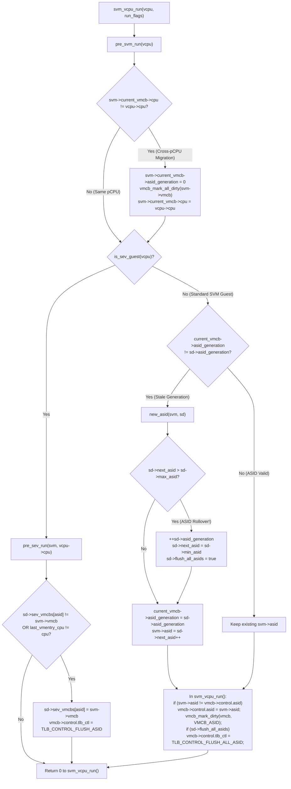

##### 6.3.2.1 Cross-CPU Migration and Per-VMCB Clean-Bit Invalidation

Trace the first `if` statement in `pre_svm_run()`:
```c
	if (unlikely(svm->current_vmcb->cpu != vcpu->cpu)) {
		svm->current_vmcb->asid_generation = 0;
		vmcb_mark_all_dirty(svm->vmcb);
		svm->current_vmcb->cpu = vcpu->cpu;
	}
```
Why is this check performed on `svm->current_vmcb->cpu` rather than a single `svm->last_cpu` field on the vCPU?
Suppose a vCPU is running an L1 hypervisor (`vmcb01`) on `CPU 0`, enters an L2 nested guest (`vmcb02`) on `CPU 0`, and while in L2 is migrated by the Linux scheduler to `CPU 1`.
1. While running L2 on `CPU 1`, `pre_svm_run()` sees `vmcb02.cpu (0) != 1`, so it zeroes `vmcb02.asid_generation`, marks `vmcb02` all-dirty, and updates `vmcb02.cpu = 1`.
2. Later, while still on `CPU 1`, L2 triggers a nested `#VMEXIT` back to L1 (`svm_switch_vmcb(svm, &svm->vmcb01)`).
3. On the next `VMRUN` of L1 on `CPU 1`, `vmcb01.cpu` is still `0`! Because `svm->current_vmcb->cpu` is tracked per-VMCB in `struct kvm_vmcb_info`, `pre_svm_run()` catches that `vmcb01` has not yet run on `CPU 1`, marks `vmcb01` all-dirty (`vmcb_mark_all_dirty`), and forces `vmcb01` to acquire a valid ASID on `CPU 1`!

##### 6.3.2.2 Generation Rollover and `TLB_CONTROL_FLUSH_ALL_ASID`

When `svm->current_vmcb->asid_generation != sd->asid_generation` (either because `asid_generation` was reset to `0` upon VMCB initialization/migration, decremented by `svm_flush_tlb_asid()` on legacy CPUs, or because `sd->asid_generation` advanced during a rollover), `pre_svm_run()` calls `new_asid(svm, sd)`.
- In the common case (`sd->next_asid <= sd->max_asid`), `new_asid()` simply stamps `svm->current_vmcb->asid_generation = sd->asid_generation` and assigns `svm->asid = sd->next_asid++`. No TLB flush is needed because `sd->next_asid` has not been used by any VMCB since the last `TLB_CONTROL_FLUSH_ALL_ASID` on this physical CPU!
- When `sd->next_asid > sd->max_asid`, all available ASIDs on this physical CPU have been exhausted. `new_asid()` increments `++sd->asid_generation`, resets `sd->next_asid = sd->min_asid`, and sets `sd->flush_all_asids = true`.
- Moments later in `svm_vcpu_run()` ([`arch/x86/kvm/svm/svm.c:4521-4526`](https://kernel.googlesource.com/pub/scm/virt/kvm/kvm.git/+/refs/heads/master/arch/x86/kvm/svm/svm.c#L4521-L4526)):
  ```c
	if (unlikely(svm->asid != svm->vmcb->control.asid)) {
		svm->vmcb->control.asid = svm->asid;
		vmcb_mark_dirty(svm->vmcb, VMCB_ASID);
	}
	if (this_cpu_ptr(&svm_data)->flush_all_asids)
		svm->vmcb->control.tlb_ctl = TLB_CONTROL_FLUSH_ALL_ASID;
  ```
  Notice how `sd->flush_all_asids` is a boolean flag on `struct svm_cpu_data` rather than just setting `vmcb->control.tlb_ctl` inside `new_asid()`: if `VMRUN` fails consistency checks (`svm_is_vmrun_failure`), the hardware did not necessarily flush all ASIDs, so KVM only clears `this_cpu_ptr(&svm_data)->flush_all_asids = false` and resets `svm->vmcb->control.tlb_ctl = TLB_CONTROL_DO_NOTHING` *after* a non-failing `VMRUN` at lines 4618–4620!
- And what about all other VMCBs that previously ran on this physical CPU? Because `++sd->asid_generation` bumped the CPU's generation counter, the next time any other VMCB runs on this physical CPU, its `current_vmcb->asid_generation` will no longer match `sd->asid_generation`, automatically forcing it into `new_asid()` to receive a fresh ASID from the new generation!

###### 6.3.2.2.1 SEV ASID Tracking in `pre_sev_run()` (`sd->sev_vmcbs[asid]`)

Contrast `new_asid()` with `pre_sev_run()` in [`arch/x86/kvm/svm/sev.c:3596-3636`](https://kernel.googlesource.com/pub/scm/virt/kvm/kvm.git/+/refs/heads/master/arch/x86/kvm/svm/sev.c#L3596-L3636):
```c
// arch/x86/kvm/svm/sev.c
	/* Assign the asid allocated with this SEV guest */
	svm->asid = asid;

	/*
	 * Flush guest TLB:
	 *
	 * 1) when different VMCB for the same ASID is to be run on the same host CPU.
	 * 2) or this VMCB was executed on different host CPU in previous VMRUNs.
	 */
	if (sd->sev_vmcbs[asid] == svm->vmcb &&
	    svm->vcpu.arch.last_vmentry_cpu == cpu)
		return 0;

	sd->sev_vmcbs[asid] = svm->vmcb;
	svm->vmcb->control.tlb_ctl = TLB_CONTROL_FLUSH_ASID;
	return 0;
```
Because all vCPUs of an SEV VM share the same `asid` (`sev_get_asid(kvm)`), if `vCPU 0` and `vCPU 1` of the same SEV VM time-slice on the same physical CPU, they will execute with the **exact same hardware ASID** but potentially different guest `CR3` page tables! Therefore, `struct svm_cpu_data` maintains an array `struct vmcb **sev_vmcbs` indexed by `asid`. Whenever `sd->sev_vmcbs[asid] != svm->vmcb` (or the vCPU migrated from another physical CPU), `pre_sev_run()` updates `sd->sev_vmcbs[asid] = svm->vmcb` and sets `svm->vmcb->control.tlb_ctl = TLB_CONTROL_FLUSH_ASID` to prevent cross-vCPU TLB aliasing.

##### 6.3.2.3 Fine-Grained TLB Control: `tlb_ctl` Encodings and `INVLPGA` Errata

At byte offset `0x05C` of `struct vmcb_control_area`, the 8-bit `tlb_ctl` field accepts four architectural command values defined in [`arch/x86/include/asm/svm.h:180-185`](https://kernel.googlesource.com/pub/scm/virt/kvm/kvm.git/+/refs/heads/master/arch/x86/include/asm/svm.h#L180-L185):
- `TLB_CONTROL_DO_NOTHING (0)`: Do not flush any TLB entries on `VMRUN`.
- `TLB_CONTROL_FLUSH_ALL_ASID (1)`: Flush all TLB entries for **all** ASIDs on this logical processor on `VMRUN`.
- `TLB_CONTROL_FLUSH_ASID (3)`: Flush all TLB entries matching `vmcb->control.asid` on `VMRUN` (requires `X86_FEATURE_FLUSHBYASID`, CPUID `0x8000000A:EDX[6]`).
- `TLB_CONTROL_FLUSH_ASID_LOCAL (7)`: Flush only non-global (`!PGE`) TLB entries matching `vmcb->control.asid` on `VMRUN`.

Let us examine how KVM's TLB flush callbacks in [`arch/x86/kvm/svm/svm.c:4180-4260`](https://kernel.googlesource.com/pub/scm/virt/kvm/kvm.git/+/refs/heads/master/arch/x86/kvm/svm/svm.c#L4180-L4260) use `tlb_ctl` and `invlpga()`:

```c
// arch/x86/kvm/svm/svm.c
static void svm_flush_tlb_asid(struct kvm_vcpu *vcpu)
{
	struct vcpu_svm *svm = to_svm(vcpu);

	kvm_hv_vcpu_purge_flush_tlb(vcpu);

	if (cpu_feature_enabled(X86_FEATURE_FLUSHBYASID))
		svm->vmcb->control.tlb_ctl = TLB_CONTROL_FLUSH_ASID;
	else
		svm->current_vmcb->asid_generation--;
}

static void svm_flush_tlb_gva(struct kvm_vcpu *vcpu, gva_t gva, bool *full)
{
	struct vcpu_svm *svm = to_svm(vcpu);

	/*
	 * INVLPGA has had errata on Genoa and Turin, and even on older
	 * generations there were reports of Windows BSODs if INVLPGA
	 * was used for Hyper-V tlbflush.  Use it only for shadow paging
	 * where it seems to be okay.
	 */
	if (!npt_enabled) {
		invlpga(gva, svm->vmcb->control.asid);
		return;
	}

	svm_flush_tlb_guest(vcpu);
	if (full)
		*full = true;
}
```

###### 6.3.2.3.1 Why `svm_flush_tlb_gva()` Avoids `INVLPGA` When NPT Is Enabled

In the AMD architecture manual, the `INVLPGA %rax, %ecx` instruction (wrapped in [`arch/x86/kvm/svm/svm_ops.h:49-52`](https://kernel.googlesource.com/pub/scm/virt/kvm/kvm.git/+/refs/heads/master/arch/x86/kvm/svm/svm_ops.h#L49-L52)) invalidates the TLB entry for the linear address in `RAX` tagged with the ASID in `ECX`. Why does `svm_flush_tlb_gva()` refuse to use `invlpga()` when `npt_enabled` is true, falling back instead to a full ASID flush (`svm_flush_tlb_guest(vcpu)`)?
1. As the comment in `svm_flush_tlb_gva()` explains, hardware errata on Zen 4 (Genoa) and Zen 5 (Turin)—as well as subtle TLB invalidation bugs observed with Windows/Hyper-V guests on earlier generations—caused `INVLPGA` under Nested Paging to occasionally leave stale combined GVA->HPA translations in the TLB.
2. When `svm_flush_tlb_guest(vcpu)` is called instead, notice line 4237: `kvm_register_mark_dirty(vcpu, VCPU_REG_ERAPS);`. On Zen 5+ CPUs supporting **Enhanced Return Address Predictor Security (`X86_FEATURE_ERAPS`)**, marking `VCPU_REG_ERAPS` dirty causes `svm_vcpu_run()` (line 4532) to set `svm->vmcb->control.erap_ctl |= ERAP_CONTROL_CLEAR_RAP`, flushing the guest's hardware Return Address Predictor alongside the ASID TLB flush (`TLB_CONTROL_FLUSH_ASID`)!

---

### 6.4 Instruction-by-Instruction Walkthrough of `svm_vcpu_run` and `__svm_vcpu_run` (`arch/x86/kvm/svm/vmenter.S`)

We now arrive at the heart of the AMD SVM hypervisor backend: the transition from the Linux host kernel into guest execution and back again. To understand why the inner `VMRUN` loop is so compact, we must first trace how KVM amortizes heavyweight host/guest state switching across the outer scheduling hooks.

```mermaid
sequenceDiagram
    participant Sched as Linux Scheduler / vcpu_load
    participant C_Prep as svm_prepare_switch_to_guest()
    participant C_Run as svm_vcpu_run() / svm_vcpu_enter_exit()
    participant Asm as __svm_vcpu_run() (vmenter.S)
    participant HW as AMD SVM Hardware

    Sched->>C_Prep: kvm_arch_vcpu_ioctl_run() -> svm_vcpu_load()
    Note over C_Prep: Called before entering tight vcpu_enter_guest() loop
    C_Prep->>HW: vmsave(sd->save_area_pa) (Saves Host FS/GS/TR/LDTR/SYSCALL MSRs once!)
    C_Prep->>HW: __svm_write_tsc_multiplier() & kvm_set_user_return_msr(MSR_TSC_AUX)
    C_Prep->>C_Prep: svm->guest_state_loaded = true

    loop Tight Inner World-Switch Loop (vcpu_enter_guest)
        C_Run->>C_Run: Copy RAX, RSP, RIP to vmcb->save; pre_svm_run() (ASID & TLB)
        C_Run->>C_Run: sync_lapic_to_cr8(); write CR2, DR6; clgi() [GIF=0, IF=0]
        C_Run->>C_Run: svm_vcpu_enter_exit(): raw_local_irq_enable() [GIF=0, IF=1]
        C_Run->>Asm: Call __svm_vcpu_run(svm, enter_flags)
        Asm->>Asm: Push callee-saved GPRs, @enter_flags, SD_save_area_pa, @svm
        Asm->>Asm: RESTORE_GUEST_SPEC_CTRL
        Asm->>HW: vmload(svm->vmcb01.pa) (Loads Guest FS/GS/TR/LDTR/SYSCALL MSRs)
        Asm->>Asm: Load current_vmcb->pa into RAX; LOAD_REGS RCX..R15, RDI
        Asm->>HW: vmrun %rax [Hardware sets GIF=1, switches to Guest]
        Note over HW: Guest Executes until Intercept / Trap / NP Fault
        HW->>Asm: #VMEXIT [Hardware sets GIF=0, restores Host RIP, RSP, RAX]
        Asm->>Asm: pop %rax (@svm); STORE_REGS RCX..R15, RDI
        Asm->>HW: vmsave(svm->vmcb01.pa) (Saves Guest FS/GS/TR/LDTR/SYSCALL MSRs)
        Asm->>HW: pop %rax; vmload(sd->save_area_pa) (Restores Host GS.base & MSRs)
        Asm->>Asm: FILL_RETURN_BUFFER; RESTORE_HOST_SPEC_CTRL; UNTRAIN_RET_VM; CLEAR_REGS
        Asm-->>C_Run: RET to svm_vcpu_enter_exit()
        C_Run->>C_Run: raw_local_irq_disable() [GIF=0, IF=0]
        C_Run->>C_Run: Copy CR2, RAX, RSP, RIP from vmcb->save; stgi() [GIF=1, IF=0]
        C_Run->>C_Run: sync_cr8_to_lapic(); vmcb_mark_all_clean(); svm_complete_interrupts()
        C_Run->>C_Run: svm_exit_handlers_fastpath() -> svm_handle_exit()
    end

    Sched->>C_Prep: vcpu_put() -> svm_vcpu_put() -> guest_state_loaded = false
```

#### 6.4.1 Lazy vs. Eager State Switching: `svm_vcpu_load()`, `svm_prepare_switch_to_guest()`, and `svm_vcpu_put()`

Let us trace what happens before `svm_vcpu_run()` is even called, by inspecting `svm_prepare_switch_to_guest()` in [`arch/x86/kvm/svm/svm.c:1429-1467`](https://kernel.googlesource.com/pub/scm/virt/kvm/kvm.git/+/refs/heads/master/arch/x86/kvm/svm/svm.c#L1429-L1467):

```c
// arch/x86/kvm/svm/svm.c
static void svm_prepare_switch_to_guest(struct kvm_vcpu *vcpu)
{
	struct vcpu_svm *svm = to_svm(vcpu);
	struct svm_cpu_data *sd = per_cpu_ptr(&svm_data, vcpu->cpu);

	if (is_sev_es_guest(vcpu))
		sev_es_unmap_ghcb(svm);

	if (svm->guest_state_loaded)
		return;

	/*
	 * Save additional host state that will be restored on VMEXIT (sev-es)
	 * or subsequent vmload of host save area.
	 */
	vmsave(sd->save_area_pa);
	if (is_sev_es_guest(vcpu))
		sev_es_prepare_switch_to_guest(svm, sev_es_host_save_area(sd));

	if (tsc_scaling)
		__svm_write_tsc_multiplier(vcpu->arch.tsc_scaling_ratio);

	if (likely(tsc_aux_uret_slot >= 0) &&
	    (!boot_cpu_has(X86_FEATURE_V_TSC_AUX) || !is_sev_es_guest(vcpu)))
		kvm_set_user_return_msr(tsc_aux_uret_slot, svm->tsc_aux, -1ull);

	if (cpu_feature_enabled(X86_FEATURE_SRSO_BP_SPEC_REDUCE) &&
	    !sd->bp_spec_reduce_set) {
		sd->bp_spec_reduce_set = true;
		msr_set_bit(MSR_ZEN4_BP_CFG, MSR_ZEN4_BP_CFG_BP_SPEC_REDUCE_BIT);
	}
	svm->guest_state_loaded = true;
}
```

Why is `vmsave(sd->save_area_pa)` here instead of inside `__svm_vcpu_run()`?
- Every time `__svm_vcpu_run()` exits the guest, it executes `vmload` on `sd->save_area_pa` to restore the host's `GS.base` (so the Linux kernel can access `PER_CPU_VAR` data) along with host `FS`, `TR`, `LDTR`, `KERNEL_GS_BASE`, and `SYSCALL`/`SYSENTER` MSRs.
- As long as the vCPU thread remains scheduled on the CPU (`svm->guest_state_loaded == true`), the host kernel never changes any of those registers in `sd->save_area`! Thus, executing `vmsave(sd->save_area_pa)` once per `vcpu_load` / `prepare_switch_to_guest` cycle eliminates an entire `vmsave` instruction from every single world switch!
- Similarly, `MSR_TSC_AUX` (`0xC0000103`, read by userspace `RDTSCP` / `RDPID`) is never read by the Linux kernel itself. By calling `kvm_set_user_return_msr(tsc_aux_uret_slot, svm->tsc_aux, -1ull)`, KVM writes the guest's `TSC_AUX` into hardware once and defers restoring the host's `TSC_AUX` until the vCPU thread actually returns to host userspace (or is context-switched out by the Linux scheduler)!

##### 6.4.1.1 Virtualized `VMLOAD`/`VMSAVE` (`vls`) and Nested `vmcb01` Unification

What happens when an L1 guest hypervisor runs an L2 nested guest?
1. Normally, `__svm_vcpu_run()` executes `vmload` and `vmsave` using **`svm->vmcb01.pa`**, even when `svm->current_vmcb` points to **`svm->nested.vmcb02`**! Why? Because `VMRUN` does *not* touch the `VMLOAD`/`VMSAVE` fields (`FS`, `GS`, `TR`, `LDTR`, `KERNEL_GS_BASE`, `STAR`, `LSTAR`, `CSTAR`, `SFMASK`, `SYSENTER_*`). By keeping the guest's `VMLOAD`/`VMSAVE` state permanently in `vmcb01.ptr->save`, KVM avoids copying those 11 registers between `vmcb01` and `vmcb02` on every nested `VMRUN` and nested `#VMEXIT`!
2. What if the L1 guest hypervisor itself executes `VMLOAD` or `VMSAVE` to switch L2's `FS`/`GS`/`SYSCALL` state?
   - On CPUs with **Virtual `VMLOAD`/`VMSAVE` (`X86_FEATURE_V_VMSAVE_VMLOAD`, module param `vls=1`)**, `init_vmcb()` sets `SVM_MISC2_ENABLE_V_VMLOAD_VMSAVE` in `vmcb01->control.misc_ctl2` and clears `INTERCEPT_VMLOAD` and `INTERCEPT_VMSAVE`. When L1 executes `VMLOAD %rax` (where `RAX` is a Guest Physical Address in L1), the CPU hardware automatically translates `RAX` through L0's Nested Page Tables (`nested_cr3`) and loads those registers directly into the CPU hardware without causing a `#VMEXIT`! Then, when L1 eventually exits to L0, `__svm_vcpu_run()`'s `vmsave SVM_vmcb01_pa` saves the updated hardware registers straight into `vmcb01`!
   - If `vls` is disabled, L1's `VMLOAD`/`VMSAVE` triggers `vmload_vmsave_interception()` ([`arch/x86/kvm/svm/svm.c:2230-2263`](https://kernel.googlesource.com/pub/scm/virt/kvm/kvm.git/+/refs/heads/master/arch/x86/kvm/svm/svm.c#L2230-L2263)), which maps `vmcb12` and calls `svm_copy_vmloadsave_state(svm->vmcb01.ptr, vmcb12)` (or vice versa), again keeping `vmcb01` as the single source of truth.

#### 6.4.2 C-Level Entry/Exit Orchestration: `svm_vcpu_run()` and `svm_vcpu_enter_exit()`

Let us trace `svm_vcpu_run()` and `svm_vcpu_enter_exit()` in [`arch/x86/kvm/svm/svm.c:4446-4658`](https://kernel.googlesource.com/pub/scm/virt/kvm/kvm.git/+/refs/heads/master/arch/x86/kvm/svm/svm.c#L4446-L4658), paying special attention to the exact sequence of `RFLAGS.IF` and `GIF` transitions.

```
Host Context: vcpu_enter_guest() calls local_irq_disable() -> [ RFLAGS.IF = 0, GIF = 1 ]
  |
  +--> svm_vcpu_run(vcpu, run_flags)
         |-- Copy vcpu->arch.regs[RAX, RSP] and rip into vmcb->save
         |-- pre_svm_run(vcpu) -> Assign/validate ASID & mark dirty if pCPU changed
         |-- sync_lapic_to_cr8(vcpu), write vmcb->control.asid, tlb_ctl, save.cr2, dr6
         |
         |-- clgi()  =======================================> [ RFLAGS.IF = 0, GIF = 0 ]
         |     (All physical INTR, NMI, SMI, INIT are now blocked at hardware GIF gate!)
         |-- update_debugctlmsr(), kvm_wait_lapic_expire(), x86_spec_ctrl_set_guest()
         |
         +--> svm_vcpu_enter_exit(vcpu, enter_flags)
                |-- guest_state_enter_irqoff()
                |-- raw_local_irq_enable() (STI) ===========> [ RFLAGS.IF = 1, GIF = 0 ]
                |     (Host IF=1 so VMRUN saves Host IF=1, enabling physical IRQ exits
                |      while guest runs; GIF=0 prevents host from taking any IRQ here!)
                |-- amd_clear_divider()
                |-- __svm_vcpu_run(svm, enter_flags)
                |     |-- vmload vmcb01_pa
                |     |-- vmrun %rax =======================> [ Guest IF,      GIF = 1 ]
                |     |     (CPU enters Guest Mode; GIF becomes 1 atomically)
                |     |     ... Guest executes ...
                |     |-- #VMEXIT ==========================> [ RFLAGS.IF = 1, GIF = 0 ]
                |     |     (CPU exits to Host; GIF becomes 0 atomically; Host IF=1 restored)
                |     |-- vmsave vmcb01_pa; vmload save_area_pa
                |-- raw_local_irq_disable() (CLI) ==========> [ RFLAGS.IF = 0, GIF = 0 ]
                |-- guest_state_exit_irqoff()
         |
         |-- x86_spec_ctrl_restore_host()
         |-- Copy vmcb->save.{cr2, rax, rsp, rip, cr0, cr3} back to vcpu->arch
         |-- if (exit_code == SVM_EXIT_NMI) kvm_before_interrupt(vcpu, KVM_HANDLING_NMI)
         |-- Restore host DEBUGCTL
         |
         |-- stgi()  =======================================> [ RFLAGS.IF = 0, GIF = 1 ]
         |     (GIF=1 re-enabled! If exit_code was SVM_EXIT_NMI, physical NMI fires
         |      on the instruction boundary immediately following STGI!)
         |-- if (exit_code == SVM_EXIT_NMI) kvm_after_interrupt(vcpu)
         |-- sync_cr8_to_lapic(vcpu), vmcb_mark_all_clean(svm->vmcb)
         |-- svm_complete_interrupts(vcpu)
         +-- return svm_exit_handlers_fastpath(vcpu)
```

Look closely at five subtle mechanisms in `svm_vcpu_run()` ([`arch/x86/kvm/svm/svm.c:4478-4658`](https://kernel.googlesource.com/pub/scm/virt/kvm/kvm.git/+/refs/heads/master/arch/x86/kvm/svm/svm.c#L4478-L4658)):

1. **Canceling `nmi_singlestep` on Simultaneous Event Injection (lines 4499–4510)**:
   ```c
	if (svm->nmi_singlestep && svm->vmcb->control.event_inj) {
		disable_nmi_singlestep(svm);
		force_immediate_exit = true;
	}
	if (force_immediate_exit)
		smp_send_reschedule(vcpu->cpu);
   ```
   Suppose KVM had set `RFLAGS.TF` (`nmi_singlestep`) to single-step the guest over an `IRET` or `STI` shadow, *and* at the same time `event_inj` is about to inject an exception or interrupt on `VMRUN`. If `VMRUN` vectors that event while `RFLAGS.TF=1`, the processor will push the modified `RFLAGS` (with KVM's fake `TF=1` bit!) onto the guest's stack frame! To prevent the guest from seeing a corrupted `RFLAGS.TF=1` on its stack, KVM calls `disable_nmi_singlestep(svm)` before `VMRUN` and sets `force_immediate_exit = true`, which sends a self-IPI (`smp_send_reschedule(vcpu->cpu)`). Because `VMRUN` completes event injection *before* checking pending physical interrupts, the self-IPI (held pending while `GIF=0`) triggers an `SVM_EXIT_INTR` immediately after the injected event has been vectored!
2. **Divider State Clearing (`amd_clear_divider()`, line 4465)**: On Zen 1/2/3 CPUs vulnerable to Divider State Sampling (`X86_BUG_DIV0`), `amd_clear_divider()` executes a dummy `0 / 1` division before entering the guest so the guest cannot infer host kernel division operands via speculative execution timing.
3. **NMI Handling Around `stgi()` (lines 4590–4602)**:
   When a physical NMI arrives while the guest is running, hardware intercepts it (`INTERCEPT_NMI`) and triggers `#VMEXIT` with `exit_code == SVM_EXIT_NMI` and `GIF=0`. Notice that the host CPU's IDT NMI handler has **not** run yet because `GIF=0` blocks NMIs! As soon as `svm_vcpu_run()` executes `stgi()` at line 4597, `GIF` becomes `1` and the pending physical NMI immediately vectors through the host IDT! Wrapping `stgi()` with `kvm_before_interrupt(vcpu, KVM_HANDLING_NMI)` and `kvm_after_interrupt(vcpu)` tells x86 entry/instrumentation code that the NMI expectedly arrived on the `stgi()` instruction boundary.

#### 6.4.3 Assembly Line-by-Line Walkthrough of `__svm_vcpu_run` (`arch/x86/kvm/svm/vmenter.S`)

Now let us step instruction-by-instruction through `__svm_vcpu_run` in [`arch/x86/kvm/svm/vmenter.S:37-210`](https://kernel.googlesource.com/pub/scm/virt/kvm/kvm.git/+/refs/heads/master/arch/x86/kvm/svm/vmenter.S#L37-L210):

```assembly
/* arch/x86/kvm/svm/vmenter.S */
SYM_FUNC_START(__svm_vcpu_run)
	push %_ASM_BP
	mov  %_ASM_SP, %_ASM_BP
#ifdef CONFIG_X86_64
	push %r15
	push %r14
	push %r13
	push %r12
#else
	push %edi
	push %esi
#endif
	push %_ASM_BX

	/*
	 * Save variables needed after vmexit on the stack, in inverse
	 * order compared to when they are needed.
	 */

	/* Accessed directly from the stack in RESTORE_HOST_SPEC_CTRL.  */
	push %_ASM_ARG2

	/* Needed to restore access to percpu variables.  */
	__ASM_SIZE(push) PER_CPU_VAR(svm_data + SD_save_area_pa)

	/* Finally save @svm. */
	push %_ASM_ARG1
```

##### 6.4.3.1 Host Stack Frame Layout During `VMRUN`

Let us draw the exact x86_64 host stack frame constructed by lines 38–63 right before `VMRUN` executes (where `%rdi` = `@svm` and `%rsi` = `@enter_flags`):

```
High Memory Addresses
+-------------------------------------------------------------------+
| Return RIP (into svm_vcpu_enter_exit)                             |
+-------------------------------------------------------------------+
| Saved Host %rbp                                                   | <-- %rbp
+-------------------------------------------------------------------+
| Saved Host %r15                                                   | -0x08(%rbp)
+-------------------------------------------------------------------+
| Saved Host %r14                                                   | -0x10(%rbp)
+-------------------------------------------------------------------+
| Saved Host %r13                                                   | -0x18(%rbp)
+-------------------------------------------------------------------+
| Saved Host %r12                                                   | -0x20(%rbp)
+-------------------------------------------------------------------+
| Saved Host %rbx                                                   | -0x28(%rbp)
+-------------------------------------------------------------------+
| @enter_flags (%rsi)                                               | -0x30(%rbp)
+-------------------------------------------------------------------+
| per_cpu(svm_data.save_area_pa) (Host Save Area HPA for VMLOAD)    | -0x38(%rbp)
+-------------------------------------------------------------------+
| @svm (%rdi, pointer to struct vcpu_svm)                           | -0x40(%rbp) <-- Host %rsp saved in
+-------------------------------------------------------------------+                 MSR_VM_HSAVE_PA!
Low Memory Addresses
```

Why must `PER_CPU_VAR(svm_data + SD_save_area_pa)` be pushed onto the stack *before* `vmload`?
Because on x86_64, `PER_CPU_VAR(...)` expands to a `%gs:` segment-relative memory access! As soon as line 84 executes `vmload %rax` on `svm->vmcb01.pa`, the CPU's `GS.base` register is overwritten with the **guest's** `GS.base`! After `#VMEXIT`, `GS.base` *still* holds the guest's `GS.base` until `vmload` is executed on the host's `save_area_pa`. If `__svm_vcpu_run` tried to read `PER_CPU_VAR(svm_data + SD_save_area_pa)` after `#VMEXIT`, it would dereference the guest's `GS.base` in host ring 0—an instant privilege escalation / kernel crash! Pushing `SD_save_area_pa` onto the host stack while host `GS.base` is still active allows line 131 (`pop %_ASM_AX`) to retrieve the host save area HPA using only `%rsp` (which hardware restores from `MSR_VM_HSAVE_PA` on `#VMEXIT`).

##### 6.4.3.2 Pre-Entry `VMLOAD`, Guest Register Load, and `VMRUN`

Let us trace lines 74–108 of [`arch/x86/kvm/svm/vmenter.S`](https://kernel.googlesource.com/pub/scm/virt/kvm/kvm.git/+/refs/heads/master/arch/x86/kvm/svm/vmenter.S#L74-L108):

```assembly
	/* Clobbers RAX, RCX, RDX (and ESI on 32-bit), consumes RDI (@svm). */
	RESTORE_GUEST_SPEC_CTRL
801:

	/*
	 * Use a single vmcb (vmcb01 because it's always valid) for
	 * context switching guest state via VMLOAD/VMSAVE, that way
	 * the state doesn't need to be copied between vmcb01 and
	 * vmcb02 when switching vmcbs for nested virtualization.
	 */
	mov SVM_vmcb01_pa(%_ASM_DI), %_ASM_AX
1:	vmload %_ASM_AX
2:

	/* Get svm->current_vmcb->pa into RAX. */
	mov SVM_current_vmcb(%_ASM_DI), %_ASM_AX
	mov KVM_VMCB_pa(%_ASM_AX), %_ASM_AX

	/*
	 * Load guest registers. Intentionally omit %_ASM_AX and %_ASM_SP as
	 * context switched by hardware
	 */
	LOAD_REGS %_ASM_DI, SVM_vcpu_arch_regs, \
		  %_ASM_CX, %_ASM_DX, %_ASM_BX, %_ASM_BP, %_ASM_SI
#ifdef CONFIG_X86_64
	LOAD_REGS %_ASM_DI, SVM_vcpu_arch_regs, \
		  %r8, %r9, %r10, %r11, %r12, %r13, %r14, %r15
#endif
	LOAD_REGS %_ASM_DI, SVM_vcpu_arch_regs, %_ASM_DI

	/* Clobbers EFLAGS.ZF */
	SVM_CLEAR_CPU_BUFFERS

	/* Enter guest mode */
3:	vmrun %_ASM_AX
4:
```

Observe the exact ordering constraints here:
1. **`RESTORE_GUEST_SPEC_CTRL` (line 74)**: Must run *before* `vmload` because `RESTORE_GUEST_SPEC_CTRL_BODY` ([`arch/x86/kvm/vmenter.h:22-40`](https://kernel.googlesource.com/pub/scm/virt/kvm/kvm.git/+/refs/heads/master/arch/x86/kvm/vmenter.h#L22-L40)) compares `svm->spec_ctrl` against `PER_CPU_VAR(x86_spec_ctrl_current)` using `%gs:`, and if they differ, writes `MSR_IA32_SPEC_CTRL` via `wrmsr`. (On Zen 3+ CPUs with `X86_FEATURE_V_SPEC_CTRL`, `ALTERNATIVE_2` patches this out to a no-op because hardware loads `vmcb->save.spec_ctrl` automatically on `VMRUN`.)
2. **`vmload %rax` on `vmcb01.pa` (lines 83–84)**: Loads `FS`, `GS`, `TR`, `LDTR`, `KERNEL_GS_BASE`, `STAR`, `LSTAR`, `CSTAR`, `SFMASK`, and `SYSENTER_*` from `svm->vmcb01.ptr->save`.
3. **Loading `svm->current_vmcb->pa` into `%rax` (lines 88–89)**: Dereferences `svm->current_vmcb` (at offset `SVM_current_vmcb` from `%rdi`) and loads its physical address (`KVM_VMCB_pa`) into `%rax`. For L1, this is `vmcb01.pa`; for L2, this is `vmcb02.pa`.
4. **`LOAD_REGS` (lines 95–101)**: Loads `RCX`, `RDX`, `RBX`, `RBP`, `RSI`, `R8`–`R15` from `svm->vcpu.arch.regs[]` using `%rdi` as the base pointer, and **last of all** loads the guest's `RDI` into `%rdi` (clobbering the `@svm` pointer). `RAX` and `RSP` are omitted because `%rax` holds the VMCB HPA and `%rsp` holds the host stack pointer; hardware loads guest `RAX` and `RSP` from the VMCB during `vmrun %rax`.
5. **`SVM_CLEAR_CPU_BUFFERS` and `vmrun %rax` (lines 104–107)**: Optionally executes `VERW` (`__CLEAR_CPU_BUFFERS`) if `X86_FEATURE_CLEAR_CPU_BUF_VM` is enabled, and executes `3: vmrun %rax`.

##### 6.4.3.3 Post-`#VMEXIT` Register Save, Host `VMLOAD`, and Speculative Hardening

When an intercept, NPF, or physical interrupt triggers `#VMEXIT`, the processor resumes host execution at label `4:` (line 108) with `GIF=0`, host `RSP` restored to `-0x40(%rbp)`, and `RAX` restored to the VMCB HPA:

```assembly
	/* Pop @svm to RAX while it's the only available register. */
	pop %_ASM_AX

	/*
	 * Save all guest registers. Intentionally omit %_ASM_AX and %_ASM_SP as
	 * context switched by hardware
	 */
	STORE_REGS %_ASM_AX, SVM_vcpu_arch_regs, \
		   %_ASM_CX, %_ASM_DX, %_ASM_BX, %_ASM_BP, %_ASM_SI, %_ASM_DI
#ifdef CONFIG_X86_64
	STORE_REGS %_ASM_AX, SVM_vcpu_arch_regs, \
		   %r8, %r9, %r10, %r11, %r12, %r13, %r14, %r15
#endif

	/* @svm can stay in RDI from now on.  */
	mov %_ASM_AX, %_ASM_DI

	mov SVM_vmcb01_pa(%_ASM_DI), %_ASM_AX
5:	vmsave %_ASM_AX
6:

	/* Restores GSBASE among other things, allowing access to percpu data.  */
	pop %_ASM_AX
7:	vmload %_ASM_AX
8:

	/* IMPORTANT: Stuff the RSB immediately after VM-Exit, before RET! */
	FILL_RETURN_BUFFER %_ASM_AX, RSB_CLEAR_LOOPS, X86_FEATURE_RSB_VMEXIT

	RESTORE_HOST_SPEC_CTRL
901:
	UNTRAIN_RET_VM

	CLEAR_REGS %ecx, %edx, %ebx, %ebp, %esi, %edi
#ifdef CONFIG_X86_64
	CLEAR_REGS %r8d, %r9d, %r10d, %r11d, %r12d, %r13d, %r14d, %r15d
#endif
```

Every line in this post-`#VMEXIT` sequence is crafted with surgical precision:
1. **`pop %rax` and `STORE_REGS` (lines 110–121)**: At label `4:`, `%rcx` through `%r15` hold live guest register values, while `%rax` holds the VMCB HPA (because guest `RAX` was saved by hardware into `vmcb->save.rax`). Popping `@svm` from the top of the stack into `%rax` gives us a base register to save `RCX`, `RDX`, `RBX`, `RBP`, `RSI`, `RDI`, and `R8`–`R15` into `svm->vcpu.arch.regs[]`.
2. **`vmsave` on `vmcb01.pa` and `vmload` on `SD_save_area_pa` (lines 126–133)**: Saves the guest's `FS`, `GS`, `TR`, `LDTR`, `KERNEL_GS_BASE`, and `SYSCALL` MSRs into `vmcb01`, then pops `SD_save_area_pa` into `%rax` and executes `vmload %rax` to restore the host kernel's `GS.base` and system registers.
3. **Microarchitectural Side-Channel Mitigations (lines 136–166)**:
   - `FILL_RETURN_BUFFER`: Overwrites the hardware Return Stack Buffer (RSB) to prevent guest-poisoned RSB entries from redirecting host `RET` speculation.
   - `RESTORE_HOST_SPEC_CTRL`: Saves the guest's `MSR_IA32_SPEC_CTRL` if `KVM_ENTER_SAVE_SPEC_CTRL` was set in `@enter_flags` (now at `(%rsp)`!) and restores the host's `x86_spec_ctrl_current`.
   - `UNTRAIN_RET_VM`: Mitigates RETBleed / SRSO (Speculative Return Stack Overflow) on AMD Zen microarchitectures *before* `stgi()` re-enables interrupts.
   - `CLEAR_REGS`: Executes `xorl %reg, %reg` across all 14 non-`RAX`/non-`RSP` GPRs (`%ecx` through `%r15d`) before popping callee-saved registers from the stack, ensuring that even if a subsequent stack pop misses in L1D cache, the processor cannot speculatively execute host instructions using leftover guest register values!

###### 6.4.3.3.1 Reboot Exception Tables (`_ASM_EXTABLE` and `virt_rebooting`) and `__svm_sev_es_vcpu_run`

What are labels `10:`, `30:`, `50:`, `70:` and `_ASM_EXTABLE(1b, 10b)` at lines 192–209 of [`arch/x86/kvm/svm/vmenter.S`](https://kernel.googlesource.com/pub/scm/virt/kvm/kvm.git/+/refs/heads/master/arch/x86/kvm/svm/vmenter.S#L192-L209)?
- During an emergency system reboot (`kexec`, panic, or emergency restart), the kernel calls `svm_emergency_disable_virtualization_cpu()`, which clears `MSR_VM_HSAVE_PA` and disables SVM (`EFER.SVME = 0`) after setting the global flag `virt_rebooting = true`. If another CPU was simultaneously in the middle of `__svm_vcpu_run()`, executing `vmload`, `vmrun`, or `vmsave` with `EFER.SVME == 0` raises `#UD`! The exception table entries catch a `#UD` on `1: vmload`, `3: vmrun`, `5: vmsave`, or `7: vmload`; if `virt_rebooting` is non-zero, they jump past the faulting SVM instruction so the CPU can cleanly unwind; otherwise they execute `ud2` to panic immediately.
- Finally, compare `__svm_vcpu_run` with **`__svm_sev_es_vcpu_run`** ([`arch/x86/kvm/svm/vmenter.S:221-283`](https://kernel.googlesource.com/pub/scm/virt/kvm/kvm.git/+/refs/heads/master/arch/x86/kvm/svm/vmenter.S#L221-L283)): for SEV-ES and SEV-SNP guests, the guest's GPRs (`RAX`–`R15`) and `FS`/`GS`/`SYSCALL` MSRs are encrypted inside the guest's **VMSA** (`vmcb->control.vmsa_pa`) and switched **entirely by hardware** during `VMRUN` and `#VMEXIT`! Thus, `__svm_sev_es_vcpu_run` has **no** `vmload`, **no** `vmsave`, **no** `LOAD_REGS`, and **no** `CLEAR_REGS`: it simply saves the host's callee-saved registers (`%rbp`, `%r15`–`%r12`, `%rbx`, `%rdi`, `%rsi`) into `sd->save_area->host_sev_es_save` at offset `SEV_ES_GPRS_BASE` (`0x300`) and executes `vmrun %rax`!

---

### 6.5 SVM Interrupt/NMI Window Mechanics and Exit Dispatch (`svm_handle_exit` & `svm_exit_handlers[]`)

Once `__svm_vcpu_run` returns to C, KVM must reconcile any events that were interrupted during `VMRUN` vectoring (`svm_complete_interrupts()`), check whether the `#VMEXIT` can be handled in the IRQ-disabled fastpath (`svm_exit_handlers_fastpath()`), and otherwise dispatch the exit through `svm_handle_exit()` and `svm_invoke_exit_handler()`. Simultaneously, on the next entry path, KVM must inject pending virtual interrupts and NMIs—or arm hardware interrupt/NMI windows when the guest currently has interrupts or NMIs masked.

#### 6.5.1 Virtual Interrupt Injection (`event_inj`) vs. Dummy `V_IRQ` Interrupt Window Detection (`svm_set_vintr` & `INTERCEPT_VINTR`)

One of the most frequent sources of confusion when reading the AMD Architecture Programmer's Manual (APM Vol. 2) alongside KVM's `svm.c` is that AMD SVM actually provides **two** distinct hardware mechanisms for delivering interrupts to a guest:
1. **Direct Event Injection (`vmcb->control.event_inj` at offset `0x0A8`)**: Vectored unconditionally by `VMRUN` before the first guest instruction executes (identical in spirit to VMX's `VM_ENTRY_INTR_INFO_FIELD`).
2. **Virtual Interrupts (`V_IRQ` in `vmcb->control.int_ctl` at offset `0x060` + `int_vector` at offset `0x064`)**: Evaluated continuously by hardware whenever the guest unmasks `RFLAGS.IF=1` and `V_INTR_PRIO > V_TPR`.

Why doesn't KVM simply stuff the guest's pending interrupt vector into `int_vector` with `V_IRQ_MASK` set and let the CPU deliver it whenever the guest unmasks `RFLAGS.IF`?
Because in KVM's architecture (unless hardware APIC virtualization—AVIC—is active), the authoritative interrupt controller (the in-kernel Local APIC / PIC or userspace split irqchip) resides in software! If KVM placed a real interrupt vector into `V_IRQ`/`int_vector` while the guest had `RFLAGS.IF=0`, and a *higher-priority* interrupt arrived before the guest executed `STI`, or the guest modified its APIC state before taking the interrupt, KVM's software LAPIC state (`ISR`/`IRR`) would fall out of sync with hardware.

Instead, KVM uses an ingenious hybrid design:
- **Actual interrupt delivery** is *always* performed via **`vmcb->control.event_inj`** in `svm_inject_irq()` ([`arch/x86/kvm/svm/svm.c:3836-3872`](https://kernel.googlesource.com/pub/scm/virt/kvm/kvm.git/+/refs/heads/master/arch/x86/kvm/svm/svm.c#L3836-L3872)) once `svm_interrupt_allowed()` confirms that `GIF==1`, `RFLAGS.IF==1`, and no interrupt shadow (`SVM_INTERRUPT_SHADOW_MASK`) is active.
- **`V_IRQ` in `vmcb->control.int_ctl`** is used **purely as a dummy trap to detect an open interrupt window** (`SVM_EXIT_VINTR`)!

##### 6.5.1.1 Bit-Level Layout of `vmcb->control.int_ctl` and `vmcb->control.event_inj`

Let us inspect the exact bit layouts of `int_ctl` (`0x060`) and `event_inj` (`0x0A8`) from [`arch/x86/include/asm/svm.h:190-226`](https://kernel.googlesource.com/pub/scm/virt/kvm/kvm.git/+/refs/heads/master/arch/x86/include/asm/svm.h#L190-L226) and [`630-655`](https://kernel.googlesource.com/pub/scm/virt/kvm/kvm.git/+/refs/heads/master/arch/x86/include/asm/svm.h#L630-L655):

```
vmcb->control.int_ctl (32 bits at VMCB offset 0x060):
 31      30       26       25       24     23..21    20      19..16   15..13    12       11      10     9       8     7..4   3..0
+------+--------+--------+--------+-------+------+---------+---------+------+--------+--------+-----+-------+-------+------+------+
| AVIC | X2APIC | V_NMI  | V_GIF  | V_INTR| Rsvd |V_IGN_TPR| V_INTR  | Rsvd | V_NMI  | V_NMI  |Rsvd | V_GIF | V_IRQ | Rsvd |V_TPR |
|  EN  |  MODE  | ENABLE | ENABLE |MASKING|      |         |  PRIO   |      |BLOCKING|PENDING |     | (val) |       |      |(CR8) |
+------+--------+--------+--------+-------+------+---------+---------+------+--------+--------+-----+-------+-------+------+------+

vmcb->control.event_inj & exit_int_info (32 bits at VMCB offsets 0x0A8 & 0x088):
  31       30..12         11        10..8          7..0
+-------+------------+-----------+----------+----------------+
| VALID |  Reserved  | VALID_ERR |   TYPE   |     VECTOR     |
| (1<<31|            |  (1<<11)  |0=INTR    |   (0x00..0xFF) |
|       |            |           |2=NMI     |                |
|       |            |           |3=EXEPT   |                |
|       |            |           |4=SOFT    |                |
+-------+------------+-----------+----------+----------------+
```

###### 6.5.1.1.1 Why `svm_set_vintr()` Programs Vector `0x0` with Priority `0xF`

Now examine `svm_set_vintr()`, `svm_enable_irq_window()`, and `interrupt_window_interception()` in [`arch/x86/kvm/svm/svm.c:1548-1600`](https://kernel.googlesource.com/pub/scm/virt/kvm/kvm.git/+/refs/heads/master/arch/x86/kvm/svm/svm.c#L1548-L1600), [`3236-3243`](https://kernel.googlesource.com/pub/scm/virt/kvm/kvm.git/+/refs/heads/master/arch/x86/kvm/svm/svm.c#L3236-L3243), and [`4084-4123`](https://kernel.googlesource.com/pub/scm/virt/kvm/kvm.git/+/refs/heads/master/arch/x86/kvm/svm/svm.c#L4084-L4123):

```c
// arch/x86/kvm/svm/svm.c
static void svm_set_vintr(struct vcpu_svm *svm)
{
	struct vmcb_control_area *control;

	WARN_ON(kvm_vcpu_apicv_activated(&svm->vcpu));

	svm_set_intercept(svm, INTERCEPT_VINTR);

	if (!svm_is_intercept(svm, INTERCEPT_VINTR))
		return;

	/*
	 * This is just a dummy VINTR to actually cause a vmexit to happen.
	 * Actual injection of virtual interrupts happens through EVENTINJ.
	 */
	control = &svm->vmcb->control;
	control->int_vector = 0x0;
	control->int_ctl &= ~V_INTR_PRIO_MASK;
	control->int_ctl |= V_IRQ_MASK |
		((/*control->int_vector >> 4*/ 0xf) << V_INTR_PRIO_SHIFT);
	vmcb_mark_dirty(svm->vmcb, VMCB_INTR);
}

static int interrupt_window_interception(struct kvm_vcpu *vcpu)
{
	kvm_make_request(KVM_REQ_EVENT, vcpu);
	svm_clear_vintr(to_svm(vcpu));

	++vcpu->stat.irq_window_exits;
	return 1;
}
```

Trace what happens when a guest has `RFLAGS.IF == 0` (or is inside an `STI` / `MOV SS` shadow) and KVM has a pending interrupt to deliver:
1. Generic KVM calls `svm_x86_ops.enable_irq_window(vcpu)` -> `svm_enable_irq_window(vcpu)`.
2. Provided `vgif` is enabled or `gif_set(svm)` is true, `svm_enable_irq_window()` calls `svm_set_vintr(svm)`. (If `enable_apicv` is true—meaning a legacy PIC `ExtINT` is pending while AVIC is active—it first inhibits AVIC via `kvm_inc_apicv_irq_window_req(vcpu->kvm)` because hardware ignores `V_IRQ` when `AVIC_ENABLE_MASK` is set!)
3. `svm_set_vintr()` sets `INTERCEPT_VINTR` (bit 100 in `control->intercepts`), sets `V_IRQ_MASK` (bit 8 in `int_ctl`), and sets `V_INTR_PRIO` (bits `19:16`) to **`0xF`** (the highest possible 4-bit priority, `15`).
4. Why set `V_INTR_PRIO = 0xF` instead of `V_IGN_TPR_MASK`? Because even if the guest has set `CR8` (`V_TPR`) to `14` (`0xE`) while masking interrupts via `RFLAGS.IF=0` (and KVM has already checked that the pending interrupt in the LAPIC outranks `CR8`), priority `0xF` is guaranteed to be strictly greater than any non-15 `V_TPR`! And because `INTERCEPT_VINTR` is set, the moment the guest executes `STI` (and retires the instruction after `STI`) or `POPF`/`IRET` to set `RFLAGS.IF=1`, hardware **does not deliver vector `0x0`**—instead, it immediately intercepts the virtual interrupt before vectoring and triggers `#VMEXIT` with `SVM_EXIT_VINTR` (`0x064`)!
5. `interrupt_window_interception()` handles `SVM_EXIT_VINTR` by calling `svm_clear_vintr(svm)` (clearing `INTERCEPT_VINTR` and `V_IRQ_INJECTION_BITS_MASK`) and setting `KVM_REQ_EVENT`. On the very next entry pass, `kvm_check_and_inject_events()` sees `svm_interrupt_allowed() == 1` and injects the real interrupt vector via `svm_inject_irq()` (`vmcb->control.event_inj`)!

#### 6.5.2 NMI Injection, `INTERCEPT_IRET`, Single-Stepping, and Hardware Virtual NMI (`vNMI`)

Unlike maskable interrupts, Non-Maskable Interrupts (NMIs) ignore `RFLAGS.IF`. However, x86 architecture dictates that once an NMI is delivered, **subsequent NMIs are masked until the CPU executes an `IRET` instruction** (andNMIs are also blocked if `GIF == 0` or during an `STI`/`MOV SS` interrupt shadow).

AMD SVM handles guest NMI blocking in one of two ways, depending on whether the CPU supports **Virtual NMI (`X86_FEATURE_VNMI`, CPUID `0x8000000A:EDX[25]`, Zen 4+)**:

##### 6.5.2.1 Software NMI Window State Machine (`nmi_masked` -> `iret_interception` -> `awaiting_iret_completion` -> `nmi_singlestep`)

On pre-Zen 4 processors (or when running an L2 nested guest where L1's `vNMI` is not active), the VMCB has no hardware NMI-blocking bit. Therefore, KVM tracks NMI masking entirely in software using three fields in `struct vcpu_svm` ([`arch/x86/kvm/svm/svm.h:313-331`](https://kernel.googlesource.com/pub/scm/virt/kvm/kvm.git/+/refs/heads/master/arch/x86/kvm/svm/svm.h#L313-L331)):
1. **Injection (`svm_inject_nmi()`, lines 3782–3801)**:
   When KVM injects a first NMI via `svm->vmcb->control.event_inj = SVM_EVTINJ_VALID | SVM_EVTINJ_TYPE_NMI`, it sets `svm->nmi_masked = true` and arms `svm_set_iret_intercept(svm)` (`INTERCEPT_IRET`, bit 116).
2. **Catching the Guest's `IRET` (`iret_interception()`, lines 2522–2536)**:
   Because `INTERCEPT_IRET` is a **pre-execution (`PRE_EX`)** intercept in AMD SVM, when the guest's NMI handler finishes and executes `IRET`, `#VMEXIT` (`SVM_EXIT_IRET`, `0x074`) fires **before `IRET` actually executes**!
   ```c
   static int iret_interception(struct kvm_vcpu *vcpu)
   {
   	struct vcpu_svm *svm = to_svm(vcpu);

   	WARN_ON_ONCE(is_sev_es_guest(vcpu));

   	++vcpu->stat.nmi_window_exits;
   	svm->awaiting_iret_completion = true;

   	svm_clr_iret_intercept(svm);
   	svm->nmi_iret_rip = kvm_rip_read(vcpu);

   	kvm_make_request(KVM_REQ_EVENT, vcpu);
   	return 1;
   }
   ```
   Look closely at the dilemma in `iret_interception()`: KVM must clear `INTERCEPT_IRET` so the guest can actually execute the `IRET` instruction upon the next `VMRUN`. Yet KVM **cannot** unmask NMIs (`svm->nmi_masked = false`) right now, because if a second NMI is already pending, injecting it before `IRET` executes would deliver the second NMI on top of the unpopped NMI stack frame before `IRET` retires!
3. **Single-Stepping Over `IRET` (`svm_enable_nmi_window()`, lines 4125–4178)**:
   `iret_interception()` sets `svm->awaiting_iret_completion = true`, records `svm->nmi_iret_rip = kvm_rip_read(vcpu)`, and requests `KVM_REQ_EVENT`.
   - If **no** second NMI is currently pending, the guest simply resumes; on whatever future `#VMEXIT` occurs next, `svm_complete_interrupts()` (lines 4348–4353) checks `if (svm->awaiting_iret_completion && kvm_rip_read(vcpu) != svm->nmi_iret_rip)` and clears `svm->nmi_masked = false`.
   - If a second NMI **is** pending right now, `kvm_check_and_inject_events()` calls `svm_enable_nmi_window(vcpu)`:
     ```c
     	if (svm_get_nmi_mask(vcpu)) {
     		WARN_ON_ONCE(is_vnmi_enabled(svm));

     		if (!svm->awaiting_iret_completion)
     			return; /* IRET will cause a vm exit */
     	}
     	...
     	svm->nmi_singlestep_guest_rflags = svm_get_rflags(vcpu);
     	svm->nmi_singlestep = true;
     	svm->vmcb->save.rflags |= (X86_EFLAGS_TF | X86_EFLAGS_RF);
     ```
     Because `svm->awaiting_iret_completion` is `true`, `svm_enable_nmi_window()` does *not* return early—it hijacks the guest's `RFLAGS.TF` (Trap Flag) and `RFLAGS.RF` (Resume Flag), setting `svm->nmi_singlestep = true`!
   - On the next `VMRUN`, the guest executes the single `IRET` instruction and immediately traps with `#DB` (`SVM_EXIT_EXCP_BASE + DB_VECTOR`).
   - On that `#VMEXIT`, `svm_complete_interrupts()` sees `kvm_rip_read(vcpu) != svm->nmi_iret_rip`, so it clears `svm->awaiting_iret_completion = false` and `svm->nmi_masked = false`, while `db_interception()` (lines 2043–2047) calls `disable_nmi_singlestep(svm)` and requests `KVM_REQ_EVENT`, injecting the second NMI cleanly on the instruction boundary immediately after `IRET`!

###### 6.5.2.1.1 Hardware Virtual NMI (`X86_FEATURE_VNMI`): `V_NMI_ENABLE_MASK`, `V_NMI_PENDING_MASK`, and `V_NMI_BLOCKING_MASK`

On Zen 4 and newer CPUs supporting `X86_FEATURE_VNMI` (`vnmi=1`), all of that `INTERCEPT_IRET` + `RFLAGS.TF` single-stepping machinery is eliminated for L1 guests!
- `init_vmcb()` sets `V_NMI_ENABLE_MASK` (bit 26) in `vmcb->control.int_ctl`.
- When KVM injects an NMI via `svm_inject_nmi()` or queues a pending virtual NMI via `svm_set_vnmi_pending()` ([`arch/x86/kvm/svm/svm.c:3813-3834`](https://kernel.googlesource.com/pub/scm/virt/kvm/kvm.git/+/refs/heads/master/arch/x86/kvm/svm/svm.c#L3813-L3834)):
  - Hardware automatically sets `V_NMI_BLOCKING_MASK` (bit 12 in `int_ctl`) when the NMI is delivered.
  - If a second NMI arrives while `V_NMI_BLOCKING_MASK` is set, KVM simply sets `V_NMI_PENDING_MASK` (bit 11 in `int_ctl`) via `svm_set_vnmi_pending()`.
  - When the guest executes `IRET`, the processor clears `V_NMI_BLOCKING_MASK` in hardware **without a `#VMEXIT`** and automatically vectors the queued `V_NMI_PENDING_MASK` NMI on the next instruction boundary!

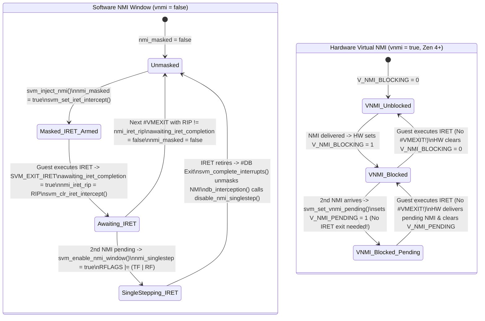

#### 6.5.3 Hardware Instruction Assists (`NextRIP` & `DecodeAssists`) and Interrupted Event Vectoring (`exit_int_info`)

When a guest instruction triggers a trap-style or fault-style intercept that KVM emulates in software (such as `CPUID`, `RDMSR`, `WRMSR`, `IN`/`OUT`, `VMMCALL`, or `INVLPG`), KVM must advance the guest's `RIP` past the intercepted instruction (`svm_skip_emulated_instruction()`).
- In the original K8 SVM implementation, the VMCB only recorded the faulting instruction's starting `RIP` (`vmcb->save.rip`, except for `SVM_EXIT_IOIO` which placed the next RIP in `exit_info_2`). To skip an instruction on K8, KVM had to invoke the full software instruction decoder (`kvm_emulate_instruction(vcpu, EMULTYPE_SKIP)`) just to compute the instruction length!
- Starting with AMD Family 10h (Barcelona), AMD added two crucial hardware assists reported in CPUID `0x8000000A:EDX`:
  1. **`NextRIP` Save (`X86_FEATURE_NRIPS`, bit 3)**: On every instruction intercept, hardware writes the sequential `RIP` of the *next* instruction into `vmcb->control.next_rip` (offset `0x0C8`). Thus, `__svm_skip_emulated_instruction()` ([`arch/x86/kvm/svm/svm.c:298-335`](https://kernel.googlesource.com/pub/scm/virt/kvm/kvm.git/+/refs/heads/master/arch/x86/kvm/svm/svm.c#L298-L335)) simply copies `svm->next_rip = svm->vmcb->control.next_rip` and calls `kvm_rip_write(vcpu, svm->next_rip)` without touching guest memory!
  2. **`DecodeAssists` (`X86_FEATURE_DECODEASSISTS`, bit 7)**:
     - On `#PF` and `#NPF` exits, hardware pre-fetches up to 15 bytes of the faulting instruction into `vmcb->control.insn_bytes[15]` (offset `0x0D1`) and writes the count into `vmcb->control.insn_len` (offset `0x0D0`), passing them directly to `kvm_mmu_page_fault()` without walking guest page tables to fetch the instruction!
     - On `CR` and `DR` intercepts, hardware writes the GPR number (`0..15`) into `exit_info_1 & SVM_EXITINFO_REG_MASK` (with bit 63 `CR_VALID` set), allowing `cr_interception()` and `dr_interception()` to read/write the register directly without decoding the `MOV CRn`/`MOV DRn` instruction!
     - On `INVLPG` and `INVPCID` intercepts, hardware provides the faulting linear address directly in `exit_info_1`.

##### 6.5.3.1 `__svm_skip_emulated_instruction()`, `svm_update_soft_interrupt_rip()`, and `svm_complete_interrupts()`

What happens when KVM injects an event via `vmcb->control.event_inj` on `VMRUN`, and while the CPU is vectoring that event through the guest's IDT, vectoring itself triggers a `#VMEXIT` (for example, accessing the guest's IDT or kernel stack triggers a Nested Page Fault `SVM_EXIT_NPF`)?
1. The CPU aborts vectoring, copies the uncompleted event descriptor into **`vmcb->control.exit_int_info`** (offset `0x088`, with `SVM_EXITINTINFO_VALID` set) and `exit_int_info_err` (offset `0x08C`), and exits with `exit_code = SVM_EXIT_NPF`.
2. At the end of `svm_vcpu_run()`, `svm_complete_interrupts(vcpu)` ([`arch/x86/kvm/svm/svm.c:4332-4402`](https://kernel.googlesource.com/pub/scm/virt/kvm/kvm.git/+/refs/heads/master/arch/x86/kvm/svm/svm.c#L4332-L4402)) inspects `svm->vmcb->control.exit_int_info`.
3. If `SVM_EXITINTINFO_VALID` is `0`, the injected event was successfully delivered to the guest, so `svm_complete_interrupts()` clears `vcpu->arch.nmi_injected`, `kvm_clear_exception_queue(vcpu)`, and `kvm_clear_interrupt_queue(vcpu)`.
4. If `SVM_EXITINTINFO_VALID` is `1`, vectoring was interrupted! `svm_complete_interrupts()` requests `KVM_REQ_EVENT` and re-queues the interrupted NMI (`vcpu->arch.nmi_injected = true`), exception (`kvm_requeue_exception()`), or hardware/software interrupt (`kvm_queue_interrupt()`) so it will be re-injected once the `#NPF` is resolved!

###### 6.5.3.1.1 Recovering from Vectoring Page Faults During Soft Interrupt Injection (`svm_complete_soft_interrupt`)

Software interrupts (`INTn`) and software exceptions (`INT3`, `INTO`) have a notorious architectural quirk on x86: the return `RIP` pushed onto the guest's stack frame by vectoring must point to the instruction **after** `INTn`/`INT3`/`INTO` (`next_rip`), not to the `INTn` instruction itself!
- On CPUs with `X86_FEATURE_NRIPS`, when `VMRUN` injects an event of type `SVM_EVTINJ_TYPE_SOFT` or a software exception (`#BP`, `#OF`), hardware pushes `vmcb->control.next_rip` onto the guest stack!
- However, if a `#NPF` occurs *while* `VMRUN` is vectoring that software interrupt, hardware **clears `vmcb->control.next_rip` to `0` on `#VMEXIT`**!
- Look at how `svm_update_soft_interrupt_rip()` ([`arch/x86/kvm/svm/svm.c:342-387`](https://kernel.googlesource.com/pub/scm/virt/kvm/kvm.git/+/refs/heads/master/arch/x86/kvm/svm/svm.c#L342-L387)) and `svm_complete_soft_interrupt()` ([`arch/x86/kvm/svm/svm.c:4288-4330`](https://kernel.googlesource.com/pub/scm/virt/kvm/kvm.git/+/refs/heads/master/arch/x86/kvm/svm/svm.c#L4288-L4330)) solve this:
  - Before injecting a soft interrupt/exception, `svm_update_soft_interrupt_rip()` computes the post-instruction `rip` via `__svm_skip_emulated_instruction()`, saves `svm->soft_int_injected = true`, `svm->soft_int_csbase`, `svm->soft_int_old_rip`, and `svm->soft_int_next_rip`, and writes `svm->vmcb->control.next_rip = rip` (restoring `old_rip` to `vcpu->arch.rip` if `nrips` is enabled).
  - If vectoring is interrupted by `#VMEXIT`, `svm_complete_interrupts()` sees `soft_int_injected == true` and calls `svm_complete_soft_interrupt()`, which restores `svm->vmcb->control.next_rip = svm->soft_int_next_rip` (when `nrips` is enabled) or rewinds `RIP` to `svm->soft_int_old_rip` (when `!nrips`), guaranteeing that when the soft interrupt is re-injected after the `#NPF` is fixed, the guest stack receives the exact post-instruction `RIP`!

#### 6.5.4 `#VMEXIT` Classification and Dispatch (`svm_exit_handlers_fastpath`, `svm_handle_exit`, and `svm_exit_handlers[]`)

Let us trace the complete two-stage `#VMEXIT` dispatch pipeline in [`arch/x86/kvm/svm/svm.c`](https://kernel.googlesource.com/pub/scm/virt/kvm/kvm.git/+/refs/heads/master/arch/x86/kvm/svm/svm.c):

1. **Stage 1: IRQ-Disabled Fastpath (`svm_exit_handlers_fastpath()`, lines 4415–4444)**
   Called at the tail end of `svm_vcpu_run()` while host maskable interrupts (`RFLAGS.IF=0`) are still disabled (though `GIF=1` after `stgi()`):
   ```c
   static fastpath_t svm_exit_handlers_fastpath(struct kvm_vcpu *vcpu)
   {
   	struct vcpu_svm *svm = to_svm(vcpu);
   	struct vmcb_control_area *control = &svm->vmcb->control;

   	if (!nrips || !control->next_rip)
   		return EXIT_FASTPATH_NONE;

   	if (is_guest_mode(vcpu))
   		return EXIT_FASTPATH_NONE;

   	switch (control->exit_code) {
   	case SVM_EXIT_MSR:
   		if (!control->exit_info_1)
   			break;
   		return handle_fastpath_wrmsr(vcpu);
   	case SVM_EXIT_HLT:
   		return handle_fastpath_hlt(vcpu);
   	case SVM_EXIT_INVD:
   		return handle_fastpath_invd(vcpu);
   	default:
   		break;
   	}

   	return EXIT_FASTPATH_NONE;
   }
   ```
   Why does `svm_exit_handlers_fastpath()` require `nrips && control->next_rip`? Because `RFLAGS.IF=0` in the fastpath! If `NextRIP` were not provided by hardware in `control->next_rip`, skipping the instruction would require reading and decoding guest memory, which could trigger a sleeping page fault while IRQs are disabled! When `NextRIP` is valid and the guest is in L1, `WRMSR` (`exit_info_1 == 1`, e.g., `MSR_IA32_TSC_DEADLINE` or x2APIC `APIC_ICR`), `HLT`, and `INVD` can be handled immediately in the fastpath, returning `EXIT_FASTPATH_REENTER_GUEST` so `vcpu_enter_guest()` loops straight back to `svm_vcpu_run()` without ever enabling host IRQs or leaving the inner loop!

2. **Stage 2: Slowpath Exit Dispatch (`svm_handle_exit()` and `svm_invoke_exit_handler()`, lines 3630–3744)**
   After `vcpu_enter_guest()` runs `svm_handle_exit_irqoff()` (which processes `#MC` via `svm_handle_mce()` and marks `vcpu->arch.at_instruction_boundary = true` on `SVM_EXIT_INTR`) and re-enables host interrupts (`local_irq_enable()`), it calls `svm_handle_exit(vcpu, exit_fastpath)`:

```c
// arch/x86/kvm/svm/svm.c
int svm_invoke_exit_handler(struct kvm_vcpu *vcpu, u64 __exit_code)
{
	u32 exit_code = __exit_code;

	if (!cpu_feature_enabled(X86_FEATURE_HYPERVISOR) &&
	    (u64)exit_code != __exit_code)
		goto unexpected_vmexit;

#ifdef CONFIG_MITIGATION_RETPOLINE
	if (exit_code == SVM_EXIT_MSR)
		return msr_interception(vcpu);
	else if (exit_code == SVM_EXIT_VINTR)
		return interrupt_window_interception(vcpu);
	else if (exit_code == SVM_EXIT_INTR)
		return intr_interception(vcpu);
	else if (exit_code == SVM_EXIT_HLT || exit_code == SVM_EXIT_IDLE_HLT)
		return kvm_emulate_halt(vcpu);
	else if (exit_code == SVM_EXIT_NPF)
		return npf_interception(vcpu);
#ifdef CONFIG_KVM_AMD_SEV
	else if (exit_code == SVM_EXIT_VMGEXIT)
		return sev_handle_vmgexit(vcpu);
#endif
#endif
	if (exit_code >= ARRAY_SIZE(svm_exit_handlers))
		goto unexpected_vmexit;

	exit_code = array_index_nospec(exit_code, ARRAY_SIZE(svm_exit_handlers));
	if (!svm_exit_handlers[exit_code])
		goto unexpected_vmexit;

	return svm_exit_handlers[exit_code](vcpu);

unexpected_vmexit:
	dump_vmcb(vcpu);
	kvm_prepare_unexpected_reason_exit(vcpu, __exit_code);
	return 0;
}
```

##### 6.5.4.1 Retpoline Avoidance (`CONFIG_MITIGATION_RETPOLINE`), `array_index_nospec`, and Key Intercept Handlers (`npf_interception`, `cr_interception` vs `cr_trap`, `gp_interception`)

Look closely at `svm_invoke_exit_handler()` above:
- **Retpoline Direct-Call Devirtualization**: Because `svm_exit_handlers[exit_code](vcpu)` is an indirect function pointer call through a table of size `0x404` (`SVM_EXIT_VMGEXIT + 1`), when the kernel is compiled with `CONFIG_MITIGATION_RETPOLINE`, that indirect call would incur a costly retpoline/thunk penalty. Therefore, KVM explicitly peels off the 7 hottest `#VMEXIT` reasons (`SVM_EXIT_MSR`, `SVM_EXIT_VINTR`, `SVM_EXIT_INTR`, `SVM_EXIT_HLT`, `SVM_EXIT_IDLE_HLT`, `SVM_EXIT_NPF`, and `SVM_EXIT_VMGEXIT`) as direct `if / else if` calls!
- **Spectre v1 Bounds Hardening**: Before indexing `svm_exit_handlers[]`, KVM clamps `exit_code` using `array_index_nospec(exit_code, ARRAY_SIZE(svm_exit_handlers))` so the CPU cannot speculatively index out-of-bounds kernel memory using an attacker-influenced exit code.

Let us summarize the most important entries in `svm_exit_handlers[]` ([`arch/x86/kvm/svm/svm.c:3341-3418`](https://kernel.googlesource.com/pub/scm/virt/kvm/kvm.git/+/refs/heads/master/arch/x86/kvm/svm/svm.c#L3341-L3418)):

| `SVM_EXIT_*` Code | Hex Value | Handler Function | Exit Semantics & `exit_info_1` / `exit_info_2` Contract |
| :--- | :--- | :--- | :--- |
| `SVM_EXIT_READ_CR0..CR8` / `WRITE_CR0..CR4` / `CR0_SEL_WRITE` | `0x000..0x014`, `0x065` | `cr_interception()` | Pre-execution fault-like intercept; `exit_info_1[3:0]` = GPR (`CR_VALID` bit 63). |
| `SVM_EXIT_WRITE_CR8` | `0x018` | `cr8_write_interception()` | Calls `cr_interception()`; exits to userspace (`KVM_EXIT_SET_TPR`) if irqchip is in userspace and TPR dropped. |
| `SVM_EXIT_EXCP_BASE + PF_VECTOR` | `0x04e` | `pf_interception()` | Guest `#PF` (only intercepted under shadow paging). `exit_info_1` = error code, `exit_info_2` = `CR2` (GVA). |
| `SVM_EXIT_EXCP_BASE + GP_VECTOR` | `0x04d` | `gp_interception()` | Handles CPU erratum where guest `VMRUN`/`VMLOAD`/`VMSAVE` with reserved `RAX` raises `#GP` instead of `#VMEXIT`, plus VMware backdoor ports. |
| `SVM_EXIT_INTR` | `0x060` | `intr_interception()` | Physical host IRQ arrived during guest mode; increments `irq_exits`, returns `1` (host IRQ already ran after `local_irq_enable()`). |
| `SVM_EXIT_VINTR` | `0x064` | `interrupt_window_interception()` | Dummy `V_IRQ` fired when guest unmasked `RFLAGS.IF=1`; clears `V_IRQ` and sets `KVM_REQ_EVENT`. |
| `SVM_EXIT_IRET` | `0x074` | `iret_interception()` | Pre-execution intercept when `nmi_masked == true`; sets `awaiting_iret_completion = true` and `KVM_REQ_EVENT`. |
| `SVM_EXIT_IOIO` | `0x07b` | `io_interception()` | Port I/O access; `exit_info_1` encodes port (`[31:16]`), size (`[6:4]`), rep (`[3]`), str (`[2]`), in/out (`[0]`); `exit_info_2` = `NextRIP`. |
| `SVM_EXIT_MSR` | `0x07c` | `msr_interception()` | `exit_info_1 == 0` -> `kvm_emulate_rdmsr(vcpu)`; `exit_info_1 == 1` -> `kvm_emulate_wrmsr(vcpu)`. |
| `SVM_EXIT_VMRUN` / `VMLOAD` / `VMSAVE` | `0x080`, `0x082`, `0x083` | `vmrun_interception()` / `vmload_interception()` / `vmsave_interception()` | Emulates nested SVM instructions when L1 has `EFER.SVME=1` (or injects `#UD` via `nested_svm_check_permissions()` if `SVME=0`). |
| `SVM_EXIT_EFER_WRITE_TRAP` / `CR0/4/8_WRITE_TRAP` | `0x08f`, `0x090`, `0x094`, `0x098` | `efer_trap()` / `cr_trap()` | Post-execution trap-style intercept (used for SEV-ES guests where KVM cannot decode/emulate pre-execution CR/EFER writes); `exit_info_1` = new value written! |
| `SVM_EXIT_NPF` | `0x400` | `npf_interception()` | Nested Page Fault; `exit_info_1` = 64-bit `PFERR_*` error code, `exit_info_2` = faulting Guest Physical Address (`gpa`). |
| `SVM_EXIT_AVIC_INCOMPLETE_IPI` / `UNACCELERATED_ACCESS` | `0x401`, `0x402` | `avic_incomplete_ipi_interception()` / `avic_unaccelerated_access_interception()` | Hardware AVIC exits when an IPI targets a non-running vCPU (doorbell wakeup needed) or accesses a trap-like APIC register. |
| `SVM_EXIT_VMGEXIT` | `0x403` | `sev_handle_vmgexit()` | SEV-ES / SEV-SNP guest executed `VMGEXIT` (`rep; vmmcall`, `0xF3 0x0F 0x01 0xD9`) to request hypervisor service via the unencrypted GHCB. |

###### 6.5.4.1.1 Nested `#VMEXIT` Pre-Filtering (`nested_svm_exit_special` and `nested_svm_exit_handled`) and Erratum 1096 / 1218 Workarounds

Before `svm_handle_exit()` dispatches to `svm_invoke_exit_handler()`, check lines 3717–3729 of [`arch/x86/kvm/svm/svm.c`](https://kernel.googlesource.com/pub/scm/virt/kvm/kvm.git/+/refs/heads/master/arch/x86/kvm/svm/svm.c#L3717-L3729):
```c
	if (is_guest_mode(vcpu)) {
		int vmexit;

		trace_kvm_nested_vmexit(vcpu, KVM_ISA_SVM);

		vmexit = nested_svm_exit_special(svm);

		if (vmexit == NESTED_EXIT_CONTINUE)
			vmexit = nested_svm_exit_handled(svm);

		if (vmexit == NESTED_EXIT_DONE)
			return 1;
	}
```
When the vCPU is running an L2 nested guest (`is_guest_mode(vcpu)` is true, meaning `svm->current_vmcb == &svm->nested.vmcb02`), every `#VMEXIT` lands in L0 KVM first. `svm_handle_exit()` asks two questions:
1. `nested_svm_exit_special(svm)`: Is this an exit that L0 *always* handles on its own (such as `SVM_EXIT_INTR` when L1 didn't intercept physical interrupts, or an L0 Nested Page Fault `SVM_EXIT_NPF` that must be resolved in L0's shadow/nested NPT before deciding whether to inject an `#NPF` into L1)?
2. `nested_svm_exit_handled(svm)`: Did L1 configure its `vmcb12` (cached in `svm->nested.ctl`) to intercept this event? If so, `nested_svm_vmexit(svm)` synthesizes a virtual `#VMEXIT` from L2 back to L1 (`svm_switch_vmcb(svm, &svm->vmcb01)`), returning `NESTED_EXIT_DONE` (`1`) so L1's hypervisor code resumes on the next `VMRUN`!

Finally, notice how `npf_interception()` ([`arch/x86/kvm/svm/svm.c:1968-2028`](https://kernel.googlesource.com/pub/scm/virt/kvm/kvm.git/+/refs/heads/master/arch/x86/kvm/svm/svm.c#L1968-L2028)) and `svm_check_emulate_instruction()` ([`arch/x86/kvm/svm/svm.c:5208-5265`](https://kernel.googlesource.com/pub/scm/virt/kvm/kvm.git/+/refs/heads/master/arch/x86/kvm/svm/svm.c#L5208-L5265)) defend against real-world AMD silicon errata:
- **Erratum 1218 (`npf_interception()`, lines 2003–2013)**: When Guest Mode Execute Trap (`SVM_MISC_ENABLE_GMET`) is enabled and a `#NPF` occurs on an instruction fetch (`PFERR_FETCH_MASK`), hardware may corrupt `EXITINFO1[2]` (`PFERR_USER_MASK`). KVM explicitly reconstructs `PFERR_USER_MASK` by reading `svm_get_cpl(vcpu) == 3` (`vmcb->save.cpl`)!
- **Erratum 1096 (`svm_check_emulate_instruction()`, lines 5208–5265)**: On Family 17h (`00h–0Fh`) processors, when an SEV guest triggers a data `#NPF` while `CR4.SMAP=1`, the CPU microcode implementing `DecodeAssists` attempts to fetch the instruction bytes at `CS:RIP` using a *data* load micro-op with `CPL=0` privileges! If `CS:RIP` is in user memory (`CPL=3`), that microcode data load trips a false `CR4.SMAP` violation and returns `insn_len = 0` in the VMCB! Because KVM cannot decrypt SEV guest memory to fetch `CS:RIP` in software, `svm_check_emulate_instruction()` detects the exact Erratum 1096 signature (`is_sev_guest && insn_len == 0 && !(error_code & PFERR_FETCH_MASK) && smap && (!smep || is_user)`) and injects `#GP(0)` into user mode rather than letting the emulator decode encrypted ciphertext!

---

### 6.6 Hands-On Mastery Exercises

#### Exercise 6.1: Building a Userspace C `/dev/kvm` Harness to Trigger and Inspect SVM Intercepts (`CPUID`, `IOIO`, `VMMCALL`, and `HLT`)

**Objective**: Write a standalone C program that creates a 64-bit Long Mode guest on an AMD SVM host, executes a sequence of instructions that trigger distinct VMCB intercepts (`SVM_EXIT_IOIO`, `SVM_EXIT_CPUID`, `SVM_EXIT_VMMCALL`, and `SVM_EXIT_HLT`), and inspects how `NextRIP` advances `RIP` across each `#VMEXIT`.

##### Step 1: Complete C Source (`svm_intercept_lab.c`)

```c
// svm_intercept_lab.c
// Compile: gcc -O2 -Wall -Wextra -o svm_intercept_lab svm_intercept_lab.c
#define _GNU_SOURCE
#include <errno.h>
#include <fcntl.h>
#include <linux/kvm.h>
#include <stdint.h>
#include <stdio.h>
#include <stdlib.h>
#include <string.h>
#include <sys/ioctl.h>
#include <sys/mman.h>
#include <unistd.h>

#define GUEST_MEM_SIZE (2 * 1024 * 1024)
#define PML4_GPA       0x1000
#define PDPT_GPA       0x2000
#define PD_GPA         0x3000
#define CODE_GPA       0x4000

/*
 * Guest 64-bit assembly payload at GPA 0x4000:
 *   0x4000: ba f8 03 00 00       mov  $0x3f8, %edx
 *   0x4005: b0 41                mov  $'A', %al
 *   0x4007: ee                   out  %al, (%dx)       ; -> SVM_EXIT_IOIO (fast PIO / userspace IO)
 *   0x4008: b8 0a 00 00 80       mov  $0x8000000a, %eax
 *   0x400d: 0f a2                cpuid                 ; -> SVM_EXIT_CPUID (handled in KVM kernel!)
 *   0x400f: 89 1c 25 00 50 00 00 mov  %ebx, 0x5000     ; Store guest-observed NASID at GPA 0x5000
 *   0x4016: 89 14 25 04 50 00 00 mov  %edx, 0x5004     ; Store guest-observed SVM features at 0x5004
 *   0x401d: b0 42                mov  $'B', %al
 *   0x401f: ee                   out  %al, (%dx)       ; -> SVM_EXIT_IOIO
 *   0x4020: f4                   hlt                   ; -> SVM_EXIT_HLT -> KVM_EXIT_HLT
 */
static const uint8_t guest_code[] = {
	0xba, 0xf8, 0x03, 0x00, 0x00,
	0xb0, 0x41,
	0xee,
	0xb8, 0x0a, 0x00, 0x00, 0x80,
	0x0f, 0xa2,
	0x89, 0x1c, 0x25, 0x00, 0x50, 0x00, 0x00,
	0x89, 0x14, 0x25, 0x04, 0x50, 0x00, 0x00,
	0xb0, 0x42,
	0xee,
	0xf4
};

int main(void)
{
	int kvm_fd = open("/dev/kvm", O_RDWR | O_CLOEXEC);
	if (kvm_fd < 0) {
		perror("open(/dev/kvm)");
		return 1;
	}

	int vm_fd = ioctl(kvm_fd, KVM_CREATE_VM, 0);
	if (vm_fd < 0) {
		perror("KVM_CREATE_VM");
		return 1;
	}

	uint8_t *mem = mmap(NULL, GUEST_MEM_SIZE, PROT_READ | PROT_WRITE,
			    MAP_PRIVATE | MAP_ANONYMOUS, -1, 0);
	if (mem == MAP_FAILED) {
		perror("mmap guest mem");
		return 1;
	}

	/* Set up identity-mapped 64-bit page tables (2 MiB hugepage at 0x0) */
	uint64_t *pml4 = (uint64_t *)(mem + PML4_GPA);
	uint64_t *pdpt = (uint64_t *)(mem + PDPT_GPA);
	uint64_t *pd   = (uint64_t *)(mem + PD_GPA);
	pml4[0] = PDPT_GPA | 0x3;
	pdpt[0] = PD_GPA   | 0x3;
	pd[0]   = 0x0      | 0x83; /* Present + Read/Write + 2MiB Page Size (PS) */

	memcpy(mem + CODE_GPA, guest_code, sizeof(guest_code));

	struct kvm_userspace_memory_region region = {
		.slot = 0,
		.guest_phys_addr = 0,
		.memory_size = GUEST_MEM_SIZE,
		.userspace_addr = (uint64_t)mem,
	};
	if (ioctl(vm_fd, KVM_SET_USER_MEMORY_REGION, &region) < 0) {
		perror("KVM_SET_USER_MEMORY_REGION");
		return 1;
	}

	int vcpu_fd = ioctl(vm_fd, KVM_CREATE_VCPU, 0);
	if (vcpu_fd < 0) {
		perror("KVM_CREATE_VCPU");
		return 1;
	}

	/* Populate guest CPUID using KVM_GET_SUPPORTED_CPUID */
	struct {
		struct kvm_cpuid2 header;
		struct kvm_cpuid_entry2 entries[128];
	} cpuid;
	memset(&cpuid, 0, sizeof(cpuid));
	cpuid.header.nent = 128;
	if (ioctl(kvm_fd, KVM_GET_SUPPORTED_CPUID, &cpuid.header) < 0) {
		perror("KVM_GET_SUPPORTED_CPUID");
		return 1;
	}
	if (ioctl(vcpu_fd, KVM_SET_CPUID2, &cpuid.header) < 0) {
		perror("KVM_SET_CPUID2");
		return 1;
	}

	/* Configure 64-bit Long Mode segments and CR0/CR3/CR4/EFER */
	struct kvm_sregs sregs;
	if (ioctl(vcpu_fd, KVM_GET_SREGS, &sregs) < 0) {
		perror("KVM_GET_SREGS");
		return 1;
	}
	struct kvm_segment code_seg = {
		.base = 0, .limit = 0xffffffff, .selector = 0x8,
		.type = 11, .present = 1, .dpl = 0, .db = 0, .s = 1, .l = 1, .g = 1,
	};
	struct kvm_segment data_seg = {
		.base = 0, .limit = 0xffffffff, .selector = 0x10,
		.type = 3, .present = 1, .dpl = 0, .db = 1, .s = 1, .l = 0, .g = 1,
	};
	sregs.cs = code_seg;
	sregs.ds = sregs.es = sregs.fs = sregs.gs = sregs.ss = data_seg;
	sregs.cr3 = PML4_GPA;
	sregs.cr4 = 1 << 5; /* X86_CR4_PAE */
	sregs.cr0 = (1U << 31) | 1; /* X86_CR0_PG | X86_CR0_PE */
	sregs.efer = (1 << 8) | (1 << 10); /* EFER_LME | EFER_LMA */
	if (ioctl(vcpu_fd, KVM_SET_SREGS, &sregs) < 0) {
		perror("KVM_SET_SREGS");
		return 1;
	}

	struct kvm_regs regs = {
		.rip = CODE_GPA,
		.rsp = 0x8000,
		.rflags = 0x2,
	};
	if (ioctl(vcpu_fd, KVM_SET_REGS, &regs) < 0) {
		perror("KVM_SET_REGS");
		return 1;
	}

	int run_size = ioctl(kvm_fd, KVM_GET_VCPU_MMAP_SIZE, 0);
	struct kvm_run *run = mmap(NULL, run_size, PROT_READ | PROT_WRITE,
				   MAP_SHARED, vcpu_fd, 0);

	while (1) {
		if (ioctl(vcpu_fd, KVM_RUN, 0) < 0) {
			perror("KVM_RUN");
			return 1;
		}
		ioctl(vcpu_fd, KVM_GET_REGS, &regs);
		switch (run->exit_reason) {
		case KVM_EXIT_IO:
			printf("[KVM_EXIT_IO] port=0x%x val='%c' Guest RIP=0x%llx (NextRIP advanced!)\n",
			       run->io.port, *((char *)run + run->io.data_offset),
			       (unsigned long long)regs.rip);
			break;
		case KVM_EXIT_HLT:
			printf("[KVM_EXIT_HLT] Guest RIP=0x%llx\n", (unsigned long long)regs.rip);
			printf("Guest CPUID(0x8000000A): NASID=%u, SVM Features EDX=0x%08x\n",
			       *(uint32_t *)(mem + 0x5000), *(uint32_t *)(mem + 0x5004));
			return 0;
		default:
			printf("Unexpected exit_reason=%u\n", run->exit_reason);
			return 1;
		}
	}
}
```

##### Step 2: Walk Through the Kernel Path

When you run `./svm_intercept_lab` while tracing `kvm_exit` events (`perf trace -e kvm:kvm_exit ./svm_intercept_lab`):
1. The first `out %al, (%dx)` at `RIP = 0x4007` triggers `SVM_EXIT_IOIO` (`0x07b`). In `io_interception()` ([`arch/x86/kvm/svm/svm.c:2209`](https://kernel.googlesource.com/pub/scm/virt/kvm/kvm.git/+/refs/heads/master/arch/x86/kvm/svm/svm.c#L2209)), KVM reads `svm->next_rip = svm->vmcb->control.exit_info_2` (`0x4008`) and advances `RIP` before exiting to userspace (`KVM_EXIT_IO`).
2. When `KVM_RUN` re-enters the guest at `0x4008`, `cpuid` at `0x400d` triggers `SVM_EXIT_CPUID` (`0x072`), which `svm_invoke_exit_handler()` dispatches to `kvm_emulate_cpuid()`. `kvm_emulate_cpuid()` populates `EAX`–`EDX` with the guest's `0x8000000A` SVM feature leaf and calls `svm_skip_emulated_instruction()`, which reads `svm->vmcb->control.next_rip` (`0x400f`), updates `vmcb->save.rip`, and **immediately re-enters the guest (`return 1`) without returning to userspace**!
3. The guest writes `EBX` and `EDX` to `GPA 0x5000` (triggering an `SVM_EXIT_NPF` (`0x400`) on first write to fault in the NPT SPTE for page `0x5000`), executes the second `out` (`RIP = 0x4020`), and halts at `0x4021`.

---

#### Exercise 6.2: Tracing VMCB Clean-Bit Dirtying (`vmcb_mark_dirty`) and ASID Rollovers with `bpftrace`

**Objective**: Observe `pre_svm_run()`, `new_asid()`, and `vmcb->control.clean` bitmasks live on an AMD host as vCPUs migrate across physical CPUs or experience TLB flushes.

##### Step 1: Write the `bpftrace` Script (`svm_vmcb_clean_asid.bt`)

```awk
#!/usr/bin/env bpftrace
/*
 * svm_vmcb_clean_asid.bt
 * Tracks VMCB Clean-Bit masks entering VMRUN and ASID allocations in new_asid().
 */

kprobe:pre_svm_run
{
	$vcpu = (struct kvm_vcpu *)arg0;
	$svm  = (struct vcpu_svm *)arg0;
	$vmcb = $svm->vmcb;
	$clean = $vmcb->control.clean;
	$asid  = $vmcb->control.asid;

	@clean_hist = lhist($clean, 0, 0x4000, 0x200);
	if ($clean == 0) {
		@all_dirty_events[cpu, $vcpu->vcpu_id] = count();
	}
	/* Bit 4 is VMCB_NPT, Bit 5 is VMCB_CR, Bit 0 is VMCB_INTERCEPTS */
	if (!($clean & (1 << 0))) { @dirty_reason["VMCB_INTERCEPTS"] = count(); }
	if (!($clean & (1 << 4))) { @dirty_reason["VMCB_NPT"] = count(); }
	if (!($clean & (1 << 5))) { @dirty_reason["VMCB_CR"] = count(); }
}

kprobe:new_asid
{
	$svm = (struct vcpu_svm *)arg0;
	$sd  = (struct svm_cpu_data *)arg1;
	printf("[CPU %d] new_asid() vcpu_id=%d: next_asid=%u max_asid=%u gen=%llu\n",
	       cpu, $svm->vcpu.vcpu_id, $sd->next_asid, $sd->max_asid, $sd->asid_generation);
}
```

##### Step 2: Force Cross-pCPU Migrations to Trigger `new_asid()` and `vmcb_mark_all_dirty()`

While a multi-vCPU guest is running, pin and rapidly migrate vCPU threads across physical CPUs using `taskset`:
```bash
# In Terminal 1:
sudo bpftrace svm_vmcb_clean_asid.bt

# In Terminal 2:
VCPU_PID=$(pgrep -f qemu | head -n1)
for cpu in 0 1 2 3 0 1 2 3; do
    taskset -cp $cpu $VCPU_PID
    sleep 0.1
done
```
Every time `vcpu->cpu` changes (`svm->current_vmcb->cpu != vcpu->cpu` in `pre_svm_run()`), you will see `@all_dirty_events` increment (`vmcb->control.clean == 0`) paired with an immediate `new_asid()` call on the destination CPU! Conversely, when the vCPU remains pinned to a single physical CPU, you will observe `vmcb->control.clean` stabilize at `VMCB_ALL_CLEAN_MASK & ~VMCB_ALWAYS_DIRTY_MASK` (`0x80001df7`, where only `VMCB_INTR` bit 3 and `VMCB_CR2` bit 9 are `0`).

---

#### Exercise 6.3: Observing the Dummy `V_IRQ` Interrupt Window (`SVM_EXIT_VINTR`) and `IRET` NMI Window (`SVM_EXIT_IRET`)

**Objective**: Trace the exact moment KVM arms `INTERCEPT_VINTR` (with dummy vector `0x0` and priority `0xF`) when a guest masks `RFLAGS.IF=0`, and observe the resulting `SVM_EXIT_VINTR` (`0x064`) when the guest executes `STI`.

##### Step 1: Attach `ftrace` / `bpftrace` to `svm_set_vintr` and `kvm_exit`

```awk
#!/usr/bin/env bpftrace
/*
 * svm_irq_nmi_windows.bt
 */

kprobe:svm_set_vintr
{
	$svm = (struct vcpu_svm *)arg0;
	printf("[CPU %d] svm_set_vintr: vcpu=%d guest RIP=0x%llx RFLAGS=0x%llx (IF=0 or shadow!)\n",
	       cpu, $svm->vcpu.vcpu_id, $svm->vmcb->save.rip, $svm->vmcb->save.rflags);
}

tracepoint:kvm:kvm_exit
/args->exit_reason == 0x64 || args->exit_reason == 0x74/
{
	printf("[CPU %d] Window Exit! reason=0x%x (%s) guest_rip=0x%lx\n",
	       cpu, args->exit_reason,
	       args->exit_reason == 0x64 ? "SVM_EXIT_VINTR" : "SVM_EXIT_IRET",
	       args->guest_rip);
}
```

##### Step 2: Analyze the `AVIC` vs. Non-`AVIC` Behavior

If your AMD host has `avic=1` enabled (`cat /sys/module/kvm_amd/parameters/avic`), you will notice that regular LAPIC interrupts are delivered directly by hardware without calling `svm_set_vintr()`! Now reload `kvm_amd` with `avic=0` (`sudo modprobe -r kvm_amd && sudo modprobe kvm_amd avic=0 vnmi=0`) and inject NMIs via QEMU monitor (`nmi` command in HMP). You will see:
1. `svm_set_vintr` firing whenever a timer or virtio interrupt arrives while the guest kernel is inside a `local_irq_save()` critical section (`RFLAGS.IF=0`), followed microseconds later by `SVM_EXIT_VINTR` (`0x64`) at the instruction immediately following `sti` (`native_irq_enable`)!
2. With `vnmi=0`, injecting two back-to-back NMIs triggers `SVM_EXIT_IRET` (`0x74`) at the guest's `iretq` instruction in `exc_nmi`, followed by a single-step `#DB` exit (`0x41`) one instruction later!

---

#### Exercise 6.4: Kernel Modification Experiment — Auditing VMCB Clean Bits by Detecting Unmarked VMCB Mutations

**Objective**: One of the hardest classes of bugs to diagnose in `arch/x86/kvm/svm/` is modifying a VMCB field (such as `vmcb->save.cr0`, `vmcb->control.nested_cr3`, or `vmcb->control.intercepts[]`) without calling `vmcb_mark_dirty(vmcb, VMCB_*)`. Design a debug shadow verifier inside `svm_vcpu_run()` in [`arch/x86/kvm/svm/svm.c`](https://kernel.googlesource.com/pub/scm/virt/kvm/kvm.git/+/refs/heads/master/arch/x86/kvm/svm/svm.c) that catches missing `vmcb_mark_dirty()` calls before `VMRUN`.

##### Step 1: Add a Debug VMCB Shadow Check in `svm_vcpu_run()`

In `struct kvm_vmcb_info` ([`arch/x86/kvm/svm/svm.h:143`](https://kernel.googlesource.com/pub/scm/virt/kvm/kvm.git/+/refs/heads/master/arch/x86/kvm/svm/svm.h#L143)), add a shadow copy of key cached fields (e.g., `u64 last_cr0`, `u64 last_cr4`, `u64 last_efer`, `u64 last_nested_cr3`, `u32 last_intercepts[MAX_INTERCEPT]`):

```c
// In arch/x86/kvm/svm/svm.c, right before clgi() in svm_vcpu_run():
static void svm_audit_vmcb_clean_bits(struct vcpu_svm *svm)
{
	struct vmcb *vmcb = svm->vmcb;
	u32 clean = vmcb->control.clean;

	/* If VMCB_CR (bit 5) is marked CLEAN (1), CR0/CR3/CR4/EFER must match post-exit snapshot! */
	if (clean & BIT(VMCB_CR)) {
		WARN_ON_ONCE(vmcb->save.cr0  != svm->current_vmcb->shadow_cr0);
		WARN_ON_ONCE(vmcb->save.cr4  != svm->current_vmcb->shadow_cr4);
		WARN_ON_ONCE(vmcb->save.efer != svm->current_vmcb->shadow_efer);
	}
	/* If VMCB_NPT (bit 4) is marked CLEAN (1), nested_cr3 and g_pat must match! */
	if (clean & BIT(VMCB_NPT)) {
		WARN_ON_ONCE(vmcb->control.nested_cr3 != svm->current_vmcb->shadow_nested_cr3);
		WARN_ON_ONCE(vmcb->save.g_pat         != svm->current_vmcb->shadow_g_pat);
	}
}
```
And right after `vmcb_mark_all_clean(svm->vmcb)` at line 4629 of `svm_vcpu_run()`, record the post-exit snapshot (`svm->current_vmcb->shadow_cr0 = svm->vmcb->save.cr0`, etc.).

##### Step 2: Test the Verifier by Intentionally Commenting Out `vmcb_mark_dirty(svm->vmcb, VMCB_CR)` in `svm_set_cr4()`

Temporarily comment out line 1846 of [`arch/x86/kvm/svm/svm.c`](https://kernel.googlesource.com/pub/scm/virt/kvm/kvm.git/+/refs/heads/master/arch/x86/kvm/svm/svm.c#L1846) (`vmcb_mark_dirty(to_svm(vcpu)->vmcb, VMCB_CR);` inside `svm_set_cr4()`) and boot a guest. As soon as the guest kernel toggles `CR4.OSFXSR` or `CR4.SMEP` during early boot while staying on the same physical CPU, your `svm_audit_vmcb_clean_bits()` `WARN_ON_ONCE` will fire with a full stack trace, demonstrating both why hardware VMCB clean bits require strict software discipline and how to catch clean-bit bugs deterministically during kernel development.

---

## Chapter 7: The x86 Instruction Emulator and Decode Cache (`arch/x86/kvm/emulate.c`)

At first glance, the existence of a 5,655-line software x86 instruction decoder and execution engine inside [`arch/x86/kvm/emulate.c`](https://kernel.googlesource.com/pub/scm/virt/kvm/kvm.git/+/refs/heads/master/arch/x86/kvm/emulate.c) seems like an anachronism. The foundational promise of Intel VT-x (VMX) and AMD-V (SVM) was to eliminate the binary translation and trap-and-emulate overhead of first-generation hypervisors by executing guest instructions natively on the physical CPU. Yet if you inspect any production KVM hypervisor running modern 64-bit Linux or Windows guests with Extended Page Tables (EPT) or Nested Page Tables (NPT) enabled, `vcpu->stat.insn_emulation` climbs steadily throughout the lifetime of the virtual machine.

Why does a hardware-assisted hypervisor still require a complete CISC instruction decoder, a segment linearization engine, an inline-assembly ALU execution harness, and a stateful I/O fragment cache? The answer lies in the architectural boundary between what x86 silicon records during a VM-Exit and what a hypervisor actually needs to service memory-mapped I/O (MMIO), shadow page table updates, legacy real-mode transitions, paravirtualized backdoors, and unsupported instructions.

In this chapter, we dissect KVM's x86 instruction emulator from its high-level entry contract in [`arch/x86/kvm/x86.c`](https://kernel.googlesource.com/pub/scm/virt/kvm/kvm.git/+/refs/heads/master/arch/x86/kvm/x86.c) down to the individual bitfields of [`struct opcode`](https://kernel.googlesource.com/pub/scm/virt/kvm/kvm.git/+/refs/heads/master/arch/x86/kvm/emulate.c) and the inline assembly flag-manipulation blocks in [`arch/x86/kvm/emulate.c`](https://kernel.googlesource.com/pub/scm/virt/kvm/kvm.git/+/refs/heads/master/arch/x86/kvm/emulate.c).

---

### 7.1 Why Hardware Virtualization Still Requires a Full x86 CPU Emulator in Software

When a guest CPU executes an instruction that cannot be completed natively in VMX non-root operation or SVM guest mode, hardware forces a VM-Exit. For simple, dedicated instructions—such as `CPUID`, `RDMSR`, `WRMSR`, or `HLT`—the VM-Exit reason uniquely identifies the instruction, and the x86 architecture fixes the register operands (`EAX`/`ECX`/`EDX`). KVM's exit handlers can service those exits directly without fetching or decoding the guest's instruction stream.

However, a large class of VM-Exits are triggered not by a dedicated instruction opcode, but by a **side effect of a memory access or an exception** that can be caused by hundreds of different x86 instructions with arbitrary addressing modes, prefixes, and operand sizes.

#### 7.1.1 The Architectural Gap in x86 EPT/NPT MMIO Exits

Consider a guest device driver writing to a 32-bit register on an emulated PCI device (or an unaccelerated local APIC register) mapped at Guest Physical Address (GPA) `0xfebf1010`. Because this GPA is not backed by host RAM, KVM either leaves the corresponding EPT/NPT entry unmapped or marks it with reserved bits (`PFERR_RSVD_MASK`) so that any access traps into the hypervisor via `EXIT_REASON_EPT_MISCONFIG` (or `EXIT_REASON_EPT_VIOLATION` / `SVM_EXIT_NPF`).

##### 7.1.1.1 Hardware Exit Metadata vs. CISC Operand Semantics

When the guest executes an instruction targeting that MMIO address, what does the hardware tell KVM in the VMCS or VMCB?
- On Intel VMX ([`arch/x86/kvm/vmx/vmx.c`](https://kernel.googlesource.com/pub/scm/virt/kvm/kvm.git/+/refs/heads/master/arch/x86/kvm/vmx/vmx.c)), hardware populates `GUEST_PHYSICAL_ADDRESS` with `0xfebf1010`, `GUEST_LINEAR_ADDRESS` with the faulting Guest Virtual Address (GVA), and `EXIT_QUALIFICATION` with the access direction (read/write/fetch).
- On AMD SVM ([`arch/x86/kvm/svm/svm.c`](https://kernel.googlesource.com/pub/scm/virt/kvm/kvm.git/+/refs/heads/master/arch/x86/kvm/svm/svm.c)), hardware populates `exit_info_1` (the `#NPF` error code) and `exit_info_2` (the faulting GPA).

Crucially, **neither Intel VMX nor AMD SVM decodes the data operand of an arbitrary memory-accessing instruction on an EPT/NPT fault**.

###### 7.1.1.1.1 Why VMCS GUEST_PHYSICAL_ADDRESS and VMCB EXITINFO2 Are Insufficient for Emulated MMIO

Suppose the guest driver did not use a simple `MOV [rax], ebx`, but instead executed one of the following valid x86 instructions against the MMIO address:
1. `OR DWORD PTR [rdi + rcx*4 + 0x10], 0x80` (a read-modify-write ALU operation with an immediate source).
2. `XCHG DWORD PTR [rax], edx` (an implicitly `LOCK`ed atomic swap between a register and MMIO memory).
3. `REP MOVSD` (a string copy moving `ECX` dwords from `DS:[RSI]` in guest RAM to `ES:[RDI]` in MMIO space, or vice versa).
4. `MOVZX R12D, WORD PTR [rbx]` (a 16-bit MMIO read with zero-extension into a 64-bit extended register `R12`).
5. `MOV QWORD PTR [rax + 0xffd], rdx` (an unaligned 8-byte write that straddles a 4 KiB page boundary between guest RAM at `0x100ffd` and MMIO space at `0x101000`).

On an EPT violation or misconfiguration, the CPU halts execution of the faulting instruction *before* any architectural state changes are committed, sets `GUEST_RIP` to the start of the instruction (including prefixes), and exits to KVM. Hardware does **not** tell KVM:
- Which register (`EBX`, `EDX`, `R12`, etc.) holds the source value for a write or is the destination for a read.
- What the operand size is (1, 2, 4, 8, 16, or 32 bytes).
- Whether the instruction is a pure write (`Mov`), a pure read, or a read-modify-write (`OR`, `AND`, `ADD`, `BTC`, `XCHG`) that requires reading from the MMIO device first, computing an ALU result, updating `RFLAGS`, and writing the result back.
- How many bytes long the instruction is, so `GUEST_RIP` can be advanced once the MMIO operation completes.

> [!NOTE]
> Even on AMD processors supporting the `DecodeAssists` feature (which populates `vmcb->control.insn_bytes` and `insn_len` on certain intercepts), hardware only prefetches up to 15 raw instruction bytes into the VMCB so the hypervisor can avoid walking guest page tables to fetch `CS:RIP`. KVM must still feed those raw bytes into [`x86_decode_insn()`](https://kernel.googlesource.com/pub/scm/virt/kvm/kvm.git/+/refs/heads/master/arch/x86/kvm/emulate.c#L4851) and [`x86_emulate_insn()`](https://kernel.googlesource.com/pub/scm/virt/kvm/kvm.git/+/refs/heads/master/arch/x86/kvm/emulate.c#L5273) to parse the opcode and execute the instruction semantics.

#### 7.1.2 Shadow Page Table Write-Trapping and Self-Modifying Page Tables

The second major consumer of the instruction emulator is KVM's MMU (`arch/x86/kvm/mmu/mmu.c`). Whenever KVM maintains **shadow page tables**—either because the host runs without TDP (`ept=0` / `npt=0`) or because L0 KVM is shadowing an L1 hypervisor's EPT/NPT tables during nested virtualization—KVM must keep its shadow page table entries (`SPTE`s) synchronized with the guest's page tables (`gPTE`s).

##### 7.1.2.1 Write-Protected Guest PTEs and the Emulate-vs-Unprotect Tradeoff

To intercept guest modifications to active page tables, KVM write-protects the guest page frames (`gfn`s) that hold shadowed page directories and page tables. When the guest OS updates a PTE—for example, via `MOV [rdi], rax`, `LOCK BTS [rdi], 0`, or `CMPXCHG8B [rdi]`—the write triggers a write-protection page fault that traps into [`kvm_mmu_page_fault()`](https://kernel.googlesource.com/pub/scm/virt/kvm/kvm.git/+/refs/heads/master/arch/x86/kvm/mmu/mmu.c#L6573).

KVM now faces a fundamental choice:
1. **Emulate the instruction**: Decode and execute the guest instruction in software via [`x86_emulate_instruction()`](https://kernel.googlesource.com/pub/scm/virt/kvm/kvm.git/+/refs/heads/master/arch/x86/kvm/x86.c#L6330). During the writeback phase, [`emulator_write_guest()`](https://kernel.googlesource.com/pub/scm/virt/kvm/kvm.git/+/refs/heads/master/arch/x86/kvm/x86.c#L5061) writes the new `gPTE` value to guest RAM and invokes [`kvm_page_track_write()`](https://kernel.googlesource.com/pub/scm/virt/kvm/kvm.git/+/refs/heads/master/arch/x86/kvm/x86.c#L5069), allowing KVM's MMU to update the corresponding shadow PTE in place without destroying the shadow page!
2. **Unprotect the GFN and retry natively**: If the guest recycled a former page-table page as an ordinary kernel slab or stack page and is now executing complex instructions (such as `REP STOSB` or SIMD vector stores) against it, emulating every write would be painfully slow, or might hit an unimplemented instruction in the emulator. Notice how [`x86_emulate_instruction()`](https://kernel.googlesource.com/pub/scm/virt/kvm/kvm.git/+/refs/heads/master/arch/x86/kvm/x86.c#L6438) checks [`x86_page_table_writing_insn(ctxt)`](https://kernel.googlesource.com/pub/scm/virt/kvm/kvm.git/+/refs/heads/master/arch/x86/kvm/emulate.c#L5211), which tests whether the decoded opcode carries the `PageTable` (`1 << 29`) descriptor flag:

```c
	/*
	 * If emulation was caused by a write-protection #PF on a non-page_table
	 * writing instruction, try to unprotect the gfn, i.e. zap shadow pages,
	 * and retry the instruction, as the vCPU is likely no longer using the
	 * gfn as a page table.
	 */
	if ((emulation_type & EMULTYPE_ALLOW_RETRY_PF) &&
	    !x86_page_table_writing_insn(ctxt) &&
	    kvm_mmu_unprotect_gfn_and_retry(vcpu, cr2_or_gpa))
		return 1;
```

###### 7.1.2.1.1 Avoiding Infinite Fault Loops on Self-Translating Writes (EMULTYPE_WRITE_PF_TO_SP)

What happens if an instruction NotImplemented in the emulator (e.g., an exotic SIMD store) attempts to write to a guest page table page that **is itself used to translate the instruction fetch or the data write of that very instruction**?

If KVM simply zapped (unprotected) the shadow page for that `gfn` and resumed the guest (`kvm_unprotect_and_retry_on_failure()`), the guest CPU would immediately take a `!PRESENT` page fault when trying to translate the instruction again. KVM's page fault handler would rebuild the shadow page, write-protect the `gfn` again, re-enter the guest, hit the write-protection fault again, fail emulation again, zap the shadow page again, and spin in an unkillable infinite loop!

To prevent this livelock, the MMU sets `EMULTYPE_WRITE_PF_TO_SP` (`1 << 8`) in [`arch/x86/kvm/mmu/mmu.c`](https://kernel.googlesource.com/pub/scm/virt/kvm/kvm.git/+/refs/heads/master/arch/x86/kvm/mmu/mmu.c#L5043) whenever the target `gfn` of a write fault matches any of the paging-structure `gfn`s walked to translate the instruction or its operands. In [`kvm_unprotect_and_retry_on_failure()`](https://kernel.googlesource.com/pub/scm/virt/kvm/kvm.git/+/refs/heads/master/arch/x86/kvm/x86.c#L6116), if `EMULTYPE_WRITE_PF_TO_SP` is set, KVM refuses to unprotect and retry, instead returning `false` so [`handle_emulation_failure()`](https://kernel.googlesource.com/pub/scm/virt/kvm/kvm.git/+/refs/heads/master/arch/x86/kvm/x86.c#L6088) exits cleanly to userspace with `KVM_EXIT_INTERNAL_ERROR` (`KVM_INTERNAL_ERROR_EMULATION`).

#### 7.1.3 Invalid Guest State Emulation, Paravirtualized Backdoors, and Forced Emulation

Beyond MMIO and shadow paging, three additional subsystems rely directly on [`arch/x86/kvm/emulate.c`](https://kernel.googlesource.com/pub/scm/virt/kvm/kvm.git/+/refs/heads/master/arch/x86/kvm/emulate.c).

##### 7.1.3.1 Big Real Mode without Unrestricted Guest (handle_invalid_guest_state)

Early Intel VT-x processors (prior to Westmere's "Unrestricted Guest" execution control, or when the module parameter `enable_unrestricted_guest=0` is forced) cannot execute VMX non-root code when `CR0.PE = 0` (Real Mode) or when `CR0.PE = 1` and `CR0.PG = 0` with segment descriptor caches that violate protected-mode rules (the infamous "Big Real Mode" or "Unreal Mode" used by legacy BIOS option ROMs and bootloaders like GRUB/SeaBIOS to access 32-bit physical addresses while in 16-bit real mode).

When `vmx->vt.emulation_required` is true, VMX cannot perform a normal `VMLAUNCH`/`VMRESUME` into the guest's architectural state. Instead, [`handle_invalid_guest_state()`](https://kernel.googlesource.com/pub/scm/virt/kvm/kvm.git/+/refs/heads/master/arch/x86/kvm/vmx/vmx.c#L6070) emulates the guest's instruction stream entirely in software until the guest transitions back into a hardware-valid state:

```c
static int handle_invalid_guest_state(struct kvm_vcpu *vcpu)
{
	struct vcpu_vmx *vmx = to_vmx(vcpu);
	bool intr_window_requested;
	unsigned count = 130;

	intr_window_requested = exec_controls_get(vmx) &
				CPU_BASED_INTR_WINDOW_EXITING;

	while (vmx->vt.emulation_required && count-- != 0) {
		if (intr_window_requested && !vmx_interrupt_blocked(vcpu))
			return handle_interrupt_window(&vmx->vcpu);

		if (kvm_test_request(KVM_REQ_EVENT, vcpu))
			return 1;

		/*
		 * Ensure that any updates to kvm->buses[] observed by the
		 * previous instruction (emulated or otherwise) are also
		 * visible to the instruction KVM is about to emulate.
		 */
		smp_rmb();

		if (!kvm_emulate_instruction(vcpu, 0))
			return 0;
...
```

###### 7.1.3.1.1 The 130-Instruction Batch Loop and Memory Barrier Ordering in arch/x86/kvm/vmx/vmx.c

Notice two subtle systems details in [`handle_invalid_guest_state()`](https://kernel.googlesource.com/pub/scm/virt/kvm/kvm.git/+/refs/heads/master/arch/x86/kvm/vmx/vmx.c#L6070):
1. **Batching bound (`count = 130`)**: Emulating one instruction per `vcpu_enter_guest()` iteration would incur the full cost of guest-entry/exit preparation on every single instruction. By looping up to 130 instructions at a time while checking `KVM_REQ_EVENT` and `__xfer_to_guest_mode_work_pending()` on every iteration, KVM amortizes the outer loop overhead without starving host signals, preemption, or virtual interrupt injection.
2. **Read memory barrier (`smp_rmb()`)**: On normal hardware execution, a VM-Exit provides a full serializing barrier before KVM queries `kvm->buses[]` (the SRCU-protected MMIO/PIO device buses). Because `handle_invalid_guest_state()` emulates back-to-back instructions without a hardware VM-Entry/VM-Exit in between, the explicit `smp_rmb()` guarantees that if instruction $N$ observed a side effect of a `kvm->buses[]` update made by another thread, instruction $N+1$ cannot observe an older version of `kvm->buses[]`.

##### 7.1.3.2 Intercepted #UD (EMULTYPE_TRAP_UD / EMULTYPE_TRAP_UD_FORCED) and VMware Backdoor (#GP)

KVM also intercepts the `#UD` (Invalid Opcode, vector 6) exception in hardware and routes it to [`handle_ud()`](https://kernel.googlesource.com/pub/scm/virt/kvm/kvm.git/+/refs/heads/master/arch/x86/kvm/x86.c#L4975) in [`arch/x86/kvm/x86.c`](https://kernel.googlesource.com/pub/scm/virt/kvm/kvm.git/+/refs/heads/master/arch/x86/kvm/x86.c). Why would a hypervisor emulate an instruction that the physical CPU rejected as an invalid opcode?
- **Cross-vendor hypercalls (`VMCALL` vs. `VMMCALL`)**: A guest disk image migrated from an Intel host to an AMD host (or vice versa) may have patched its paravirtualized hypercall sites with Intel's `VMCALL` (`0f 01 c1`), which raises `#UD` on AMD CPUs, or AMD's `VMMCALL` (`0f 01 d9`), which raises `#UD` on Intel CPUs.
- **Cross-vendor `SYSCALL` / `SYSENTER` in 32-bit compatibility mode**: Intel CPUs do not support `SYSCALL` in legacy 32-bit mode, and AMD CPUs do not support `SYSENTER` in 64-bit compatibility mode.
- **Instruction features exposed in guest CPUID or SMM**: Instructions such as `MOVBE` (`0f 38 f0`/`f1`), `RDPID` (`f3 0f c7 /7`), and `RSM` (`0f aa`) may trap with `#UD` and require software emulation.

Similarly, when `enable_vmware_backdoor` is enabled, KVM intercepts `#GP` (General Protection Fault, vector 13) from Ring 3 guests attempting I/O port accesses (`IN`/`OUT`/`INS`/`OUTS` to port `0x5658`/`0x5659`) or `RDPMC` with pseudo-PMC `0x10000`/`0x10001`/`0x10002`, invoking the emulator with `EMULTYPE_VMWARE_GP`.

###### 7.1.3.2.1 Attack Surface Reduction via EmulateOnUD and the KVM Force Emulation Prefix (ud2; .ascii "kvm")

Historically, when `#UD` triggered [`kvm_emulate_instruction()`](https://kernel.googlesource.com/pub/scm/virt/kvm/kvm.git/+/refs/heads/master/arch/x86/kvm/x86.c#L6550), KVM allowed *any* instruction in `opcode_table` or `twobyte_table` to be emulated. Because any unprivileged Ring 3 user process inside a guest can execute an undefined opcode (or race to overwrite its own code page between the hardware `#UD` and KVM's instruction fetch), exposing the entire 5,600-line emulator to `#UD` created an unnecessary privilege-escalation attack surface.

Modern KVM restricts `#UD` emulation strictly via `EMULTYPE_TRAP_UD` (`1 << 1`). In [`x86_decode_insn()`](https://kernel.googlesource.com/pub/scm/virt/kvm/kvm.git/+/refs/heads/master/arch/x86/kvm/emulate.c#L5123):

```c
	if (unlikely(emulation_type & EMULTYPE_TRAP_UD) &&
	    likely(!(ctxt->d & EmulateOnUD)))
		return EMULATION_FAILED;
```

Only instructions explicitly annotated with the `EmulateOnUD` (`1 << 22`) flag in `emulate.c`—namely `em_hypercall` (`VMCALL`/`VMMCALL`), `em_syscall`, `em_sysenter`, `em_sysexit`, `em_rsm`, `em_rdpid`, and `em_movbe`—are permitted to execute on a hardware `#UD`. All other instructions immediately fail decoding and cause [`x86_emulate_instruction()`](https://kernel.googlesource.com/pub/scm/virt/kvm/kvm.git/+/refs/heads/master/arch/x86/kvm/x86.c#L6378) to queue a `#UD` back into the guest.

How, then, do KVM developers test the full instruction emulator from unprivileged unit tests (`kvm-unit-tests` and Kselftests)? Examine [`handle_ud()`](https://kernel.googlesource.com/pub/scm/virt/kvm/kvm.git/+/refs/heads/master/arch/x86/kvm/x86.c#L4975) in [`arch/x86/kvm/x86.c`](https://kernel.googlesource.com/pub/scm/virt/kvm/kvm.git/+/refs/heads/master/arch/x86/kvm/x86.c):

```c
int handle_ud(struct kvm_vcpu *vcpu)
{
	static const char kvm_emulate_prefix[] = { __KVM_EMULATE_PREFIX };
	int fep_flags = READ_ONCE(force_emulation_prefix);
	int emul_type = EMULTYPE_TRAP_UD;
	char sig[5]; /* ud2; .ascii "kvm" */
	struct x86_exception e;
	int r;

	r = kvm_check_emulate_insn(vcpu, emul_type, NULL, 0);
	if (r != X86EMUL_CONTINUE)
		return 1;

	if (fep_flags &&
	    kvm_read_guest_virt(vcpu, kvm_get_linear_rip(vcpu),
				sig, sizeof(sig), &e) == 0 &&
	    memcmp(sig, kvm_emulate_prefix, sizeof(sig)) == 0) {
		if (fep_flags & KVM_FEP_CLEAR_RFLAGS_RF)
			kvm_set_rflags(vcpu, kvm_get_rflags(vcpu) & ~X86_EFLAGS_RF);
		kvm_rip_write(vcpu, kvm_rip_read(vcpu) + sizeof(sig));
		emul_type = EMULTYPE_TRAP_UD_FORCED;
	}

	return kvm_emulate_instruction(vcpu, emul_type);
}
```

When the kernel module parameter `kvm.force_emulation_prefix` is non-zero, prefixing any guest instruction with the 5-byte magic sequence `0x0f, 0x0b, 'k', 'v', 'm'` (`ud2; .ascii "kvm"`, defined as `__KVM_EMULATE_PREFIX` in `arch/x86/include/asm/kvm_para.h`) causes hardware to trap on the `ud2` instruction. `handle_ud()` reads the 5 bytes at `CS:RIP`, verifies the signature, advances guest `RIP` by 5 bytes past the prefix, and switches `emul_type` from `EMULTYPE_TRAP_UD` to `EMULTYPE_TRAP_UD_FORCED` (`1 << 4`), bypassing the `EmulateOnUD` gate and forcing KVM to decode and emulate the immediately following instruction!

---

### 7.2 Entry Pipeline and `EMULTYPE_*` Semantics (`x86_emulate_instruction`)

Every entry into the x86 instruction emulator funnels through [`x86_emulate_instruction()`](https://kernel.googlesource.com/pub/scm/virt/kvm/kvm.git/+/refs/heads/master/arch/x86/kvm/x86.c#L6330) (or its convenience wrappers [`kvm_emulate_instruction()`](https://kernel.googlesource.com/pub/scm/virt/kvm/kvm.git/+/refs/heads/master/arch/x86/kvm/x86.c#L6550) and [`kvm_emulate_instruction_from_buffer()`](https://kernel.googlesource.com/pub/scm/virt/kvm/kvm.git/+/refs/heads/master/arch/x86/kvm/x86.c#L6556)). Because the callers have vastly different preconditions and error-recovery semantics, KVM parameterizes the emulator's behavior using the 32-bit `emulation_type` bitmask.

#### 7.2.1 Complete Taxonomy of `EMULTYPE_*` Flags in `arch/x86/kvm/x86.h`

The `EMULTYPE_*` flags are defined in [`arch/x86/kvm/x86.h`](https://kernel.googlesource.com/pub/scm/virt/kvm/kvm.git/+/refs/heads/master/arch/x86/kvm/x86.h#L438):

| Flag Constant | Bit Value | Primary Call Sites | Architectural & Emulator Semantics |
| :--- | :--- | :--- | :--- |
| `EMULTYPE_NO_DECODE` | `1 << 0` (`0x001`) | [`complete_emulated_io()`](https://kernel.googlesource.com/pub/scm/virt/kvm/kvm.git/+/refs/heads/master/arch/x86/kvm/x86.c#L8775), SVM `gp_interception` / `pf_interception` | Reuses the existing `vcpu->arch.emulate_ctxt` decode state without calling `init_emulate_ctxt()` or `x86_decode_insn()`. Essential when resuming an instruction after a `KVM_EXIT_MMIO` or `KVM_EXIT_IO` userspace round-trip. |
| `EMULTYPE_TRAP_UD` | `1 << 1` (`0x002`) | [`handle_ud()`](https://kernel.googlesource.com/pub/scm/virt/kvm/kvm.git/+/refs/heads/master/arch/x86/kvm/x86.c#L4979) | Emulating an intercepted hardware `#UD`. Restricts decoding strictly to opcodes marked with `EmulateOnUD`. On decode failure, queues `#UD` into the guest. |
| `EMULTYPE_SKIP` | `1 << 2` (`0x004`) | [`skip_emulated_instruction()`](https://kernel.googlesource.com/pub/scm/virt/kvm/kvm.git/+/refs/heads/master/arch/x86/kvm/vmx/vmx.c#L1860), [`kvm_fast_pio()`](https://kernel.googlesource.com/pub/scm/virt/kvm/kvm.git/+/refs/heads/master/arch/x86/kvm/x86.c#L6590) | Decodes the instruction solely to compute `ctxt->_eip` (the next RIP) and advance the instruction pointer without executing the instruction body (`x86_emulate_insn()`). |
| `EMULTYPE_ALLOW_RETRY_PF` | `1 << 3` (`0x008`) | [`kvm_mmu_page_fault()`](https://kernel.googlesource.com/pub/scm/virt/kvm/kvm.git/+/refs/heads/master/arch/x86/kvm/mmu/mmu.c#L6568) | Valid only in L1 (`!is_guest_mode(vcpu)`) combined with `EMULTYPE_PF`. Permits KVM to unprotect (zap shadow pages for) the faulting `gfn` and resume native guest execution if the instruction is not a `PageTable`-writing instruction or if emulation fails. |
| `EMULTYPE_TRAP_UD_FORCED` | `1 << 4` (`0x010`) | [`handle_ud()`](https://kernel.googlesource.com/pub/scm/virt/kvm/kvm.git/+/refs/heads/master/arch/x86/kvm/x86.c#L4995) | Triggered by the `ud2; .ascii "kvm"` prefix when `force_emulation_prefix` is enabled. Bypasses the `EmulateOnUD` restriction and forces software code-breakpoint (`#DB`) checks on the post-prefix RIP. |
| `EMULTYPE_VMWARE_GP` | `1 << 5` (`0x020`) | [`handle_exception_nmi()`](https://kernel.googlesource.com/pub/scm/virt/kvm/kvm.git/+/refs/heads/master/arch/x86/kvm/vmx/vmx.c#L5491), [`gp_interception()`](https://kernel.googlesource.com/pub/scm/virt/kvm/kvm.git/+/refs/heads/master/arch/x86/kvm/svm/svm.c#L2358) | Emulating an intercepted `#GP(0)` for VMware backdoor ports. Verifies `is_vmware_backdoor_opcode(ctxt)` (`IN`, `OUT`, `INS`, `OUTS`, `RDPMC`); reinjects `#GP(0)` if the opcode does not match or if emulation fails. |
| `EMULTYPE_PF` | `1 << 6` (`0x040`) | [`kvm_mmu_page_fault()`](https://kernel.googlesource.com/pub/scm/virt/kvm/kvm.git/+/refs/heads/master/arch/x86/kvm/mmu/mmu.c#L6576), [`handle_ept_misconfig()`](https://kernel.googlesource.com/pub/scm/virt/kvm/kvm.git/+/refs/heads/master/arch/x86/kvm/vmx/vmx.c#L6009) | Indicates that emulation was triggered by a page fault or EPT/NPT violation/misconfiguration, meaning `cr2_or_gpa` passed to `x86_emulate_instruction()` is valid and can be cached in `ctxt->gpa_val` when `mmu->root_role.direct` is true. |
| `EMULTYPE_COMPLETE_USER_EXIT` | `1 << 7` (`0x080`) | [`complete_fast_pio_out()`](https://kernel.googlesource.com/pub/scm/virt/kvm/kvm.git/+/refs/heads/master/arch/x86/kvm/x86.c#L6574) | Used with `EMULTYPE_SKIP` after completing a fast PIO exit in userspace; instructs `x86_emulate_instruction()` to perform the full `writeback:` tail (interruptibility shadow updates, PMU retirement, single-step `#DB`). |
| `EMULTYPE_WRITE_PF_TO_SP` | `1 << 8` (`0x100`) | [`kvm_mmu_page_fault()`](https://kernel.googlesource.com/pub/scm/virt/kvm/kvm.git/+/refs/heads/master/arch/x86/kvm/mmu/mmu.c#L5043) | Indicates that the faulting write targets a `gfn` used to translate the instruction itself. Disables `kvm_unprotect_and_retry_on_failure()` to prevent an infinite `!PRESENT` -> shadow -> write-protect -> unprotect fault loop. |
| `EMULTYPE_SKIP_SOFT_INT` | `1 << 9` (`0x200`) | [`svm_skip_emulated_instruction()`](https://kernel.googlesource.com/pub/scm/virt/kvm/kvm.git/+/refs/heads/master/arch/x86/kvm/svm/svm.c#L344) | Combined with `EMULTYPE_SKIP` and `EMULTYPE_SET_SOFT_INT_VECTOR(vec)` on AMD SVM without `NRIPS` to verify via `is_soft_int_instruction()` that the instruction at `RIP` is actually `INT3` (`0xcc`), `INT n` (`0xcd`), or `INTO` (`0xce`) matching `vec` before advancing `RIP`. |

##### 7.2.1.1 Bit-Level Encoding of `EMULTYPE_*` Flags and Soft-Interrupt Vector Packing

Let us visualize the 32-bit layout of `emulation_type` as defined in [`arch/x86/kvm/x86.h`](https://kernel.googlesource.com/pub/scm/virt/kvm/kvm.git/+/refs/heads/master/arch/x86/kvm/x86.h#L438-L450):

```
 31            24 23            16 15        10  9   8   7   6   5   4   3   2   1   0
+----------------+----------------+------------+---+---+---+---+---+---+---+---+---+---+
|  Reserved (0)  | SOFT_INT_VEC   | Reserved(0)| S | W | C | P | V | F | R | K | U | N |
|                | (0x00 .. 0xFF) |            | I | S | U | F | G | U | P | P | D | D |
+----------------+----------------+------------+---+---+---+---+---+---+---+---+---+---+
                        |                        |   |   |   |   |   |   |   |   |   +-- Bit 0: EMULTYPE_NO_DECODE
                        |                        |   |   |   |   |   |   |   |   +------ Bit 1: EMULTYPE_TRAP_UD
                        |                        |   |   |   |   |   |   |   +---------- Bit 2: EMULTYPE_SKIP
                        |                        |   |   |   |   |   |   +-------------- Bit 3: EMULTYPE_ALLOW_RETRY_PF
                        |                        |   |   |   |   |   +------------------ Bit 4: EMULTYPE_TRAP_UD_FORCED
                        |                        |   |   |   |   +---------------------- Bit 5: EMULTYPE_VMWARE_GP
                        |                        |   |   |   +-------------------------- Bit 6: EMULTYPE_PF
                        |                        |   |   +------------------------------ Bit 7: EMULTYPE_COMPLETE_USER_EXIT
                        |                        |   +---------------------------------- Bit 8: EMULTYPE_WRITE_PF_TO_SP
                        |                        +-------------------------------------- Bit 9: EMULTYPE_SKIP_SOFT_INT
                        +--- Bits 23:16: EMULTYPE_SET_SOFT_INT_VECTOR(v) / EMULTYPE_GET_SOFT_INT_VECTOR(e)
```

###### 7.2.1.1.1 Hardware Pre-Checks: `vmx_check_emulate_instruction()` and `svm_check_emulate_instruction()`

Before KVM touches the decode cache or fetches a single byte from guest memory, [`x86_emulate_instruction()`](https://kernel.googlesource.com/pub/scm/virt/kvm/kvm.git/+/refs/heads/master/arch/x86/kvm/x86.c#L6342) calls `kvm_check_emulate_insn(vcpu, emulation_type, insn, insn_len)`, which dispatches via `kvm_x86_call(check_emulate_instruction)` to the vendor backend:
1. **Event Vectoring Guard (`X86EMUL_UNHANDLEABLE_VECTORING`)**: Both [`vmx_check_emulate_instruction()`](https://kernel.googlesource.com/pub/scm/virt/kvm/kvm.git/+/refs/heads/master/arch/x86/kvm/vmx/vmx.c#L1784) and [`svm_check_emulate_instruction()`](https://kernel.googlesource.com/pub/scm/virt/kvm/kvm.git/+/refs/heads/master/arch/x86/kvm/svm/svm.c#L5140) check whether the VM-Exit occurred while hardware was vectoring an interrupt or exception through the guest IDT (`IDT_VECTORING_INFO_FIELD` valid on VMX, or `exit_int_info` valid on SVM). If so, and `!kvm_can_emulate_event_vectoring(emul_type)` (which returns `!(emul_type & EMULTYPE_PF)`), emulation is architecturally impossible if triggered by `#PF`/`#NPF` during IDT vectoring (for instance, if the guest's IDT or TSS resides in emulated MMIO!). In that case, the callback returns `X86EMUL_UNHANDLEABLE_VECTORING`, and KVM exits to userspace via [`kvm_prepare_event_vectoring_exit()`](https://kernel.googlesource.com/pub/scm/virt/kvm/kvm.git/+/refs/heads/master/arch/x86/kvm/x86.c#L6054) with `KVM_INTERNAL_ERROR_DELIVERY_EV`.
2. **Intel SGX Enclave Guard**: In [`vmx_check_emulate_instruction()`](https://kernel.googlesource.com/pub/scm/virt/kvm/kvm.git/+/refs/heads/master/arch/x86/kvm/vmx/vmx.c#L1794), if `vmx_get_exit_reason(vcpu).enclave_mode` is set, `GUEST_RIP` points to the Asynchronous Enclave Exit (AEX) handler rather than the faulting instruction inside the encrypted enclave, and enclave memory cannot be read by the hypervisor. To prevent a malicious Ring 3 enclave from triggering `KVM_EXIT_INTERNAL_ERROR` and DoSing the VM, KVM queues `#UD` into the guest and returns `X86EMUL_PROPAGATE_FAULT`.
3. **AMD SEV / SEV-ES Confidential Guest Guard**: In [`svm_check_emulate_instruction()`](https://kernel.googlesource.com/pub/scm/virt/kvm/kvm.git/+/refs/heads/master/arch/x86/kvm/svm/svm.c#L5145), if the guest is an SEV-ES guest (`is_sev_es_guest(vcpu)`), guest GPRs are encrypted inside the VMSA and inaccessible to KVM, so it returns `X86EMUL_RETRY_INSTR`. For standard SEV guests (`is_sev_guest(vcpu)`), guest code pages are encrypted with the guest's memory encryption key; KVM can only emulate if `EMULTYPE_NO_DECODE` is set or if hardware `DecodeAssists` pre-populated `insn` and `insn_len` in the VMCB!

#### 7.2.2 The Master Orchestrator: `x86_emulate_instruction()` in `arch/x86/kvm/x86.c`

Let us trace the complete control flow of [`x86_emulate_instruction()`](https://kernel.googlesource.com/pub/scm/virt/kvm/kvm.git/+/refs/heads/master/arch/x86/kvm/x86.c#L6330) using the Mermaid flowchart below, and then walk through its implementation in [`arch/x86/kvm/x86.c`](https://kernel.googlesource.com/pub/scm/virt/kvm/kvm.git/+/refs/heads/master/arch/x86/kvm/x86.c).

```mermaid
flowchart TD
    Entry["x86_emulate_instruction(vcpu, cr2_or_gpa, emulation_type, insn, insn_len)"] --> CheckInsn["kvm_check_emulate_insn()"]
    CheckInsn -- "!= X86EMUL_CONTINUE" --> CheckFail{"Retry / Fault / Unprotect?"}
    CheckFail -- "RETRY_INSTR / PROPAGATE_FAULT / Unprotected" --> RetResume["Return 1 (Resume Guest)"]
    CheckFail -- "UNHANDLEABLE_VECTORING" --> VecExit["kvm_prepare_event_vectoring_exit() -> Return 0"]
    CheckFail -- "UNHANDLEABLE" --> EmulFail["handle_emulation_failure()"]

    CheckInsn -- "X86EMUL_CONTINUE" --> L1TF["kvm_request_l1tf_flush_l1d()"]
    L1TF --> NoDecodeCheck{"emulation_type & EMULTYPE_NO_DECODE?"}

    NoDecodeCheck -- "No (Fresh Decode)" --> CodeBP{"kvm_vcpu_check_code_breakpoint()?"}
    CodeBP -- "Hit #DB" --> InjectDB["kvm_inject_emulated_db() -> Return r"]
    CodeBP -- "No #DB" --> Decode["x86_decode_emulated_instruction()<br/>init_emulate_ctxt() + x86_decode_insn()"]

    Decode -- "r != EMULATION_OK" --> DecodeFail{"TRAP_UD / Unprotect / Exception?"}
    DecodeFail -- "TRAP_UD(_FORCED)" --> QueueUD["kvm_queue_exception(UD_VECTOR) -> Return 1"]
    DecodeFail -- "Unprotected GFN" --> RetResume
    DecodeFail -- "ctxt->have_exception & !SKIP" --> InjectEx["inject_emulated_exception()"]
    DecodeFail -- "Otherwise" --> EmulFail

    Decode -- "EMULATION_OK" --> VMwareCheck{"EMULTYPE_VMWARE_GP &<br/>!is_vmware_backdoor_opcode()?"}
    NoDecodeCheck -- "Yes (Reuse ctxt)" --> VMwareCheck
    VMwareCheck -- "Yes" --> QueueGP["kvm_queue_exception_e(GP_VECTOR, 0) -> Return 1"]
    VMwareCheck -- "No" --> SkipCheck{"emulation_type & EMULTYPE_SKIP?"}

    SkipCheck -- "Yes" --> AdvanceRIP["Advance ctxt->eip = ctxt->_eip<br/>Handle COMPLETE_USER_EXIT or write RIP & clear RF"]
    SkipCheck -- "No" --> NonPTCheck{"ALLOW_RETRY_PF &<br/>!x86_page_table_writing_insn()?"}

    NonPTCheck -- "Unprotected GFN" --> RetResume
    NonPTCheck -- "Proceed to Execute" --> SetGPA["If EMULTYPE_PF & direct MMU:<br/>ctxt->gpa_available = true; ctxt->gpa_val = cr2_or_gpa"]

    SetGPA --> EmulInsn["r = x86_emulate_insn(ctxt, check_intercepts)"]
    EmulInsn -- "EMULATION_INTERCEPTED" --> RetResume
    EmulInsn -- "EMULATION_FAILED" --> ExecFail{"Unprotect GFN?"}
    ExecFail -- "Yes" --> RetResume
    ExecFail -- "No" --> EmulFail

    EmulInsn -- "EMULATION_OK / RESTART" --> PostCheck{"Post-Execution State?"}
    PostCheck -- "ctxt->have_exception" --> InjectEx2["inject_emulated_exception() -> Writeback"]
    PostCheck -- "vcpu->arch.pio.count (IN)" --> DeferPIO["writeback = false<br/>complete_userspace_io = complete_emulated_pio<br/>Return 0 (Exit to Userspace)"]
    PostCheck -- "vcpu->mmio_needed" --> DeferMMIO["If MMIO read: writeback = false<br/>complete_userspace_io = complete_emulated_mmio<br/>Return 0 (Exit to Userspace)"]
    PostCheck -- "EMULATION_RESTART" --> SetGPA
    PostCheck -- "Normal Completion" --> Writeback["writeback == true:<br/>toggle_interruptibility(), kvm_rip_write(),<br/>single-step #DB, __kvm_set_rflags() -> Return 1"]
```

##### 7.2.2.1 Context Initialization (`init_emulate_ctxt`) and Execution Mode Resolution

When `EMULTYPE_NO_DECODE` is **not** set, [`x86_decode_emulated_instruction()`](https://kernel.googlesource.com/pub/scm/virt/kvm/kvm.git/+/refs/heads/master/arch/x86/kvm/x86.c#L6313) first resets `vcpu->arch.emulate_ctxt` by calling [`init_emulate_ctxt()`](https://kernel.googlesource.com/pub/scm/virt/kvm/kvm.git/+/refs/heads/master/arch/x86/kvm/x86.c#L5934):

```c
static void init_emulate_ctxt(struct kvm_vcpu *vcpu)
{
	struct x86_emulate_ctxt *ctxt = vcpu->arch.emulate_ctxt;
	int cs_db, cs_l;

	kvm_x86_call(get_cs_db_l_bits)(vcpu, &cs_db, &cs_l);

	ctxt->gpa_available = false;
	ctxt->eflags = kvm_get_rflags(vcpu);
	ctxt->tf = (ctxt->eflags & X86_EFLAGS_TF) != 0;

	ctxt->eip = kvm_rip_read(vcpu);
	ctxt->mode = (!is_protmode(vcpu))		? X86EMUL_MODE_REAL :
		     (ctxt->eflags & X86_EFLAGS_VM)	? X86EMUL_MODE_VM86 :
		     (cs_l && is_long_mode(vcpu))	? X86EMUL_MODE_PROT64 :
		     cs_db				? X86EMUL_MODE_PROT32 :
							  X86EMUL_MODE_PROT16;
	ctxt->interruptibility = 0;
	ctxt->have_exception = false;
	ctxt->exception.vector = -1;
	ctxt->exception.payload = 0;
	ctxt->perm_ok = false;

	init_decode_cache(ctxt);
	vcpu->arch.emulate_regs_need_sync_from_vcpu = false;
}
```

Observe how `ctxt->mode` is derived from a 4-way architectural hierarchy:
1. If `!is_protmode(vcpu)` (`CR0.PE == 0`), the vCPU is in `X86EMUL_MODE_REAL`.
2. Otherwise, if `RFLAGS.VM == 1`, the vCPU is in Virtual-8086 mode (`X86EMUL_MODE_VM86`).
3. Otherwise, if the `CS` descriptor cache has the `L` (Long) bit set and `EFER.LMA == 1` (`is_long_mode(vcpu)`), the vCPU is in 64-bit mode (`X86EMUL_MODE_PROT64`).
4. Otherwise, the `CS.D/B` (Default Operand Size) bit selects between 32-bit protected/compatibility mode (`X86EMUL_MODE_PROT32`) and 16-bit protected/compatibility mode (`X86EMUL_MODE_PROT16`).

###### 7.2.2.1.1 Line-by-Line Walkthrough of `x86_emulate_instruction()`: Decode, Unprotect/Retry, Execute, and Writeback

Let us examine the critical phases inside [`x86_emulate_instruction()`](https://kernel.googlesource.com/pub/scm/virt/kvm/kvm.git/+/refs/heads/master/arch/x86/kvm/x86.c#L6330):

1. **Sanitizing `EMULTYPE_ALLOW_RETRY_PF` (lines 6337–6340)**: Retrying a page fault by unprotecting shadow pages is only valid when `EMULTYPE_PF` is set and the vCPU is not in nested guest mode (`!is_guest_mode(vcpu)`).
2. **L1 Terminal Fault (L1TF) Mitigation (line 6360)**: Before decoding or emulating an instruction, KVM invokes `kvm_request_l1tf_flush_l1d()`. Because the emulator touches host kernel data structures (`emulate_ctxt`, MMU page tables, memslots), those structures may be pulled into the physical CPU's L1 Data Cache (L1D). Marking the vCPU for a conditional L1D flush on the next VM-Entry prevents a malicious guest from using L1TF speculative execution to read residual host kernel cache lines.
3. **Software Code Breakpoint Verification (lines 6362–6371)**: When KVM emulates an instruction directly (such as during `handle_invalid_guest_state()` or after stripping the `EMULTYPE_TRAP_UD_FORCED` prefix) rather than in response to a lower-priority hardware exception (`EMULTYPE_PF`, `EMULTYPE_TRAP_UD`, `EMULTYPE_VMWARE_GP`), hardware has *not* checked `DR0–DR3` and `DR7` against the instruction's `RIP`. [`kvm_vcpu_check_code_breakpoint()`](https://kernel.googlesource.com/pub/scm/virt/kvm/kvm.git/+/refs/heads/master/arch/x86/kvm/x86.c#L6215) checks `DR7` and `RFLAGS.RF` (plus `KVM_X86_SHADOW_INT_MOV_SS` on Intel-compatible CPUs) and injects a fault-like `#DB` before instruction fetch if a hardware instruction breakpoint matches linear `RIP`.
4. **Fast GPA Forwarding (`ctxt->gpa_available`, lines 6451–6463)**: When `emulation_type & EMULTYPE_PF` is set and the active MMU root is direct (`vcpu->arch.mmu->root_role.direct`, e.g., two-dimensional EPT/NPT paging in L1), `cr2_or_gpa` is already the exact Guest Physical Address reported by hardware! Saving `ctxt->gpa_val = cr2_or_gpa` and `ctxt->gpa_available = true` allows [`emulator_read_write_onepage()`](https://kernel.googlesource.com/pub/scm/virt/kvm/kvm.git/+/refs/heads/master/arch/x86/kvm/x86.c#L5092) to bypass a software guest page-table walk (`vcpu_mmio_gva_to_gpa()`) entirely for single-memory-operand, non-`REP` instructions.
5. **Writeback vs. Deferred Userspace Completion (lines 6485–6546)**: This is one of the most important asymmetries in KVM:
   - For **PIO `IN`** (`vcpu->arch.pio.count && vcpu->arch.pio.in`) and **MMIO Reads** (`vcpu->mmio_needed && !vcpu->mmio_is_write`), the instruction *cannot* finish executing yet because the value read from the device in userspace has not arrived! Therefore, `x86_emulate_instruction()` sets `writeback = false`, installs `vcpu->arch.complete_userspace_io = complete_emulated_pio` or `complete_emulated_mmio`, sets `vcpu->arch.emulate_regs_need_sync_to_vcpu = true`, and returns `0` to exit to userspace (`KVM_EXIT_IO` or `KVM_EXIT_MMIO`). Notice that `GUEST_RIP` and `RFLAGS` are **not** updated yet!
   - For **PIO `OUT`** and **MMIO Writes** (`vcpu->mmio_needed && vcpu->mmio_is_write`), the emulator already had all source operands needed to compute the output value and populate `vcpu->mmio_fragments[]`. Thus, `writeback` remains `true`! KVM commits the updated `ctxt->eip`, `ctxt->eflags`, interruptibility shadows, and single-step `#DB` state *before* returning `0` to exit to userspace. When userspace finishes handling an MMIO write (assuming all fragments are done), [`complete_emulated_mmio()`](https://kernel.googlesource.com/pub/scm/virt/kvm/kvm.git/+/refs/heads/master/arch/x86/kvm/x86.c#L8837) simply returns `1` to re-enter the guest without re-running the emulator!
   - For **Multi-Iteration String Operations (`r == EMULATION_RESTART`, line 6508)**: When emulating a `REP` string instruction (like `REP MOVSD` or `REP STOSB`) that resolves inside the kernel (e.g., writing to guest RAM or an in-kernel MMIO device like the local APIC), [`x86_emulate_insn()`](https://kernel.googlesource.com/pub/scm/virt/kvm/kvm.git/+/refs/heads/master/arch/x86/kvm/emulate.c#L5556) returns `EMULATION_RESTART` for up to 1,024 iterations (`reg_read(ctxt, VCPU_REGS_RCX) & 0x3ff`) before jumping to `done:` without updating `ctxt->eip`, allowing `x86_emulate_instruction()` to loop at `goto restart;` in batches of 1,024 iterations and then yield back to the outer vCPU run loop so pending interrupts or preemption requests can be serviced between batches.

---

### 7.3 Deep Anatomy of `struct x86_emulate_ctxt`, `struct operand`, and `struct x86_emulate_ops`

One of the cleanest architectural boundaries in `arch/x86/kvm/` is the strict separation between the instruction emulator (`arch/x86/kvm/emulate.c`) and the core KVM vCPU state (`struct kvm_vcpu` in `arch/x86/kvm/x86.c`). Notice the copyright header at the top of [`arch/x86/kvm/emulate.c`](https://kernel.googlesource.com/pub/scm/virt/kvm/kvm.git/+/refs/heads/master/arch/x86/kvm/emulate.c#L7) and [`arch/x86/kvm/kvm_emulate.h`](https://kernel.googlesource.com/pub/scm/virt/kvm/kvm.git/+/refs/heads/master/arch/x86/kvm/kvm_emulate.h#L7): the emulator originally descended from Keir Fraser's Xen `x86_emulate.c` before Avi Kivity and Yaniv Kamay adapted it for KVM in 2006.

To preserve that modularity—and to ensure `emulate.c` never directly dereferences `struct kvm_vcpu`, `struct vcpu_vmx`, or `struct vcpu_svm`—all state required to decode and execute an instruction is encapsulated in [`struct x86_emulate_ctxt`](https://kernel.googlesource.com/pub/scm/virt/kvm/kvm.git/+/refs/heads/master/arch/x86/kvm/kvm_emulate.h#L338), where `ctxt->vcpu` is an opaque `void *` pointer, and every interaction with guest registers, segments, control registers, MSRs, or memory goes through the [`struct x86_emulate_ops`](https://kernel.googlesource.com/pub/scm/virt/kvm/kvm.git/+/refs/heads/master/arch/x86/kvm/kvm_emulate.h#L109) function-pointer vtable.

#### 7.3.1 Decoupling the Emulator via `struct x86_emulate_ops`

Let us examine the memory and architectural access operations defined in [`struct x86_emulate_ops`](https://kernel.googlesource.com/pub/scm/virt/kvm/kvm.git/+/refs/heads/master/arch/x86/kvm/kvm_emulate.h#L109-L256):

```c
struct x86_emulate_ops {
	void (*vm_bugged)(struct x86_emulate_ctxt *ctxt);
	ulong (*read_gpr)(struct x86_emulate_ctxt *ctxt, unsigned reg);
	void (*write_gpr)(struct x86_emulate_ctxt *ctxt, unsigned reg, ulong val);
	int (*read_std)(struct x86_emulate_ctxt *ctxt,
			unsigned long addr, void *val,
			unsigned int bytes,
			struct x86_exception *fault, bool system);
	int (*write_std)(struct x86_emulate_ctxt *ctxt,
			 unsigned long addr, void *val, unsigned int bytes,
			 struct x86_exception *fault, bool system);
	int (*fetch)(struct x86_emulate_ctxt *ctxt,
		     unsigned long addr, void *val, unsigned int bytes,
		     struct x86_exception *fault);
	int (*read_emulated)(struct x86_emulate_ctxt *ctxt,
			     unsigned long addr, void *val, unsigned int bytes,
			     struct x86_exception *fault);
	int (*write_emulated)(struct x86_emulate_ctxt *ctxt,
			      unsigned long addr, const void *val,
			      unsigned int bytes,
			      struct x86_exception *fault);
	int (*cmpxchg_emulated)(struct x86_emulate_ctxt *ctxt,
				unsigned long addr,
				const void *old,
				const void *new,
				unsigned int bytes,
				struct x86_exception *fault);
	void (*invlpg)(struct x86_emulate_ctxt *ctxt, ulong addr);
	int (*pio_in_emulated)(struct x86_emulate_ctxt *ctxt,
			       int size, unsigned short port, void *val,
			       unsigned int count);
	int (*pio_out_emulated)(struct x86_emulate_ctxt *ctxt,
				int size, unsigned short port, const void *val,
				unsigned int count);
...
```

##### 7.3.1.1 Standard Memory (`*_std`) vs. Emulated Memory (`*_emulated`) vs. Instruction Fetch

Why does `struct x86_emulate_ops` distinguish between three different memory access families: `fetch()`, `read_std()` / `write_std()`, and `read_emulated()` / `write_emulated()` / `cmpxchg_emulated()`?

1. **`fetch` (`kvm_fetch_guest_virt`)**: Used exclusively by [`__do_insn_fetch_bytes()`](https://kernel.googlesource.com/pub/scm/virt/kvm/kvm.git/+/refs/heads/master/arch/x86/kvm/emulate.c#L861) to read instruction bytes from `CS:RIP`. Walking the guest page tables via `kvm_fetch_guest_virt()` sets the `PFERR_FETCH_MASK` (`1 << 4`) access bit in the page-walk state, enforcing NX/XD (No-Execute) and SMEP (Supervisor Mode Execution Prevention) page-table permission checks, and refuses to treat unmapped GPAs as MMIO (code fetches from emulated MMIO are not supported by the emulator).
2. **`read_std` / `write_std` (`emulator_read_std` / `emulator_write_std`)**: Used for **implicit system and descriptor table accesses** that are expected to reside in ordinary guest RAM—such as reading GDT/LDT/IDT descriptors (`linear_read_system()`), setting the `Accessed` bit in a segment descriptor (`linear_write_system()`), or reading/writing the 512-byte `FXSAVE`/`FXRSTOR` state image (`segmented_read_std()` / `segmented_write_std()`). Note the `bool system` parameter: when `system == true` (as in `linear_read_system()` when reading GDT/IDT entries during a Ring 3 `INT n` or segment load), `emulator_read_std()` passes `KVM_ACCESS_SYSTEM` to the guest page walker so supervisor-only (`U/S = 0`) descriptor tables can be accessed even when `CPL == 3`, exactly matching x86 hardware semantics! Crucially, `*_std` operations **never** trigger userspace MMIO exits (`vcpu->mmio_needed`); if a GPA is not backed by a valid memslot, `emulator_read_std()` returns `X86EMUL_UNHANDLEABLE`.
3. **`read_emulated` / `write_emulated` / `cmpxchg_emulated` (`emulator_read_emulated` / `emulator_write_emulated` / `emulator_cmpxchg_emulated`)**: Used for explicit data operands (`OP_MEM` / `OP_MEM_STR`) and stack operations (`PUSH`/`POP`). These callbacks first check if the access can be satisfied via the fast cached `ctxt->gpa_val` or a guest RAM read/write (`kvm_vcpu_read_guest()` / `kvm_vcpu_write_guest()` + `kvm_page_track_write()`), and if the GPA targets MMIO, they invoke `vcpu_mmio_read()` / `vcpu_mmio_write()` (for in-kernel devices like `kvm_io_bus` / APIC) or record fragments in `vcpu->mmio_fragments[]` for a `KVM_EXIT_MMIO` exit to userspace.

###### 7.3.1.1.1 The `emulate_ops` Vtable Wiring in `arch/x86/kvm/x86.c` and Return Code Contract (`X86EMUL_*`)

In [`arch/x86/kvm/x86.c`](https://kernel.googlesource.com/pub/scm/virt/kvm/kvm.git/+/refs/heads/master/arch/x86/kvm/x86.c#L5814), KVM defines a single `static const struct x86_emulate_ops emulate_ops` table that is attached to `ctxt->ops` when `alloc_emulate_ctxt()` allocates the vCPU's emulator context from `x86_emulator_cache` (`kmem_cache`). Every callback in `emulate_ops` recovers the `struct kvm_vcpu *` pointer via `emul_to_vcpu(ctxt)` (which simply casts `ctxt->vcpu`).

All `x86_emulate_ops` callbacks and internal `emulate.c` helpers communicate status via the `X86EMUL_*` return codes defined in [`arch/x86/kvm/kvm_emulate.h`](https://kernel.googlesource.com/pub/scm/virt/kvm/kvm.git/+/refs/heads/master/arch/x86/kvm/kvm_emulate.h#L89-L99):
- `X86EMUL_CONTINUE` (`0`): The step succeeded; continue decoding or executing the instruction.
- `X86EMUL_UNHANDLEABLE` (`1`): The instruction or memory access cannot be emulated; abort and return `EMULATION_FAILED` (`-1`) to `x86_emulate_instruction()`.
- `X86EMUL_PROPAGATE_FAULT` (`2`): The access or check generated an architectural guest exception (stored in `ctxt->exception`, e.g., `#GP`, `#PF`, `#UD`, `#SS`, `#NP`, `#TS`, `#NM`, `#DE`, `#DB`). The emulator immediately aborts without committing register or RIP writebacks, sets `ctxt->have_exception = true`, and returns `EMULATION_OK` (`0`) (or `EMULATION_FAILED` during decode) so `x86_emulate_instruction()` injects the exception into the guest via [`inject_emulated_exception()`](https://kernel.googlesource.com/pub/scm/virt/kvm/kvm.git/+/refs/heads/master/arch/x86/kvm/x86.c#L5901).
- `X86EMUL_RETRY_INSTR` (`3`): Used by `check_emulate_instruction` (e.g., on SEV-ES) to tell KVM to resume the guest without emulating.
- `X86EMUL_CMPXCHG_FAILED` (`4`): Indicates that an atomic compare-and-exchange (`cmpxchg_emulated`) saw a memory value different from `old`.
- `X86EMUL_IO_NEEDED` (`5`): Returned by `emulator_read_write()` (for MMIO reads) and `em_in()` (for PIO `IN`) when the emulator must pause execution and exit to userspace (`KVM_EXIT_MMIO` or `KVM_EXIT_IO`) to obtain the input value before the instruction can complete.
- `X86EMUL_INTERCEPTED` (`6`): Returned by `emulator_check_intercept()` when emulating an L2 guest instruction that is intercepted by the L1 hypervisor's VMCS/VMCB, causing [`x86_emulate_insn()`](https://kernel.googlesource.com/pub/scm/virt/kvm/kvm.git/+/refs/heads/master/arch/x86/kvm/emulate.c#L5573) to return `EMULATION_INTERCEPTED` (`2`) so KVM synthesizes a nested VM-Exit to L1.
- `X86EMUL_UNHANDLEABLE_VECTORING` (`7`): Returned when emulation is triggered by a page fault during hardware event vectoring.

#### 7.3.2 Inside `struct x86_emulate_ctxt`: The Per-vCPU Decode and Execution State Machine

Let us inspect the exact definition of [`struct x86_emulate_ctxt`](https://kernel.googlesource.com/pub/scm/virt/kvm/kvm.git/+/refs/heads/master/arch/x86/kvm/kvm_emulate.h#L338-L408) in [`arch/x86/kvm/kvm_emulate.h`](https://kernel.googlesource.com/pub/scm/virt/kvm/kvm.git/+/refs/heads/master/arch/x86/kvm/kvm_emulate.h):

```c
struct x86_emulate_ctxt {
	void *vcpu;
	const struct x86_emulate_ops *ops;

	/* Register state before/after emulation. */
	unsigned long eflags;
	unsigned long eip; /* eip before instruction emulation */
	/* Emulated execution mode, represented by an X86EMUL_MODE value. */
	enum x86emul_mode mode;

	/* interruptibility state, as a result of execution of STI or MOV SS */
	int interruptibility;

	bool perm_ok; /* do not check permissions if true */
	bool tf;	/* TF value before instruction (after for syscall/sysret) */

	bool have_exception;
	struct x86_exception exception;

	/* GPA available */
	bool gpa_available;
	gpa_t gpa_val;

	/*
	 * decode cache
	 */

	/* current opcode length in bytes */
	u8 opcode_len;
	u8 b;
	u8 intercept;
	bool op_prefix;
	u8 op_bytes;
	u8 ad_bytes;
	union {
		int (*execute)(struct x86_emulate_ctxt *ctxt);
		fastop_t fop;
	};
	int (*check_perm)(struct x86_emulate_ctxt *ctxt);

	bool rip_relative;
	enum rex_type rex_prefix;
	u8 rex_bits;
	u8 lock_prefix;
	u8 rep_prefix;
	/* bitmaps of registers in _regs[] that can be read */
	u16 regs_valid;
	/* bitmaps of registers in _regs[] that have been written */
	u16 regs_dirty;
	/* modrm */
	u8 modrm;
	u8 modrm_mod;
	u8 modrm_reg;
	u8 modrm_rm;
	u8 modrm_seg;
	u8 seg_override;
	u64 d;
	unsigned long _eip;

	/* Here begins the usercopy section. */
	struct operand src;
	struct operand src2;
	struct operand dst;
	struct operand memop;
	unsigned long _regs[NR_EMULATOR_GPRS];
	struct operand *memopp;
	struct fetch_cache fetch;
	struct read_cache io_read;
	struct read_cache mem_read;
	bool is_branch;
};
```

##### 7.3.2.1 Architectural State, Decode Cache, Lazy GPR Bitmap (`regs_valid` / `regs_dirty`), and Read Caches

Notice how [`struct x86_emulate_ctxt`](https://kernel.googlesource.com/pub/scm/virt/kvm/kvm.git/+/refs/heads/master/arch/x86/kvm/kvm_emulate.h#L338) is partitioned into three logical zones:
1. **Architectural Header (`vcpu` through `gpa_val`)**: Tracks the starting instruction pointer (`ctxt->eip`), `ctxt->eflags`, the execution mode (`ctxt->mode`), interruptibility shadow updates (`ctxt->interruptibility`, such as `KVM_X86_SHADOW_INT_STI` or `KVM_X86_SHADOW_INT_MOV_SS`), pending exception details (`ctxt->exception`), and whether a hardware-supplied GPA (`ctxt->gpa_val`) is valid. Notice the distinction between `ctxt->eip` and `ctxt->_eip`:
   - `ctxt->eip` holds the guest `RIP` **before** the instruction began.
   - `ctxt->_eip` is the **running decode/execution cursor**. As [`insn_fetch()`](https://kernel.googlesource.com/pub/scm/virt/kvm/kvm.git/+/refs/heads/master/arch/x86/kvm/emulate.c#L881) consumes prefix, opcode, ModR/M, SIB, displacement, and immediate bytes, `ctxt->_eip` advances byte by byte. When decoding finishes, `ctxt->_eip` points to the exact start of the *next* instruction (which is also the base address for `RIP`-relative addressing!). Only after [`x86_emulate_insn()`](https://kernel.googlesource.com/pub/scm/virt/kvm/kvm.git/+/refs/heads/master/arch/x86/kvm/emulate.c#L5563) completes without an exception or a pending `REP` iteration does it commit `ctxt->eip = ctxt->_eip`.
2. **The Decode Cache (`opcode_len` through `_eip`)**: Stores the parsed representation of the current instruction: the final opcode byte `ctxt->b`, the 64-bit descriptor flags word `ctxt->d`, the operand and address sizes (`op_bytes`, `ad_bytes`), prefix state (`op_prefix`, `rex_prefix`, `rex_bits`, `lock_prefix`, `rep_prefix`, `seg_override`), unpacked ModR/M fields (`modrm`, `modrm_mod`, `modrm_reg`, `modrm_rm`, `modrm_seg`), and the resolved handler pointers (`execute`, `check_perm`, `intercept`).
3. **The Usercopy / Operand & Cache Section (`src` through `is_branch`)**: Why does line 397 say `/* Here begins the usercopy section. */`? When `alloc_emulate_ctxt()` creates the slab cache `x86_emulator_cache` in [`arch/x86/kvm/x86.c`](https://kernel.googlesource.com/pub/scm/virt/kvm/kvm.git/+/refs/heads/master/arch/x86/kvm/x86.c#L11005), it uses `kmem_cache_create_usercopy()` with `offsetof(struct x86_emulate_ctxt, src)` as the usercopy offset! Because `copy_to_user()` / `copy_from_user()` inside `kvm_vcpu_read_guest()` / `kvm_vcpu_write_guest()` copies guest memory directly into or out of `ctxt->src`, `ctxt->dst`, `ctxt->fetch`, `ctxt->io_read`, and `ctxt->mem_read`, hardening configurations with `CONFIG_HARDENED_USERCOPY` require those fields to be explicitly whitelisted in the slab cache while protecting the function pointers (`ops`, `execute`, `check_perm`) above line 397 from usercopy overwrites!

###### 7.3.2.1.1 Lazy Register Caching via `reg_read()`, `reg_write()`, and `reg_rmw()` in `arch/x86/kvm/kvm_emulate.h`

Reading or writing a guest general-purpose register (`RAX`..`R15`) via `ctxt->ops->read_gpr()` / `write_gpr()` invokes `kvm_register_read_raw()` / `kvm_register_write_raw()`, which may have to synchronize registers (`RSP`, `RIP`) from the hardware VMCS/VMCB if they are not yet cached in `vcpu->arch.regs[]`. Fetching all 16 GPRs into `ctxt->_regs[]` on every emulated instruction when a typical `MOV [rax], ebx` only touches two registers would waste cycles.

Instead, [`arch/x86/kvm/kvm_emulate.h`](https://kernel.googlesource.com/pub/scm/virt/kvm/kvm.git/+/refs/heads/master/arch/x86/kvm/kvm_emulate.h#L545-L574) implements a **16-bit lazy register cache** governed by two bitmaps: `ctxt->regs_valid` and `ctxt->regs_dirty`:

```c
static inline ulong reg_read(struct x86_emulate_ctxt *ctxt, unsigned nr)
{
	if (KVM_EMULATOR_BUG_ON(nr >= NR_EMULATOR_GPRS, ctxt))
		nr &= NR_EMULATOR_GPRS - 1;

	if (!(ctxt->regs_valid & (1 << nr))) {
		ctxt->regs_valid |= 1 << nr;
		ctxt->_regs[nr] = ctxt->ops->read_gpr(ctxt, nr);
	}
	return ctxt->_regs[nr];
}

static inline ulong *reg_write(struct x86_emulate_ctxt *ctxt, unsigned nr)
{
	if (KVM_EMULATOR_BUG_ON(nr >= NR_EMULATOR_GPRS, ctxt))
		nr &= NR_EMULATOR_GPRS - 1;

	BUILD_BUG_ON(sizeof(ctxt->regs_dirty) * BITS_PER_BYTE < NR_EMULATOR_GPRS);
	BUILD_BUG_ON(sizeof(ctxt->regs_valid) * BITS_PER_BYTE < NR_EMULATOR_GPRS);

	ctxt->regs_valid |= 1 << nr;
	ctxt->regs_dirty |= 1 << nr;
	return &ctxt->_regs[nr];
}

static inline ulong *reg_rmw(struct x86_emulate_ctxt *ctxt, unsigned nr)
{
	reg_read(ctxt, nr);
	return reg_write(ctxt, nr);
}
```

This design provides two major benefits:
1. **On-Demand Pull**: `reg_read(ctxt, nr)` only calls `ctxt->ops->read_gpr(ctxt, nr)` the first time register `nr` is read during the instruction, setting bit `nr` in `ctxt->regs_valid`.
2. **Transactional Rollback on Fault**: During instruction decode and execution, register modifications (such as `decode_register()` returning a pointer via `reg_rmw()`, or `rsp_increment()` modifying `ctxt->_regs[VCPU_REGS_RSP]`) only mutate `ctxt->_regs[]` and set bits in `ctxt->regs_dirty`. If the instruction subsequently faults—for example, if the second memory access of a `PUSH` or `CALL` hits a `#PF` or `#SS`—[`x86_emulate_insn()`](https://kernel.googlesource.com/pub/scm/virt/kvm/kvm.git/+/refs/heads/master/arch/x86/kvm/emulate.c#L5576) skips [`writeback_registers(ctxt)`](https://kernel.googlesource.com/pub/scm/virt/kvm/kvm.git/+/refs/heads/master/arch/x86/kvm/emulate.c#L250) because `rc != X86EMUL_CONTINUE`! The dirty values in `ctxt->_regs[]` are simply discarded on the next `init_decode_cache()`, preserving exact x86 fault atomicity without needing undo logs for general-purpose registers.

#### 7.3.3 Polymorphic Operand Representation (`struct operand`) and Cache Structures

Every x86 instruction in `emulate.c` is normalized into up to three operands stored in `ctxt`: `ctxt->src` (first source), `ctxt->src2` (second source, used by 3-operand `IMUL`, `SHLD`/`SHRD`, `ENTER`, and shift counts in `CL`), and `ctxt->dst` (destination), plus a scratch `ctxt->memop` populated by `decode_modrm()` or `decode_abs()`.

##### 7.3.3.1 Memory Layout of `struct operand`, `struct fetch_cache`, and `struct read_cache`

Let us examine [`struct operand`](https://kernel.googlesource.com/pub/scm/virt/kvm/kvm.git/+/refs/heads/master/arch/x86/kvm/kvm_emulate.h#L259-L285), [`struct fetch_cache`](https://kernel.googlesource.com/pub/scm/virt/kvm/kvm.git/+/refs/heads/master/arch/x86/kvm/kvm_emulate.h#L289-L293), and [`struct read_cache`](https://kernel.googlesource.com/pub/scm/virt/kvm/kvm.git/+/refs/heads/master/arch/x86/kvm/kvm_emulate.h#L295-L299) in [`arch/x86/kvm/kvm_emulate.h`](https://kernel.googlesource.com/pub/scm/virt/kvm/kvm.git/+/refs/heads/master/arch/x86/kvm/kvm_emulate.h) through a combined structural layout diagram:

```
+======================================================================================+
|                           struct x86_emulate_ctxt                                    |
+======================================================================================+
| vcpu (void *) -----> [ struct kvm_vcpu ]                                             |
| ops  --------------> [ emulate_ops vtable in arch/x86/kvm/x86.c ]                    |
| eip (start RIP) | _eip (running RIP cursor) | eflags | mode (X86EMUL_MODE_*)         |
| d (u64 opcode flags) | b (opcode byte) | op_bytes | ad_bytes | rex_bits | modrm_*    |
| regs_valid (16-bit bitmap) | regs_dirty (16-bit bitmap) | _regs[16] (cached GPRs)    |
+--------------------------------------------------------------------------------------+
|                       Operand Slots: src, src2, dst, memop                           |
|  +--------------------------------------------------------------------------------+  |
|  | struct operand                                                                 |  |
|  |  +-- type: OP_REG | OP_MEM | OP_MEM_STR | OP_IMM | OP_XMM | OP_YMM | OP_MM     |  |
|  |  +-- bytes: operand width (1, 2, 4, 8, 16, 32)   count: string rep count       |  |
|  |  +-- orig_val / orig_val64: snapshot of value before execution (for CMPXCHG)   |  |
|  |  +-- union addr:                                                               |  |
|  |  |    * reg (unsigned long * -> points into ctxt->_regs[n] or &ctxt->eflags)   |  |
|  |  |    * mem { ulong ea; unsigned seg; } (segmented effective address)          |  |
|  |  |    * xmm / mm (vector register index)                                       |  |
|  |  +-- union __aligned(32) {                                                     |  |
|  |       unsigned long val; u64 val64; char valptr[32];                           |  |
|  |       sse128_t vec_val;  avx256_t vec_val2; u64 mm_val; void *data;            |  |
|  |      }                                                                         |  |
|  +--------------------------------------------------------------------------------+  |
+--------------------------------------------------------------------------------------+
|                                Cache Structures                                      |
|  +--------------------------------------------------------------------------------+  |
|  | struct fetch_cache fetch:                                                      |  |
|  |   u8 data[15] (X86_MAX_INSTRUCTION_LENGTH)                                     |  |
|  |   [ B0 | B1 | B2 | B3 | B4 | B5 | ... | B14 ]                                  |  |
|  |     ^                   ^               ^                                      |  |
|  |     data                ptr (next read) end (bytes prefetched from CS:RIP)     |  |
|  +--------------------------------------------------------------------------------+  |
|  | struct read_cache mem_read / io_read:                                          |  |
|  |   u8 data[1024]                                                                |  |
|  |   [ Frag0 (8B) | Frag1 (8B) | ... ]                                            |  |
|  |     ^            ^                  ^                                          |  |
|  |     0            pos (replay cursor) end (filled bytes from read_emulated/PIO) |  |
|  +--------------------------------------------------------------------------------+  |
+======================================================================================+
```

###### 7.3.3.1.1 Preserving Original Values (`orig_val64`) for `LOCK` `CMPXCHG` Atomic Writebacks

Why does `struct operand` maintain *both* `orig_val`/`orig_val64` and `val`/`val64`?
Consider a guest executing a `LOCK`ed read-modify-write instruction—such as `LOCK OR DWORD PTR [rdi], eax`, `LOCK BTS [rdi], 5`, or `XCHG [rdi], rax`—against a write-protected guest page table in RAM while another physical CPU (running another vCPU) is concurrently accessing the same guest page table.

When [`x86_emulate_insn()`](https://kernel.googlesource.com/pub/scm/virt/kvm/kvm.git/+/refs/heads/master/arch/x86/kvm/emulate.c#L5405) reads the destination memory operand before executing the ALU handler, it snapshots the value read from memory into `ctxt->dst.orig_val64 = ctxt->dst.val64`:

```c
	if ((ctxt->dst.type == OP_MEM) && !(ctxt->d & Mov)) {
		/* optimisation - avoid slow emulated read if Mov */
		rc = segmented_read(ctxt, ctxt->dst.addr.mem,
				   &ctxt->dst.val, ctxt->dst.bytes);
		if (rc != X86EMUL_CONTINUE) {
...
			goto done;
		}
	}
	/* Copy full 64-bit value for CMPXCHG8B.  */
	ctxt->dst.orig_val64 = ctxt->dst.val64;
```

Then the instruction handler (`em_or`, `em_bts`, `em_xchg`) modifies `ctxt->dst.val` in place. Finally, during [`writeback()`](https://kernel.googlesource.com/pub/scm/virt/kvm/kvm.git/+/refs/heads/master/arch/x86/kvm/emulate.c#L1761):

```c
	case OP_MEM:
		if (ctxt->lock_prefix)
			return segmented_cmpxchg(ctxt,
						 op->addr.mem,
						 &op->orig_val,
						 &op->val,
						 op->bytes);
		else
			return segmented_write(ctxt,
					       op->addr.mem,
					       &op->val,
					       op->bytes);
```

If `ctxt->lock_prefix` is set (which is set either by an explicit `0xf0` `LOCK` prefix or implicitly by `em_xchg()`), `writeback()` does **not** perform a blind `segmented_write()`! Instead, it calls [`segmented_cmpxchg()`](https://kernel.googlesource.com/pub/scm/virt/kvm/kvm.git/+/refs/heads/master/arch/x86/kvm/emulate.c#L1344) -> [`emulator_cmpxchg_emulated()`](https://kernel.googlesource.com/pub/scm/virt/kvm/kvm.git/+/refs/heads/master/arch/x86/kvm/x86.c#L5260), which executes a real hardware `LOCK CMPXCHG` (`__try_cmpxchg_user`) on the host user virtual address (`hva`), comparing the guest memory against `&op->orig_val` and atomically swapping in `&op->val`! If another vCPU modified that memory location in the window between `segmented_read()` and `writeback()`, `__try_cmpxchg_user` fails and `emulator_cmpxchg_emulated()` returns `X86EMUL_CMPXCHG_FAILED` (or `X86EMUL_RETRY_INSTR`), ensuring that emulated `LOCK`ed instructions never clobber concurrent updates from sibling vCPUs.

---

### 7.4 The Table-Driven x86 Instruction Decoder (`x86_decode_insn`)

Decoding x86 instructions in software is notoriously tricky because x86 is a variable-length (1 to 15 bytes) encoding where operand types, sizes, addressing modes, and even the identity of the instruction itself can be altered by prefixes (`0x66`, `0x67`, `0xf0`, `0xf2`, `0xf3`, `REX`, `VEX`), ModR/M `reg` bits (`/0`–`/7`), ModR/M `mod` bits (`mod == 3` vs. `mod != 3`),ModR/M `rm` bits, or CPU execution mode (32-bit vs. 64-bit).

Instead of writing a giant procedural `switch` statement to decode every opcode, [`arch/x86/kvm/emulate.c`](https://kernel.googlesource.com/pub/scm/virt/kvm/kvm.git/+/refs/heads/master/arch/x86/kvm/emulate.c) uses a compact, declarative, **table-driven decoder** centered around [`struct opcode`](https://kernel.googlesource.com/pub/scm/virt/kvm/kvm.git/+/refs/heads/master/arch/x86/kvm/emulate.c#L191).

#### 7.4.1 Descriptor Flag Encoding in `struct opcode` (64-Bit Flags Word)

Every entry in `opcode_table[256]`, `twobyte_table[256]`, `opcode_map_0f_38[256]`, and the auxiliary group tables is a 24-byte `struct opcode`:

```c
struct opcode {
	u64 flags;
	u8 intercept;
	u8 pad[7];
	union {
		int (*execute)(struct x86_emulate_ctxt *ctxt);
		const struct opcode *group;
		const struct group_dual *gdual;
		const struct gprefix *gprefix;
		const struct escape *esc;
		const struct instr_dual *idual;
		const struct mode_dual *mdual;
	} u;
	int (*check_perm)(struct x86_emulate_ctxt *ctxt);
};
```

##### 7.4.1.1 Operand Shift Fields (`DstShift`, `SrcShift`, `Src2Shift`) and Behavioral Modifiers

The heart of `struct opcode` is `u64 flags` (copied into `ctxt->d` during decoding). This single 64-bit integer packs three 5-bit operand type descriptors (`Dst`, `Src`, `Src2`), a 3-bit table-indirection selector (`GroupMask`), a 2-bit alignment requirement (`AlignMask`), and 36 boolean behavioral modifiers (`bits 0..57`).

Let us diagram the exact 64-bit layout of `struct opcode.flags` (`ctxt->d`) from [`arch/x86/kvm/emulate.c`](https://kernel.googlesource.com/pub/scm/virt/kvm/kvm.git/+/refs/heads/master/arch/x86/kvm/emulate.c#L84-L180):

```
Bits 63..32 of struct opcode.flags (ctxt->d):
 63    58  57  56  55  54  53  52  51  50  49  48  47  46  45 44..43 42..41  40 39..37 36........32
+--------+---+---+---+---+---+---+---+---+---+---+---+---+---+------+------+---+------+------------+
| Unused | S | I | T | I | N | N | P | 0 | C | I | N | S | N | Free |Align | M | Free | Src2Mask   |
|  (0)   | H | s | w | n | o | e | r |   | h | n | o | r | o | (0)  |Mask  | m | (0)  | (5 bits:   |
|        | S | B | o | c | 1 | a | i |   | k | t | M | c | W |      |1=Aln | x |      |  OpNone..  |
|        | T | r | M | S | 6 | r | v |   | P | c | o | W | r |      |2=Unal|   |      |  OpGS)     |
|        | K | n | e | P |   | B | U |   | r | p | d | r | i |      |3=Al16|   |      | Src2Shift  |
|        |   | c | m |   |   | r | D |   | m | t |   | t | t |      |      |   |      |  = 32      |
+--------+---+---+---+---+---+---+---+---+---+---+---+---+---+------+------+---+------+------------+

Bits 31..0 of struct opcode.flags (ctxt->d):
 31  30  29  28  27  26  25  24  23  22  21  20  19  18 17....15  14  13  12  11 10.........6 5..........1  0
+---+---+---+---+---+---+---+---+---+---+---+---+---+---+-------+---+---+---+---+------------+------------+---+
| A | N | P | N | P | L | U | O | N | E | P | M | M | S | Group | S | S | M | B |  SrcMask   |  DstMask   | B |
| v | o | a | o | r | o | n | p | o | m | r | o | o | s | Mask  | t | t | e | i |  (5 bits:  |  (5 bits:  | y |
| x | t | g | 6 | i | c | d | 3 | A | u | o | v | d | e |1=Group| a | r | m | t |   OpNone.. |   OpNone.. | t |
|   | I | e | 4 | v | k | e | 2 | c | l | t |   | R |   |2=GDual| c | i | A | O |   OpAccHi) |   OpAccLo) | e |
|   | m | T |   |   |   | f | 6 | c | U |   |   | M |   |3=Prefx| k | n | b | p |  SrcShift  |  DstShift  | O |
|   | p | b |   |   |   |   | 4 | e | D |   |   |   |   |4=RMExt|   | g | s |   |   = 6      |   = 1      | p |
|   | l | l |   |   |   |   |   | s |   |   |   |   |   |5=Escpe|   |   |   |   |            |            |   |
|   |   |   |   |   |   |   |   | s |   |   |   |   |   |6=IDual|   |   |   |   |            |            |   |
|   |   |   |   |   |   |   |   |   |   |   |   |   |   |7=MDual|   |   |   |   |            |            |   |
+---+---+---+---+---+---+---+---+---+---+---+---+---+---+-------+---+---+---+---+------------+------------+---+
```

Notice how expressive this bitfield encoding is. For example, look at how `opcode_table` defines the standard 6-opcode ALU pattern (`0x00..0x05` for `ADD`, `0x08..0x0d` for `OR`, etc.) using the `I6ALU` macro at [`arch/x86/kvm/emulate.c:3972`](https://kernel.googlesource.com/pub/scm/virt/kvm/kvm.git/+/refs/heads/master/arch/x86/kvm/emulate.c#L3972):

```c
#define I2bv(_f, _e)  I((_f) | ByteOp, _e), I(_f, _e)

#define I6ALU(_f, _e) I2bv((_f) | DstMem | SrcReg | ModRM, _e),		\
		I2bv(((_f) | DstReg | SrcMem | ModRM) & ~Lock, _e),	\
		I2bv(((_f) & ~Lock) | DstAcc | SrcImm, _e)
```

With a single line `I6ALU(Lock | PageTable, em_or)`, the table populates six consecutive opcodes:
- `0x08`: `OR r/m8, r8` (`ByteOp | DstMem | SrcReg | ModRM | Lock | PageTable`)
- `0x09`: `OR r/m16/32/64, r16/32/64` (`DstMem | SrcReg | ModRM | Lock | PageTable`)
- `0x0a`: `OR r8, r/m8` (`ByteOp | DstReg | SrcMem | ModRM | PageTable` — note `& ~Lock` strips `Lock` because x86 forbids `LOCK` when the destination is a register!)
- `0x0b`: `OR r16/32/64, r/m16/32/64` (`DstReg | SrcMem | ModRM | PageTable`)
- `0x0c`: `OR AL, imm8` (`ByteOp | DstAcc | SrcImm | PageTable`)
- `0x0d`: `OR AX/EAX/RAX, imm16/32` (`DstAcc | SrcImm | PageTable`)

###### 7.4.1.1.1 Multi-Dimensional Dispatch Tables: `Group`, `GroupDual`, `Prefix`, `Escape`, `InstrDual`, and `ModeDual`

When a primary opcode byte in `opcode_table`, `twobyte_table`, or `opcode_map_0f_38` is shared by multiple instructions, its `struct opcode` entry sets one of the seven 3-bit values in `GroupMask` (`bits 17:15`) and points `opcode.u` at a secondary disambiguation structure. During [`x86_decode_insn()`](https://kernel.googlesource.com/pub/scm/virt/kvm/kvm.git/+/refs/heads/master/arch/x86/kvm/emulate.c#L5009), the loop `while (ctxt->d & GroupMask)` iteratively resolves these indirections (accumulating flags into `ctxt->d` at each level):

| `GroupMask` Type | Macro | Union Member | Disambiguation Key & Real Example in `arch/x86/kvm/emulate.c` |
| :--- | :--- | :--- | :--- |
| `Group` (`1 << 15`) | `G(_f, _g)` | `u.group` (`struct opcode[8]`) | Indexed by `ModRM.reg` (`(ctxt->modrm >> 3) & 7`). Example: `0x80`–`0x83` (`group1`: `ADD`, `OR`, `ADC`, `SBB`, `AND`, `SUB`, `XOR`, `CMP`). |
| `GroupDual` (`2 << 15`) | `GD(_f, _g)` | `u.gdual` (`struct group_dual *`) | Splits into `mod012[8]` (memory addressing, `ModRM.mod != 3`) and `mod3[8]` (register addressing, `ModRM.mod == 3`), then indexes by `ModRM.reg`. Example: `0x0f 0x01` (`group7`: `SGDT`/`SIDT`/`LGDT`/`LIDT`/`INVLPG` when `mod != 3`, but branches to `group7_rm0..7` for `VMCALL`/`VMMCALL`/`XSETBV`/`RDTSCP` when `mod == 3`). |
| `Prefix` (`3 << 15`) | `GP(_f, _g)` | `u.gprefix` (`struct gprefix *`) | Selects one of 4 `struct opcode` entries (`pfx_no`, `pfx_66`, `pfx_f2`, `pfx_f3`) based on the mandatory SIMD prefix (`0x00`, `0x66`, `0xf2`, `0xf3`). Example: `0x0f 0x6f` (`pfx_0f_6f_0f_7f`: `MOVQ` MMX with no prefix, `MOVDQA` aligned SSE/AVX with `0x66`, `MOVDQU` unaligned SSE/AVX with `0xf3`). |
| `RMExt` (`4 << 15`) | `EXT(_f, _e)` | `u.group` (`struct opcode[8]`) | Indexed by `ModRM.rm` (`ctxt->modrm & 7`) when `ModRM.mod == 3`. Example: `group7_rm0` (`0f 01 c1` = `VMCALL` at index 1), `group7_rm3` (`0f 01 d9` = `VMMCALL` at index 1). |
| `Escape` (`5 << 15`) | `E(_f, _e)` | `u.esc` (`struct escape *`) | Used for x87 FPU escape opcodes (`0xd9`, `0xdb`, `0xdd`). If `ctxt->modrm <= 0xbf`, indexes `esc->op[(modrm >> 3) & 7]` (e.g., `FNSTCW m2byte` in `escape_d9`); if `ctxt->modrm > 0xbf`, indexes `esc->high[modrm - 0xc0]` (protected against Spectre v1 via `array_index_nospec()`, e.g., `FNINIT` `db e3` in `escape_db`). |
| `InstrDual` (`6 << 15`) | `ID(_f, _i)` | `u.idual` (`struct instr_dual *`) | Selects `idual->mod012` when `ModRM.mod != 3` or `idual->mod3` when `ModRM.mod == 3`. Example: `0x8d` (`LEA`, `instr_dual_8d`), which is valid with a memory operand (`mod012`) but `NotImpl`/`#UD` with a register operand (`mod3`). |
| `ModeDual` (`7 << 15`) | `MD(_f, _m)` | `u.mdual` (`struct mode_dual *`) | Selects `mdual->mode64` in 64-bit mode (`X86EMUL_MODE_PROT64`) or `mdual->mode32` otherwise. Example: `0x63` (`mode_dual_63`: `MOVSXD` in 64-bit mode, `ARPL` (`NotImpl`) in 32-bit/16-bit modes). |

#### 7.4.2 Step-by-Step Execution of `x86_decode_insn()` in `arch/x86/kvm/emulate.c`

Let us visualize the complete instruction decoding state machine in [`x86_decode_insn()`](https://kernel.googlesource.com/pub/scm/virt/kvm/kvm.git/+/refs/heads/master/arch/x86/kvm/emulate.c#L4851) using a Mermaid diagram before analyzing its implementation:

```mermaid
flowchart TD
    Start["x86_decode_insn(ctxt, insn, insn_len, emulation_type)"] --> InitFetch{"insn_len > 0?"}
    InitFetch -- "Yes (Pre-fetched Buffer)" --> CopyBuf["memcpy(ctxt->fetch.data, insn, insn_len)"]
    InitFetch -- "No (Fetch from Guest CS:RIP)" --> DoFetch["__do_insn_fetch_bytes(ctxt, 1)<br/>Prefetches up to min(15, seg_limit, PAGE_SIZE - offset)"]

    CopyBuf --> DefSizes["Set default op_bytes & ad_bytes from ctxt->mode<br/>(REAL/VM86: 2 or 4 from CS.D, PROT16: 2, PROT32: 4, PROT64: 4/8)"]
    DoFetch --> DefSizes

    DefSizes --> PrefixLoop["Loop: Fetch byte ctxt->b = insn_fetch(u8, ctxt)"]
    PrefixLoop -- "0x66 / 0x67 / Seg / 0xF0 / 0xF2 / 0xF3" --> ClearREX["Apply prefix & reset ctxt->rex_prefix = REX_NONE"] --> PrefixLoop
    PrefixLoop -- "0x40..0x4F in PROT64" --> SetREX["Set ctxt->rex_prefix = REX_PREFIX, rex_bits = b & 0xf"] --> PrefixLoop
    PrefixLoop -- "Non-Prefix Byte" --> DonePrefixes["done_prefixes: If REX_W -> op_bytes = 8"]

    DonePrefixes --> OpcodeMap{"Inspect first opcode byte ctxt->b"}
    OpcodeMap -- "0xC4 / 0xC5 (VEX or LDS/LES)" --> CheckVEX{"PROT64 or vex_2nd[7:6]==11b?"}
    CheckVEX -- "No (32/16-bit LDS/LES)" --> LDS["opcode = opcode_table[b]; modrm = vex_2nd"] --> DoneModRM
    CheckVEX -- "Yes (AVX VEX2/VEX3)" --> DecodeAVX["x86_decode_avx() -> twobyte_table or opcode_map_0f_38"] --> FetchModRM

    OpcodeMap -- "0x0F (Escape)" --> TwoByte["Fetch 2nd byte -> twobyte_table[b]<br/>If 0x38 -> Fetch 3rd byte -> opcode_map_0f_38[b]"] --> FetchModRM
    OpcodeMap -- "Standard 1-Byte" --> OneByte["opcode = opcode_table[b]"] --> FetchModRM

    FetchModRM["If opcode.flags & ModRM:<br/>ctxt->modrm = insn_fetch(u8, ctxt)"] --> DoneModRM["done_modrm: ctxt->d = opcode.flags"]

    DoneModRM --> GroupLoop{"while (ctxt->d & GroupMask)"}
    GroupLoop -- "Group / GroupDual / RMExt /<br/>Prefix / Escape / InstrDual / ModeDual" --> ResolveGroup["Traverse opcode.u table;<br/>Merge child opcode.flags into ctxt->d"] --> GroupLoop
    GroupLoop -- "GroupMask == 0" --> CheckValid["Verify ctxt->d != 0, Avx, CET (SHSTK/IBT),<br/>EMULTYPE_TRAP_UD -> EmulateOnUD, NotImpl"]

    CheckValid --> DecodeEA{"Addressing Mode?"}
    DecodeEA -- "ctxt->d & ModRM" --> ModRM["decode_modrm(ctxt, &ctxt->memop)"]
    DecodeEA -- "ctxt->d & MemAbs" --> Abs["decode_abs(ctxt, &ctxt->memop)"]
    DecodeEA -- "Neither" --> DecodeOps

    ModRM --> DecodeOps["decode_operand(src) -> decode_operand(src2) -> decode_operand(dst)"]
    Abs --> DecodeOps
    DecodeOps --> RIPRel["If ctxt->rip_relative && ctxt->memopp:<br/>memopp->addr.mem.ea += ctxt->_eip"]
    RIPRel --> Return["Return EMULATION_OK (or EMULATION_FAILED)"]
```

##### 7.4.2.1 Cross-Page Prefetching in `__do_insn_fetch_bytes()` and Legacy/REX/VEX Prefix Parsing

Let us examine how [`__do_insn_fetch_bytes()`](https://kernel.googlesource.com/pub/scm/virt/kvm/kvm.git/+/refs/heads/master/arch/x86/kvm/emulate.c#L825) populates `ctxt->fetch`:

```c
static int __do_insn_fetch_bytes(struct x86_emulate_ctxt *ctxt, int op_size)
{
	int rc;
	unsigned size, max_size;
	unsigned long linear;
	int cur_size = ctxt->fetch.end - ctxt->fetch.data;
	struct segmented_address addr = { .seg = VCPU_SREG_CS,
					   .ea = ctxt->eip + cur_size };

	rc = __linearize(ctxt, addr, &max_size, 0, ctxt->mode, &linear,
			 X86EMUL_F_FETCH);
	if (unlikely(rc != X86EMUL_CONTINUE))
		return rc;

	size = min_t(unsigned, 15UL ^ cur_size, max_size);
	size = min_t(unsigned, size, PAGE_SIZE - offset_in_page(linear));

	if (unlikely(size < op_size))
		return emulate_gp(ctxt, 0);

	rc = ctxt->ops->fetch(ctxt, linear, ctxt->fetch.end,
			      size, &ctxt->exception);
	if (unlikely(rc != X86EMUL_CONTINUE))
		return rc;
	ctxt->fetch.end += size;
	return X86EMUL_CONTINUE;
}
```

Why does `__do_insn_fetch_bytes()` clamp `size` to `PAGE_SIZE - offset_in_page(linear)` instead of blindly fetching 15 bytes (`X86_MAX_INSTRUCTION_LENGTH`) at the start of `x86_decode_insn()`?
Consider a 3-byte instruction `MOV [rax], ebx` located at Guest Virtual Address `0x400ffd` (3 bytes before the end of page `0x400000`), where page `0x401000` is **unmapped** (`!PRESENT` in the guest page tables). If KVM tried to fetch 15 bytes (`0x400ffd`..`0x40100b`) up front, the guest page table walk on `0x401000` would inject a spurious `#PF` on `0x401000` into the guest even though the 3-byte instruction never actually crossed into page `0x401000`!

By clamping the initial fetch to the end of the first 4 KiB page (`PAGE_SIZE - offset_in_page(linear)`), KVM fetches only the bytes residing on the first page. If the instruction actually straddles the page boundary, a subsequent `insn_fetch()` macro call notices `done_size < size` in [`do_insn_fetch_bytes()`](https://kernel.googlesource.com/pub/scm/virt/kvm/kvm.git/+/refs/heads/master/arch/x86/kvm/emulate.c#L869) and calls `__do_insn_fetch_bytes(ctxt, size - done_size)` a second time to fetch the remaining bytes from the second page (up to the 15-byte architectural instruction length limit, raising `#GP(0)` via `emulate_gp(ctxt, 0)` if an instruction exceeds 15 bytes).

Next, inspect the prefix loop in [`x86_decode_insn()`](https://kernel.googlesource.com/pub/scm/virt/kvm/kvm.git/+/refs/heads/master/arch/x86/kvm/emulate.c#L4905-L4964):
- **`0x66` (Operand-Size Override)**: Toggles `ctxt->op_bytes` between 2 and 4 bytes using the XOR trick `ctxt->op_bytes = def_op_bytes ^ 6` (since `2 ^ 6 == 4` and `4 ^ 6 == 2`).
- **`0x67` (Address-Size Override)**: Toggles `ctxt->ad_bytes` between 4 and 8 bytes in 64-bit mode (`def_ad_bytes ^ 12`, since `8 ^ 12 == 4`) or between 2 and 4 bytes in 16/32-bit modes (`def_ad_bytes ^ 6`).
- **`0x40..0x4f` (REX Prefix)**: In 64-bit mode (`X86EMUL_MODE_PROT64`), records `ctxt->rex_prefix = REX_PREFIX` and `ctxt->rex_bits = ctxt->b & 0xf` (`REX_B = 1`, `REX_X = 2`, `REX_R = 4`, `REX_W = 8`) and executes `continue`. Notice lines 4961–4963: if *any* legacy prefix (`0x66`, `0x67`, segment override, `LOCK`, `REP`) appears *after* a `REX` prefix, execution falls through the `switch` and clears `ctxt->rex_prefix = REX_NONE` and `ctxt->rex_bits = 0`! This matches the architectural rule in the Intel SDM / AMD APM that a `REX` prefix is only effective if it immediately precedes the opcode (or `0x0f` escape byte).
- **`0xc4` / `0xc5` (VEX2 / VEX3 vs. `LDS` / `LES` Disambiguation, lines 4973–4986)**: In 64-bit mode, `0xc4` and `0xc5` are always 3-byte and 2-byte AVX VEX prefixes (`x86_decode_avx()`). Outside 64-bit mode, `0xc4` and `0xc5` are the legacy `LES` and `LDS` instructions, *except* when bits `7:6` of the following byte are `11b` (`(vex_2nd & 0xc0) == 0xc0` — which would be an illegal `ModRM.mod == 3` register operand for `LES`/`LDS`, and in 32-bit mode encodes a VEX prefix with inverted `R=1, X=1` bits!).

###### 7.4.2.1.1 ModR/M, SIB, RIP-Relative Addressing, and Operand Decoding (`decode_modrm` and `decode_operand`)

Once the opcode descriptor `ctxt->d` is resolved, if `ctxt->d & ModRM` is set, `x86_decode_insn()` invokes [`decode_modrm(ctxt, &ctxt->memop)`](https://kernel.googlesource.com/pub/scm/virt/kvm/kvm.git/+/refs/heads/master/arch/x86/kvm/emulate.c#L1114). Let us trace the subtle corner cases handled by `decode_modrm()`:
1. **REX Extension of `reg`, `index`, and `base` (lines 1122–1128)**:
   - `ctxt->modrm_reg` combines `REX.R` (`bit 3`) with `modrm[5:3]`.
   - `ctxt->modrm_rm` combines `REX.B` (`bit 3`) with `modrm[2:0]`.
   - When a SIB byte is present (`(ctxt->modrm_rm & 7) == 4` in 32/64-bit addressing), `index_reg` combines `REX.X` (`bit 3`) with `sib[5:3]`, and `base_reg` combines `REX.B` (`bit 3`) with `sib[2:0]`. Note that `index_reg == 4` (`RSP` without `REX.X=1`) means "no index register", whereas `index_reg == 12` (`R12`, when `REX.X=1` and `sib[5:3]=4`) *is* scaled and added!
2. **Default Segment Selection (`SS` vs. `DS`)**: By default, `ctxt->modrm_seg = VCPU_SREG_DS`. However, if the base register is `BP` (in 16-bit addressing) or `RSP`/`RBP` (in 32/64-bit addressing, checked by [`adjust_modrm_seg()`](https://kernel.googlesource.com/pub/scm/virt/kvm/kvm.git/+/refs/heads/master/arch/x86/kvm/emulate.c#L1108) — note that `R12`/`R13` use `DS`, not `SS`!), `ctxt->modrm_seg` switches to `VCPU_SREG_SS` unless overridden by an explicit segment override prefix (`has_seg_override`).
3. **The `POP [ESP]` Pre-Increment Rule (`IncSP`, lines 1201–1204)**: In `group1A`, `POP r/m` (`0x8f /0`) carries the `IncSP` (`1 << 54`) flag. Why? When a guest executes `POP DWORD PTR [esp + 4]`, the x86 architecture specifies that `ESP` is incremented by the pop operand size *before* computing the effective address `[esp + 4]`. Because `decode_modrm()` runs during decode (before `em_pop()` executes), `decode_modrm()` checks `if ((ctxt->d & IncSP) && base_reg == VCPU_REGS_RSP)` and adds `ctxt->op_bytes` to `modrm_ea`!
4. **Deferred `RIP`-Relative Addressing (lines 1208–1211 and 5201–5203)**: When `(ctxt->modrm_rm & 7) == 5 && ctxt->modrm_mod == 0` in 64-bit mode, the operand uses `RIP`-relative addressing (`[RIP + disp32]`). Why can't `decode_modrm()` simply add `ctxt->_eip` to `modrm_ea` right there at line 1211? Because an instruction like `MOV DWORD PTR [rip + 0x100], 0x12345678` has a 4-byte immediate (`0x12345678`) *following* the `disp32` in the instruction stream! Architectural `RIP`-relative addressing is relative to the `RIP` of the *next* instruction (after all immediate bytes have been fetched). Therefore, `decode_modrm()` sets `ctxt->rip_relative = 1`, and `x86_decode_insn()` waits until *after* `decode_operand()` has fetched `src`, `src2`, and `dst` (including any immediates) before adding the final `ctxt->_eip` at lines 5201–5203:

```c
	if (ctxt->rip_relative && likely(ctxt->memopp))
		ctxt->memopp->addr.mem.ea = address_mask(ctxt,
					ctxt->memopp->addr.mem.ea + ctxt->_eip);
```

---

### 7.5 Linearization, Execution (`x86_emulate_insn`), Fastops/`EM_ASM`, Writeback, and Split-MMIO Fragmentation

Once [`x86_decode_insn()`](https://kernel.googlesource.com/pub/scm/virt/kvm/kvm.git/+/refs/heads/master/arch/x86/kvm/emulate.c#L4851) returns `EMULATION_OK`, `ctxt->src`, `ctxt->src2`, and `ctxt->dst` hold decoded operand descriptors. Notice, however, that while register (`OP_REG`), vector (`OP_XMM`/`OP_YMM`), and immediate (`OP_IMM`) operands already have their values fetched in `op->val`, **memory operands (`OP_MEM`) only have their segmented effective address (`op->addr.mem.seg` and `op->addr.mem.ea`) computed during decode**. Why does KVM defer reading memory operands until [`x86_emulate_insn()`](https://kernel.googlesource.com/pub/scm/virt/kvm/kvm.git/+/refs/heads/master/arch/x86/kvm/emulate.c#L5273)?

Two reasons dictate this separation:
1. **Exception Priority and Nested Intercept Ordering**: In the x86 architecture, instruction-decode exceptions (`#UD` on invalid `LOCK` prefix, `No64`, `CR0.EM`, `CR4.OSFXSR`, `CR4.OSXSAVE`), device-not-available exceptions (`#NM` when `CR0.TS=1`), privilege violations (`#GP(0)` when `CPL > 0` on `Priv` instructions), and nested hypervisor instruction intercepts (`X86_ICPT_PRE_EXCEPT` and `X86_ICPT_POST_EXCEPT`) all take architectural priority *before* any memory operand is translated or accessed! If `decode_operand()` read memory during decode, a privileged instruction or an instruction with an invalid `LOCK` prefix targeting an unmapped memory address would erroneously inject `#PF` instead of `#UD` or `#GP(0)`.
2. **Userspace I/O Replay (`EMULTYPE_NO_DECODE`) and `REP` String Loops (`EMULATION_RESTART`)**: When an instruction is re-emulated after returning from userspace MMIO (`EMULTYPE_NO_DECODE`) or restarted for the next iteration of a `REP` string loop, decoding is skipped completely and execution jumps straight into `x86_emulate_insn()`.

#### 7.5.1 Segment Translation, Privilege Enforcement, and Canonical Checks (`__linearize`)

Every memory access in the emulator—instruction fetch (`__do_insn_fetch_bytes`), near/far jump target validation (`assign_eip`), `INVLPG` (`em_invlpg`), standard descriptor access (`segmented_read_std`/`segmented_write_std`), and emulated operand access (`segmented_read`/`segmented_write`/`segmented_cmpxchg`)—must translate a `struct segmented_address { ulong ea; unsigned seg; }` into a flat linear address (`GVA`) via [`__linearize()`](https://kernel.googlesource.com/pub/scm/virt/kvm/kvm.git/+/refs/heads/master/arch/x86/kvm/emulate.c#L620).

##### 7.5.1.1 64-Bit Canonical & LAM/UAI Checks vs. Legacy Segment Limit & Expand-Down Validation

Let us inspect [`__linearize()`](https://kernel.googlesource.com/pub/scm/virt/kvm/kvm.git/+/refs/heads/master/arch/x86/kvm/emulate.c#L620-L685) in [`arch/x86/kvm/emulate.c`](https://kernel.googlesource.com/pub/scm/virt/kvm/kvm.git/+/refs/heads/master/arch/x86/kvm/emulate.c):

```c
static __always_inline int __linearize(struct x86_emulate_ctxt *ctxt,
				       struct segmented_address addr,
				       unsigned *max_size, unsigned size,
				       enum x86emul_mode mode, ulong *linear,
				       unsigned int flags)
{
	struct desc_struct desc;
	bool usable;
	ulong la;
	u32 lim;
	u16 sel;
	u8  va_bits;

	la = seg_base(ctxt, addr.seg) + addr.ea;
	*max_size = 0;
	switch (mode) {
	case X86EMUL_MODE_PROT64:
		*linear = la = ctxt->ops->get_untagged_addr(ctxt, la, flags);
		va_bits = ctxt_virt_addr_bits(ctxt);
		if (!__is_canonical_address(la, va_bits))
			goto bad;

		*max_size = min_t(u64, ~0u, (1ull << va_bits) - la);
		if (size > *max_size)
			goto bad;
		break;
	default:
		*linear = la = (u32)la;
		usable = ctxt->ops->get_segment(ctxt, &sel, &desc, NULL,
						addr.seg);
		if (!usable)
			goto bad;
		/* code segment in protected mode or read-only data segment */
		if ((((ctxt->mode != X86EMUL_MODE_REAL) && (desc.type & 8)) || !(desc.type & 2)) &&
		    (flags & X86EMUL_F_WRITE))
			goto bad;
		/* unreadable code segment */
		if (!(flags & X86EMUL_F_FETCH) && (desc.type & 8) && !(desc.type & 2))
			goto bad;
		lim = desc_limit_scaled(&desc);
		if (!(desc.type & 8) && (desc.type & 4)) {
			/* expand-down segment */
			if (addr.ea <= lim)
				goto bad;
			lim = desc.d ? 0xffffffff : 0xffff;
		}
		if (addr.ea > lim)
			goto bad;
		if (lim == 0xffffffff)
			*max_size = ~0u;
		else {
			*max_size = (u64)lim + 1 - addr.ea;
			if (size > *max_size)
				goto bad;
		}
		break;
	}
	if (la & (insn_alignment(ctxt, size) - 1))
		return emulate_gp(ctxt, 0);
	return X86EMUL_CONTINUE;
bad:
	if (addr.seg == VCPU_SREG_SS)
		return emulate_ss(ctxt, 0);
	else
		return emulate_gp(ctxt, 0);
}
```

###### 7.5.1.1.1 Exact C Walkthrough of `__linearize()` and `__load_segment_descriptor()`

Trace the seven architectural invariants enforced by [`__linearize()`](https://kernel.googlesource.com/pub/scm/virt/kvm/kvm.git/+/refs/heads/master/arch/x86/kvm/emulate.c#L620):
1. **Segment Base Addition (`seg_base`)**: In 64-bit mode (`X86EMUL_MODE_PROT64`), `seg_base()` returns `0` for `ES`, `CS`, `SS`, and `DS` (`seg < VCPU_SREG_FS`), and queries `ctxt->ops->get_cached_segment_base(ctxt, seg)` for `FS` and `GS` (or for all segments in 16/32-bit modes).
2. **Pointer Untagging for Intel LAM / AMD UAI (line 637)**: In 64-bit mode, before checking canonicality, `__linearize()` calls `ctxt->ops->get_untagged_addr(ctxt, la, flags)`. When Intel Linear Address Masking (LAM) or AMD Upper Address Ignore (UAI) is active in the guest, metadata bits in the upper bits of data pointers are sign-extended from bit 47 or bit 56 (unless `X86EMUL_F_FETCH` or `X86EMUL_F_INVLPG` applies where untagging is architecturally suppressed).
3. **48-Bit vs. 57-Bit Canonical Address Check (lines 638–644)**: `ctxt_virt_addr_bits(ctxt)` inspects `CR4.LA57` (`1 << 12`) to select 57-bit (5-level paging) or 48-bit (4-level paging) virtual addresses, and `__is_canonical_address(la, va_bits)` verifies that the starting linear address `la` has bits `63:va_bits` equal to bit `va_bits - 1`. It then sets `*max_size = min_t(u64, ~0u, (1ull << va_bits) - la)` and checks `if (size > *max_size) goto bad;` to bound the access length `max_size` (which is also returned to callers like `__do_insn_fetch_bytes()` that pass `size = 0`).
4. **32-Bit Linear Address Truncation and Segment Usable Check (lines 647–651)**: Outside 64-bit mode, linear addresses wrap modulo $2^{32}$ (`(u32)la`), and `get_segment()` checks the VMCS/VMCB segment unusable bit (e.g., if a NULL selector was loaded into `DS`/`ES`/`FS`/`GS`).
5. **Segment Type Permission Checks (lines 653–658)**: In descriptor `desc.type` (4 bits):
   - Bit 3 (`desc.type & 8`) distinguishes Code segments (`1`) from Data segments (`0`).
   - For Data segments (`!(desc.type & 8)`), bit 1 (`desc.type & 2`) is the **Writable** bit (`W`) and bit 2 (`desc.type & 4`) is the **Expand-Down** bit (`E`).
   - For Code segments (`desc.type & 8`), bit 1 (`desc.type & 2`) is the **Readable** bit (`R`) and bit 2 (`desc.type & 4`) is the **Conforming** bit (`C`).
   - Therefore, line 653 rejects any write (`X86EMUL_F_WRITE`) to a Code segment in protected mode or to a read-only Data segment (`!(desc.type & 2)`), and line 657 rejects any data read (`!(flags & X86EMUL_F_FETCH)`) from an execute-only Code segment (`(desc.type & 8) && !(desc.type & 2)`).
6. **Expand-Up vs. Expand-Down Segment Limits (lines 659–674)**: `desc_limit_scaled(&desc)` scales the 20-bit segment limit by 4 KiB (`(limit << 12) | 0xfff`) if the Granularity bit `desc.g == 1`. For normal expand-up segments, valid offsets are `0 <= addr.ea <= lim` and `addr.ea + size - 1 <= lim`. For expand-down data segments (`!(desc.type & 8) && (desc.type & 4)`), valid offsets must be *strictly greater* than `lim` (`addr.ea > lim`) up to `0xffffffff` (if `desc.d == 1`) or `0xffff` (if `desc.d == 0`).
7. **Alignment & Exception Vector Selection (`#SS(0)` vs. `#GP(0)`, lines 677–684)**: Vector instructions (`MOVDQA`, `MOVAPS`), `CMPXCHG16B`, and `FXSAVE`/`FXRSTOR` (`Aligned` or `Aligned16`) require 16-byte or 32-byte linear address alignment; misalignment always raises `#GP(0)`. By contrast, any canonicality, usability, permission, or limit failure jumps to `bad:`, which raises `#SS(0)` (`emulate_ss`) if `addr.seg == VCPU_SREG_SS` and `#GP(0)` (`emulate_gp`) for all other segments!

Similarly, when an instruction loads a new segment selector into `CS`, `SS`, `DS`, `ES`, `FS`, `GS`, `LDTR`, or `TR` (such as `MOV Sreg, r/m16`, `POP Sreg`, `JMP FAR`, `CALL FAR`, `RET FAR`, `IRET`, `LLDT`, or `LTR`), [`__load_segment_descriptor()`](https://kernel.googlesource.com/pub/scm/virt/kvm/kvm.git/+/refs/heads/master/arch/x86/kvm/emulate.c#L1517) enforces the full x86 protected-mode and long-mode privilege ring matrix (`CPL`, `DPL`, `RPL`), descriptor table bounds (`dt.size < index * 8 + 7`), Present bit (`!seg_desc.p` -> `#SS(sel)` for `SS` or `#NP(sel)` for other segments), and atomically sets the Busy bit (`seg_desc.type |= 2`) via `cmpxchg_emulated` when loading `TR` (`VCPU_SREG_TR`).

#### 7.5.2 Native Flag Execution via Inline Assembly (`EM_ASM_*` and Fastop Heritage) and `x86_emulate_insn()`

How should an instruction emulator compute the result and update `RFLAGS` (`OF`, `SF`, `ZF`, `AF`, `PF`, `CF`) for 1-, 2-, 4-, and 8-byte arithmetic and logical instructions (`ADD`, `OR`, `ADC`, `SBB`, `AND`, `SUB`, `XOR`, `CMP`, `TEST`, `XADD`, `MUL`, `IMUL`, `DIV`, `IDIV`, `SHLD`, `SHRD`, `NOT`, `NEG`, `INC`, `DEC`, `ROL`, `ROR`, `RCL`, `RCR`, `SHL`, `SHR`, `SAR`, `BSF`, `BSR`, `BT`, `BTS`, `BTR`, `BTC`)?

Calculating the x86 Auxiliary Carry Flag (`AF`), Parity Flag (`PF`), and signed Overflow Flag (`OF`) in pure C for every operand width and shift count is error-prone and slow. Because KVM's x86 emulator always runs on an x86 host CPU, KVM instead executes the guest ALU operation **directly on the host CPU's ALU using inline assembly**!

##### 7.5.2.1 How `__EM_ASM` Executes Guest ALU Operations on Host Silicon and Catches `#DE` via `_ASM_EXTABLE_TYPE_REG`

In earlier kernels, `emulate.c` used out-of-line aligned assembly stubs called "fastops" (`fastop_t fop` in `struct x86_emulate_ctxt`). In modern KVM (`arch/x86/kvm/emulate.c` lines 278–388 and 938–980), those assembly routines are generated directly as type-safe `em_<op>(struct x86_emulate_ctxt *ctxt)` functions via the `EM_ASM_*` macro family:

```c
#define EFLAGS_MASK (X86_EFLAGS_OF|X86_EFLAGS_SF|X86_EFLAGS_ZF|X86_EFLAGS_AF|\
		     X86_EFLAGS_PF|X86_EFLAGS_CF)

#define EM_ASM_START(op) \
static int em_##op(struct x86_emulate_ctxt *ctxt) \
{ \
	unsigned long flags = (ctxt->eflags & EFLAGS_MASK) | X86_EFLAGS_IF; \
	int bytes = 1, ok = 1; \
	if (!(ctxt->d & ByteOp)) \
		bytes = ctxt->dst.bytes; \
	switch (bytes) {

#define __EM_ASM(str) \
		asm("push %[flags]; popf \n\t" \
		    "10: " str \
		    "pushf; pop %[flags] \n\t" \
		    "11: \n\t" \
		    : "+a" (ctxt->dst.val), \
		      "+d" (ctxt->src.val), \
		      [flags] "+D" (flags), \
		      "+S" (ok) \
		    : "c" (ctxt->src2.val))

#define __EM_ASM_1_EX(op, dst) \
		__EM_ASM(#op " %%" #dst " \n\t" \
			 _ASM_EXTABLE_TYPE_REG(10b, 11f, EX_TYPE_ZERO_REG, %%esi))

#define EM_ASM_END \
	} \
	ctxt->eflags = (ctxt->eflags & ~EFLAGS_MASK) | (flags & EFLAGS_MASK); \
	return !ok ? emulate_de(ctxt) : X86EMUL_CONTINUE; \
}
```

Study the mechanics of `__EM_ASM` and `__EM_ASM_1_EX` carefully—this is systems programming at its finest:
1. **Sanitizing Host `RFLAGS` (`flags`)**: Before loading guest status flags into the physical CPU's `RFLAGS` register via `push %[flags]; popf`, line 281 masks `ctxt->eflags` with `EFLAGS_MASK` (`OF|SF|ZF|AF|PF|CF`) and explicitly ORs in `X86_EFLAGS_IF` (`1 << 9`). Why? Because the emulator runs in host kernel context with preemption enabled (or interrupts enabled); if a guest had `RFLAGS.IF == 0`, `RFLAGS.TF == 1`, `RFLAGS.AC == 1`, or `RFLAGS.NT == 1` and KVM blindly `popf`ed the unmasked guest `eflags` into the host CPU, the guest would disable host kernel interrupts or trigger a host kernel single-step `#DB`! By masking to `EFLAGS_MASK | X86_EFLAGS_IF`, only the 6 arithmetic flags (`CF`, `PF`, `AF`, `ZF`, `SF`, `OF`) are loaded into the host CPU, and host `IF=1` is preserved.
2. **Fixed Register Binding (`+a`, `+d`, `c`)**:
   - `ctxt->dst.val` is bound to `RAX` (`al`/`ax`/`eax`/`rax`).
   - `ctxt->src.val` is bound to `RDX` (`dl`/`dx`/`edx`/`rdx`). Notice how for `MUL`/`IMUL`/`DIV`/`IDIV` (`DstXacc = DstAccLo | SrcAccHi | SrcWrite`), `decode_operand()` decodes `DstAccLo` (`RAX`) into `ctxt->dst.val` and `SrcAccHi` (`RDX`) into `ctxt->src.val`, while the divisor/multiplier memory operand is decoded via `Src2Mem` into `ctxt->src2.val` (`RCX`)! That way, when `divq %%rcx` executes in `__EM_ASM_1_EX`, hardware automatically divides `RDX:RAX` (`src.val : dst.val`) by `RCX` (`src2.val`), placing the quotient in `RAX` (`dst.val`) and the remainder in `RDX` (`src.val`), and `SrcWrite` writes `ctxt->src.val` back to guest `RDX`!
3. **Catching Host Divide-by-Zero / Overflow (`#DE`) via Kernel Exception Tables (`_ASM_EXTABLE_TYPE_REG`)**: What happens if the guest executes `DIV` or `IDIV` (`EM_ASM_1SRC2EX(div, div_ex)`) with a divisor of `0` (or signed overflow)? The `div` instruction at label `10:` inside `__EM_ASM_1_EX` raises a **real hardware `#DE` (Divide Error) exception in Ring 0 host kernel mode**! Because label `10:` is registered in the Linux kernel's `.Cold` / `__ex_table` exception table via `_ASM_EXTABLE_TYPE_REG(10b, 11f, EX_TYPE_ZERO_REG, %%esi)`, the host kernel's `exc_divide_error()` handler looks up the faulting host `RIP` (`10b`), sees `EX_TYPE_ZERO_REG` for register `%esi` (which holds the C variable `ok`, initialized to `1`), sets `%esi = 0` (`ok = 0`), and advances host `RIP` to label `11f`! Execution resumes cleanly in `EM_ASM_END`, which sees `!ok` and calls `emulate_de(ctxt)` to inject a virtual `#DE` into the guest!

###### 7.5.2.1.1 Full Execution Walkthrough of `x86_emulate_insn()`: Pre/Post-Exception Nested Intercepts, Operand Reads, and `REP` String Loops

Now trace the execution pipeline of [`x86_emulate_insn()`](https://kernel.googlesource.com/pub/scm/virt/kvm/kvm.git/+/refs/heads/master/arch/x86/kvm/emulate.c#L5273-L5633):

1. **Resetting the Memory Read Replay Cursor (`ctxt->mem_read.pos = 0`, line 5279)**: Note that `init_decode_cache()` sets `ctxt->mem_read.end = 0` on a fresh decode, whereas `x86_emulate_insn()` resets `ctxt->mem_read.pos = 0` at the start of every execution attempt. When an instruction is re-entered with `EMULTYPE_NO_DECODE` after a userspace MMIO read completes, `mem_read.end` is non-zero (containing the data filled by userspace), and resetting `mem_read.pos = 0` replays those cached bytes in exact order when `segmented_read()` calls `read_emulated()`.
2. **Three-Stage Nested Virtualization Intercept Checks (`X86_ICPT_*`)**: When KVM emulates an instruction on behalf of an L2 nested guest (`check_intercepts == true`), L1's VMCS/VMCB might intercept that instruction. However, architectural intercept priority relative to exceptions varies by instruction! Therefore, `x86_emulate_insn()` invokes `emulator_check_intercept()` at three distinct stages:
   - `X86_ICPT_PRE_EXCEPT` (line 5341): Checked *before* protected-mode (`Prot`), `CPL == 0` (`Priv`), and `check_perm()` checks (used by SVM intercepts that take priority over `#UD`/`#GP`).
   - `X86_ICPT_POST_EXCEPT` (line 5370): Checked *after* `#UD`, `#NM`, and `#GP` permission checks, but *before* memory operands are read.
   - `X86_ICPT_POST_MEMACCESS` (line 5424): Checked *after* memory operands have been read and validated against page faults and segment limits (e.g., for instructions whose intercept on SVM fires after memory address translation).
3. **Reading `src`, `src2`, and `dst` Memory Operands (lines 5386–5419)**:
   - If `ctxt->src.type == OP_MEM` and `!(ctxt->d & NoAccess)` (excluding instructions like `LEA` and `INVLPG` that compute an effective address without dereferencing memory), `segmented_read()` linearizes and reads `ctxt->src.bytes` into `ctxt->src.valptr`.
   - If `ctxt->src2.type == OP_MEM`, `segmented_read()` reads `ctxt->src2`.
   - If `ctxt->dst.type == OP_MEM` and `!(ctxt->d & Mov)`, `segmented_read()` reads the destination memory operand (for read-modify-write instructions). Look closely at lines 5410–5414:
     ```c
     if (!(ctxt->d & NoWrite) &&
         rc == X86EMUL_PROPAGATE_FAULT &&
         ctxt->exception.vector == PF_VECTOR)
             ctxt->exception.error_code |= PFERR_WRITE_MASK;
     ```
     Why does KVM force `PFERR_WRITE_MASK` (`1 << 1`) onto the `#PF` error code if reading `ctxt->dst` faults on a read-modify-write instruction (like `ADD [rax], ebx`, where `NoWrite` is not set)? Because on real x86 hardware, a read-modify-write instruction checks write permissions on the destination PTE up front; if a guest page is mapped Read-Only (`R/W = 0`) and the guest executes `ADD [rax], ebx`, hardware raises a **Write** page fault (`PFERR_WRITE_MASK`), not a Read page fault!
4. **Executing the Handler (`ctxt->execute(ctxt)` or Inline Switch, lines 5434–5504)**: If `ctxt->execute` is non-NULL, it is called directly (e.g., `em_mov`, `em_add`, `em_in`, `em_out`, `em_push`, `em_cr_write`). A handful of simple instructions (`Jcc`, `LEA`, `NOP`, `CBW`/`CWDE`/`CDQE`, `INT3`/`INT n`/`INTO`, `JMP rel`, `HLT`, `CMC`/`CLC`/`STC`/`CLD`/`STD`, `CMOVcc`, `SETcc`, `MOVZX`, `MOVSX`) are handled inline in `x86_emulate_insn()` under `switch (ctxt->b)`.
5. **Writeback and `REP` String Advancement (lines 5508–5566)**:
   - Writes back `ctxt->src` (if `SrcWrite` is set, e.g., `XADD`, `CMPXCHG`, `MUL`/`DIV`) and `ctxt->dst` (unless `NoWrite` is set or `dst.type` was set to `OP_NONE`).
   - Increments or decrements `RSI` (if `SrcSI`) and `RDI` (if `DstDI`) by `op->count * op->bytes` according to `RFLAGS.DF` via [`string_addr_inc()`](https://kernel.googlesource.com/pub/scm/virt/kvm/kvm.git/+/refs/heads/master/arch/x86/kvm/emulate.c#L2992).
   - If `ctxt->rep_prefix && (ctxt->d & String)`, decrements `RCX` by `count`, checks termination conditions (`RCX == 0` or `ZF` mismatch on `REPE`/`REPNE` `CMPS`/`SCAS` in [`string_insn_completed()`](https://kernel.googlesource.com/pub/scm/virt/kvm/kvm.git/+/refs/heads/master/arch/x86/kvm/emulate.c#L5216)), and if more iterations remain, commits dirty registers and either returns `EMULATION_RESTART` (up to 1,024 iterations) or jumps to `done:` without advancing `ctxt->eip` so the guest will re-enter at the `REP` instruction!

#### 7.5.3 Operand Writeback, Split-MMIO Fragmentation, and Userspace I/O Resumption

What happens when a guest instruction performs a memory read or write that cannot be satisfied by guest RAM or an in-kernel MMIO device (like the local APIC), or worse, **straddles a 4 KiB page boundary**?

##### 7.5.3.1 Cross-Page MMIO Splitting in `emulator_read_write()` and `emulator_read_write_onepage()`

Examine [`emulator_read_write()`](https://kernel.googlesource.com/pub/scm/virt/kvm/kvm.git/+/refs/heads/master/arch/x86/kvm/x86.c#L5148-L5225) in [`arch/x86/kvm/x86.c`](https://kernel.googlesource.com/pub/scm/virt/kvm/kvm.git/+/refs/heads/master/arch/x86/kvm/x86.c):

```c
	vcpu->mmio_nr_fragments = 0;

	/* Crossing a page boundary? */
	if (((addr + bytes - 1) ^ addr) & PAGE_MASK) {
		int now;

		now = -addr & ~PAGE_MASK;
		rc = emulator_read_write_onepage(addr, val, now, exception,
						 vcpu, ops);

		if (rc != X86EMUL_CONTINUE)
			return rc;
		addr += now;
		if (ctxt->mode != X86EMUL_MODE_PROT64)
			addr = (u32)addr;
		val += now;
		bytes -= now;
	}

	rc = emulator_read_write_onepage(addr, val, bytes, exception,
					 vcpu, ops);
	if (rc != X86EMUL_CONTINUE)
		return rc;

	if (!vcpu->mmio_nr_fragments)
		return X86EMUL_CONTINUE;

	vcpu->mmio_needed = 1;
	vcpu->mmio_cur_fragment = 0;
	vcpu->mmio_is_write = ops->write;

	kvm_prepare_emulated_mmio_exit(vcpu, &vcpu->mmio_fragments[0]);

	return ops->write ? X86EMUL_CONTINUE : X86EMUL_IO_NEEDED;
```

Look at how `emulator_read_write()` handles an unaligned cross-page access—for example, an 8-byte `MOV RAX, [RDI]` where `RDI = 0x100ffc` (4 bytes on page `0x100000`, 4 bytes on page `0x101000`):
1. The test `(((addr + bytes - 1) ^ addr) & PAGE_MASK)` detects that the first byte (`0x100ffc`) and last byte (`0x101003`) lie on different 4 KiB pages.
2. `now = -addr & ~PAGE_MASK` computes the exact number of bytes remaining on the first page (`-0x100ffc & 0xfff = 4`).
3. It calls [`emulator_read_write_onepage()`](https://kernel.googlesource.com/pub/scm/virt/kvm/kvm.git/+/refs/heads/master/arch/x86/kvm/x86.c#L5073) for the first 4 bytes (`addr = 0x100ffc`, `val = mc->data + 0`, `now = 4`), advances `addr` to `0x101000` and `val` by 4, and calls `emulator_read_write_onepage()` a second time for the remaining 4 bytes on the second page!
4. Inside `emulator_read_write_onepage()`, each page is translated independently from GVA to GPA (`vcpu_mmio_gva_to_gpa()`). This means:
   - If page 1 is guest RAM and page 2 is MMIO, page 1 is read/written directly via `ops->read_write_guest()` while page 2 is appended as `vcpu->mmio_fragments[0]`!
   - If both page 1 and page 2 are MMIO (even at non-contiguous GPAs due to guest virtual memory mapping!), `emulator_read_write_onepage()` appends **two** fragments (`vcpu->mmio_fragments[0]` and `vcpu->mmio_fragments[1]`, with `vcpu->mmio_nr_fragments = 2`).
   - What if an instruction performs a 16-byte SSE (`MOVDQU`) or 32-byte AVX (`VMOVDQU`) MMIO access on a single page? Because `vcpu->run->mmio.data` is an 8-byte buffer (`__u8 data[8]`), a single `struct kvm_mmio_fragment` can have `frag->len == 16` or `32` (pointing `frag->data` directly into `ctxt->mem_read.data` for reads or `ctxt->dst.valptr` for writes), and [`complete_emulated_mmio()`](https://kernel.googlesource.com/pub/scm/virt/kvm/kvm.git/+/refs/heads/master/arch/x86/kvm/x86.c#L8804) slices each fragment into 8-byte `KVM_EXIT_MMIO` pieces!

###### 7.5.3.1.1 The Userspace Round-Trip State Machine: `complete_emulated_mmio()`, `mem_read` Cache Hits, and `EMULTYPE_NO_DECODE`

Let us trace the complete lifecycle of a **cross-page 8-byte MMIO read-modify-write instruction** (e.g., `OR QWORD PTR [rdi], rbx` where `RDI` straddles two MMIO pages) across the kernel/userspace boundary using a Mermaid sequence diagram:

```mermaid
sequenceDiagram
    participant Guest as Guest vCPU
    participant X86 as x86_emulate_instruction()<br/>(arch/x86/kvm/x86.c)
    participant Emul as x86_decode_insn() &<br/>x86_emulate_insn() (emulate.c)
    participant RW as emulator_read_write()<br/>& complete_emulated_mmio()
    participant VMM as Userspace VMM (QEMU)<br/>(KVM_RUN ioctl)

    Guest->>X86: EPT Misconfig VM-Exit on "OR [rdi], rbx" (straddling 2 MMIO pages)
    X86->>Emul: x86_decode_emulated_instruction() -> init_emulate_ctxt() + x86_decode_insn()
    Emul-->>X86: EMULATION_OK (dst=OP_MEM 8B, src=OP_REG rbx)
    X86->>Emul: x86_emulate_insn(ctxt)
    Emul->>RW: segmented_read(dst) -> read_emulated(8B) -> emulator_read_write()
    Note over RW: Splits 8B read across page boundary:<br/>mmio_fragments[0] = {gpa1, data=mc->data+0, len=4}<br/>mmio_fragments[1] = {gpa2, data=mc->data+4, len=4}<br/>mmio_nr_fragments = 2, mmio_cur_fragment = 0, mmio_is_write = 0
    RW-->>Emul: Returns X86EMUL_IO_NEEDED
    Emul-->>X86: Aborts before execute/writeback; returns EMULATION_OK
    Note over X86: Sees vcpu->mmio_needed && !mmio_is_write:<br/>Sets writeback = false, complete_userspace_io = complete_emulated_mmio
    X86-->>VMM: Returns 0 -> Exit to Userspace: KVM_EXIT_MMIO (gpa1, len=4, is_write=0)

    VMM->>RW: Next KVM_RUN ioctl -> complete_emulated_mmio(vcpu)
    Note over RW: Copies 4B from run->mmio.data into frag[0].data (mc->data+0)<br/>Increments mmio_cur_fragment = 1 (< mmio_nr_fragments)<br/>Prepares frag[1] (gpa2, len=4, is_write=0)
    RW-->>VMM: Returns 0 -> Exit to Userspace: KVM_EXIT_MMIO (gpa2, len=4, is_write=0)

    VMM->>RW: Next KVM_RUN ioctl -> complete_emulated_mmio(vcpu)
    Note over RW: Copies 4B from run->mmio.data into frag[1].data (mc->data+4)<br/>mmio_cur_fragment (2) == mmio_nr_fragments (2)<br/>Sets mmio_needed = 0, mmio_read_completed = 1
    RW->>X86: Calls complete_emulated_io() -> kvm_emulate_instruction(vcpu, EMULTYPE_NO_DECODE)
    Note over X86: Skips init_emulate_ctxt() and x86_decode_insn()!
    X86->>Emul: Calls x86_emulate_insn(ctxt) with preserved decode state
    Emul->>RW: segmented_read(dst) -> read_emulated(8B) -> emulator_read_write()
    Note over RW: Sees !ops->write && vcpu->mmio_read_completed == 1!<br/>Clears mmio_read_completed = 0, returns X86EMUL_CONTINUE<br/>read_emulated() copies 8B from mc->data[0..7] into ctxt->dst.val!
    Emul->>Emul: Executes em_or(ctxt): ctxt->dst.val |= ctxt->src.val (updates ctxt->eflags)
    Emul->>RW: writeback(dst) -> segmented_write(8B) -> emulator_read_write()
    Note over RW: Splits 8B write across page boundary:<br/>mmio_fragments[0] = {gpa1, val=low 4B, len=4}<br/>mmio_fragments[1] = {gpa2, val=high 4B, len=4}<br/>mmio_needed = 1, mmio_is_write = 1
    RW-->>Emul: Returns X86EMUL_CONTINUE (for writes!)
    Emul->>Emul: Advances ctxt->eip = ctxt->_eip; writeback_registers(ctxt)
    Emul-->>X86: Returns EMULATION_OK
    Note over X86: Sees mmio_needed && mmio_is_write:<br/>writeback remains true! Commits GUEST_RIP and RFLAGS!<br/>Sets complete_userspace_io = complete_emulated_mmio
    X86-->>VMM: Returns 0 -> Exit to Userspace: KVM_EXIT_MMIO (gpa1, len=4, is_write=1)

    VMM->>RW: Next KVM_RUN ioctl -> complete_emulated_mmio(vcpu) (advances to frag[1])
    RW-->>VMM: Returns 0 -> Exit to Userspace: KVM_EXIT_MMIO (gpa2, len=4, is_write=1)
    VMM->>RW: Next KVM_RUN ioctl -> complete_emulated_mmio(vcpu) (all write frags done!)
    RW-->>Guest: Sees mmio_is_write == 1 -> Returns 1 directly to vcpu_run() -> VM-Enter Guest!
```

Look at how [`read_emulated()`](https://kernel.googlesource.com/pub/scm/virt/kvm/kvm.git/+/refs/heads/master/arch/x86/kvm/emulate.c#L1277-L1313) in [`arch/x86/kvm/emulate.c`](https://kernel.googlesource.com/pub/scm/virt/kvm/kvm.git/+/refs/heads/master/arch/x86/kvm/emulate.c) and [`complete_emulated_mmio()`](https://kernel.googlesource.com/pub/scm/virt/kvm/kvm.git/+/refs/heads/master/arch/x86/kvm/x86.c#L8804-L8846) in [`arch/x86/kvm/x86.c`](https://kernel.googlesource.com/pub/scm/virt/kvm/kvm.git/+/refs/heads/master/arch/x86/kvm/x86.c) interlock during this sequence:
1. When `read_emulated()` is called on the first pass (`mc->pos == 0`, `mc->end == 0`), it passes `mc->data + mc->end` (`&ctxt->mem_read.data[0]`) as the destination buffer `val` to `ctxt->ops->read_emulated()`.
2. `emulator_read_write_onepage()` stores `frag->data = val` (pointing directly into `ctxt->mem_read.data`) and returns `X86EMUL_IO_NEEDED` before `mc->end += size` is reached.
3. As userspace services each read fragment, `complete_emulated_mmio()` copies `run->mmio.data` into `frag->data`—which populates `ctxt->mem_read.data` in place!
4. Once the final read fragment completes (`vcpu->mmio_cur_fragment >= vcpu->mmio_nr_fragments`), `complete_emulated_mmio()` sets `vcpu->mmio_read_completed = 1` and calls `complete_emulated_io(vcpu)` -> `kvm_emulate_instruction(vcpu, EMULTYPE_NO_DECODE)`.
5. On this second pass (`EMULTYPE_NO_DECODE`), `x86_emulate_insn()` calls `read_emulated()` again. `read_emulated()` calls `ctxt->ops->read_emulated()`, which hits the fast check in `emulator_read_write()` at line 5171:
   ```c
   if (!ops->write && vcpu->mmio_read_completed) {
           trace_kvm_mmio(KVM_TRACE_MMIO_READ, bytes,
                          vcpu->mmio_fragments[0].gpa, val);
           vcpu->mmio_read_completed = 0;
           return X86EMUL_CONTINUE;
   }
   ```
   Because `emulator_read_write()` now returns `X86EMUL_CONTINUE`, `read_emulated()` advances `mc->end += size`, copies the assembled 8-byte value from `mc->data` into `ctxt->dst.val`, and advances `mc->pos += size`! And what if the instruction has *two* memory reads (such as `MOVS` or `CMPS` from MMIO to RAM)? On the first read's replay, `mc->pos < mc->end` is satisfied (or `mmio_read_completed` advances `mc->end`), and if the second operand also hits MMIO, the first operand's value remains safely cached in `mc->data[0..size-1]` (hits `if (mc->pos < mc->end) goto read_cached;`) while the second operand appends to `mc->data + mc->end`!

---

### 7.6 Hands-On Mastery Exercises

#### 7.6.1 Exercise 1: Userspace `/dev/kvm` Test Harness for Cross-Page Split-MMIO Read-Modify-Write and Fragmentation Inspection

**Objective**: Write a standalone C userspace VMM using `/dev/kvm` that places a 64-bit guest at `0x1000` and executes a single 8-byte read-modify-write ALU instruction (`OR QWORD PTR [rdi], rbx`) where `RDI = 0x200ffc` straddles the boundary between a mapped RAM page (`0x200000`–`0x200fff`) and an unmapped MMIO page (`0x201000`–`0x201fff`), and then where `RDI = 0x300ffc` straddles two consecutive unmapped MMIO pages (`0x300000` and `0x301000`). Count and log every `KVM_EXIT_MMIO` exit to verify the exact state machine in `emulator_read_write()` and `complete_emulated_mmio()`.

##### Step-by-Step Implementation (`split_mmio_lab.c`)

```c
// SPDX-License-Identifier: GPL-2.0
#include <stdio.h>
#include <stdlib.h>
#include <stdint.h>
#include <string.h>
#include <fcntl.h>
#include <unistd.h>
#include <sys/ioctl.h>
#include <sys/mman.h>
#include <linux/kvm.h>

#define GUEST_RAM_SIZE (2 * 1024 * 1024) /* 2 MiB at GPA 0x0 .. 0x1fffff */

int main(void)
{
	int kvm_fd = open("/dev/kvm", O_RDWR | O_CLOEXEC);
	if (kvm_fd < 0) { perror("open /dev/kvm"); return 1; }

	int vm_fd = ioctl(kvm_fd, KVM_CREATE_VM, 0);
	if (vm_fd < 0) { perror("KVM_CREATE_VM"); return 1; }

	void *ram = mmap(NULL, GUEST_RAM_SIZE, PROT_READ | PROT_WRITE,
			 MAP_PRIVATE | MAP_ANONYMOUS, -1, 0);
	struct kvm_userspace_memory_region region = {
		.slot = 0,
		.guest_phys_addr = 0,
		.memory_size = GUEST_RAM_SIZE,
		.userspace_addr = (uint64_t)ram,
	};
	ioctl(vm_fd, KVM_SET_USER_MEMORY_REGION, &region);

	int vcpu_fd = ioctl(vm_fd, KVM_CREATE_VCPU, 0);
	int run_size = ioctl(kvm_fd, KVM_GET_VCPU_MMAP_SIZE, 0);
	struct kvm_run *run = mmap(NULL, run_size, PROT_READ | PROT_WRITE,
				   MAP_SHARED, vcpu_fd, 0);

	/* Set up Real Mode at CS:IP = 0x0000:0x1000 */
	struct kvm_sregs sregs;
	ioctl(vcpu_fd, KVM_GET_SREGS, &sregs);
	sregs.cs.base = 0;
	sregs.cs.selector = 0;
	sregs.ds.base = 0;
	sregs.ds.selector = 0;
	/* Enable Big Real Mode (32-bit DS limit) so [edi] can address 0x300ffc */
	sregs.ds.limit = 0xffffffff;
	sregs.ds.g = 1;
	ioctl(vcpu_fd, KVM_SET_SREGS, &sregs);

	/*
	 * Guest code at 0x1000 (16-bit Real Mode with 0x66/0x67 prefixes):
	 *   67 66 09 1f   -> or DWORD PTR [edi], ebx
	 *   f4            -> hlt
	 */
	uint8_t code[] = {
		0x67, 0x66, 0x09, 0x1f, /* or dword ptr [edi], ebx */
		0xf4                    /* hlt */
	};
	memcpy((uint8_t *)ram + 0x1000, code, sizeof(code));

	struct kvm_regs regs = {
		.rip = 0x1000,
		.rdi = 0x300ffe, /* Straddles 0x300ffe..0x300fff (2B) and 0x301000..0x301001 (2B) */
		.rbx = 0xa0b0c0d0,
		.rflags = 0x2,
	};
	ioctl(vcpu_fd, KVM_SET_REGS, &regs);

	int exit_num = 0;
	for (;;) {
		if (ioctl(vcpu_fd, KVM_RUN, 0) < 0) { perror("KVM_RUN"); break; }
		exit_num++;
		if (run->exit_reason == KVM_EXIT_MMIO) {
			printf("[Exit %d] KVM_EXIT_MMIO: phys_addr=0x%llx len=%u is_write=%u\n",
			       exit_num, (unsigned long long)run->mmio.phys_addr,
			       run->mmio.len, run->mmio.is_write);
			if (!run->mmio.is_write) {
				/* Supply 0x1122 for frag 0, 0x3344 for frag 1 */
				uint16_t val = (run->mmio.phys_addr < 0x301000) ? 0x0102 : 0x0304;
				memcpy(run->mmio.data, &val, 2);
				printf("  -> Supplied read data: 0x%04x\n", val);
			} else {
				uint16_t val = 0;
				memcpy(&val, run->mmio.data, 2);
				printf("  -> Observed write data: 0x%04x\n", val);
			}
		} else if (run->exit_reason == KVM_EXIT_HLT) {
			printf("[Exit %d] KVM_EXIT_HLT: Emulation complete!\n", exit_num);
			break;
		} else {
			printf("[Exit %d] Unexpected exit_reason=%u\n", exit_num, run->exit_reason);
			break;
		}
	}
	return 0;
}
```

##### Expected Output and Analysis
When you compile (`gcc -O2 split_mmio_lab.c -o split_mmio_lab`) and run `./split_mmio_lab`, you will observe **4 sequential `KVM_EXIT_MMIO` exits** before `KVM_EXIT_HLT`:
1. `[Exit 1] phys_addr=0x300ffe len=2 is_write=0` (Fragment 0 of `segmented_read` in `x86_emulate_insn`).
2. `[Exit 2] phys_addr=0x301000 len=2 is_write=0` (Fragment 1 of `segmented_read` serviced by `complete_emulated_mmio`, which then sets `mmio_read_completed = 1` and invokes `EMULTYPE_NO_DECODE`).
3. `[Exit 3] phys_addr=0x300ffe len=2 is_write=1` (Fragment 0 of `writeback` after `em_or` ORed `0x03040102 | 0xa0b0c0d0 = 0xa3b4c1d2`, writing `0xc1d2`).
4. `[Exit 4] phys_addr=0x301000 len=2 is_write=1` (Fragment 1 of `writeback`, writing `0xa3b4`).

---

#### 7.6.2 Exercise 2: Exercising the Force Emulation Prefix (`ud2; .ascii "kvm"`) to Test `EM_ASM_2` ALU Flag Fidelity and Division `#DE` Recovery

**Objective**: Enable `kvm.force_emulation_prefix=1` on a test host and write a `/dev/kvm` test program that executes instructions prefixed with `0x0f, 0x0b, 'k', 'v', 'm'` (`__KVM_EMULATE_PREFIX`). Verify via `vcpu->stat.insn_emulation` and `RFLAGS` inspection that:
1. A prefixed `ADD` instruction (`0x0f, 0x0b, 'k', 'v', 'm', 0x01, 0xd8` = `add eax, ebx`) executes inside `em_add()` (`EM_ASM_2(add)`) and sets `RFLAGS` (`OF`, `SF`, `ZF`, `AF`, `PF`, `CF`) identically to native hardware execution.
2. A prefixed `DIV` by zero (`0x0f, 0x0b, 'k', 'v', 'm', 0xf7, 0xf1` = `div ecx` with `ECX = 0`) triggers the host kernel exception table recovery in `__EM_ASM_1_EX` (`_ASM_EXTABLE_TYPE_REG(10b, 11f, EX_TYPE_ZERO_REG, %%esi)`), sets `ok = 0`, calls `emulate_de(ctxt)`, and cleanly delivers vector 0 (`#DE`) to the guest's IDT handler without crashing the host kernel!

##### Verification Steps
1. Reload the KVM module with forced emulation enabled:
   ```bash
   sudo modprobe -r kvm_intel kvm && sudo modprobe kvm force_emulation_prefix=1 && sudo modprobe kvm_intel
   ```
2. Place the byte sequence `0x0f, 0x0b, 'k', 'v', 'm', 0xf7, 0xf1` at `0x1000` with `ECX = 0` and a Real-Mode IVT entry 0 (`0x0000:0x0000`) pointing to an ISR at `0x2000` (`f4` = `HLT`).
3. Run the vCPU and verify via `KVM_GET_REGS` after `KVM_EXIT_HLT` that `regs.rip == 0x2001`, proving that:
   - `handle_ud()` recognized the 5-byte `ud2; .ascii "kvm"` prefix and called `kvm_emulate_instruction(vcpu, EMULTYPE_TRAP_UD_FORCED)`.
   - `em_div_ex()` caught the hardware divide-by-zero fault in Ring 0 via `_ASM_EXTABLE_TYPE_REG` and called `emulate_de(ctxt)`.
   - `inject_emulated_exception()` injected vector 0 (`#DE`), routing the guest to `0x2000`.

---

#### 7.6.3 Exercise 3: Live Kernel Tracing of `x86_decode_insn()`, `mem_read` Cache Replay, and `EMULTYPE_*` Flags with `bpftrace`

**Objective**: Use `bpftrace` against the built-in KVM tracepoints `kvm:kvm_emulate_insn` and kprobes on `x86_emulate_instruction` and `complete_emulated_mmio` to observe live `EMULTYPE_*` bitmasks, instruction bytes in `ctxt->fetch.data`, and `EMULTYPE_NO_DECODE` replays.

##### `bpftrace` Script (`trace_kvm_emulator.bt`)

```awk
#!/usr/bin/env bpftrace
/*
 * Trace x86_emulate_instruction() entry flags, decoded opcodes, and MMIO completions.
 */

kprobe:x86_emulate_instruction
{
	$vcpu = (struct kvm_vcpu *)arg0;
	$gpa  = arg1;
	$type = arg2;

	printf("CPU %d | x86_emulate_instruction: gpa=0x%llx emul_type=0x%x [%s%s%s%s%s%s]\n",
	       cpu, $gpa, $type,
	       ($type & 0x01) ? "NO_DECODE " : "",
	       ($type & 0x02) ? "TRAP_UD " : "",
	       ($type & 0x04) ? "SKIP " : "",
	       ($type & 0x08) ? "ALLOW_RETRY_PF " : "",
	       ($type & 0x10) ? "TRAP_UD_FORCED " : "",
	       ($type & 0x40) ? "PF " : "");
}

tracepoint:kvm:kvm_emulate_insn
{
	printf("  -> trace_kvm_emulate_insn: rip=0x%llx len=%u failed=%u\n",
	       args->rip, args->len, args->failed);
}

kprobe:complete_emulated_mmio
{
	printf("  -> complete_emulated_mmio() invoked on return from userspace\n");
}
```

Run `sudo bpftrace trace_kvm_emulator.bt` while executing `./split_mmio_lab` from Exercise 1. You will see:
1. Initial call: `x86_emulate_instruction: gpa=0x300ffe emul_type=0x48 [ALLOW_RETRY_PF PF]` followed by `trace_kvm_emulate_insn: rip=0x1000 len=4 failed=0`.
2. First `complete_emulated_mmio()` call (advancing from fragment 0 to fragment 1).
3. Second `complete_emulated_mmio()` call, immediately triggering `x86_emulate_instruction: gpa=0x0 emul_type=0x1 [NO_DECODE]` (notice no `trace_kvm_emulate_insn` fires on the `NO_DECODE` pass because `x86_decode_emulated_instruction()` is skipped!).

---

#### 7.6.4 Exercise 4: Adding a Custom Emulated Instruction to `twobyte_table` in `arch/x86/kvm/emulate.c`

**Objective**: Modify `arch/x86/kvm/emulate.c` in a test kernel to emulate an unused two-byte opcode (`0x0f 0x3f`, which is `N` / `NotImpl` in `twobyte_table` at line 4395 and raises `#UD` in hardware) as a custom guest-to-emulator diagnostic instruction Marked with `EmulateOnUD`. When the guest executes `0x0f 0x3f` without any special prefix, hardware raises `#UD`, `handle_ud()` passes `EMULTYPE_TRAP_UD`, and our custom handler writes `0xdeadbeefcafebabeULL` into guest `RAX` and increments `RBX`.

##### Kernel Patch Walkthrough (`arch/x86/kvm/emulate.c`)

1. Define the execution handler `em_custom_diag()` in `arch/x86/kvm/emulate.c`:
   ```c
   static int em_custom_diag(struct x86_emulate_ctxt *ctxt)
   {
   	*reg_write(ctxt, VCPU_REGS_RAX) = 0xdeadbeefcafebabeULL;
   	*reg_rmw(ctxt, VCPU_REGS_RBX) += 1;
   	return X86EMUL_CONTINUE;
   }
   ```
2. In `twobyte_table[256]` at index `0x3f` (`arch/x86/kvm/emulate.c:4395`), replace the final `N` in the `0x30 - 0x3F` block with:
   ```c
   	I(ImplicitOps | EmulateOnUD, em_custom_diag),
   ```
3. Why did we specify `ImplicitOps | EmulateOnUD`?
   - `EmulateOnUD` (`1 << 22`) allows `x86_decode_insn()` to pass the `if (unlikely(emulation_type & EMULTYPE_TRAP_UD) && likely(!(ctxt->d & EmulateOnUD)))` security gate when hardware traps `0x0f 0x3f` with `#UD`.
   - `ImplicitOps` (`OpImplicit << DstShift`) tells `decode_operand()` to set `ctxt->dst.type = OP_NONE` (disabling generic operand writeback) and tells `x86_emulate_insn()` to jump to `special_insn:`, where `ctxt->execute(ctxt)` calls `em_custom_diag(ctxt)` and `writeback_registers(ctxt)` flushes the dirty `RAX` and `RBX` slots from `ctxt->_regs[]` back into `vcpu->arch.regs[]`!

---

## Chapter 8: Virtualizing CPU Identity, Registers, MSRs, FPU/XSTATE, Debug, SMM, and PMU

When an operating system boots on bare-metal x86 silicon, its earliest instructions interrogate the processor to discover what kind of machine it is inhabiting. Before initializing virtual memory, scheduling a single thread, or registering an interrupt vector, the kernel executes `CPUID` to enumerate supported instruction extensions, reads and writes Model-Specific Registers (`RDMSR`/`WRMSR`) to configure architectural features, toggles control register flags (`CR0`, `CR3`, `CR4`, `EFER`) to transition execution modes, and sets up extended state (`XCR0`, `IA32_XSS`, `IA32_XFD`) for vector and matrix coprocessors. Later in the system's lifecycle, user and kernel debuggers program hardware watchpoints (`DR0`–`DR7`), platform firmware services System Management Interrupts (`SMI`) in a segregated address space (`SMRAM`), and performance profilers sample hardware event counters (`PMC`s) via the Performance Monitoring Unit (`PMU`).

For a bare-metal OS kernel developer, these mechanisms represent immutable hardware truths: `CPUID` returns silicon-etched constants, `CR4` bits directly gate circuit paths in the instruction decoder, and `RDPMC` reads physical performance counters wired to the core's retirement unit. Inside a hypervisor, however, every one of these "immutable truths" must become a programmable, migratable, per-vCPU software abstraction. If a guest kernel booted on an Intel Sapphire Rapids host is live-migrated to an older Cascade Lake host—or even to a host with different microcode mitigations—exposing the raw host `CPUID` or unfiltered MSRs would cause the guest OS to execute instructions or touch registers that vanish mid-flight, crashing the virtual machine instantly. Worse yet, allowing a guest to freely read or write hardware MSRs, control register bits like `CR4.MCE` or `CR4.VMXE`, or raw PMU and debug registers would shatter host isolation.

In the Linux KVM x86 architecture (`arch/x86/kvm/`), virtualizing the processor's identity and architectural register state is organized across a clean set of specialized subsystems:

1. **CPUID Virtualization and Reverse-CPUID (`arch/x86/kvm/cpuid.c`, `cpuid.h`, `reverse_cpuid.h`)**: Translates between Linux's flat `X86_FEATURE_*` capability bitmasks and hardware `CPUID(EAX, ECX)` register leaves, intersects hardware capabilities with KVM's hypervisor support (`kvm_cpu_caps`), stores the VMM-defined guest topology in `vcpu->arch.cpuid_entries[]`, caches fast-lookup feature words in `vcpu->arch.cpu_caps[]`, and dynamically updates runtime-dependent `CPUID` bits (`OSXSAVE`, `OSPKE`, `APIC`, `MWAIT`, and `XSTATE` leaf sizes) whenever guest control registers change.
2. **Model-Specific Register (MSR) Virtualization and Userspace Filtering (`arch/x86/kvm/msrs.c`, `msrs.h`)**: Arbitrates guest and host access to hundreds of architectural, synthetic, and paravirtual MSRs; optimizes context switching for high-frequency registers via `user_return_msrs` (`kvm_user_return_msr_values`); programs Intel VMX 4-KiB MSR bitmaps and AMD SVM 8-KiB MSR permission maps (`MSRPM`); and implements RCU-protected Userspace MSR Filtering (`KVM_X86_SET_MSR_FILTER`) so the VMM can intercept arbitrary MSR ranges in userspace (`KVM_EXIT_X86_RDMSR` / `KVM_EXIT_X86_WRMSR`).
3. **Control Registers, Extended Processor State (`XSTATE`), and Debug Multiplexing (`arch/x86/kvm/regs.c`, `regs.h`, `fpu.h`, `x86.c`)**: Splits `CR0` and `CR4` ownership bit-by-bit between guest and host using hardware guest/host masks and read shadows; lazily and eagerly swaps `guest_fpu` state (`XCR0`, `IA32_XSS`, `PKRU`, and Intel AMX Dynamic Feature Detection `IA32_XFD`); and multiplexes `DR0`–`DR7` between guest OS debuggers and host VMM breakpoints (`KVM_SET_GUEST_DEBUG`).
4. **System Management Mode (`SMM`) Emulation (`arch/x86/kvm/smm.c`, `smm.h`)**: Virtualizes `SMI` delivery, constructs the architectural 512-byte 32-bit or 64-bit SMRAM state-save map at `SMBASE + 0xFE00`, switches the KVM MMU into a dedicated SMM paging role, and emulates the `RSM` instruction to restore pre-SMI state.
5. **Virtual Performance Monitoring Unit (`vPMU`) (`arch/x86/kvm/pmu.c`, `pmu.h`, `vmx/pmu_intel.c`, `svm/pmu.c`)**: Virtualizes general-purpose and fixed performance counters, Last Branch Records (`LBR`), and Processor Event-Based Sampling (`PEBS`) using either host `perf_event` kernel counters or direct hardware passthrough via the **Mediated vPMU** architecture.

---

### 8.1 CPUID Virtualization and Reverse-CPUID Architecture

To an operating system kernel, `CPUID` is a read-only lookup table indexed by `EAX` (leaf) and `ECX` (subleaf) that outputs 128 bits of capability flags and structural parameters across `EAX`, `EBX`, `ECX`, and `EDX`. Internally, the Linux kernel tracks CPU features using a compact array of 32-bit feature words (`boot_cpu_data.x86_capability[NCAPINTS]`), where each feature is identified by a linear bit index `X86_FEATURE_*` (defined in `arch/x86/include/asm/cpufeatures.h`).

KVM must bridge both representations simultaneously. When checking whether the host or guest supports a feature inside the hypervisor fastpath (for example, checking whether `XSAVES` or `PKU` is enabled), scanning an array of `struct kvm_cpuid_entry2` structures with a binary or linear search on every VM-Exit would destroy performance. Conversely, when emulating a guest `CPUID` instruction or servicing `KVM_GET_SUPPORTED_CPUID`, KVM must produce exact `(function, index, reg) -> u32` hardware leaves. KVM solves this duality with the **Reverse-CPUID** architecture.

```mermaid
flowchart TD
    subgraph HostInit["1. Host Module Initialization (kvm_x86_vendor_init)"]
        BootCaps["boot_cpu_data.x86_capability\n(Host Linux CPU features)"] --> InitCaps["kvm_initialize_cpu_caps()\n& kvm_x86_call(cpu_caps_init)()"]
        InitCaps --> KvmCpuCaps["kvm_cpu_caps[NR_KVM_CPU_CAPS]\n(Host Hardware ∩ KVM Support)"]
    end

    subgraph UserspaceQuery["2. VMM Capability Discovery (/dev/kvm)"]
        KvmCpuCaps --> DoCpuid["KVM_GET_SUPPORTED_CPUID\n__do_cpuid_func() + cpuid_mask()"]
        DoCpuid --> VMM["Userspace VMM (QEMU / CrosVM)\nIntersects with VM Migration Policy"]
    end

    subgraph VcpuConfig["3. Per-vCPU CPUID Installation (vCPU fd)"]
        VMM --> SetCpuid["KVM_SET_CPUID2\nkvm_vcpu_ioctl_set_cpuid2()"]
        SetCpuid --> Entries["vcpu->arch.cpuid_entries[]\n(Sorted by function, index)"]
        Entries --> AfterSet["kvm_vcpu_after_set_cpuid()\nkvm_Check_cpuid()"]
        AfterSet --> GuestCaps["vcpu->arch.cpu_caps[NR_KVM_CPU_CAPS]\n(O(1) Reverse-CPUID bit array)"]
    end

    subgraph RuntimeExec["4. Runtime Execution & Dynamic Updates"]
        CRChange["Guest writes CR4 (OSXSAVE/PKE),\nXCR0, IA32_XSS, or IA32_MISC_ENABLE"] --> DirtyFlag["vcpu->arch.cpuid_dynamic_bits_dirty = true"]
        GuestCpuid["Guest executes CPUID\nkvm_emulate_cpuid()"] --> CheckDirty{"cpuid_dynamic_bits_dirty?"}
        DirtyFlag -.-> CheckDirty
        CheckDirty -- "Yes" --> UpdateRuntime["kvm_update_cpuid_runtime()\nUpdates OSXSAVE, OSPKE, APIC, Leaf 0xD sizes"]
        UpdateRuntime --> Lookup["kvm_find_cpuid_entry_index()\nReturns EAX, EBX, ECX, EDX"]
        CheckDirty -- "No" --> Lookup
    end
```

#### 8.1.1 UAPI Contract: `KVM_GET_SUPPORTED_CPUID` and `KVM_SET_CPUID2`

The CPUID contract between userspace VMMs and `/dev/kvm` operates in two phases: capability discovery on the `/dev/kvm` system file descriptor, followed by per-vCPU identity configuration on each vCPU file descriptor.

1. **System Discovery (`KVM_GET_SUPPORTED_CPUID` and `KVM_GET_EMULATED_CPUID`)**: Userspace allocates a `struct kvm_cpuid2` header followed by an array of `nent` `struct kvm_cpuid_entry2` elements and invokes `ioctl(kvm_fd, KVM_GET_SUPPORTED_CPUID, &cpuid)`. Handled by [`kvm_dev_ioctl_get_cpuid()`](https://kernel.googlesource.com/pub/scm/virt/kvm/kvm.git/+/refs/heads/master/arch/x86/kvm/cpuid.c#L1651), this ioctl returns all `CPUID` leaves and feature bits that KVM can virtualize at native or near-native speed on the current host. Its companion, `KVM_GET_EMULATED_CPUID`, returns features that are not natively supported by the hardware or standard execution path, but which KVM can emulate in software (such as `X86_FEATURE_MOVBE`, `X86_FEATURE_HYPERVISOR`, and `X86_FEATURE_KVM_PV_UNHALT`) at a potential performance cost.
2. **Per-vCPU Installation (`KVM_SET_CPUID2`)**: After filtering the supported leaves against the user's requested CPU model (e.g., `-cpu Cascadelake-Server`) and live-migration compatibility mask, the VMM invokes `ioctl(vcpu_fd, KVM_SET_CPUID2, &cpuid)`, entering [`kvm_vcpu_ioctl_set_cpuid2()`](https://kernel.googlesource.com/pub/scm/virt/kvm/kvm.git/+/refs/heads/master/arch/x86/kvm/cpuid.c#L540).

Each entry in `vcpu->arch.cpuid_entries[]` uses the UAPI `struct kvm_cpuid_entry2` layout:
- `function`: The `EAX` input value (leaf).
- `index`: The `ECX` input value (subleaf), relevant only when `flags & KVM_CPUID_FLAG_SIGNIFCANT_INDEX` is set.
- `flags`: Bitmask of `KVM_CPUID_FLAG_SIGNIFCANT_INDEX` (subleaf `ECX` matters), `KVM_CPUID_FLAG_STATEFUL_FUNC` (deprecated legacy stateful iteration), and `KVM_CPUID_FLAG_STATE_READ_NEXT`.
- `eax`, `ebx`, `ecx`, `edx`: The 32-bit output values returned to the guest when `CPUID(function, index)` is executed.

> [!IMPORTANT]
> KVM enforces strict immutability on `KVM_SET_CPUID2` once a vCPU has executed `KVM_RUN`. Inside [`kvm_set_cpuid()`](https://kernel.googlesource.com/pub/scm/virt/kvm/kvm.git/+/refs/heads/master/arch/x86/kvm/cpuid.c#L469), KVM checks `if (vcpu->arch.last_vcpu_runs) return -E2BIG;`. Allowing userspace to mutate guest CPUID capabilities after the guest has already run would invalidate shadow page table roles, MSR intercept bitmaps, and XSAVE state buffer allocations.

#### 8.1.2 Reverse-CPUID Data Structures and Translation Mechanics

In [`arch/x86/kvm/reverse_cpuid.h`](https://kernel.googlesource.com/pub/scm/virt/kvm/kvm.git/+/refs/heads/master/arch/x86/kvm/reverse_cpuid.h#L11), KVM defines its own feature words for leaves that Linux itself does not track in `boot_cpu_data.x86_capability`, appending them directly after `NCAPINTS`:

```c
/* arch/x86/kvm/reverse_cpuid.h */
enum kvm_only_cpuid_leafs {
	CPUID_12_EAX	 = NCAPINTS,
	CPUID_7_1_EDX,
	CPUID_8000_0007_EDX,
	CPUID_8000_0022_EAX,
	CPUID_7_2_EDX,
	CPUID_24_0_EBX,
	NR_KVM_CPU_CAPS,

	NKVMCAPINTS = NR_KVM_CPU_CAPS - NCAPINTS,
};
```

Every `X86_FEATURE_*` bit index is a 32-bit integer where `x86_feature / 32` (`x86_feature >> 5`) selects the capability word (`CPUID_1_EDX`, `CPUID_8000_0001_ECX`, `CPUID_7_0_EBX`, etc.) and `x86_feature % 32` (`x86_feature & 31`) selects the bit position within that 32-bit word. The lookup table [`reverse_cpuid[]`](https://kernel.googlesource.com/pub/scm/virt/kvm/kvm.git/+/refs/heads/master/arch/x86/kvm/reverse_cpuid.h#L71) maps each capability word back to its exact hardware `(function, index, reg)` tuple:

```c
/* arch/x86/kvm/reverse_cpuid.h */
struct cpuid_reg {
	u32 function;
	u32 index;
	int reg;
};

static const struct cpuid_reg reverse_cpuid[] = {
	[CPUID_1_EDX]         = {         1, 0, CPUID_EDX},
	[CPUID_8000_0001_EDX] = {0x80000001, 0, CPUID_EDX},
	[CPUID_8086_0001_EDX] = {0x80860001, 0, CPUID_EDX},
	[CPUID_1_ECX]         = {         1, 0, CPUID_ECX},
	[CPUID_C000_0001_EDX] = {0xc0000001, 0, CPUID_EDX},
	[CPUID_8000_0001_ECX] = {0x80000001, 0, CPUID_ECX},
	[CPUID_7_0_EBX]       = {         7, 0, CPUID_EBX},
	[CPUID_D_1_EAX]       = {       0xd, 1, CPUID_EAX},
	[CPUID_8000_0008_EBX] = {0x80000008, 0, CPUID_EBX},
	[CPUID_6_EAX]         = {         6, 0, CPUID_EAX},
	[CPUID_8000_000A_EDX] = {0x8000000a, 0, CPUID_EDX},
	[CPUID_7_ECX]         = {         7, 0, CPUID_ECX},
	[CPUID_8000_0007_EBX] = {0x80000007, 0, CPUID_EBX},
	[CPUID_7_EDX]         = {         7, 0, CPUID_EDX},
	[CPUID_7_1_EAX]       = {         7, 1, CPUID_EAX},
	[CPUID_12_EAX]        = {      0x12, 0, CPUID_EAX},
	[CPUID_8000_001F_EAX] = {0x8000001f, 0, CPUID_EAX},
	[CPUID_7_1_EDX]       = {         7, 1, CPUID_EDX},
	[CPUID_8000_0007_EDX] = {0x80000007, 0, CPUID_EDX},
	[CPUID_8000_0021_EAX] = {0x80000021, 0, CPUID_EAX},
	[CPUID_8000_0022_EAX] = {0x80000022, 0, CPUID_EAX},
	[CPUID_7_2_EDX]       = {         7, 2, CPUID_EDX},
	[CPUID_24_0_EBX]      = {      0x24, 0, CPUID_EBX},
};
```

##### 8.1.2.1 Feature Translation (`__feature_translate`) and Compile-Time Verification

Not every `X86_FEATURE_*` bit lives in a hardware-defined `reverse_cpuid[]` slot. Linux groups certain scattered hardware bits and synthetic software flags into word `CPUID_LNX_1`, `CPUID_LNX_2`, etc. Whenever KVM translates an `X86_FEATURE_*` macro, it first passes the bit number through [`__feature_translate()`](https://kernel.googlesource.com/pub/scm/virt/kvm/kvm.git/+/refs/heads/master/arch/x86/kvm/reverse_cpuid.h#L106) to remap Linux-defined feature bits into KVM's canonical `kvm_only_cpuid_leafs` slots (for instance, remapping `X86_FEATURE_SGX1` and `X86_FEATURE_SGX2` into `KVM_X86_FEATURE_SGX1` and `KVM_X86_FEATURE_SGX2` in `CPUID_12_EAX`), and then validates the resulting leaf via [`reverse_cpuid_check()`](https://kernel.googlesource.com/pub/scm/virt/kvm/kvm.git/+/refs/heads/master/arch/x86/kvm/reverse_cpuid.h#L130):

```c
/* arch/x86/kvm/reverse_cpuid.h */
static __always_inline void reverse_cpuid_check(unsigned int x86_leaf)
{
	/*
	 *Validated by BUILD_BUG_ON; any X86_FEATURE_* passed to reverse_cpuid
	 * helpers must map to a valid hardware leaf in reverse_cpuid[].
	 */
	BUILD_BUG_ON(x86_leaf >= ARRAY_SIZE(reverse_cpuid));
	BUILD_BUG_ON(reverse_cpuid[x86_leaf].function == 0);
}

static __always_inline struct cpuid_reg x86_feature_cpuid(unsigned int x86_feature)
{
	unsigned int x86_leaf = __feature_translate(x86_feature) / 32;

	reverse_cpuid_check(x86_leaf);
	return reverse_cpuid[x86_leaf];
}
```

Notice the power of `BUILD_BUG_ON(reverse_cpuid[x86_leaf].function == 0)` inside an `__always_inline` helper: if a kernel developer accidentally passes a pure software synthetic flag (like `X86_FEATURE_PTI` or `X86_FEATURE_RETPO_LINE`, which resides in a `CPUID_LNX_*` word whose `reverse_cpuid[]` entry has `.function == 0`) to any KVM CPUID helper, the build fails at compile time!

```
X86_FEATURE_AVX512F = (9 * 32 + 16) = 304
   │
   ├──► Word Index: 304 / 32 = 9 (CPUID_7_0_EBX)
   │       │
   │       └──► reverse_cpuid[9] ──► { .function = 7, .index = 0, .reg = CPUID_EBX }
   │
   └──► Bit Offset: 304 & 31 = 16 ──► BIT(16) in EBX of CPUID(EAX=7, ECX=0)
```

###### 8.1.2.1.1 Host Capability Synthesis (`kvm_initialize_cpu_caps`) and `kvm_cpu_caps`

At KVM module initialization (`kvm_x86_vendor_init()`), [`kvm_initialize_cpu_caps()`](https://kernel.googlesource.com/pub/scm/virt/kvm/kvm.git/+/refs/heads/master/arch/x86/kvm/cpuid.c#L728) populates the global `u32 kvm_cpu_caps[NR_KVM_CPU_CAPS]` array. This function is the master whitelist of x86 features that KVM knows how to virtualize safely:

```c
/* arch/x86/kvm/cpuid.c */
void kvm_initialize_cpu_caps(void)
{
	memset(kvm_cpu_caps, 0, sizeof(kvm_cpu_caps));

	WARN_ON_ONCE(kvm_is_configuring_cpu_caps);
	kvm_is_configuring_cpu_caps = true;

	BUILD_BUG_ON(sizeof(kvm_cpu_caps) - (NKVMCAPINTS * sizeof(*kvm_cpu_caps)) >
		     sizeof(boot_cpu_data.x86_capability));

	kvm_cpu_cap_init(CPUID_1_ECX,
		F(XMM3),
		F(PCLMULQDQ),
		VENDOR_F(DTES64),
		RUNTIME_F(MWAIT),
		VENDOR_F(VMX),
		F(SSSE3),
		F(FMA),
		F(CX16),
		F(PDCM),
		F(PCID),
		F(XMM4_1),
		F(XMM4_2),
		EMULATED_F(X2APIC),
		F(MOVBE),
		F(POPCNT),
		EMULATED_F(TSC_DEADLINE_TIMER),
		F(AES),
		F(XSAVE),
		RUNTIME_F(OSXSAVE),
		F(AVX),
		F(F16C),
		F(RDRAND),
		EMULATED_F(HYPERVISOR),
	);
...
```

Let's trace the three distinct operations used across `kvm_initialize_cpu_caps()` and the vendor callback `kvm_x86_call(cpu_caps_init)()`:
1. **`kvm_cpu_cap_mask(leaf, mask)` / `kvm_cpu_cap_init_kvm_defined(leaf, mask)`**: For standard leaves copied from `boot_cpu_data.x86_capability`, `kvm_cpu_cap_mask()` bitwise-ANDs `kvm_cpu_caps[leaf]` with the `F(FEATURE)` whitelist. Any new hardware bit introduced by Intel or AMD in future silicon is **automatically masked off (0)** until a KVM developer explicitly audits its virtualization requirements and adds `F(NEW_FEATURE)` to `kvm_initialize_cpu_caps()`. For KVM-only leaves (`>= NCAPINTS`), `kvm_cpu_cap_init_kvm_defined()` executes `cpuid_count()` directly on the physical CPU and masks the raw hardware register against KVM's whitelist.
2. **`kvm_cpu_cap_set(X86_FEATURE_*)`**: Unconditionally advertises a feature that KVM emulates in software regardless of whether the physical host CPU has it enabled (e.g., `X86_FEATURE_X2APIC`, `X86_FEATURE_TSC_ADJUST`, `X86_FEATURE_ARCH_CAPABILITIES`).
3. **`kvm_cpu_cap_passthrough(X86_FEATURE_*)`**: Used for microarchitectural hint or speculation-control bits (such as `X86_FEATURE_NO_SMM_CTL_MSR` or `X86_FEATURE_Fast_Short_STOSB`) that are not tracked in `boot_cpu_data.x86_capability` because the host Linux kernel does not care about them, so KVM reads them directly from hardware `CPUID` and passes them through if present.

When userspace invokes `KVM_GET_SUPPORTED_CPUID`, [`__do_cpuid_func()`](https://kernel.googlesource.com/pub/scm/virt/kvm/kvm.git/+/refs/heads/master/arch/x86/kvm/cpuid.c#L1239) executes host `cpuid_count()` to populate a template entry and then calls `cpuid_entry_override(entry, leaf)` to replace or mask the raw hardware registers with `kvm_cpu_caps[leaf]`.

###### 8.1.2.1.2 Per-vCPU Installation (`kvm_vcpu_after_set_cpuid`) and Runtime Dynamic Updates (`kvm_update_cpuid_runtime`)

When userspace installs a vCPU's CPUID table via `KVM_SET_CPUID2`, [`kvm_set_cpuid()`](https://kernel.googlesource.com/pub/scm/virt/kvm/kvm.git/+/refs/heads/master/arch/x86/kvm/cpuid.c#L469) validates the entries (`kvm_check_cpuid()`), swaps `vcpu->arch.cpuid_entries` and `vcpu->arch.cpuid_nent`, and invokes [`kvm_vcpu_after_set_cpuid()`](https://kernel.googlesource.com/pub/scm/virt/kvm/kvm.git/+/refs/heads/master/arch/x86/kvm/cpuid.c#L397):

```c
/* arch/x86/kvm/cpuid.c */
static void kvm_vcpu_after_set_cpuid(struct kvm_vcpu *vcpu)
{
	struct kvm_lapic *apic = vcpu->arch.apic;
	struct kvm_cpuid_entry2 *best;
	bool allow_gbpages;

	BUILD_BUG_ON(KVM_NR_GOVERNED_FEATURES >
		     BITS_PER_TYPE(vcpu->arch.governed_features.enabled));
	vcpu->arch.governed_features.enabled = 0;

	/*
	 * If TDP is enabled, let the guest use GBPAGES if they're supported in
	 * hardware.  The hardware page walker doesn't let KVM disable GBPAGES,
	 * i.e. won't treat them as reserved, and KVM doesn't redo the GVA->GPA
	 * walk for performance and complexity reasons.  Not to mention KVM
	 * _can't_ solve the problem because GVA->GPA walks aren't captured in
	 * any way once a shadow (NPT/EPT) SPTE is installed.
	 */
	allow_gbpages = tdp_enabled ? boot_cpu_has(X86_FEATURE_GBPAGES) :
				      guest_cpuid_has(vcpu, X86_FEATURE_GBPAGES);
	if (allow_gbpages)
		kvm_governed_feature_set(vcpu, X86_FEATURE_GBPAGES);

	best = kvm_find_cpuid_entry(vcpu, 1);
	if (best && apic) {
		if (cpuid_entry_test_bit(best, X86_FEATURE_TSC_DEADLINE_TIMER))
			apic->lapic_timer.timer_mode_mask = 3 << 17;
		else
			apic->lapic_timer.timer_mode_mask = 1 << 17;

		kvm_apic_set_version(vcpu);
	}

	vcpu->arch.guest_supported_xcr0 =
		cpuid_get_supported_xcr0(vcpu->arch.cpuid_entries, vcpu->arch.cpuid_nent);

	kvm_update_cpuid_runtime(vcpu);

	vcpu->arch.maxphyaddr = cpuid_query_maxphyaddr(vcpu);
	vcpu->arch.reserved_gpa_bits = kvm_vcpu_reserved_gpa_bits_raw(vcpu);

	kvm_pmu_refresh(vcpu);

	vcpu->arch.cr4_guest_rsvd_bits = __cr4_reserved_bits(guest_cpu_cap_has, vcpu);

	kvm_hv_set_cpuid(vcpu, kvm_cpuid_has_hyperv(vcpu->arch.cpuid_entries,
						    vcpu->arch.cpuid_nent));

	/* Invoke the vendor callback only after the above state is updated. */
	static_call(kvm_x86_vcpu_after_set_cpuid)(vcpu);

	/*
	 * Except for the MMU, which needs to do its thing any vendor specific
	 * adjustments to the reserved GPA bits.
	 */
	kvm_mmu_after_set_cpuid(vcpu);
}
```

During `kvm_check_cpuid()`, KVM populates `vcpu->arch.cpu_caps[NR_KVM_CPU_CAPS]` by iterating over `reverse_cpuid[]`, looking up the matching `struct kvm_cpuid_entry2` in the guest's table, and copying the 32-bit register into `vcpu->arch.cpu_caps[i]`, intersected with `kvm_cpu_caps[i]`. From that point forward, any KVM subsystem can query `guest_cpu_cap_has(vcpu, X86_FEATURE_*)` in $O(1)$ time with a single array read and bit test!

However, five architectural `CPUID` fields on x86 are **not static**—hardware dynamically reflects the current state of control registers and MSRs in `CPUID` outputs:
1. **`CPUID.01H:ECX.OSXSAVE[bit 27]`**: Must mirror `CR4.OSXSAVE`.
2. **`CPUID.07H.00H:ECX.OSPKE[bit 4]`**: Must mirror `CR4.PKE`.
3. **`CPUID.01H:EDX.APIC[bit 9]`**: Must mirror `MSR_IA32_APICBASE.ENABLE`.
4. **`CPUID.01H:ECX.MWAIT[bit 3]`**: Must mirror `MSR_IA32_MISC_ENABLE.MWAIT`.
5. **`CPUID.0DH.00H:EBX` and `CPUID.0DH.01H:EBX`**: Report the exact byte size of the `XSAVE` area required for all extended features *currently enabled* in `XCR0` (leaf `0xD`, subleaf `0`) or `XCR0 | IA32_XSS` (leaf `0xD`, subleaf `1`).

Rather than recomputing the CPUID table on every `MOV CR4` or `XSETBV`, KVM sets a lazy dirty flag `vcpu->arch.cpuid_dynamic_bits_dirty = true` whenever the guest modifies `CR4.OSXSAVE`, `CR4.PKE`, `XCR0`, `IA32_XSS`, `IA32_APICBASE`, or `IA32_MISC_ENABLE`. Then, only when the guest actually executes `CPUID` (inside [`kvm_emulate_cpuid()`](https://kernel.googlesource.com/pub/scm/virt/kvm/kvm.git/+/refs/heads/master/arch/x86/kvm/cpuid.c#L1796)) or userspace calls `KVM_GET_CPUID2`, KVM checks `if (vcpu->arch.cpuid_dynamic_bits_dirty)` and invokes [`kvm_update_cpuid_runtime()`](https://kernel.googlesource.com/pub/scm/virt/kvm/kvm.git/+/refs/heads/master/arch/x86/kvm/cpuid.c#L334):

```c
/* arch/x86/kvm/cpuid.c */
void kvm_update_cpuid_runtime(struct kvm_vcpu *vcpu)
{
	struct kvm_cpuid_entry2 *best;

	vcpu->arch.cpuid_dynamic_bits_dirty = false;

	best = kvm_find_cpuid_entry(vcpu, 1);
	if (best) {
		/* Update OSXSAVE bit */
		if (boot_cpu_has(X86_FEATURE_XSAVE))
			cpuid_entry_change(best, X86_FEATURE_OSXSAVE,
					   kvm_is_cr4_bit_set(vcpu, X86_CR4_OSXSAVE));

		cpuid_entry_change(best, X86_FEATURE_APIC,
			   vcpu->arch.apic_base & MSR_IA32_APICBASE_ENABLE);

		if (!kvm_check_has_quirk(vcpu->kvm, KVM_X86_QUIRK_MISC_ENABLE_NO_MWAIT))
			cpuid_entry_change(best, X86_FEATURE_MWAIT,
					   vcpu->arch.ia32_misc_enable_msr &
					   MSR_IA32_MISC_ENABLE_MWAIT);
	}

	best = kvm_find_cpuid_entry_index(vcpu, 7, 0);
	if (best && boot_cpu_has(X86_FEATURE_PKU))
		cpuid_entry_change(best, X86_FEATURE_OSPKE,
				   kvm_is_cr4_bit_set(vcpu, X86_CR4_PKE));

	best = kvm_find_cpuid_entry_index(vcpu, 0xD, 0);
	if (best)
		best->ebx = xstate_required_size(vcpu->arch.xcr0, false);

	best = kvm_find_cpuid_entry_index(vcpu, 0xD, 1);
	if (best && (cpuid_entry_has(best, X86_FEATURE_XSAVES) ||
		     cpuid_entry_has(best, X86_FEATURE_XSAVEC)))
		best->ebx = xstate_required_size(vcpu->arch.xcr0 | vcpu->arch.ia32_xss,
						 true);
...
```

---

### 8.2 Model-Specific Register (MSR) Virtualization and Userspace MSR Filtering

If `CPUID` is the processor's read-only capability manifest, Model-Specific Registers (`MSRs`) are its read-write control plane. In current upstream `kvm.git/master`, MSR virtualization and userspace MSR filtering have been cleanly factored out of the monolithic `arch/x86/kvm/x86.c` into dedicated compilation units: [`arch/x86/kvm/msrs.c`](https://kernel.googlesource.com/pub/scm/virt/kvm/kvm.git/+/refs/heads/master/arch/x86/kvm/msrs.c) and [`arch/x86/kvm/msrs.h`](https://kernel.googlesource.com/pub/scm/virt/kvm/kvm.git/+/refs/heads/master/arch/x86/kvm/msrs.h).

Every MSR access inside KVM carries a critical boolean distinction encapsulated in [`struct msr_data`](https://kernel.googlesource.com/pub/scm/virt/kvm/kvm.git/+/refs/heads/master/arch/x86/include/asm/kvm_host.h#L473):

```c
struct msr_data {
	bool host_initiated;
	u32 index;
	u64 data;
};
```

Why is `host_initiated` so important? When the **guest CPU** executes `RDMSR` or `WRMSR` (`host_initiated == false`), KVM must strictly enforce architectural privilege rules and the guest's configured `CPUID` model: if a guest attempts to write `MSR_IA32_SPEC_CTRL` when `CPUID` does not advertise `IBRS`/`STIBP`, KVM must inject `#GP(0)`. Conversely, when **host userspace** saves or restores vCPU state during VM creation, reset, or live migration via `KVM_GET_MSRS` or `KVM_SET_MSRS` (`host_initiated == true`), the VMM may restore MSRs *before* calling `KVM_SET_CPUID2`, or may need to initialize internal registers (such as `MSR_IA32_SMBASE` or `MSR_KVM_SYSTEM_TIME_NEW`) that are read-only or inaccessible to normal guest code.

#### 8.2.1 UAPI Contract: `KVM_GET_MSR_INDEX_LIST`, `KVM_GET_MSRS`, `KVM_SET_MSRS`, and `KVM_X86_SET_MSR_FILTER`

The MSR userspace ABI spans four primary `ioctl` interfaces handled in [`arch/x86/kvm/msrs.c`](https://kernel.googlesource.com/pub/scm/virt/kvm/kvm.git/+/refs/heads/master/arch/x86/kvm/msrs.c#L1720):
- **`KVM_GET_MSR_INDEX_LIST` and `KVM_GET_MSR_FEATURE_INDEX_LIST`**: Queries on `/dev/kvm` that return the list of migratable MSR indices (`msrs_to_save[]`, `emulated_msrs[]`, plus dynamic PMU/LBR MSRs) and MSR-based hardware capability indices (`num_msr_based_features`, such as `MSR_IA32_VMX_BASIC` or `MSR_IA32_ARCH_CAPABILITIES`).
- **`KVM_GET_MSRS` and `KVM_SET_MSRS`**: Per-vCPU ioctls taking a `struct kvm_msrs` header followed by `nmsrs` instances of `struct kvm_msr_entry { __u32 index; __u32 reserved; __u64 data; }`. Processed by `msr_io()` -> `__msr_io()`, which loops over each entry and invokes `kvm_get_msr_with_filter()` or `kvm_set_msr_with_filter()` with `host_initiated = true`.
- **`KVM_X86_SET_MSR_FILTER`**: A VM-wide (`ioctl(vm_fd, ...)`) mechanism allowing userspace to install up to `KVM_MSR_FILTER_MAX_RANGES` (16) bitmap ranges that intercept specific guest `RDMSR`/`WRMSR` instructions and bounce them to userspace via `KVM_EXIT_X86_RDMSR` and `KVM_EXIT_X86_WRMSR`.

#### 8.2.2 Deferred Host Restoration: `user_return_msrs` (`kvm_user_return_msr_values`)

Saving and restoring MSRs on every single VM-Entry and VM-Exit (`WRMSR` can cost 50–150+ clock cycles) is prohibitively expensive. However, a subset of MSRs—such as `MSR_SYSCALL_MASK`, `MSR_LSTAR`, `MSR_CSTAR`, `MSR_EFER`, `MSR_TSC_AUX`, `MSR_IA32_TSX_CTRL`, and `MSR_XFEM`—share a unique property: **the host Linux kernel never uses them while executing inside the kernel (`vcpu_run` loop)**! For example, `MSR_LSTAR` holds the 64-bit `SYSCALL` target RIP; while the CPU is executing in Ring 0 inside `kvm.ko`, no `SYSCALL` instruction can occur until the host thread either returns to Ring 3 userspace (QEMU) or is context-switched out by the Linux scheduler to run a different task.

KVM exploits this property via the **User Return Notifier** infrastructure in [`arch/x86/kvm/msrs.c`](https://kernel.googlesource.com/pub/scm/virt/kvm/kvm.git/+/refs/heads/master/arch/x86/kvm/msrs.c#L60):

```c
/* arch/x86/kvm/msrs.c */
struct kvm_user_return_msrs {
	struct user_return_notifier urn;
	bool registered;
	struct kvm_user_return_msr_values {
		u64 host;
		u64 curr;
	} values[KVM_MAX_NR_USER_RETURN_MSRS];
};
```

Let's trace the exact state machine of a User Return MSR across the vCPU execution loop:
1. **Registration (`kvm_add_user_return_msr`)**: During vendor initialization (`vmx_init` / `svm_init`), the vendor module registers each candidate MSR index into the global `user_return_msrs_list[]` array and obtains a compact `slot` index (`0 .. KVM_MAX_NR_USER_RETURN_MSRS - 1`).
2. **Loading Guest Value (`kvm_set_user_return_msr`)**: Before entering the guest (or during `vcpu_load`), KVM calls [`kvm_set_user_return_msr(slot, value, mask)`](https://kernel.googlesource.com/pub/scm/virt/kvm/kvm.git/+/refs/heads/master/arch/x86/kvm/msrs.c#L172). If `(value ^ msrs->values[slot].curr) & mask` is zero, the physical CPU register *already* contains the desired value, so KVM skips the hardware `wrmsrq()` completely! If the value differs, KVM executes `wrmsrq(user_return_msrs_list[slot], value)`, updates `values[slot].curr = value`, and—if `!msrs->registered`—calls `user_return_notifier_register(&msrs->urn)` and sets `msrs->registered = true`.
3. **Staying in Guest Context Across VM-Exits**: When the vCPU exits to KVM (`VM-Exit`) and loops inside `vcpu_run()` to handle an EPT violation, APIC timer interrupt, or fastpath MSR write, KVM **does not restore** the host MSR values. They remain loaded with the guest's values across thousands of consecutive VM-Entries!
4. **Restoring Host Values (`kvm_on_user_return`)**: Only when the vCPU thread finally exits the kernel to return to userspace (or is preempted by the scheduler to run another task that returns to userspace) does the core kernel invoke [`kvm_on_user_return()`](https://kernel.googlesource.com/pub/scm/virt/kvm/kvm.git/+/refs/heads/master/arch/x86/kvm/msrs.c#L121):

```c
/* arch/x86/kvm/msrs.c */
static void kvm_on_user_return(struct user_return_notifier *urn)
{
	unsigned slot;
	struct kvm_user_return_msrs *msrs
		= container_of(urn, struct kvm_user_return_msrs, urn);
	struct kvm_user_return_msr_values *values;
	unsigned long flags;

	/*
	 * Disabling irqs at this point prevents the following race:
	 *
	 * - kvm_on_user_return() reads values->curr != values->host
	 * - interrupt fires, handler calls kvm_user_return_msr_cpu_online()
	 * - kvm_on_user_return() writes stale values->host to MSR
	 */
	local_irq_save(flags);
	if (msrs->registered) {
		msrs->registered = false;
		user_return_notifier_unregister(urn);
	}
	local_irq_restore(flags);
	for (slot = 0; slot < nr_user_return_msrs; ++slot) {
		values = &msrs->values[slot];
		if (values->host != values->curr) {
			wrmsrq(user_return_msrs_list[slot], values->host);
			values->curr = values->host;
		}
	}
}
```

#### 8.2.3 Hardware MSR Bitmaps (Intel VMX vs. AMD SVM)

To avoid taking a VM-Exit on safe MSR reads/writes (such as `MSR_FS_BASE`, `MSR_GS_BASE`, `MSR_KERNEL_GS_BASE`, or x2APIC registers backed by APICv/AVIC), both Intel VMX and AMD SVM provide hardware MSR permission bitmaps where a bit value of `0` allows direct guest hardware execution and `1` triggers a VM-Exit. However, their memory layouts and bit-indexing formulas differ fundamentally.

##### 8.2.3.1 Bit-Level Layout Comparison: VMX 4-KiB MSR Bitmap vs. SVM 8-KiB MSRPM

```
┌──────────────────────────────────────────────────────────────────────────────┐
│                 Intel VMX 4-KiB MSR Bitmap (1 Page = 4096 Bytes)             │
│               1 Bit per MSR per Direction (Read vs. Write Split)             │
├──────────────────┬─────────────────────────────┬─────────────────────────────┤
│ Byte Offset      │ MSR Index Range             │ Access Type                 │
├──────────────────┼─────────────────────────────┼─────────────────────────────┤
│ 0x000 .. 0x3FF   │ 0x00000000 .. 0x00001FFF    │ Read Bitmap  (Low MSRs)     │
│ 0x400 .. 0x7FF   │ 0xC0000000 .. 0xC0001FFF    │ Read Bitmap  (High MSRs)    │
│ 0x800 .. 0xBFF   │ 0x00000000 .. 0x00001FFF    │ Write Bitmap (Low MSRs)     │
│ 0xC00 .. 0xFFF   │ 0xC0000000 .. 0xC0001FFF    │ Write Bitmap (High MSRs)    │
└──────────────────┴─────────────────────────────┴─────────────────────────────┘

┌──────────────────────────────────────────────────────────────────────────────┐
│                  AMD SVM 8-KiB MSRPM (2 Pages = 8192 Bytes)                  │
│             2 Adjacent Bits per MSR: Bit 2*i = Read, Bit 2*i+1 = Write       │
├──────────────────┬─────────────────────────────┬─────────────────────────────┤
│ Byte Offset      │ MSR Index Range             │ Coverage                    │
├──────────────────┼─────────────────────────────┼─────────────────────────────┤
│ 0x0000 .. 0x07FF │ 0x00000000 .. 0x00001FFF    │ 8192 MSRs × 2 bits (R/W)    │
│ 0x0800 .. 0x0FFF │ 0xC0000000 .. 0xC0001FFF    │ 8192 MSRs × 2 bits (R/W)    │
│ 0x1000 .. 0x17FF │ 0xC0010000 .. 0xC0011FFF    │ 8192 MSRs × 2 bits (R/W)    │
│ 0x1800 .. 0x1FFF │ Reserved                    │ Always 0xFF (Intercept All) │
└──────────────────┴─────────────────────────────┴─────────────────────────────┘
```

In [`arch/x86/kvm/vmx/vmx.h`](https://kernel.googlesource.com/pub/scm/virt/kvm/kvm.git/+/refs/heads/master/arch/x86/kvm/vmx/vmx.h#L438), KVM generates the VMX bitmap accessors via preprocessor macros that index into the `0x0`, `0x400`, `0x800`, and `0xC00` quadrants:

```c
/* arch/x86/kvm/vmx/vmx.h */
#define __BUILD_VMX_MSR_BITMAP_HELPER(rtype, action, bitop, access, base)      \
static inline rtype vmx_##action##_msr_bitmap_##access(unsigned long *bitmap,  \
						       u32 msr)		       \
{									       \
	int f = sizeof(unsigned long);					       \
									       \
	if (msr <= 0x1fff)						       \
		return bitop##_bit(msr, bitmap + base / f);		       \
	else if ((msr >= 0xc0000000) && (msr <= 0xc0001fff))		       \
		return bitop##_bit(msr & 0x1fff, bitmap + (base + 0x400) / f); \
	return (rtype)true;						       \
}
#define BUILD_VMX_MSR_BITMAP_HELPERS(ret_type, action, bitop)		       \
	__BUILD_VMX_MSR_BITMAP_HELPER(ret_type, action, bitop, read,  0x0)     \
	__BUILD_VMX_MSR_BITMAP_HELPER(ret_type, action, bitop, write, 0x800)
```

By contrast, in [`arch/x86/kvm/svm/svm.h`](https://kernel.googlesource.com/pub/scm/virt/kvm/kvm.git/+/refs/heads/master/arch/x86/kvm/svm/svm.h#L746), AMD SVM covers an additional third range (`0xC0010000..0xC0011FFF`, where AMD-specific core and PMU MSRs reside) and interleaves the Read (bit 0) and Write (bit 1) permission bits for each MSR:

```c
/* arch/x86/kvm/svm/svm.h */
static __always_inline int svm_msrpm_bit_nr(u32 msr)
{
	int range_nr;

	switch (msr & ~SVM_MSRPM_OFFSET_MASK) {
	case 0:
		range_nr = 0;
		break;
	case 0xc0000000:
		range_nr = 1;
		break;
	case 0xc0010000:
		range_nr = 2;
		break;
	default:
		return -EINVAL;
	}

	return range_nr * SVM_MSRPM_BYTES_PER_RANGE * BITS_PER_BYTE +
	       (msr & SVM_MSRPM_OFFSET_MASK) * SVM_BITS_PER_MSR;
}
```

When either [`vmx_set_intercept_for_msr()`](https://kernel.googlesource.com/pub/scm/virt/kvm/kvm.git/+/refs/heads/master/arch/x86/kvm/vmx/vmx.c#L4066) or [`svm_set_intercept_for_msr()`](https://kernel.googlesource.com/pub/scm/virt/kvm/kvm.git/+/refs/heads/master/arch/x86/kvm/svm/svm.c#L681) is called with `set == false` (requesting that hardware passthrough be enabled for an MSR), both functions **always consult the userspace MSR filter first**:

```c
/* arch/x86/kvm/vmx/vmx.c */
	/*
	 * Don't disable interception for MSRs that userspace wants to handle.
	 * Note, disabling interception is always allowed when initializing the
	 * default bitmap (vcpu is NULL), as userspace can't have configured an
	 * MSR filter before the VM is created.
	 */
	if (type & MSR_TYPE_R) {
		if (!set && kvm_msr_allowed(vcpu, msr, KVM_MSR_FILTER_READ))
			vmx_clear_msr_bitmap_read(msr_bitmap, msr);
		else
			vmx_set_msr_bitmap_read(msr_bitmap, msr);
	}
```

This guarantees that even if KVM normally passes an MSR (such as `MSR_FS_BASE` or `MSR_IA32_SPEC_CTRL`) directly through to the guest CPU, installing a userspace MSR filter denying that MSR will immediately set the corresponding intercept bit in the VMX MSR bitmap or SVM MSRPM!

##### 8.2.3.2 Emulation Pipeline (`kvm_emulate_rdmsr` / `kvm_emulate_wrmsr`) and Userspace MSR Filtering

When a guest `RDMSR` or `WRMSR` instruction triggers a VM-Exit, control flows into [`kvm_emulate_rdmsr()`](https://kernel.googlesource.com/pub/scm/virt/kvm/kvm.git/+/refs/heads/master/arch/x86/kvm/msrs.c#L2043) or [`kvm_emulate_wrmsr()`](https://kernel.googlesource.com/pub/scm/virt/kvm/kvm.git/+/refs/heads/master/arch/x86/kvm/msrs.c#L2086) (or, for immediate-operand instructions `RDMSR_IMM`/`WRMSR_IMM` introduced in recent Intel architectures, `kvm_emulate_rdmsr_imm()` / `kvm_emulate_wrmsr_imm()`, and for latency-critical writes like `MSR_IA32_TSC_DEADLINE` or x2APIC `APIC_SELF_IPI`, the IRQ-disabled fastpath [`handle_fastpath_wrmsr()`](https://kernel.googlesource.com/pub/scm/virt/kvm/kvm.git/+/refs/heads/master/arch/x86/kvm/msrs.c#L2117)).

```mermaid
sequenceDiagram
    participant Guest as Guest vCPU (Ring 0)
    participant HW as VMX/SVM MSR Bitmap
    participant KVM as arch/x86/kvm/msrs.c
    participant Filter as kvm_msr_allowed() (SRCU)
    participant Vendor as vmx_get/set_msr() / svm_get/set_msr()
    participant VMM as Userspace VMM (QEMU)

    Guest->>HW: Executes WRMSR (ECX=index, EDX:EAX=data)
    HW-->>KVM: VM-Exit -> kvm_emulate_wrmsr(vcpu)
    KVM->>KVM: kvm_set_msr_with_filter(vcpu, index, data)
    KVM->>Filter: kvm_msr_allowed(vcpu, index, KVM_MSR_FILTER_WRITE)
    alt Denied by Userspace MSR Filter
        Filter-->>KVM: Returns false -> KVM_MSR_RET_FILTERED
        KVM->>KVM: kvm_msr_user_space(vcpu, index, KVM_EXIT_X86_WRMSR, data, complete_emulated_wrmsr)
        KVM-->>VMM: Exit to Userspace (run->exit_reason = KVM_EXIT_X86_WRMSR)
        VMM-->>KVM: Next KVM_RUN -> complete_emulated_wrmsr(vcpu)
        alt run->msr.error == 1
            KVM->>Guest: kvm_inject_gp(vcpu, 0)
        else run->msr.error == 0
            KVM->>Guest: kvm_skip_emulated_instruction(vcpu)
        end
    else Allowed by Filter (or No Filter Installed)
        Filter-->>KVM: Returns true
        KVM->>Vendor: kvm_set_msr() -> __kvm_set_msr() -> kvm_x86_call(set_msr)()
        alt Handled by Vendor or Common x86 (kvm_set_msr_common)
            Vendor-->>KVM: Returns 0 (Success)
            KVM->>Guest: kvm_skip_emulated_instruction(vcpu)
        else Unsupported MSR (Returns KVM_MSR_RET_UNSUPPORTED)
            Vendor-->>KVM: Returns KVM_MSR_RET_UNSUPPORTED
            KVM->>KVM: kvm_get_set_msr_common() -> kvm_handle_unknown_msr()
            alt ignore_msrs == true
                KVM->>Guest: Log rate-limited dmesg + skip instruction
            else ignore_msrs == false (Default)
                KVM->>Guest: Returns 1 -> kvm_inject_gp(vcpu, 0)
            end
        end
    end
```

###### 8.2.3.2.1 Exact Walkthrough of `kvm_emulate_rdmsr`, `kvm_emulate_wrmsr`, and `kvm_msr_allowed`

Let's examine [`kvm_emulate_rdmsr()`](https://kernel.googlesource.com/pub/scm/virt/kvm/kvm.git/+/refs/heads/master/arch/x86/kvm/msrs.c#L2043), [`kvm_emulate_wrmsr()`](https://kernel.googlesource.com/pub/scm/virt/kvm/kvm.git/+/refs/heads/master/arch/x86/kvm/msrs.c#L2086), and [`kvm_msr_allowed()`](https://kernel.googlesource.com/pub/scm/virt/kvm/kvm.git/+/refs/heads/master/arch/x86/kvm/msrs.c#L1913) in [`arch/x86/kvm/msrs.c`](https://kernel.googlesource.com/pub/scm/virt/kvm/kvm.git/+/refs/heads/master/arch/x86/kvm/msrs.c#L1913):

```c
/* arch/x86/kvm/msrs.c */
bool kvm_msr_allowed(struct kvm_vcpu *vcpu, u32 index, u32 type)
{
	struct kvm_x86_msr_filter *msr_filter;
	struct msr_bitmap_range *ranges;
	struct kvm *kvm;
	bool r;
	u32 i;

	if (!vcpu)
		return true;

	/* x2APIC MSRs do not support filtering. */
	if (index >= 0x800 && index <= 0x8ff)
		return true;

	kvm = vcpu->kvm;
	msr_filter = srcu_dereference(kvm->arch.msr_filter, &kvm->srcu);
	if (!msr_filter)
		return true;

	r = msr_filter->default_allow;
	ranges = msr_filter->ranges;

	for (i = 0; i < msr_filter->count; i++) {
		u32 start = ranges[i].base;
		u32 end = start + ranges[i].nmsrs;
		u32 flags = ranges[i].flags;

		if ((index >= start && index < end) && (flags & type)) {
			r = !!test_bit(index - start, ranges[i].bitmap);
			break;
		}
	}

	return r;
}
EXPORT_SYMBOL_FOR_KVM_INTERNAL(kvm_msr_allowed);
```

Notice the synchronization and design details here:
- **SRCU Protection**: Because `kvm_msr_allowed()` runs in the hot VM-Exit path across all vCPUs while userspace might concurrently update the filter via `KVM_X86_SET_MSR_FILTER`, `kvm->arch.msr_filter` is protected by the VM's `kvm->srcu` Sleepable RCU domain (`srcu_dereference(kvm->arch.msr_filter, &kvm->srcu)`). When userspace updates the filter in [`kvm_vm_ioctl_set_msr_filter()`](https://kernel.googlesource.com/pub/scm/virt/kvm/kvm.git/+/refs/heads/master/arch/x86/kvm/msrs.c#L2300), KVM atomically swaps the pointer with `rcu_assign_pointer()`, calls `synchronize_srcu_expedited(&kvm->srcu)`, frees the old filter, and broadcasts `kvm_make_all_cpus_request(kvm, KVM_REQ_MSR_FILTER_CHANGED)` so every vCPU invokes `kvm_x86_call(msr_filter_changed)(vcpu)` to recompute its hardware VMX/SVM MSR intercept bitmaps!
- **x2APIC Exemption (`0x800 .. 0x8ff`)**: x2APIC MSRs are explicitly exempted from userspace filtering because hardware APIC virtualization (`VIRTUALIZE_X2APIC_MODE` / AVIC) handles x2APIC reads and writes directly inside the virtual APIC page without consulting the standard MSR filter pipeline.
- **Userspace Bounce and Completion Callback (`kvm_msr_user_space`)**: When `kvm_msr_allowed()` returns `false`, `kvm_get_msr_with_filter()` or `kvm_set_msr_with_filter()` returns the internal sentinel `KVM_MSR_RET_FILTERED` (`2`). In response, `kvm_emulate_rdmsr()` / `kvm_emulate_wrmsr()` calls [`kvm_msr_user_space()`](https://kernel.googlesource.com/pub/scm/virt/kvm/kvm.git/+/refs/heads/master/arch/x86/kvm/msrs.c#L1988), which populates `vcpu->run->exit_reason` (`KVM_EXIT_X86_RDMSR` or `KVM_EXIT_X86_WRMSR`), records `vcpu->run->msr.index` and `reason`, registers a completion callback (`vcpu->arch.complete_userspace_io = complete_emulated_rdmsr` or `complete_emulated_wrmsr`), and returns `0` to exit `vcpu_run()` back to userspace.
- **`KVM_MSR_RET_UNSUPPORTED` vs. `1` (`#GP`)**: Inside KVM's internal MSR handlers (`vmx_get_msr`, `svm_get_msr`, `kvm_get_msr_common`), returning `1` means the MSR is recognized by KVM, **and the access is architecturally illegal** (e.g., reserved bit set, or feature disabled in guest `CPUID`), requiring an unconditional `#GP(0)`. Returning `KVM_MSR_RET_UNSUPPORTED` (`3`) means the MSR index is completely unrecognized. That sentinel flows into `kvm_handle_unknown_msr()`, which checks the `ignore_msrs` module parameter (`/sys/module/kvm/parameters/ignore_msrs`): if `ignore_msrs=false` (the default), KVM returns `1` and injects `#GP(0)`; if `ignore_msrs=true`, KVM logs an `unhandled rdmsr/wrmsr` message (if `report_ignored_msrs=true`), zeroes `data` on reads, and returns `0` so the guest continues without crashing.

---
### 8.3 Control Registers, Extended Processor State (FPU/XSTATE/AMX), and Debug Multiplexing

While `CPUID` and `MSRs` configure the processor's feature set, the architectural execution mode of an x86 core—whether it operates in 16-bit Real Mode, 32-bit Protected Mode, or 64-bit IA-32e Long Mode, how it translates virtual addresses, which SIMD/Matrix register banks are active, and which instruction or data addresses trigger debug traps—is governed continuously by Control Registers (`CR0`, `CR2`, `CR3`, `CR4`, `CR8`, `EFER`), Extended Control Registers (`XCR0`), and Debug Registers (`DR0`–`DR7`).

In current upstream `kvm.git/master`, control and debug register virtualization is implemented in [`arch/x86/kvm/regs.c`](https://kernel.googlesource.com/pub/scm/virt/kvm/kvm.git/+/refs/heads/master/arch/x86/kvm/regs.c) and [`arch/x86/kvm/regs.h`](https://kernel.googlesource.com/pub/scm/virt/kvm/kvm.git/+/refs/heads/master/arch/x86/kvm/regs.h), while FPU/XSTATE buffer management resides in [`arch/x86/kvm/fpu.h`](https://kernel.googlesource.com/pub/scm/virt/kvm/kvm.git/+/refs/heads/master/arch/x86/kvm/fpu.h) and [`arch/x86/kvm/x86.c`](https://kernel.googlesource.com/pub/scm/virt/kvm/kvm.git/+/refs/heads/master/arch/x86/kvm/x86.c).

#### 8.3.1 UAPI Contract: `KVM_GET_SREGS2`, `KVM_SET_SREGS2`, `KVM_GET_XSAVE2`, and `KVM_SET_GUEST_DEBUG`

Userspace interacts with these three register domains through distinct per-vCPU `ioctl` calls:
- **System & Control Registers (`KVM_GET_SREGS` / `KVM_SET_SREGS` and `KVM_GET_SREGS2` / `KVM_SET_SREGS2`)**: Transfers segment descriptors (`cs`, `ds`, `es`, `fs`, `gs`, `ss`, `tr`, `ldt`), descriptor tables (`gdt`, `idt`), control registers (`cr0`, `cr2`, `cr3`, `cr4`, `cr8`, `efer`, `apic_base`), and, in `KVM_GET_SREGS2`/`KVM_SET_SREGS2`, the four 32-bit PAE Page Directory Pointer Table registers (`pdptrs[4]`).
- **Extended Processor State (`KVM_GET_FPU` / `KVM_SET_FPU`, `KVM_GET_XCRO` / `KVM_SET_XCRS`, `KVM_GET_XSAVE` / `KVM_GET_XSAVE2` / `KVM_SET_XSAVE`)**: Whereas legacy `KVM_GET_XSAVE` transfers a fixed 4096-byte `struct kvm_xsave` buffer, modern CPU architectures with Intel AMX (`XTILEDATA` alone requires 8192 bytes!) exceed 4 KiB. Userspace queries `KVM_CHECK_EXTENSION(KVM_CAP_XSAVE2)` to learn the dynamic byte size required for the vCPU's enabled extended features and uses `KVM_GET_XSAVE2` / `KVM_SET_XSAVE` to save and restore the variable-length `XSAVE` state area.
- **Hardware Debug Multiplexing (`KVM_SET_GUEST_DEBUG`)**: Allows a host debugger (such as `gdb` connected to QEMU's gdbstub) to inject single-step traps (`KVM_GUESTDBG_SINGLESTEP`), intercept guest `#DB` and `#BP` exceptions (`KVM_GUESTDBG_USE_SW_BP`), or program host-controlled hardware watchpoints directly into the vCPU's `DR0`–`DR7` registers (`KVM_GUESTDBG_USE_HW_BP`) transparently alongside the guest's own `DR0`–`DR7` state.

#### 8.3.2 Control Register Shadowing and Split-Bit Ownership (`CR0`, `CR3`, `CR4`, `CR8`, `EFER`)

A naive hypervisor might intercept every `MOV CR0` and `MOV CR4` instruction. However, guest operating systems toggle certain control register bits at high frequency—most notably `CR0.TS` (Task Switched, used by legacy lazy FPU switching or kernel FPU protection), `CR0.MP`, `CR4.PGE` (Global Pages TLB flush via `CR4.PGE` toggle), `CR4.TSD`, and `CR4.PCE`. At the same time, the hypervisor *must* force certain hardware bits on or off in the physical CPU even when the guest believes they have a different value: for example, on Intel VMX, `CR4.VMXE` (bit 13) must always remain `1` in physical `CR4` while in VMX non-root operation, and `CR4.MCE` (Machine Check Enable) must reflect the host kernel's setting so a physical machine check exception is never masked while running a guest.

##### 8.3.2.1 Hardware Guest/Host Masks vs. Read Shadows

Both Intel VMX and AMD SVM provide hardware bit-splitting for `CR0` and `CR4` via two per-register fields in the VMCS (or VMCB):
1. **Guest/Host Mask (`CR0_GUEST_HOST_MASK` / `CR4_GUEST_HOST_MASK`)**: A 64-bit bitmask where `1` means the bit is **Host-Owned** and `0` means the bit is **Guest-Owned**.
   - When the guest executes `MOV EAX, CR0` (read): For every bit where `MASK == 0` (Guest-Owned), the CPU returns the bit from hardware `GUEST_CR0`. For every bit where `MASK == 1` (Host-Owned), the CPU returns the bit from `CR0_READ_SHADOW`! Thus, `MOV reg, CR0` and `MOV reg, CR4` **never cause a VM-Exit**!
   - When the guest executes `MOV CR0, EAX` (write): If the guest attempts to change any bit where `MASK == 1` (i.e., `(new_val ^ CR0_READ_SHADOW) & CR0_GUEST_HOST_MASK != 0`), the CPU triggers a VM-Exit (`EXIT_REASON_CR_ACCESS`). If the guest only modifies bits where `MASK == 0` (Guest-Owned), the CPU updates those bits in `GUEST_CR0` directly in hardware **without a VM-Exit**.
2. **Guest-Owned Bits in KVM (`KVM_POSSIBLE_CR0_GUEST_BITS` and `KVM_POSSIBLE_CR4_GUEST_BITS`)**: Defined in [`arch/x86/kvm/regs.h`](https://kernel.googlesource.com/pub/scm/virt/kvm/kvm.git/+/refs/heads/master/arch/x86/kvm/regs.h#L165):

```c
/* arch/x86/kvm/regs.h */
#define KVM_POSSIBLE_CR0_GUEST_BITS	(X86_CR0_TS | X86_CR0_WP)
#define KVM_POSSIBLE_CR4_GUEST_BITS				  \
	(X86_CR4_PVI | X86_CR4_DE | X86_CR4_PCE | X86_CR4_OSFXSR  \
	 | X86_CR4_OSXMMEXCPT | X86_CR4_PGE | X86_CR4_TSD | X86_CR4_FSGSBASE)
```

Notice why `CR4.PGE` is only guest-owned when Two-Dimensional Paging (`EPT`/`NPT`) is enabled and the vCPU is not running a nested L2 guest: when TDP is active, toggling `CR4.PGE` only flushes the guest's combined/tagged TLB mappings without invalidating shadow page tables. When legacy shadow paging is used, KVM clears `X86_CR4_PGE` from `vcpu->arch.cr4_guest_owned_bits` (and `X86_CR0_WP` from `cr0_guest_owned_bits`) so that guest writes to `CR4.PGE` or `CR0.WP` trap into KVM to rebuild or flush shadow page tables.

```
Guest executes: MOV RAX, CR4 (Read)  ──► NEVER VM-Exits!
┌────────────────────────────────────────────────────────────────────────────┐
│GUEST_CR4 (Hardware Execution State: e.g., VMXE=1, MCE=host, PAE=1)         │
│   &  ~CR4_GUEST_HOST_MASK (0 = Guest-Owned: DE, PCE, PGE, OSFXSR, FSGSBASE)│
├────────────────────────────────────────────────────────────────────────────┤
│                                    OR                                      │
├────────────────────────────────────────────────────────────────────────────┤
│CR4_READ_SHADOW (Guest-Visible Shadow: e.g., VMXE=0, MCE=guest, PAE=guest)  │
│   &   CR4_GUEST_HOST_MASK (1 = Host-Owned: VMXE, MCE, PAE, PSE, SMEP, ...) │
└────────────────────────────────────────────────────────────────────────────┘
                                      │
                                      ▼
                     Result placed in Guest RAX Register
```

###### 8.3.2.1.1 Bit-Level Walkthrough of `kvm_read_cr0_bits`, `kvm_set_cr0`, `kvm_set_cr4`, and `vmx_set_cr0`/`cr4`

Because Guest-Owned bits in `GUEST_CR0` and `GUEST_CR4` can be modified by the guest without a VM-Exit, `vcpu->arch.cr0` and `vcpu->arch.cr4` can become stale with respect to those specific bits while the vCPU is running! Look at how [`kvm_read_cr0_bits()`](https://kernel.googlesource.com/pub/scm/virt/kvm/kvm.git/+/refs/heads/master/arch/x86/kvm/regs.h#L170) and [`kvm_read_cr4_bits()`](https://kernel.googlesource.com/pub/scm/virt/kvm/kvm.git/+/refs/heads/master/arch/x86/kvm/regs.h#L192) in [`arch/x86/kvm/regs.h`](https://kernel.googlesource.com/pub/scm/virt/kvm/kvm.git/+/refs/heads/master/arch/x86/kvm/regs.h#L170) avoid unnecessary `VMREAD` instructions:

```c
/* arch/x86/kvm/regs.h */
static inline ulong kvm_read_cr0_bits(struct kvm_vcpu *vcpu, ulong mask)
{
	ulong tmask = mask & vcpu->arch.cr0_guest_owned_bits;
	if ((tmask & vcpu->arch.cr0_guest_owned_bits) &&
	    !kvm_register_is_available(vcpu, VCPU_REG_CR0))
		kvm_x86_call(cache_reg)(vcpu, VCPU_REG_CR0);
	return vcpu->arch.cr0 & mask;
}
```

If a KVM caller only queries a **Host-Owned** bit—such as `kvm_read_cr0_bits(vcpu, X86_CR0_PG)` or `kvm_is_cr4_bit_set(vcpu, X86_CR4_OSXSAVE)`—then `mask & vcpu->arch.cr0_guest_owned_bits` is `0`! KVM immediately returns `vcpu->arch.cr0 & mask` from host RAM without executing a `VMREAD` (`vmx_cache_reg`), because the guest could not possibly have modified `CR0.PG` or `CR4.OSXSAVE` without trapping into KVM. Only when `mask` overlaps `cr0_guest_owned_bits` (and `VCPU_REG_CR0` has not yet been cached since the last VM-Exit) does KVM invoke `vmx_cache_reg(vcpu, VCPU_REG_CR0)` to combine the guest-owned bits from `vmcs_readl(GUEST_CR0)` with the host-owned bits in `vcpu->arch.cr0`.

When a guest `MOV CR0, reg` or `MOV CR4, reg` *does* trap into KVM, [`kvm_set_cr0()`](https://kernel.googlesource.com/pub/scm/virt/kvm/kvm.git/+/refs/heads/master/arch/x86/kvm/regs.c#L54) and [`kvm_set_cr4()`](https://kernel.googlesource.com/pub/scm/virt/kvm/kvm.git/+/refs/heads/master/arch/x86/kvm/regs.c#L173) in [`arch/x86/kvm/regs.c`](https://kernel.googlesource.com/pub/scm/virt/kvm/kvm.git/+/refs/heads/master/arch/x86/kvm/regs.c#L54) enforce architectural invariants before invoking the vendor backend (`vmx_set_cr0` / `svm_set_cr0`):

```c
/* arch/x86/kvm/regs.c */
int kvm_set_cr0(struct kvm_vcpu *vcpu, unsigned long cr0)
{
	unsigned long old_cr0 = kvm_read_cr0(vcpu);

	if (!__kvm_is_valid_cr0(vcpu, cr0))
		return 1;

	cr0 |= X86_CR0_ET;

	/* Write to CR0 reserved bits are ignored, even on Intel. */
	cr0 &= ~CR0_RESERVED_BITS;

	if ((cr0 ^ old_cr0) & X86_CR0_PG) {
		if ( !is_pae(vcpu) && (cr0 & X86_CR0_PG) && (vcpu->arch.efer & EFER_LME))
			return 1;

		if ( !is_5level_paging(vcpu) && (cr0 & X86_CR0_PG) &&
		    (vcpu->arch.efer & EFER_LME) && (vcpu->arch.cr4 & X86_CR4_LA57))
			return 1;

		if ((cr0 & X86_CR0_PG) && (vcpu->arch.cr4 & X86_CR4_PCIDE) &&
		    !((vcpu->arch.efer & EFER_LME) || (vcpu->arch.cr3 & X86_CR3_PCID_MASK))) {
			if (!(vcpu->arch.efer & EFER_LME))
				return 1;
		}
	}

	kvm_x86_call(set_cr0)(vcpu, cr0);

	kvm_post_set_cr0(vcpu, old_cr0, cr0);

	return 0;
}
```

Trace the subtle architectural rules enforced here:
1. **`__kvm_is_valid_cr0(vcpu, cr0)`**: Rejects illegal combinations such as enabling paging without protected mode (`CR0.PG=1` with `CR0.PE=0`), setting cache-disable `CR0.CD=0` while `CR0.NW=1`, or setting any bit above bit 31 on 64-bit CPUs, returning `1` so the caller injects `#GP(0)`.
2. **Long Mode Activation (`EFER_LME -> EFER_LMA`)**: When `CR0.PG` transitions from `0 -> 1` while `EFER.LME == 1`, KVM verifies that `CR4.PAE == 1` (and that `CR4.LA57` is valid), and then inside `vmx_set_cr0()` calls `enter_lmode(vcpu)`, which sets `vcpu->arch.efer |= EFER_LMA` and sets the `VM_ENTRY_IA32E_MODE` bit in the VMCS VM-Entry Controls.
3. **MMU Role Reconfiguration (`kvm_post_set_cr0` and `kvm_post_set_cr4`)**: Whenever `CR0.PG`, `CR0.WP`, `CR0.CD`, `CR4.PAE`, `CR4.PSE`, `CR4.PGE`, `CR4.SMEP`, `CR4.SMAP`, `CR4.PKE`, or `CR4.LA57` changes, `kvm_post_set_cr0()` / `kvm_post_set_cr4()` calls `kvm_mmu_reset_context(vcpu)` to switch the KVM MMU to a page-table role matching the new paging mode, and flushes the guest TLB when required.
4. **Hardware CR4 Sanitization in `vmx_set_cr4()`**: In [`arch/x86/kvm/vmx/vmx.c`](https://kernel.googlesource.com/pub/scm/virt/kvm/kvm.git/+/refs/heads/master/arch/x86/kvm/vmx/vmx.c#L3584), `vmx_set_cr4()` writes the exact guest value to `vmcs_writel(CR4_READ_SHADOW, cr4)` and `vcpu->arch.cr4 = cr4`, but computes a sanitized `hw_cr4` for `vmcs_writel(GUEST_CR4, hw_cr4)` that forces `X86_CR4_VMXE` on (`KVM_VM_CR4_ALWAYS_ON_UNRESTRICTED_GUEST`) and splices in the host's `X86_CR4_MCE` bit (`(cr4_read_shadow() & X86_CR4_MCE) | (cr4 & ~X86_CR4_MCE)`).

##### 8.3.2.2 Extended Processor State (`guest_fpu`, `XCR0`, `IA32_XSS`, `PKRU`, and AMX `XFD`)

Modern x86 processors carry a massive register file beyond the 16 general-purpose registers: 80-bit x87 FPU registers, 128-bit XMM (SSE), 256-bit YMM (AVX), 512-bit ZMM0–ZMM31 and `K0`–`K7` opmask registers (AVX-512), Protection Key Rights for User Pages (`PKRU`), Control-flow Enforcement Technology (`CET_U`/`CET_S`), and Intel Advanced Matrix Extensions (`AMX` `XTILECFG` and eight 1-KiB `TMM0`–`TMM7` tile registers totaling 8 KiB).

Rather than saving and restoring this state on every single VM-Exit (which would copy up to 11 KiB twice per exit), KVM ties the guest's `struct fpu_guest guest_fpu` directly into the host Linux kernel's per-CPU FPU state machine at the outer `vcpu_run()` boundary (`vcpu_load()` / `kvm_load_guest_fpu()` and `kvm_put_guest_fpu()`), supplemented by fast register switching inside [`vcpu_enter_guest()`](https://kernel.googlesource.com/pub/scm/virt/kvm/kvm.git/+/refs/heads/master/arch/x86/kvm/x86.c#L8395).

###### 8.3.2.2.1 Context Switching `guest_fpu`, `__kvm_set_xcr`, `kvm_load_xfeatures`, and Intel AMX `XFD` Traps

Let's trace the exact sequence of extended state transitions during vCPU execution in [`arch/x86/kvm/x86.c`](https://kernel.googlesource.com/pub/scm/virt/kvm/kvm.git/+/refs/heads/master/arch/x86/kvm/x86.c#L8395):

1. **Buffer Swapping (`kvm_load_guest_fpu` and `kvm_put_guest_fpu`)**: Before entering the `vcpu_run` inner loop, [`kvm_load_guest_fpu()`](https://kernel.googlesource.com/pub/scm/virt/kvm/kvm.git/+/refs/heads/master/arch/x86/kvm/x86.c#L8178) disables preemption (`fpregs_lock()`), calls `fpu_swap_kvm_fpstate(&vcpu->arch.guest_fpu, true)` to swap the current task's kernel `fpstate` pointer with the vCPU's `guest_fpu` buffer and execute `XRSTORS`/`XRSTOR` to load the guest's vector/matrix registers into hardware. Across normal VM-Exits that stay inside the `vcpu_run` loop, the guest's FPU/AVX/AMX registers **remain live in the physical CPU registers**! Only if the host kernel itself needs FPU state (via `kernel_fpu_begin()`) or when `vcpu_run` exits to userspace (`kvm_put_guest_fpu()`) does `fpu_swap_kvm_fpstate(&vcpu->arch.guest_fpu, false)` execute `XSAVES`/`XSAVE` to save the guest registers back into `vcpu->arch.guest_fpu`.
2. **Switching `XCR0`, `IA32_XSS`, and `PKRU` (`kvm_load_xfeatures` and `kvm_load_guest_pkru`)**: Why must `XCR0` and `IA32_XSS` be switched inside `vcpu_enter_guest()` (`kvm_load_xfeatures(vcpu, true)` before VM-Entry and `kvm_load_xfeatures(vcpu, false)` after VM-Exit) instead of once per `vcpu_load()`? Because if a host interrupt or page fault handler executes `kernel_fpu_begin()` or `XSAVES` while in host kernel context, hardware `XCR0` and `IA32_XSS` must match `kvm_host.xcr0` and `kvm_host.xss` so the host kernel saves/restores the full host feature set! Look at [`kvm_load_xfeatures()`](https://kernel.googlesource.com/pub/scm/virt/kvm/kvm.git/+/refs/heads/master/arch/x86/kvm/x86.c#L644):
   ```c
   /* arch/x86/kvm/x86.c */
   static void kvm_load_xfeatures(struct kvm_vcpu *vcpu, bool load_guest)
   {
   	if (vcpu->arch.guest_state_protected)
   		return;

   	if (!kvm_is_cr4_bit_set(vcpu, X86_CR4_OSXSAVE))
   		return;

   	if (vcpu->arch.xcr0 != kvm_host.xcr0)
   		xsetbv(XCR_XFEATURE_ENABLED_MASK,
   		       load_guest ? vcpu->arch.xcr0 : kvm_host.xcr0);

   	if (guest_cpu_cap_has(vcpu, X86_FEATURE_XSAVES) &&
   	    vcpu->arch.ia32_xss != kvm_host.xss)
   		wrmsrq(MSR_IA32_XSS, load_guest ? vcpu->arch.ia32_xss : kvm_host.xss);
   }
   ```
   Notice the optimization: if the guest OS has already enabled the exact same `XCR0` bitmask as the host Linux kernel (`vcpu->arch.xcr0 == kvm_host.xcr0`), KVM skips the `XSETBV` instruction on both VM-Entry and VM-Exit!
3. **`XSETBV` Emulation (`__kvm_set_xcr` and `kvm_emulate_xsetbv`)**: Hardware `XSETBV` in VMX non-root or SVM guest mode unconditionally causes a VM-Exit (`EXIT_REASON_XSETBV`). In [`__kvm_set_xcr()`](https://kernel.googlesource.com/pub/scm/virt/kvm/kvm.git/+/refs/heads/master/arch/x86/kvm/x86.c#L687), KVM validates every architectural dependency:
   - `index` must be `0` (`XCR_XFEATURE_ENABLED_MASK`).
   - Bit 0 (`XFEATURE_MASK_FP`) must be `1`.
   - `XFEATURE_MASK_YMM` cannot be set without `XFEATURE_MASK_SSE`.
   - No bit outside `vcpu->arch.guest_supported_xcr0 | XFEATURE_MASK_FP` may be set.
   - `BNDREGS` and `BNDCSR` (MPX) must be set or cleared together.
   - All three AVX-512 bits (`OPMASK`, `ZMM_Hi256`, `Hi16_ZMM`) require `YMM` and must be set or cleared as an atomic group.
   - Both Intel AMX bits (`XTILE_CFG` bit 17 and `XTILE_DATA` bit 18, `XFEATURE_MASK_XTILE`) must be set or cleared together.
   If any rule is violated (or `CPL != 0`), `kvm_emulate_xsetbv()` injects `#GP(0)`.
4. **Intel AMX Dynamic Feature Detection (`MSR_IA32_XFD` and `MSR_IA32_XFD_ERR`)**: Because AMX's 8-KiB `XTILE_DATA` state is huge, Linux uses Intel's **Extended Feature Disable (`XFD`)** mechanism to keep `MSR_IA32_XFD[bit 18] = 1` for normal threads, arming hardware to raise a Device Not Available (`#NM`) exception with `MSR_IA32_XFD_ERR = BIT(18)` the first time a thread executes an AMX instruction, at which point the OS dynamically reallocates the thread's `fpstate` buffer. When a guest sets `XFEATURE_MASK_XTILE` in `XCR0` (or via `KVM_SET_XCRS`), KVM invokes `fpu_enable_guest_xfd_features(&vcpu->arch.guest_fpu, ...)` to expand the host-side `guest_fpu` buffer to hold the 8-KiB tile data. During `vcpu_enter_guest()`, if `vcpu->arch.guest_fpu.xfd_err` is non-zero, KVM writes `wrmsrq(MSR_IA32_XFD_ERR, vcpu->arch.guest_fpu.xfd_err)` before entering the guest; and when the guest armed with `MSR_IA32_XFD` triggers a `#NM` trap, KVM intercepts `#NM` (`vmx_update_exception_bitmap` enables `NM_VECTOR` interception whenever `xfd` is non-zero), reads hardware `MSR_IA32_XFD_ERR`, saves it into `vcpu->arch.guest_fpu.xfd_err`, zeroes the hardware MSR so the host kernel isn't confused, and injects the `#NM` into the guest!

##### 8.3.2.3 Debug Registers (`DR0`–`DR7`) and Host/Guest Breakpoint Multiplexing

The x86 debug architecture comprises four linear breakpoint address registers (`DR0`–`DR3`), a debug status register (`DR6`, where bits `0..3` report which breakpoint fired and bit `14` `BD` reports a `DR` access trap), and a debug control register (`DR7`, which enables local `L0..L3` and global `G0..G3` breakpoints and specifies their R/W/X type and byte length). Note that `DR4` and `DR5` are architectural aliases for `DR6` and `DR7` when `CR4.DE == 0`, and raise `#UD` when `CR4.DE == 1` (enforced by [`kvm_require_dr()`](https://kernel.googlesource.com/pub/scm/virt/kvm/kvm.git/+/refs/heads/master/arch/x86/kvm/x86.c#L634)).

###### 8.3.2.3.1 Multiplexing `vcpu->arch.db[]` and `guest_debug_dr7` into `eff_db[]` and `KVM_DEBUGREG_WONT_EXIT`

KVM maintains two separate sets of debug registers in `struct kvm_vcpu_arch`:
- **Guest Architectural State**: `vcpu->arch.db[4]`, `vcpu->arch.dr6`, and `vcpu->arch.dr7`.
- **Effective Hardware State**: `vcpu->arch.eff_db[4]` and `vcpu->arch.guest_debug_dr7` (programmed by the VMM via `KVM_SET_GUEST_DEBUG` with `KVM_GUESTDBG_USE_HW_BP`).

Look at how [`kvm_update_dr0123()`](https://kernel.googlesource.com/pub/scm/virt/kvm/kvm.git/+/refs/heads/master/arch/x86/kvm/regs.c#L387) and [`kvm_update_dr7()`](https://kernel.googlesource.com/pub/scm/virt/kvm/kvm.git/+/refs/heads/master/arch/x86/kvm/regs.c#L408) in [`arch/x86/kvm/regs.c`](https://kernel.googlesource.com/pub/scm/virt/kvm/kvm.git/+/refs/heads/master/arch/x86/kvm/regs.c#L387) multiplex them:

```c
/* arch/x86/kvm/regs.c */
static void kvm_update_dr0123(struct kvm_vcpu *vcpu)
{
	int i;

	if (!(vcpu->guest_debug & KVM_GUESTDBG_USE_HW_BP)) {
		for (i = 0; i < KVM_NR_DB_REGS; i++)
			vcpu->arch.eff_db[i] = vcpu->arch.db[i];
	}
}

void kvm_update_dr7(struct kvm_vcpu *vcpu)
{
	unsigned long dr7;

	if (vcpu->guest_debug & KVM_GUESTDBG_USE_HW_BP)
		dr7 = vcpu->arch.guest_debug_dr7;
	else
		dr7 = vcpu->arch.dr7;
	kvm_x86_call(set_dr7)(vcpu, dr7);
	vcpu->arch.switch_db_regs &= ~KVM_DEBUGREG_BP_ENABLED;
	if (dr7 & DR7_BP_EN_MASK)
		vcpu->arch.switch_db_regs |= KVM_DEBUGREG_BP_ENABLED;
}
```

And observe the demand-driven optimization for `MOV DR` interception during guest execution:
1. By default, when a vCPU resets (`vcpu->arch.switch_db_regs == 0`), KVM **enables `CPU_BASED_MOV_DR_EXITING`** in the VMCS (or `INTERCEPT_DR` in the VMCB), and **does not** load `vcpu->arch.eff_db[0..3]` into hardware `DR0`–`DR3` on `vcpu_enter_guest()`. Since 99.9% of guest execution never touches debug registers, `vcpu_enter_guest()` pays zero debug register switching overhead!
2. The first time the guest executes `MOV DRx, reg` (handled by [`kvm_set_dr()`](https://kernel.googlesource.com/pub/scm/virt/kvm/kvm.git/+/refs/heads/master/arch/x86/kvm/regs.c#L455)) or `MOV reg, DRx` (`kvm_get_dr()`), if neither `KVM_GUESTDBG_USE_HW_BP` nor `DR7_GD` (General Detect bit 13) is active, KVM **disables `MOV_DR_EXITING` in hardware** and sets `vcpu->arch.switch_db_regs |= KVM_DEBUGREG_WONT_EXIT`!
3. Once `KVM_DEBUGREG_WONT_EXIT` (or `KVM_DEBUGREG_BP_ENABLED`) is set in `vcpu->arch.switch_db_regs`, [`vcpu_enter_guest()`](https://kernel.googlesource.com/pub/scm/virt/kvm/kvm.git/+/refs/heads/master/arch/x86/kvm/x86.c#L8360) loads `eff_db[0..3]` and `dr6` into the physical CPU's `DR0`–`DR3` and `DR6` registers before VM-Entry (`set_debugreg()`), allows the guest to read and write `DR0`–`DR7` at full hardware speed without VM-Exits, and on the next `vcpu_put()` (`kvm_arch_vcpu_put`) saves the hardware `DR0`–`DR6` values back into `vcpu->arch.db[0..3]` and re-arms `MOV_DR_EXITING` for the next time slot!

---

### 8.4 System Management Mode (SMM) Virtualization

System Management Mode (`SMM`) is x86's highest-privilege, firmware-dedicated execution environment (`Ring -2` on bare metal). When the chipset or Local APIC asserts a System Management Interrupt (`SMI#`), the processor halts normal execution—even if interrupts (`RFLAGS.IF`) and NMIs are masked—switches to a dedicated physical address space (`SMRAM`) typically hidden from the OS at `0xA0000` or `TSEG`, dumps its entire register state into a 512-byte structure at `SMBASE + 0xFE00`, disables paging and protected mode, loads `CS.base = SMBASE` and `RIP = 0x8000`, and executes UEFI/BIOS SMM handler code until encountering the `RSM` (Resume from System Management Mode) instruction.

Why does a virtual machine need SMM? Modern UEFI firmware (OVMF / EDK2) relies on SMM to isolate Secure Boot cryptographic variable storage (`EFI_VARIABLE_AUTHENTICATED_WRITE_ACCESS`) inside SMRAM so that a compromised guest OS kernel cannot overwrite the Platform Key (`PK`) or Key Exchange Key (`KEK`) in flash! KVM implements complete architectural SMM virtualization in [`arch/x86/kvm/smm.c`](https://kernel.googlesource.com/pub/scm/virt/kvm/kvm.git/+/refs/heads/master/arch/x86/kvm/smm.c) and [`arch/x86/kvm/smm.h`](https://kernel.googlesource.com/pub/scm/virt/kvm/kvm.git/+/refs/heads/master/arch/x86/kvm/smm.h).

```mermaid
stateDiagram-v2
    [*] --> NormalMode: vCPU Running (HF_SMM_MASK == 0)
    NormalMode --> SMIPending: KVM_SMI ioctl or APIC IPI (APIC_DM_SMI)\nkvm_inject_smi() sets smi_pending + KVM_REQ_EVENT
    SMIPending --> EnterSMM: kvm_check_and_inject_events() -> process_smi()\nChecks !is_smm(vcpu) && !vmx_smm_blocked()
    EnterSMM --> SaveState: enter_smm() writes 512B SMRAM state at SMBASE + 0xFE00\n(enter_smm_save_state_64 or enter_smm_save_state_32)
    SaveState --> SMMContext: Sets HF_SMM_MASK, clears CR0.PE/PG/TF, EFER=0,\nCS.base = SMBASE, RIP = 0x8000, kvm_mmu_reset_context()
    SMMContext --> SMMExecution: OVMF SMM Handler Executes in SMRAM Address Space\n(memslot with KVM_MEM_READONLY / SMRAM role)
    SMMExecution --> EmulateRSM: Guest executes RSM instruction (0F AA)\nTriggers UD/Intercept -> emulator_leave_smm()
    EmulateRSM --> RestoreState: Reads 512B SMRAM state from SMBASE + 0xFE00\n(rsm_load_state_64 or rsm_load_state_32)
    RestoreState --> NormalMode: Clears HF_SMM_MASK, restores CR0/CR3/CR4/EFER/Regs,\nUnmasks NMI if HF_SMM_INSIDE_NMI_MASK == 0
```

#### 8.4.1 UAPI Contract: `KVM_SMI`, `KVM_CAP_X86_SMM`, and `KVM_VCPU_EVENTS`

1. **Capability and Injection (`KVM_CAP_X86_SMM` and `KVM_SMI`)**: Userspace checks `KVM_CAP_X86_SMM` and injects an SMI either via `ioctl(vcpu_fd, KVM_SMI, 0)` (which calls [`kvm_vcpu_ioctl_smi()`](https://kernel.googlesource.com/pub/scm/virt/kvm/kvm.git/+/refs/heads/master/arch/x86/kvm/x86.c#L5456) -> [`kvm_inject_smi()`](https://kernel.googlesource.com/pub/scm/virt/kvm/kvm.git/+/refs/heads/master/arch/x86/kvm/smm.c#L628)) or when the guest writes an ICR command with delivery mode `APIC_DM_SMI` to its Local APIC (for example, when guest UEFI runtime services write to I/O port `0xB2` `APM_CNT`, causing QEMU's ICH9 LPC emulation to assert `KVM_SMI`).
2. **SMRAM Memory Isolation (`KVM_X86_SET_MEMSLOT` / Dual Address Spaces)**: When advertising `KVM_CAP_X86_SMM`, KVM sets `KVM_CAP_MULTI_ADDRESS_SPACE = 2`. Address Space `0` is normal guest physical memory (`!is_smm(vcpu)`), whereas Address Space `1` (`KVM_ADDRESS_SPACE_SMM`, selected when `vcpu->arch.hflags & HF_SMM_MASK` is set) maps the SMRAM memory slots (`0xA0000` and `TSEG`). Because normal-mode EPT/NPT page tables (`role.smm = 0`) are built from Address Space `0` memslots and SMM EPT/NPT page tables (`role.smm = 1`) are built from Address Space `1` memslots, normal guest OS code is physically incapable of reading or writing SMRAM even with DMA or direct physical mappings!
3. **Live Migration State (`KVM_GET_VCPU_EVENTS` / `KVM_SET_VCPU_EVENTS`)**: The `smi` sub-struct of `struct kvm_vcpu_events` exports `smm` (`HF_SMM_MASK`), `pending` (`vcpu->arch.smi_pending`), `smm_inside_nmi` (`HF_SMM_INSIDE_NMI_MASK`), and `latched_init`. Meanwhile, `vcpu->arch.smbase` (defaulting to `0x30000` at reset and relocated by firmware to `TSEG`) is migratable via `MSR_IA32_SMBASE` (`0x98`).

#### 8.4.2 The SMM State Machine: SMI Injection, SMRAM State-Save Map, and MMU Role Switching

##### 8.4.2.1 Architectural Layout of the 512-Byte SMRAM Save State Area (`SMBASE + 0xFE00`)

In [`arch/x86/kvm/smm.h`](https://kernel.googlesource.com/pub/scm/virt/kvm/kvm.git/+/refs/heads/master/arch/x86/kvm/smm.h#L16), KVM defines the exact byte-for-byte architectural structures for both 32-bit (`struct kvm_smram_state_32`, used when `!guest_cpuid_has(vcpu, X86_FEATURE_LM)`) and 64-bit (`struct kvm_smram_state_64`, used on 64-bit guests, matching AMD64 Architecture Programmer's Manual Volume 2) SMRAM save state areas, wrapped in `union kvm_smram` with `compiletime_assert(sizeof(union kvm_smram) == 512, ...)`:

```
SMBASE + 0x00000 ┌────────────────────────────────────────────────────────┐
                 │                 SMRAM Base (Default 0x30000)           │
                 │                         ...                            │
SMBASE + 0x08000 ├────────────────────────────────────────────────────────┤
                 │       SMM Handler Entry Point (CS.base=SMBASE,         │
                 │       RIP=0x8000, 16-bit Real-Address Mode)            │
                 │                         ...                            │
SMBASE + 0x0FE00 ├────────────────────────────────────────────────────────┤
                 │  0xFE00..0xFE9F: ES, CS, SS, DS, FS, GS, GDTR, LDTR,   │
                 │                  IDTR, TR (16B struct kvm_smm_seg_64)  │
                 │  0xFEA0..0xFEDF: io_restart_rip, rcx, rsi, rdi,        │
                 │                  io_inst_dword, smm_revison (0x00030064)│
                 │  0xFEE0..0xFEFF: smbase (u32 @ 0xFEF8), svm_guest_flag │
                 │  0xFF00..0xFF57: pat, efer, ia32_Perf_global_ctrl,     │
                 │                  cr4 (@ 0xFF48), cr3 (@ 0xFF50)        │
                 │  0xFF58..0xFF7F: cr0 (@ 0xFF58), dr7, dr6, rflags,     │
                 │                  rip (@ 0xFF78)                        │
                 │  0xFF80..0xFFFF: r15, r14, r13, r12, r11, r10, r9, r8, │
                 │                  rdi, rsi, rbp, rsp, rbx, rdx, rcx, rax│
SMBASE + 0x0FFFF └────────────────────────────────────────────────────────┘
```

###### 8.4.2.1.1 Line-by-Line Walkthrough of `process_smi()`, `enter_smm()`, and `emulator_leave_smm()`

When `vcpu->arch.smi_pending` is set and KVM evaluates pending events in `kvm_check_and_inject_events()`, it invokes [`process_smi()`](https://kernel.googlesource.com/pub/scm/virt/kvm/kvm.git/+/refs/heads/master/arch/x86/kvm/smm.c#L504) -> [`enter_smm()`](https://kernel.googlesource.com/pub/scm/virt/kvm/kvm.git/+/refs/heads/master/arch/x86/kvm/smm.c#L439) in [`arch/x86/kvm/smm.c`](https://kernel.googlesource.com/pub/scm/virt/kvm/kvm.git/+/refs/heads/master/arch/x86/kvm/smm.c#L439):

```c
/* arch/x86/kvm/smm.c */
static void enter_smm(struct kvm_vcpu *vcpu)
{
	struct kvm_segment cs, ds;
	struct desc_ptr dt;
	unsigned long cr0;
	union kvm_smram smram;

	memset(smram.bytes, 0, sizeof(smram.bytes));

	if (guest_cpuid_has(vcpu, X86_FEATURE_LM))
		enter_smm_save_state_64(vcpu, &smram.smram64);
	else
		enter_smm_save_state_32(vcpu, &smram.smram32);

	/*
	 * Give enter_smm() a shot to fill in the vendor specific state
	 * (e.g. for nested virtualization) before writing to SMRAM.
	 */
	if (kvm_x86_call(enter_smm)(vcpu, &smram))
		return;

	kvm_smm_changed(vcpu, true);

	if (kvm_vcpu_write_guest(vcpu, vcpu->arch.smbase + 0xfe00, &smram, sizeof(smram)))
		return;

	if (kvm_x86_ops.nested_ops->get_nested_state) {
		vcpu->arch.emi_smm_entered = true;
	}

	/*
	 * Note that the NMI mask is not updated until after enter_smm()
	 * succeeds.
	 */
	if (kvm_x86_call(get_nmi_mask)(vcpu))
		vcpu->arch.hflags |= HF_SMM_INSIDE_NMI_MASK;
	else
		kvm_x86_call(set_nmi_mask)(vcpu, true);

	kvm_set_rflags(vcpu, X86_EFLAGS_FIXED);
	kvm_rip_write(vcpu, 0x8000);

	cr0 = vcpu->arch.cr0 & ~(X86_CR0_PE | X86_CR0_EM | X86_CR0_TS | X86_CR0_PG);
	kvm_x86_call(set_cr0)(vcpu, cr0);
	vcpu->arch.cr0 = cr0;

	kvm_x86_call(set_cr4)(vcpu, 0);

	/* Undocumented: IDT limit is set to 0xffff on entry to SMM. */
	dt.address = 0;
	dt.size = 0xffff;
	kvm_x86_call(set_idt)(vcpu, &dt);

	if (WARN_ON_ONCE(kvm_set_dr(vcpu, 7, DR7_FIXED_1)))
		;

	cs.selector = (vcpu->arch.smbase >> 4) & 0xffff;
	cs.base = vcpu->arch.smbase;

	ds.selector = 0;
	ds.base = 0;

	cs.limit = ds.limit = 0xffffffff;
	cs.type = ds.type = 0x3;
	cs.dpl = ds.dpl = 0;
	cs.db = ds.db = 0;
	cs.s = ds.s = 1;
	cs.l = ds.l = 0;
	cs.g = ds.g = 1;
	cs.present = ds.present = 1;
	cs.avl = ds.avl = 0;
	cs.unusable = ds.unusable = 0;

	kvm_set_segment(vcpu, &cs, VCPU_SREG_CS);
	kvm_set_segment(vcpu, &ds, VCPU_SREG_DS);
	kvm_set_segment(vcpu, &ds, VCPU_SREG_ES);
	kvm_set_segment(vcpu, &ds, VCPU_SREG_FS);
	kvm_set_segment(vcpu, &ds, VCPU_SREG_GS);
	kvm_set_segment(vcpu, &ds, VCPU_SREG_SS);

	if (guest_cpuid_has(vcpu, X86_FEATURE_LM))
		if (WARN_ON_ONCE(kvm_set_msr(vcpu, MSR_EFER, 0)))
			;

	kvm_update_cpuid_runtime(vcpu);
	kvm_mmu_reset_context(vcpu);
}
```

Every line in `enter_smm()` reflects a hard-earned lesson in x86 hardware architecture:
1. **Why `kvm_smm_changed(vcpu, true)` runs *before* `kvm_vcpu_write_guest()`**: `kvm_smm_changed()` sets `vcpu->arch.hflags |= HF_SMM_MASK` and calls `kvm_mmu_reset_context(vcpu)`. Why must `HF_SMM_MASK` be set *before* writing `smram` to `vcpu->arch.smbase + 0xfe00`? Because `kvm_vcpu_write_guest()` resolves guest physical addresses using `kvm_vcpu_gfn_to_memslot(vcpu, gfn)`, which selects the memslot address space based on `is_smm(vcpu)`! Only after `HF_SMM_MASK` is set does `kvm_vcpu_write_guest()` write into Address Space `1` (the SMRAM memslot).
2. **NMI Masking (`HF_SMM_INSIDE_NMI_MASK`)**: Entering SMM masks further NMIs (`set_nmi_mask(vcpu, true)`). If an NMI handler was already executing when the SMI arrived, KVM records `HF_SMM_INSIDE_NMI_MASK` so that when `RSM` later exits SMM, NMI remains masked until the original `IRET` completes. Note that if the SMI handler itself unmasks NMIs inside SMM by executing `IRET`, KVM clears `HF_SMM_INSIDE_NMI_MASK`.
3. **"Big Real Mode" Initialization**: Upon entering SMM, `CR0.PE` and `CR0.PG` are cleared (`0`), `CR4` and `EFER` are zeroed, `RIP` is set to `0x8000`, and `CS.base` is set to `vcpu->arch.smbase`—yet `cs.limit` and `ds.limit` are initialized to `0xffffffff` (`4 GiB`, 32-bit flat "Unreal Mode") so the 16-bit SMM entry stub can immediately address 32-bit physical memory before switching to Protected or Long Mode!
4. **Leaving SMM (`emulator_leave_smm`)**: When the SMM handler finishes and executes `RSM` (`0x0F 0xAA`), the instruction is emulated by [`emulator_leave_smm()`](https://kernel.googlesource.com/pub/scm/virt/kvm/kvm.git/+/refs/heads/master/arch/x86/kvm/smm.c#L540). It reads the 512-byte `union kvm_smram` from `vcpu->arch.smbase + 0xfe00` (while `HF_SMM_MASK` is still set, reading from Address Space `1`!), zeros `CR0.PG`/`PE`, `CR4`, and `EFER` to prepare for a clean mode transition, calls `kvm_smm_changed(vcpu, false)` to clear `HF_SMM_MASK` and switch the MMU back to Address Space `0`, and finally calls `rsm_load_state_64()` (or `rsm_load_state_32()`) and `rsm_enter_protected_mode()` to restore `SMBASE` (allowing firmware to relocate `SMBASE` by modifying offset `0xFEF8` in the save state map before executing `RSM`!), `CR4`, `CR3`, `CR0`, `EFER`, segments, and general-purpose registers.

---
### 8.5 Virtual Performance Monitoring Unit (`vPMU`: `pmu.c`, `pmu.h`, `vmx/pmu_intel.c`, `svm/pmu.c`)

Performance profiling tools inside a virtual machine—such as `perf record -e cycles,instructions,branches`, VTune, or AMD uProf—depend on the processor's hardware Performance Monitoring Unit (`PMU`). On bare metal, the PMU consists of programmable General-Purpose Performance Monitoring Counters (`GP PMCs`, configured via `MSR_IA32_PERFEVTSELx` / `MSR_K7_EVNTSELx` and read via `MSR_IA32_PERFCTRx` or `RDPMC`), Fixed-Function Counters (`MSR_CORE_PERF_FIXED_CTR0..3` for Instructions Retired, Unhalted Core Cycles, Reference Cycles, and Topdown Slots), global enable/status/overflow control registers (`MSR_CORE_PERF_GLOBAL_CTRL`, `MSR_CORE_PERF_GLOBAL_STATUS`, `MSR_CORE_PERF_GLOBAL_OVF_CTRL`), and overflow interrupt delivery wired to the Local APIC's Performance Counter LVT entry (`APIC_LVTPC`).

Virtualizing the PMU presents a classic systems dilemma:
1. **Multiplexed Perf-Backed vPMU (Default)**: The host Linux kernel itself may be running `perf` events on the same physical CPU core, and vCPUs migrate freely across physical cores. Therefore, KVM's classic vPMU translates each enabled guest PMC into a host Linux kernel `struct perf_event` via `perf_event_create_kernel_counter()`, delegating hardware counter scheduling and multiplexing to the host `perf_events` subsystem.
2. **Mediated Passthrough vPMU (`enable_mediated_pmu`)**: Creating, destroying, and reprogramming host `perf_event` structures on guest MSR writes incurs significant overhead and cannot faithfully expose all microarchitectural features. In current upstream `kvm.git/master`, KVM also implements a **Mediated vPMU** (`kvm_Usage_mediated_pmu()`), which silences host-wide exclude-guest perf events while a vCPU is loaded and swaps guest PMC registers **directly into the physical PMU hardware** at `vcpu_enter_guest()` time!

```mermaid
flowchart TD
    GuestMSR["Guest writes IA32_PERFEVTSELx,\nIA32_FIXED_CTR_CTRL, or IA32_PERF_GLOBAL_CTRL"] --> ReprogBit["Set bit in pmu->reprogram_pmi bitmap\n+ kvm_make_request(KVM_REQ_PMU, vcpu)"]
    ReprogBit --> HandleEvent["vcpu_enter_guest() checks KVM_REQ_PMU\n-> kvm_pmu_handle_event(vcpu)"]
    HandleEvent --> LoopPMC["for_each_set_bit(bit, pmu->reprogram_pmi)\n-> reprogram_counter(pmc)"]
    LoopPMC --> FilterCheck{"check_pmu_event_filter(pmc)\nAllowed by KVM_SET_PMU_EVENT_FILTER?"}
    FilterCheck -- "Denied" --> Pause["pmc_pause_counter(pmc)\nCounter stays frozen"]
    FilterCheck -- "Allowed" --> ModeCheck{"kvm_use_mediated_pmu(vcpu)?"}
    ModeCheck -- "No (Perf-Backed vPMU)" --> PerfCreate["pmc_reprogram_counter()\n-> perf_event_create_kernel_counter()\nRegisters kvm_perf_overflow callback"]
    PerfCreate --> Overflow["Hardware Counter Overflows in Host\n-> kvm_perf_overflow()"]
    Overflow --> RequestPMI["__set_bit(pmc->idx, pmu->global_status)\n+ kvm_make_request(KVM_REQ_PMI, vcpu)"]
    ModeCheck -- "Yes (Mediated vPMU)" --> MediatedLoad["kvm_mediated_pmu_load(vcpu)\nperf_guest_enter() + Direct WRMSR to physical PMCs\nVMCS loads guest IA32_PERF_GLOBAL_CTRL"]
    MediatedLoad --> HostPMI["Physical PMI fires -> Host LVTPC\n or Guest VM-Exit -> KVM_REQ_PMI"]
    RequestPMI --> DeliverPMI["kvm_pmu_deliver_pmi(vcpu)\n-> kvm_apic_local_deliver(apic, APIC_LVTPC)"]
    HostPMI --> DeliverPMI
```

#### 8.5.1 UAPI Contract: `KVM_CAP_PMU_CAPABILITY`, `KVM_SET_PMU_EVENT_FILTER`, and vCPU CPUID Leaf `0xA` / `0x80000022`

Userspace configures the vPMU through three interfaces:
1. **VM-Level PMU Capability (`KVM_CAP_PMU_CAPABILITY`)**: Before creating vCPUs, userspace can invoke `KVM_ENABLE_CAP` with `KVM_CAP_PMU_CAPABILITY` and flags `KVM_PMU_CAP_DISABLE` (Setting `kvm->arch.enable_pmu = false` to completely disable vPMU for the VM).
2. **vCPU CPUID Enumeration (Intel Leaf `0xA` and AMD Leaf `0x80000022` / `X86_FEATURE_PERFCTR_CORE`)**: When `KVM_SET_CPUID2` runs, `kvm_vcpu_after_set_cpuid()` calls [`kvm_pmu_refresh(vcpu)`](https://kernel.googlesource.com/pub/scm/virt/kvm/kvm.git/+/refs/heads/master/arch/x86/kvm/pmu.c#L911), which invokes `kvm_x86_call(pmu_ops->refresh)(vcpu)` (`intel_pmu_refresh()` or `amd_pmu_refresh()`). On Intel, leaf `0xA` `EAX[7:0]` specifies the PMU version (`1..5`), `EAX[15:8]` the number of GP counters, `EAX[23:16]` the GP counter bit width, `EDX[4:0]` the number of fixed counters, and `EDX[12:5]` the fixed counter bit width.
3. **PMU Event Filtering (`KVM_SET_PMU_EVENT_FILTER`)**: Because certain hardware PMU events (such as LLC cache misses or front-end micro-op stalls) can be abused for cross-VM side-channel timing attacks or trigger microarchitectural errata, userspace can pass a `struct kvm_pmu_event_filter` via `ioctl(vm_fd, KVM_SET_PMU_EVENT_FILTER, &filter)` to whitelist (`KVM_PMU_EVENT_ALLOW`) or blacklist (`KVM_PMU_EVENT_DENY`) specific raw event selectors (`eventsel + unit_mask`) and fixed counter bitmasks.

#### 8.5.2 Core vPMU Data Structures: `struct kvm_pmu` and `struct kvm_pmc`

In [`arch/x86/include/asm/kvm_host.h`](https://kernel.googlesource.com/pub/scm/virt/kvm/kvm.git/+/refs/heads/master/arch/x86/include/asm/kvm_host.h#L546), every vCPU embeds a `struct kvm_pmu` containing arrays of `struct kvm_pmc` objects:

```c
/* arch/x86/include/asm/kvm_host.h */
struct kvm_pmc {
	enum pmc_type type;
	u8 idx;
	bool is_paused;
	bool intr;
	/*
	 * Base value of the PMC counter, relative to the *consumed* count from
	 * the associated perf_event.  This value includes counter updates from
	 * the guest and the residual count from the perf_event when it is
	 * recreated or paused.
	 */
	u64 counter;
	/*
	 * Counter value not yet accumulated into @counter from the associated
	 * perf_event.  Only non-zero when the perf_event is active.
	 */
	u64 prev_counter;
	u64 eventsel;
	struct perf_event *perf_event;
	struct kvm_vcpu *vcpu;
	/*
	 * eventsel value for general purpose counters,
	 * ctrl value for fixed counters.
	 */
	u64 current_config;
};

struct kvm_pmu {
	u8 version;
	unsigned nr_arch_gp_counters;
	unsigned nr_arch_fixed_counters;
	unsigned available_event_types;
	u64 fixed_ctr_ctrl;
	u64 fixed_ctr_ctrl_rsvd;
	u64 global_ctrl;
	u64 global_status;
	u64 global_ctrl_rsvd;
	u64 global_status_rsvd;
	u64 global_ovf_ctrl_rsvd;
	u64 counter_bitmask[2];
	u64 raw_event_mask;
	u64 pebs_enable;
	u64 pebs_enable_rsvd;
	u64 pebs_data_cfg;
	u64 pebs_data_cfg_rsvd;
	struct kvm_pmc gp_counters[KVM_MAX_NR_GP_COUNTERS];
	struct kvm_pmc fixed_counters[KVM_MAX_NR_FIXED_COUNTERS];

	/*
	 * Overlay the bitmap with a 64-bit atomic so that all bits can be
	 * accessed in a single access, e.g. to query if any bit is set.
	 */
	union {
		DECLARE_BITMAP(reprogram_pmi, X86_PMC_IDX_MAX);
		atomic64_t __reprogram_pmi;
	};
	DECLARE_BITMAP(all_valid_pmc_idx, X86_PMC_IDX_MAX);
	DECLARE_BITMAP(pmc_in_use, X86_PMC_IDX_MAX);

	DECLARE_BITMAP(pmc_counting_instructions, X86_PMC_IDX_MAX);
	DECLARE_BITMAP(pmc_counting_branches, X86_PMC_IDX_MAX);

	DECLARE_BITMAP(pmc_has_mode_specific_enables, X86_PMC_IDX_MAX);

	u64 ds_area;
	u64 pebs_enable;
	u64 pebs_enable_rsvd;
	u64 pebs_data_cfg;
	u64 pebs_data_cfg_rsvd;

	u64 host_cross_mapped_mask;
	bool need_cleanup;
	u8 event_count;
};
```

```
┌────────────────────────────────────────────────────────────────────────────┐
│                   struct kvm_pmu (Embedded in vcpu->arch.pmu)              │
├────────────────────────────────────────────────────────────────────────────┤
│ gp_counters[0 .. KVM_MAX_NR_GP_COUNTERS - 1]                               │
│   └──► idx = 0 .. 31          (Bit position in IA32_PERF_GLOBAL_CTRL[31:0])│
│ fixed_counters[0 .. KVM_MAX_NR_FIXED_COUNTERS - 1]                         │
│   └──► idx = 32 .. 63         (KVM_FIXED_PMC_BASE_IDX = 32, bits [63:32])  │
├────────────────────────────────────────────────────────────────────────────┤
│ Intel IA32_PERFEVTSELx (64-bit Layout):                                    │
│  63        32 31     24 23  22  21  20  19  18  17  16 15        8 7      0│
│ ┌────────────┬─────────┬───┬───┬───┬───┬───┬───┬───┬───┬──────────┬───────┐│
│ │   IN_TX    │  CMASK  │INV│EN │ANY│INT│PC │ E │OS │USR│  UMASK   │EVENT  ││
│ └────────────┴─────────┴───┴───┴───┴───┴───┴───┴───┴───┴──────────┴───────┘│
└────────────────────────────────────────────────────────────────────────────┘
```

##### 8.5.2.1 Dual Execution Modes: Perf-Backed vPMU vs. Mediated Passthrough vPMU

Why does `struct kvm_pmc` maintain both `u64 counter` and `u64 prev_counter` alongside `struct perf_event *perf_event`?
In Perf-Backed mode, when a guest writes a starting value (say `0xFFFF_FFFF_FFFF_0000`) to `MSR_IA32_PERFCTR0` and enables the counter in `MSR_IA32_PERFEVTSEL0` and `MSR_CORE_PERF_GLOBAL_CTRL`, KVM does not immediately create the host `perf_event` inside the `WRMSR` handler! Instead, KVM sets the PMC's bit in `pmu->reprogram_pmi` and raises `KVM_REQ_PMU` (`kvm_pmu_request_counter_reprogram(pmc)`). Why defer reprogramming until `vcpu_enter_guest()`? Because a guest OS typically writes `MSR_IA32_PERFCTR0`, then `MSR_IA32_PERFEVTSEL0`, and then `MSR_CORE_PERF_GLOBAL_CTRL` in three consecutive `WRMSR` instructions! Deferring `reprogram_counter()` to `KVM_REQ_PMU` coalesces all three MSR writes into a single `perf_event` creation!

###### 8.5.2.1.1 Counter Reprogramming, Lazy `irq_work` Overflow, and PMI Delivery (`reprogram_counter`, `kvm_perf_overflow`, `KVM_REQ_PMI`)

Let's examine [`reprogram_counter()`](https://kernel.googlesource.com/pub/scm/virt/kvm/kvm.git/+/refs/heads/master/arch/x86/kvm/pmu.c#L660) and [`kvm_perf_overflow()`](https://kernel.googlesource.com/pub/scm/virt/kvm/kvm.git/+/refs/heads/master/arch/x86/kvm/pmu.c#L525) in [`arch/x86/kvm/pmu.c`](https://kernel.googlesource.com/pub/scm/virt/kvm/kvm.git/+/refs/heads/master/arch/x86/kvm/pmu.c#L525):

```c
/* arch/x86/kvm/pmu.c */
static void kvm_perf_overflow(struct perf_event *perf_event,
			      struct perf_sample_data *data,
			      struct pt_regs *regs)
{
	struct kvm_pmc *pmc = perf_event->overflow_handler_context;
	struct kvm_pmu *pmu = pmc_to_pmu(pmc);

	/*
	 * Ignore asynchronous overflow events for counters that are scheduled
	 * to be reprogrammed, e.g. if a PMI for the previous event races with
	 * KVM's handling of a related guest WRMSR.
	 */
	if (test_bit(pmc->idx, pmu->reprogram_pmi))
		return;

	__set_bit(pmc->idx, (unsigned long *)&pmu->global_status);
	kvm_make_request(KVM_REQ_PMU, pmc->vcpu);

	if (!pmc->intr)
		return;

	/*
	 * Inject PMI. If vcpu was in aguest mode during NMI
	 * handler, KVM_REQ_PMI will be handled on VM-Exit.
	 * Otherwise we need to wake up the vcpu via irq_work.
	 */
	kvm_make_request(KVM_REQ_PMI, pmc->vcpu);
	if (!kvm_is_in_guest())
		irq_work_queue(&pmc_to_pmu(pmc)->irq_work);
}
```

Trace the NMI-context synchronization in `kvm_perf_overflow()`:
1. **NMI Execution Context**: Hardware PMU counter overflows deliver a Non-Maskable Interrupt (`NMI`) to the physical CPU. Thus, `kvm_perf_overflow()` executes **inside host NMI context**!
2. **Sample Period Calculation**: When `pmc_reprogram_counter()` creates the `perf_event`, it sets `attr.sample_period = get_sample_period(pmc, pmc->counter)`, which is `(-pmc->counter) & pmc_bitmask(pmc)`—the exact number of hardware events remaining before the guest's N-bit counter wraps around to `0`!
3. **In-Guest vs. Out-of-Guest Overflow**: If the physical NMI interrupted the vCPU while it was executing in VMX non-root / SVM guest mode (`kvm_is_in_guest() == true`), the NMI itself already forced a VM-Exit! Setting `KVM_REQ_PMI` is sufficient because `vcpu_enter_guest()` will immediately see `KVM_REQ_PMI` before re-entering the guest and call [`kvm_pmu_deliver_pmi()`](https://kernel.googlesource.com/pub/scm/virt/kvm/kvm.git/+/refs/heads/master/arch/x86/kvm/pmu.c#L789) -> `kvm_apic_local_deliver(vcpu->arch.apic, APIC_LVTPC)`. However, if the overflow happened just after VM-Exit while the vCPU thread was in host kernel context (`!kvm_is_in_guest()`), KVM cannot call `kvm_vcpu_kick()` directly from NMI context (as waking a task acquires spinlocks unsafe in NMI). Instead, it queues `irq_work_queue(&pmu->irq_work)`, which fires an IRQ-work IPI to run `kvm_pmi_trigger_fn()` -> `kvm_vcpu_kick(vcpu)` in standard hardirq context!

###### 8.5.2.1.2 Mediated vPMU Context Switching (`kvm_mediated_pmu_load` and `kvm_mediated_pmu_put`)

When the module parameter `enable_mediated_pmu` is enabled on supported hardware (`kvm_use_mediated_pmu(vcpu)`), KVM bypasses per-counter `perf_event` creation for guest PMCs and instead context-switches the physical PMU registers directly in [`kvm_mediated_pmu_load()`](https://kernel.googlesource.com/pub/scm/virt/kvm/kvm.git/+/refs/heads/master/arch/x86/kvm/pmu.c#L823) and [`kvm_mediated_pmu_put()`](https://kernel.googlesource.com/pub/scm/virt/kvm/kvm.git/+/refs/heads/master/arch/x86/kvm/pmu.c#L867) inside `vcpu_enter_guest()`:

```c
/* arch/x86/kvm/pmu.c */
void kvm_mediated_pmu_load(struct kvm_vcpu *vcpu)
{
	struct kvm_pmu *pmu = vcpu_to_pmu(vcpu);

	if (!kvm_use_mediated_pmu(vcpu))
		return;

	lockdep_assert_irqs_disabled();

	perf_guest_enter();

	/*
	 * All PMCs are loaded with guest context when the mediated PMU is
	 * enabled, clear reprogram_pmi as KVM doesn't need to create perf
	 * events for enabled counters.
	 */
	atomic64_set(&pmu->__reprogram_pmi, 0);

	kvm_pmu_load_guest_pmcs(vcpu);
	kvm_x86_call(pmu_ops->mediated_load)(vcpu);
}

void kvm_mediated_pmu_put(struct kvm_vcpu *vcpu)
{
	if (!kvm_use_mediated_pmu(vcpu))
		return;

	lockdep_assert_irqs_disabled();

	kvm_x86_call(pmu_ops->mediated_put)(vcpu);
	kvm_pmu_save_guest_pmcs(vcpu);

	perf_guest_exit();
}
```

In this mediated path:
1. `perf_guest_enter()` notifies the host Linux `perf` core to stop and save any host-wide `exclude_guest` counters on this physical CPU and zeroes hardware `IA32_PERF_GLOBAL_CTRL`.
2. `kvm_pmu_load_guest_pmcs(vcpu)` writes the guest's `pmc->counter` and `pmc->eventsel` directly into the physical `MSR_IA32_PERFCTRx` / `MSR_IA32_PERFEVTSELx` and `MSR_CORE_PERF_FIXED_CTRx` MSRs, while MSR interception for the guest's valid PMCs and `RDPMC` exiting are **disabled** so the guest reads and writes its counters at native bare-metal speed!
3. On VM-Entry, hardware loads the guest's `IA32_PERF_GLOBAL_CTRL` from the VMCS (`VM_ENTRY_LOAD_IA32_PERF_GLOBAL_CTRL`), starting the physical counters at the exact cycle the CPU enters guest mode, and clears/restores it on VM-Exit (`VM_EXIT_LOAD_IA32_PERF_GLOBAL_CTRL`).

###### 8.5.2.1.3 PMU Event Filtering (`KVM_SET_PMU_EVENT_FILTER`) and Intel LBR/PEBS vs. AMD Core PMU

When userspace installs an event filter via `KVM_SET_PMU_EVENT_FILTER` ([`kvm_vm_ioctl_set_pmu_event_filter()`](https://kernel.googlesource.com/pub/scm/virt/kvm/kvm.git/+/refs/heads/master/arch/x86/kvm/pmu.c#L1294)), KVM converts each entry into an internal 64-bit `struct kvm_pmu_emulated_event_filter` encoding (`MATCH_EVENT(raw_event_mask, eventsel)`), sorts the array using `sort(..., cmp_u64)`, and attaches it to `kvm->arch.pmu_event_filter` via RCU (`rcu_replace_pointer` + `synchronize_srcu_expedited(&kvm->srcu)`). Whenever a counter is reprogrammed, [`check_pmu_event_filter(pmc)`](https://kernel.googlesource.com/pub/scm/virt/kvm/kvm.git/+/refs/heads/master/arch/x86/kvm/pmu.c#L609) performs a binary search across the sorted filter ranges; if the event is denied, `reprogram_counter()` pauses the counter so it never increments.

Finally, note the architectural differences between [`arch/x86/kvm/vmx/pmu_intel.c`](https://kernel.googlesource.com/pub/scm/virt/kvm/kvm.git/+/refs/heads/master/arch/x86/kvm/vmx/pmu_intel.c) and [`arch/x86/kvm/svm/pmu.c`](https://kernel.googlesource.com/pub/scm/virt/kvm/kvm.git/+/refs/heads/master/arch/x86/kvm/svm/pmu.c):
- **Intel vPMU (`pmu_intel.c`)**: Supports both General-Purpose and Fixed-Function counters (`MSR_CORE_PERF_FIXED_CTR0..3`), Architectural LBRs and Legacy LBR passthrough (`intel_pmu_create_guest_lbr_event()` allocates a dummy host `VLBR` perf event so the host `perf` subsystem context-switches the physical `MSR_LBR_TOS` and `MSR_LBR_INFO_0..31` / `FROM` / `TO` stack on behalf of the vCPU, allowing `vmx_passthrough_lbr_msrs()` to clear the MSR bitmap bits on first guest LBR access!), and Processor Event-Based Sampling (`PEBS`, `MSR_IA32_PEBS_ENABLE` and `MSR_IA32_DS_AREA`).
- **AMD vPMU (`svm/pmu.c`)**: Supports Legacy K7 (`4` GP counters at `0xC0010000..0xC0010007`), AMD Core Performance Counters (`X86_FEATURE_PERFCTR_CORE`, `6` GP counters interleaved at `0xC0010200..0xC001020B` where even MSRs are `PERF_CTL` and odd MSRs are `PERF_CTR`), and AMD PMU v2 (`CPUID.80000022H:EAX`, `X86_FEATURE_PERFMON_V2`, which introduces `MSR_AMD64_PERF_CNTR_GLOBAL_CTL`, `GLOBAL_STATUS`, and `GLOBAL_STATUS_CLR` analogous to Intel's v2 global PMU control registers).

---

### 8.6 Hands-On Mastery Exercises

The following five multi-step systems programming exercises allow you to directly observe, manipulate, and verify every subsystem covered in this chapter—from Reverse-CPUID and dynamic `XSTATE` leaf sizing to Userspace MSR Filtering (`KVM_X86_SET_MSR_FILTER`), Hardware Breakpoint Multiplexing (`KVM_SET_GUEST_DEBUG`), full `SMI` -> `SMRAM` -> `RSM` firmware execution (`KVM_SMI`), and `vPMU` counter overflow tracing.

---

#### Exercise 8.6.1: Dynamic CPUID Verification (`OSXSAVE`, `XSETBV`, and Leaf `0xD` `EBX` Resizing)

In Section 8.1.2.1.2, we saw that [`kvm_update_cpuid_runtime()`](https://kernel.googlesource.com/pub/scm/virt/kvm/kvm.git/+/refs/heads/master/arch/x86/kvm/cpuid.c#L334) dynamically mutates `CPUID.01H:ECX.OSXSAVE` and recalculates `CPUID.0DH.00H:EBX` (`xstate_required_size(vcpu->arch.xcr0, false)`) whenever the guest modifies `CR4.OSXSAVE` or executes `XSETBV`. Write a standalone C `/dev/kvm` program that configures a 64-bit guest with `KVM_GET_SUPPORTED_CPUID` / `KVM_SET_CPUID2`, executes `CPUID(0xD, 0)` before and after enabling `CR4.OSXSAVE` and setting `XCR0 = 0x7` (`FP | SSE | YMM`), and prints the dynamic change in `EBX` (from `576` bytes to `832` bytes).

```c
// file: ch08_ex1_dynamic_cpuid.c
// Build: gcc -O2 -Wall ch08_ex1_dynamic_cpuid.c -o ch08_ex1_dynamic_cpuid
#include <stdio.h>
#include <stdlib.h>
#include <stdint.h>
#include <string.h>
#include <fcntl.h>
#include <unistd.h>
#include <sys/ioctl.h>
#include <sys/mman.h>
#include <linux/kvm.h>

#define GUEST_MEM_SIZE (2 * 1024 * 1024)
#define CODE_START     0x1000

/*
 * 64-bit Guest Payload:
 * 1. Execute CPUID(EAX=0xD, ECX=0) -> store initial EBX (XSTATE size) to port 0x10
 * 2. Enable CR4.OSXSAVE (bit 18 = 0x40000)
 * 3. Execute CPUID(EAX=1, ECX=0) -> verify ECX bit 27 (OSXSAVE) via port 0x11
 * 4. Execute XSETBV(ECX=0, EDX:EAX=0x7) to enable x87 + SSE + AVX (YMM)
 * 5. Execute CPUID(EAX=0xD, ECX=0) -> store updated EBX (XSTATE size) to port 0x12
 * 6. HLT
 */
static const uint8_t guest_code[] = {
    0xb8, 0x0d, 0x00, 0x00, 0x00,             // mov eax, 0xd
    0x31, 0xc9,                               // xor ecx, ecx
    0x0f, 0xa2,                               // cpuid
    0x89, 0xd8,                               // mov eax, ebx
    0xe7, 0x10,                               // out 0x10, eax

    0x0f, 0x20, 0xe0,                         // mov rax, cr4
    0x48, 0x0d, 0x00, 0x00, 0x04, 0x00,       // or rax, (1 << 18) ; X86_CR4_OSXSAVE
    0x0f, 0x22, 0xe0,                         // mov cr4, rax

    0xb8, 0x01, 0x00, 0x00, 0x00,             // mov eax, 1
    0x31, 0xc9,                               // xor ecx, ecx
    0x0f, 0xa2,                               // cpuid
    0x89, 0xc8,                               // mov eax, ecx
    0xe7, 0x11,                               // out 0x11, eax

    0x31, 0xc9,                               // xor ecx, ecx
    0x31, 0xd2,                               // xor edx, edx
    0xb8, 0x07, 0x00, 0x00, 0x00,             // mov eax, 0x7 (FP | SSE | YMM)
    0x0f, 0x01, 0xd1,                         // xsetbv

    0xb8, 0x0d, 0x00, 0x00, 0x00,             // mov eax, 0xd
    0x31, 0xc9,                               // xor ecx, ecx
    0x0f, 0xa2,                               // cpuid
    0x89, 0xd8,                               // mov eax, ebx
    0xe7, 0x12,                               // out 0x12, eax
    0xf4                                      // hlt
};

int main(void)
{
    int kvm_fd = open("/dev/kvm", O_RDWR | O_CLOEXEC);
    if (kvm_fd < 0) { perror("open /dev/kvm"); return 1; }

    int vm_fd = ioctl(kvm_fd, KVM_CREATE_VM, 0);
    void *mem = mmap(NULL, GUEST_MEM_SIZE, PROT_READ | PROT_WRITE,
                     MAP_SHARED | MAP_ANONYMOUS, -1, 0);
    struct kvm_userspace_memory_region region = {
        .slot = 0, .guest_phys_addr = 0, .memory_size = GUEST_MEM_SIZE,
        .userspace_addr = (uint64_t)mem,
    };
    ioctl(vm_fd, KVM_SET_USER_MEMORY_REGION, &region);

    /* Identity-map first 2 MiB with 64-bit 2M hugepage: PML4[0]->PDPT[0]->PD[0] */
    uint64_t *pml4 = (uint64_t *)((char *)mem + 0x2000);
    uint64_t *pdpt = (uint64_t *)((char *)mem + 0x3000);
    uint64_t *pd   = (uint64_t *)((char *)mem + 0x4000);
    pml4[0] = 0x3003; pdpt[0] = 0x4003; pd[0] = 0x0083;
    memcpy((char *)mem + CODE_START, guest_code, sizeof(guest_code));

    int vcpu_fd = ioctl(vm_fd, KVM_CREATE_VCPU, 0);
    int run_size = ioctl(kvm_fd, KVM_GET_VCPU_MMAP_SIZE, 0);
    struct kvm_run *run = mmap(NULL, run_size, PROT_READ | PROT_WRITE,
                               MAP_SHARED, vcpu_fd, 0);

    struct {
        struct kvm_cpuid2 header;
        struct kvm_cpuid_entry2 entries[256];
    } cpuid = { .header.nent = 256 };
    if (ioctl(kvm_fd, KVM_GET_SUPPORTED_CPUID, &cpuid) < 0) {
        perror("KVM_GET_SUPPORTED_CPUID"); return 1;
    }
    if (ioctl(vcpu_fd, KVM_SET_CPUID2, &cpuid) < 0) {
        perror("KVM_SET_CPUID2"); return 1;
    }

    struct kvm_sregs sregs;
    ioctl(vcpu_fd, KVM_GET_SREGS, &sregs);
    sregs.cr3 = 0x2000;
    sregs.cr4 = 1 << 5; // X86_CR4_PAE
    sregs.cr0 = (1U << 31) | 1; // PG | PE
    sregs.efer = (1 << 8) | (1 << 10); // LME | LMA
    struct kvm_segment seg = {
        .base = 0, .limit = 0xffffffff, .selector = 0x8,
        .type = 11, .present = 1, .dpl = 0, .db = 0, .s = 1, .l = 1, .g = 1,
    };
    sregs.cs = seg;
    ioctl(vcpu_fd, KVM_SET_SREGS, &sregs);

    struct kvm_regs regs = { .rip = CODE_START, .rflags = 0x2 };
    ioctl(vcpu_fd, KVM_SET_REGS, &regs);

    while (1) {
        ioctl(vcpu_fd, KVM_RUN, 0);
        if (run->exit_reason == KVM_EXIT_IO) {
            uint32_t val = *(uint32_t *)((char *)run + run->io.data_offset);
            if (run->io.port == 0x10)
                printf("[Before XSETBV] CPUID(0xD, 0).EBX (XSTATE bytes) = %u\n", val);
            else if (run->io.port == 0x11)
                printf("[After CR4.OSXSAVE=1] CPUID(1, 0).ECX.OSXSAVE   = %u\n",
                       (val >> 27) & 1);
            else if (run->io.port == 0x12)
                printf("[After XSETBV(0x7)] CPUID(0xD, 0).EBX (XSTATE)  = %u\n", val);
        } else if (run->exit_reason == KVM_EXIT_HLT) {
            break;
        } else {
            printf("Unexpected exit: %u\n", run->exit_reason);
            break;
        }
    }
    return 0;
}
```

---

#### Exercise 8.6.2: Userspace MSR Interception with `KVM_X86_SET_MSR_FILTER`

In Section 8.2.3.2, we traced how [`kvm_msr_allowed()`](https://kernel.googlesource.com/pub/scm/virt/kvm/kvm.git/+/refs/heads/master/arch/x86/kvm/msrs.c#L1913) and [`kvm_msr_user_space()`](https://kernel.googlesource.com/pub/scm/virt/kvm/kvm.git/+/refs/heads/master/arch/x86/kvm/msrs.c#L1988) bounce filtered MSR accesses to userspace with `KVM_EXIT_X86_RDMSR` and `KVM_EXIT_X86_WRMSR`. Write a C userspace VMM program that enables `KVM_CAP_X86_USER_SPACE_MSR` (`KVM_MSR_EXIT_REASON_FILTER`), installs a `struct kvm_msr_filter` denying read/write access to `MSR_IA32_TSC_ADJUST` (`0x3B`), intercepts the guest's `RDMSR` and `WRMSR` in userspace, returns a custom synthetic 64-bit value `0xCAFEBABE12345678ULL`, and then tests `#GP(0)` injection by setting `run->msr.error = 1`.

```c
// file: ch08_ex2_msr_filter.c
// Build: gcc -O2 -Wall ch08_ex2_msr_filter.c -o ch08_ex2_msr_filter
#include <stdio.h>
#include <stdlib.h>
#include <stdint.h>
#include <string.h>
#include <fcntl.h>
#include <unistd.h>
#include <sys/ioctl.h>
#include <sys/mman.h>
#include <linux/kvm.h>

#define MSR_IA32_TSC_ADJUST 0x0000003b

/*
 * 16-bit Real Mode Guest Payload:
 * 1. ECX = 0x3b (MSR_IA32_TSC_ADJUST); RDMSR
 * 2. Increment EAX; WRMSR
 * 3. HLT
 */
static const uint8_t guest_code[] = {
    0xb9, 0x3b, 0x00, 0x00, 0x00, // mov ecx, 0x3b
    0x0f, 0x32,                   // rdmsr
    0x66, 0xff, 0xc0,             // inc eax
    0x0f, 0x30,                   // wrmsr
    0xf4                          // hlt
};

int main(void)
{
    int kvm_fd = open("/dev/kvm", O_RDWR | O_CLOEXEC);
    int vm_fd  = ioctl(kvm_fd, KVM_CREATE_VM, 0);

    /* 1. Enable KVM_CAP_X86_USER_SPACE_MSR for filtered MSRs */
    struct kvm_enable_cap cap = {
        .cap = KVM_CAP_X86_USER_SPACE_MSR,
        .args[0] = KVM_MSR_EXIT_REASON_FILTER | KVM_MSR_EXIT_REASON_UNKNOWN,
    };
    if (ioctl(vm_fd, KVM_ENABLE_CAP, &cap) < 0) {
        perror("KVM_CAP_X86_USER_SPACE_MSR"); return 1;
    }

    /* 2. Install MSR filter denying MSR 0x3b (bit = 0 in range [0x0..0x3f]) */
    uint8_t bitmap[8];
    memset(bitmap, 0xff, sizeof(bitmap)); // Allow all MSRs in [0x0..0x3f]
    bitmap[MSR_IA32_TSC_ADJUST / 8] &= ~(1U << (MSR_IA32_TSC_ADJUST % 8)); // Deny 0x3b

    struct kvm_msr_filter filter = {
        .flags = KVM_MSR_FILTER_DEFAULT_ALLOW,
        .ranges[0] = {
            .flags = KVM_MSR_FILTER_READ | KVM_MSR_FILTER_WRITE,
            .nmsrs = 64,
            .base  = 0x0,
            .bitmap = bitmap,
        },
    };
    if (ioctl(vm_fd, KVM_X86_SET_MSR_FILTER, &filter) < 0) {
        perror("KVM_X86_SET_MSR_FILTER"); return 1;
    }

    void *mem = mmap(NULL, 0x1000, PROT_READ | PROT_WRITE,
                     MAP_SHARED | MAP_ANONYMOUS, -1, 0);
    memcpy(mem, guest_code, sizeof(guest_code));
    struct kvm_userspace_memory_region region = {
        .slot = 0, .guest_phys_addr = 0, .memory_size = 0x1000,
        .userspace_addr = (uint64_t)mem,
    };
    ioctl(vm_fd, KVM_SET_USER_MEMORY_REGION, &region);

    int vcpu_fd = ioctl(vm_fd, KVM_CREATE_VCPU, 0);
    int run_size = ioctl(kvm_fd, KVM_GET_VCPU_MMAP_SIZE, 0);
    struct kvm_run *run = mmap(NULL, run_size, PROT_READ | PROT_WRITE,
                               MAP_SHARED, vcpu_fd, 0);

    struct kvm_sregs sregs;
    ioctl(vcpu_fd, KVM_GET_SREGS, &sregs);
    sregs.cs.base = 0; sregs.cs.selector = 0;
    ioctl(vcpu_fd, KVM_SET_SREGS, &sregs);

    struct kvm_regs regs = { .rip = 0, .rflags = 0x2 };
    ioctl(vcpu_fd, KVM_SET_REGS, &regs);

    while (1) {
        ioctl(vcpu_fd, KVM_RUN, 0);
        if (run->exit_reason == KVM_EXIT_X86_RDMSR) {
            printf("[Userspace Filter] Intercepted RDMSR index=0x%x reason=%u\n",
                   run->msr.index, run->msr.reason);
            run->msr.data  = 0xCAFEBABE12345678ULL;
            run->msr.error = 0;
        } else if (run->exit_reason == KVM_EXIT_X86_WRMSR) {
            printf("[Userspace Filter] Intercepted WRMSR index=0x%x data=0x%llx\n",
                   run->msr.index, (unsigned long long)run->msr.data);
            run->msr.error = 0;
        } else if (run->exit_reason == KVM_EXIT_HLT) {
            printf("Guest completed cleanly after userspace MSR emulation!\n");
            break;
        } else {
            printf("Exit reason: %u\n", run->exit_reason);
            break;
        }
    }
    return 0;
}
```

---

#### Exercise 8.6.3: Multiplexing Host Hardware Watchpoints (`KVM_SET_GUEST_DEBUG`) with Guest `DR0`–`DR7`

In Section 8.3.2.3.1, we analyzed how [`kvm_update_dr0123()`](https://kernel.googlesource.com/pub/scm/virt/kvm/kvm.git/+/refs/heads/master/arch/x86/kvm/regs.c#L387) and [`kvm_update_dr7()`](https://kernel.googlesource.com/pub/scm/virt/kvm/kvm.git/+/refs/heads/master/arch/x86/kvm/regs.c#L408) load the VMM's `eff_db[0..3]` and `guest_debug_dr7` into the physical CPU while shadowing the guest's own writes to `vcpu->arch.db[0..3]` and `vcpu->arch.dr7`. Write a test program that sets a host hardware execution breakpoint on guest `RIP = 0x0007` using `KVM_SET_GUEST_DEBUG` while the guest simultaneously writes `0xDEAD1000` to `DR0` and reads it back, proving that the guest sees its own `DR0` value (`0xDEAD1000`) while the physical hardware fires `KVM_EXIT_DEBUG` at the VMM's watchpoint (`0x0007`).

```c
// file: ch08_ex3_guest_debug_mux.c
// Build: gcc -O2 -Wall ch08_ex3_guest_debug_mux.c -o ch08_ex3_guest_debug_mux
#include <stdio.h>
#include <stdlib.h>
#include <stdint.h>
#include <string.h>
#include <fcntl.h>
#include <unistd.h>
#include <sys/ioctl.h>
#include <sys/mman.h>
#include <linux/kvm.h>

/*
 * Guest code (Real Mode at 0x0000):
 * 0x0000: 66 b8 00 10 ad de    mov eax, 0xdead1000
 * 0x0006: 90                   nop
 * 0x0007: 0f 23 c0             mov dr0, eax   <-- Host HW Breakpoint at RIP=0x0007!
 * 0x000a: 0f 21 c3             mov ebx, dr0
 * 0x000d: f4                   hlt
 */
static const uint8_t guest_code[] = {
    0x66, 0xb8, 0x00, 0x10, 0xad, 0xde,
    0x90,
    0x0f, 0x23, 0xc0,
    0x0f, 0x21, 0xc3,
    0xf4
};

int main(void)
{
    int kvm_fd = open("/dev/kvm", O_RDWR | O_CLOEXEC);
    int vm_fd  = ioctl(kvm_fd, KVM_CREATE_VM, 0);
    void *mem  = mmap(NULL, 0x1000, PROT_READ | PROT_WRITE,
                      MAP_SHARED | MAP_ANONYMOUS, -1, 0);
    memcpy(mem, guest_code, sizeof(guest_code));
    struct kvm_userspace_memory_region region = {
        .slot = 0, .guest_phys_addr = 0, .memory_size = 0x1000,
        .userspace_addr = (uint64_t)mem,
    };
    ioctl(vm_fd, KVM_SET_USER_MEMORY_REGION, &region);

    int vcpu_fd = ioctl(vm_fd, KVM_CREATE_VCPU, 0);
    int run_size = ioctl(kvm_fd, KVM_GET_VCPU_MMAP_SIZE, 0);
    struct kvm_run *run = mmap(NULL, run_size, PROT_READ | PROT_WRITE,
                               MAP_SHARED, vcpu_fd, 0);

    struct kvm_sregs sregs;
    ioctl(vcpu_fd, KVM_GET_SREGS, &sregs);
    sregs.cs.base = 0; sregs.cs.selector = 0;
    ioctl(vcpu_fd, KVM_SET_SREGS, &sregs);

    struct kvm_regs regs = { .rip = 0, .rflags = 0x2 };
    ioctl(vcpu_fd, KVM_SET_REGS, &regs);

    /* Arm Host Hardware Breakpoint on DR0 = 0x0007 (Global Enable G0 = bit 1) */
    struct kvm_guest_debug dbg = {
        .control = KVM_GUESTDBG_ENABLE | KVM_GUESTDBG_USE_HW_BP,
        .arch.debugreg[0] = 0x0007,
        .arch.debugreg[7] = (1UL << 1) | 0x400, // G0=1 (Instruction Breakpoint)
    };
    ioctl(vcpu_fd, KVM_SET_GUEST_DEBUG, &dbg);

    while (1) {
        ioctl(vcpu_fd, KVM_RUN, 0);
        if (run->exit_reason == KVM_EXIT_DEBUG) {
            ioctl(vcpu_fd, KVM_GET_REGS, &regs);
            printf("[KVM_EXIT_DEBUG] Fired at Guest RIP=0x%llx, DR6=0x%llx\n",
                   (unsigned long long)regs.rip,
                   (unsigned long long)run->debug.arch.dr6);
            /* Disable host breakpoint so guest can execute past 0x0007 */
            dbg.control = 0;
            ioctl(vcpu_fd, KVM_SET_GUEST_DEBUG, &dbg);
        } else if (run->exit_reason == KVM_EXIT_HLT) {
            ioctl(vcpu_fd, KVM_GET_REGS, &regs);
            printf("[KVM_EXIT_HLT] Guest read back DR0 into EBX = 0x%08x\n",
                   (uint32_t)regs.rbx);
            break;
        }
    }
    return 0;
}
```

---

#### Exercise 8.6.4: Emulating `SMI` Entry, `SMRAM` Inspection, `SMBASE` Relocation, and `RSM` (`KVM_SMI`)

In Section 8.4.2, we examined how [`enter_smm()`](https://kernel.googlesource.com/pub/scm/virt/kvm/kvm.git/+/refs/heads/master/arch/x86/kvm/smm.c#L439) switches to Address Space `1` (`KVM_ADDRESS_SPACE_SMM`), writes the 512-byte SMRAM save-state map at `SMBASE + 0xFE00`, jumps to `SMBASE + 0x8000`, and restores state upon `RSM` (`0x0F 0xAA`). Build a program that maps separate memory buffers for normal Guest RAM (Address Space `0`) and SMRAM (Address Space `1` at `0x30000`), injects an SMI via `ioctl(vcpu_fd, KVM_SMI, 0)`, executes an SMM handler at `0x38000` that increments the saved `RAX` value inside the 64-bit SMRAM save state (`0x3FFF8`) and executes `RSM`, and verifies that normal execution resumes with the modified `RAX` while normal-mode reads of `0x38000` see only zeros!

```c
// file: ch08_ex4_smm_rsm.c
// Build: gcc -O2 -Wall ch08_ex4_smm_rsm.c -o ch08_ex4_smm_rsm
#include <stdio.h>
#include <stdlib.h>
#include <stdint.h>
#include <string.h>
#include <fcntl.h>
#include <unistd.h>
#include <sys/ioctl.h>
#include <sys/mman.h>
#include <linux/kvm.h>

/*
 * Normal Mode Code at 0x0000 (Address Space 0):
 * 1. mov eax, 0x11112222
 * 2. out 0xB2, al   --> Traps to VMM to trigger ioctl(vcpu_fd, KVM_SMI, 0)
 * 3. hlt            --> Resumes here after SMM handler executes RSM!
 */
static const uint8_t normal_code[] = {
    0x66, 0xb8, 0x22, 0x22, 0x11, 0x11, // mov eax, 0x11112222
    0xe6, 0xb2,                         // out 0xb2, al
    0xf4                                // hlt
};

/*
 * SMM Handler Code at SMBASE (0x30000) + 0x8000 = 0x38000 (Address Space 1):
 * Modify saved RAX in 64-bit SMRAM state save map at CS:0xFFF8 (0x3FFF8)
 * and execute RSM (0F AA).
 */
static const uint8_t smm_handler[] = {
    0x2e, 0x66, 0xc7, 0x06, 0xf8, 0xff, 0x99, 0x88, 0x77, 0x66, // mov dword cs:[0xfff8], 0x66778899
    0x0f, 0xaa                                                  // rsm
};

int main(void)
{
    int kvm_fd = open("/dev/kvm", O_RDWR | O_CLOEXEC);
    int vm_fd  = ioctl(kvm_fd, KVM_CREATE_VM, 0);

    void *normal_ram = mmap(NULL, 0x40000, PROT_READ | PROT_WRITE,
                            MAP_SHARED | MAP_ANONYMOUS, -1, 0);
    void *smram      = mmap(NULL, 0x40000, PROT_READ | PROT_WRITE,
                            MAP_SHARED | MAP_ANONYMOUS, -1, 0);

    memcpy(normal_ram, normal_code, sizeof(normal_code));
    memcpy((char *)smram + 0x38000, smm_handler, sizeof(smm_handler));

    /* Map Address Space 0 (Normal Guest RAM) */
    struct kvm_userspace_memory_region reg_normal = {
        .slot = 0, .guest_phys_addr = 0, .memory_size = 0x40000,
        .userspace_addr = (uint64_t)normal_ram,
    };
    ioctl(vm_fd, KVM_SET_USER_MEMORY_REGION, &reg_normal);

    /* Map Address Space 1 (KVM_ADDRESS_SPACE_SMM = 1 << 16) */
    struct kvm_userspace_memory_region reg_smram = {
        .slot = (1U << 16) | 0, .guest_phys_addr = 0, .memory_size = 0x40000,
        .userspace_addr = (uint64_t)smram,
    };
    ioctl(vm_fd, KVM_SET_USER_MEMORY_REGION, &reg_smram);

    int vcpu_fd = ioctl(vm_fd, KVM_CREATE_VCPU, 0);
    int run_size = ioctl(kvm_fd, KVM_GET_VCPU_MMAP_SIZE, 0);
    struct kvm_run *run = mmap(NULL, run_size, PROT_READ | PROT_WRITE,
                               MAP_SHARED, vcpu_fd, 0);

    struct {
        struct kvm_cpuid2 header;
        struct kvm_cpuid_entry2 entries[256];
    } cpuid = { .header.nent = 256 };
    ioctl(kvm_fd, KVM_GET_SUPPORTED_CPUID, &cpuid);
    ioctl(vcpu_fd, KVM_SET_CPUID2, &cpuid);

    struct kvm_sregs sregs;
    ioctl(vcpu_fd, KVM_GET_SREGS, &sregs);
    sregs.cs.base = 0; sregs.cs.selector = 0;
    ioctl(vcpu_fd, KVM_SET_SREGS, &sregs);

    struct kvm_regs regs = { .rip = 0, .rflags = 0x2 };
    ioctl(vcpu_fd, KVM_SET_REGS, &regs);

    while (1) {
        ioctl(vcpu_fd, KVM_RUN, 0);
        if (run->exit_reason == KVM_EXIT_IO && run->io.port == 0xb2) {
            printf("[APM_CNT 0xB2] Injecting KVM_SMI into vCPU...\n");
            ioctl(vcpu_fd, KVM_SMI, 0);
        } else if (run->exit_reason == KVM_EXIT_HLT) {
            ioctl(vcpu_fd, KVM_GET_REGS, &regs);
            uint32_t saved_smm_rev = *(uint32_t *)((char *)smram + 0x3fefc);
            printf("[After RSM] Resumed at RIP=0x%llx, RAX=0x%08x (Modified in SMRAM!)\n",
                   (unsigned long long)regs.rip, (uint32_t)regs.rax);
            printf("[SMRAM Audit] SMM Revision ID at 0x3FEFC = 0x%08x\n", saved_smm_rev);
            break;
        } else {
            printf("Unexpected exit: %u\n", run->exit_reason);
            break;
        }
    }
    return 0;
}
```

---

#### Exercise 8.6.5: Live Tracing `vPMU` Counter Reprogramming and Overflow PMIs with `bpftrace`

In Section 8.5.2.1.1, we traced how guest writes to `MSR_IA32_PERFEVTSELx` and `MSR_CORE_PERF_GLOBAL_CTRL` set bits in `pmu->reprogram_pmi`, invoke `pmc_reprogram_counter()` during `KVM_REQ_PMU`, and trigger `kvm_perf_overflow()` -> `KVM_REQ_PMI` -> `kvm_pmu_deliver_pmi()`. Save and run the following `bpftrace` script on the host while running `perf record -e instructions,cycles -c 100000 sleep 1` inside a KVM guest to observe the live vPMU state machine in action:

```awk
#!/usr/bin/env bpftrace
// file: ch08_ex5_vpmu_trace.bt
// Run: sudo bpftrace ch08_ex5_vpmu_trace.bt

tracepoint:kvm:kvm_pmu {
    printf("[vCPU %d] kvm_pmu reprogram: idx=%u eventsel=0x%llx counter=0x%llx\n",
           tid, args->pmc_idx, args->eventsel, args->counter);
}

kprobe:kvm_perf_overflow {
    @overflows[tid] = count();
}

kprobe:kvm_pmu_deliver_pmi {
    @pmis[tid] = count();
    printf("[vCPU %d] Delivering Virtual PMI to Guest Local APIC LVTPC!\n", tid);
}

interval:s:5 {
    printf("\n--- 5s vPMU Summary ---\n");
    print(@overflows);
    print(@pmis);
}
```

---

# Part III: Memory Virtualization — Memslots, Two-Dimensional Paging (TDP), and Shadow MMU

## Chapter 9: Guest Physical Memory Management — Memslots, Two-Address-Space Model, SRCU, `gfn_to_pfn`, and `guest_memfd`

In Part II, we traced how a virtual CPU enters and exits guest mode, how hardware control structures (VMCS on Intel VMX, VMCB on AMD SVM) govern instruction execution, and how KVM emulates privileged instructions when the guest traps into the hypervisor. Yet a CPU without memory cannot fetch its first instruction at the x86 reset vector (`0xFFFFFFF0`), nor can it walk its own page tables, stack frames, or DMA buffers.

To a kernel engineer trained in traditional operating system internals, virtual memory is a two-layer contract: a user process generates a **Virtual Address (VA)**, and the CPU's Memory Management Unit (MMU) walks the kernel-managed page tables rooted at `CR3` (and tracked in software by the process's `struct mm_struct` and `struct vm_area_struct` interval/maple trees) to translate that VA into a **Physical Address (PA)** backed by a `struct page` or `struct folio`.

When we introduce a hypervisor, that single-stage hardware translation splits into two orthogonal dimensions—and in Linux KVM, a third software glue layer sits squarely between them. The guest operating system believes it owns physical RAM starting at address `0x0`, constructing its own page tables to map **Guest Virtual Addresses (GVAs)** to **Guest Physical Addresses (GPAs)**. Meanwhile, because KVM turns the Linux kernel into a hypervisor where each Virtual Machine is an ordinary POSIX process (such as QEMU, CrosVM, or Firecracker), the guest's "physical" RAM is actually just virtual memory (or an anonymous `guest_memfd` inode) inside that host process. The host kernel's core memory manager (`mm/`) translates **Host Virtual Addresses (HVAs)** into **Host Physical Addresses (HPAs)**—the true electrical addresses placed on the system memory bus.

How does KVM bridge the guest's illusion of physical RAM (`GPA`) to the host process's virtual address space (`HVA`) and ultimately to host physical frames (`HPA`)—while allowing vCPUs to fault in pages concurrently, allowing the host kernel to swap or migrate guest RAM via `mmu_notifier` callbacks, and allowing userspace VMMs to hot-plug, move, or delete memory regions without pausing running vCPUs?

The answer lies in KVM's **Memslot subsystem** ([`virt/kvm/kvm_main.c`](https://kernel.googlesource.com/pub/scm/virt/kvm/kvm.git/+/refs/heads/master/virt/kvm/kvm_main.c)), its **Sleepable RCU (`kvm->srcu`) double-buffered update state machine**, the **GFN-to-PFN resolution pipeline** (`gfn_to_memslot()` $\rightarrow$ `__gfn_to_hva_many()` $\rightarrow$ `__kvm_faultin_pfn()` $\rightarrow$ `kvm_follow_pfn()` $\rightarrow$ `hva_to_pfn()`), the **GFN-to-PFN cache (`pfncache.c`)**, and—for modern Confidential Computing (Intel TDX, AMD SEV-SNP, Arm CCA, pKVM)—the **host-unmapped `guest_memfd` subsystem** ([`virt/kvm/guest_memfd.c`](https://kernel.googlesource.com/pub/scm/virt/kvm/kvm.git/+/refs/heads/master/virt/kvm/guest_memfd.c)). In this chapter, we dissect every data structure, algorithm, lock hierarchy, and bit-level encoding that makes guest physical memory work.

---

### 9.1 The Four Address Spaces of Virtualization (GVA, GPA, HVA, HPA) & UAPI Entry Contract

#### 9.1.1 Bridging OS Virtual Memory to Hypervisor Address Translation

In a bare-metal Linux system, the kernel's memory management subsystem (`mm/`) maintains a strict invariant: every userspace process has an `mm_struct` containing a tree of Virtual Memory Areas (`struct vm_area_struct`, or VMAs) and a hierarchy of hardware page tables (`pgd_t` $\rightarrow$ `p4d_t` $\rightarrow$ `pud_t` $\rightarrow$ `pmd_t` $\rightarrow$ `pte_t`). When a thread suffers a page fault, `handle_mm_fault()` walks the VMA metadata, allocates a physical page via the buddy allocator (`alloc_pages()`), and populates the leaf PTE with the **Host Page Frame Number (PFN)**.

In a KVM virtual machine, this exact mechanism is reused—not replaced—to back guest physical memory. Rather than writing a separate physical memory allocator, page swapper, KSM (Kernel Samepage Merging) engine, or NUMA balancer for virtual machines, KVM delegates host physical page allocation to the standard Linux `mm_struct` of the VMM process (or to a VFS pseudo-filesystem inode in the case of `guest_memfd`).

##### 9.1.1.1 The Two-Dimensional Paging Problem and the Glue Layer (`GPA` $\rightarrow$ `HVA`)

To understand how a single memory access from a guest application reaches physical DRAM, we must trace four distinct address spaces and three distinct translation stages:

1. **Guest Virtual Address (`GVA` / `gva_t`) $\rightarrow$ Guest Physical Address (`GPA` / `gpa_t`)**:
   - **Owner**: The Guest OS kernel.
   - **Data Structure**: Guest page tables pointed to by the guest's `CR3` register (`GUEST_CR3` in the VMCS / VMCB).
   - **Mechanism**: Walked automatically by the physical CPU's page-walk hardware when Two-Dimensional Paging (Intel EPT / AMD NPT) is enabled, or walked in software by KVM's Shadow MMU (`FNAME(walk_addr_generic)` in `arch/x86/kvm/mmu/paging_tmpl.h`) when shadow paging or instruction emulation is active.
2. **Guest Physical Address (`GPA` / `gpa_t`) $\rightarrow$ Host Virtual Address (`HVA` / `hva_t`)**:
   - **Owner**: KVM's generic Memslot layer (`virt/kvm/kvm_main.c`).
   - **Data Structure**: `struct kvm_memslots` and `struct kvm_memory_slot`.
   - **Mechanism**: Purely a piecewise-linear software mapping. Each `struct kvm_memory_slot` defines a contiguous range of guest physical pages `[base_gfn, base_gfn + npages)` and maps it linearly onto a contiguous range of userspace virtual addresses `[userspace_addr, userspace_addr + (npages << PAGE_SHIFT))` in `kvm->mm` (or onto a page-offset range `[pgoff, pgoff + npages)` inside a `guest_memfd` file).
3. **Host Virtual Address (`HVA` / `hva_t`) $\rightarrow$ Host Physical Address (`HPA` / `hpa_t`)**:
   - **Owner**: The Host Linux kernel's primary MMU (`mm/`).
   - **Data Structure**: The VMM process's `kvm->mm` (`struct mm_struct`), `struct vm_area_struct` (VMA), and host primary page tables (`current->mm->pgd`).
   - **Mechanism**: Queried by KVM during a stage-2 page fault (EPT violation / `#NPF`) using the Linux kernel's `get_user_pages()` (GUP) family of APIs (`get_user_page_fast_only()`, `get_user_pages_unlocked()`, `pin_user_pages_unlocked()`) or `follow_pfnmap_start()` for `VM_IO | VM_PFNMAP` mappings. Once KVM resolves the `GPA` $\rightarrow$ `HVA` $\rightarrow$ `HPA` chain in software, it programs the composite **`GPA` $\rightarrow$ `HPA`** translation directly into the hardware secondary page tables (EPT / NPT Shadow PTEs, or **SPTEs**) so subsequent guest memory accesses execute at native hardware speed without VM-Exits.

```
+=========================================================================================+
|                     THE FOUR ADDRESS SPACES OF LINUX KVM VIRTUALIZATION                 |
+=========================================================================================+

  [Guest Userspace / Kernel]
              |
              |  1. Guest Virtual Address (GVA: gva_t)
              |     e.g., 0xffff888000102340
              v
  +-------------------------------------------------------------------+
  | Stage 1: Guest Page Tables (Walked via Guest CR3)                 |
  |   GPGD -> GP4D -> GPUD -> GPMD -> GPTE                            |
  +-------------------------------------------------------------------+
              |
              |  2. Guest Physical Address (GPA: gpa_t) / Guest Frame Number (GFN: gfn_t)
              |     GPA = 0x0000000100102340  ==>  GFN = GPA >> 12 = 0x100102
              |
              +-------------------------------------------------------+
              | (Slow Path: EPT Violation / #NPF / Emulation)         | (Fast Path: Hardware TDP)
              v                                                       |
  +---------------------------------------------------+               |
  | Stage 2A (KVM Software Glue): struct kvm_memslots |               |
  |   Search gfn_tree RB-tree for slot containing GFN |               |
  |   HVA = slot->userspace_addr                      |               |
  |         + (GFN - slot->base_gfn) * PAGE_SIZE      |               |
  +---------------------------------------------------+               |
              |                                                       |
              |  3. Host Virtual Address (HVA: hva_t / unsigned long) |
              |     e.g., 0x00007f8a40102000 (in QEMU's mm_struct)    |
              v                                                       |
  +---------------------------------------------------+               |
  | Stage 2B (Host Primary MMU): Linux mm/ GUP        |               |
  |   hva_to_pfn() -> get_user_page_fast_only()       |               |
  |                -> get_user_pages_unlocked()       |               |
  |   Walks host VMA & host page tables (kvm->mm)     |               |
  +---------------------------------------------------+               |
              |                                                       |
              |  Program GPA -> HPA into EPT / NPT SPTE               v
              |                                       +-------------------------------+
              |                                       | Hardware Secondary MMU (TDP)  |
              |                                       |   EPTP / nCR3 (SPTE Walk)     |
              |                                       +-------------------------------+
              |                                                       |
              +---------------------------+---------------------------+
                                          |
                                          |  4. Host Physical Address (HPA: hpa_t)
                                          |     / Host PFN (kvm_pfn_t)
                                          |     HPA = (pfn << 12) | 0x340
                                          v
                           [ Physical DRAM / MMIO Bus ]
```

###### 9.1.1.1.1 Type-Safe Address Primitives in [`include/linux/kvm_types.h`](https://kernel.googlesource.com/pub/scm/virt/kvm/kvm.git/+/refs/heads/master/include/linux/kvm_types.h) (`gva_t`, `gpa_t`, `gfn_t`, `hva_t`, `hpa_t`, `kvm_pfn_t`)

Because confusing a Guest Physical Address with a Host Virtual Address or a Page Frame Number is one of the most catastrophic bugs possible in hypervisor code, KVM defines explicit C typedefs in [`include/linux/kvm_types.h`](https://kernel.googlesource.com/pub/scm/virt/kvm/kvm.git/+/refs/heads/master/include/linux/kvm_types.h#L53-L75):

```c
/*
 * Address types:
 *
 *  gva - guest virtual address
 *  gpa - guest physical address
 *  gfn - guest frame number
 *  hva - host virtual address
 *  hpa - host physical address
 *  hfn - host frame number
 */

typedef unsigned long  gva_t;
typedef u64            gpa_t;
typedef u64            gfn_t;

#define INVALID_GPA	(~(gpa_t)0)

typedef unsigned long  hva_t;
typedef u64            hpa_t;
typedef u64            hfn_t;

typedef hfn_t kvm_pfn_t;
```

Notice the subtle width distinction in [`include/linux/kvm_types.h`](https://kernel.googlesource.com/pub/scm/virt/kvm/kvm.git/+/refs/heads/master/include/linux/kvm_types.h#L64-L74):
- `gva_t` and `hva_t` are `unsigned long` because virtual addresses are bounded by the architecture's native register width.
- `gpa_t`, `gfn_t`, `hpa_t`, `hfn_t`, and `kvm_pfn_t` are unconditionally 64-bit (`u64`), even on 32-bit architectures with Physical Address Extension (PAE), where physical addresses can exceed 32 bits.
- Conversion helpers in [`include/linux/kvm_host.h`](https://kernel.googlesource.com/pub/scm/virt/kvm/kvm.git/+/refs/heads/master/include/linux/kvm_host.h#L1950-L1963) shift by `PAGE_SHIFT` (12 bits on 4 KiB page architectures):
  - `gfn_to_gpa(gfn)` computes `(gpa_t)gfn << PAGE_SHIFT`
  - `gpa_to_gfn(gpa)` computes `(gfn_t)(gpa >> PAGE_SHIFT)`
  - `pfn_to_hpa(pfn)` computes `(hpa_t)pfn << PAGE_SHIFT`
- Sentinel error values are partitioned by address domain so they can never collide with valid addresses:
  - **GPA Sentinel**: `INVALID_GPA` (`~(gpa_t)0`, i.e., `0xffffffffffffffffULL`), checked via `kvm_is_error_gpa(gpa)`.
  - **HVA Sentinels**: Defined in [`include/linux/kvm_host.h`](https://kernel.googlesource.com/pub/scm/virt/kvm/kvm.git/+/refs/heads/master/include/linux/kvm_host.h#L143-L150) as `KVM_HVA_ERR_BAD` (`PAGE_OFFSET`, the start of kernel virtual memory on x86-64) and `KVM_HVA_ERR_RO_BAD` (`PAGE_OFFSET + PAGE_SIZE`, indicating a write attempt to a read-only memslot). Because every valid userspace HVA in `kvm->mm` is strictly below `PAGE_OFFSET`, `kvm_is_error_hva(addr)` is a single comparison: `return addr >= PAGE_OFFSET;`.

---

#### 9.1.2 The Userspace Memory Region UAPI Contract (`KVM_SET_USER_MEMORY_REGION` & `KVM_SET_USER_MEMORY_REGION2`)

When a Virtual Machine Monitor (VMM) like QEMU creates a VM via `ioctl(kvm_fd, KVM_CREATE_VM, 0)`, the VM begins with zero bytes of guest physical RAM. Every guest physical memory access will miss the memslot trees and be treated as unmapped MMIO (`KVM_PFN_NOSLOT`). To populate the guest's physical address space, userspace invokes the VM-level ioctl `KVM_SET_USER_MEMORY_REGION` or its modern superset `KVM_SET_USER_MEMORY_REGION2`.

##### 9.1.2.1 Binary Layout of `struct kvm_userspace_memory_region` and `struct kvm_userspace_memory_region2`

Let us examine the exact UAPI definitions in [`include/uapi/linux/kvm.h`](https://kernel.googlesource.com/pub/scm/virt/kvm/kvm.git/+/refs/heads/master/include/uapi/linux/kvm.h#L30-L59):

```c
/* for KVM_SET_USER_MEMORY_REGION */
struct kvm_userspace_memory_region {
	__u32 slot;
	__u32 flags;
	__u64 guest_phys_addr;
	__u64 memory_size; /* bytes */
	__u64 userspace_addr; /* start of the userspace allocated memory */
};

/* for KVM_SET_USER_MEMORY_REGION2 */
struct kvm_userspace_memory_region2 {
	__u32 slot;
	__u32 flags;
	__u64 guest_phys_addr;
	__u64 memory_size;
	__u64 userspace_addr;
	__u64 guest_memfd_offset;
	__u32 guest_memfd;
	__u32 pad1;
	__u64 pad2[14];
};

/*
 * The bit 0 ~ bit 15 of kvm_userspace_memory_region::flags are visible for
 * userspace, other bits are reserved for kvm internal use which are defined
 * in include/linux/kvm_host.h.
 */
#define KVM_MEM_LOG_DIRTY_PAGES	(1UL << 0)
#define KVM_MEM_READONLY	(1UL << 1)
#define KVM_MEM_GUEST_MEMFD	(1UL << 2)
```

Notice how `struct kvm_userspace_memory_region2` (160 bytes total) is strictly layout-compatible with `struct kvm_userspace_memory_region` (32 bytes total) across the first five fields (`slot`, `flags`, `guest_phys_addr`, `memory_size`, `userspace_addr`), appending `guest_memfd_offset` (`__u64`), `guest_memfd` (`__u32`), and 116 bytes of zero-reserved padding (`pad1` and `pad2[14]`).

###### 9.1.2.1.1 Bit-Level Encoding of `slot` (Address Space ID vs Slot ID), `flags` (`KVM_MEM_*` vs Internal Bits), and Dispatch Validation in `kvm_vm_ioctl()`

Two fields in `struct kvm_userspace_memory_region2` pack multiplexed sub-fields at the bit level:

1. **`__u32 slot`**:
   - **Bits `[15:0]` (`(u16)mem->slot`)**: The **Memslot ID** (`id`), identifying the slot within its address space. Userspace slots must satisfy `id < KVM_USER_MEM_SLOTS`, where `KVM_MEM_SLOTS_NUM` is `SHRT_MAX` (`32767`) and `KVM_INTERNAL_MEM_SLOTS` is `3` on x86 (reserved for internal KVM allocations such as the TSS, identity map, and APIC access page).
   - **Bits `[31:16]` (`mem->slot >> 16`)**: The **Address Space ID** (`as_id`). On x86 (`CONFIG_KVM_SMM`), `as_id = 0` is the normal architectural guest physical address space, and `as_id = 1` is the System Management Mode (SMM) address space visible only when a vCPU enters SMM (`vcpu->arch.hflags & HF_SMM_MASK`).
2. **`__u32 flags`**:
   - **Bits `[15:0]` (UAPI-visible flags)**:
     - `KVM_MEM_LOG_DIRTY_PAGES (1UL << 0)`: Instructs KVM to track guest writes to pages in this memslot via `slot->dirty_bitmap` or the per-vCPU dirty ring (`vcpu->dirty_ring`), write-protecting or clearing D-bits on leaf SPTEs for live migration.
     - `KVM_MEM_READONLY (1UL << 1)`: Maps guest physical pages as read-only in the secondary MMU. Guest writes to a read-only memslot trigger an EPT violation / `#NPF` that KVM routes to userspace as emulated MMIO (used forROM/flash devices like OVMF `pflash`).
     - `KVM_MEM_GUEST_MEMFD (1UL << 2)`: Associates the memslot with a `guest_memfd` file descriptor (`mem->guest_memfd`) starting at file byte offset `mem->guest_memfd_offset`, enabling private guest memory.
   - **Bits `[31:16]` (KVM-internal flags defined in [`include/linux/kvm_host.h`](https://kernel.googlesource.com/pub/scm/virt/kvm/kvm.git/+/refs/heads/master/include/linux/kvm_host.h#L57-L58))**:
     - `KVM_MEMSLOT_INVALID (1UL << 16)`: Marks a temporary memslot as invalid while a `KVM_MR_DELETE` or `KVM_MR_MOVE` operation is in progress so concurrent vCPUs refuse to create new SPTEs for it.
     - `KVM_MEMSLOT_GMEM_ONLY (1UL << 17)`: Indicates that the `guest_memfd` backing this slot was created with `GUEST_MEMFD_FLAG_MMAP`, meaning both private and shared memory are backed by the `guest_memfd` inode rather than a separate `userspace_addr`.

```
+-----------------------------------------------------------------------------------+
|               32-BIT ENCODING OF kvm_userspace_memory_region2::slot               |
+-----------------------------------------+-----------------------------------------+
|              Bits [31:16]               |               Bits [15:0]               |
|         Address Space ID (as_id)        |              Memslot ID (id)            |
|   0x0000 = Normal Guest Physical AS     |   0 .. (KVM_USER_MEM_SLOTS - 1): User   |
|   0x0001 = x86 SMM Address Space        |   KVM_USER_MEM_SLOTS .. 32766: Internal |
+-----------------------------------------+-----------------------------------------+

+-----------------------------------------------------------------------------------+
|              32-BIT ENCODING OF kvm_memory_slot::flags (UAPI + Internal)          |
+-----------------------------------------+-----------------------------------------+
|       Bits [31:16] (KVM Internal)       |        Bits [15:0] (UAPI Visible)       |
|  Bit 17: KVM_MEMSLOT_GMEM_ONLY          |  Bit 2: KVM_MEM_GUEST_MEMFD             |
|  Bit 16: KVM_MEMSLOT_INVALID            |  Bit 1: KVM_MEM_READONLY                |
|                                         |  Bit 0: KVM_MEM_LOG_DIRTY_PAGES         |
+-----------------------------------------+-----------------------------------------+
```

Let us examine how [`kvm_vm_ioctl()`](https://kernel.googlesource.com/pub/scm/virt/kvm/kvm.git/+/refs/heads/master/virt/kvm/kvm_main.c#L5199-L5233) in [`virt/kvm/kvm_main.c`](https://kernel.googlesource.com/pub/scm/virt/kvm/kvm.git/+/refs/heads/master/virt/kvm/kvm_main.c) unifies both ioctls at the entry boundary:

```c
	case KVM_SET_USER_MEMORY_REGION2:
	case KVM_SET_USER_MEMORY_REGION: {
		struct kvm_userspace_memory_region2 mem;
		unsigned long size;

		if (ioctl == KVM_SET_USER_MEMORY_REGION) {
			/*
			 * Fields beyond struct kvm_userspace_memory_region shouldn't be
			 * accessed, but avoid leaking kernel memory in case of a bug.
			 */
			memset(&mem, 0, sizeof(mem));
			size = sizeof(struct kvm_userspace_memory_region);
		} else {
			size = sizeof(struct kvm_userspace_memory_region2);
		}

		/* Ensure the common parts of the two structs are identical. */
		SANITY_CHECK_MEM_REGION_FIELD(slot);
		SANITY_CHECK_MEM_REGION_FIELD(flags);
		SANITY_CHECK_MEM_REGION_FIELD(guest_phys_addr);
		SANITY_CHECK_MEM_REGION_FIELD(memory_size);
		SANITY_CHECK_MEM_REGION_FIELD(userspace_addr);

		r = -EFAULT;
		if (copy_from_user(&mem, argp, size))
			goto out;

		r = -EINVAL;
		if (ioctl == KVM_SET_USER_MEMORY_REGION &&
		    (mem.flags & ~KVM_SET_USER_MEMORY_REGION_V1_FLAGS))
			goto out;

		r = kvm_vm_ioctl_set_memory_region(kvm, &mem);
		break;
	}
```

When userspace calls the legacy `KVM_SET_USER_MEMORY_REGION`, KVM zeroes a stack-allocated `struct kvm_userspace_memory_region2`, copies only the first 32 bytes from userspace, verifies that no flags outside `KVM_SET_USER_MEMORY_REGION_V1_FLAGS` (`KVM_MEM_LOG_DIRTY_PAGES | KVM_MEM_READONLY`) are set, and forwards the unified `struct kvm_userspace_memory_region2` to [`kvm_vm_ioctl_set_memory_region()`](https://kernel.googlesource.com/pub/scm/virt/kvm/kvm.git/+/refs/heads/master/virt/kvm/kvm_main.c#L2147-L2155). That wrapper verifies `(u16)mem->slot < KVM_USER_MEM_SLOTS`, acquires `mutex_lock(&kvm->slots_lock)` via `guard(mutex)(&kvm->slots_lock)`, and enters `kvm_set_memory_region()`.

---

### 9.2 Deep Anatomy of `struct kvm_memory_slot` and `struct kvm_memslots`

#### 9.2.1 Triple-Indexed Memslot Containers (`struct kvm_memslots`) and Double-Buffered Node Arrays

Why is guest physical memory management so performance-critical inside KVM? Because memslot lookups sit on three hot paths with radically different access patterns:
1. **GFN-to-Memslot (`gfn_t` $\rightarrow$ `struct kvm_memory_slot *`)**: Every EPT violation, NPT fault, shadow page table walk, MMIO check, or guest memory read/write supplies a 64-bit `gfn_t` and needs to find the unique memslot whose range `[base_gfn, base_gfn + npages)` contains that `gfn`.
2. **HVA-to-Memslot (`[hva_start, hva_end)` $\rightarrow$ all overlapping `struct kvm_memory_slot *`)**: When the host Linux kernel reclaims, swaps, unmaps, or ages pages in the VMM process (`kvm->mm`), the Linux `mmu_notifier` subsystem calls `kvm_mmu_notifier_invalidate_range_start()` with a host virtual address range `[start, end)`. Note that **multiple memslots are allowed to alias the same `userspace_addr` (HVA) range** (even though memslots within the same address space may *never* overlap in `gfn` space!). Thus, KVM must rapidly locate *all* memslots whose `[userspace_addr, userspace_addr + (npages << PAGE_SHIFT))` interval intersects the invalidated HVA range.
3. **ID-to-Memslot (`id` $\rightarrow$ `struct kvm_memory_slot *`)**: When userspace calls `KVM_SET_USER_MEMORY_REGION2` or `KVM_GET_DIRTY_LOG`, it identifies the target memslot by its 16-bit integer `slot` ID.

##### 9.2.1.1 Why Three Data Structures? `gfn_tree` (RB-Tree), `hva_tree` (Interval Tree), and `id_hash` (Hashtable)

To serve all three lookup patterns in logarithmic or constant time without duplicating memslot allocations, KVM embeds three distinct intrusive node arrays inside [`struct kvm_memory_slot`](https://kernel.googlesource.com/pub/scm/virt/kvm/kvm.git/+/refs/heads/master/include/linux/kvm_host.h#L593-L617) and links them into three index roots inside [`struct kvm_memslots`](https://kernel.googlesource.com/pub/scm/virt/kvm/kvm.git/+/refs/heads/master/include/linux/kvm_host.h#L753-L768):

```c
struct kvm_memory_slot {
	struct hlist_node id_node[2];
	struct interval_tree_node hva_node[2];
	struct rb_node gfn_node[2];
	gfn_t base_gfn;
	unsigned long npages;
	unsigned long *dirty_bitmap;
	struct kvm_arch_memory_slot arch;
	unsigned long userspace_addr;
	u32 flags;
	short id;
	u16 as_id;

#ifdef CONFIG_KVM_GUEST_MEMFD
	struct {
		/*
		 * Writes protected by kvm->slots_lock.  Acquiring a
		 * reference via kvm_gmem_get_file() is protected by
		 * either kvm->slots_lock or kvm->srcu.
		 */
		struct file *file;
		pgoff_t pgoff;
	} gmem;
#endif
};
```

And the container [`struct kvm_memslots`](https://kernel.googlesource.com/pub/scm/virt/kvm/kvm.git/+/refs/heads/master/include/linux/kvm_host.h#L753-L768) in [`include/linux/kvm_host.h`](https://kernel.googlesource.com/pub/scm/virt/kvm/kvm.git/+/refs/heads/master/include/linux/kvm_host.h):

```c
struct kvm_memslots {
	u64 generation;
	atomic_long_t last_used_slot;
	struct rb_root_cached hva_tree;
	struct rb_root gfn_tree;
	/*
	 * The mapping table from slot id to memslot.
	 *
	 * 7-bit bucket count matches the size of the old id to index array for
	 * 512 slots, while giving good performance with this slot count.
	 * Higher bucket counts bring only small performance improvements but
	 * always result in higher memory usage (even for lower memslot counts).
	 */
	DECLARE_HASHTABLE(id_hash, 7);
	int node_idx;
};
```

Let us compare the three index structures inside `struct kvm_memslots`:

| Index Root in `struct kvm_memslots` | Embedded Node in `struct kvm_memory_slot` | Kernel Data Structure | Search Key / Invariant | Complexity | Primary Callers |
| :--- | :--- | :--- | :--- | :--- | :--- |
| `gfn_tree` (`struct rb_root`) | `gfn_node[2]` (`struct rb_node`) | Standard Red-Black Tree (`<linux/rbtree.h>`) | Keyed by `slot->base_gfn`. Disjoint intervals: no two slots in the same `as_id` may overlap in `[base_gfn, base_gfn + npages)`. | $O(\log N)$ point & range lookup; $O(1)$ `last_used_slot` fast path | `search_memslots()`, `kvm_memslot_iter_start()` |
| `hva_tree` (`struct rb_root_cached`) | `hva_node[2]` (`struct interval_tree_node`) | Augmented RB Interval Tree (`<linux/interval_tree.h>`) | Closed interval `[start, last]` where `start = userspace_addr` and `last = userspace_addr + (npages << PAGE_SHIFT) - 1`. Overlapping HVA intervals **are permitted**. | $O(\log N + K)$ for $K$ overlapping slots | `kvm_handle_hva_range()` (`mmu_notifier` callbacks) |
| `id_hash` (`struct hlist_head[128]`) | `id_node[2]` (`struct hlist_node`) | 7-bit (128-bucket) Hashtable (`<linux/hashtable.h>`) | Hashed on `slot->id` (`0 .. 32766`). Unique `id` per `as_id`. | $O(1)$ average lookup, insert, delete | `id_to_memslot()`, `kvm_for_each_memslot()` |

###### 9.2.1.1.1 Dual-Node Embedding (`node_idx` 0 and 1), Range Iteration via `struct kvm_memslot_iter`, and `mmu_notifier` HVA Walks

Why does `struct kvm_memory_slot` declare *two* elements for each intrusive node (`id_node[2]`, `hva_node[2]`, `gfn_node[2]`), and why does `struct kvm` declare `struct kvm_memslots __memslots[KVM_MAX_NR_ADDRESS_SPACES][2]`?

This is one of the most elegant lockless concurrency designs in the Linux kernel. In earlier kernel eras, `struct kvm_memslots` contained a flat array of `struct kvm_memory_slot` objects, and updating a single memslot required `kvzalloc()`-ing an entire new `struct kvm_memslots` array, copying all 500+ memslots, sorting them, and freeing the old array after an SRCU grace period.

Modern KVM allocates each `struct kvm_memory_slot` **independently** via `kzalloc_obj(*new, GFP_KERNEL_ACCOUNT)`. At rest (when no memslot update is in progress), a single `struct kvm_memory_slot` object is simultaneously linked into **both** the active `struct kvm_memslots` (`__memslots[as_id][0]`, which has `node_idx = 0`) and the inactive `struct kvm_memslots` (`__memslots[as_id][1]`, which has `node_idx = 1`)!
- In `__memslots[as_id][0]`, the trees and hash table link `slot->gfn_node[0]`, `slot->hva_node[0]`, and `slot->id_node[0]`.
- In `__memslots[as_id][1]`, the trees and hash table link `slot->gfn_node[1]`, `slot->hva_node[1]`, and `slot->id_node[1]`.

```
+=========================================================================================+
|          DOUBLE-BUFFERED MEMSLOT SETS AND DUAL-NODE EMBEDDING AT REST / UPDATE          |
+=========================================================================================+

  struct kvm
  +----------------------------------------------------+
  | memslots[0] (__rcu *) ------------------------+    |
  |                                               |    |
  | __memslots[0][0] (node_idx = 0)  <------------+    |  <-- ACTIVE SET (Read by vCPUs
  |   gfn_tree (rb_root)       ----+                   |      under srcu_read_lock)
  |   hva_tree (rb_root_cached)    |                   |
  |   id_hash[128]                 |                   |
  +--------------------------------|-------------------+
                                   |
                                   | Links via gfn_node[0], hva_node[0], id_node[0]
                                   v
              +----------------------------------------+
              | struct kvm_memory_slot (Slot ID = 0)   |  (Unmodified slots are shared
              |   id_node[0]   | id_node[1]            |   between BOTH sets without
              |   hva_node[0]  | hva_node[1]           |   duplication!)
              |   gfn_node[0]  | gfn_node[1]           |
              |   base_gfn = 0x0, npages = 0x80000     |
              +----------------------------------------+
                                   ^
                                   | Links via gfn_node[1], hva_node[1], id_node[1]
  +--------------------------------|-------------------+
  | __memslots[0][1] (node_idx = 1)|                   |  <-- INACTIVE SET (Mutated by
  |   gfn_tree (rb_root)       ----+                   |      updater under slots_lock
  |   hva_tree (rb_root_cached)                        |      before pointer swap)
  |   id_hash[128]                                     |
  +----------------------------------------------------+
```

When a writer under `kvm->slots_lock` wants to modify a single memslot `M`, it does **not** touch any of the other $N - 1$ memslots. Instead:
1. It looks up the inactive `struct kvm_memslots` via [`kvm_get_inactive_memslots()`](https://kernel.googlesource.com/pub/scm/virt/kvm/kvm.git/+/refs/heads/master/virt/kvm/kvm_main.c#L1439-L1445), which computes `node_idx_inactive = active->node_idx ^ 1`.
2. It unlinks `old->gfn_node[idx]`, `old->hva_node[idx]`, and `old->id_node[idx]` from the inactive set and links `new->gfn_node[idx]`, `new->hva_node[idx]`, and `new->id_node[idx]` in their place (`kvm_replace_memslot()`). Meanwhile, vCPUs running concurrently on other physical CPUs continue traversing `old->gfn_node[active->node_idx]` in the active set without seeing a single mutated pointer!
3. It atomically flips `kvm->memslots[as_id]` to point to the newly updated set (`rcu_assign_pointer(kvm->memslots[as_id], slots)`), waits for all pre-existing SRCU readers to finish (`synchronize_srcu_expedited(&kvm->srcu)`), and then performs the exact same replacement in the *formerly active* (now inactive) set so both sets are once again identical.

Let us inspect how GFN range iteration leverages `gfn_tree` in [`include/linux/kvm_host.h`](https://kernel.googlesource.com/pub/scm/virt/kvm/kvm.git/+/refs/heads/master/include/linux/kvm_host.h#L1148-L1224):

```c
static inline void kvm_memslot_iter_start(struct kvm_memslot_iter *iter,
					  struct kvm_memslots *slots,
					  gfn_t start)
{
	int idx = slots->node_idx;
	struct rb_node *tmp;
	struct kvm_memory_slot *slot;

	iter->slots = slots;

	/*
	 * Find the so called "upper bound" of a key - the first node that has
	 * its key strictly greater than the searched one (the start gfn in our case).
	 */
	iter->node = NULL;
	for (tmp = slots->gfn_tree.rb_node; tmp; ) {
		slot = container_of(tmp, struct kvm_memory_slot, gfn_node[idx]);
		if (start < slot->base_gfn) {
			iter->node = tmp;
			tmp = tmp->rb_left;
		} else {
			tmp = tmp->rb_right;
		}
	}

	/*
	 * Find the slot with the lowest gfn that can possibly intersect with
	 * the range, so we'll ideally have slot start <= range start
	 */
	if (iter->node) {
		tmp = rb_prev(iter->node);
		if (tmp)
			iter->node = tmp;
	} else {
		/* a NULL node below means no slots */
		iter->node = rb_last(&slots->gfn_tree);
	}

	if (iter->node) {
		iter->slot = container_of(iter->node, struct kvm_memory_slot, gfn_node[idx]);
		if (iter->slot->base_gfn + iter->slot->npages <= start)
			kvm_memslot_iter_next(iter);
	}
}
```

Walk through the binary search logic in `kvm_memslot_iter_start()`:
1. Because `gfn_tree` is ordered solely by `slot->base_gfn` and memslots within an address space are strictly disjoint, a range `[start, end)` can at most partially overlap one memslot whose `base_gfn <= start`.
2. The `for` loop finds the **upper bound** of `start`—the leftmost node in `gfn_tree` with `slot->base_gfn > start`.
3. Stepping one node backward in-order via `rb_prev(iter->node)` (or taking `rb_last(&slots->gfn_tree)` if all slots have `base_gfn <= start`) yields the unique slot with the largest `base_gfn <= start`.
4. If that slot ends at or before `start` (`iter->slot->base_gfn + iter->slot->npages <= start`), it lies completely to the left of `[start, end)`, so `kvm_memslot_iter_next(iter)` advances once to the upper-bound node. From there, `kvm_for_each_memslot_in_gfn_range(iter, slots, start, end)` steps sequentially via `rb_next()` until `iter->slot->base_gfn >= end`.

Conversely, when the host kernel's `mmu_notifier` invalidates a host virtual address range `[range->start, range->end)`, [`kvm_handle_hva_range()`](https://kernel.googlesource.com/pub/scm/virt/kvm/kvm.git/+/refs/heads/master/virt/kvm/kvm_main.c#L585-L647) walks `slots->hva_tree` using the kernel's augmented interval tree iterator:

```c
/* Iterate over each memslot intersecting [start, last] (inclusive) range */
#define kvm_for_each_memslot_in_hva_range(node, slots, start, last)	     \
	for (node = interval_tree_iter_first(&slots->hva_tree, start, last); \
	     node;							     \
	     node = interval_tree_iter_next(node, start, last))
```

For each intersecting `hva_node`, `kvm_handle_hva_range()` recovers the enclosing `struct kvm_memory_slot` via `container_of(node, struct kvm_memory_slot, hva_node[slots->node_idx])`, clamps `[range->start, range->end)` to the memslot's HVA bounds, converts the clamped HVA bounds into `[gfn_range.start, gfn_range.end)` using `hva_to_gfn_memslot()`, acquires `KVM_MMU_LOCK(kvm)` lazily on the first matching memslot (`if (!r.found_memslot)`), and invokes `range->handler(kvm, &gfn_range)` (such as `kvm_mmu_unmap_gfn_range`).

---

#### 9.2.2 Address Space Multiplexing and x86 Architecture-Specific Memslot Metadata (`struct kvm_arch_memory_slot`)

##### 9.2.2.1 Multiple Address Spaces: Normal Mode (`AS 0`) vs System Management Mode (`SMM AS 1`)

On most architectures (`KVM_MAX_NR_ADDRESS_SPACES == 1`), a VM has a single guest physical address space (`as_id = 0`). On x86 with `CONFIG_KVM_SMM` enabled, however, hardware System Management Mode (SMM) introduces a tricky architectural requirement: when a physical or virtual CPU receives a System Management Interrupt (SMI), it switches to an isolated execution environment backed by **SMRAM** (typically mapped at `0x30000` or `0xA0000`–`0xBFFFF` or `TSEG`). In real hardware, DRAM at `0xA0000` (SMRAM) is only visible to the CPU when it asserts the `SMIACT#` pin in SMM; when the CPU is in normal mode, accesses to `0xA0000` are routed to the VGA framebuffer MMIO region instead!

To emulate this hardware bank-switching cleanly without mutating memslots on every SMI entry and `RSM` exit, x86 KVM defines two distinct memslot address spaces in [`arch/x86/include/asm/kvm_host.h`](https://kernel.googlesource.com/pub/scm/virt/kvm/kvm.git/+/refs/heads/master/arch/x86/include/asm/kvm_host.h#L1872-L1883):

```c
#ifdef CONFIG_KVM_SMM
#define HF_SMM_MASK		(1 << 1)
#define HF_SMM_INSIDE_NMI_MASK	(1 << 2)

# define KVM_MAX_NR_ADDRESS_SPACES	2
/* SMM is currently unsupported for guests with private memory. */
# define kvm_arch_nr_memslot_as_ids(kvm) (kvm_arch_has_private_mem(kvm) ? 1 : 2)
# define kvm_arch_vcpu_memslots_id(vcpu) ((vcpu)->arch.hflags & HF_SMM_MASK ? 1 : 0)
# define kvm_memslots_for_spte_role(kvm, role) __kvm_memslots(kvm, (role).smm)
#else
# define kvm_memslots_for_spte_role(kvm, role) __kvm_memslots(kvm, 0)
#endif
```

When QEMU initializes an x86 VM with SMM enabled, it registers two sets of memslots:
- In **Address Space 0 (`mem.slot = id | (0 << 16)`)**, `0xA0000`–`0xBFFFF` is left as a hole (so accesses trap as VGA MMIO).
- In **Address Space 1 (`mem.slot = id | (1 << 16)`)**, `0xA0000`–`0xBFFFF` is populated with a RAM memslot pointing to SMRAM.
When a vCPU is running in normal mode (`!(vcpu->arch.hflags & HF_SMM_MASK)`), `kvm_vcpu_memslots(vcpu)` returns `__kvm_memslots(vcpu->kvm, 0)`. The instant the vCPU enters SMM (`vcpu->arch.hflags |= HF_SMM_MASK`), `kvm_vcpu_memslots(vcpu)` automatically resolves to `__kvm_memslots(vcpu->kvm, 1)`, and the MMU page role's `.smm` bit (`role.smm = 1`) selects a separate set of EPT/shadow roots!

###### 9.2.2.1.1 Inside `struct kvm_arch_memory_slot`: `rmap[]`, `lpage_info[]`, Alignment Disallowance, and `gfn_write_track`

Embedded inside every `struct kvm_memory_slot` is `struct kvm_arch_memory_slot arch`. On x86, [`struct kvm_arch_memory_slot`](https://kernel.googlesource.com/pub/scm/virt/kvm/kvm.git/+/refs/heads/master/arch/x86/include/asm/kvm_host.h#L1034-L1042) in [`arch/x86/include/asm/kvm_host.h`](https://kernel.googlesource.com/pub/scm/virt/kvm/kvm.git/+/refs/heads/master/arch/x86/include/asm/kvm_host.h) holds the per-memslot metadata required by the x86 MMU:

```c
struct kvm_lpage_info {
	int disallow_lpage;
};

struct kvm_arch_memory_slot {
	struct kvm_rmap_head *rmap[KVM_NR_PAGE_SIZES];
	struct kvm_lpage_info *lpage_info[KVM_NR_PAGE_SIZES - 1];
	unsigned short *gfn_write_track;
};
```

Here `KVM_NR_PAGE_SIZES` is `3` (`PG_LEVEL_4K = 1`, `PG_LEVEL_2M = 2`, `PG_LEVEL_1G = 3`). Let us examine how [`kvm_alloc_memslot_metadata()`](https://kernel.googlesource.com/pub/scm/virt/kvm/kvm.git/+/refs/heads/master/arch/x86/kvm/x86.c#L10097-L10164) in [`arch/x86/kvm/x86.c`](https://kernel.googlesource.com/pub/scm/virt/kvm/kvm.git/+/refs/heads/master/arch/x86/kvm/x86.c) allocates and initializes these three arrays when a memslot is created or moved:

```c
static int kvm_alloc_memslot_metadata(struct kvm *kvm,
				      struct kvm_memory_slot *slot)
{
	unsigned long npages = slot->npages;
	int i, r;

	memset(&slot->arch, 0, sizeof(slot->arch));

	if (kvm_memslots_have_rmaps(kvm)) {
		r = memslot_rmap_alloc(slot, npages);
		if (r)
			return r;
	}

	for (i = 1; i < KVM_NR_PAGE_SIZES; ++i) {
		struct kvm_lpage_info *linfo;
		unsigned long ugfn;
		int lpages;
		int level = i + 1;

		lpages = __kvm_mmu_slot_lpages(slot, npages, level);

		linfo = __vcalloc(lpages, sizeof(*linfo), GFP_KERNEL_ACCOUNT);
		if (!linfo)
			goto out_free;

		slot->arch.lpage_info[i - 1] = linfo;

		if (slot->base_gfn & (KVM_PAGES_PER_HPAGE(level) - 1))
			linfo[0].disallow_lpage = 1;
		if ((slot->base_gfn + npages) & (KVM_PAGES_PER_HPAGE(level) - 1))
			linfo[lpages - 1].disallow_lpage = 1;
		ugfn = slot->userspace_addr >> PAGE_SHIFT;
		/*
		 * If the gfn and userspace address are not aligned wrt each
		 * other, disable large page support for this slot.
		 */
		if ((slot->base_gfn ^ ugfn) & (KVM_PAGES_PER_HPAGE(level) - 1)) {
			unsigned long j;

			for (j = 0; j < lpages; ++j)
				linfo[j].disallow_lpage = 1;
		}
	}

#ifdef CONFIG_KVM_GENERIC_MEMORY_ATTRIBUTES
	kvm_mmu_init_memslot_memory_attributes(kvm, slot);
#endif

	if (kvm_page_track_create_memslot(kvm, slot, npages))
		goto out_free;

	return 0;
...
```

Look closely at the three components of `struct kvm_arch_memory_slot`:
1. **`rmap[KVM_NR_PAGE_SIZES]`**: Reverse-mapping arrays indexed by page level (`0` for 4 KiB, `1` for 2 MiB, `2` for 1 GiB). Each entry (`struct kvm_rmap_head`) points to the SPTE(s) in the Shadow MMU or legacy TDP MMU that map that GFN at that page size. (When only the modern x86 **TDP MMU** is active and shadow paging is not yet used, `kvm_memslots_have_rmaps(kvm)` is `false` and `rmap[]` is lazily allocated only if a nested VM or shadow root requires it, saving megabytes of `vmalloc` overhead per GiB of guest RAM!)
2. **`lpage_info[KVM_NR_PAGE_SIZES - 1]`**: Two arrays (`i = 1` for 2 MiB pages where `KVM_PAGES_PER_HPAGE(2) = 512`, and `i = 2` for 1 GiB pages where `KVM_PAGES_PER_HPAGE(3) = 262144`) tracking whether a given 2 MiB or 1 GiB guest physical frame is allowed to be mapped with a huge SPTE (`disallow_lpage == 0`).
   - **Boundary Tail/Head Protection**: If `slot->base_gfn` is not a multiple of 512 (2 MiB) or 262,144 (1 GiB), the first large page frame (`linfo[0]`) straddles the start boundary of the memslot, so `linfo[0].disallow_lpage = 1` prevents KVM from ever mapping a 2 MiB/1 GiB SPTE that would spill outside the memslot. Similarly, if `slot->base_gfn + npages` is unaligned, `linfo[lpages - 1].disallow_lpage = 1` protects the tail boundary.
   - **GPA-to-HVA Relative Alignment Check**: Look at `if ((slot->base_gfn ^ ugfn) & (KVM_PAGES_PER_HPAGE(level) - 1))`. For hardware to map a 2 MiB guest page (`base_gfn` aligned to 2 MiB) onto a 2 MiB host Transparent Huge Page (THP) or `hugetlbfs` page, the host virtual address `userspace_addr` (`ugfn = userspace_addr >> PAGE_SHIFT`) **must have the exact same modulo-2MiB (or modulo-1GiB) alignment** as `base_gfn`. If userspace `mmap()`s memory at an unaligned HVA offset relative to `guest_phys_addr`, `(slot->base_gfn ^ ugfn)` has non-zero lower bits, and KVM sets `disallow_lpage = 1` across the entire memslot for that level!
   - **Runtime Incrementing**: Later at runtime, if the Shadow MMU write-protects a 4 KiB guest page table inside a 2 MiB region, or if `KVM_SET_MEMORY_ATTRIBUTES` sets mixed private/shared attributes within a 2 MiB region, KVM increments `disallow_lpage` for that 2 MiB frame (`KVM_LPAGE_MIXED_FLAG`).
3. **`gfn_write_track`**: Allocated by `kvm_page_track_create_memslot()` (`__vcalloc(npages, sizeof(*slot->arch.gfn_write_track), GFP_KERNEL_ACCOUNT)`), this array of 16-bit reference counts tracks how many shadow page tables (or external KVMGT page-track users) are currently write-protecting each 4 KiB `gfn` in the memslot.

---

### 9.3 The Atomic 5-Phase Memslot Update Protocol and SRCU Synchronization

#### 9.3.1 Sleepable RCU (`kvm->srcu`), Active/Inactive Set Swapping, and Generation Counters

How does KVM allow hundreds of vCPUs to look up memslots, fault in pages, and walk guest page tables concurrently with zero lock contention on the read side, while still allowing userspace to dynamically add, delete, move, or toggle dirty logging on memslots?

##### 9.3.1.1 Why Standard RCU Fails in Hypervisors: Sleeping Inside Guest Page Faults Under `srcu_read_lock(&kvm->srcu)`

In a typical Linux kernel subsystem (such as the VFS dcache or the IPv4 routing table), read-mostly data structures are protected by standard **RCU (`rcu_read_lock()` / `rcu_read_unlock()`)**. Standard RCU has one non-negotiable rule: **a reader may never block or sleep inside an `rcu_read_lock()` critical section**, because standard RCU grace periods detect completion by observing context switches (quiescent states) across CPUs.

Why can KVM **not** use standard RCU to protect `kvm->memslots[]`?
Follow what happens when a vCPU takes an EPT violation (`kvm_mmu_page_fault()`) while holding a reference to a `struct kvm_memory_slot *`:
1. The vCPU looks up `slot = kvm_vcpu_gfn_to_memslot(vcpu, gfn)`.
2. Using `slot`, it computes `hva = __gfn_to_hva_memslot(slot, gfn)`.
3. It calls `get_user_pages_unlocked(hva, ...)` (or `kvm_gmem_get_pfn()`) to fault in the host page from `kvm->mm`.
4. **What if the host page was swapped out to an NVMe drive, or resides in a file-backed mapping, or requires allocating a new folio under memory pressure, or acquiring `mmap_read_lock(current->mm)` while another thread holds `mmap_write_lock`?** The vCPU thread **must sleep**!
5. After waking up with the resolved `kvm_pfn_t`, the vCPU acquires `kvm->mmu_lock` and installs the SPTE, indexing into `slot->arch.rmap[]` and `slot->arch.lpage_info[]`.

If `slot` were protected by standard `rcu_read_lock()`, sleeping inside `get_user_pages_unlocked()` would be a fatal kernel bug (`scheduling while atomic`). If KVM dropped the lock before calling `get_user_pages_unlocked()`, a concurrent `KVM_MR_DELETE` could free `slot` and `slot->arch.rmap[]` while GUP is sleeping, causing a catastrophic Use-After-Free (UAF) when the vCPU wakes up and touches `slot->arch`!

Therefore, KVM protects `kvm->memslots[]` with **Sleepable RCU (SRCU)** via `struct srcu_struct srcu` embedded inside `struct kvm` ([`include/linux/kvm_host.h`](https://kernel.googlesource.com/pub/scm/virt/kvm/kvm.git/+/refs/heads/master/include/linux/kvm_host.h#L861)). Look at how [`__kvm_memslots()`](https://kernel.googlesource.com/pub/scm/virt/kvm/kvm.git/+/refs/heads/master/include/linux/kvm_host.h#L1086-L1092) enforces this contract via `srcu_dereference_check()`:

```c
static inline struct kvm_memslots *__kvm_memslots(struct kvm *kvm, int as_id)
{
	as_id = array_index_nospec(as_id, KVM_MAX_NR_ADDRESS_SPACES);
	return srcu_dereference_check(kvm->memslots[as_id], &kvm->srcu,
			lockdep_is_held(&kvm->slots_lock) ||
			!refcount_read(&kvm->users_count));
}
```

And look at the per-vCPU SRCU helpers in [`include/linux/kvm_host.h`](https://kernel.googlesource.com/pub/scm/virt/kvm/kvm.git/+/refs/heads/master/include/linux/kvm_host.h#L957-L974):

```c
static inline void kvm_vcpu_srcu_read_lock(struct kvm_vcpu *vcpu)
{
#ifdef CONFIG_PROVE_RCU
	WARN_ONCE(vcpu->srcu_depth++,
		  "KVM: Illegal vCPU srcu_idx LOCK, depth=%d", vcpu->srcu_depth - 1);
#endif
	vcpu->____srcu_idx = srcu_read_lock(&vcpu->kvm->srcu);
}

static inline void kvm_vcpu_srcu_read_unlock(struct kvm_vcpu *vcpu)
{
	srcu_read_unlock(&vcpu->kvm->srcu, vcpu->____srcu_idx);

#ifdef CONFIG_PROVE_RCU
	WARN_ONCE(--vcpu->srcu_depth,
		  "KVM: Illegal vCPU srcu_idx UNLOCK, depth=%d", vcpu->srcu_depth);
#endif
}
```

> [!IMPORTANT]
> **The vCPU SRCU Lifecycle Rule**: In `vcpu_run()` (`arch/x86/kvm/x86.c`), KVM acquires `kvm_vcpu_srcu_read_lock(vcpu)` when entering the run loop, **drops** `kvm_vcpu_srcu_read_unlock(vcpu)` right before entering the tight non-sleeping guest entry loop (`vcpu_enter_guest()`) or when blocking (`kvm_vcpu_block()`), and **re-acquires** `kvm_vcpu_srcu_read_lock(vcpu)` immediately upon VM-Exit when handling exits (such as `handle_ept_violation()`). Why must a vCPU drop `kvm->srcu` while executing inside the guest (`IN_GUEST_MODE`) or halted in `kvm_vcpu_block()`? Because a vCPU can remain in guest mode or halted for seconds or minutes! If a vCPU held `srcu_read_lock(&kvm->srcu)` across `VMRESUME`, any userspace thread calling `KVM_SET_USER_MEMORY_REGION2` would hang in `synchronize_srcu_expedited(&kvm->srcu)` until every vCPU happened to take a VM-Exit.

###### 9.3.1.1.1 The Generation Counter Protocol, `KVM_MEMSLOT_GEN_UPDATE_IN_PROGRESS` (Bit 63), and `kvm_swap_active_memslots()`

Whenever KVM caches information derived from the current memslot configuration—such as `vcpu->last_used_slot`, `struct gfn_to_hva_cache`, `struct gfn_to_pfn_cache`, or MMIO SPTEs in the x86 MMU—it tags that cache entry with `slots->generation`. If `slots->generation` changes, the cache knows its cached memslot pointer or MMIO status is stale and must be recomputed.

However, a subtle concurrency hazard arises during the pointer swap in [`kvm_swap_active_memslots()`](https://kernel.googlesource.com/pub/scm/virt/kvm/kvm.git/+/refs/heads/master/virt/kvm/kvm_main.c#L1607-L1663): **updating `kvm->memslots[as_id]` and updating `slots->generation` cannot be made atomic with respect to lockless caches unless a two-step "update in-progress" bit is used**.

Consider what would go wrong without `KVM_MEMSLOT_GEN_UPDATE_IN_PROGRESS` (`BIT_ULL(63)`):
- **Case A (Increment `generation` *before* swapping `kvm->memslots[as_id]`)**: A vCPU reads the new generation $G + 2$, looks up the *old* memslots, and caches a stale translation tagged with generation $G + 2$. After the swap completes, the cache entry claims to be valid for generation $G + 2$!
- **Case B (Increment `generation` *after* swapping `kvm->memslots[as_id]`)**: Before `synchronize_srcu_expedited()` finishes, an in-flight vCPU reading the *old* memslots caches an entry with old generation $G$, or a vCPU reading the *new* memslots sees generation $G$ and gets a false cache hit against an entry created from the *old* memslots!

Let us examine how [`kvm_swap_active_memslots()`](https://kernel.googlesource.com/pub/scm/virt/kvm/kvm.git/+/refs/heads/master/virt/kvm/kvm_main.c#L1607-L1663) in [`virt/kvm/kvm_main.c`](https://kernel.googlesource.com/pub/scm/virt/kvm/kvm.git/+/refs/heads/master/virt/kvm/kvm_main.c) solves this with `KVM_MEMSLOT_GEN_UPDATE_IN_PROGRESS`:

```c
static void kvm_swap_active_memslots(struct kvm *kvm, int as_id)
{
	struct kvm_memslots *slots = kvm_get_inactive_memslots(kvm, as_id);

	/* Grab the generation from the activate memslots. */
	u64 gen = __kvm_memslots(kvm, as_id)->generation;

	WARN_ON(gen & KVM_MEMSLOT_GEN_UPDATE_IN_PROGRESS);
	slots->generation = gen | KVM_MEMSLOT_GEN_UPDATE_IN_PROGRESS;

	/*
	 * Do not store the new memslots while there are invalidations in
	 * progress, otherwise the locking in invalidate_range_start and
	 * invalidate_range_end will be unbalanced.
	 */
	spin_lock(&kvm->mn_invalidate_lock);
	prepare_to_rcuwait(&kvm->mn_memslots_update_rcuwait);
	while (kvm->mn_active_invalidate_count) {
		set_current_state(TASK_UNINTERRUPTIBLE);
		spin_unlock(&kvm->mn_invalidate_lock);
		schedule();
		spin_lock(&kvm->mn_invalidate_lock);
	}
	finish_rcuwait(&kvm->mn_memslots_update_rcuwait);
	rcu_assign_pointer(kvm->memslots[as_id], slots);
	spin_unlock(&kvm->mn_invalidate_lock);

	/*
	 * Acquired in kvm_set_memslot. Must be released before synchronize
	 * SRCU below in order to avoid deadlock with another thread
	 * acquiring the slots_arch_lock in an srcu critical section.
	 */
	mutex_unlock(&kvm->slots_arch_lock);

	synchronize_srcu_expedited(&kvm->srcu);

	/*
	 * Increment the new memslot generation a second time, dropping the
	 * update in-progress flag and incrementing the generation based on
	 * the number of address spaces.  This provides a unique and easily
	 * identifiable generation number while the memslots are in flux.
	 */
	gen = slots->generation & ~KVM_MEMSLOT_GEN_UPDATE_IN_PROGRESS;

	/*
	 * Generations must be unique even across address spaces.  We do not need
	 * a global counter for that, instead the generation space is evenly split
	 * across address spaces.  For example, with two address spaces, address
	 * space 0 will use generations 0, 2, 4, ... while address space 1 will
	 * use generations 1, 3, 5, ...
	 */
	gen += kvm_arch_nr_memslot_as_ids(kvm);

	kvm_arch_memslots_updated(kvm, gen);

	slots->generation = gen;
}
```

Trace every step of `kvm_swap_active_memslots()`:
1. **Setting Bit 63 (`KVM_MEMSLOT_GEN_UPDATE_IN_PROGRESS`)**: Before exposing the inactive `slots`, KVM sets `slots->generation = gen | KVM_MEMSLOT_GEN_UPDATE_IN_PROGRESS`. Any cache (such as MMIO SPTE caching) that checks `if (unlikely(gen & KVM_MEMSLOT_GEN_UPDATE_IN_PROGRESS))` immediately refuses to cache anything while the swap is in flight, and any equality check (`cached_gen == slots->generation`) against a pre-swap generation `gen` fails because Bit 63 is now set.
2. **Synchronizing with `mmu_notifier` Range Invalidations (`mn_active_invalidate_count`)**: Recall from `kvm_handle_hva_range()` that `kvm_mmu_notifier_invalidate_range_start()` only increments `kvm->mmu_invalidate_in_progress` if at least one memslot overlaps `[start, end)`, and `kvm_mmu_notifier_invalidate_range_end()` only decrements `kvm->mmu_invalidate_in_progress` if at least one memslot overlaps `[start, end)`. If KVM swapped `kvm->memslots[as_id]` *between* `invalidate_range_start()` and `invalidate_range_end()`, `range_start()` might find 0 overlapping memslots (not incrementing `mmu_invalidate_in_progress`) while `range_end()` finds the newly added memslot and decrements `mmu_invalidate_in_progress` to `-1`, triggering `KVM_BUG_ON(kvm->mmu_invalidate_in_progress < 0, kvm)`! Therefore, `kvm_swap_active_memslots()` acquires `kvm->mn_invalidate_lock`, waits on `kvm->mn_memslots_update_rcuwait` until `kvm->mn_active_invalidate_count == 0`, and executes `rcu_assign_pointer(kvm->memslots[as_id], slots)` **while still holding `mn_invalidate_lock`**.
3. **Unlocking `slots_arch_lock` Before `synchronize_srcu_expedited(&kvm->srcu)`**: Notice lines 1639–1641. Why must `mutex_unlock(&kvm->slots_arch_lock)` happen *before* `synchronize_srcu_expedited(&kvm->srcu)`? Because x86 MMU code (such as `kvm_mmu_zap_all_fast()` or dynamic rmap allocation) acquires `kvm->slots_arch_lock` **inside** an `srcu_read_lock(&kvm->srcu)` critical section! If `kvm_swap_active_memslots()` held `slots_arch_lock` while calling `synchronize_srcu_expedited(&kvm->srcu)`, and a vCPU holding `srcu_read_lock(&kvm->srcu)` blocked waiting for `slots_arch_lock`, the kernel would deadlock permanently (classic AB-BA lock inversion between `slots_arch_lock` and `kvm->srcu`).
4. **Waiting for Grace Period (`synchronize_srcu_expedited(&kvm->srcu)`)**: Guarantees that no reader anywhere in the kernel can still see the old `kvm->memslots[as_id]` pointer.
5. **Final Generation Publish**: Clears `KVM_MEMSLOT_GEN_UPDATE_IN_PROGRESS`, adds `kvm_arch_nr_memslot_as_ids(kvm)` (so `as_id = 0` uses even numbers `0, 2, 4, ...` and `as_id = 1` uses odd numbers `1, 3, 5, ...`, guaranteeing that `vcpu->last_used_slot_gen` is invalidated even when a vCPU transitions between normal mode and SMM), calls `kvm_arch_memslots_updated(kvm, gen)`, and writes the final `slots->generation = gen`.

```
+-----------------------------------------------------------------------------------+
|                     64-BIT ENCODING OF kvm_memslots::generation                   |
+-----------------------+-----------------------------------------------+-----------+
|        Bit 63         |                  Bits [62:1]                  |   Bit 0   |
|  UPDATE_IN_PROGRESS   |            Monotonic Update Counter           |   as_id   |
|  1 = Swap in flight   |       Incremented by 1 per swap (shifted      |  0 = AS 0 |
|  0 = Stable memslots  |       by nr_as_ids = 2 on x86 with SMM)       |  1 = AS 1 |
+-----------------------+-----------------------------------------------+-----------+
```

---

#### 9.3.2 Step-by-Step State Machine of `kvm_set_memory_region()` and `kvm_set_memslot()`

##### 9.3.2.1 Classifying `KVM_MR_CREATE`, `KVM_MR_DELETE`, `KVM_MR_MOVE`, and `KVM_MR_FLAGS_ONLY`

When [`kvm_set_memory_region()`](https://kernel.googlesource.com/pub/scm/virt/kvm/kvm.git/+/refs/heads/master/virt/kvm/kvm_main.c#L2001-L2132) is called under `kvm->slots_lock`, it validates alignment, address-space bounds, untagged userspace addresses, and `access_ok()`, looks up the existing memslot `old = id_to_memslot(slots, id)`, and classifies the requested mutation into one of four [`enum kvm_mr_change`](https://kernel.googlesource.com/pub/scm/virt/kvm/kvm.git/+/refs/heads/master/include/linux/kvm_host.h#L1241-L1246) operations:

| `enum kvm_mr_change` | Precondition on `old` (`id_to_memslot`) | Precondition on `mem` (`struct kvm_userspace_memory_region2`) | Allowed Changes | Number of Active Memslot Swaps (`synchronize_srcu_expedited`) |
| :--- | :--- | :--- | :--- | :--- |
| **`KVM_MR_CREATE`** | `!old` or `!old->npages` | `mem->memory_size > 0`, no GFN overlap with existing slots | Creates brand-new slot; binds `guest_memfd` if `KVM_MEM_GUEST_MEMFD` set | **1 swap** (`kvm_create_memslot`) |
| **`KVM_MR_DELETE`** | `old && old->npages > 0` | `mem->memory_size == 0` | Deletes `old`, unmaps all SPTEs, unbinds `guest_memfd`, frees metadata | **2 swaps** (`kvm_invalidate_memslot` + `kvm_delete_memslot`) |
| **`KVM_MR_MOVE`** | `old && old->npages > 0` | `mem->guest_phys_addr != (old->base_gfn << PAGE_SHIFT)`; same `userspace_addr` and `npages`; `!KVM_MEM_GUEST_MEMFD` | Moves `base_gfn` to new non-overlapping GPA range; reallocates arch metadata | **2 swaps** (`kvm_invalidate_memslot` + `kvm_move_memslot`) |
| **`KVM_MR_FLAGS_ONLY`** | `old && old->npages > 0` | Same `base_gfn`, `userspace_addr`, `npages`, `READONLY`, `GUEST_MEMFD`; `mem->flags != old->flags` | Toggles `KVM_MEM_LOG_DIRTY_PAGES` only; reuses `old->arch` metadata | **1 swap** (`kvm_update_flags_memslot`) |

Notice the strict invariants enforced in [`kvm_set_memory_region()`](https://kernel.googlesource.com/pub/scm/virt/kvm/kvm.git/+/refs/heads/master/virt/kvm/kvm_main.c#L2082-L2097):
- You **cannot** change `userspace_addr` or `npages` (size) of an existing memslot in place (`-EINVAL`); to resize a slot or change its backing HVA, userspace must first `KVM_MR_DELETE` it (`memory_size = 0`) and then `KVM_MR_CREATE` it.
- You **cannot** toggle `KVM_MEM_READONLY` or `KVM_MEM_GUEST_MEMFD` on an existing memslot (`-EINVAL`).
- A memslot with `KVM_MEM_GUEST_MEMFD` is **completely immutable** once created: it cannot even undergo `KVM_MR_MOVE` or `KVM_MR_FLAGS_ONLY`; it can only be deleted via `KVM_MR_DELETE`.

###### 9.3.2.1.1 The Two-Swap Dance of `DELETE` and `MOVE`: `kvm_invalidate_memslot()`, Shadow MMU Zapping, and Lock Ordering Between `slots_lock` and `slots_arch_lock`

Why do `KVM_MR_DELETE` and `KVM_MR_MOVE` require **two** calls to `kvm_swap_active_memslots()` (and thus two `synchronize_srcu_expedited()` grace periods) via a temporary `invalid_slot` marked with `KVM_MEMSLOT_INVALID`, whereas `KVM_MR_CREATE` and `KVM_MR_FLAGS_ONLY` only require one?

Let us trace what would happen if `KVM_MR_DELETE` simply removed `old` from the memslot trees in a single step and then called `kvm_arch_flush_shadow_memslot(kvm, old)` to zap the hardware EPT/NPT SPTEs:
1. If KVM zapped the SPTEs *before* removing `old` from the active memslots, a running vCPU on another core could immediately fault on that GFN, find `old` still in the active `gfn_tree`, and **re-install a fresh SPTE** right after the zap finished!
2. Conversely, if KVM removed `old` from the active memslots *before* zapping the SPTEs, then during the window while `kvm_arch_flush_shadow_memslot()` is walking the MMU and zapping SPTEs, `gfn_to_memslot(kvm, gfn)` would already return `NULL` (or in the `KVM_MR_MOVE` case, the new moved slot!) for GFNs that still have live SPTEs or shadow pages pointing to `old->arch.rmap[]`. Any concurrent MMU operation looking up the slot for an existing SPTE would fail to find `old`!

KVM resolves this Catch-22 using the **5-Phase Atomic Memslot Update Protocol** in [`kvm_set_memslot()`](https://kernel.googlesource.com/pub/scm/virt/kvm/kvm.git/+/refs/heads/master/virt/kvm/kvm_main.c#L1893-L1986) and [`kvm_invalidate_memslot()`](https://kernel.googlesource.com/pub/scm/virt/kvm/kvm.git/+/refs/heads/master/virt/kvm/kvm_main.c#L1805-L1845):

```mermaid
sequenceDiagram
    participant U as Userspace VMM (ioctl)
    participant S as kvm_set_memslot() (slots_lock)
    participant I as Inactive kvm_memslots
    participant A as Active kvm_memslots (kvm->memslots[as_id])
    participant V as Concurrent vCPUs (kvm->srcu)
    participant M as Arch MMU (kvm_arch_flush_shadow_memslot)

    U->>S: KVM_SET_USER_MEMORY_REGION2 (DELETE / MOVE)
    Note over S: Phase 1: Acquire mutex_lock(&kvm->slots_arch_lock)
    S->>I: Copy old -> invalid_slot (flags |= KVM_MEMSLOT_INVALID)<br/>kvm_replace_memslot(old, invalid_slot) in Inactive Set
    S->>A: rcu_assign_pointer(kvm->memslots[as_id], slots)<br/>(gen |= KVM_MEMSLOT_GEN_UPDATE_IN_PROGRESS)
    Note over S: mutex_unlock(&kvm->slots_arch_lock)
    S->>V: synchronize_srcu_expedited(&kvm->srcu) (Swap #1)
    Note over V: Any new page fault sees KVM_MEMSLOT_INVALID<br/>-> returns KVM_PFN_NOSLOT (no new SPTEs!)
    S->>M: Phase 2: kvm_arch_flush_shadow_memslot(kvm, old)<br/>Zaps all existing SPTEs & flushes remote TLBs
    Note over S: Re-acquire mutex_lock(&kvm->slots_arch_lock)<br/>old->arch = invalid_slot->arch
    S->>S: Phase 3: kvm_prepare_memory_region(kvm, old, new, change)<br/>Allocates new dirty_bitmap & new->arch metadata
    S->>I: Phase 4: kvm_replace_memslot(old, new/NULL) in Inactive Set
    S->>A: rcu_assign_pointer(kvm->memslots[as_id], slots)<br/>mutex_unlock(&kvm->slots_arch_lock)
    S->>V: synchronize_srcu_expedited(&kvm->srcu) (Swap #2)
    S->>I: Propagate new/NULL to formerly active (now inactive) set<br/>kfree(invalid_slot)
    S->>M: Phase 5: kvm_commit_memory_region(kvm, old, new, change)<br/>Apply dirty log flags, free old memslot & old->arch
```

Let us trace the five phases of [`kvm_set_memslot()`](https://kernel.googlesource.com/pub/scm/virt/kvm/kvm.git/+/refs/heads/master/virt/kvm/kvm_main.c#L1893-L1986) line by line:

1. **Phase 1 — Pre-Invalidation (`kvm_invalidate_memslot()`) [Only for `KVM_MR_DELETE` and `KVM_MR_MOVE`]**:
   - Acquires `mutex_lock(&kvm->slots_arch_lock)`.
   - Allocates a temporary `invalid_slot = kzalloc_obj(*invalid_slot, GFP_KERNEL_ACCOUNT)`.
   - Copies `old` into `invalid_slot` (`kvm_copy_memslot(invalid_slot, old)`), sets `invalid_slot->flags |= KVM_MEMSLOT_INVALID`, and replaces `old` with `invalid_slot` **only** in the inactive memslots (`kvm_replace_memslot(kvm, old, invalid_slot)`). Notice that `old` is *left untouched* in the currently active memslots so that if Phase 3 (`kvm_prepare_memory_region`) fails with `-ENOMEM`, KVM can trivially roll back by swapping the preserved `old` set back in!
   - Calls `kvm_swap_active_memslots(kvm, old->as_id)` (**Swap #1**). Once `synchronize_srcu_expedited(&kvm->srcu)` returns, `invalid_slot` is active across the entire VM. Because `__gfn_to_hva_many()` checks `if (!slot || slot->flags & KVM_MEMSLOT_INVALID) return KVM_HVA_ERR_BAD;`, **no vCPU can instantiate any new SPTEs or shadow pages for this memslot from this moment onward**, yet the memslot still exists in the tree (`id_to_memslot` and `gfn_to_memslot` still find `invalid_slot` for MMU cleanup routines that ignore `KVM_MEMSLOT_INVALID`).
2. **Phase 2 — Zapping Existing Mappings (`kvm_arch_flush_shadow_memslot()`) [Only for `KVM_MR_DELETE` and `KVM_MR_MOVE`]**:
   - Calls `kvm_arch_flush_shadow_memslot(kvm, old)` (which on x86 invokes `kvm_mmu_zap_all_fast(kvm)` or zaps all SPTEs covering the slot and flushes all remote guest TLBs) followed by `kvm_arch_guest_memory_reclaimed(kvm)`.
   - Re-acquires `mutex_lock(&kvm->slots_arch_lock)` and executes `old->arch = invalid_slot->arch;`. Why is this assignment necessary? Because during the window inside `kvm_swap_active_memslots()` after `slots_arch_lock` was released, a concurrent thread (such as `kvm_mmu_zap_all_fast()` allocating rmaps under `slots_arch_lock`) could have updated `invalid_slot->arch`! Copying `invalid_slot->arch` back to `old->arch` ensures no dynamically allocated arch pointers are leaked or lost.
3. **Phase 3 — Preparation and Allocation (`kvm_prepare_memory_region()`)**:
   - Allocates `new->dirty_bitmap` (if `KVM_MEM_LOG_DIRTY_PAGES` is newly enabled and dirty rings are not used). Note that `kvm_alloc_dirty_bitmap()` allocates **twice** `kvm_dirty_bitmap_bytes(memslot)` via `__vcalloc(2, dirty_bytes, GFP_KERNEL_ACCOUNT)` so `KVM_GET_DIRTY_LOG` on manual-protect configurations has a second scratch bitmap (`kvm_second_dirty_bitmap(memslot)`) without allocating at runtime.
   - Calls `kvm_arch_prepare_memory_region(kvm, old, new, change)`. On x86:
     - For `KVM_MR_CREATE` or `KVM_MR_MOVE`, it validates `new->base_gfn + new->npages - 1 <= kvm_mmu_max_gfn()` and calls `kvm_alloc_memslot_metadata(kvm, new)` to allocate `new->arch.rmap[]`, `new->arch.lpage_info[]`, and `new->arch.gfn_write_track`.
     - For `KVM_MR_FLAGS_ONLY`, it simply copies the pointers `memcpy(&new->arch, &old->arch, sizeof(old->arch))` so `new` inherits `old`'s live `rmap[]` and `lpage_info[]` arrays without reallocating or zapping!
   - If `kvm_prepare_memory_region()` returns an error (e.g., `-ENOMEM`) on a `DELETE` or `MOVE`, KVM rolls back cleanly by calling `kvm_activate_memslot(kvm, invalid_slot, old)` and freeing `invalid_slot`.
4. **Phase 4 — Final Activation (`kvm_create_memslot` / `kvm_delete_memslot` / `kvm_move_memslot` / `kvm_update_flags_memslot`)**:
   - First calls `kvm_replace_memslot(kvm, old, new)` (or `NULL` for `DELETE`) on the currently inactive set (where `old` was still sitting!).
   - Then calls `kvm_activate_memslot(kvm, invalid_slot_or_old, new_or_NULL)`:
     1. Calls `kvm_swap_active_memslots(kvm, as_id)` (**Swap #2** for `DELETE`/`MOVE`, or **Swap #1** for `CREATE`/`FLAGS_ONLY`), which drops `slots_arch_lock` and waits for `synchronize_srcu_expedited(&kvm->srcu)`.
     2. Calls `kvm_replace_memslot(kvm, invalid_slot_or_old, new_or_NULL)` on the *formerly active* (now inactive) set so that both `__memslots[as_id][0]` and `__memslots[as_id][1]` once again contain the exact same set of `struct kvm_memory_slot` pointers!
   - Frees `invalid_slot` if `change == KVM_MR_DELETE || change == KVM_MR_MOVE`.
5. **Phase 5 — Commit and Teardown (`kvm_commit_memory_region()`)**:
   - Updates `kvm->nr_memslot_pages` and `kvm->nr_memslots_dirty_logging`.
   - Calls `kvm_arch_commit_memory_region(kvm, old, new, change)`. On x86 (`arch/x86/kvm/x86.c`):
     - Adjusts the shadow MMU page quota (`kvm_mmu_change_mmu_pages()`) if `CREATE` or `DELETE`.
     - Calls `kvm_mmu_slot_apply_flags(kvm, old, new, change)`: if `KVM_MR_FLAGS_ONLY` toggled `KVM_MEM_LOG_DIRTY_PAGES` **on**, it splits huge pages (if `eager_page_split` is enabled), clears D-bits or write-protects leaf SPTEs (`kvm_mmu_slot_remove_write_access()`), and flushes remote TLBs (`kvm_flush_remote_tlbs_memslot(kvm, new)`). If `KVM_MEM_LOG_DIRTY_PAGES` was toggled **off**, it calls `kvm_mmu_recover_huge_pages(kvm, new)` to allow 4 KiB SPTEs to collapse back into 2 MiB / 1 GiB huge pages!
     - If `change == KVM_MR_MOVE`, calls `kvm_arch_free_memslot(kvm, old)` to `vfree()` the old `rmap[]` and `lpage_info[]` arrays (since `MOVE` allocated brand-new arch metadata in Phase 3).
   - Finally, `kvm_commit_memory_region()` frees `old`:
     - For `KVM_MR_DELETE`, calls `kvm_free_memslot(kvm, old)` (which unbinds `guest_memfd`, destroys `dirty_bitmap`, frees `old->arch`, and `kfree(old)`).
     - For `KVM_MR_MOVE` and `KVM_MR_FLAGS_ONLY`, destroys `old->dirty_bitmap` if dirty logging was turned off, and calls `kfree(old)` on the detached `struct kvm_memory_slot` shell (preserving `new->arch`, which reused `old->arch` in the `FLAGS_ONLY` case!).

---

### 9.4 The GFN-to-PFN Resolution Pipeline, `struct kvm_follow_pfn`, and PFN Caches (`pfncache.c`)

Once memslots are active in `kvm->memslots[as_id]`, how does KVM translate a guest physical frame (`gfn_t`) into a host physical frame (`kvm_pfn_t`) during a page fault or instruction emulation? Let us trace the complete resolution pipeline from top to bottom.

```mermaid
flowchart TD
    A["Caller: kvm_faultin_pfn(vcpu, gfn, write, &writable, &page)<br/>or __kvm_vcpu_map(vcpu, gfn, map, writable)"] --> B["kvm_vcpu_gfn_to_memslot(vcpu, gfn)"]
    B --> C{"vcpu->last_used_slot_gen == slots->generation<br/>AND is_gfn_in_memslot(vcpu->last_used_slot, gfn)?"}
    C -- "Yes (O(1) Hit)" --> D["Return vcpu->last_used_slot"]
    C -- "No (Miss)" --> E["search_memslots(slots, gfn, false)<br/>Walks slots->gfn_tree (O(log N))"]
    E --> F["Update vcpu->last_used_slot & Return slot"]
    D --> G["kvm_follow_pfn(&kfp)"]
    F --> G
    G --> H["__gfn_to_hva_many(slot, gfn, NULL, write)"]
    H --> I{"!slot OR KVM_MEMSLOT_INVALID?"}
    I -- "Yes" --> J["Return KVM_HVA_ERR_BAD -> KVM_PFN_NOSLOT"]
    I -- "No" --> K{"memslot_is_readonly(slot) AND write?"}
    K -- "Yes" --> L["Return KVM_HVA_ERR_RO_BAD -> KVM_PFN_ERR_RO_FAULT"]
    K -- "No" --> M["__gfn_to_hva_memslot(slot, gfn)<br/>array_index_nospec(gfn - base_gfn, npages)<br/>Return slot->userspace_addr + offset * PAGE_SIZE"]
    M --> N["hva_to_pfn(&kfp)"]
    N --> O["1. hva_to_pfn_fast(kfp, &pfn)<br/>Lockless IRQ-off page table walk:<br/>get_user_page_fast_only() / pin_user_pages_fast()"]
    O -- "Success" --> P["kvm_resolve_pfn() -> Return pfn & *refcounted_page"]
    O -- "Miss / Read-only Fault" --> Q["2. hva_to_pfn_slow(kfp, &pfn)<br/>get_user_pages_unlocked() / pin_user_pages_unlocked()<br/>+ Opportunistic FOLL_WRITE upgrade via get_user_page_fast_only()"]
    Q -- "npages == 1" --> P
    Q -- "-EINTR / -EAGAIN / -EHWPOISON" --> R["Return KVM_PFN_ERR_SIGPENDING / KVM_PFN_ERR_HWPOISON"]
    Q -- "Other Failure (e.g. VM_IO | VM_PFNMAP)" --> S["3. mmap_read_lock(current->mm)<br/>vma_lookup(current->mm, kfp->hva)"]
    S --> T{"vma->vm_flags & (VM_IO | VM_PFNMAP)?"}
    T -- "Yes" --> U["hva_to_pfn_remapped(vma, kfp, &pfn)<br/>follow_pfnmap_start(&args) / fixup_user_fault()"]
    U --> V["kvm_resolve_pfn(kfp, NULL, &args, args.writable)<br/>Return non-refcounted PFN (*refcounted_page = NULL)"]
    T -- "No" --> W["Return KVM_PFN_ERR_NEEDS_IO (if FOLL_NOWAIT)<br/>or KVM_PFN_ERR_FAULT"]
```

#### 9.4.1 From `gfn_t` to `hva_t`: `gfn_to_memslot()`, `last_used_slot` Caching, and Spectre Mitigation

##### 9.4.1.1 Per-vCPU vs Per-VM Memslot Caching (`kvm_vcpu_gfn_to_memslot` vs `____gfn_to_memslot`)

Although `slots->gfn_tree` is a balanced Red-Black Tree ($O(\log N)$), most guests place 99%+ of their active RAM inside a single large main-memory memslot (e.g., Slot 0 or the post-PCI-hole High RAM slot). Walking even 3 or 4 levels of pointer-chasing RB-tree nodes on every EPT violation or shadow page table walk wastes precious L1 data cache lines.

To turn memslot lookup into an $O(1)$ operation in the common case, KVM maintains **two tiers** of `last_used_slot` caches:
1. **The VM-wide Cache (`slots->last_used_slot`)**: Used by [`____gfn_to_memslot()`](https://kernel.googlesource.com/pub/scm/virt/kvm/kvm.git/+/refs/heads/master/include/linux/kvm_host.h#L1893-L1910) when no `struct kvm_vcpu *` is available (e.g., `gfn_to_memslot(struct kvm *kvm, gfn_t gfn)`):
   ```c
   static inline struct kvm_memory_slot *
   ____gfn_to_memslot(struct kvm_memslots *slots, gfn_t gfn, bool approx)
   {
   	struct kvm_memory_slot *slot;

   	slot = (struct kvm_memory_slot *)atomic_long_read(&slots->last_used_slot);
   	slot = try_get_memslot(slot, gfn);
   	if (slot)
   		return slot;

   	slot = search_memslots(slots, gfn, approx);
   	if (slot) {
   		atomic_long_set(&slots->last_used_slot, (unsigned long)slot);
   		return slot;
   	}

   	return NULL;
   }
   ```
2. **The Per-vCPU Cache (`vcpu->last_used_slot` and `vcpu->last_used_slot_gen`)**: Why does [`kvm_vcpu_gfn_to_memslot()`](https://kernel.googlesource.com/pub/scm/virt/kvm/kvm.git/+/refs/heads/master/virt/kvm/kvm_main.c#L2664-L2696) in [`virt/kvm/kvm_main.c`](https://kernel.googlesource.com/pub/scm/virt/kvm/kvm.git/+/refs/heads/master/virt/kvm/kvm_main.c) bypass `____gfn_to_memslot()` and maintain its own per-vCPU pointer?
   ```c
   struct kvm_memory_slot *kvm_vcpu_gfn_to_memslot(struct kvm_vcpu *vcpu, gfn_t gfn)
   {
   	struct kvm_memslots *slots = kvm_vcpu_memslots(vcpu);
   	u64 gen = slots->generation;
   	struct kvm_memory_slot *slot;

   	/*
   	 * This also protects against using a memslot from a different address space,
   	 * since different address spaces have different generation numbers.
   	 */
   	if (unlikely(gen != vcpu->last_used_slot_gen)) {
   		vcpu->last_used_slot = NULL;
   		vcpu->last_used_slot_gen = gen;
   	}

   	slot = try_get_memslot(vcpu->last_used_slot, gfn);
   	if (slot)
   		return slot;

   	/*
   	 * Fall back to searching all memslots. We purposely use
   	 * search_memslots() instead of __gfn_to_memslot() to avoid
   	 * thrashing the VM-wide last_used_slot in kvm_memslots.
   	 */
   	slot = search_memslots(slots, gfn, false);
   	if (slot) {
   		vcpu->last_used_slot = slot;
   		return slot;
   	}

   	return NULL;
   }
   ```
   Imagine a 128-vCPU VM where vCPU 0 is accessing low memory (Slot 0, `< 3 GiB`) while vCPU 1 is accessing high memory (Slot 1, `>= 4 GiB`). If both vCPUs used `slots->last_used_slot`, their `atomic_long_set(&slots->last_used_slot, ...)` writes on cache misses would bounce the `struct kvm_memslots` cache line back and forth across CPU sockets via MESI invalidations! By caching `vcpu->last_used_slot` locally in `struct kvm_vcpu` and validating it against `slots->generation`, each vCPU gets a lockless, false-sharing-free $O(1)$ hit rate, and on a miss it calls `search_memslots(slots, gfn, false)` directly without dirtying the shared `slots->last_used_slot`.

###### 9.4.1.1.1 Speculative Execution Defense in `__gfn_to_hva_memslot()` via `array_index_nospec()` and Error HVA Sentinels (`KVM_HVA_ERR_BAD`, `KVM_HVA_ERR_RO_BAD`)

Once KVM has a `struct kvm_memory_slot *slot` containing `gfn`, [`__gfn_to_hva_memslot()`](https://kernel.googlesource.com/pub/scm/virt/kvm/kvm.git/+/refs/heads/master/include/linux/kvm_host.h#L1923-L1935) in [`include/linux/kvm_host.h`](https://kernel.googlesource.com/pub/scm/virt/kvm/kvm.git/+/refs/heads/master/include/linux/kvm_host.h) computes the corresponding Host Virtual Address (`hva`):

```c
static inline unsigned long
__gfn_to_hva_memslot(const struct kvm_memory_slot *slot, gfn_t gfn)
{
	/*
	 * The index was checked originally in search_memslots.  To avoid
	 * that a malicious guest builds a Spectre gadget out of e.g. page
	 * table walks, do not let the processor speculate loads outside
	 * the guest's registered memslots.
	 */
	unsigned long offset = gfn - slot->base_gfn;
	offset = array_index_nospec(offset, slot->npages);
	return slot->userspace_addr + offset * PAGE_SIZE;
}
```

Why is `offset = array_index_nospec(offset, slot->npages);` critical here even though `try_get_memslot()` or `search_memslots()` already checked `gfn >= slot->base_gfn && gfn < slot->base_gfn + slot->npages`?
Because `gfn` is directly controlled by the untrusted guest! Under **Spectre Variant 1 (Bounds Check Bypass)**, a malicious guest can train the host CPU's branch predictor so that `is_gfn_in_memslot(vcpu->last_used_slot, gfn)` speculatively predicts `true` for an out-of-bounds `gfn` chosen by the attacker. Without `array_index_nospec()`, the CPU would speculatively compute `slot->userspace_addr + offset * PAGE_SIZE` pointing to arbitrary host memory inside QEMU's address space (such as heap encryption keys or other VMs' metadata) and speculatively dereference it inside `__copy_from_user()`, leaking host memory into CPU cache side channels. `array_index_nospec(offset, slot->npages)` emits a branchless assembly mask (via `sbb` / `and` on x86) that clamps `offset` to `0` under out-of-bounds speculation.

---

#### 9.4.2 From `hva_t` to `kvm_pfn_t`: `kvm_follow_pfn()`, GUP Fast/Slow Paths, and `VM_IO | VM_PFNMAP`

##### 9.4.2.1 Anatomy of `struct kvm_follow_pfn` and PFN Error Bitmasks (`KVM_PFN_ERR_*`, `KVM_PFN_NOSLOT`)

In modern Linux KVM, all HVA-to-PFN lookups are parameterized through a single descriptor struct defined in [`virt/kvm/kvm_mm.h`](https://kernel.googlesource.com/pub/scm/virt/kvm/kvm.git/+/refs/heads/master/virt/kvm/kvm_mm.h#L27-L57):

```c
struct kvm_follow_pfn {
	const struct kvm_memory_slot *slot;
	const gfn_t gfn;

	unsigned long hva;

	/* FOLL_* flags modifying lookup behavior, e.g. FOLL_WRITE. */
	unsigned int flags;

	/*
	 * Pin the page (effectively FOLL_PIN, which is an mm/ internal flag).
	 * The page *must* be pinned if KVM will write to the page via a kernel
	 * mapping, e.g. via kmap(), mremap(), etc.
	 */
	bool pin;

	/*
	 * If non-NULL, try to get a writable mapping even for a read fault.
	 * Set to true if a writable mapping was obtained.
	 */
	bool *map_writable;

	/*
	 * Optional output.  Set to a valid "struct page" if the returned pfn
	 * is for a refcounted or pinned struct page, NULL if the returned pfn
	 * has no struct page or if the struct page is not being refcounted
	 * (e.g. tail pages of non-compound higher order allocations from
	 * IO/PFNMAP mappings).
	 */
	struct page **refcounted_page;
};
```

Pay close attention to the distinction between `.pin = false` (used by `__kvm_faultin_pfn()` when building EPT/NPT SPTEs) and `.pin = true` (used by `__kvm_vcpu_map()` when KVM itself maps a guest page into host kernel virtual memory via `kmap()`):
- When KVM maps a page into the secondary MMU (`__kvm_faultin_pfn()`), KVM is **registered with `mmu_notifier`**. It only needs a short-lived page reference (`get_user_pages_unlocked()`) while holding/acquiring `kvm->mmu_lock` to install the SPTE, after which it immediately releases the `struct page` reference via `kvm_release_faultin_page()`. If the host kernel later wants to swap or migrate that page, `mmu_notifier_invalidate_range_start()` will zap the SPTE.
- When KVM maps a guest page via `kmap()` in `__kvm_vcpu_map()` (for example, to read/write a guest VMCS12 or scatter-gather list outside `mmu_notifier` protection), `mmu_notifier` **cannot** tear down `kmap()`. Therefore, `__kvm_vcpu_map()` sets `.pin = true`, which calls `pin_user_pages_fast()` / `pin_user_pages_unlocked()` (`FOLL_PIN`), preventing the host kernel from migrating or swapping the page until `kvm_vcpu_unmap()` calls `unpin_user_page(map->pinned_page)`.

When `kvm_follow_pfn()` or `hva_to_pfn()` encounters an error or a missing memslot, it encodes the failure in the upper 12 bits (`[63:52]`) of the 64-bit `kvm_pfn_t` return value, defined in [`include/linux/kvm_host.h`](https://kernel.googlesource.com/pub/scm/virt/kvm/kvm.git/+/refs/heads/master/include/linux/kvm_host.h#L93-L102):

```
+-----------------------------------------------------------------------------------+
|                        64-BIT ENCODING OF kvm_pfn_t (u64)                         |
+-----------+-----------------------------------+-----------------------------------+
|  Bit 63   |            Bits [62:52]           |            Bits [51:0]            |
|  NOSLOT   |          KVM_PFN_ERR_MASK         |     Physical Page Frame Number    |
|   (0x1)   |              (0x7ff)              |  (Supports up to 64 PiB HPA space)|
+-----------+-----------------------------------+-----------------------------------+
  Values when Bits [63:52] != 0:
  - KVM_PFN_NOSLOT         = (0x1ULL << 63)           : GFN is not in any valid memslot (MMIO)
  - KVM_PFN_ERR_FAULT      = (0x7ffULL << 52) + 0     : Unmapped HVA / GUP -EFAULT
  - KVM_PFN_ERR_HWPOISON   = (0x7ffULL << 52) + 1     : Host RAM ECC poison (-EHWPOISON -> MCE)
  - KVM_PFN_ERR_RO_FAULT   = (0x7ffULL << 52) + 2     : Write fault to KVM_MEM_READONLY slot
  - KVM_PFN_ERR_SIGPENDING = (0x7ffULL << 52) + 3     : GUP interrupted by signal (-EINTR)
  - KVM_PFN_ERR_NEEDS_IO   = (0x7ffULL << 52) + 4     : FOLL_NOWAIT missed; page needs swap I/O
```

###### 9.4.2.1.1 Line-by-Line Walkthrough of `hva_to_pfn()`: `hva_to_pfn_fast()`, `hva_to_pfn_slow()`, CoW Breakage, and `follow_pfnmap_start()`

Let us inspect the three-stage resolution engine inside [`hva_to_pfn()`](https://kernel.googlesource.com/pub/scm/virt/kvm/kvm.git/+/refs/heads/master/virt/kvm/kvm_main.c#L2877-L3058) in [`virt/kvm/kvm_main.c`](https://kernel.googlesource.com/pub/scm/virt/kvm/kvm.git/+/refs/heads/master/virt/kvm/kvm_main.c):

```c
static bool hva_to_pfn_fast(struct kvm_follow_pfn *kfp, kvm_pfn_t *pfn)
{
	struct page *page;
	bool r;

	/*
	 * Try the fast-only path when the caller wants to pin/get the page for
	 * writing.  If the caller only wants to read the page, KVM must go
	 * down the full, slow path in order to avoid racing an operation that
	 * breaks Copy-on-Write (CoW), e.g. so that KVM doesn't end up pointing
	 * at the old, read-only page while mm/ points at a new, writable page.
	 */
	if (!((kfp->flags & FOLL_WRITE) || kfp->map_writable))
		return false;

	if (kfp->pin)
		r = pin_user_pages_fast(kfp->hva, 1, FOLL_WRITE, &page) == 1;
	else
		r = get_user_page_fast_only(kfp->hva, FOLL_WRITE, &page);

	if (r) {
		*pfn = kvm_resolve_pfn(kfp, page, NULL, true);
		return true;
	}

	return false;
}
```

Look closely at the subtle microarchitectural and OS internals lessons in the three stages of `hva_to_pfn()`:

1. **Stage 1 — `hva_to_pfn_fast()` (Lockless IRQ-disabled Host Page Table Walk)**:
   - `get_user_page_fast_only(kfp->hva, FOLL_WRITE, &page)` walks `current->mm->pgd` in software without taking `mmap_read_lock(current->mm)`! If the host PTE is already present and writable (`_PAGE_PRESENT | _PAGE_RW`), it atomically increments the folio's reference count and returns `true` in a few dozen nanoseconds.
   - **Why does `hva_to_pfn_fast()` always pass `FOLL_WRITE` (even on a guest read fault when `kfp->map_writable` is non-NULL) and bail out if neither `FOLL_WRITE` nor `map_writable` is requested?**
     Read the comment at lines 2886–2892 carefully: if a page in `current->mm` is currently mapped **read-only** due to Copy-on-Write (e.g., `fork()` or KSM deduplication), and KVM used `get_user_page_fast_only()` *without* `FOLL_WRITE` to service a guest read fault, KVM could grab a reference to the old shared read-only `struct page` concurrently while another thread in the host process takes a write fault and breaks CoW (replacing the host PTE with a new private writable page). Because CoW breakage on a read-only PTE only invalidates the single faulting HVA in the primary MMU, subtle races could leave KVM mapping the stale pre-CoW page. Furthermore, on a guest read fault to normal writable RAM, passing `FOLL_WRITE` in `hva_to_pfn_fast()` allows KVM to **opportunistically install a writable SPTE on the first guest read**, avoiding a second EPT violation when the guest subsequently writes to that same page!
2. **Stage 2 — `hva_to_pfn_slow()` (Sleeping GUP with `FOLL_HONOR_NUMA_FAULT`)**:
   - If `hva_to_pfn_fast()` misses (because the host PTE is not yet faulted in, or is mapped read-only), `hva_to_pfn_slow()` calls `get_user_pages_unlocked(kfp->hva, 1, &page, flags)` with `flags = FOLL_HWPOISON | FOLL_HONOR_NUMA_FAULT | kfp->flags`.
   - Notice `FOLL_HONOR_NUMA_FAULT`: when the Linux kernel's AutoNUMA scanner periodically unmaps PTEs (`_PAGE_PROTNONE`) in `kvm->mm` to detect which NUMA node is accessing guest RAM, a vCPU taking an EPT violation on that page will enter `hva_to_pfn_slow()` on the physical CPU where the vCPU is running. Passing `FOLL_HONOR_NUMA_FAULT` tells `handle_mm_fault()` to record the NUMA hinting fault and migrate the host folio toward the vCPU's local NUMA node!
   - After `get_user_pages_unlocked()` faults in the page on a read fault (`!(flags & FOLL_WRITE)`), if `kfp->map_writable` is requested, lines 2946–2951 immediately call `get_user_page_fast_only(kfp->hva, FOLL_WRITE, &wpage)` to check if the newly faulted-in host PTE is actually writable, upgrading `flags |= FOLL_WRITE` so the secondary MMU can map the SPTE as writable right away.
3. **Stage 3 — `hva_to_pfn_remapped()` (Non-`struct page` MMIO / PCI BARs / `VM_IO | VM_PFNMAP`)**:
   - What if `kfp->hva` points to a VFIO passthrough PCI BAR or `/dev/mem` region mapped into QEMU with `VM_IO | VM_PFNMAP`? Because device MMIO BARs have no `struct page` in the kernel's `vmemmap` (`pfn_valid(pfn)` is `false`), `get_user_pages_unlocked()` returns `-EFAULT`.
   - `hva_to_pfn()` then acquires `mmap_read_lock(current->mm)`, looks up `vma = vma_lookup(current->mm, kfp->hva)`, sees `vma->vm_flags & (VM_IO | VM_PFNMAP)`, and calls [`hva_to_pfn_remapped()`](https://kernel.googlesource.com/pub/scm/virt/kvm/kvm.git/+/refs/heads/master/virt/kvm/kvm_main.c#L2969-L3013).
   - `hva_to_pfn_remapped()` invokes `follow_pfnmap_start(&args)` (calling `fixup_user_fault()` first if the driver's `.fault` handler hasn't populated the PTE yet) to extract `args.pfn` and `args.writable` directly from the host PTE without touching any `struct page`, setting `*kfp->refcounted_page = NULL`.

---

#### 9.4.3 Direct Guest Memory Access (`kvm_vcpu_read_guest` / `kvm_vcpu_map`) and the GFN-to-PFN Cache (`virt/kvm/pfncache.c`)

When KVM itself (rather than the hardware CPU executing guest code) needs to read or write guest physical memory—for example, when emulating an instruction, walking guest page tables, or updating paravirtualized structures—KVM provides three distinct APIs depending on frequency and context:

1. **One-Shot Copy APIs (`kvm_vcpu_read_guest()` / `kvm_vcpu_write_guest()` / `kvm_vcpu_read_guest_atomic()`)**:
   - Implemented in [`virt/kvm/kvm_main.c`](https://kernel.googlesource.com/pub/scm/virt/kvm/kvm.git/+/refs/heads/master/virt/kvm/kvm_main.c#L3213-L3400), these functions split a cross-page `[gpa, gpa + len)` transfer into page-bounded segments (`next_segment(len, offset)`), resolve `addr = gfn_to_hva_memslot(slot, gfn)`, and execute `__copy_from_user()` or `__copy_to_user()` directly against `current->mm`!
   - On writes, `__kvm_write_guest_page()` automatically calls `mark_page_dirty_in_slot(kvm, memslot, gfn)` so live migration dirty bitmaps/rings never miss a hypervisor-originated write.
   - `kvm_vcpu_read_guest_atomic()` wraps `__copy_from_user_inatomic()` inside `pagefault_disable()` / `pagefault_enable()` for contexts where sleeping is forbidden.
2. **Temporary Kernel Mapping API (`kvm_vcpu_map()` / `kvm_vcpu_unmap()`)**:
   - Implemented in [`virt/kvm/kvm_main.c`](https://kernel.googlesource.com/pub/scm/virt/kvm/kvm.git/+/refs/heads/master/virt/kvm/kvm_main.c#L3140-L3203), `__kvm_vcpu_map()` pins the target page (`kfp.pin = true`) via `kvm_follow_pfn(&kfp)` and creates a kernel virtual mapping (`map->hva = kmap(map->page)` for normal RAM or `memremap(pfn_to_hpa(map->pfn), PAGE_SIZE, MEMREMAP_WB)` for `VM_IO | VM_PFNMAP` memory).
3. **Persistent GFN-to-PFN Cache (`struct gfn_to_pfn_cache` in [`virt/kvm/pfncache.c`](https://kernel.googlesource.com/pub/scm/virt/kvm/kvm.git/+/refs/heads/master/virt/kvm/pfncache.c))**:
   - Why are `kvm_vcpu_write_guest()` and `kvm_vcpu_map()` too slow or unusable for paravirtualized structures like `kvm-clock` (`pvclock_vcpu_time_info`), steal time (`kvm_steal_time`), Xen shared info, or nested VMX/SVM pages?
   - Because `kvm_vcpu_map()` pins the page (preventing the host kernel from ever migrating or swapping it for the lifetime of the VM!) and `kmap()`/`unpin_user_page()` on every VM-Enter is far too expensive. Worse yet, KVM sometimes needs to access a cached guest page from **atomic or `IN_GUEST_MODE` contexts** (where `current->mm` might not even be loaded or page faults cannot sleep).

##### 9.4.3.1 High-Frequency Guest Structure Accesses and `struct gfn_to_pfn_cache` Architecture

[`struct gfn_to_pfn_cache`](https://kernel.googlesource.com/pub/scm/virt/kvm/kvm.git/+/refs/heads/master/include/linux/kvm_types.h#L84-L97) (defined in [`include/linux/kvm_types.h`](https://kernel.googlesource.com/pub/scm/virt/kvm/kvm.git/+/refs/heads/master/include/linux/kvm_types.h)) maintains a persistently mapped kernel virtual address (`void *khva`) and host PFN (`kvm_pfn_t pfn`) for a single guest page **without pinning the underlying `struct page`**:

```c
struct gfn_to_pfn_cache {
	u64 generation;
	gpa_t gpa;
	unsigned long uhva;
	struct kvm_memory_slot *memslot;
	struct kvm *kvm;
	struct list_head list;
	rwlock_t lock;
	struct mutex refresh_lock;
	void *khva;
	kvm_pfn_t pfn;
	bool active;
	bool valid;
};
```

How can `struct gfn_to_pfn_cache` hold a `kmap()`ped pointer `gpc->khva` and drop its `struct page` reference (`kvm_release_page_clean(page)` at line 246 of `virt/kvm/pfncache.c`) without risking a Use-After-Free when the host kernel swaps or migrates that page?
Because when a cache is activated via [`kvm_gpc_activate()`](https://kernel.googlesource.com/pub/scm/virt/kvm/kvm.git/+/refs/heads/master/virt/kvm/pfncache.c#L397-L437), it links itself onto the VM's global `kvm->gpc_list` under `kvm->gpc_lock`!

###### 9.4.3.1.1 Lockless `IN_GUEST_MODE` Checks, `hva_to_pfn_retry()`, and Lock-Order-Safe Invalidations in `gfn_to_pfn_cache_invalidate_start()`

Let us trace the synchronization protocol between a vCPU using `gpc`, a vCPU refreshing `gpc`, and a host thread invalidating `gpc` via `mmu_notifier`:

1. **Fast-Path Validity Check (`kvm_gpc_check()`)**:
   ```c
   bool kvm_gpc_check(struct gfn_to_pfn_cache *gpc, unsigned long len)
   {
   	struct kvm_memslots *slots = kvm_memslots(gpc->kvm);

   	if (!gpc->active)
   		return false;

   	if (!kvm_is_error_gpa(gpc->gpa) && gpc->generation != slots->generation)
   		return false;

   	if (kvm_is_error_hva(gpc->uhva))
   		return false;

   	if (!kvm_gpc_is_valid_len(gpc->gpa, gpc->uhva, len))
   		return false;

   	if (!gpc->valid)
   		return false;

   	return true;
   }
   ```
   A caller holds `read_lock_irqsave(&gpc->lock, flags)` (and `srcu_read_lock(&kvm->srcu)` if GPA-based), calls `kvm_gpc_check(gpc, len)`, and if it returns `true`, reads or writes directly through `gpc->khva` at native memory speed while holding `gpc->lock`!
2. **Invalidation Hook (`gfn_to_pfn_cache_invalidate_start()`)**:
   Look back at [`kvm_mmu_notifier_invalidate_range_start()`](https://kernel.googlesource.com/pub/scm/virt/kvm/kvm.git/+/refs/heads/master/virt/kvm/kvm_main.c#L745-L760):
   - First, it increments `kvm->mn_active_invalidate_count` under `kvm->mn_invalidate_lock`.
   - Next—**before acquiring `kvm->mmu_lock`**—it calls [`gfn_to_pfn_cache_invalidate_start(kvm, range->start, range->end)`](https://kernel.googlesource.com/pub/scm/virt/kvm/kvm.git/+/refs/heads/master/virt/kvm/pfncache.c#L25-L58).
   - `gfn_to_pfn_cache_invalidate_start()` iterates `kvm->gpc_list` under `spin_lock(&kvm->gpc_lock)`. For each `gpc` whose `gpc->uhva` falls within `[start, end)`, it acquires `write_lock_irq(&gpc->lock)` and sets `gpc->valid = false`. Because `write_lock_irq(&gpc->lock)` waits for any concurrent `read_lock(&gpc->lock)` reader to finish its access to `gpc->khva`, the host `mm/` is guaranteed that no thread is accessing the old `pfn` once `gfn_to_pfn_cache_invalidate_start()` returns!
3. **Refresh Retry Loop (`hva_to_pfn_retry()`)**:
   When `kvm_gpc_check()` returns `false`, the caller drops `gpc->lock` and calls [`kvm_gpc_refresh()`](https://kernel.googlesource.com/pub/scm/virt/kvm/kvm.git/+/refs/heads/master/virt/kvm/pfncache.c#L366-L383). Inside [`hva_to_pfn_retry()`](https://kernel.googlesource.com/pub/scm/virt/kvm/kvm.git/+/refs/heads/master/virt/kvm/pfncache.c#L155-L254), KVM must drop `write_unlock_irq(&gpc->lock)` in order to call the sleeping functions `hva_to_pfn(&kfp)` and `gpc_map(new_pfn)` (`kmap()`).
   How does `hva_to_pfn_retry()` detect if an `mmu_notifier` invalidation occurred while `gpc->lock` was dropped?
   Look at [`mmu_notifier_retry_cache()`](https://kernel.googlesource.com/pub/scm/virt/kvm/kvm.git/+/refs/heads/master/virt/kvm/pfncache.c#L127-L153):
   ```c
   static inline bool mmu_notifier_retry_cache(struct kvm *kvm, unsigned long mmu_seq)
   {
   	if (kvm->mn_active_invalidate_count)
   		return true;

   	smp_rmb();
   	return kvm->mmu_invalidate_seq != mmu_seq;
   }
   ```
   Notice why `mmu_notifier_retry_cache()` checks `kvm->mn_active_invalidate_count` instead of `kvm->mmu_invalidate_in_progress`: because `gfn_to_pfn_cache_invalidate_start()` runs **before** `kvm_mmu_invalidate_start()` increments `mmu_invalidate_in_progress`, whereas `mn_active_invalidate_count` is incremented *before* `gfn_to_pfn_cache_invalidate_start()` and decremented *after* `mmu_invalidate_seq` is incremented! Once the `do { ... } while (mmu_notifier_retry_cache(gpc->kvm, mmu_seq));` loop exits with `write_lock_irq(&gpc->lock)` held, `hva_to_pfn_retry()` sets `gpc->valid = true`, stores `gpc->pfn = new_pfn` and `gpc->khva = new_khva + offset_in_page(gpc->uhva)`, and releases the page reference via `kvm_release_page_clean(page)`!

---

### 9.5 Host-Unmapped Private Guest Memory via `guest_memfd` (`virt/kvm/guest_memfd.c`)

#### 9.5.1 The Confidential Computing Paradigm Shift: Removing Host Virtual Addresses (`HVA`) from Guest RAM

For the first fifteen years of KVM's history, every byte of guest physical RAM obeyed a single rule: **it had to be mapped into the userspace virtual address space (`kvm->mm`) of the host VMM process** via `slot->userspace_addr`.

Why did modern hardware virtualization—specifically **Confidential Computing** architectures such as **Intel TDX (Trust Domain Extensions)**, **AMD SEV-SNP (Secure Encrypted Virtualization - Secure Nested Paging)**, **Arm CCA (Confidential Compute Architecture)**, and **Android pKVM (Protected KVM)**, as well as hardened cloud hypervisors—break this foundational assumption?

##### 9.5.1.1 Threat Model of Traditional HVA-Backed Memslots and the Architecture of `struct gmem_inode` and `struct gmem_file`

Consider what happens when a guest's encrypted or hardware-isolated private page is mapped into QEMU's virtual address space (`HVA`):
1. **Hardware Machine Check / Integrity Violations**: On Intel TDX and AMD SEV-SNP, private guest physical pages are assigned to the guest in hardware (via the Intel SEAM module's PAMT or the AMD RMP — Reverse Map Table). If a host userspace thread in QEMU (either due to a bug, a compromised device emulator, or speculative execution) dereferences an HVA pointing to a guest-assigned private page, the CPU raises a fatal **RMP fault (`#PF` with `PFERR_RMP_BIT`)** or **TDX machine check**!
2. **Kernel Direct-Map and GUP Hazards**: If guest private memory is backed by ordinary anonymous VMA pages in `kvm->mm`, any host kernel subsystem (`get_user_pages()`, `/proc/pid/mem`, `process_vm_readv()`, KSM, page migration, swap, or `ptrace`) can obtain a `struct page *` and read or write that page, either crashing the host or corrupting guest state.
3. **Fault-Isolation for Hardened Non-CoCo VMs**: Even in standard (non-encrypted) VMs, if guest RAM is not mapped into the VMM's userspace address space by default, an exploitable vulnerability in QEMU's device emulation code (e.g., an out-of-bounds pointer read) cannot read or exfiltrate guest kernel memory!

To solve all of these problems at the root, Linux 6.8+ introduced **`guest_memfd`** ([`virt/kvm/guest_memfd.c`](https://kernel.googlesource.com/pub/scm/virt/kvm/kvm.git/+/refs/heads/master/virt/kvm/guest_memfd.c)): a KVM-specific VFS pseudo-filesystem (`"guest_memfd"`) whose inodes own guest physical memory folios directly in their `struct address_space` (`inode->i_mapping`) **without requiring any `vm_area_struct` (VMA) or page table mapping in `kvm->mm`**.

Let us examine the core data structures at the top of [`virt/kvm/guest_memfd.c`](https://kernel.googlesource.com/pub/scm/virt/kvm/kvm.git/+/refs/heads/master/virt/kvm/guest_memfd.c#L16-L46):

```c
/*
 * A guest_memfd instance can be associated multiple VMs, each with its own
 * "view" of the underlying physical memory.
 *
 * The gmem's inode is effectively the raw underlying physical storage, and is
 * used to track properties of the physical memory, while each gmem file is
 * effectively a single VM's view of that storage, and is used to track assets
 * specific to its associated VM, e.g. memslots=>gmem bindings.
 */
struct gmem_file {
	struct kvm *kvm;
	struct xarray bindings;
	struct list_head entry;
};

struct gmem_inode {
	struct shared_policy policy;
	struct inode vfs_inode;
	struct list_head gmem_file_list;

	u64 flags;
};

static __always_inline struct gmem_inode *GMEM_I(struct inode *inode)
{
	return container_of(inode, struct gmem_inode, vfs_inode);
}

#define kvm_gmem_for_each_file(f, inode) \
	list_for_each_entry(f, &GMEM_I(inode)->gmem_file_list, entry)
```

Notice the clean separation between **storage (`struct gmem_inode`)** and **per-VM view (`struct gmem_file`)**:
- **`struct gmem_inode`**: Allocated from KVM's dedicated slab cache `kvm_gmem_inode_cachep` (`sizeof(struct gmem_inode)`), it embeds the standard VFS `struct inode vfs_inode` (whose `vfs_inode.i_mapping` XArray holds all allocated `struct folio *` pages), a NUMA `struct shared_policy policy` (supporting `mbind()`), the creation `flags` (`GUEST_MEMFD_FLAG_MMAP`, `GUEST_MEMFD_FLAG_INIT_SHARED`), and the head of `gmem_file_list` linking all `struct gmem_file` instances referencing this inode.
- **`struct gmem_file`**: Stored in `file->private_data`, it holds a reference-counted pointer `struct kvm *kvm` to its owning VM, an `entry` node in the inode's `gmem_file_list`, and an XArray `struct xarray bindings` mapping each page index `pgoff` in `[start, end)` to the `struct kvm_memory_slot *` bound to that file range!

```
+=========================================================================================+
|                  ARCHITECTURE OF guest_memfd (virt/kvm/guest_memfd.c)                   |
+=========================================================================================+

  struct kvm_memory_slot (flags |= KVM_MEM_GUEST_MEMFD)
  +-----------------------------------------+
  | base_gfn = 0x1000, npages = 0x400       |
  | userspace_addr = 0x7f0000000000 (Shared)|
  | gmem.pgoff = 0x0                        |
  | gmem.file ----------------------------+ |
  +---------------------------------------|-+
                                          |
                                          v
                              struct file ("[kvm-gmem]")
                              +-----------------------------------------+
                              | f_op = &kvm_gmem_fops                   |
                              | private_data -> struct gmem_file        |
                              |   kvm --------> struct kvm (kvm_get_kvm)|
                              |   bindings ---> XArray [pgoff -> slot]  |
                              |   entry ------> Linked in gmem_file_list|
                              | f_inode ----------------------------+   |
                              +-------------------------------------|---+
                                                                    |
                                                                    v
                                            struct gmem_inode (kvm_gmem_inode_cachep)
                                            +-------------------------------------------+
                                            | flags (GUEST_MEMFD_FLAG_MMAP / SHARED)    |
                                            | policy (NUMA struct shared_policy)        |
                                            | gmem_file_list (head of gmem_file list)   |
                                            | vfs_inode.i_mapping (struct address_space)|
                                            |   i_pages XArray: [pgoff -> struct folio*]|
                                            |   a_ops = &kvm_gmem_aops (unevictable,    |
                                            |           mapping_set_inaccessible)       |
                                            +-------------------------------------------+
```

###### 9.5.1.1.1 Creating and Binding `guest_memfd`: `__kvm_gmem_create()`, `mapping_set_inaccessible()`, and `kvm_gmem_bind()`

When userspace invokes `ioctl(vm_fd, KVM_CREATE_GUEST_MEMFD, &args)` with `struct kvm_create_guest_memfd` (`size`, `flags`), KVM dispatches to [`__kvm_gmem_create()`](https://kernel.googlesource.com/pub/scm/virt/kvm/kvm.git/+/refs/heads/master/virt/kvm/guest_memfd.c#L523-L590) in [`virt/kvm/guest_memfd.c`](https://kernel.googlesource.com/pub/scm/virt/kvm/kvm.git/+/refs/heads/master/virt/kvm/guest_memfd.c):

```c
static int __kvm_gmem_create(struct kvm *kvm, loff_t size, u64 flags)
{
	static const char *name = "[kvm-gmem]";
	struct gmem_file *f;
	struct inode *inode;
	struct file *file;
	int fd, err;

	fd = get_unused_fd_flags(0);
	if (fd < 0)
		return fd;

	f = kzalloc_obj(*f);
	if (!f) {
		err = -ENOMEM;
		goto err_fd;
	}

	/* __fput() will take care of fops_put(). */
	if (!fops_get(&kvm_gmem_fops)) {
		err = -ENOENT;
		goto err_gmem;
	}

	inode = anon_inode_make_secure_inode(kvm_gmem_mnt->mnt_sb, name, NULL);
	if (IS_ERR(inode)) {
		err = PTR_ERR(inode);
		goto err_fops;
	}

	inode->i_op = &kvm_gmem_iops;
	inode->i_mapping->a_ops = &kvm_gmem_aops;
	inode->i_mode |= S_IFREG;
	inode->i_size = size;
	mapping_set_gfp_mask(inode->i_mapping, GFP_HIGHUSER);
	mapping_set_inaccessible(inode->i_mapping);
	/* Unmovable mappings are supposed to be marked unevictable as well. */
	WARN_ON_ONCE(!mapping_unevictable(inode->i_mapping));

	GMEM_I(inode)->flags = flags;

	file = alloc_file_pseudo(inode, kvm_gmem_mnt, name, O_RDWR, &kvm_gmem_fops);
	if (IS_ERR(file)) {
		err = PTR_ERR(file);
		goto err_inode;
	}

	file->f_flags |= O_LARGEFILE;
	file->private_data = f;

	kvm_get_kvm(kvm);
	f->kvm = kvm;
	xa_init(&f->bindings);
	list_add(&f->entry, &GMEM_I(inode)->gmem_file_list);

	fd_install(fd, file);
	return fd;
...
```

Look closely at the VFS properties configured on `inode` in `__kvm_gmem_create()`:
1. **`anon_inode_make_secure_inode(kvm_gmem_mnt->mnt_sb, name, NULL)`**: Creates an anonymous inode on KVM's internal `kvm_gmem_mnt` pseudo-mount (`GUEST_MEMFD_MAGIC`) that can Still be checked by LSMs (SELinux / AppArmor).
2. **`mapping_set_inaccessible(inode->i_mapping)`**: Sets `AS_INACCESSIBLE` and `AS_UNMOVABLE` (which implies `AS_UNEVICTABLE`) on `inode->i_mapping->flags`. This instructs the core Linux `mm/` that folios in this `address_space` are **unevictable** (never scanned by `kswapd` LRU reclaim), **unmovable** (`kvm_gmem_migrate_folio()` triggers a `WARN_ON_ONCE(1)` and returns `-EINVAL`), and **inaccessible** to standard VFS read/write/splice paths (`kvm_gmem_fops` implements only `.mmap`, `.open`, `.release`, and `.fallocate`—no `.read_iter` or `.write_iter`!).
3. **Inverted Reference Counting (`kvm_get_kvm(kvm)` vs `fput(file)`)**:
   Notice line 573: `f->kvm = kvm` calls `kvm_get_kvm(kvm)`—the **`guest_memfd` file pins the `struct kvm` instance**, *not* the other way around!
   When userspace later binds this `guest_memfd` to a memslot via `KVM_SET_USER_MEMORY_REGION2` with `KVM_MEM_GUEST_MEMFD`, [`kvm_gmem_bind()`](https://kernel.googlesource.com/pub/scm/virt/kvm/kvm.git/+/refs/heads/master/virt/kvm/guest_memfd.c#L606-L669) validates that `f->kvm == kvm`, checks that no existing memslot is bound to `[start, end - 1]` in `f->bindings`, stores `WRITE_ONCE(slot->gmem.file, file)` and `slot->gmem.pgoff = start`, inserts `slot` into `f->bindings` via `xa_store_range(&f->bindings, start, end - 1, slot, GFP_KERNEL)`, and **calls `fput(file)` before returning**!
   Why does `slot->gmem.file` not hold a permanent `struct file` reference count?
   - If the `guest_memfd` file pinned `struct kvm` (`kvm_get_kvm`) *and* the memslot inside `struct kvm` pinned `struct file` (`fget`), they would form a **circular reference count cycle**—neither `kvm_vm_release()` nor `kvm_gmem_release()` would ever run if userspace exited without manually deleting every memslot first!
   - Instead, `slot->gmem.file` is a weak pointer protected by `kvm->slots_lock` and `get_file_active(&slot->gmem.file)` (`kvm_gmem_get_file(slot)`). If userspace `close()`s the `guest_memfd` file descriptor while the memslot is still active, [`kvm_gmem_release()`](https://kernel.googlesource.com/pub/scm/virt/kvm/kvm.git/+/refs/heads/master/virt/kvm/guest_memfd.c#L290-L338) acquires `mutex_lock(&kvm->slots_lock)` and `filemap_invalidate_lock(inode->i_mapping)`, clears `WRITE_ONCE(slot->gmem.file, NULL)` across all bound memslots, zaps all private/shared SPTEs via `__kvm_gmem_invalidate_start()`, and finally calls `kvm_put_kvm(kvm)`.

---

#### 9.5.2 Folio Allocation, `fallocate` Hole Punching, and Private/Shared Memory Attributes

##### 9.5.2.1 Servicing Private Page Faults via `kvm_gmem_get_pfn()` and `kvm_gmem_get_folio()`

When a vCPU takes an EPT violation or `#NPF` on a GFN whose memory attribute is marked **Private** (`KVM_MEMORY_ATTRIBUTE_PRIVATE`), the secondary MMU does **not** call `__kvm_faultin_pfn()` / `hva_to_pfn()`. Instead, it calls [`kvm_gmem_get_pfn()`](https://kernel.googlesource.com/pub/scm/virt/kvm/kvm.git/+/refs/heads/master/virt/kvm/guest_memfd.c#L753-L791) in [`virt/kvm/guest_memfd.c`](https://kernel.googlesource.com/pub/scm/virt/kvm/kvm.git/+/refs/heads/master/virt/kvm/guest_memfd.c):

```c
/* Returns a locked folio on success.  */
static struct folio *__kvm_gmem_get_pfn(struct file *file,
					struct kvm_memory_slot *slot,
					pgoff_t index, kvm_pfn_t *pfn,
					int *max_order)
{
	struct file *slot_file = READ_ONCE(slot->gmem.file);
	struct gmem_file *f = file->private_data;
	struct folio *folio;

	if (file != slot_file) {
		WARN_ON_ONCE(slot_file);
		return ERR_PTR(-EFAULT);
	}

	if (xa_load(&f->bindings, index) != slot) {
		WARN_ON_ONCE(xa_load(&f->bindings, index));
		return ERR_PTR(-EIO);
	}

	folio = kvm_gmem_get_folio(file_inode(file), index);
	if (IS_ERR(folio))
		return folio;

	if (folio_test_hwpoison(folio)) {
		folio_unlock(folio);
		folio_put(folio);
		return ERR_PTR(-EHWPOISON);
	}

	*pfn = folio_file_pfn(folio, index);
	if (max_order)
		*max_order = 0;

	return folio;
}

int kvm_gmem_get_pfn(struct kvm *kvm, struct kvm_memory_slot *slot,
		     gfn_t gfn, kvm_pfn_t *pfn, struct page **page,
		     int *max_order)
{
	pgoff_t index = kvm_gmem_get_index(slot, gfn);
	struct folio *folio;
	int r = 0, __order;

	max_order = max_order ?: &__order;

	CLASS(gmem_get_file, file)(slot);
	if (!file)
		return -EFAULT;

	folio = __kvm_gmem_get_pfn(file, slot, index, pfn, max_order);
	if (IS_ERR(folio))
		return PTR_ERR(folio);

	if (!folio_test_uptodate(folio)) {
		clear_highpage(folio_page(folio, 0));
		folio_mark_uptodate(folio);
	}

#ifdef CONFIG_HAVE_KVM_ARCH_GMEM_CONVERT
	if (kvm_gmem_is_private_mem(file_inode(file), index))
		r = kvm_arch_gmem_make_private(kvm, gfn, *pfn,
					       (kvm_pfn_t)1 << *max_order);
#endif

	folio_unlock(folio);

	if (!r)
		*page = folio_file_page(folio, index);
	else
		folio_put(folio);

	return r;
}
```

Trace the exact steps inside `kvm_gmem_get_pfn()`:
1. **Index Computation (`kvm_gmem_get_index`)**: Computes the page-cache index inside the `guest_memfd` inode:
   $$\text{index} = \text{gfn} - \text{slot}\to\text{base\_gfn} + \text{slot}\to\text{gmem.pgoff}$$
2. **Scope-Based File Reference (`CLASS(gmem_get_file, file)(slot)`)**: Uses the Linux kernel's cleanup attribute macro (`DEFINE_CLASS(gmem_get_file, ...)`) to call `get_file_active(&slot->gmem.file)` on entry and automatically call `fput(file)` when `file` goes out of scope.
3. **Folio Lookup / Allocation (`kvm_gmem_get_folio()`)**:
   - First tries the fast path `filemap_lock_folio(inode->i_mapping, index)` to see if the folio already exists in `inode->i_mapping->i_pages`.
   - On a miss, looks up any NUMA memory policy (`mpol_shared_policy_lookup(&GMEM_I(inode)->policy, index)`) and calls `__filemap_get_folio_mpol(inode->i_mapping, index, FGP_LOCK | FGP_CREAT, mapping_gfp_mask(inode->i_mapping), policy)` to allocate a fresh folio and insert it locked into the inode's page cache.
4. **Zero-Initialization via `folio_test_uptodate(folio)`**:
   - When a folio is freshly allocated by `__filemap_get_folio_mpol()`, its `PG_uptodate` flag is **clear** (`!folio_test_uptodate(folio)`).
   - While still holding the folio lock (`folio_unlock(folio)` has not yet been called!), `kvm_gmem_get_pfn()` zeroes the page (`clear_highpage(folio_page(folio, 0))`) and marks it up-to-date (`folio_mark_uptodate(folio)`). Because `guest_memfd` folios are unevictable, the folio remains `uptodate` for the rest of its life until userspace explicitly punches a hole via `fallocate()`.
5. **Hardware Private Conversion (`kvm_arch_gmem_make_private`)**: On architectures with `CONFIG_HAVE_KVM_ARCH_GMEM_CONVERT` (such as AMD SEV-SNP RMP assignment), converts the host physical frame into private state before unlocking the folio and returning `*pfn` and `*page` (with an elevated refcount that the MMU fault handler drops after installing the SPTE under `kvm->mmu_lock`).

###### 9.5.2.1.1 Coordinated Invalidation Across VMs: `kvm_gmem_punch_hole()`, `__kvm_gmem_invalidate_start()`, and `KVM_SET_MEMORY_ATTRIBUTES` (`kvm_vm_set_mem_attributes`)

Because a `guest_memfd` has no VMA in `kvm->mm` (unless created with `GUEST_MEMFD_FLAG_MMAP` for shared memory), the standard `mmu_notifier` path (`madvise(MADV_DONTNEED)`) cannot reclaim guest private pages when a guest converts a page from **Private** to **Shared** (e.g., for `virtio` bounce-buffer DMA) or when a memory balloon inflates.

Instead, userspace manages `guest_memfd` backing lifecycles and shared/private transitions through two explicit mechanisms:

1. **Toggling Private vs Shared Memory Attributes (`KVM_SET_MEMORY_ATTRIBUTES`)**:
   In [`virt/kvm/kvm_main.c`](https://kernel.googlesource.com/pub/scm/virt/kvm/kvm.git/+/refs/heads/master/virt/kvm/kvm_main.c#L2566-L2628), `kvm_vm_set_mem_attributes(kvm, start, end, attributes)` stores `KVM_MEMORY_ATTRIBUTE_PRIVATE` (`1ULL << 3`) or `0` (Shared) per GFN in the VM-wide `kvm->mem_attr_array` XArray:
   - First, under `kvm->slots_lock`, it pre-reserves XArray nodes via `xa_reserve(&kvm->mem_attr_array, i, GFP_KERNEL_ACCOUNT)` so the subsequent store loop cannot fail partway through.
   - Next, it calls `kvm_handle_gfn_range(kvm, &pre_set_range)`, which acquires `KVM_MMU_LOCK(kvm)`, increments `kvm->mmu_invalidate_in_progress` (`kvm_mmu_invalidate_start`), adds `[start, end)` to the active invalidation range (`kvm_mmu_invalidate_range_add`), and invokes `kvm_arch_pre_set_memory_attributes(kvm, range)` (which zaps any existing shared or private SPTEs in `[start, end)` and updates `lpage_info` hugepage disallowance if `[start, end)` splits a 2 MiB / 1 GiB page into mixed private/shared attributes!).
   - While `kvm->mmu_invalidate_in_progress` is elevated (preventing any concurrent vCPU page fault from installing a new SPTE in `[start, end)`!), it updates `kvm->mem_attr_array` via `xa_store()`.
   - Finally, it calls `kvm_handle_gfn_range(kvm, &post_set_range)` to invoke `kvm_mmu_invalidate_end(kvm)`.
2. **Reclaiming `guest_memfd` Pages via `fallocate(fd, FALLOC_FL_KEEP_SIZE | FALLOC_FL_PUNCH_HOLE, offset, len)`**:
   When userspace punches a hole in a `guest_memfd` file descriptor, VFS invokes [`kvm_gmem_fallocate()`](https://kernel.googlesource.com/pub/scm/virt/kvm/kvm.git/+/refs/heads/master/virt/kvm/guest_memfd.c#L266-L288) $\rightarrow$ [`kvm_gmem_punch_hole()`](https://kernel.googlesource.com/pub/scm/virt/kvm/kvm.git/+/refs/heads/master/virt/kvm/guest_memfd.c#L197-L217) in [`virt/kvm/guest_memfd.c`](https://kernel.googlesource.com/pub/scm/virt/kvm/kvm.git/+/refs/heads/master/virt/kvm/guest_memfd.c):
   ```c
   static long kvm_gmem_punch_hole(struct inode *inode, loff_t offset, loff_t len)
   {
   	pgoff_t start = offset >> PAGE_SHIFT;
   	pgoff_t end = (offset + len) >> PAGE_SHIFT;

   	/*
   	 * Bindings must be stable across invalidation to ensure the start+end
   	 * are balanced.
   	 */
   	filemap_invalidate_lock(inode->i_mapping);

   	kvm_gmem_invalidate_start(inode, start, end);

   	truncate_inode_pages_range(inode->i_mapping, offset, offset + len - 1);

   	kvm_gmem_invalidate_end(inode, start, end);

   	filemap_invalidate_unlock(inode->i_mapping);

   	return 0;
   }
   ```
   Look at the coordination inside `kvm_gmem_punch_hole()`:
   - Acquiring `filemap_invalidate_lock(inode->i_mapping)` blocks any concurrent `kvm_gmem_bind()`, `kvm_gmem_unbind()`, `kvm_gmem_allocate()`, or page-cache fault while the hole punch is in progress.
   - `kvm_gmem_invalidate_start(inode, start, end)` iterates over every `struct gmem_file` attached to `inode` (`kvm_gmem_for_each_file(f, inode)`), searches `f->bindings` for all memslots overlapping `[start, end - 1]`, acquires `KVM_MMU_LOCK(kvm)`, calls `kvm_mmu_invalidate_start(kvm)` and `kvm_mmu_unmap_gfn_range(kvm, &gfn_range)` (plus `kvm_arch_gmem_invalidate_range()` for TDX/SEV-SNP metadata teardown), and flushes remote TLBs (`kvm_flush_remote_tlbs(kvm)`).
   - Only **after** every SPTE mapping those folios has been zapped and TLB-flushed—and while `kvm->mmu_invalidate_in_progress` remains elevated to block concurrent vCPU faults—does `truncate_inode_pages_range(inode->i_mapping, offset, offset + len - 1)` remove the folios from `inode->i_mapping` and free them back to the host buddy allocator!
   - Finally, `kvm_gmem_invalidate_end(inode, start, end)` calls `kvm_mmu_invalidate_end(kvm)` to increment `kvm->mmu_invalidate_seq` and decrement `kvm->mmu_invalidate_in_progress`.

```mermaid
sequenceDiagram
    participant U as Userspace VMM
    participant G as guest_memfd (virt/kvm/guest_memfd.c)
    participant I as gmem_inode (inode->i_mapping)
    participant M as KVM Secondary MMU (mmu_lock)
    participant V as Concurrent vCPU (Private EPT Fault)

    U->>G: KVM_CREATE_GUEST_MEMFD(size) -> __kvm_gmem_create()
    G->>I: anon_inode_make_secure_inode() + mapping_set_inaccessible()
    U->>G: KVM_SET_USER_MEMORY_REGION2(KVM_MEM_GUEST_MEMFD) -> kvm_gmem_bind()
    G->>G: xa_store_range(&f->bindings, start, end - 1, slot)
    U->>M: KVM_SET_MEMORY_ATTRIBUTES(KVM_MEMORY_ATTRIBUTE_PRIVATE)
    M->>M: Zap shared SPTEs in [start, end), xa_store(&kvm->mem_attr_array)
    V->>G: Private EPT Violation -> kvm_gmem_get_pfn(kvm, slot, gfn)
    G->>I: kvm_gmem_get_folio() -> __filemap_get_folio_mpol(FGP_LOCK | FGP_CREAT)
    G->>I: clear_highpage() + folio_mark_uptodate() + folio_unlock()
    G-->>V: Return *pfn & *page (installs Private SPTE under mmu_lock)
    U->>G: fallocate(FALLOC_FL_KEEP_SIZE | FALLOC_FL_PUNCH_HOLE) -> kvm_gmem_punch_hole()
    Note over G,I: Acquire filemap_invalidate_lock(inode->i_mapping)
    G->>M: __kvm_gmem_invalidate_start() -> kvm_mmu_invalidate_start()<br/>+ kvm_mmu_unmap_gfn_range() + kvm_flush_remote_tlbs()
    G->>I: truncate_inode_pages_range() (frees folios to buddy allocator)
    G->>M: __kvm_gmem_invalidate_end() -> kvm_mmu_invalidate_end()
    Note over G,I: Release filemap_invalidate_lock(inode->i_mapping)
```

---

### 9.6 Hands-On Mastery Exercises

#### Exercise 9.1: Building a Multi-Memslot & `guest_memfd` VM Harness in C (`KVM_SET_USER_MEMORY_REGION2`, `KVM_CREATE_GUEST_MEMFD`, `KVM_SET_MEMORY_ATTRIBUTES`, and `FALLOC_FL_PUNCH_HOLE`)

**Objective**: Write a complete, standalone C userspace VMM program that exercises the entire KVM physical memory lifecycle:
1. Creates a normal writable RAM memslot (Slot 0 at GPA `0x1000`) and a `KVM_MEM_READONLY` memslot (Slot 1 at GPA `0x2000`).
2. Creates a `guest_memfd` via `KVM_CREATE_GUEST_MEMFD` and binds it to Slot 2 at GPA `0x3000` using `KVM_SET_USER_MEMORY_REGION2` with `KVM_MEM_GUEST_MEMFD`.
3. Toggles GPA `0x3000` between `KVM_MEMORY_ATTRIBUTE_PRIVATE` and Shared (`0`) using `KVM_SET_MEMORY_ATTRIBUTES`, pre-allocates the private folio via `fallocate(gmem_fd, FALLOC_FL_KEEP_SIZE, 0, 4096)`, and reclaims it via `fallocate(gmem_fd, FALLOC_FL_KEEP_SIZE | FALLOC_FL_PUNCH_HOLE, 0, 4096)`.
4. Runs a 16-bit real-mode vCPU that reads from and writes to the read-only memslot (`0x2000`), proving that the guest read succeeds at hardware speed while the guest write traps to userspace with `KVM_EXIT_MMIO` (`is_write = 1`, `phys_addr = 0x2000`) due to `KVM_HVA_ERR_RO_BAD` $\rightarrow$ `KVM_PFN_ERR_RO_FAULT`!

##### Complete C Source (`kvm_memslot_gmem_lab.c`)

```c
// SPDX-License-Identifier: GPL-2.0
// Compile: gcc -O2 -Wall -Wextra -o kvm_memslot_gmem_lab kvm_memslot_gmem_lab.c
#define _GNU_SOURCE
#include <stdio.h>
#include <stdlib.h>
#include <stdint.h>
#include <stdbool.h>
#include <string.h>
#include <unistd.h>
#include <fcntl.h>
#include <errno.h>
#include <sys/ioctl.h>
#include <sys/mman.h>
#include <linux/kvm.h>
#include <linux/falloc.h>

#ifndef KVM_SET_USER_MEMORY_REGION2
struct kvm_userspace_memory_region2 {
	__u32 slot;
	__u32 flags;
	__u64 guest_phys_addr;
	__u64 memory_size;
	__u64 userspace_addr;
	__u64 guest_memfd_offset;
	__u32 guest_memfd;
	__u32 pad1;
	__u64 pad2[14];
};
#define KVM_SET_USER_MEMORY_REGION2 _IOW(KVMIO, 0x49, struct kvm_userspace_memory_region2)
#define KVM_MEM_GUEST_MEMFD         (1UL << 2)
#endif

#ifndef KVM_CREATE_GUEST_MEMFD
struct kvm_create_guest_memfd {
	__u64 size;
	__u64 flags;
	__u64 reserved[6];
};
#define KVM_CREATE_GUEST_MEMFD _IOWR(KVMIO, 0xd4, struct kvm_create_guest_memfd)
#endif

#ifndef KVM_SET_MEMORY_ATTRIBUTES
struct kvm_memory_attributes {
	__u64 address;
	__u64 size;
	__u64 attributes;
	__u64 flags;
};
#define KVM_SET_MEMORY_ATTRIBUTES    _IOW(KVMIO, 0xd2, struct kvm_memory_attributes)
#define KVM_MEMORY_ATTRIBUTE_PRIVATE (1ULL << 3)
#endif

#ifndef KVM_SW_PROTECTED_VM
#define KVM_X86_SW_PROTECTED_VM 1
#endif

#define PAGE_SIZE_4K 4096UL

int main(void)
{
	int kvm_fd = open("/dev/kvm", O_RDWR | O_CLOEXEC);
	if (kvm_fd < 0) {
		perror("open(/dev/kvm)");
		return 1;
	}

	/* Try creating a VM supporting private memory (KVM_X86_SW_PROTECTED_VM = 1),
	 * or fall back to standard VM type (0) if running on an older kernel. */
	bool has_gmem = true;
	int vm_fd = ioctl(kvm_fd, KVM_CREATE_VM, KVM_X86_SW_PROTECTED_VM);
	if (vm_fd < 0) {
		printf("[*] KVM_X86_SW_PROTECTED_VM unsupported (%s), falling back to standard VM\n",
		       strerror(errno));
		has_gmem = false;
		vm_fd = ioctl(kvm_fd, KVM_CREATE_VM, 0);
		if (vm_fd < 0) {
			perror("KVM_CREATE_VM");
			return 1;
		}
	} else {
		printf("[+] Created KVM_X86_SW_PROTECTED_VM (vm_fd=%d)\n", vm_fd);
	}

	/* 1. Allocate 3 pages of host virtual memory in our mm_struct */
	uint8_t *ram_slot0 = mmap(NULL, PAGE_SIZE_4K, PROT_READ | PROT_WRITE,
				  MAP_PRIVATE | MAP_ANONYMOUS, -1, 0);
	uint8_t *rom_slot1 = mmap(NULL, PAGE_SIZE_4K, PROT_READ | PROT_WRITE,
				  MAP_PRIVATE | MAP_ANONYMOUS, -1, 0);
	uint8_t *shd_slot2 = mmap(NULL, PAGE_SIZE_4K, PROT_READ | PROT_WRITE,
				  MAP_PRIVATE | MAP_ANONYMOUS, -1, 0);
	if (ram_slot0 == MAP_FAILED || rom_slot1 == MAP_FAILED || shd_slot2 == MAP_FAILED) {
		perror("mmap");
		return 1;
	}

	/* Place a magic value 0x5A at GPA 0x2000 (inside Read-Only Slot 1) */
	rom_slot1[0] = 0x5A;

	/* Place 16-bit real-mode guest code at GPA 0x1000 (Slot 0):
	 *   mov al, [0x2000]   ; A0 00 20  (Read from Read-Only Slot 1 -> succeeds!)
	 *   out 0x10, al       ; E6 10     (Report read value 0x5A via PIO)
	 *   mov byte [0x2000], 0x99 ; C6 06 00 20 99 (Write to RO Slot 1 -> KVM_EXIT_MMIO!)
	 *   hlt                ; F4
	 */
	const uint8_t guest_code[] = {
		0xA0, 0x00, 0x20,
		0xE6, 0x10,
		0xC6, 0x06, 0x00, 0x20, 0x99,
		0xF4
	};
	memcpy(ram_slot0, guest_code, sizeof(guest_code));

	/* 2. Register Slot 0 (Writable RAM at GPA 0x1000) */
	struct kvm_userspace_memory_region reg0 = {
		.slot = 0,
		.flags = 0,
		.guest_phys_addr = 0x1000,
		.memory_size = PAGE_SIZE_4K,
		.userspace_addr = (uintptr_t)ram_slot0,
	};
	if (ioctl(vm_fd, KVM_SET_USER_MEMORY_REGION, &reg0) < 0) {
		perror("KVM_SET_USER_MEMORY_REGION (Slot 0)");
		return 1;
	}
	printf("[+] Slot 0 (RW RAM) registered at GPA 0x1000 -> HVA %p\n", (void *)ram_slot0);

	/* 3. Register Slot 1 (Read-Only ROM at GPA 0x2000) */
	struct kvm_userspace_memory_region reg1 = {
		.slot = 1,
		.flags = KVM_MEM_READONLY,
		.guest_phys_addr = 0x2000,
		.memory_size = PAGE_SIZE_4K,
		.userspace_addr = (uintptr_t)rom_slot1,
	};
	if (ioctl(vm_fd, KVM_SET_USER_MEMORY_REGION, &reg1) < 0) {
		perror("KVM_SET_USER_MEMORY_REGION (Slot 1 RO)");
		return 1;
	}
	printf("[+] Slot 1 (KVM_MEM_READONLY) registered at GPA 0x2000 -> HVA %p\n", (void *)rom_slot1);

	/* 4. Demonstrate KVM_MR_MOVE on Slot 1 (Move to 0x4000 and back to 0x2000) */
	reg1.guest_phys_addr = 0x4000;
	if (ioctl(vm_fd, KVM_SET_USER_MEMORY_REGION, &reg1) == 0) {
		printf("[+] KVM_MR_MOVE: Moved Slot 1 from GPA 0x2000 -> GPA 0x4000\n");
		reg1.guest_phys_addr = 0x2000;
		ioctl(vm_fd, KVM_SET_USER_MEMORY_REGION, &reg1);
		printf("[+] KVM_MR_MOVE: Moved Slot 1 back to GPA 0x2000\n");
	}

	/* 5. If supported, create guest_memfd and bind Slot 2 at GPA 0x3000 */
	int gmem_fd = -1;
	if (has_gmem) {
		struct kvm_create_guest_memfd cg = {
			.size = PAGE_SIZE_4K,
			.flags = 0,
		};
		gmem_fd = ioctl(vm_fd, KVM_CREATE_GUEST_MEMFD, &cg);
		if (gmem_fd >= 0) {
			printf("[+] Created guest_memfd (fd=%d, size=%llu)\n",
			       gmem_fd, (unsigned long long)cg.size);

			struct kvm_userspace_memory_region2 reg2 = {
				.slot = 2,
				.flags = KVM_MEM_GUEST_MEMFD,
				.guest_phys_addr = 0x3000,
				.memory_size = PAGE_SIZE_4K,
				.userspace_addr = (uintptr_t)shd_slot2,
				.guest_memfd_offset = 0,
				.guest_memfd = (uint32_t)gmem_fd,
			};
			if (ioctl(vm_fd, KVM_SET_USER_MEMORY_REGION2, &reg2) == 0) {
				printf("[+] Bound Slot 2 (KVM_MEM_GUEST_MEMFD) at GPA 0x3000\n");

				/* Set GPA 0x3000 to PRIVATE via KVM_SET_MEMORY_ATTRIBUTES */
				struct kvm_memory_attributes attr = {
					.address = 0x3000,
					.size = PAGE_SIZE_4K,
					.attributes = KVM_MEMORY_ATTRIBUTE_PRIVATE,
					.flags = 0,
				};
				if (ioctl(vm_fd, KVM_SET_MEMORY_ATTRIBUTES, &attr) == 0)
					printf("[+] Marked GPA 0x3000 as KVM_MEMORY_ATTRIBUTE_PRIVATE\n");

				/* Pre-allocate folio in guest_memfd via fallocate() */
				if (fallocate(gmem_fd, FALLOC_FL_KEEP_SIZE, 0, PAGE_SIZE_4K) == 0)
					printf("[+] Pre-allocated guest_memfd folio via fallocate(FALLOC_FL_KEEP_SIZE)\n");

				/* Punch hole in guest_memfd to test kvm_gmem_punch_hole() */
				if (fallocate(gmem_fd, FALLOC_FL_KEEP_SIZE | FALLOC_FL_PUNCH_HOLE,
					      0, PAGE_SIZE_4K) == 0)
					printf("[+] Reclaimed guest_memfd folio via fallocate(FALLOC_FL_PUNCH_HOLE)\n");
			}
		}
	}

	/* 6. Create vCPU and run guest code */
	int vcpu_fd = ioctl(vm_fd, KVM_CREATE_VCPU, 0);
	if (vcpu_fd < 0) {
		perror("KVM_CREATE_VCPU");
		return 1;
	}
	int run_size = ioctl(kvm_fd, KVM_GET_VCPU_MMAP_SIZE, 0);
	struct kvm_run *run = mmap(NULL, run_size, PROT_READ | PROT_WRITE,
				   MAP_SHARED, vcpu_fd, 0);

	struct kvm_sregs sregs;
	ioctl(vcpu_fd, KVM_GET_SREGS, &sregs);
	sregs.cs.base = 0;
	sregs.cs.selector = 0;
	sregs.ds.base = 0;
	sregs.ds.selector = 0;
	ioctl(vcpu_fd, KVM_SET_SREGS, &sregs);

	struct kvm_regs regs = {
		.rip = 0x1000,
		.rflags = 0x2,
	};
	ioctl(vcpu_fd, KVM_SET_REGS, &regs);

	for (;;) {
		if (ioctl(vcpu_fd, KVM_RUN, 0) < 0) {
			perror("KVM_RUN");
			break;
		}
		if (run->exit_reason == KVM_EXIT_IO) {
			uint8_t val = *((uint8_t *)run + run->io.data_offset);
			printf("[Guest PIO] Read 0x%02x from Read-Only Slot 1 (GPA 0x2000)\n", val);
		} else if (run->exit_reason == KVM_EXIT_MMIO) {
			printf("[Guest MMIO Trap] Write to Read-Only Slot 1 trapped! "
			       "GPA=0x%llx, is_write=%u, len=%u, data=0x%02x\n",
			       (unsigned long long)run->mmio.phys_addr,
			       run->mmio.is_write, run->mmio.len, run->mmio.data[0]);
		} else if (run->exit_reason == KVM_EXIT_HLT) {
			printf("[Guest HLT] Execution complete. Host rom_slot1[0] is still 0x%02x!\n",
			       rom_slot1[0]);
			break;
		} else {
			printf("[!] Unexpected exit_reason=%u\n", run->exit_reason);
			break;
		}
	}

	if (gmem_fd >= 0)
		close(gmem_fd);
	close(vcpu_fd);
	close(vm_fd);
	close(kvm_fd);
	return 0;
}
```

##### Expected Output & Walkthrough

When you compile and run `./kvm_memslot_gmem_lab`, observe the exact kernel behavior:
1. The guest's `mov al, [0x2000]` instruction faults on GPA `0x2000`. Inside KVM, `__kvm_faultin_pfn()` calls `kvm_follow_pfn()` with `FOLL_WRITE == 0`. `__gfn_to_hva_many()` sees `memslot_is_readonly(slot)` with `write == false`, so it returns a valid HVA, while `kvm_follow_pfn()` clears `*kfp->map_writable = false`. KVM installs a **read-only SPTE** in EPT/NPT, and the guest reads `0x5A` at native hardware speed.
2. Next, the guest executes `mov byte [0x2000], 0x99`. The hardware CPU takes an EPT violation with `PFERR_WRITE_MASK`. Inside `__kvm_faultin_pfn()`, `kvm_follow_pfn()` calls `__gfn_to_hva_many(slot, gfn, NULL, true)`. Because `memslot_is_readonly(slot) && write` is true, `__gfn_to_hva_many()` returns `KVM_HVA_ERR_RO_BAD`, which `kvm_follow_pfn()` translates into `KVM_PFN_ERR_RO_FAULT`! The x86 MMU (`RET_PF_EMULATE`) hands the instruction to the x86 emulator, which sees `KVM_HVA_ERR_RO_BAD` and exits to userspace with `KVM_EXIT_MMIO` (`phys_addr = 0x2000, is_write = 1, data[0] = 0x99`), leaving `rom_slot1[0]` untouched at `0x5A`!

---

#### Exercise 9.2: Tracing the 5-Phase Memslot Update State Machine and SRCU Grace Periods with `bpftrace`

**Objective**: Observe the double-swap `KVM_MEMSLOT_INVALID` dance during `KVM_MR_MOVE` and `KVM_MR_DELETE` vs the single-swap update during `KVM_MR_CREATE` and `KVM_MR_FLAGS_ONLY`, and measure the exact duration of `synchronize_srcu_expedited(&kvm->srcu)` inside `kvm_swap_active_memslots()`.

##### `bpftrace` Script (`trace_memslot_updates.bt`)

```awk
#!/usr/bin/env bpftrace
/*
 * trace_memslot_updates.bt
 * Traces KVM's 5-phase memslot state machine and measures SRCU swap latency.
 */

BEGIN
{
	printf("Tracing KVM memslot updates... Run ./kvm_memslot_gmem_lab in another terminal.\n");
	@change_name[0] = "KVM_MR_CREATE";
	@change_name[1] = "KVM_MR_DELETE";
	@change_name[2] = "KVM_MR_MOVE";
	@change_name[3] = "KVM_MR_FLAGS_ONLY";
}

kprobe:kvm_set_memslot
{
	$change = arg3;
	printf("\n[%u] >>> kvm_set_memslot(change=%s) old=%p new=%p\n",
	       tid, @change_name[$change], arg1, arg2);
}

kprobe:kvm_invalidate_memslot
{
	printf("[%u]   [Phase 1] kvm_invalidate_memslot(old=%p, invalid_slot=%p)\n",
	       tid, arg1, arg2);
}

kprobe:kvm_swap_active_memslots
{
	@swap_start[tid] = nsecs;
	printf("[%u]   [SRCU Swap] kvm_swap_active_memslots(as_id=%d) starting...\n",
	       tid, arg1);
}

kretprobe:kvm_swap_active_memslots
/@swap_start[tid]/
{
	$lat_us = (nsecs - @swap_start[tid]) / 1000;
	delete(@swap_start[tid]);
	printf("[%u]   [SRCU Swap] kvm_swap_active_memslots completed in %llu us\n",
	       tid, $lat_us);
}

kprobe:kvm_arch_flush_shadow_memslot
{
	printf("[%u]   [Phase 2] kvm_arch_flush_shadow_memslot(slot=%p)\n",
	       tid, arg1);
}

kretprobe:kvm_set_memslot
{
	printf("[%u] <<< kvm_set_memslot returned %d\n", tid, retval);
}

END
{
	clear(@change_name);
	clear(@swap_start);
}
```

##### Analysis of Trace Output

Run `sudo bpftrace trace_memslot_updates.bt` while executing `./kvm_memslot_gmem_lab`:
- For `KVM_MR_CREATE` (Slots 0, 1, 2), you will see **one** call to `kvm_swap_active_memslots()` and **zero** calls to `kvm_invalidate_memslot()`.
- For `KVM_MR_MOVE` (moving Slot 1 from `0x2000` to `0x4000`), you will see:
  1. `kvm_invalidate_memslot()`
  2. `kvm_swap_active_memslots(as_id=0)` (**Swap #1**, activating `invalid_slot` with `KVM_MEMSLOT_INVALID`)
  3. `kvm_arch_flush_shadow_memslot()` (zapping all SPTEs while `invalid_slot` prevents new faults)
  4. `kvm_swap_active_memslots(as_id=0)` (**Swap #2**, activating the moved `new` slot at `0x4000`).

---

#### Exercise 9.3: Profiling `hva_to_pfn_fast()` vs `hva_to_pfn_slow()` and Opportunistic Writable Upgrades

**Objective**: Measure how guest memory pre-population (`MAP_POPULATE` vs demand-zero anonymous `mmap()`) determines whether KVM resolves EPT violations via the lockless IRQ-off `hva_to_pfn_fast()` (`get_user_page_fast_only()`) or the sleeping `hva_to_pfn_slow()` (`get_user_pages_unlocked()`).

##### `bpftrace` Script (`trace_hva_to_pfn.bt`)

```awk
#!/usr/bin/env bpftrace

kprobe:hva_to_pfn
{
	@start[tid] = nsecs;
}

kretprobe:hva_to_pfn_fast
{
	@fast_calls[retval ? "HIT_FAST" : "MISS_FAST"] = count();
}

kprobe:hva_to_pfn_slow
{
	@slow_calls = count();
}

kretprobe:hva_to_pfn
/@start[tid]/
{
	$ns = nsecs - @start[tid];
	delete(@start[tid]);
	@hva_to_pfn_lat_ns = hist($ns);
}
```

##### Experimental Steps
1. In `kvm_memslot_gmem_lab.c`, observe that `ram_slot0` is written by `memcpy(ram_slot0, guest_code, ...)` *before* `KVM_RUN` (so its host PTE is already present and writable in `current->mm`), whereas `rom_slot1` is read-only in the memslot (`kfp->map_writable == NULL` and `!(kfp->flags & FOLL_WRITE)`).
2. Notice in `trace_hva_to_pfn.bt` that when the guest faults on `ram_slot0` (`0x1000`), `hva_to_pfn_fast()` returns `true` (`HIT_FAST`) in ~150–300 ns because `kfp->map_writable` is non-NULL and the host PTE has `_PAGE_RW` set!
3. Conversely, when the guest reads `rom_slot1` (`0x2000`), `kvm_follow_pfn()` sets `kfp->map_writable = NULL` because `memslot_is_readonly(kfp->slot)` is true. Inside `hva_to_pfn_fast()`, `if (!((kfp->flags & FOLL_WRITE) || kfp->map_writable))` evaluates to `true` and returns `false` (`MISS_FAST`), forcing the lookup down `hva_to_pfn_slow()` (`get_user_pages_unlocked()`) to safely handle potential CoW pages!

---

#### Exercise 9.4: Inspecting `struct kvm_arch_memory_slot` Large Page Disallowance (`lpage_info[]`) Upon Misaligned HVA-to-GPA Mappings

**Objective**: Verify the relative alignment check `if ((slot->base_gfn ^ ugfn) & (KVM_PAGES_PER_HPAGE(level) - 1))` inside [`kvm_alloc_memslot_metadata()`](https://kernel.googlesource.com/pub/scm/virt/kvm/kvm.git/+/refs/heads/master/arch/x86/kvm/x86.c#L10139).

##### Experimental Walkthrough
1. Allocate a 4 MiB buffer in userspace via `mmap(NULL, 4 * 1024 * 1024, ...)` and align a pointer `uint8_t *aligned_hva` to a 2 MiB boundary (`0x200000`).
2. **Case A (Aligned GPA & HVA)**: Register a 2 MiB memslot at `guest_phys_addr = 0x200000` (`base_gfn = 0x200`) backed by `userspace_addr = (uintptr_t)aligned_hva`. Here `(slot->base_gfn ^ ugfn) & 0x1ff` is `0`, so `slot->arch.lpage_info[0][0].disallow_lpage == 0`, allowing KVM's TDP MMU to map the entire 2 MiB region with a single `PG_LEVEL_2M` EPT PDE!
3. **Case B (Misaligned HVA offset by +4 KiB)**: Register a 2 MiB memslot at `guest_phys_addr = 0x200000` (`base_gfn = 0x200`), but pass `userspace_addr = (uintptr_t)(aligned_hva + 4096)`. Even if `madvise(aligned_hva, 4 * 1024 * 1024, MADV_HUGEPAGE)` backs the host VMA with 2 MiB Transparent Huge Pages, `(slot->base_gfn ^ ugfn) & 0x1ff` is `1 != 0`. Consequently, `kvm_alloc_memslot_metadata()` sets `linfo[j].disallow_lpage = 1` for every 2 MiB frame in the slot, forcing KVM to shatter the EPT mapping into 512 individual 4 KiB SPTEs (observable in `/sys/kernel/debug/kvm/<pid>-<fd>/pages_2m` vs `pages_4k`).

---

#### Exercise 9.5: Stress-Testing `struct gfn_to_pfn_cache` (`pfncache.c`) Under Concurrent `madvise(MADV_DONTNEED)` Invalidations

**Objective**: Trace the lockless/rwlock coordination between `kvm_gpc_check()`, `gfn_to_pfn_cache_invalidate_start()`, and `hva_to_pfn_retry()` when a running vCPU uses `MSR_KVM_STEAL_TIME` (`0x4b564d03`) or `MSR_KVM_SYSTEM_TIME_NEW` (`0x4b564d01`) while a host thread repeatedly invalidates the backing HVA page via `madvise(hva, 4096, MADV_DONTNEED)`.

##### `bpftrace` Script (`trace_pfncache.bt`)

```awk
#!/usr/bin/env bpftrace

kprobe:kvm_gpc_activate
{
	printf("[vCPU %u] kvm_gpc_activate(gpc=%p, gpa=0x%llx, len=%lu)\n",
	       tid, arg0, arg1, arg2);
}

kretprobe:kvm_gpc_check
{
	@gpc_check[retval ? "VALID_HIT" : "INVALID_MISS"] = count();
}

kprobe:gfn_to_pfn_cache_invalidate_start
{
	@gpc_inval_calls = count();
}

kprobe:kvm_gpc_refresh
{
	printf("[vCPU %u] kvm_gpc_refresh(gpc=%p) triggered after invalidation!\n",
	       tid, arg0);
}
```

##### Experimental Verification
1. Boot a standard Linux guest under QEMU with `kvm-steal-time` enabled (the default on x86 KVM), or write a small guest snippet that writes `0x1001` (`gpa = 0x1000 | KVM_STEAL_TIME_ENABLED`) to `MSR_KVM_STEAL_TIME` (`0x4b564d03`).
2. Attach `sudo bpftrace trace_pfncache.bt`. Observe `kvm_gpc_activate()` prime `vcpu->arch.st.cache` (`struct gfn_to_pfn_cache`) on first entry, followed by thousands of `VALID_HIT` returns from `kvm_gpc_check()` on subsequent VM-Entries (`record_steal_time()`).
3. In your userspace VMM (or via a background thread calling `madvise(ram_slot0, 4096, MADV_DONTNEED)`), invalidate the host page backing GPA `0x1000`. Observe `kvm_mmu_notifier_invalidate_range_start()` invoke `gfn_to_pfn_cache_invalidate_start()`, which sets `gpc->valid = false` under `write_lock_irq(&gpc->lock)`. On the very next VM-Entry, `kvm_gpc_check()` returns `false` (`INVALID_MISS`), and `record_steal_time()` calls `kvm_gpc_refresh()` $\rightarrow$ `hva_to_pfn_retry()` to fault in the new host page and seamlessly re-establish `gpc->khva`!

---

## Chapter 10: The KVM x86 MMU Architecture, Page Fault Dispatch, and SPTE Encoding (`arch/x86/kvm/mmu/`)

In a bare-metal operating system, the Memory Management Unit (MMU) subsystem has a single, well-defined mandate: translate a process's Virtual Address (VA) into a physical RAM address by maintaining a radix tree of hardware page tables rooted at `CR3`. When a process accesses an unmapped virtual page, the CPU's hardware Page Miss Handler (PMH) walks the radix tree, encounters a non-present Page Table Entry (PTE), and raises a `#PF` exception (Vector 14), transferring control to the kernel's `do_page_fault()` handler with the faulting linear address in `CR2` and a 32-bit architectural error code pushed onto the stack.

In a Type-2/Type-1 hybrid hypervisor like Linux KVM (`arch/x86/kvm/mmu/`), the MMU problem explodes in dimensionality. A guest operating system believes it owns `CR0`, `CR3`, `CR4`, and `EFER`, and it constructs its own page tables to translate **Guest Virtual Addresses (GVAs)** into **Guest Physical Addresses (GPAs)**. Yet GPAs are an illusion created by the VMM's memory slots (`struct kvm_memory_slot`, covered in Chapter 9); the physical memory controller and caches only understand **Host Physical Addresses (HPAs)**. Worse still, a single physical host may simultaneously execute:
- **64-bit guests with 4-level (LA48) or 5-level (LA57) paging** on top of Intel Extended Page Tables (EPT) or AMD Nested Page Tables (NPT).
- **Real-mode or Protected-mode unpaged guests (`CR0.PG = 0`)** during firmware boot (`reset vector` at `0xFFFFFFF0`), where GVAs equal GPAs directly, yet the CPU still requires a valid EPT/NPT or PAE identity page table to enforce GPA-to-HPA isolation.
- **Legacy 32-bit guests using 2-level non-PAE paging (`has_4_byte_gpte = 1`)** or **3-level PAE paging (`PT32E_ROOT_LEVEL`)**, where guest PTEs are 32 bits wide or rooted in four 64-bit Page Directory Pointer Table Registers (`PDPTR0..3`) while the hypervisor's shadow page tables are 64-bit PAE or Long Mode structures.
- **Nested virtualization guests (L2)** running inside an L1 hypervisor that has constructed its own virtual EPT (`EPTP12`) or virtual NPT (`nCR3`), requiring KVM (L0) to compose L1's guest-physical translation (`L2 GPA -> L1 GPA`) with L0's host-physical translation (`L1 GPA -> HPA`) into a shadow EPT/NPT tree.
- **System Management Mode (SMM)** handlers executing inside a separate physical address space (`SMRAM`) with `role.smm = 1`, or Confidential Computing (CoCo) guests (Intel TDX, AMD SEV-SNP) partitioning GPA space into private (`guest_memfd`) and shared mappings via mirror TDP roots.

To tame this combinatorial explosion without duplicating page-fault handling logic across a dozen architectures and paging modes, KVM's x86 MMU (`arch/x86/kvm/mmu/`) introduces three foundational abstractions:
1. **`struct kvm_mmu` and `struct kvm_pagewalk` ([`arch/x86/include/asm/kvm_host.h`](https://kernel.googlesource.com/pub/scm/virt/kvm/kvm.git/+/refs/heads/master/arch/x86/include/asm/kvm_host.h#L481))**: A polymorphic per-vCPU MMU context and page-walker engine parameterized by a 64-bit role descriptor (`union kvm_cpu_role`, split into `union kvm_mmu_page_role` and `union kvm_mmu_extended_role`) and precomputed hardware/software permission bitmasks (`struct kvm_page_format`).
2. **The 64-bit Shadow PTE (`SPTE`, [`arch/x86/kvm/mmu/spte.h`](https://kernel.googlesource.com/pub/scm/virt/kvm/kvm.git/+/refs/heads/master/arch/x86/kvm/mmu/spte.h) and [`arch/x86/kvm/mmu/spte.c`](https://kernel.googlesource.com/pub/scm/virt/kvm/kvm.git/+/refs/heads/master/arch/x86/kvm/mmu/spte.c))**: A unified 64-bit page table entry format that abstracts away the radical hardware differences between standard x86/AMD NPT PTEs and Intel EPT PTEs, packing hardware translation bits alongside software state machines for write-protection tracking (`shadow_host_writable_mask`, `shadow_mmu_writable_mask`), software access/dirty tracking (`SPTE_TDP_AD_MASK`), L1TF mitigations, and zero-walk MMIO generation caching.
3. **The Unified Page Fault Dispatch Pipeline (`kvm_mmu_page_fault()` -> `kvm_mmu_do_page_fault()` in [`arch/x86/kvm/mmu/mmu.c`](https://kernel.googlesource.com/pub/scm/virt/kvm/kvm.git/+/refs/heads/master/arch/x86/kvm/mmu/mmu.c#L4986))**: A high-throughput fault state machine driven by `struct kvm_page_fault` and the `RET_PF_*` return codes, featuring $O(1)$ reserved-bit MMIO fault recognition (`handle_mmio_page_fault()`), lockless atomic compare-and-swap fault resolution (`fast_page_fault()`), primary MMU PFN resolution (`kvm_mmu_faultin_pfn()`), and transparent hugepage geometry adjustment (`kvm_mmu_hugepage_adjust()`).

In this chapter, we dissect the architecture of `arch/x86/kvm/mmu/` from top to bottom, laying the groundwork for our deep dives into the RCU-parallel Two-Dimensional Paging (TDP) MMU in Chapter 11 and the classical Shadow MMU (`paging_tmpl.h`) in Chapter 12.

---

### 10.1 OS Page Tables vs. Hypervisor Two-Dimensional Page Tables

To appreciate why KVM's MMU is designed the way it is—and why every cycle in `arch/x86/kvm/mmu/` is ruthlessly optimized—we must first contrast a native OS page walk with a virtualized Two-Dimensional (2D) page walk.

#### 10.1.1 The $N \times M + M$ Hardware Page Walk Penalty

In a native 64-bit Linux kernel with 4-level paging (`CR4.LA57 = 0`), translating a 48-bit Virtual Address (`VA`) on a TLB miss requires at most $N = 4$ sequential memory reads by the CPU's hardware Page Miss Handler (PMH):
1. Read `PML4E` at physical address $\text{CR3} + 8 \times \text{VA}[47:39]$.
2. Read `PDPTE` at physical address $\text{PML4E.base} + 8 \times \text{VA}[38:30]$.
3. Read `PDE` at physical address $\text{PDPTE.base} + 8 \times \text{VA}[29:21]$.
4. Read `PTE` at physical address $\text{PDE.base} + 8 \times \text{VA}[20:12]$.
5. Access the target data byte at physical address $\text{PTE.base} + \text{VA}[11:0]$ (1 final memory access, for $4 + 1 = 5$ memory references total). With 5-level paging (`CR4.LA57 = 1`), this grows to $5 + 1 = 6$ memory references.

Now consider what happens when that same OS runs as a guest inside a KVM virtual machine with **Two-Dimensional Paging (TDP)**—Intel EPT or AMD NPT—enabled (`tdp_enabled == true` in [`arch/x86/kvm/mmu/mmu.c`](https://kernel.googlesource.com/pub/scm/virt/kvm/kvm.git/+/refs/heads/master/arch/x86/kvm/mmu/mmu.c#L108)). The guest OS loads a **Guest Physical Address (GPA)** into `gCR3`, and every entry (`gPML5E`, `gPML4E`, `gPDPTE`, `gPDE`, `gPTE`) inside the guest's radix tree contains the **GPA** of the next guest page table level! Because the physical memory bus only accepts **Host Physical Addresses (HPAs)**, the CPU's hardware page walker cannot dereference `gCR3` or any `gPTE` directly. Instead, **every single memory read of a guest page table entry must itself be translated from GPA to HPA by walking the hypervisor's EPT/NPT radix tree** (of depth $M \in \{4, 5\}$), and finally the resulting target data GPA must also be translated via an $M$-level EPT/NPT walk before the memory access can complete:

$$\text{Total Memory Accesses (Worst-Case 2D Walk)} = (N \times M) + M + 1 = (N + 1) \times M + 1$$

When both the guest OS ($N = 5$, `CR4.LA57 = 1`) and the host TDP tree ($M = 5$, 5-level EPT/NPT) use 5-level 4 KiB page tables, a single guest memory instruction that misses all TLBs and paging-structure caches requires **$(5 \times 5) + 5 = 30$ page table memory accesses** (31 accesses including the final data read/write)! Even with standard 4-level guest paging ($N = 4$) and 4-level EPT/NPT ($M = 4$), a worst-case 2D walk requires **$(4 \times 4) + 4 = 20$ page table memory reads**.

```
+=========================================================================================+
|     TWO-DIMENSIONAL PAGE WALK MATRIX: 5-Level Guest (N=5) x 5-Level EPT/NPT (M=5)       |
|                     30 Page Table Accesses + 1 Data Access = 31 Reads                   |
+=========================================================================================+

  Guest Walk Dimension (GVA -> GPA)
  |
  |  Step 0: Translate gCR3 (GPA of gPML5) --------> [ EPTP/nCR3 -> sPML5 -> sPML4 -> sPDPT -> sPD -> sPT ] (5 reads)
  |                                                                                                     |
  v                                                                                                     v
[Read gPML5E at HPA_0] (1 read) <-----------------------------------------------------------------------+
  |
  |  Step 1: Translate gPML5E.gpa (GPA of gPML4) --> [ EPTP/nCR3 -> sPML5 -> sPML4 -> sPDPT -> sPD -> sPT ] (5 reads)
  |                                                                                                     |
  v                                                                                                     v
[Read gPML4E at HPA_1] (1 read) <-----------------------------------------------------------------------+
  |
  |  Step 2: Translate gPML4E.gpa (GPA of gPDPT) --> [ EPTP/nCR3 -> sPML5 -> sPML4 -> sPDPT -> sPD -> sPT ] (5 reads)
  |                                                                                                     |
  v                                                                                                     v
[Read gPDPTE at HPA_2] (1 read) <-----------------------------------------------------------------------+
  |
  |  Step 3: Translate gPDPTE.gpa (GPA of gPD) ----> [ EPTP/nCR3 -> sPML5 -> sPML4 -> sPDPT -> sPD -> sPT ] (5 reads)
  |                                                                                                     |
  v                                                                                                     v
[Read gPDE at HPA_3]   (1 read) <-----------------------------------------------------------------------+
  |
  |  Step 4: Translate gPDE.gpa (GPA of gPT) ------> [ EPTP/nCR3 -> sPML5 -> sPML4 -> sPDPT -> sPD -> sPT ] (5 reads)
  |                                                                                                     |
  v                                                                                                     v
[Read gPTE at HPA_4]   (1 read) <-----------------------------------------------------------------------+
  |
  |  Step 5: Translate Target Data GPA ------------> [ EPTP/nCR3 -> sPML5 -> sPML4 -> sPDPT -> sPD -> sPT ] (5 reads)
  |                                                                                                     |
  v                                                                                                     v
[Access Guest Data at Final HPA_5] (1 read/write) <-----------------------------------------------------+
```

##### 10.1.1.1 Why Huge Pages in TDP (`2 MiB` / `1 GiB`) Are Architecturally Mandatory

Inspecting the 2D walk matrix above reveals why mapping guest memory with `2 MiB` (`PG_LEVEL_2M`) or `1 GiB` (`PG_LEVEL_1G`) huge pages in the hypervisor's EPT/NPT page tables yields a multiplicative—not merely additive—performance improvement:
- If KVM maps the guest's memory slots using **1 GiB TDP huge pages** ($M = 2$ for 4-level TDP: `sPML4 -> sPDPT(PS=1)`), then **every row** of the 2D walk drops from 4 or 5 EPT/NPT reads down to just 2 reads (and because a single 1 GiB EPT/NPT entry covers $2^{18}$ 4 KiB guest page frames, the CPU's Paging-Structure Caches—specifically the EPT PDE/PDPTE cache—almost always hit in 0 memory reads!).
- If the guest OS *also* uses 2 MiB or 1 GiB huge pages ($N \in \{2, 3\}$), a 2D TLB miss collapses from 30 memory reads down to just $2 \times 2 + 2 = 6$ memory reads before paging-structure cache hits.

This multiplicative compounding is why KVM invests heavily in `kvm_mmu_hugepage_adjust()` ([`arch/x86/kvm/mmu/mmu.c:3451`](https://kernel.googlesource.com/pub/scm/virt/kvm/kvm.git/+/refs/heads/master/arch/x86/kvm/mmu/mmu.c#L3451)), `slot->arch.lpage_info` tracking, and asynchronous NX hugepage recovery threads, all of which we examine in detail in Section 10.5.

#### 10.1.2 Direct vs. Indirect MMUs: Unifying All x86 Translation Modes

Despite the vast differences between hardware TDP, classical software shadow paging, unpaged real mode, and nested virtualization, every translation managed by KVM's MMU falls into one of two structural categories, distinguished by a single bit: `sp->role.direct` (and `vcpu->arch.mmu->root_role.direct`):

1. **Direct MMUs (`role.direct == 1`)**:
   - The shadow page tables (`SPTEs`) are indexed **linearly by a contiguous address range** without shadowing any guest page table structure (`sp->shadowed_translation == NULL`).
   - Given a shadow page `sp` with base Guest Frame Number `sp->gfn` at `sp->role.level`, the GFN mapped by `sp->spt[index]` is computed closed-form by [`kvm_mmu_page_get_gfn()`](https://kernel.googlesource.com/pub/scm/virt/kvm/kvm.git/+/refs/heads/master/arch/x86/kvm/mmu/mmu.c#L651):
     ```c
     return sp->gfn + (index << ((sp->role.level - 1) * SPTE_LEVEL_BITS));
     ```
   - **When used**:
     - **TDP (`tdp_enabled == true`, non-nested)**: The hardware walks the guest's `GVA -> GPA` page tables natively and uses KVM's EPT/NPT root (`EPTP` or `nCR3`) to translate `GPA -> HPA`. Here, the input to KVM's page fault handler (`cr2_or_gpa`) is a **GPA**, and the entire MMU tree is direct (`root_role.direct = 1`).
     - **Unpaged Guest with Shadow Paging (`tdp_enabled == false` and `CR0.PG == 0`)**: The guest is in Real Mode or unpaged Protected Mode (`GVA == GPA`), but the host CPU is running with shadow paging where `hCR3` must point to a valid x86 page table. KVM sets `root_role.direct = 1` and `page_fault = nonpaging_page_fault` ([`arch/x86/kvm/mmu/mmu.c:4888`](https://kernel.googlesource.com/pub/scm/virt/kvm/kvm.git/+/refs/heads/master/arch/x86/kvm/mmu/mmu.c#L4888)), building an identity-mapped (`GVA == GPA -> HPA`) PAE/64-bit shadow page table.
     - **Sub-pages of a Guest Huge Page in an Indirect MMU**: Even when `root_role.direct == 0` (classical shadow paging), if a guest maps a `2 MiB` huge page (`gPDE.PS = 1`) or `1 GiB` huge page (`gPDPTE.PS = 1`), and KVM must map that range using `4 KiB` host pages (e.g., because the host backing memory is fragmented 4 KiB pages or dirty logging is active), the child shadow page table at level 1 (`PG_LEVEL_4K`) has no guest level-1 page table to shadow! That child `struct kvm_mmu_page` is created with `sp->role.direct = 1`.

2. **Indirect (Shadow) MMUs (`role.direct == 0`)**:
   - Each shadow page `sp` actively mirrors ("shadows") a specific 4 KiB page of guest RAM at `sp->gfn` that the guest is using as a page table (`gPML5`, `gPML4`, `gPDPT`, `gPD`, or `gPT`).
   - Because each guest PTE (`gPTE`) inside `sp->gfn` can point to an arbitrary GPA, the GFN mapped by `sp->spt[index]` cannot be computed by arithmetic offset. Instead, KVM allocates an auxiliary 512-entry array `u64 *shadowed_translation` ([`arch/x86/kvm/mmu/mmu_internal.h:89`](https://kernel.googlesource.com/pub/scm/virt/kvm/kvm.git/+/refs/heads/master/arch/x86/kvm/mmu/mmu_internal.h#L89)) alongside `sp->spt`, storing `(gfn << PAGE_SHIFT) | access` for each shadowed entry!
   - Furthermore, because the guest can modify its own page tables in RAM at any time, KVM must **write-protect** or **unsync** `sp->gfn` in the host page tables so that guest PTE modifications are intercepted and reflected in `sp->spt`.
   - **When used**:
     - **Classical Shadow Paging (`tdp_enabled == false` and `CR0.PG == 1`)**: KVM shadows the guest's `GVA -> GPA` page tables (`paging32_page_fault` or `paging64_page_fault`) to construct a direct `GVA -> HPA` page table loaded into hardware `CR3`.
     - **Nested TDP Shadowing (`tdp_enabled == true` and `is_guest_mode(vcpu) == true`)**: When an L1 hypervisor runs an L2 guest using virtual EPT (`EPTP12`) or virtual NPT (`nCR3`), hardware only supports two paging dimensions (`L2 GVA -> L2 GPA` via L2's `CR3`, and `L2 GPA -> HPA` via L0's `EPTP02`/`nCR3_02`). KVM must therefore **shadow L1's EPT/NPT page tables** in software (`ept_page_fault` or `paging64_page_fault` in `vcpu->arch.guest_mmu`), translating `L2 GPA (nGPA) -> L1 GPA` via `vcpu->arch.ngpa_walk` and composing it with `L1 GPA -> HPA` into shadow EPT/NPT entries!

| Operating Mode | `tdp_enabled` | `is_guest_mode` | `CR0.PG` | Active `vcpu->arch.mmu` | `root_role.direct` | Input `cr2_or_gpa` | Page Fault Handler (`mmu->page_fault`) | Guest Page Walker (`w->gva_to_gpa`) |
| :--- | :--- | :--- | :--- | :--- | :--- | :--- | :--- | :--- |
| **L1 Native TDP (64-bit)** | `true` | `false` | `0` or `1` | `&vcpu->arch.root_mmu` | `1` (`true`) | `L1 GPA` | `kvm_tdp_page_fault` (`kvm_tdp_mmu_page_fault` / `direct_page_fault`) | `paging64_gva_to_gpa` / `paging32_gva_to_gpa` / `nonpaging_gva_to_gpa` (via `gva_walk` for emulation) |
| **L1 Unpaged Shadow** | `false` | `false` | `0` | `&vcpu->arch.root_mmu` | `1` (`true`) | `L1 GVA == GPA` | `nonpaging_page_fault` (`direct_page_fault`) | `nonpaging_gva_to_gpa` |
| **L1 32-bit 2-Level Shadow** | `false` | `false` | `1` (`PAE=0`) | `&vcpu->arch.root_mmu` | `0` (`false`) | `L1 GVA` | `paging32_page_fault` | `paging32_gva_to_gpa` |
| **L1 PAE / 64-bit Shadow** | `false` | `false` | `1` (`PAE=1`) | `&vcpu->arch.root_mmu` | `0` (`false`) | `L1 GVA` | `paging64_page_fault` | `paging64_gva_to_gpa` |
| **L2 Nested EPT (Intel VMX)** | `true` | `true` | `0` or `1` | `&vcpu->arch.guest_mmu` | `0` (`false`) | `L2 GPA (nGPA)` | `ept_page_fault` | `ept_gva_to_gpa` (via `ngpa_walk` walking `EPTP12`) |
| **L2 Nested NPT (AMD SVM)** | `true` | `true` | `0` or `1` | `&vcpu->arch.guest_mmu` | `0` (`false`) | `L2 GPA (nGPA)` | `paging64_page_fault` / `paging32_page_fault` | `paging64_gva_to_gpa` / `paging32_gva_to_gpa` (via `ngpa_walk` walking `nCR3`) |

---

### 10.2 Deep Anatomy of `struct kvm_mmu`, `union kvm_mmu_page_role`, and `union kvm_mmu_extended_role`

To switch seamlessly across all six rows of the table above—and to know when an existing shadow page table or root page can be safely reused after a guest modifies `CR0`, `CR3`, `CR4`, `EFER`, enters SMM, or executes `VMLAUNCH`/`VMRUN`—KVM separates **vCPU paging state** into two core structures defined in [`arch/x86/include/asm/kvm_host.h`](https://kernel.googlesource.com/pub/scm/virt/kvm/kvm.git/+/refs/heads/master/arch/x86/include/asm/kvm_host.h#L481): `struct kvm_pagewalk` and `struct kvm_mmu`.

#### 10.2.1 `struct kvm_mmu` and `struct kvm_pagewalk`: Dual Contexts in `kvm_vcpu_arch`

Let us examine the exact definitions of `struct kvm_pagewalk` and `struct kvm_mmu` in [`arch/x86/include/asm/kvm_host.h:476-517`](https://kernel.googlesource.com/pub/scm/virt/kvm/kvm.git/+/refs/heads/master/arch/x86/include/asm/kvm_host.h#L476) and their embedding inside `struct kvm_vcpu_arch` ([`arch/x86/include/asm/kvm_host.h:758-790`](https://kernel.googlesource.com/pub/scm/virt/kvm/kvm.git/+/refs/heads/master/arch/x86/include/asm/kvm_host.h#L758)):

```c
/* arch/x86/include/asm/kvm_host.h */
struct kvm_pagewalk {
	unsigned long (*get_guest_pgd)(struct kvm_vcpu *vcpu);
	u64 (*get_pdptr)(struct kvm_vcpu *vcpu, int index);
	void (*inject_page_fault)(struct kvm_vcpu *vcpu,
				  struct x86_exception *fault,
				  bool from_hardware);
	gpa_t (*gva_to_gpa)(struct kvm_vcpu *vcpu, struct kvm_pagewalk *w,
			    gpa_t gva_or_gpa, u64 access,
			    struct x86_exception *exception);

	union kvm_cpu_role cpu_role;
	struct kvm_page_format fmt;
};

struct kvm_mmu {
	int (*page_fault)(struct kvm_vcpu *vcpu, struct kvm_page_fault *fault);
	int (*sync_spte)(struct kvm_vcpu *vcpu,
			 struct kvm_mmu_page *sp, int i);
	struct kvm_pagewalk *w;

	struct kvm_mmu_root_info root;
	hpa_t mirror_root_hpa;
	union kvm_mmu_page_role root_role;

	struct kvm_mmu_root_info prev_roots[KVM_MMU_NUM_PREV_ROOTS];

	u64 *pae_root;
	u64 *pml4_root;
	u64 *pml5_root;

	/*
	 * check zero bits on shadow page table entries, these
	 * bits include not only hardware reserved bits but also
	 * the bits spte never used.
	 */
	struct kvm_page_format fmt;
};
```

And inside `struct kvm_vcpu_arch`:

```c
/* arch/x86/include/asm/kvm_host.h */
	struct kvm_mmu *mmu;

	/* Non-nested MMU for L1 */
	struct kvm_mmu root_mmu;

	/* L1 TDP when running nested */
	struct kvm_mmu guest_mmu;
	struct kvm_pagewalk ngpa_walk;

	/*
	 * Pagewalk context used for gva_to_gpa translations.
	 */
	struct kvm_pagewalk gva_walk;
```

Notice the clean architectural separation introduced between **walking guest page tables** (`struct kvm_pagewalk`) and **managing shadow/TDP page tables** (`struct kvm_mmu`):
- Even when TDP (`EPT`/`NPT`) is enabled and the hardware walks `GVA -> GPA` automatically during normal guest execution, KVM's instruction emulator (`x86_emulate_instruction()`) still frequently needs to translate a guest virtual address (`GVA`) to a `GPA` in software (e.g., when emulating an MMIO instruction, a string I/O operation, or a privileged instruction).
- Therefore, `vcpu->arch.gva_walk` **always** tracks the currently executing guest's `GVA -> GPA` paging mode (`CR0`, `CR4`, `EFER`), providing `gva_walk.gva_to_gpa()` and `gva_walk.fmt` (guest PTE reserved-bit masks and `CR4.SMEP`/`CR4.SMAP`/`CR4.PKE`/`CR0.WP` permission bitmasks).
- Meanwhile, `vcpu->arch.root_mmu` (whose walker pointer `root_mmu.w` is bound to `&vcpu->arch.gva_walk` in `__kvm_mmu_create()`) manages the non-nested MMU root (`EPTP01` / `nCR3_01` when `tdp_enabled == true`, or the shadow `CR3` when `tdp_enabled == false`).
- When L1 launches a nested guest (L2) with nested TDP (virtual EPT or virtual NPT), KVM switches the active pointer `vcpu->arch.mmu` from `&vcpu->arch.root_mmu` to `&vcpu->arch.guest_mmu` (checked via `mmu_is_nested(vcpu)` in [`arch/x86/kvm/mmu.h:383`](https://kernel.googlesource.com/pub/scm/virt/kvm/kvm.git/+/refs/heads/master/arch/x86/kvm/mmu.h#L383)).
  - In this nested TDP state, `vcpu->arch.gva_walk` tracks **L2's** `CR0`/`CR4`/`EFER` so KVM can translate `L2 GVA -> L2 GPA (nGPA)` whenever L2 triggers instruction emulation.
  - Simultaneously, `vcpu->arch.ngpa_walk` (pointed to by `guest_mmu.w`) tracks **L1's** EPT/NPT configuration (`EPTP12` or `nCR3`), translating `L2 GPA (nGPA) -> L1 GPA`!
  - And `vcpu->arch.guest_mmu` manages the shadow EPT/NPT page tables (`EPTP02` / `nCR3_02`) that map `L2 GPA -> HPA`, while `vcpu->arch.root_mmu` retains L1's own TDP root cached in place so that when L2 exits back to L1 (`VM-Exit`), switching `vcpu->arch.mmu = &vcpu->arch.root_mmu` restores L1's EPT/NPT root in $O(1)$ without rebuilding or flushing L1's TDP tree!

```mermaid
flowchart TD
    subgraph vcpu_arch["struct kvm_vcpu_arch (arch/x86/include/asm/kvm_host.h)"]
        ActiveMMU["struct kvm_mmu *mmu<br/>(Active Fault & Root Context)"]
        RootMMU["struct kvm_mmu root_mmu<br/>(Non-Nested L1 TDP or Shadow MMU)<br/>root.hpa -> EPTP01 / hCR3"]
        GuestMMU["struct kvm_mmu guest_mmu<br/>(Nested Shadow EPT / NPT for L2)<br/>root.hpa -> EPTP02 / nCR3_02"]
        GVAWalk["struct kvm_pagewalk gva_walk<br/>(Translates Active Guest GVA -> GPA)<br/>Tracks Guest CR0, CR4, EFER, PKRU"]
        NGPAWalk["struct kvm_pagewalk ngpa_walk<br/>(Translates Nested L2 GPA -> L1 GPA)<br/>Tracks L1 EPTP12 or L1 nCR3"]
    end

    ActiveMMU -->|"L1 Mode (!mmu_is_nested)"| RootMMU
    ActiveMMU -.->|"L2 Nested TDP (mmu_is_nested)"| GuestMMU
    RootMMU -->|"root_mmu.w"| GVAWalk
    GuestMMU -->|"guest_mmu.w"| NGPAWalk
    GVAWalk -.->|"When Nested: kvm_translate_gpa()<br/>chains L2 GVA -> nGPA into"| NGPAWalk
```

##### 10.2.1.1 The 4-Entry MRU Root Cache (`root` and `prev_roots[3]`) and `fast_pgd_switch()`

In classical shadow paging (`!tdp_enabled`) or nested TDP (`guest_mmu`), whenever the guest writes a new value to `CR3` (e.g., on a Linux process context switch between user tasks) or switches `EPTP12`, a naive hypervisor would release the current root shadow page, decrement its `root_count`, and walk the global shadow page hash table (`kvm->arch.mmu_page_hash`) under `write_lock(&kvm->mmu_lock)` to locate or allocate a new root page.

To avoid taking `mmu_lock` on frequent `CR3` context switches (such as kernel-to-user KPTI transitions or switches among a working set of active processes), `struct kvm_mmu` maintains:
- `struct kvm_mmu_root_info root`: The currently active `(pgd, hpa)` pair (`pgd` is the guest `CR3`/`EPTP12`, `hpa` is the host physical address of the shadow root page).
- `struct kvm_mmu_root_info prev_roots[KVM_MMU_NUM_PREV_ROOTS]`: An array of 3 previously used `(pgd, hpa)` pairs (`KVM_MMU_NUM_PREV_ROOTS == 3`), giving each `struct kvm_mmu` a **4-entry Most-Recently-Used (MRU) root cache**!

Let us trace how `kvm_mmu_new_pgd()` ([`arch/x86/kvm/mmu/mmu.c:5355`](https://kernel.googlesource.com/pub/scm/virt/kvm/kvm.git/+/refs/heads/master/arch/x86/kvm/mmu/mmu.c#L5355)) and `cached_root_find_and_keep_current()` ([`arch/x86/kvm/mmu/mmu.c:5284`](https://kernel.googlesource.com/pub/scm/virt/kvm/kvm.git/+/refs/heads/master/arch/x86/kvm/mmu/mmu.c#L5284)) handle a `CR3` switch completely locklessly on a cache hit:

```c
/* arch/x86/kvm/mmu/mmu.c */
static inline bool is_root_usable(struct kvm_mmu_root_info *root, gpa_t pgd,
				  union kvm_mmu_page_role role)
{
	struct kvm_mmu_page *sp;

	if (!VALID_PAGE(root->hpa))
		return false;

	if (!role.direct && pgd != root->pgd)
		return false;

	sp = root_to_sp(root->hpa);
	if (WARN_ON_ONCE(!sp))
		return false;

	return role.word == sp->role.word;
}

static bool cached_root_find_and_keep_current(struct kvm *kvm, struct kvm_mmu *mmu,
					      gpa_t new_pgd,
					      union kvm_mmu_page_role new_role)
{
	uint i;

	if (is_root_usable(&mmu->root, new_pgd, new_role))
		return true;

	for (i = 0; i < KVM_MMU_NUM_PREV_ROOTS; i++) {
		/*
		 * The swaps end up rotating the cache like this:
		 *   C   0 1 2 3   (on entry to the function)
		 *   0   C 1 2 3
		 *   1   C 0 2 3
		 *   2   C 0 1 3
		 *   3   C 0 1 2   (on exit from the loop)
		 */
		swap(mmu->root, mmu->prev_roots[i]);
		if (is_root_usable(&mmu->root, new_pgd, new_role))
			return true;
	}

	kvm_mmu_free_roots(kvm, mmu, KVM_MMU_ROOT_CURRENT);
	return false;
}
```

Look at the elegance of that `swap(mmu->root, mmu->prev_roots[i])` loop:
1. If the new `pgd` and `new_role` already match `mmu->root` (for instance, the guest reloaded `CR3` with the same value solely to flush non-global TLB entries), `is_root_usable()` returns `true` on the first check without touching `prev_roots`.
2. Otherwise, as the loop iterates over `i = 0, 1, 2`, `swap(mmu->root, mmu->prev_roots[i])` places the old `root` (`C`) into `prev_roots[0]` (the MRU slot) and shifts `prev_roots[0 .. i-1]` down by one position.
3. If `prev_roots[i]` matches `(new_pgd, new_role)` (and `sp->role.invalid == 0`, checked implicitly because `new_role.invalid == 0` and `role.word == sp->role.word`), the loop returns `true` immediately! `kvm_mmu_new_pgd()` simply raises `KVM_REQ_LOAD_MMU_PGD` so the CPU's hardware `CR3`/`EPTP` register is updated before VM-Entry—**without acquiring `mmu_lock` at all**!
4. Only if all 4 cached slots miss does `cached_root_find_and_keep_current()` evict the Least-Recently-Used (LRU) root (which is now sitting in `mmu->root` after all 3 swaps) via `kvm_mmu_free_roots(kvm, mmu, KVM_MMU_ROOT_CURRENT)`, leaving `mmu->root.hpa = INVALID_PAGE` so that `kvm_mmu_reload()` -> `kvm_mmu_load()` will allocate a fresh root before the next VM-Entry.

#### 10.2.2 Bit-by-Bit Anatomy of `union kvm_mmu_page_role` and the $2^{14}$ Upper-Level Bound

Every `struct kvm_mmu_page` in KVM is keyed in the shadow page hash table (`kvm->arch.mmu_page_hash`) by two fields ([`arch/x86/kvm/mmu/mmu_internal.h:72-73`](https://kernel.googlesource.com/pub/scm/virt/kvm/kvm.git/+/refs/heads/master/arch/x86/kvm/mmu/mmu_internal.h#L72)):
1. `gfn_t gfn`: The guest frame number being shadowed (or the base GFN of the address range for a `direct` page).
2. `union kvm_mmu_page_role role`: A 32-bit word (`u32 word`) encoding the exact architectural context under which this shadow page is valid.

Why not just store a single shadow page per `gfn`? Because a guest might map the exact same page table frame under different CPU modes—or even map a single physical frame at multiple levels of its page table hierarchy (e.g., self-referencing/recursive page tables where a PML4 page is also used as a PT page, or 32-bit PAE vs. 64-bit transitions, or `CR0.WP=0` vs. `CR0.WP=1`, or SMM vs. normal mode). A shadow page built when `CR0.WP = 0` (where supervisor writes to read-only user pages are permitted) cannot be reused when `CR0.WP = 1` without risking privilege escalation!

At the same time, `union kvm_mmu_page_role` cannot include arbitrary bits without bound. As documented in the critical comment in [`arch/x86/include/asm/kvm_host.h:300-338`](https://kernel.googlesource.com/pub/scm/virt/kvm/kvm.git/+/refs/heads/master/arch/x86/include/asm/kvm_host.h#L300), KVM tracks write-protection of upper-level guest page tables (`level >= PG_LEVEL_2M`) using a **16-bit reference counter per GFN**: `slot->arch.gfn_write_track[gfn]` (`unsigned short`, 2 bytes per GFN). Each unique upper-level `struct kvm_mmu_page` shadowing `gfn` increments `gfn_write_track[gfn]` by 1. If it were possible to create $2^{16}$ (65,536) distinct upper-level shadow pages for the same `gfn`, `gfn_write_track[gfn]` would overflow to 0, removing write protection from an active guest page table and shattering hypervisor isolation!

Let us examine the exact 32-bit layout of `union kvm_mmu_page_role` ([`arch/x86/include/asm/kvm_host.h:339-375`](https://kernel.googlesource.com/pub/scm/virt/kvm/kvm.git/+/refs/heads/master/arch/x86/include/asm/kvm_host.h#L339)) and verify the mathematical bound on unique upper-level shadow pages:

```
+===================================================================================================+
|                        union kvm_mmu_page_role (32-bit u32 word Layout)                           |
|                         arch/x86/include/asm/kvm_host.h:339-375                                   |
+===================================================================================================+
 31            24 23   21 20      19        18        17       16       15       14       13       12
+----------------+-------+--------+---------+---------+--------+--------+--------+--------+--------+
|      smm       | rsvd  |cr4_smep|is_mirror|passthru |guest_md|ad_disab|smap_~wp| cr0_wp |efer_nx |
|    (8 bits)    |(3 bit)| (1 bit)| (1 bit) | (1 bit) | (1 bit)| (1 bit)| (1 bit)| (1 bit)| (1 bit)|
+----------------+-------+--------+---------+---------+--------+--------+--------+--------+--------+

 11       10            8 7        6         5      4        3                                    0
+--------+---------------+--------+---------+---------------+--------------------------------------+
|invalid |    access     | direct |quadrant |has_4_byte_gpte|                level                 |
|(1 bit) |   (4 bits)    | (1 bit)| (2 bits)|    (1 bit)    |               (4 bits)               |
+--------+---------------+--------+---------+---------------+--------------------------------------+
```

##### 10.2.2.1 Complete Bitfield Reference for `union kvm_mmu_page_role`

1. **`level` (bits 3:0, 4 bits)**: The level of this shadow page in the hardware page table hierarchy: `PG_LEVEL_4K` (1), `PG_LEVEL_2M` (2), `PG_LEVEL_1G` (3), `PG_LEVEL_512G` (4 / PML4), or `PG_LEVEL_256T` (5 / PML5). For a root role (`mmu->root_role.level`), this holds the root depth (`PT32_ROOT_LEVEL = 2`, `PT32E_ROOT_LEVEL = 3`, `PT64_ROOT_4LEVEL = 4`, or `PT64_ROOT_5LEVEL = 5`).
2. **`has_4_byte_gpte` (bit 4, 1 bit)**: Set to `1` if and only if the shadow page is shadowing legacy 32-bit non-PAE guest page tables (`CR0.PG = 1 && CR4.PAE = 0`), where each guest PTE/PDE is 4 bytes (32 bits) instead of 8 bytes (64 bits). Always `0` for PAE, 64-bit, and TDP/EPT/NPT.
3. **`quadrant` (bits 6:5, 2 bits)**: Used exclusively when `has_4_byte_gpte == 1`. A legacy 32-bit non-PAE guest page table page (4 KiB) contains **1,024** 4-byte entries, whereas KVM's shadow page table page (which always uses 64-bit PAE/Long-Mode entries) holds only **512** 8-byte SPTEs! Furthermore, a 32-bit non-PAE Page Directory Entry (`gPDE`) covers `4 MiB` of virtual address space, whereas a PAE shadow Page Directory covers `2 MiB` per PDE (`1 GiB` per 512-entry PD). Thus:
   - Shadowing a 1,024-entry guest Page Table (`level == 1`) requires **2** 512-entry shadow pages (`quadrant` 0 and 1).
   - Shadowing a 1,024-entry guest Page Directory (`level == 2`) across `4 GiB` using four `1 GiB` PAE shadow Page Directories requires **4** shadow pages (`quadrant` 0, 1, 2, and 3).
4. **`direct` (bit 7, 1 bit)**: Set to `1` if this shadow page does not shadow a page of guest PTEs (`sp->shadowed_translation == NULL`), i.e., TDP pages, non-paging identity pages, or 4 KiB shadow pages splitting a guest `2 MiB`/`1 GiB` huge page.
5. **`access` (bits 11:8, 4 bits)**: Encodes `ACC_READ_MASK` (1), `ACC_WRITE_MASK` (2), `ACC_USER_MASK`/`ACC_USER_EXEC_MASK` (4), and `ACC_EXEC_MASK` (8), representing the cumulative upper-level guest PDE/PDPTE/PML4E access permissions inherited by this child shadow page.
6. **`invalid` (bit 12, 1 bit)**: Set to `1` when a shadow page is being zapped/obsoleted so no lookup in `mmu_page_hash` or `prev_roots` will ever match a live `role` where `invalid == 0`.
7. **`efer_nx` (bit 13, 1 bit)**: Guest `EFER.NXE` state.
8. **`cr0_wp` (bit 14, 1 bit)**: Guest `CR0.WP` state.
9. **`smap_andnot_wp` (bit 15, 1 bit)**: Set to `1` when `CR4.SMAP == 1 && CR0.WP == 0`; needed in the page role because when `CR0.WP == 0` and `CR4.SMAP == 1`, KVM must clear `PT_USER_MASK` on shadow PTEs or adjust permissions so supervisor writes cannot bypass SMAP.
10. **`ad_disabled` (bit 16, 1 bit)**: Set to `1` if hardware Accessed/Dirty bits are disabled for this EPT/TDP tree (e.g., hardware lacks EPT A/D or L1 disabled A/D in `EPTP12`).
11. **`guest_mode` (bit 17, 1 bit)**: Set to `1` if created for an L2 nested guest, preventing L1 and L2 shadow pages from colliding.
12. **`passthrough` (bit 18, 1 bit)**: Set to `1` for a synthetic 5-level-to-4-level passthrough PML5 root page when a 5-level AMD NPT host shadows a 4-level L1 NPT in `kvm_init_shadow_npt_mmu()`.
13. **`is_mirror` (bit 19, 1 bit)**: Set to `1` for Intel TDX mirror EPT pages managing private GPA mappings via the TDX module's `external_spt`.
14. **`cr4_smep` (bit 20, 1 bit)**: Guest `CR4.SMEP`, EPT Mode-Based Execute Control (`MBEC`), or AMD Guest Mode Execute Trap (`GMET`).
15. **`unsigned:3` (bits 23:21, 3 bits)**: Reserved/unused padding bits.
16. **`smm` (bits 31:24, 8 bits)**: `1` when the vCPU is in System Management Mode, `0` otherwise; placed in the upper byte so [`kvm_mmu_role_as_id()`](https://kernel.googlesource.com/pub/scm/virt/kvm/kvm.git/+/refs/heads/master/arch/x86/kvm/mmu/mmu_internal.h#L145) can extract the address space ID with a single byte load or right-shift.

###### 10.2.2.1.1 Proof That `gfn_write_track` (`u16`) Cannot Overflow

Why can't an adversarial guest craft page tables with every combination of `union kvm_mmu_page_role` bits pointing to the same `gfn` to overflow the 16-bit `gfn_write_track` counter? Let us trace the exact combinatorics documented in [`arch/x86/include/asm/kvm_host.h:318-337`](https://kernel.googlesource.com/pub/scm/virt/kvm/kvm.git/+/refs/heads/master/arch/x86/include/asm/kvm_host.h#L318):
- Out of the 21 defined role bits (treating `smm:8` as 1 effective boolean bit `0` or `1`), only shadow pages that **actually shadow upper-level guest PTEs** (`!direct && level >= PG_LEVEL_2M && !invalid && !passthrough && !is_mirror`) are write-tracked in `gfn_write_track`!
- Dropping `direct` (must be `0`), `invalid` (must be `0`), `passthrough` (must be `0`), and `is_mirror` (must be `0`) removes 4 bits immediately, leaving 17 bits.
- When `has_4_byte_gpte == 1` (32-bit non-PAE paging), `level` is fixed to `2` (the only upper level in 2-level paging), `ad_disabled` is `0` (only used for EPT), and `quadrant` has 4 values (`2` bits). When `has_4_byte_gpte == 0` (PAE/64-bit/EPT), `quadrant` is always `0` (`0` bits) and `level` can only take the 4 values `{2, 3, 4, 5}` (`2` bits). Thus `(has_4_byte_gpte, level, quadrant)` together have far fewer states than $2^{1+4+2} = 128$: specifically $4 + (4 \times 1) = 8$ combinations ($2^3$, saving 4 bits!).
- Furthermore, `smap_andnot_wp` can only be `1` when `cr0_wp == 0`, so `(cr0_wp, smap_andnot_wp)` has only 3 valid states (`(0,0)`, `(0,1)`, `(1,0)`) instead of 4.
- Multiplying all possible combinations across `(level/quadrant/has_4_byte_gpte)` (8) $\times$ `access` ($2^4 = 16$) $\times$ `efer_nx` (2) $\times$ `(cr0_wp, smap_andnot_wp)` (3) $\times$ `ad_disabled` (2) $\times$ `guest_mode` (2) $\times$ `cr4_smep` (2) $\times$ `smm` (2) yields at most $8 \times 16 \times 2 \times 3 \times 2 \times 2 \times 2 \times 2 = 12,288 < 2^{14} = 16,384 \ll 65,535$. Thus a 16-bit `unsigned short` in `gfn_write_track` is mathematically guaranteed never to overflow!

#### 10.2.3 `union kvm_mmu_extended_role` and `struct kvm_page_format` Permission Bitmasks

While `union kvm_mmu_page_role` tracks properties that affect whether a `struct kvm_mmu_page` can be reused, [`union kvm_mmu_extended_role`](https://kernel.googlesource.com/pub/scm/virt/kvm/kvm.git/+/refs/heads/master/arch/x86/include/asm/kvm_host.h#L396) tracks properties that affect **software guest page walks** (`struct kvm_pagewalk`) or are already implicitly encoded in `base.level`:

```c
/* arch/x86/include/asm/kvm_host.h */
union kvm_mmu_extended_role {
	u32 word;
	struct {
		unsigned int valid:1;
		unsigned int execonly:1;
		unsigned int cr4_pse:1;
		unsigned int cr4_pke:1;
		unsigned int cr4_smap:1;
		unsigned int cr4_la57:1;
		unsigned int efer_lma:1;

		/*
		 * True if either CR4.SMEP or EFER.NXE are set.  For AMD NPT
		 * this is the "real" host CR4.SMEP whereas cr4_smep is
		 * actually GMET.
		 */
		unsigned int has_pferr_fetch:1;
	};
};
```

Together, `base` (`union kvm_mmu_page_role`) and `ext` (`union kvm_mmu_extended_role`) form the 64-bit `union kvm_cpu_role` computed by [`kvm_calc_cpu_role()`](https://kernel.googlesource.com/pub/scm/virt/kvm/kvm.git/+/refs/heads/master/arch/x86/kvm/mmu/mmu.c#L5904). Whenever a guest modifies `CR0`, `CR4`, or `EFER`, `kvm_init_mmu()` ([`arch/x86/kvm/mmu/mmu.c:6179`](https://kernel.googlesource.com/pub/scm/virt/kvm/kvm.git/+/refs/heads/master/arch/x86/kvm/mmu/mmu.c#L6179)) recomputes `cpu_role`. If `cpu_role.as_u64 == w->cpu_role.as_u64`, `init_kvm_page_walk()` returns immediately in $O(1)$!

##### 10.2.3.1 Precomputing the `u16 permissions[16]` Matrix in `__update_permission_bitmask()`

When KVM walks a guest page table in software (`permission_fault()` in [`arch/x86/kvm/mmu.h:274`](https://kernel.googlesource.com/pub/scm/virt/kvm/kvm.git/+/refs/heads/master/arch/x86/kvm/mmu.h#L274)) or checks whether a lockless fast page fault is spurious (`spte_permission_fault()` in [`arch/x86/kvm/mmu/spte.h:491`](https://kernel.googlesource.com/pub/scm/virt/kvm/kvm.git/+/refs/heads/master/arch/x86/kvm/mmu/spte.h#L491)), it must evaluate a complex boolean function of:
- The access type (`PFERR_WRITE_MASK`, `PFERR_USER_MASK`, `PFERR_FETCH_MASK`, and whether SMAP is overridden via `EFLAGS.AC = 1` on an explicit supervisor access, encoded in `PFERR_RSVD_MASK`).
- The PTE's effective permissions (`ACC_READ_MASK` = 1, `ACC_WRITE_MASK` = 2, `ACC_USER_MASK`/`ACC_USER_EXEC_MASK` = 4, `ACC_EXEC_MASK` = 8 — a 4-bit integer in `0..15`).
- The active CPU control register bits (`CR0.WP`, `CR4.SMEP`, `CR4.SMAP`, `EFER.NXE`, EPT `MBEC`, or AMD `GMET`).

Instead of executing a slow chain of branches on every PTE during every page walk, KVM precomputes a **16 $\times$ 16 boolean truth table** inside `fmt->permissions[16]` (16 `u16` words = 32 bytes) in [`__update_permission_bitmask()`](https://kernel.googlesource.com/pub/scm/virt/kvm/kvm.git/+/refs/heads/master/arch/x86/kvm/mmu/mmu.c#L5701)!
- **Array index (`index = pfec >> 1`, `0..15`)**: Formed by the 4 bits `[PFERR_FETCH_MASK (bit 4), PFERR_RSVD_MASK/not_smap (bit 3), PFERR_USER_MASK (bit 2), PFERR_WRITE_MASK (bit 1)]` shifted right by 1.
- **Bit position (`pte_access`, `0..15`)**: Formed by the 4-bit `ACC_*` mask of the PTE/SPTE.
- **Lookup (`O(1)` branchless bit test)**:
  ```c
  fault = (fmt->permissions[index] >> pte_access) & 1;
  ```
  A single array load, right shift, and bitwise AND determines whether the access faults under the current `CR0.WP`, `CR4.SMEP`, `CR4.SMAP`, `EFER.NX`, and EPT `MBEC` configuration!

---

### 10.3 Bit-by-Bit Anatomy of a 64-Bit Shadow PTE (`SPTE`: `spte.h` & `spte.c`)

At the heart of `arch/x86/kvm/mmu/` is the 64-bit **Shadow Page Table Entry (`SPTE`)**. Note KVM's terminology: **every** 64-bit PTE written by KVM into a page table consumed by the host CPU—whether it is an Intel EPT entry, an AMD NPT entry, or a classical shadow `CR3` entry—is called an **SPTE**.

#### 10.3.1 Hardware Bit-Layout Clash: x86 / AMD NPT vs. Intel EPT

Why is SPTE encoding in [`arch/x86/kvm/mmu/spte.h`](https://kernel.googlesource.com/pub/scm/virt/kvm/kvm.git/+/refs/heads/master/arch/x86/kvm/mmu/spte.h) and [`arch/x86/kvm/mmu/spte.c`](https://kernel.googlesource.com/pub/scm/virt/kvm/kvm.git/+/refs/heads/master/arch/x86/kvm/mmu/spte.c) so intricate? Because AMD and Intel took opposite architectural paths when designing hardware Two-Dimensional Paging:
- **AMD Nested Page Tables (NPT)** and **Classical x86 Shadow Page Tables** use the standard x86-64 IA-32e PTE format:
  - Bit 0 is `Present` (`PT_PRESENT_MASK`, also implying Read permission).
  - Bit 1 is `Writable` (`PT_WRITABLE_MASK`).
  - Bit 2 is `User/Supervisor` (`PT_USER_MASK`).
  - Bits 5 and 6 are hardware `Accessed` (`PT_ACCESSED_MASK`) and `Dirty` (`PT_DIRTY_MASK`).
  - Bits 11:9 and 62:52 are **Ignored by hardware** (software-available).
  - Bit 63 is `No-Execute` (`PT64_NX_MASK`, active-high disable!).
- **Intel Extended Page Tables (EPT)** invented a completely different 64-bit entry layout:
  - Bit 0 is `Readable` (`VMX_EPT_READABLE_MASK = 0x1`).
  - Bit 1 is `Writable` (`VMX_EPT_WRITABLE_MASK = 0x2`).
  - Bit 2 is `Supervisor/General Executable` (`VMX_EPT_EXECUTABLE_MASK = 0x4`, active-high enable!).
  - Bits 5:3 encode the **EPT Memory Type** (`VMX_EPT_MT_MASK`, e.g., `0 = UC`, `6 = WB` on leaf SPTEs, reserved on non-leaf SPTEs!), and Bit 6 is `Ignore PAT` (`VMX_EPT_IPAT_BIT`).
  - Bit 7 is `Page Size` (`PT_PAGE_SIZE_MASK`, `1` for 2 MiB / 1 GiB leaf SPTEs).
  - Bits 8 and 9 are hardware `Accessed` (`VMX_EPT_ACCESS_BIT`) and `Dirty` (`VMX_EPT_DIRTY_BIT`)! (Notice that bit 9, which is software-ignored on x86/NPT and used for `DEFAULT_SPTE_HOST_WRITABLE`, is the **hardware Dirty bit** on Intel EPT!)
  - Bit 10 is `User-Mode Executable` (`VMX_EPT_USER_EXECUTABLE_MASK`) when Mode-Based Execute Control (MBEC) is enabled! (Notice that bit 10, which is software-ignored on x86/NPT and used for `DEFAULT_SPTE_MMU_WRITABLE`, is a **hardware execute permission bit** on Intel EPT!)
  - Bit 11 is **Ignored by hardware on BOTH x86/NPT and Intel EPT**!
  - Bits 62:52 are **Ignored by hardware** on Intel EPT.
  - Bit 63 is `Suppress #VE` (`VMX_EPT_SUPPRESS_VE_BIT = BIT_ULL(63)`), which must be set to `1` on EPT entries to prevent hardware from converting EPT Violations into guest `#VE` (Virtualization Exception, Vector 20) traps when `#VE` is enabled (such as in Intel TDX)!

Let us visualize and compare the exact 64-bit layouts of an **x86 / AMD NPT Leaf SPTE** and an **Intel EPT Leaf SPTE** side by side:

```
+===================================================================================================+
|             1. x86-64 / AMD NPT Leaf SPTE Bit Layout (arch/x86/kvm/mmu/spte.h & mmu.h)            |
+===================================================================================================+
 63    62   60 59             52 51                                                              12
+-----+-------+-----------------+-------------------------------------------------------------------+
| NX  |TDP_AD |   SW Ignored    |                Host Physical Frame Number (PFN)                   |
|(b63)|(61:60)|   (59:52 = 0)   |                 (bits 51:12, masked by MAXPHYADDR)                |
+-----+-------+-----------------+-------------------------------------------------------------------+
  11       10         9       8     7      6     5     4     3     2     1     0
+--------+----------+-------+-----+------+-----+-----+-----+-----+-----+-----+-----+
|MMU_PRES|MMU_WRITAB|HOST_WR|  G  |PS/PAT|  D  |  A  | PCD | PWT |  U  |  W  |  P  |
|(bit 11)| (bit 10) |(bit 9)|(b8) | (b7) |(b6) |(b5) |(b4) |(b3) |(b2) |(b1) |(b0) |
+--------+----------+-------+-----+------+-----+-----+-----+-----+-----+-----+-----+
  [SW]      [SW]      [SW]   [HW]   [HW]  [HW]  [HW]  [HW]  [HW]  [HW]  [HW]  [HW]


+===================================================================================================+
|                2. Intel VMX EPT Leaf SPTE Bit Layout (arch/x86/kvm/mmu/spte.h & vmx.h)            |
+===================================================================================================+
 63       62    61   60 59   56    55     54     53    52 51                                     12
+-------+------+-------+-------+--------+----+-------+---+------------------------------------------+
|SUPP_VE|Svd_XU|TDP_AD |Unused |MMU_WRIT|SvdX|HOST_WR|SvR|       Host Physical Frame Number (PFN)   |
|(bit63)| (b62)|(61:60)|(59:56)|(bit 55)|b54 |(bit53)|b52|        (bits 51:12, masked by MAXPHYADDR)|
+-------+------+-------+-------+--------+----+-------+---+------------------------------------------+
  11       10      9     8     7      6       5         3     2     1     0
+--------+-------+-----+-----+------+------+---------------+-----+-----+-----+
|MMU_PRES|  XU   |  D  |  A  |  PS  | IPAT | EPT MemType   | XS  |  W  |  R  |
|(bit 11)|(bit10)|(b9) |(b8) | (b7) | (b6) |  (bits 5:3)   |(b2) |(b1) |(b0) |
+--------+-------+-----+-----+------+------+---------------+-----+-----+-----+
  [SW]     [HW]   [HW]  [HW]  [HW]   [HW]        [HW]       [HW]  [HW]  [HW]
```

#### 10.3.2 Why `SPTE_MMU_PRESENT_MASK` Lives at Bit 11 (`is_shadow_present_pte`)

In a traditional OS kernel, checking whether a PTE maps a valid physical page is trivial: `pte_present(pte)` checks `pte & _PAGE_PRESENT` (bit 0). Why can't KVM check bit 0 (or even bits `2:0`) to determine if an SPTE is present?

Consider three cases in KVM:
1. **Execute-Only EPT Mappings**: On Intel EPT, a page can be mapped **Execute-Only** (`R=0, W=0, XS=1` at bit 2, or with MBEC, User-Execute-Only `R=0, W=0, XS=0, XU=1` at bit 10). In both cases, bit 0 (`R`) is `0`!
2. **Software Access-Tracked EPT Mappings (`is_access_track_spte`)**: On older Intel CPUs that lack hardware EPT Accessed/Dirty bits (or when L1 disables A/D in `EPTP12`), KVM emulates the Accessed bit by **clearing all hardware permission bits (`R=0, W=0, XS=0, XU=0`)** and saving the original `R`, `XS`, and `XU` bits into software bits `52`, `54`, and `62`! To the CPU hardware, the EPT entry is completely non-present (`bits 2:0 == 000b` and `bit 10 == 0`), so the next guest access triggers an EPT Violation (`!fault->present`). Yet to KVM's MMU, **that SPTE is already populated with a valid HPA PFN** and can be restored locklessly in `fast_page_fault()`!
3. **Reserved-Bit MMIO SPTEs (`is_mmio_spte`)**: Conversely, as we will see in Section 10.4, when KVM caches an emulated MMIO address on x86/AMD NPT, it sets **Bit 0 (`PT_PRESENT_MASK = 1`)** alongside reserved physical address bit 51 (`BIT_ULL(51)`) so that the hardware page walker raises a `#PF(RSVD)` fault! To the CPU hardware, bit 0 is `1`; yet to KVM's MMU, the SPTE does **not** point to a host RAM page or child shadow page table!

How does KVM distinguish an SPTE that maps real host memory (whether hardware-present, execute-only, or software access-tracked) from an unmapped (`SHADOW_NONPRESENT_VALUE`), frozen (`FROZEN_SPTE`), or MMIO (`make_mmio_spte`) SPTE in a single instruction across **all** x86 and EPT modes? By dedicating **Bit 11**—the only low-order bit ignored by every x86, PAE, NPT, and EPT paging format—as `SPTE_MMU_PRESENT_MASK` ([`arch/x86/kvm/mmu/spte.h:18`](https://kernel.googlesource.com/pub/scm/virt/kvm/kvm.git/+/refs/heads/master/arch/x86/kvm/mmu/spte.h#L18)):

```c
/* arch/x86/kvm/mmu/spte.h */
#define SPTE_MMU_PRESENT_MASK		BIT_ULL(11)

static inline bool is_shadow_present_pte(u64 pte)
{
	return !!(pte & SPTE_MMU_PRESENT_MASK);
}
```

Why Bit 11 instead of a high bit like Bit 56? As the comment in `spte.h` explains, on x86-64 machine code, testing bit 11 compiles to a compact 4-byte `test $0x800, %eax` (or `bt $11, %rax`) without needing a 64-bit immediate load (`movabs`), which measurably shrinks instruction cache footprint across KVM's hot MMU paths!

#### 10.3.3 The Software Writability State Machine: `HOST_WRITABLE`, `MMU_WRITABLE`, and `PT_WRITABLE_MASK`

When a guest attempts to write to a page mapped by a shadow-present leaf SPTE (`is_shadow_present_pte(spte) == true`), and the hardware `Writable` bit (`PT_WRITABLE_MASK`, bit 1 on both x86/NPT and EPT) is `0`, the CPU triggers a write-protection page fault (`PFERR_PRESENT_MASK | PFERR_WRITE_MASK`).

Why was `PT_WRITABLE_MASK` cleared on a valid leaf SPTE? As documented in [`arch/x86/kvm/mmu/spte.h:399-464`](https://kernel.googlesource.com/pub/scm/virt/kvm/kvm.git/+/refs/heads/master/arch/x86/kvm/mmu/spte.h#L399), there are **four distinct reasons** why a present leaf SPTE is non-writable in hardware:
1. **Dirty Logging / Software Dirty Tracking**: The page is writable by both the host VMA/memslot and KVM's shadow MMU, but KVM cleared `PT_WRITABLE_MASK` to intercept the first write and record the GFN in `slot->dirty_bitmap` (or split a 2 MiB/1 GiB huge page down to 4 KiB for dirty logging).
2. **Shadow Page Table Write-Protection (`gfn_write_track` / Unsync Tracking)**: The GFN is backed by writable host memory, but the guest is using this GFN as a **guest page table** shadowed by one or more `struct kvm_mmu_page` instances, so KVM cleared `PT_WRITABLE_MASK` to trap guest PTE modifications (`mmu_lock` is required to unsync or emulate writes to this GFN!).
3. **Read-Only Host Memory (`!host_writable`)**: Either the `kvm_memory_slot` was registered with `KVM_MEM_READONLY`, or the backing host VMA in QEMU is mapped read-only (`PROT_READ`). The guest is **never** allowed to write to this HPA via this SPTE.
4. **Software Access-Tracking (`!kvm_ad_enabled`)**: Hardware A/D bits are disabled, and KVM cleared all R/W/X permissions (`shadow_acc_track_mask`) to detect when the page is next accessed.

Notice the crucial concurrency distinction:
- In **Cases 1 and 4**, `fast_page_fault()` can atomically restore `PT_WRITABLE_MASK` using `try_cmpxchg64()` **without acquiring `mmu_lock`**!
- In **Case 2**, `fast_page_fault()` **must not** make the SPTE writable without `mmu_lock`, because doing so would allow the guest to silently overwrite shadowed guest page tables without KVM marking the shadow pages `unsync` or zapping stale SPTEs!
- In **Case 3**, **neither** `fast_page_fault()` nor the slow path may make the SPTE writable without faulting in a new writable host page from the primary MMU (`FOLL_WRITE`).

To distinguish these cases in $O(1)$ directly from the 64-bit SPTE value, KVM encodes two software bits into every leaf SPTE:
- `shadow_host_writable_mask`: `DEFAULT_SPTE_HOST_WRITABLE` (`BIT_ULL(9)`) on x86/NPT, or `EPT_SPTE_HOST_WRITABLE` (`BIT_ULL(53)`) on Intel EPT.
- `shadow_mmu_writable_mask`: `DEFAULT_SPTE_MMU_WRITABLE` (`BIT_ULL(10)`) on x86/NPT, or `EPT_SPTE_MMU_WRITABLE` (`BIT_ULL(55)`) on Intel EPT.

```
+---------------------------------------------------------------------------------------------------+
|                  KVM LEAF SPTE WRITABILITY INVARIANT TABLE (spte.h:438-480)                       |
+---------------------------+--------------------------+------------------+-------------------------+
| shadow_host_writable_mask | shadow_mmu_writable_mask | PT_WRITABLE_MASK | Meaning & Fault Action  |
|   (NPT: b9  / EPT: b53)   |   (NPT: b10 / EPT: b55)  |     (bit 1)      |                         |
+---------------------------+--------------------------+------------------+-------------------------+
|             1             |            1             |        1         | Fully Writable in HW.   |
|                           |                          |                  | Writes do not VM-Exit.  |
+---------------------------+--------------------------+------------------+-------------------------+
|             1             |            1             |        0         | Case 1: Write-protected |
|                           |                          |                  | for Dirty Logging or    |
|                           |                          |                  | Access Tracking.        |
|                           |                          |                  | -> FIXED LOCKLESSLY by  |
|                           |                          |                  |    fast_page_fault()!   |
+---------------------------+--------------------------+------------------+-------------------------+
|             1             |            0             |        0         | Case 2: Write-protected |
|                           |                          |                  | for Shadow PT Tracking. |
|                           |                          |                  | -> Requires mmu_lock to |
|                           |                          |                  |    unsync or emulate!   |
+---------------------------+--------------------------+------------------+-------------------------+
|             0             |            0             |        0         | Case 3: Read-Only Host  |
|                           |                          |                  | VMA or Memslot.         |
|                           |                          |                  | -> Must call GUP with   |
|                           |                          |                  |    FOLL_WRITE or exit!  |
+---------------------------+--------------------------+------------------+-------------------------+
|             0             |            1             |      0 or 1      | ILLEGAL! Triggers       |
|             1             |            0             |        1         | WARN_ONCE in check_spte |
|                           |                          |                  | _writable_invariants()! |
+---------------------------+--------------------------+------------------+-------------------------+
```

##### 10.3.3.1 Subtle TLB Flush Invariant When Clearing `shadow_mmu_writable_mask`

Study `leaf_spte_change_needs_tlb_flush()` in [`arch/x86/kvm/mmu/spte.h:546-549`](https://kernel.googlesource.com/pub/scm/virt/kvm/kvm.git/+/refs/heads/master/arch/x86/kvm/mmu/spte.h#L546):

```c
/* arch/x86/kvm/mmu/spte.h */
static inline bool leaf_spte_change_needs_tlb_flush(u64 old_spte, u64 new_spte)
{
	return is_mmu_writable_spte(old_spte) && !is_mmu_writable_spte(new_spte);
}
```

Why does KVM check `is_mmu_writable_spte(old_spte)` (bit 10/55) instead of `is_writable_pte(old_spte)` (bit 1) when deciding whether to flush remote TLBs before dropping `mmu_lock`?
- Suppose a leaf SPTE is initially `(Host=1, MMU=1, W=1)` and a remote vCPU caches that writable translation in its hardware TLB.
- Next, userspace enables dirty logging or aging write-protects the SPTE, changing it to `(Host=1, MMU=1, W=0)`. For performance, dirty logging batches TLB flushes (or flushes only when dirty entries are reaped), so a remote vCPU may temporarily still hold a `W=1` TLB entry while the SPTE in RAM has `W=0, MMU=1`.
- Now, while that stale `W=1` TLB entry still exists on a remote vCPU, another vCPU decides to shadow a guest page table at that GFN and write-protects the SPTE for shadow page tracking (`Case 2`), changing the SPTE from `(Host=1, MMU=1, W=0)` to `(Host=1, MMU=0, W=0)`.
- If KVM only checked whether `old_spte` had `W == 1` (`is_writable_pte(old_spte)`), it would see `W == 0` on `old_spte`, skip the remote TLB flush, drop `mmu_lock`, and allow the remote vCPU to corrupt the newly shadowed guest page table through its stale `W=1` TLB entry!
- By flushing remote TLBs whenever `MMU-writable` transitions from `1 -> 0` (`is_mmu_writable_spte(old_spte) && !is_mmu_writable_spte(new_spte)`), KVM guarantees that no vCPU can ever hold a writable TLB entry once a page is write-protected for shadow page table tracking!

#### 10.3.4 Accessed/Dirty (A/D) Tracking Modes (`SPTE_TDP_AD_MASK`) and Software Access Tracking

In [`arch/x86/kvm/mmu/spte.h:42-47`](https://kernel.googlesource.com/pub/scm/virt/kvm/kvm.git/+/refs/heads/master/arch/x86/kvm/mmu/spte.h#L42), KVM reserves bits `61:60` of every TDP SPTE for `SPTE_TDP_AD_MASK`:
- `SPTE_TDP_AD_ENABLED` (`0ULL << 60`): Hardware A/D bits are enabled and used directly (including for Intel Page-Modification Logging, PML, in L1). Note that this encoding **must** be `00b` because bits `62:52` are hardware-reserved in 32-bit PAE paging!
- `SPTE_TDP_AD_DISABLED` (`1ULL << 60`): Hardware EPT A/D bits are unavailable on the CPU or disabled by L1 in `EPTP12` (`sp->role.ad_disabled == 1`). KVM must emulate the Accessed bit via software access tracking (`mark_spte_for_access_track()` / `restore_acc_track_spte()`) and emulate the Dirty bit via write-protection (`PT_WRITABLE_MASK = 0`).
- `SPTE_TDP_AD_WRPROT_ONLY` (`2ULL << 60`): Hardware EPT A/D bits are enabled, **and** Intel PML (`kvm->arch.cpu_dirty_log_size`) is active, **and** this shadow page belongs to a nested L2 guest (`sp->role.guest_mode == 1`, checked by `kvm_mmu_page_ad_need_write_protect()` in [`arch/x86/kvm/mmu/mmu_internal.h:183`](https://kernel.googlesource.com/pub/scm/virt/kvm/kvm.git/+/refs/heads/master/arch/x86/kvm/mmu/mmu_internal.h#L183)). Why? Because when L2 is running with a shadow EPT (`EPT02`), hardware PML records the faulting GPA in the PML buffer whenever the hardware sets the EPT Dirty bit (`bit 9`). However, during L2 execution, the GPA known to the hardware EPT walker is an **L2 GPA (`nGPA`)**, whereas KVM's `dirty_bitmap` is indexed by **L1 GPA**! If KVM allowed the CPU to set the EPT Dirty bit on a write in L2, the PML buffer would log the wrong GPA (`nGPA` instead of `GPA`). By setting `SPTE_TDP_AD_WRPROT_ONLY`, KVM uses the hardware Accessed bit normally (`spte_ad_enabled(spte) == true`), but forces write-protection (`spte_ad_need_write_protect(spte) == true`) on dirty-log aging so L2 writes trap into KVM and log the translated L1 GFN instead of using PML!

When `SPTE_TDP_AD_DISABLED` is active on an EPT SPTE, how does [`mark_spte_for_access_track()`](https://kernel.googlesource.com/pub/scm/virt/kvm/kvm.git/+/refs/heads/master/arch/x86/kvm/mmu/spte.c#L411) age a page (e.g., when the Linux host's `kswapd` invokes `kvm_mmu_notifier_clear_flush_young()`) without losing the SPTE's read and execute permissions?

```c
/* arch/x86/kvm/mmu/spte.c */
u64 mark_spte_for_access_track(u64 spte)
{
	if (spte_ad_enabled(spte))
		return spte & ~shadow_accessed_mask;

	if (is_access_track_spte(spte))
		return spte;

	check_spte_writable_invariants(spte);

	WARN_ONCE(spte & (SHADOW_ACC_TRACK_SAVED_BITS_MASK <<
			  SHADOW_ACC_TRACK_SAVED_BITS_SHIFT),
		  "Access Tracking saved bit locations are not zero\n");

	spte |= (spte & SHADOW_ACC_TRACK_SAVED_BITS_MASK) <<
		SHADOW_ACC_TRACK_SAVED_BITS_SHIFT;
	spte &= ~(shadow_acc_track_mask | shadow_accessed_mask);

	return spte;
}
```

Look at the bit manipulation (`SHADOW_ACC_TRACK_SAVED_BITS_SHIFT == 52`):
- `SHADOW_ACC_TRACK_SAVED_BITS_MASK` is `VMX_EPT_READABLE_MASK (bit 0) | VMX_EPT_EXECUTABLE_MASK (bit 2) | VMX_EPT_USER_EXECUTABLE_MASK (bit 10)`.
- Shifting those three bits left by 52 places:
  - Bit 0 (`R`) into **Bit 52** (`0 + 52 = 52`).
  - Bit 2 (`XS`) into **Bit 54** (`2 + 52 = 54`) — neatly skipping Bit 53 (`EPT_SPTE_HOST_WRITABLE`)!
  - Bit 10 (`XU`) into **Bit 62** (`10 + 52 = 62`) — neatly skipping Bit 55 (`EPT_SPTE_MMU_WRITABLE`) and Bits 61:60 (`SPTE_TDP_AD_MASK`)!
- It then clears `shadow_acc_track_mask` (`R | W | XS | XU`, bits 0, 1, 2, 10) and `shadow_accessed_mask` (bit 8). Notice that `W` (bit 1) is intentionally **not** saved: an aged page must also be dirty-tracked, so when the guest next reads or executes the page, [`restore_acc_track_spte()`](https://kernel.googlesource.com/pub/scm/virt/kvm/kvm.git/+/refs/heads/master/arch/x86/kvm/mmu/spte.h#L575) restores `R`, `XS`, and `XU` from bits `52, 54, 62` while leaving `W = 0` until an explicit write fault occurs!

#### 10.3.5 Line-by-Line Walkthrough of `make_spte()`

Now let us walk through [`make_spte()`](https://kernel.googlesource.com/pub/scm/virt/kvm/kvm.git/+/refs/heads/master/arch/x86/kvm/mmu/spte.c#L188) in `arch/x86/kvm/mmu/spte.c`, the central factory function that constructs every shadow-present leaf SPTE in both the TDP MMU and the Shadow MMU:

```c
/* arch/x86/kvm/mmu/spte.c:188-306 */
bool make_spte(struct kvm_vcpu *vcpu, struct kvm_mmu_page *sp,
	       const struct kvm_memory_slot *slot,
	       unsigned int pte_access, gfn_t gfn, kvm_pfn_t pfn,
	       u64 old_spte, bool prefetch, bool synchronizing,
	       bool host_writable, u64 *new_spte)
{
	int level = sp->role.level;
	u64 spte = SPTE_MMU_PRESENT_MASK;
	int is_host_mmio = -1;
	bool wrprot = false;

	WARN_ON_ONCE((pte_access | shadow_present_mask) == SHADOW_NONPRESENT_VALUE);

	if (sp->role.ad_disabled)
		spte |= SPTE_TDP_AD_DISABLED;
	else if (kvm_mmu_page_ad_need_write_protect(vcpu->kvm, sp))
		spte |= SPTE_TDP_AD_WRPROT_ONLY;

	spte |= shadow_present_mask;
	if (!prefetch || synchronizing)
		spte |= shadow_accessed_mask;
```

Let us trace each phase of `make_spte()` line by line:
1. **Initial Presence and A/D Encoding (lines 195–208)**:
   - `spte` starts with `SPTE_MMU_PRESENT_MASK` (`BIT_ULL(11)`).
   - If `sp->role.ad_disabled` is true, it sets `SPTE_TDP_AD_DISABLED` (`1ULL << 60`); else if PML is active in L2 (`kvm_mmu_page_ad_need_write_protect()`), it sets `SPTE_TDP_AD_WRPROT_ONLY` (`2ULL << 60`).
   - It ORs in `shadow_present_mask`: on x86/NPT, this is `PT_PRESENT_MASK` (`BIT_ULL(0)`); on Intel EPT, `shadow_present_mask` is `VMX_EPT_SUPPRESS_VE_BIT` (`BIT_ULL(63)`), because EPT presence is determined by `R/W/X` permissions while `#VE` suppression must always be set on present EPT SPTEs!
   - If this SPTE is being created for an actual page fault (`!prefetch`) or during shadow PTE synchronization (`synchronizing`), it pre-sets `shadow_accessed_mask` (`PT_ACCESSED_MASK` bit 5 on x86/NPT, `VMX_EPT_ACCESS_BIT` bit 8 on EPT) so the CPU does not need to perform a separate atomic RMW cycle to set the Accessed bit on VM-Entry.
2. **Enforcing the iTLB Multihit (`nx_huge_pages`) Mitigation (lines 222–226)**:
   ```c
   	if (level > PG_LEVEL_4K && is_nx_huge_page_enabled(vcpu->kvm)) {
   		pte_access &= ~ACC_EXEC_MASK;
   		if (shadow_xu_mask)
   			pte_access &= ~ACC_USER_EXEC_MASK;
   	}
   ```
   - On many Intel and some x86 microarchitectures, if a guest causes a `2 MiB` or `1 GiB` executable translation to be loaded into the Instruction TLB (iTLB) alongside overlapping `4 KiB` translations without an intervening flush, a hardware machine check (`MCE`) or system hang (CVE-2018-12207, "No eXecute Huge Pages / iTLB Multihit") can be triggered.
   - To make this impossible, whenever `level > PG_LEVEL_4K` (`2 MiB` or `1 GiB`) and `is_nx_huge_page_enabled(vcpu->kvm)` is true, `make_spte()` **unconditionally strips execute permissions (`ACC_EXEC_MASK` and `ACC_USER_EXEC_MASK`) from every huge leaf SPTE**!
   - Consequently, `2 MiB` and `1 GiB` huge pages are used freely for guest data reads and writes, and only if the guest fetches instructions (`fault->exec == true`) from a huge page does the CPU fault back into KVM, which splits that specific huge page down to `4 KiB` executable SPTEs!
3. **Mapping `ACC_*` Permissions and Page Size to Hardware Bits (lines 228–245)**:
   - If `pte_access & ACC_READ_MASK`, it sets bit 0 (`PT_PRESENT_MASK`, which equals `VMX_EPT_READABLE_MASK`).
   - On x86/NPT (`shadow_nx_mask != 0`), if `!(pte_access & ACC_EXEC_MASK)`, it sets `PT64_NX_MASK` (bit 63), and if `pte_access & ACC_USER_MASK`, it sets `PT_USER_MASK` (bit 2).
   - On Intel EPT (`shadow_nx_mask == 0`), if `pte_access & ACC_EXEC_MASK`, it sets `shadow_xs_mask` (`VMX_EPT_EXECUTABLE_MASK`, bit 2), and if `pte_access & ACC_USER_EXEC_MASK`, it sets `shadow_xu_mask` (`VMX_EPT_USER_EXECUTABLE_MASK`, bit 10).
   - If `level > PG_LEVEL_4K`, it sets `PT_PAGE_SIZE_MASK` (bit 7).
4. **Memory Type (PAT/MTRR/EPT MT), Host Writability, SME/SEV C-Bit, and PFN Placement (lines 246–257)**:
   - On Intel EPT, `kvm_x86_call(get_mt_mask)(vcpu, gfn, kvm_is_mmio_pfn(pfn, &is_host_mmio))` (`vmx_get_mt_mask()`) computes bits `6:3` (`IPAT` + EPT Memory Type: `WB (6) | IPAT` for normal RAM, or `UC (0) | IPAT` for passthrough host MMIO PFNs).
   - If `host_writable` is true, it sets `shadow_host_writable_mask` (bit 9 or bit 53); otherwise it strips `ACC_WRITE_MASK` from `pte_access`.
   - If AMD SME/SEV memory encryption (`shadow_me_value`) is active and the PFN is RAM (`!kvm_is_mmio_pfn`), it sets the hardware C-bit (`shadow_me_value`).
   - It places `(u64)pfn << PAGE_SHIFT` into bits `51:12`.
5. **Shadow Page Unsync / Write-Protection Check and Dirty Bit Placement (lines 259–279)**:
   ```c
   	if (pte_access & ACC_WRITE_MASK) {
   		if ((!is_last_spte(old_spte, level) || !is_writable_pte(old_spte)) &&
   		    mmu_try_to_unsync_pages(vcpu->kvm, slot, gfn, synchronizing, prefetch))
   			wrprot = true;
   		else
   			spte |= PT_WRITABLE_MASK | shadow_mmu_writable_mask |
   				shadow_dirty_mask;
   	}
   ```
   - If the requested mapping is writable (`pte_access & ACC_WRITE_MASK`), KVM must check whether any indirect shadow pages (`struct kvm_mmu_page`) are currently shadowing guest page tables inside `gfn` (or within the `2 MiB`/`1 GiB` range of `gfn` if `level > PG_LEVEL_4K`).
   - `mmu_try_to_unsync_pages()` ([`arch/x86/kvm/mmu/mmu.c:2994`](https://kernel.googlesource.com/pub/scm/virt/kvm/kvm.git/+/refs/heads/master/arch/x86/kvm/mmu/mmu.c#L2994)) checks:
     1. If `level > PG_LEVEL_4K` and `!kvm_gfn_is_lpage_allowed(kvm, slot, gfn, level)`, or if `kvm_gfn_is_write_tracked(kvm, slot, gfn)` (i.e. an upper-level guest page table is shadowed at `gfn`), it returns `-EPERM`, forcing `wrprot = true` (leaving `PT_WRITABLE_MASK = 0` and `shadow_mmu_writable_mask = 0`—Case 2!).
     2. Otherwise, if `4 KiB` leaf guest page tables are shadowed at `gfn`, `mmu_try_to_unsync_pages()` marks those shadow pages `sp->unsync = true` (under `kvm->arch.mmu_unsync_pages_lock` followed by `smp_wmb()`) and returns `0`, allowing the guest to write to its level-1 page table natively without VM-Exiting on every PTE write!
   - When `mmu_try_to_unsync_pages()` succeeds (`0`), `make_spte()` sets `PT_WRITABLE_MASK | shadow_mmu_writable_mask | shadow_dirty_mask`.
6. **Prefetch Access Tracking and Dirty Bitmap Recording (lines 281–305)**:
   - If `prefetch && !synchronizing` (e.g., speculative SPTE prefetching via `direct_pte_prefetch()` or `kvm_arch_vcpu_pre_fault_memory()`), it calls `mark_spte_for_access_track(spte)` so the prefetched SPTE starts without the Accessed bit (and without `PT_WRITABLE_MASK` if `mark_spte_for_access_track` clears `shadow_acc_track_mask`), ensuring prefetched pages do not pollute host page-aging or dirty-logging bitmaps unless the guest actually touches them.
   - Finally, if `spte & PT_WRITABLE_MASK` is set and dirty tracking is active on `slot`, it calls `mark_page_dirty_in_slot(vcpu->kvm, slot, gfn)`, stores `*new_spte = spte`, and returns `wrprot`.

---

### 10.4 Zero-Walk MMIO Caching via Non-Present SPTEs (`make_mmio_spte` & `handle_mmio_page_fault`)

When a guest operating system accesses an emulated Memory-Mapped I/O (MMIO) device—such as the Local APIC (`0xFEE00000`), I/O APIC (`0xFEC00000`), virtio-mmio PCI BARs, or a VGA framebuffer—the target Guest Physical Address (`GPA`) intentionally has **no backing `struct kvm_memory_slot`** (or hits the internal `APIC_ACCESS_PAGE_PRIVATE_MEMSLOT` when APICv is inactive).

Consider what would happen if KVM left the SPTE for an emulated MMIO GPA empty (`SHADOW_NONPRESENT_VALUE = BIT_ULL(63)`):
1. On **every single MMIO read or write**, the CPU would take a normal not-present page fault (`#PF` with `PFEC.P = 0`, `#NPF` with `NPF.P = 0`, or `EPT_VIOLATION` with `R=W=X=0`).
2. KVM's page fault handler would enter `kvm_mmu_do_page_fault()`:
   - Under classical shadow paging (`!direct`), KVM would first have to **walk the guest's 4- or 5-level page tables in software** (`gva_to_gpa()`) just to translate the faulting `CR2` (`GVA`) into a `GPA` and check guest PTE permissions!
   - Under both TDP and shadow paging, KVM would then search the memslot tree (`kvm_vcpu_gfn_to_memslot(vcpu, gfn)`) via binary/btree search, discover `slot == NULL` (`KVM_PFN_NOSLOT`), and only then return `RET_PF_EMULATE`.
3. Repeating a software guest page table walk and memslot tree lookup millions of times per second during heavy device I/O would waste thousands of CPU cycles per MMIO exit.

How can KVM recognize an emulated MMIO fault in **$O(1)$ without searching memslots and without walking guest page tables**, while still forcing the CPU to trap into the hypervisor on every access?

#### 10.4.1 Hardware Trap Mechanics: `#PF(RSVD=1)` vs. `EPT_MISCONFIG`

KVM's solution (`enable_mmio_caching`, enabled by default in [`arch/x86/kvm/mmu/spte.c:23`](https://kernel.googlesource.com/pub/scm/virt/kvm/kvm.git/+/refs/heads/master/arch/x86/kvm/mmu/spte.c#L23)) exploits a subtle architectural property of both x86/AMD NPT page walkers and Intel EPT page walkers: **hardware reserved-bit / misconfiguration detection**!
1. **On x86 Shadow Paging and AMD NPT (`kvm_mmu_reset_all_pte_masks()` in [`arch/x86/kvm/mmu/spte.c:597-602`](https://kernel.googlesource.com/pub/scm/virt/kvm/kvm.git/+/refs/heads/master/arch/x86/kvm/mmu/spte.c#L597))**:
   - The x86-64 architecture specifies a maximum of 52 physical address bits (`bits 51:0`), and on almost all current CPUs `kvm_host.maxphyaddr < 52` (typically `39`, `40`, `46`, `48`, or `52`).
   - Whenever `kvm_host.maxphyaddr < 52`, **Bit 51 of any PTE is a hardware-reserved physical address bit**!
   - If KVM installs a leaf SPTE with **`PT_PRESENT_MASK (bit 0) = 1` and `BIT_ULL(51) = 1`** (`shadow_mmio_value = shadow_mmio_mask = BIT_ULL(51) | PT_PRESENT_MASK`), the CPU's hardware page walker sees `P = 1`, checks the reserved bit mask, detects `bit 51 == 1`, and immediately aborts the walk, raising `#PF` or `#NPF` with **`PFERR_RSVD_MASK` (bit 3) set in the hardware error code**!
   - Because valid RAM SPTEs never set reserved bits, **any `#PF` or `#NPF` with `PFERR_RSVD_MASK == 1` is guaranteed to be an MMIO SPTE hit**!
2. **On Intel EPT (`kvm_mmu_set_ept_masks()` in [`arch/x86/kvm/mmu/spte.c:535-540`](https://kernel.googlesource.com/pub/scm/virt/kvm/kvm.git/+/refs/heads/master/arch/x86/kvm/mmu/spte.c#L535))**:
   - Intel EPT does even better: it works even on CPUs where `maxphyaddr == 52`!
   - According to the Intel SDM, if bits `2:0` (`X:W:R`) of an EPT entry are set to `110b` (**Writable + Executable, but NOT Readable**: `VMX_EPT_MISCONFIG_WX_VALUE = VMX_EPT_WRITABLE_MASK | VMX_EPT_EXECUTABLE_MASK`), the EPT entry is architecturally illegal.
   - Whenever the hardware EPT walker encounters `bits 2:0 == 110b` (with `VMX_EPT_SUPPRESS_VE_BIT` set at bit 63), it does not even raise a normal `EXIT_REASON_EPT_VIOLATION`—it raises a dedicated VM-Exit reason: **`EXIT_REASON_EPT_MISCONFIG` (Exit Reason 49)**!
   - In `handle_ept_misconfig()` (`arch/x86/kvm/vmx/vmx.c`), KVM synthesizes `error_code = PFERR_RSVD_MASK` and calls `kvm_mmu_page_fault()`, funneling Intel EPT Misconfigurations directly into the exact same `PFERR_RSVD_MASK` fast path as AMD NPT `#NPF(RSVD)`!

#### 10.4.2 Bit-Level Encoding of a 64-Bit MMIO SPTE: 18-Bit Generation + L1TF Mitigation

Because the hardware never dereferences the physical address of an SPTE that triggers `#PF(RSVD)` or `EPT_MISCONFIG`, KVM can pack metadata directly inside the remaining bits of the 64-bit MMIO SPTE! Specifically, KVM packs three pieces of metadata into every MMIO SPTE:
1. **The 18-Bit Memslot Generation Number (`MMIO_SPTE_GEN_MASK`, bits `17:0` of `memslots->generation`)**:
   - Why store a memslot generation number inside the MMIO SPTE? Suppose a guest accesses an unmapped GPA `0xF0000000` (which caches an MMIO SPTE), and later QEMU hotplugs a PCI BAR or RAM memslot at `0xF0000000` via `KVM_SET_USER_MEMORY_REGION`.
   - Instead of walking every shadow page table in the VM to find and zap MMIO SPTEs whenever a memslot is added or moved, KVM simply increments the 64-bit `kvm_memslots->generation` counter!
   - When an MMIO SPTE faults, `check_mmio_spte()` ([`arch/x86/kvm/mmu/mmu.c:328`](https://kernel.googlesource.com/pub/scm/virt/kvm/kvm.git/+/refs/heads/master/arch/x86/kvm/mmu/mmu.c#L328)) compares the 18-bit generation encoded inside the SPTE (`get_mmio_spte_generation(spte)`) against `kvm_vcpu_memslots(vcpu)->generation & MMIO_SPTE_GEN_MASK` (and checks that `KVM_MEMSLOT_GEN_UPDATE_IN_PROGRESS` is `0`).
   - If the generations match, the MMIO SPTE is still valid ($O(1)$ cache hit!). If they differ, `handle_mmio_page_fault()` returns `RET_PF_INVALID`, causing `kvm_mmu_page_fault()` to fall through to `kvm_mmu_do_page_fault()` to resolve the new memslot or refresh the MMIO SPTE's generation! Only when the 18-bit counter wraps around every $2^{18} = 262,144$ memslot updates does KVM perform a full MMU zap (`kvm_mmu_invalidate_mmio_sptes()`).
   - Where do the 18 generation bits live in the SPTE ([`arch/x86/kvm/mmu/spte.h:115-152`](https://kernel.googlesource.com/pub/scm/virt/kvm/kvm.git/+/refs/heads/master/arch/x86/kvm/mmu/spte.h#L115))?
     - **Low 7 bits (`gen[6:0]`)**: Stored in **SPTE bits `9:3`** (`MMIO_SPTE_GEN_LOW_MASK = GENMASK_ULL(9, 3)`).
     - **High 11 bits (`gen[17:7]`)**: Stored in **SPTE bits `62:52`** (`MMIO_SPTE_GEN_HIGH_MASK = GENMASK_ULL(62, 52)`).
     - Notice that **Bit 11 (`SPTE_MMU_PRESENT_MASK`) is `0`**, so `is_shadow_present_pte(mmio_spte)` is always `false`!
2. **Cached Guest Access Permissions (`shadow_mmio_access_mask`, bits `2:1`)**:
   - On x86/AMD NPT shadow paging (`!direct`), the MMIO SPTE is indexed by `GVA`, not `GPA`! To check whether a user-mode or write access to that `GVA` is permitted by the shadowed guest PTE without re-walking the guest page tables, KVM stores `access & (ACC_WRITE_MASK | ACC_USER_MASK)` in **SPTE bits `2:1`** (`PT_WRITABLE_MASK | PT_USER_MASK`). (On Intel EPT, bits `2:0` are occupied by `110b`, so `shadow_mmio_access_mask == 0`, which is fine because EPT is always indexed by GPA/nGPA where guest page permissions were already checked by the hardware or `ngpa_walk`).
3. **The Target `GFN` Split Across L1TF Mitigation Bits (`shadow_nonpresent_or_rsvd_mask`)**:
   - Under shadow paging (`!direct`), when a guest faults on a `GVA` mapped by an MMIO SPTE, KVM needs to know **which `GFN`** that `GVA` translated to! Therefore, `make_mmio_spte()` embeds `gpa = gfn << PAGE_SHIFT` into the physical address field of the MMIO SPTE.
   - **CRITICAL HARDWARE SECURITY HAZARD (CVE-2018-3646, L1 Terminal Fault / Foreshadow)**: On Intel CPUs vulnerable to L1TF (`X86_BUG_L1TF`), even when a PTE has reserved bits set or is marked non-present/EPT-misconfigured, **transient out-of-order speculative execution** after the fault can still use the physical address bits (`bits [x86_cache_bits - 1 : 12]`) of that PTE to probe the L1 Data Cache (L1D)! If KVM simply stored `gfn << 12` verbatim in bits `45:12` of an MMIO SPTE, a malicious guest could map a GVA to a crafted "MMIO" GFN whose numerical value equals a secret Host Physical Address (`HPA`) present in the L1D cache, and leak host memory via an L1TF side-channel!
   - **How KVM Defeats L1TF in MMIO SPTEs ([`arch/x86/kvm/mmu/spte.c:94-107, 561-574`](https://kernel.googlesource.com/pub/scm/virt/kvm/kvm.git/+/refs/heads/master/arch/x86/kvm/mmu/spte.c#L94))**:
     - On L1TF-affected CPUs, `kvm_mmu_reset_all_pte_masks()` sets `shadow_nonpresent_or_rsvd_mask` to a mask of five `1` bits (`SHADOW_NONPRESENT_OR_RSVD_MASK_LEN == 5`) at the top of the CPU's L1 cache physical address width: `bits [x86_cache_bits - 1 : x86_cache_bits - 5]`.
     - In `make_mmio_spte()`, KVM **forces those 5 physical address bits to `1`** (`spte |= gpa | shadow_nonpresent_or_rsvd_mask`), guaranteeing that any speculative L1D lookup points to an unpopulated physical address above `2^(x86_cache_bits - 5)` where no host RAM exists!
     - And so that those 5 bits of `gpa` are not lost, `make_mmio_spte()` shifts the overlapping 5 bits of `gpa` left by 5 positions into the reserved PA bits immediately above `x86_cache_bits - 1`:
       ```c
       spte |= (gpa & shadow_nonpresent_or_rsvd_mask)
               << SHADOW_NONPRESENT_OR_RSVD_MASK_LEN;
       ```
     - When `get_mmio_spte_gfn()` ([`arch/x86/kvm/mmu/mmu.c:313-321`](https://kernel.googlesource.com/pub/scm/virt/kvm/kvm.git/+/refs/heads/master/arch/x86/kvm/mmu/mmu.c#L313)) extracts the GFN on an MMIO fault, it reassembles the lower and shifted upper GFN bits:
       ```c
       static gfn_t get_mmio_spte_gfn(u64 spte)
       {
       	u64 gpa = spte & shadow_nonpresent_or_rsvd_lower_gfn_mask;

       	gpa |= (spte >> SHADOW_NONPRESENT_OR_RSVD_MASK_LEN)
       	       & shadow_nonpresent_or_rsvd_mask;

       	return gpa >> PAGE_SHIFT;
       }
       ```

```
+===================================================================================================+
|                  3. 64-Bit Non-Present MMIO SPTE Layout (make_mmio_spte, spte.h/c)                |
+===================================================================================================+
 63       62               52 51       50         (C) (C-1)     (C-5) (C-6)                       12
+--------+-------------------+--------+--------------+---------------+------------------------------+
|VE_SUPP | MMIO_GEN_HIGH     |RSVD_PA | Relocated    | L1TF Guard    |      Lower GFN Bits          |
|or 0    | (gen[17:7], 11b)  |(1=NPT, | GFN[C-1:C-5] | 5 bits = 11111|    (GFN[C-6 : 12])           |
|(bit 63)|   (bits 62:52)    | 0=EPT) | (shifted <<5)| (L1TF Defense)|                              |
+--------+-------------------+--------+--------------+---------------+------------------------------+
  11       10      9                3     2     1     0
+--------+-------+--------------------+-----+-----+-----+
|MMU_PRES|Unused |   MMIO_GEN_LOW     |       |   |     |
| = 0 !  | (b10) |  (gen[6:0], 7 bits)|  See  |Bel|ow   |
|(bit 11)|       |    (bits 9:3)      |  (b2) |(1)|(b0) |
+--------+-------+--------------------+-----+-----+-----+
                                       \_______________/
                                               |
      +----------------------------------------+----------------------------------------+
      |                                                                                 |
      v                                                                                 v
  [On x86 / AMD NPT]                                                            [On Intel VMX EPT]
  - Bit 51 = 1 (Reserved PA bit -> triggers #PF/#NPF with PFERR_RSVD_MASK)      - Bit 63 = 1 (VMX_EPT_SUPPRESS_VE_BIT)
  - Bit 0  = 1 (PT_PRESENT_MASK)                                                - Bits 2:0 = 110b (VMX_EPT_MISCONFIG_WX_VALUE:
  - Bits 2:1 = Guest ACC_USER_MASK | ACC_WRITE_MASK                               W=1, X=1, R=0 -> triggers EPT_MISCONFIG!)
```

#### 10.4.3 Walkthrough of `handle_mmio_page_fault()` and the Per-vCPU MMIO Cache

Let us trace what happens when the guest executes an instruction (say `movl %eax, 0xfee00300`) that hits an MMIO SPTE:
1. The CPU traps into KVM with `PFERR_RSVD_MASK` set in `error_code`.
2. In [`kvm_mmu_page_fault()`](https://kernel.googlesource.com/pub/scm/virt/kvm/kvm.git/+/refs/heads/master/arch/x86/kvm/mmu/mmu.c#L6597):
   ```c
   	r = RET_PF_INVALID;
   	if (unlikely(error_code & PFERR_RSVD_MASK)) {
   		if (WARN_ON_ONCE(error_code & PFERR_PRIVATE_ACCESS))
   			return -EFAULT;

   		r = handle_mmio_page_fault(vcpu, cr2_or_gpa, direct);
   		if (r == RET_PF_EMULATE)
   			goto emulate;
   	}
   ```
3. Inside [`handle_mmio_page_fault()`](https://kernel.googlesource.com/pub/scm/virt/kvm/kvm.git/+/refs/heads/master/arch/x86/kvm/mmu/mmu.c#L4526):
   - **Step 1: Check the Per-vCPU Single-Entry MMIO Cache (`mmio_info_in_cache`)**:
     When an MMIO instruction exits to userspace (`KVM_EXIT_MMIO`) and userspace re-enters `KVM_RUN` to complete the instruction (or during a multi-access `rep movs` string MMIO instruction), `vcpu->arch.mmio_gva` and `vcpu->arch.mmio_gfn` already hold the cached translation from the first pass (tagged with the memslot generation). If `mmio_info_in_cache(vcpu, addr, direct)` returns `true`, `handle_mmio_page_fault()` returns `RET_PF_EMULATE` immediately without even reading the shadow page tables!
   - **Step 2: Lockless Shadow/TDP Walk (`get_mmio_spte`)**:
     Otherwise, `get_mmio_spte(vcpu, addr, &spte)` performs a **lockless page table walk** (`walk_shadow_page_lockless_begin()` -> `kvm_tdp_mmu_get_walk()` or `get_walk()` -> `walk_shadow_page_lockless_end()`) to read the SPTEs along the path to `addr`.
     - As a defensive self-check, `get_mmio_spte()` verifies that no **MMU-present** SPTE (`is_shadow_present_pte()`) along the walk has hardware reserved bits set (`is_rsvd_spte()`). If a bug in KVM ever set a reserved bit on a normal RAM or non-leaf SPTE, `get_mmio_spte()` prints the full SPTE hierarchy to `dmesg` and `WARN_ON_ONCE(reserved)` returns `-EINVAL` instead of misinterpreting a corrupted RAM PTE as MMIO!
   - **Step 3: Verify `is_mmio_spte()` and `check_mmio_spte()`**:
     If the leaf `spte` matches `is_mmio_spte(vcpu->kvm, spte)`, `handle_mmio_page_fault()` extracts `gfn = get_mmio_spte_gfn(spte)` and `access = get_mmio_spte_access(spte)`, and calls `check_mmio_spte(vcpu, spte)` to verify the 18-bit memslot generation.
     - If the generation matches (`true`), it populates the per-vCPU MMIO cache via `vcpu_cache_mmio_info(vcpu, addr, gfn, access)` and returns `RET_PF_EMULATE`, jumping straight to `x86_emulate_instruction()` in `kvm_mmu_page_fault()` **without ever calling `kvm_mmu_do_page_fault()`, without searching memslots, and without acquiring `mmu_lock`**!

---

### 10.5 The Page Fault Dispatch Pipeline (`kvm_mmu_do_page_fault`), `RET_PF_*` State Machine, Hugepage Adjustment, and Lockless `fast_page_fault`

Now we are ready to trace the complete lifecycle of a KVM page fault from the architecture-specific exit handler (`vmx_handle_exit` / `svm_invoke_exit_handler`) through `kvm_mmu_page_fault()` and `kvm_mmu_do_page_fault()`.

```mermaid
flowchart TD
    Exit["VM-Exit: EPT_VIOLATION / EPT_MISCONFIG / #NPF / #PF<br/>kvm_handle_page_fault() -> kvm_mmu_page_fault()"] --> CheckRsvd{"error_code &<br/>PFERR_RSVD_MASK?"}

    CheckRsvd -->|"Yes (MMIO SPTE or EPT Misconfig)"| HandleMMIO["handle_mmio_page_fault()<br/>Lockless SPTE walk + 18-bit Gen Check"]
    HandleMMIO -->|"RET_PF_EMULATE<br/>(Gen Valid: O(1) Hit!)"| Emulate["x86_emulate_instruction()<br/>Emulate MMIO or Page-Table Write"]
    HandleMMIO -->|"RET_PF_RETRY<br/>(SPTE Zapped Race)"| ResumeGuest["Resume vCPU Execution<br/>(Return 1 to vcpu_enter_guest)"]
    HandleMMIO -->|"RET_PF_INVALID<br/>(Memslot Gen Stale)"| DoPF

    CheckRsvd -->|"No (Normal Page Fault)"| DoPF["kvm_mmu_do_page_fault()<br/>Initialize struct kvm_page_fault<br/>Lookup fault.gfn & fault.slot (if direct)"]

    DoPF --> Dispatch["Dispatch to mmu->page_fault()<br/>(kvm_tdp_mmu_page_fault / direct_page_fault /<br/>paging64_page_fault / ept_page_fault)"]

    Dispatch --> PageTrack{"page_fault_handle_page_track()?<br/>(Write to gfn_write_track page)"}
    PageTrack -->|"Yes -> RET_PF_WRITE_PROTECTED"| WrProtFault["kvm_mmu_write_protect_fault()<br/>Unprotect GFN & Retry OR RET_PF_EMULATE"]

    PageTrack -->|"No"| FastPF["fast_page_fault() [LOCKLESS!]<br/>walk_shadow_page_lockless_begin()<br/>Check spte_permission_fault() & is_mmu_writable_spte()<br/>try_cmpxchg64(sptep, &old_spte, new_spte)"]
    FastPF -->|"RET_PF_FIXED / RET_PF_SPURIOUS"| ResumeGuest

    FastPF -->|"RET_PF_INVALID (Needs Slow Path)"| Topup["mmu_topup_memory_caches()<br/>kvm_mmu_faultin_pfn()<br/>(Snapshot mmu_seq, GUP / guest_memfd / Async PF)"]
    Topup -->|"RET_PF_RETRY / RET_PF_EMULATE / < 0"| PostPF["Handle Return Code / Exit"]

    Topup -->|"RET_PF_CONTINUE"| LockMMU["Acquire mmu_lock<br/>(read_lock for TDP MMU,<br/>write_lock for Shadow MMU)"]
    LockMMU --> StaleCheck{"is_page_fault_stale()?<br/>(obsolete root or mmu_notifier seq changed)"}
    StaleCheck -->|"Yes -> RET_PF_RETRY"| UnlockRetry["kvm_mmu_finish_page_fault()<br/>Release mmu_lock -> ResumeGuest"]

    StaleCheck -->|"No"| MapPath["kvm_mmu_hugepage_adjust() & Install SPTEs<br/>(kvm_tdp_mmu_map() / direct_map() / FNAME(fetch)())"]
    MapPath --> UnlockDone["kvm_mmu_finish_page_fault()<br/>Release mmu_lock"]
    UnlockDone -->|"RET_PF_FIXED / RET_PF_SPURIOUS"| ResumeGuest
    UnlockDone -->|"RET_PF_WRITE_PROTECTED"| WrProtFault
    UnlockDone -->|"RET_PF_EMULATE"| Emulate
    WrProtFault -->|"RET_PF_RETRY"| ResumeGuest
    WrProtFault -->|"RET_PF_EMULATE"| Emulate
```

#### 10.5.1 Anatomy of `struct kvm_page_fault`, `PFERR_*` Error Codes, and `RET_PF_*` Return Codes

Before dispatching into the active MMU's `page_fault` callback, [`kvm_mmu_do_page_fault()`](https://kernel.googlesource.com/pub/scm/virt/kvm/kvm.git/+/refs/heads/master/arch/x86/kvm/mmu/mmu.c#L4986) constructs a stack-allocated `struct kvm_page_fault` descriptor ([`arch/x86/kvm/mmu/mmu_internal.h:226-291`](https://kernel.googlesource.com/pub/scm/virt/kvm/kvm.git/+/refs/heads/master/arch/x86/kvm/mmu/mmu_internal.h#L226)) that encapsulates the entire state of the fault from start to finish:

```c
/* arch/x86/kvm/mmu/mmu.c:4986-5048 */
static int kvm_mmu_do_page_fault(struct kvm_vcpu *vcpu, gpa_t cr2_or_gpa,
				 u64 err, bool prefetch, int *emulation_type,
				 u8 *level)
{
	struct kvm_page_fault fault = {
		.addr = cr2_or_gpa,
		.error_code = err,
		.exec = err & PFERR_FETCH_MASK,
		.write = err & PFERR_WRITE_MASK,
		.present = err & PFERR_PRESENT_MASK,
		.rsvd = err & PFERR_RSVD_MASK,
		.user = err & PFERR_USER_MASK,
		.prefetch = prefetch,
		.is_tdp = likely(vcpu->arch.mmu->page_fault == kvm_tdp_page_fault),
		.nx_huge_page_workaround_enabled =
			is_nx_huge_page_enabled(vcpu->kvm),

		.max_level = KVM_MAX_HUGEPAGE_LEVEL,
		.req_level = PG_LEVEL_4K,
		.goal_level = PG_LEVEL_4K,
		.is_private = err & PFERR_PRIVATE_ACCESS,

		.pfn = KVM_PFN_ERR_FAULT,
	};
	int r;

	if (vcpu->arch.mmu->root_role.direct) {
		fault.gfn = gpa_to_gfn(fault.addr) & ~kvm_gfn_direct_bits(vcpu->kvm);
		fault.slot = kvm_vcpu_gfn_to_memslot(vcpu, fault.gfn);
	}

	if (IS_ENABLED(CONFIG_MITIGATION_RETPOLINE) && fault.is_tdp)
		r = kvm_tdp_page_fault(vcpu, &fault);
	else
		r = vcpu->arch.mmu->page_fault(vcpu, &fault);
```

##### 10.5.1.1 Hardware vs. Synthetic `PFERR_*` Flags (`arch/x86/include/asm/kvm_host.h:217-245`)

Notice that `fault.error_code` (`u64 err`) is 64 bits wide, combining architectural 32-bit x86 `#PF` error flags in the lower 32 bits with AMD NPT extended flags and KVM-synthesized flags in the upper 32 bits:
- **Bits 0–6 & 15 (Architectural x86 `#PF` Error Code)**:
  - `PFERR_PRESENT_MASK` (`BIT(0)`): `0` if the fault was caused by a non-present page (`R=W=X=0` on EPT); `1` if caused by a page-level protection violation on a present entry.
  - `PFERR_WRITE_MASK` (`BIT(1)`): `1` if the faulting access was a write.
  - `PFERR_USER_MASK` (`BIT(2)`): `1` if the access was a user-mode access (or on EPT with MBEC, a user instruction fetch).
  - `PFERR_RSVD_MASK` (`BIT(3)`): `1` if a reserved bit was set in a paging-structure entry (or synthesized by VMX on `EXIT_REASON_EPT_MISCONFIG`).
  - `PFERR_FETCH_MASK` (`BIT(4)`): `1` if the access was an instruction fetch.
  - `PFERR_PK_MASK` (`BIT(5)`), `PFERR_SS_MASK` (`BIT(6)`), `PFERR_SGX_MASK` (`BIT(15)`): Protection Key, Shadow Stack, and SGX enclave page fault indicators.
- **Bits 31–36 (AMD SVM `#NPF` ExitInfo1 & VMX EPT Stage Indicators)**:
  - `PFERR_GUEST_RMP_MASK` (`BIT_ULL(31)`), `PFERR_GUEST_ENC_MASK` (`BIT_ULL(34)`), `PFERR_GUEST_SIZEM_MASK` (`BIT_ULL(35)`), `PFERR_GUEST_VMPL_MASK` (`BIT_ULL(36)`): AMD SEV-SNP Reverse Map Table (RMP) and encryption fault bits.
  - `PFERR_GUEST_FINAL_MASK` (`BIT_ULL(32)`): Set when the nested/EPT fault occurred while translating the **final target GPA** of the memory access (as opposed to reading a guest page table entry).
  - `PFERR_GUEST_PAGE_MASK` (`BIT_ULL(33)`): Set when the nested/EPT fault occurred while the hardware page walker was accessing a **guest page table entry** (`gCR3 -> gPML4 -> gPDPT -> gPD -> gPT`). Recall how `is_write_to_guest_page_table()` ([`arch/x86/kvm/mmu/mmu.c:6473`](https://kernel.googlesource.com/pub/scm/virt/kvm/kvm.git/+/refs/heads/master/arch/x86/kvm/mmu/mmu.c#L6473)) uses `PFERR_GUEST_PAGE_MASK | PFERR_WRITE_MASK | PFERR_PRESENT_MASK` to detect when an L1 guest shares page tables with L2 and triggers a hardware page-walk write fault!
- **Bits 48–49 (`PFERR_SYNTHETIC_MASK`)**:
  - `PFERR_IMPLICIT_ACCESS` (`BIT_ULL(48)`): Synthesized by KVM's emulator during implicit supervisor memory accesses (such as GDT/IDT/TSS descriptor loads) where architectural SMAP (`CR4.SMAP`) **cannot** be overridden by `EFLAGS.AC = 1`.
  - `PFERR_PRIVATE_ACCESS` (`BIT_ULL(49)`): Synthesized when a Confidential Computing guest (TDX, SEV-SNP, or `KVM_X86_SW_PROTECTED_VM`) faults on a private GPA mapping backed by `guest_memfd`.

##### 10.5.1.2 The Seven `RET_PF_*` Return Codes (`arch/x86/kvm/mmu/mmu_internal.h:312-328`)

Every stage of KVM's page fault pipeline communicates its decision using one of seven non-negative `RET_PF_*` enum values (or a negative `-errno` like `-EFAULT`, `-EINTR`, `-EIO` when exiting to userspace):

| `RET_PF_*` Constant | Value | Meaning and Action Taken by `kvm_mmu_page_fault()` |
| :--- | :--- | :--- |
| **`RET_PF_CONTINUE`** | `0` | Internal pipeline continuation code (`static_assert(RET_PF_CONTINUE == 0)` so callers compile to `test %eax, %eax; jnz`). Returned by `kvm_mmu_faultin_pfn()` and `kvm_handle_noslot_fault()` to proceed to acquiring `mmu_lock` and installing SPTEs. Never returned by `kvm_mmu_do_page_fault()`. |
| **`RET_PF_RETRY`** | `1` | Transient condition (e.g., an `mmu_notifier` invalidation occurred concurrently, a memslot is being updated, an async PF was queued, or another vCPU zapped an MMIO page table). Do not emulate; return `1` to `vcpu_enter_guest()` so the vCPU re-executes the instruction (or halts on `KVM_REQ_APF_HALT`). |
| **`RET_PF_EMULATE`** | `2` | The fault targets emulated MMIO (`KVM_PFN_NOSLOT` or read-only fault `KVM_PFN_ERR_RO_FAULT`) or a write-protected guest page table. Invokes `x86_emulate_instruction()`. |
| **`RET_PF_WRITE_PROTECTED`** | `3` | The guest attempted to write to a GFN that is actively write-protected (`page_fault_handle_page_track()` or `make_spte()` returned `wrprot == true`). Handled by `kvm_mmu_write_protect_fault()`, which either unprotects the GFN and returns `RET_PF_RETRY` or converts the result to `RET_PF_EMULATE`. |
| **`RET_PF_INVALID`** | `4` | Internal fast-path miss code: returned by `handle_mmio_page_fault()` when an MMIO SPTE's 18-bit generation is stale, or by `fast_page_fault()` when the fault cannot be resolved locklessly and must proceed to the slow path. |
| **`RET_PF_FIXED`** | `5` | The faulting SPTE was newly installed or had its permissions upgraded to satisfy the guest access. Increments `vcpu->stat.pf_fixed` and resumes the guest (`return 1`). |
| **`RET_PF_SPURIOUS`** | `6` | By the time KVM inspected the SPTE, the SPTE already permitted the faulting access (either due to a lazy TLB flush or because another vCPU raced ahead and fixed the SPTE first). Increments `vcpu->stat.pf_spurious` and resumes the guest (`return 1`). |

#### 10.5.2 Lockless Page Fault Resolution: `fast_page_fault()`

Consider a 128-vCPU virtual machine undergoing live migration (where dirty logging write-protects every SPTE on every iteration) or host memory pressure (where `clear_flush_young` clears access permissions). If all 128 vCPUs had to call `get_user_pages()` and contend on `kvm->mmu_lock` every time they wrote to a dirty-logged page, VM throughput would collapse.

Enter [`fast_page_fault()`](https://kernel.googlesource.com/pub/scm/virt/kvm/kvm.git/+/refs/heads/master/arch/x86/kvm/mmu/mmu.c#L3732), which resolves both **dirty-logging write faults** and **software access-tracking faults** completely locklessly—without calling into the primary MMU (`kvm_mmu_faultin_pfn`) and without acquiring `mmu_lock` (not even for read)!

```c
/* arch/x86/kvm/mmu/mmu.c:3732-3855 */
static int fast_page_fault(struct kvm_vcpu *vcpu, struct kvm_page_fault *fault)
{
	struct kvm_mmu *mmu;
	struct kvm_mmu_page *sp;
	int ret = RET_PF_INVALID;
	u64 spte;
	u64 *sptep;
	uint retry_count = 0;

	if (!page_fault_can_be_fast(vcpu->kvm, fault))
		return ret;

	mmu = vcpu->arch.mmu;
	walk_shadow_page_lockless_begin(vcpu);

	do {
		u64 new_spte;

		if (tdp_mmu_enabled)
			sptep = kvm_tdp_mmu_fast_pf_get_last_sptep(vcpu, fault->gfn, &spte);
		else
			sptep = fast_pf_get_last_sptep(vcpu, fault->addr, &spte);

		if (WARN_ON_ONCE(!sptep))
			spte = FROZEN_SPTE;

		if (!is_shadow_present_pte(spte))
			break;

		sp = sptep_to_sp(sptep);
		if (!is_last_spte(spte, sp->role.level))
			break;

		if (!spte_permission_fault(mmu, spte, fault)) {
			ret = RET_PF_SPURIOUS;
			break;
		}

		new_spte = spte;

		if (unlikely(!kvm_ad_enabled) && is_access_track_spte(spte))
			new_spte = restore_acc_track_spte(new_spte) |
				   shadow_accessed_mask;

		if (fault->write && is_mmu_writable_spte(spte)) {
			new_spte |= PT_WRITABLE_MASK;

			if (sp->role.level > PG_LEVEL_4K &&
			    kvm_slot_dirty_track_enabled(fault->slot))
				break;
		}

		/* Verify that the fault can be handled in the fast path */
		if (new_spte == spte ||
		    spte_permission_fault(mmu, new_spte, fault))
			break;

		if (fast_pf_fix_direct_spte(vcpu, fault, sptep, spte, new_spte)) {
			ret = RET_PF_FIXED;
			break;
		}

		if (++retry_count > 4) {
			pr_warn_once("Fast #PF retrying more than 4 times.\n");
			break;
		}

	} while (true);

	trace_fast_page_fault(vcpu, fault, sptep, spte, ret);
	walk_shadow_page_lockless_end(vcpu);

	if (ret != RET_PF_INVALID)
		vcpu->stat.pf_fast++;

	return ret;
}
```

Let us dissect the concurrency protocol and correctness invariants of `fast_page_fault()`:

##### 10.5.2.1 How `walk_shadow_page_lockless_begin/end()` Prevents Use-After-Free Without `mmu_lock`

When `fast_page_fault()` walks the page tables and dereferences `sptep` (`u64 *`) without holding `kvm->mmu_lock`, what prevents another thread (such as an `mmu_notifier` invalidation or `kvm_mmu_zap_all_fast()`) from zapping the shadow page and freeing its backing memory page right out from under `fast_page_fault()`?
Look at [`walk_shadow_page_lockless_begin()`](https://kernel.googlesource.com/pub/scm/virt/kvm/kvm.git/+/refs/heads/master/arch/x86/kvm/mmu/mmu.c#L572) and [`walk_shadow_page_lockless_end()`](https://kernel.googlesource.com/pub/scm/virt/kvm/kvm.git/+/refs/heads/master/arch/x86/kvm/mmu/mmu.c#L591):
- **When the TDP MMU is active (`is_tdp_mmu_active(vcpu) == true`)**:
  - `kvm_tdp_mmu_walk_lockless_begin()` calls `rcu_read_lock()`, and `kvm_tdp_mmu_walk_lockless_end()` calls `rcu_read_unlock()`.
  - As we will see in Chapter 11, TDP MMU page table pages (`struct kvm_mmu_page` and `sp->spt`) are freed asynchronously via `call_rcu(&sp->rcu_head, tdp_mmu_free_sp_rcu_callback)`. Therefore, holding `rcu_read_lock()` guarantees that no `sptep` pointer encountered during the walk can be freed before `rcu_read_unlock()`!
- **When the legacy Shadow MMU is used (`is_tdp_mmu_active(vcpu) == false`)**:
  - Shadow MMU pages are freed synchronously in `kvm_mmu_commit_zap_page()`, which issues a remote TLB flush (`kvm_flush_remote_tlbs()`) before returning the pages to the slab/page allocator.
  - Therefore, `walk_shadow_page_lockless_begin()` disables local interrupts (`local_irq_disable()`) and executes `smp_store_mb(vcpu->mode, READING_SHADOW_PAGE_TABLES)`.
  - Why both `local_irq_disable()` and `READING_SHADOW_PAGE_TABLES`? Because `kvm_flush_remote_tlbs()` checks `vcpu->mode` (`IN_GUEST_MODE` or `READING_SHADOW_PAGE_TABLES`) and sends an synchronous IPI to any vCPU in either mode, waiting for the IPI to be acknowledged before `kvm_mmu_commit_zap_page()` frees the shadow pages! By setting `READING_SHADOW_PAGE_TABLES` with a full memory barrier (`smp_store_mb`) while local IRQs are disabled, `fast_page_fault()` guarantees that any concurrent zapping thread will block inside `kvm_flush_remote_tlbs()` until `walk_shadow_page_lockless_end()` executes `smp_store_release(&vcpu->mode, OUTSIDE_GUEST_MODE)` and re-enables IRQs!

###### 10.5.2.1.1 Why `try_cmpxchg64()` Is Safe Against Concurrent `mmu_notifier` Unmapping

Suppose `fast_page_fault()` reads `spte` (which has `SPTE_MMU_PRESENT_MASK = 1`, `shadow_mmu_writable_mask = 1`, and `PT_WRITABLE_MASK = 0`), and at that exact nanosecond, the Linux host's primary MMU unmaps the backing host page via `kvm_mmu_notifier_invalidate_range_start()`, zapping `*sptep` to `SHADOW_NONPRESENT_VALUE`!
- Because the `mmu_notifier` handler updates `*sptep` in memory before flushing TLBs, when `fast_pf_fix_direct_spte()` executes `try_cmpxchg64(sptep, &old_spte, new_spte)` ([`arch/x86/kvm/mmu/mmu.c:3697`](https://kernel.googlesource.com/pub/scm/virt/kvm/kvm.git/+/refs/heads/master/arch/x86/kvm/mmu/mmu.c#L3697)), the hardware `LOCK CMPXCHG8B`/`CMPXCHG` instruction atomically compares `*sptep` against `old_spte`.
- Seeing `*sptep == SHADOW_NONPRESENT_VALUE != old_spte`, `try_cmpxchg64()` fails, the `do { ... } while (true)` loop in `fast_page_fault()` re-walks and sees `!is_shadow_present_pte(spte)`, breaks out of the loop, and returns `RET_PF_INVALID` so the slow path handles the unmapped page safely!
- Conversely, if `try_cmpxchg64()` succeeds, `old_spte` was still present in the page table at the instant `PT_WRITABLE_MASK` was set, and `fast_pf_fix_direct_spte()` immediately records the dirty page via `mark_page_dirty_in_slot(vcpu->kvm, fault->slot, fault->gfn)` (which uses an atomic `set_bit_le()` on `slot->dirty_bitmap` or writes to the per-vCPU `dirty_ring`, both of which are safe outside `mmu_lock`).
- Notice lines 3821–3823:
  ```c
  if (sp->role.level > PG_LEVEL_4K &&
      kvm_slot_dirty_track_enabled(fault->slot))
          break;
  ```
  Why does `fast_page_fault()` bail out (`break` -> `RET_PF_INVALID`) if `sp->role.level > PG_LEVEL_4K` (`2 MiB` or `1 GiB` huge SPTE) and dirty logging is enabled on `fault->slot`? Because KVM's dirty bitmap tracks dirty pages at **4 KiB granularity**! If `fast_page_fault()` set `PT_WRITABLE_MASK` on a `2 MiB` huge SPTE, the guest could subsequently write to all 512 4 KiB sub-pages inside that 2 MiB region without faulting again, while `fast_pf_fix_direct_spte()` only marked the single `fault->gfn` dirty! Instead, bailing out to the slow path (`kvm_tdp_mmu_map()` or `direct_map()`) allows `kvm_mmu_hugepage_adjust()` to force `goal_level = PG_LEVEL_4K` and split the 2 MiB huge SPTE into 512 4 KiB SPTEs!

#### 10.5.3 Resolving the Host PFN: `kvm_mmu_faultin_pfn()` and `mmu_invalidate_seq`

When `fast_page_fault()` returns `RET_PF_INVALID`, the page fault handler (`kvm_tdp_mmu_page_fault()` or `direct_page_fault()` or `FNAME(page_fault)()`) enters the slow path:
1. First, `mmu_topup_memory_caches(vcpu, !direct)` pre-allocates per-vCPU slab/page objects (`mmu_pte_list_desc_cache`, `mmu_shadow_page_cache`, `mmu_page_header_cache`, etc.) using `GFP_KERNEL_ACCOUNT` **before** acquiring the non-sleepable `mmu_lock` rwlock!
2. Next, `kvm_mmu_faultin_pfn(vcpu, fault, access)` ([`arch/x86/kvm/mmu/mmu.c:4694`](https://kernel.googlesource.com/pub/scm/virt/kvm/kvm.git/+/refs/heads/master/arch/x86/kvm/mmu/mmu.c#L4694)) resolves `fault->gfn` to a Host Physical Frame Number (`fault->pfn`) **outside `mmu_lock`**:
   - **Step 1: Snapshot `mmu_invalidate_seq` (`lines 4710–4711`)**:
     ```c
     fault->mmu_seq = vcpu->kvm->mmu_invalidate_seq;
     smp_rmb();
     ```
     As covered in Chapter 9, because `kvm_mmu_faultin_pfn()` resolves `fault->pfn` via the host Linux MM (`get_user_pages` / `guest_memfd`) *before* acquiring `kvm->mmu_lock`, a host `mmu_notifier` invalidation could unmap that HVA in the window between `__kvm_faultin_pfn()` returning and `read_lock(&kvm->mmu_lock)` / `write_lock(&kvm->mmu_lock)` being acquired. Taking a snapshot of `kvm->mmu_invalidate_seq` followed by `smp_rmb()`—and later verifying `is_page_fault_stale(vcpu, fault)` -> `mmu_invalidate_retry_gfn(vcpu->kvm, fault->mmu_seq, fault->gfn)` *after* acquiring `mmu_lock`—closes this TOCTOU window completely.
   - **Step 2: Check Private vs. Shared Memory Attribute Match (`lines 4717–4720`)**:
     If `fault->is_private != kvm_mem_is_private(kvm, fault->gfn)` (e.g. a CoCo guest accessed a shared GPA using a private mapping or vice versa), KVM prepares a `KVM_EXIT_MEMORY_FAULT` (`kvm_mmu_prepare_memory_fault_exit()`) and returns `-EFAULT` to exit to userspace!
   - **Step 3: Handle Unmapped GPA (`!slot -> kvm_handle_noslot_fault`) (`lines 4722–4723`)**:
     If `fault->slot == NULL`, `kvm_handle_noslot_fault()` caches the MMIO info on the vCPU, sets `fault->pfn = KVM_PFN_NOSLOT`, and returns `RET_PF_CONTINUE` (if `enable_mmio_caching` is enabled so `mmu_set_spte()` / `kvm_tdp_mmu_map()` will install an MMIO SPTE!) or `RET_PF_EMULATE` (if MMIO caching is disabled).
   - **Step 4: Primary MMU Resolution (`__kvm_mmu_faultin_pfn()`) (`lines 4649–4692`)**:
     - If `fault->is_private || kvm_memslot_is_gmem_only(fault->slot)`, `kvm_mmu_faultin_pfn_gmem()` queries `kvm_gmem_get_pfn()` on the `guest_memfd` inode, obtaining `fault->pfn`, `fault->refcounted_page`, and `max_order` (setting `fault->max_level = kvm_max_level_for_order(max_order)`).
     - Otherwise, for standard HVA-backed memslots, `__kvm_mmu_faultin_pfn()` first attempts a non-blocking fast GUP with `foll |= FOLL_NOWAIT`.
     - If the host page is swapped out or backed by a file that requires disk I/O (`fault->pfn == KVM_PFN_ERR_NEEDS_IO`), KVM checks if **Asynchronous Page Fault (Async PF)** is enabled for the guest (`!fault->prefetch && kvm_can_do_async_pf(vcpu)`). If so, `kvm_arch_setup_async_pf()` queues a background workqueue item to fault in the host page asynchronously and injects a `#PF(KVM_PV_REASON_PAGE_NOT_PRESENT)` notification into the guest so the guest OS scheduler can switch to another runnable guest task instead of freezing the entire vCPU thread!
     - If Async PF is not available (e.g. guest is in kernel mode with interrupts disabled), `__kvm_mmu_faultin_pfn()` drops `FOLL_NOWAIT`, adds `FOLL_INTERRUPTIBLE`, and calls `__kvm_faultin_pfn()` synchronously.

#### 10.5.4 Hugepage Geometry Negotiation: `max_level`, `req_level`, and `goal_level` in `kvm_mmu_hugepage_adjust()`

Once `kvm_mmu_faultin_pfn()` succeeds and the page fault handler acquires `kvm->mmu_lock` (and verifies `!is_page_fault_stale(vcpu, fault)`), KVM must decide at **which page table level** (`PG_LEVEL_4K = 1`, `PG_LEVEL_2M = 2`, or `PG_LEVEL_1G = 3`) to install the leaf SPTE.

Why does `struct kvm_page_fault` maintain **three** separate level variables—`max_level`, `req_level`, and `goal_level`? Let us trace [`kvm_mmu_max_mapping_level()`](https://kernel.googlesource.com/pub/scm/virt/kvm/kvm.git/+/refs/heads/master/arch/x86/kvm/mmu/mmu.c#L3416), [`kvm_mmu_hugepage_adjust()`](https://kernel.googlesource.com/pub/scm/virt/kvm/kvm.git/+/refs/heads/master/arch/x86/kvm/mmu/mmu.c#L3451), and [`disallowed_hugepage_adjust()`](https://kernel.googlesource.com/pub/scm/virt/kvm/kvm.git/+/refs/heads/master/arch/x86/kvm/mmu/mmu.c#L3486):

```c
/* arch/x86/kvm/mmu/mmu.c:3416-3505 */
int kvm_mmu_max_mapping_level(struct kvm *kvm, struct kvm_page_fault *fault,
			      const struct kvm_memory_slot *slot, gfn_t gfn)
{
	struct kvm_lpage_info *linfo;
	int host_level, max_level;
	bool is_private;

	lockdep_assert_held(&kvm->mmu_lock);

	if (fault) {
		max_level = fault->max_level;
		is_private = fault->is_private;
	} else {
		max_level = PG_LEVEL_NUM;
		is_private = kvm_mem_is_private(kvm, gfn);
	}

	max_level = min(max_level, max_huge_page_level);
	for ( ; max_level > PG_LEVEL_4K; max_level--) {
		linfo = lpage_info_slot(gfn, slot, max_level);
		if (!linfo->disallow_lpage)
			break;
	}

	if (max_level == PG_LEVEL_4K)
		return PG_LEVEL_4K;

	if (is_private || kvm_memslot_is_gmem_only(slot))
		host_level = kvm_gmem_max_mapping_level(kvm, fault, slot, gfn,
							is_private);
	else
		host_level = host_pfn_mapping_level(kvm, gfn, slot);
	return min(host_level, max_level);
}

void kvm_mmu_hugepage_adjust(struct kvm_vcpu *vcpu, struct kvm_page_fault *fault)
{
	struct kvm_memory_slot *slot = fault->slot;
	kvm_pfn_t mask;

	fault->huge_page_disallowed = fault->exec && fault->nx_huge_page_workaround_enabled;

	if (unlikely(fault->max_level == PG_LEVEL_4K))
		return;

	if (is_error_noslot_pfn(fault->pfn))
		return;

	if (kvm_slot_dirty_track_enabled(slot))
		return;

	/*
	 * Enforce the iTLB multihit workaround after capturing the requested
	 * level, which will be used to do precise, accurate accounting.
	 */
	fault->req_level = kvm_mmu_max_mapping_level(vcpu->kvm, fault,
						     fault->slot, fault->gfn);
	if (fault->req_level == PG_LEVEL_4K || fault->huge_page_disallowed)
		return;

	/*
	 * mmu_invalidate_retry() was successful and mmu_lock is held, so
	 * the pmd can't be split from under us.
	 */
	fault->goal_level = fault->req_level;
	mask = KVM_PAGES_PER_HPAGE(fault->goal_level) - 1;
	VM_BUG_ON((fault->gfn & mask) != (fault->pfn & mask));
	fault->pfn &= ~mask;
}
```

Let us trace the progression from `max_level` -> `req_level` -> `goal_level`:
1. **`fault->max_level` (Guest & Architectural Upper Bound)**:
   - Initialized to `KVM_MAX_HUGEPAGE_LEVEL` (`PG_LEVEL_1G = 3`).
   - In an indirect/shadow MMU (`paging64_page_fault` / `ept_page_fault`), `FNAME(walk_addr_generic)()` caps `fault->max_level` to the level of the **guest's leaf PTE** (`walker.level`). For example, if the guest mapped `GVA` with a `4 KiB` `gPTE`, KVM cannot map `GVA` with a `2 MiB` shadow PDE even if the host uses a `2 MiB` THP, because the adjacent 511 `gPTEs` in the guest page table might map completely different GPAs!
   - In `nonpaging_page_fault()`, `fault->max_level` is capped to `PG_LEVEL_2M` (`2`).
   - In `kvm_mmu_faultin_pfn_gmem()`, `fault->max_level` is set to the `guest_memfd` folio's allocation order (`kvm_max_level_for_order(max_order)`).
2. **`fault->req_level` (Memslot Geometry + Host Page Table Capability)**:
   - Computed by `kvm_mmu_max_mapping_level()` (unless dirty logging is enabled on `slot`, in which case `req_level` remains `PG_LEVEL_4K`).
   - First, `kvm_mmu_max_mapping_level()` caps `max_level` to hardware's `max_huge_page_level` and walks down from `max_level` to `PG_LEVEL_2M`, checking `lpage_info_slot(gfn, slot, max_level)->disallow_lpage`.
     - What sets `disallow_lpage != 0` in `slot->arch.lpage_info`?
       1. **Memslot boundary or GPA-to-HVA misalignment** (set at memslot creation when `base_gfn` and `userspace_addr >> PAGE_SHIFT` do not share the same `2 MiB`/`1 GiB` alignment or near the ends of an unaligned memslot).
       2. **Shadowed guest page tables** (`account_shadowed()` calls `kvm_mmu_gfn_disallow_lpage()`, incrementing `disallow_lpage` for every `2 MiB` and `1 GiB` region containing a shadowed guest page table so KVM never maps a shadowed guest page table with a writable huge page!).
       3. **Mixed private/shared memory attributes** (`KVM_LPAGE_MIXED_FLAG = BIT(31)` when a `2 MiB`/`1 GiB` range contains both private and shared 4 KiB pages).
   - Second, `host_pfn_mapping_level(kvm, gfn, slot)` ([`arch/x86/kvm/mmu/mmu.c:3302`](https://kernel.googlesource.com/pub/scm/virt/kvm/kvm.git/+/refs/heads/master/arch/x86/kvm/mmu/mmu.c#L3302)) disables local IRQs and walks the **host Linux process's (`kvm->mm`) primary page tables** (`pgd -> p4d -> pud -> pmd`) using `READ_ONCE()` at each level:
     - If `pud_leaf(pud)` is true (e.g., `1 GiB` HugeTLB page), `host_level = PG_LEVEL_1G`.
     - Else if `pmd_leaf(pmd)` is true (e.g., `2 MiB` Transparent Huge Page or `2 MiB` HugeTLB), `host_level = PG_LEVEL_2M`.
     - Else `host_level = PG_LEVEL_4K`.
   - `fault->req_level` is set to `min(host_level, max_level)`.
3. **`fault->goal_level` (Enforcing the `nx_huge_pages` iTLB Multihit Mitigation)**:
   - Why doesn't `kvm_mmu_hugepage_adjust()` simply set `goal_level = req_level` immediately?
   - **Case A: Current fault is an instruction fetch (`fault->exec == true`) and `nx_huge_page_workaround_enabled == true`**:
     - `fault->huge_page_disallowed` is set to `true`.
     - Notice that `kvm_mmu_hugepage_adjust()` **still computes `fault->req_level`** first (say `req_level = PG_LEVEL_2M`) before checking `if (fault->req_level == PG_LEVEL_4K || fault->huge_page_disallowed) return;`!
     - Why compute `req_level = PG_LEVEL_2M` when `huge_page_disallowed` forces `goal_level` to remain `PG_LEVEL_4K`? Because when `direct_map()` or `kvm_tdp_mmu_map()` allocates the intermediate `PG_LEVEL_4K` shadow page table to hold the 4 KiB executable SPTE, it calls `account_nx_huge_page(vcpu->kvm, sp, fault->req_level >= it.level)`!
     - If `fault->req_level >= it.level` (`2 >= 2`), KVM knows that this 4 KiB shadow page table **only exists because of the NX hugepage workaround** (i.e. the memslot and host THP actually permitted a 2 MiB huge page!), so KVM adds `sp` to `kvm->arch.possible_nx_huge_pages` (`sp->possible_nx_huge_page_link`) so the background recovery thread (`nx_huge_pages_recovery_ratio`) can periodically zap idle split code pages and collapse them back into 2 MiB huge pages!
   - **Case B: Current fault is a data read/write (`fault->exec == false`), so `goal_level` starts as `PG_LEVEL_2M` (and `fault->pfn` is aligned down via `fault->pfn &= ~mask`), BUT an `nx_huge_page_disallowed` child page table already exists (`disallowed_hugepage_adjust()`)**:
     - Suppose a guest previously executed code at `GFN 0x1000`, which split the `2 MiB` region `[0x1000..0x11FF]` into a `PG_LEVEL_4K` shadow page `sp` marked `sp->nx_huge_page_disallowed = true`.
     - Now the guest performs a **data read** at `GFN 0x1005` in that same `2 MiB` region. Since `fault->exec == false`, `kvm_mmu_hugepage_adjust()` sets `fault->goal_level = PG_LEVEL_2M` and rounds `fault->pfn` down to the 2 MiB boundary.
     - As `direct_map()` or `kvm_tdp_mmu_map()` walks down to level 2 (`cur_level == PG_LEVEL_2M == fault->goal_level`), it inspects the existing level-2 SPTE and calls [`disallowed_hugepage_adjust()`](https://kernel.googlesource.com/pub/scm/virt/kvm/kvm.git/+/refs/heads/master/arch/x86/kvm/mmu/mmu.c#L3486):
       ```c
       void disallowed_hugepage_adjust(struct kvm_page_fault *fault, u64 spte, int cur_level)
       {
       	if (cur_level > PG_LEVEL_4K &&
       	    cur_level == fault->goal_level &&
       	    is_shadow_present_pte(spte) &&
       	    !is_large_pte(spte) &&
       	    spte_to_child_sp(spte)->nx_huge_page_disallowed) {
       		u64 page_mask = KVM_PAGES_PER_HPAGE(cur_level) -
       				KVM_PAGES_PER_HPAGE(cur_level - 1);
       		fault->pfn |= fault->gfn & page_mask;
       		fault->goal_level--;
       	}
       }
       ```
     - Seeing that the existing level-2 SPTE points to a child shadow page with `nx_huge_page_disallowed == true`, `disallowed_hugepage_adjust()` prevents the data read from overwriting the executable child page table with a non-executable 2 MiB huge page (which would cause an infinite fault ping-pong between code fetches and data accesses!). Instead, it patches the 9 sub-page offset bits of `fault->gfn` back into `fault->pfn` and decrements `fault->goal_level` from `PG_LEVEL_2M` down to `PG_LEVEL_4K`!

#### 10.5.5 MMU Context Initialization, Root Allocation, and Fast Generation Zapping (`kvm_init_mmu`, `kvm_mmu_load`, `kvm_mmu_zap_all_fast`)

Before `kvm_mmu_do_page_fault()` can ever walk or populate a shadow/TDP page table, the vCPU's `struct kvm_mmu` and `struct kvm_pagewalk` contexts must be initialized and loaded with a valid hardware root (`vcpu->arch.mmu->root.hpa`). Let us trace the exact initialization and root management lifecycle in [`arch/x86/kvm/mmu/mmu.c`](https://kernel.googlesource.com/pub/scm/virt/kvm/kvm.git/+/refs/heads/master/arch/x86/kvm/mmu/mmu.c#L6009):

```mermaid
stateDiagram-v2
    [*] --> Uninitialized: kvm_mmu_create(vcpu)
    Uninitialized --> RoleConfigured: kvm_init_mmu(vcpu)\n(init_kvm_page_walk + init_kvm_tdp_mmu / init_kvm_shadow_mmu)
    RoleConfigured --> RootLoaded: kvm_mmu_reload(vcpu) -> kvm_mmu_load(vcpu)\n(mmu_alloc_direct_roots / mmu_alloc_shadow_roots + load_mmu_pgd)
    RootLoaded --> FastPGDSwitch: Guest writes CR3 -> kvm_mmu_new_pgd(vcpu)\n(fast_pgd_switch hits in 4-entry MRU prev_roots[3])
    FastPGDSwitch --> RootLoaded: KVM_REQ_LOAD_MMU_PGD reloads hardware CR3/EPTP
    RootLoaded --> RoleConfigured: CR3 miss in prev_roots[3] OR\nKVM_REQ_MMU_FREE_OBSOLETE_ROOTS (root.hpa = INVALID_PAGE)
    RootLoaded --> Uninitialized: Guest modifies CR0/CR4/EFER -> kvm_mmu_reset_context(vcpu)\n(kvm_mmu_unload + kvm_init_mmu)
```

##### 10.5.5.1 `kvm_init_mmu()`, `init_kvm_tdp_mmu()`, and `init_kvm_shadow_mmu()`

Whenever a vCPU is created, reset, or modifies paging-related bits in `CR0` (`X86_CR0_PG | X86_CR0_WP`), `CR4` (`PSE | PAE | LA57 | SMEP | SMAP | PKE`), or `EFER` (`LME | NX`), KVM invokes [`kvm_init_mmu()`](https://kernel.googlesource.com/pub/scm/virt/kvm/kvm.git/+/refs/heads/master/arch/x86/kvm/mmu/mmu.c#L6179):

```c
/* arch/x86/kvm/mmu/mmu.c:6179-6193 */
void kvm_init_mmu(struct kvm_vcpu *vcpu)
{
	struct kvm_mmu_role_regs regs = vcpu_to_role_regs(vcpu);
	union kvm_cpu_role cpu_role = kvm_calc_cpu_role(vcpu, &regs);

	init_kvm_page_walk(vcpu, &vcpu->arch.gva_walk, cpu_role);

	if (!mmu_is_nested(vcpu)) {
		if (tdp_enabled)
			init_kvm_tdp_mmu(vcpu, cpu_role);
		else
			init_kvm_shadow_mmu(vcpu, cpu_role);
	}
}
```

1. **Configuring `vcpu->arch.gva_walk` (`init_kvm_page_walk`)**:
   - Regardless of whether TDP is enabled or the vCPU is in nested mode (`mmu_is_nested(vcpu)`), `init_kvm_page_walk()` updates `vcpu->arch.gva_walk` with the current `cpu_role`, binds `gva_walk.gva_to_gpa` to `nonpaging_gva_to_gpa`, `paging32_gva_to_gpa`, or `paging64_gva_to_gpa`, and calls `reset_guest_paging_metadata()` to populate `gva_walk.fmt` (`rsvd_bits_mask`, `permissions[16]`, and `pkru_mask`).
2. **Configuring `vcpu->arch.root_mmu` for TDP (`init_kvm_tdp_mmu`)**:
   - When `tdp_enabled == true`, [`init_kvm_tdp_mmu()`](https://kernel.googlesource.com/pub/scm/virt/kvm/kvm.git/+/refs/heads/master/arch/x86/kvm/mmu/mmu.c#L6009) computes `root_role = kvm_calc_tdp_mmu_root_page_role(vcpu, cpu_role)`.
   - Notice that `kvm_calc_tdp_mmu_root_page_role()` ignores the guest's `CR0`, `CR4`, and `EFER`! Instead, it sets `role.direct = true`, `role.cr0_wp = true`, `role.efer_nx = true`, `role.level = kvm_mmu_get_tdp_level(vcpu)` (4 or 5), and copies only `smm` and `guest_mode` from `cpu_role.base`.
   - Consequently, when a guest toggles `CR0.PG` (e.g., switching from Real Mode to Protected Mode to Long Mode during boot), `root_role.word` **does not change at all**! `if (root_role.word == context->root_role.word) return;` short-circuits immediately, preserving the entire EPT/NPT page table tree across guest paging mode transitions!
3. **Configuring `vcpu->arch.root_mmu` for Shadow Paging (`init_kvm_shadow_mmu`)**:
   - When `tdp_enabled == false`, [`init_kvm_shadow_mmu()`](https://kernel.googlesource.com/pub/scm/virt/kvm/kvm.git/+/refs/heads/master/arch/x86/kvm/mmu/mmu.c#L6045) (formerly known in older kernels as `init_kvm_softmmu()`) starts from `root_role = cpu_role.base`, forces `root_role.level = max_t(u32, root_role.level, PT32E_ROOT_LEVEL)` (because KVM always uses at least 3-level PAE shadow page tables even when shadowing a 2-level 32-bit guest or unpaged guest), forces `root_role.efer_nx = true`, and calls `shadow_mmu_init_context()`.
   - Depending on `context->w`'s paging mode, `shadow_mmu_init_context()` sets `context->page_fault` to `nonpaging_page_fault`, `paging32_page_fault`, or `paging64_page_fault`.

##### 10.5.5.2 Root Allocation on VM-Entry (`kvm_mmu_reload` -> `kvm_mmu_load`)

Before every VM-Entry in `vcpu_enter_guest()`, KVM calls [`kvm_mmu_reload(vcpu)`](https://kernel.googlesource.com/pub/scm/virt/kvm/kvm.git/+/refs/heads/master/arch/x86/kvm/mmu.h#L195):
- If `KVM_REQ_MMU_FREE_OBSOLETE_ROOTS` is pending, it calls `kvm_mmu_free_obsolete_roots(vcpu)`.
- If `likely(vcpu->arch.mmu->root.hpa != INVALID_PAGE)`, it returns `0` in two instructions.
- Otherwise, it calls [`kvm_mmu_load(vcpu)`](https://kernel.googlesource.com/pub/scm/virt/kvm/kvm.git/+/refs/heads/master/arch/x86/kvm/mmu/mmu.c#L6225):
  1. `mmu_topup_memory_caches()` ensures per-vCPU memory caches are populated.
  2. `mmu_alloc_special_roots()` allocates synthetic `pae_root` / `pml4_root` / `pml5_root` pages if a 64-bit AMD host is shadowing a 32-bit/PAE L1 NPT.
  3. If `vcpu->arch.mmu->root_role.direct` is true, `mmu_alloc_direct_roots(vcpu)` allocates the TDP MMU root (`kvm_tdp_mmu_alloc_root()`) or legacy direct root (`mmu_alloc_root()`).
  4. If `vcpu->arch.mmu->root_role.direct` is false (Shadow MMU or Nested TDP), `mmu_alloc_shadow_roots(vcpu)` calls [`mmu_first_shadow_root_alloc(vcpu->kvm)`](https://kernel.googlesource.com/pub/scm/virt/kvm/kvm.git/+/refs/heads/master/arch/x86/kvm/mmu/mmu.c#L4066) to **lazily allocate** `kvm->arch.mmu_page_hash`, `slot->arch.rmap`, and `slot->arch.gfn_write_track` on the very first shadow root creation! Why lazy allocation? Because on a modern 64-bit system using the TDP MMU (`tdp_mmu_enabled == true`), a VM that never launches a nested L2 guest **never needs `mmu_page_hash`, `rmap`, or `gfn_write_track`**, saving megabytes of host RAM per GiB of guest memory!
  5. Finally, `kvm_mmu_load()` synchronizes any unsync root children (`kvm_mmu_sync_roots(vcpu)`), writes the hardware `EPTP` / `nCR3` / `hCR3` register via `kvm_mmu_load_pgd(vcpu)`, and flushes the local vCPU's TLB (`kvm_x86_call(flush_tlb_current)(vcpu)`).

###### 10.5.5.3 O(1) Global MMU Invalidation via `mmu_valid_gen` (`kvm_mmu_zap_all_fast`)

When a memslot is deleted or moved, KVM must invalidate all SPTEs across the entire VM. Instead of holding `write_lock(&kvm->mmu_lock)` while synchronously walking and zapping millions of shadow PTEs (which would starve vCPUs for tens of milliseconds), [`kvm_mmu_zap_all_fast()`](https://kernel.googlesource.com/pub/scm/virt/kvm/kvm.git/+/refs/heads/master/arch/x86/kvm/mmu/mmu.c#L7031) uses a **1-bit generation toggle** (`kvm->arch.mmu_valid_gen`, which alternates between `0` and `1` under `kvm->slots_lock` and `write_lock(&kvm->mmu_lock)`):
- Every `struct kvm_mmu_page` records `sp->mmu_valid_gen = kvm->arch.mmu_valid_gen` when created.
- In `__kvm_mmu_zap_all_fast_front_half()`, KVM toggles `kvm->arch.mmu_valid_gen = kvm->arch.mmu_valid_gen ? 0 : 1`, marks TDP MMU roots invalid (`kvm_tdp_mmu_invalidate_roots()`), and broadcasts `KVM_REQ_MMU_FREE_OBSOLETE_ROOTS` to all vCPUs!
- Immediately, `is_obsolete_sp(kvm, sp)` (`sp->role.invalid || sp->mmu_valid_gen != kvm->arch.mmu_valid_gen`) becomes `true` for every pre-existing shadow page in the VM! All vCPUs switch to fresh roots with the new `mmu_valid_gen`, while `kvm_zap_obsolete_pages()` and `__kvm_mmu_zap_all_fast_back_half()` tear down the old pages in batches (`BATCH_ZAP_PAGES = 10`) with periodic lock-breaks (`cond_resched_rwlock_write(&kvm->mmu_lock)`).

---

### 10.6 Hands-On Mastery Exercises

The following five practical exercises will cement your mastery of `arch/x86/kvm/mmu/` by letting you observe and manipulate SPTE bit encodings, zero-walk MMIO caching, lockless `fast_page_fault()`, and NX hugepage splitting on a live system.

---

#### Exercise 1: Triggering and Tracing Zero-Walk MMIO SPTE Caching (`make_mmio_spte` & `check_mmio_spte`)

**Objective**: Build a minimal `/dev/kvm` C userspace VMM that executes a loop of 1,000 reads from an unbacked MMIO GPA (`0x50000000`) while a `bpftrace` script hooks KVM's internal MMU tracepoints (`trace_mark_mmio_spte`, `trace_check_mmio_spte`, and `trace_handle_mmio_page_fault`) to decode the exact 64-bit MMIO SPTE bit-by-bit (including the 18-bit split memslot generation number, L1TF guard bits, and EPT misconfig / NPT reserved-bit flags).

##### Step 1: Write the Userspace `/dev/kvm` MMIO Test Harness (`mmio_spte_lab.c`)

```c
// mmio_spte_lab.c - Compile with: gcc -O2 -Wall mmio_spte_lab.c -o mmio_spte_lab
#include <stdio.h>
#include <stdlib.h>
#include <stdint.h>
#include <string.h>
#include <fcntl.h>
#include <unistd.h>
#include <sys/ioctl.h>
#include <sys/mman.h>
#include <linux/kvm.h>

#define GUEST_RAM_SIZE (2 * 1024 * 1024)
#define MMIO_GPA       0x50000000ULL

int main(void)
{
    int kvm_fd = open("/dev/kvm", O_RDWR | O_CLOEXEC);
    if (kvm_fd < 0) { perror("open /dev/kvm"); return 1; }

    int vm_fd = ioctl(kvm_fd, KVM_CREATE_VM, 0);
    if (vm_fd < 0) { perror("KVM_CREATE_VM"); return 1; }

    void *ram = mmap(NULL, GUEST_RAM_SIZE, PROT_READ | PROT_WRITE,
                     MAP_PRIVATE | MAP_ANONYMOUS, -1, 0);
    if (ram == MAP_FAILED) { perror("mmap"); return 1; }

    struct kvm_userspace_memory_region region = {
        .slot = 0,
        .flags = 0,
        .guest_phys_addr = 0x0,
        .memory_size = GUEST_RAM_SIZE,
        .userspace_addr = (uint64_t)ram,
    };
    if (ioctl(vm_fd, KVM_SET_USER_MEMORY_REGION, &region) < 0) {
        perror("KVM_SET_USER_MEMORY_REGION");
        return 1;
    }

    /*
     * 16-bit Real Mode guest payload at GPA 0x1000:
     * Uses 32-bit address override prefix (0x67) to read from MMIO_GPA (0x50000000)
     * 5 times, then executes HLT.
     * Note: We flush the per-vCPU 1-entry mmio_gva/mmio_gpa cache between accesses
     * by alternating between two MMIO pages (0x50000000 and 0x50001000) so every
     * access exercises get_mmio_spte() and check_mmio_spte() in the shadow/TDP page table!
     */
    uint8_t code[] = {
        0x66, 0xb9, 0x05, 0x00, 0x00, 0x00,       /* mov ecx, 5 */
        0x66, 0xbe, 0x00, 0x00, 0x00, 0x50,       /* mov esi, 0x50000000 */
        0x66, 0xbf, 0x00, 0x10, 0x00, 0x50,       /* mov edi, 0x50001000 */
        /* loop_start: */
        0x67, 0x8a, 0x06,                         /* mov al, [esi] (MMIO Page A) */
        0x67, 0x8a, 0x07,                         /* mov al, [edi] (MMIO Page B) */
        0x66, 0xff, 0xc9,                         /* dec ecx */
        0x75, 0xf5,                               /* jnz loop_start */
        0xf4                                      /* hlt */
    };
    memcpy((uint8_t *)ram + 0x1000, code, sizeof(code));

    int vcpu_fd = ioctl(vm_fd, KVM_CREATE_VCPU, 0);
    if (vcpu_fd < 0) { perror("KVM_CREATE_VCPU"); return 1; }

    int run_size = ioctl(kvm_fd, KVM_GET_VCPU_MMAP_SIZE, 0);
    struct kvm_run *run = mmap(NULL, run_size, PROT_READ | PROT_WRITE,
                               MAP_SHARED, vcpu_fd, 0);

    struct kvm_sregs sregs;
    ioctl(vcpu_fd, KVM_GET_SREGS, &sregs);
    sregs.cs.base = 0;
    sregs.cs.selector = 0;
    sregs.ds.base = 0;
    sregs.ds.selector = 0;
    ioctl(vcpu_fd, KVM_SET_SREGS, &sregs);

    struct kvm_regs regs = { .rip = 0x1000, .rflags = 0x2 };
    ioctl(vcpu_fd, KVM_SET_REGS, &regs);

    int mmio_exits = 0;
    while (1) {
        if (ioctl(vcpu_fd, KVM_RUN, 0) < 0) { perror("KVM_RUN"); break; }
        if (run->exit_reason == KVM_EXIT_MMIO) {
            mmio_exits++;
            printf("[VMM] KVM_EXIT_MMIO #%d: phys_addr=0x%llx len=%u is_write=%u\n",
                   mmio_exits, (unsigned long long)run->mmio.phys_addr,
                   run->mmio.len, run->mmio.is_write);
            run->mmio.data[0] = 0x42;
            /*
             * On exit #4, add a dummy memslot 1 to bump kvm_memslots->generation
             * and watch check_mmio_spte() detect the generation mismatch!
             */
            if (mmio_exits == 4) {
                printf("[VMM] Hot-adding memslot 1 at GPA 0x20000000 to increment memslot generation!\n");
                void *dummy = mmap(NULL, 4096, PROT_READ | PROT_WRITE,
                                   MAP_PRIVATE | MAP_ANONYMOUS, -1, 0);
                struct kvm_userspace_memory_region slot1 = {
                    .slot = 1,
                    .guest_phys_addr = 0x20000000ULL,
                    .memory_size = 4096,
                    .userspace_addr = (uint64_t)dummy,
                };
                ioctl(vm_fd, KVM_SET_USER_MEMORY_REGION, &slot1);
            }
        } else if (run->exit_reason == KVM_EXIT_HLT) {
            printf("[VMM] Guest executed HLT after %d MMIO exits.\n", mmio_exits);
            break;
        } else {
            printf("[VMM] Unexpected exit_reason=%u\n", run->exit_reason);
            break;
        }
    }
    return 0;
}
```

##### Step 2: Trace `mark_mmio_spte` and `check_mmio_spte` with `bpftrace`

Run the following `bpftrace` script in one terminal while running `./mmio_spte_lab` in another:

```bash
sudo bpftrace -e '
tracepoint:kvmmmu:mark_mmio_spte {
    $spte = args->spte;
    $mmu_pres = ($spte >> 11) & 1;
    $gen_low = ($spte >> 3) & 0x7f;
    $gen_high = ($spte >> 52) & 0x7ff;
    $gen = ($gen_high << 7) | $gen_low;
    printf("[mark_mmio_spte] gfn=0x%llx spte=0x%016llx | MMU_PRES(b11)=%d low3=0x%x b51=%d b63=%d gen=0x%llx\n",
           args->gfn, $spte, $mmu_pres, $spte & 7, ($spte >> 51) & 1, ($spte >> 63) & 1, $gen);
}
tracepoint:kvmmmu:check_mmio_spte {
    printf("[check_mmio_spte] spte=0x%016llx kvm_gen=0x%llx spte_gen=0x%llx -> %s\n",
           args->spte, args->kvm_gen, args->spte_gen,
           args->kvm_gen == args->spte_gen ? "CACHE HIT (RET_PF_EMULATE)" : "STALE GEN (RET_PF_INVALID)");
}'
```

##### Step 3: Analyze the Output
1. On MMIO Exits #1 and #2 (`0x50000000` and `0x50001000`), `mark_mmio_spte` fires as `kvm_mmu_do_page_fault()` installs the initial non-present MMIO SPTEs with `MMU_PRES(b11)=0` and `gen=0x1` (on Intel EPT, observe `low3=0x6` (`110b` = `VMX_EPT_MISCONFIG_WX_VALUE`) and `b63=1` (`VMX_EPT_SUPPRESS_VE_BIT`); on AMD NPT, observe `low3=0x1` and `b51=1`).
2. On MMIO Exits #3 and #4, `check_mmio_spte` fires with `kvm_gen == spte_gen`, returning `RET_PF_EMULATE` in $O(1)$ without calling `kvm_mmu_do_page_fault()`!
3. After MMIO Exit #4 hot-adds memslot 1 (incrementing `kvm_memslots->generation`), MMIO Exit #5 triggers `check_mmio_spte` with `kvm_gen != spte_gen -> STALE GEN (RET_PF_INVALID)`, which immediately falls through to `kvm_mmu_do_page_fault()` and calls `mark_mmio_spte` to refresh the SPTE with the new 18-bit generation number!

---

#### Exercise 2: Observing Lockless `fast_page_fault()` vs. Slow Path During Dirty Logging

**Objective**: Write a C userspace VMM that enables dirty logging (`KVM_MEM_LOG_DIRTY_PAGES`) on a 2 MiB memory slot, pre-populates the guest pages, and then measures how subsequent guest writes are resolved locklessly by `fast_page_fault()` via `try_cmpxchg64()` without taking `mmu_lock`.

##### Step 1: Write `fast_pf_lab.c`

```c
// fast_pf_lab.c - Compile with: gcc -O2 -Wall fast_pf_lab.c -o fast_pf_lab
#include <stdio.h>
#include <stdlib.h>
#include <stdint.h>
#include <string.h>
#include <fcntl.h>
#include <unistd.h>
#include <sys/ioctl.h>
#include <sys/mman.h>
#include <linux/kvm.h>

#define MEM_SIZE (2 * 1024 * 1024)

int main(void)
{
    int kvm_fd = open("/dev/kvm", O_RDWR | O_CLOEXEC);
    int vm_fd = ioctl(kvm_fd, KVM_CREATE_VM, 0);

    void *ram = mmap(NULL, MEM_SIZE, PROT_READ | PROT_WRITE,
                     MAP_PRIVATE | MAP_ANONYMOUS, -1, 0);

    /*
     * 16-bit Real Mode guest at 0x1000:
     * Writes to GPA 0x4000, executes OUT 0x80, AL (to let VMM clear dirty log
     * and write-protect the SPTE with MMU-Writable=1, Host-Writable=1, W=0),
     * then writes to GPA 0x4000 again to trigger fast_page_fault()!
     */
    uint8_t code[] = {
        0xc6, 0x06, 0x00, 0x40, 0x11, /* mov byte [0x4000], 0x11 (Slow PF installs SPTE) */
        0xe6, 0x80,                   /* out 0x80, al (Yield to VMM to reap dirty bitmap) */
        0xc6, 0x06, 0x00, 0x40, 0x22, /* mov byte [0x4000], 0x22 (Triggers fast_page_fault!) */
        0xf4                          /* hlt */
    };
    memcpy((uint8_t *)ram + 0x1000, code, sizeof(code));

    struct kvm_userspace_memory_region region = {
        .slot = 0,
        .flags = KVM_MEM_LOG_DIRTY_PAGES,
        .guest_phys_addr = 0,
        .memory_size = MEM_SIZE,
        .userspace_addr = (uint64_t)ram,
    };
    ioctl(vm_fd, KVM_SET_USER_MEMORY_REGION, &region);

    int vcpu_fd = ioctl(vm_fd, KVM_CREATE_VCPU, 0);
    int run_size = ioctl(kvm_fd, KVM_GET_VCPU_MMAP_SIZE, 0);
    struct kvm_run *run = mmap(NULL, run_size, PROT_READ | PROT_WRITE,
                               MAP_SHARED, vcpu_fd, 0);

    struct kvm_sregs sregs;
    ioctl(vcpu_fd, KVM_GET_SREGS, &sregs);
    sregs.cs.base = 0; sregs.cs.selector = 0;
    sregs.ds.base = 0; sregs.ds.selector = 0;
    ioctl(vcpu_fd, KVM_SET_SREGS, &sregs);

    struct kvm_regs regs = { .rip = 0x1000, .rflags = 0x2 };
    ioctl(vcpu_fd, KVM_SET_REGS, &regs);

    uint64_t bitmap[MEM_SIZE / 4096 / 64];
    struct kvm_dirty_log dlog = { .slot = 0, .dirty_bitmap = bitmap };

    while (1) {
        ioctl(vcpu_fd, KVM_RUN, 0);
        if (run->exit_reason == KVM_EXIT_IO) {
            printf("[VMM] Guest executed OUT 0x80. Calling KVM_GET_DIRTY_LOG to write-protect SPTEs...\n");
            memset(bitmap, 0, sizeof(bitmap));
            ioctl(vm_fd, KVM_GET_DIRTY_LOG, &dlog);
            printf("[VMM] Page 4 (GPA 0x4000) dirty bit = %llu\n", (unsigned long long)((bitmap[0] >> 4) & 1));
        } else if (run->exit_reason == KVM_EXIT_HLT) {
            printf("[VMM] Guest finished.\n");
            break;
        }
    }
    return 0;
}
```

##### Step 2: Trace `fast_page_fault` with `bpftrace`

Note: If your Intel CPU has hardware PML enabled (`cat /sys/module/kvm_intel/parameters/pml` is `Y`), `KVM_GET_DIRTY_LOG` clears the hardware Dirty bit (`bit 9`) rather than write-protecting the SPTE unless PML is disabled (`modprobe kvm_intel pml=0`) or `KVM_CLEAR_DIRTY_LOG` / initial write-protection is used. Run the following `bpftrace` script to observe `tracepoint:kvmmmu:fast_page_fault` and inspect the SPTE's `HOST_WRITABLE`, `MMU_WRITABLE`, and `PT_WRITABLE_MASK` bits before and after `try_cmpxchg64()`:

```bash
sudo bpftrace -e '
tracepoint:kvmmmu:fast_page_fault {
    printf("[fast_page_fault] cr2_or_gpa=0x%llx err=0x%x sptep=%p old_spte=0x%016llx ret=%d\n",
           args->cr2_or_gpa, args->error_code, args->sptep, args->spte, args->ret);
}'
```

---

#### Exercise 3: Decoding Live 64-Bit SPTEs and `union kvm_mmu_page_role` in `bpftrace`

**Objective**: Write a `bpftrace` diagnostic tool that hooks `tracepoint:kvmmmu:kvm_mmu_set_spte` and `tracepoint:kvmmmu:kvm_mmu_get_page`, decoding both the 64-bit SPTE and the 32-bit `union kvm_mmu_page_role` word on any running VM (e.g., QEMU or `./fast_pf_lab`).

```bash
sudo bpftrace -e '
tracepoint:kvmmmu:kvm_mmu_get_page {
    $w = args->role;
    printf("[SP Role] gfn=0x%llx role=0x%08x => level=%d 4byte_gpte=%d quad=%d direct=%d acc=0x%x inv=%d nx=%d wp=%d ad_dis=%d guest=%d smep=%d smm=%d\n",
           args->gfn, $w,
           $w & 0xf, ($w >> 4) & 1, ($w >> 5) & 3, ($w >> 7) & 1,
           ($w >> 8) & 0xf, ($w >> 12) & 1, ($w >> 13) & 1, ($w >> 14) & 1,
           ($w >> 16) & 1, ($w >> 17) & 1, ($w >> 20) & 1, ($w >> 24) & 0xff);
}
tracepoint:kvmmmu:kvm_mmu_set_spte {
    $spte = args->spte;
    $pfn = ($spte & 0x000ffffffffff000ULL) >> 12;
    printf("[SPTE Set] level=%d gfn=0x%llx -> pfn=0x%llx spte=0x%016llx | MMU_PRES=%d R=%d W=%d X/U=%d PS=%d AD_MODE=%d\n",
           args->level, args->gfn, $pfn, $spte,
           ($spte >> 11) & 1, $spte & 1, ($spte >> 1) & 1, ($spte >> 2) & 1,
           ($spte >> 7) & 1, ($spte >> 60) & 3);
}'
```

---

#### Exercise 4: Provoking `kvm_mmu_hugepage_adjust()` and `nx_huge_pages` Splitting (`PG_LEVEL_2M` -> `PG_LEVEL_4K`)

**Objective**: Create a `2 MiB`-aligned anonymous memory region backed by a Transparent Huge Page (`MADV_HUGEPAGE`), touch it from a guest using a **data read** first (verifying that KVM installs a `level=2` `2 MiB` non-executable huge SPTE with `PT_PAGE_SIZE_MASK` set), and then **jump (`jmp`) into that same 2 MiB region** to execute code—watching `kvm_mmu_hugepage_adjust()` set `fault->huge_page_disallowed = true` (`req_level = 2, goal_level = 1`) and split the 2 MiB huge SPTE into 512 `4 KiB` SPTEs!

##### Step 1: Write `nx_hugepage_split_lab.c`

```c
// nx_hugepage_split_lab.c - Compile with: gcc -O2 -Wall nx_hugepage_split_lab.c -o nx_hugepage_split_lab
#include <stdio.h>
#include <stdlib.h>
#include <stdint.h>
#include <string.h>
#include <fcntl.h>
#include <unistd.h>
#include <sys/ioctl.h>
#include <sys/mman.h>
#include <linux/kvm.h>

#define HPAGE_SIZE (2 * 1024 * 1024)

int main(void)
{
    int kvm_fd = open("/dev/kvm", O_RDWR | O_CLOEXEC);
    int vm_fd = ioctl(kvm_fd, KVM_CREATE_VM, 0);

    /* Allocate 4 MiB and align to a 2 MiB boundary so host_pfn_mapping_level() sees a 2 MiB THP! */
    void *raw = mmap(NULL, 2 * HPAGE_SIZE, PROT_READ | PROT_WRITE,
                     MAP_PRIVATE | MAP_ANONYMOUS, -1, 0);
    uintptr_t aligned_addr = ((uintptr_t)raw + HPAGE_SIZE - 1) & ~(uintptr_t)(HPAGE_SIZE - 1);
    void *ram = (void *)aligned_addr;
    madvise(ram, HPAGE_SIZE, MADV_HUGEPAGE);
    /* Fault in the host 2 MiB THP before starting the VM */
    memset(ram, 0x90, HPAGE_SIZE); /* Fill with NOPs (0x90) */

    /*
     * Map Slot 0 at GPA 0x0 (4 KiB for initial code) and Slot 1 at GPA 0x200000 (2 MiB THP).
     * Phase 1: Code in Slot 0 performs a 32-bit data read from GPA 0x200000, triggering a
     *          DATA fault that installs a 2 MiB NX huge SPTE (level=2, PS=1).
     * Phase 2: VMM sets CS.base = 0x200000, RIP = 0x0 and re-runs the vCPU, triggering an
     *          EXEC fault that forces kvm_mmu_hugepage_adjust() to split the 2 MiB huge
     *          SPTE into 512 4 KiB SPTEs (level=1, PS=0, executable)!
     */
    void *code_page = mmap(NULL, 4096, PROT_READ | PROT_WRITE,
                           MAP_PRIVATE | MAP_ANONYMOUS, -1, 0);
    uint8_t boot_code[] = {
        /* Use 32-bit addressing to read data from GPA 0x200000 (Slot 1, 2 MiB THP) */
        0x66, 0xbe, 0x00, 0x00, 0x20, 0x00, /* mov esi, 0x00200000 */
        0x67, 0x8a, 0x06,                   /* mov al, [esi]  --> DATA READ FAULT on 2 MiB THP! */
        0xf4                                /* hlt */
    };
    memcpy(code_page, boot_code, sizeof(boot_code));
    /* Place a HLT (0xf4) at offset 0 of the 2 MiB THP as well */
    ((uint8_t *)ram)[0] = 0xf4;

    struct kvm_userspace_memory_region slot0 = {
        .slot = 0, .guest_phys_addr = 0x0, .memory_size = 4096,
        .userspace_addr = (uint64_t)code_page,
    };
    struct kvm_userspace_memory_region slot1 = {
        .slot = 1, .guest_phys_addr = 0x200000ULL, .memory_size = HPAGE_SIZE,
        .userspace_addr = (uint64_t)ram,
    };
    ioctl(vm_fd, KVM_SET_USER_MEMORY_REGION, &slot0);
    ioctl(vm_fd, KVM_SET_USER_MEMORY_REGION, &slot1);

    int vcpu_fd = ioctl(vm_fd, KVM_CREATE_VCPU, 0);
    struct kvm_sregs sregs;
    ioctl(vcpu_fd, KVM_GET_SREGS, &sregs);
    sregs.cs.base = 0; sregs.cs.selector = 0;
    sregs.ds.base = 0; sregs.ds.selector = 0;
    ioctl(vcpu_fd, KVM_SET_SREGS, &sregs);

    struct kvm_regs regs = { .rip = 0x0, .rflags = 0x2 };
    ioctl(vcpu_fd, KVM_SET_REGS, &regs);

    printf("[Phase 1] Running guest to perform DATA READ at GPA 0x200000...\n");
    ioctl(vcpu_fd, KVM_RUN, 0);

    printf("[Phase 2] Pointing CS.base = 0x200000, RIP = 0x0 to perform INSTRUCTION FETCH at GPA 0x200000...\n");
    ioctl(vcpu_fd, KVM_GET_SREGS, &sregs);
    sregs.cs.base = 0x200000;
    ioctl(vcpu_fd, KVM_SET_SREGS, &sregs);
    regs.rip = 0x0;
    ioctl(vcpu_fd, KVM_SET_REGS, &regs);
    ioctl(vcpu_fd, KVM_RUN, 0);
    printf("[Done] Completed both phases.\n");
    return 0;
}
```

##### Step 2: Trace `kvm_mmu_spte_requested` and `kvm_mmu_set_spte`

```bash
sudo bpftrace -e '
tracepoint:kvmmmu:kvm_mmu_set_spte /args->gfn >= 0x200/ {
    printf("[set_spte] gfn=0x%llx level=%d spte=0x%016llx (PS=%d NX/XS=0x%llx)\n",
           args->gfn, args->level, args->spte, (args->spte >> 7) & 1,
           (args->spte & (1ULL << 63)) | (args->spte & 4));
}'
```

Observe that in **Phase 1** (Data Read at `gfn=0x200`), KVM installs a single **`level=2` (`2 MiB`) SPTE** with `PS=1` and execute permission disabled (`NX=1` on AMD NPT or `XS=0` on Intel EPT). Then in **Phase 2** (Instruction Fetch at `gfn=0x200`), the CPU faults on the non-executable 2 MiB SPTE (`PFERR_PRESENT_MASK | PFERR_FETCH_MASK`), `kvm_mmu_hugepage_adjust()` sets `huge_page_disallowed = true` (`req_level = 2, goal_level = 1`), and KVM splits the 2 MiB entry into a `level=1` (`4 KiB`) shadow page table with execute permission enabled!

---

#### Exercise 5: Pre-Populating EPT/NPT Page Tables Before `KVM_RUN` with `KVM_PRE_FAULT_MEMORY` (`kvm_arch_vcpu_pre_fault_memory`)

**Objective**: Use the `KVM_PRE_FAULT_MEMORY` vCPU ioctl (implemented by [`kvm_arch_vcpu_pre_fault_memory()`](https://kernel.googlesource.com/pub/scm/virt/kvm/kvm.git/+/refs/heads/master/arch/x86/kvm/mmu/mmu.c#L5095) -> `kvm_tdp_page_prefault()` -> `kvm_mmu_do_page_fault(..., prefetch=true)`) to pre-populate the entire TDP SPTE hierarchy before the guest executes a single instruction, and verify using `kvm_mmu_print_sptes()` / `vcpu->stat.pf_taken` that the guest executes with **zero VM-Exits due to page faults**!

##### Step 1: Write `prefault_lab.c`

```c
// prefault_lab.c - Compile with: gcc -O2 -Wall prefault_lab.c -o prefault_lab
#include <stdio.h>
#include <stdlib.h>
#include <stdint.h>
#include <string.h>
#include <fcntl.h>
#include <unistd.h>
#include <errno.h>
#include <sys/ioctl.h>
#include <sys/mman.h>
#include <linux/kvm.h>

#ifndef KVM_PRE_FAULT_MEMORY
struct kvm_pre_fault_memory {
    __u64 gpa;
    __u64 size;
    __u64 flags;
    __u64 padding[5];
};
#define KVM_PRE_FAULT_MEMORY _IOWR(KVMIO, 0xd5, struct kvm_pre_fault_memory)
#endif

#define RAM_SIZE (64 * 1024)

int main(void)
{
    int kvm_fd = open("/dev/kvm", O_RDWR | O_CLOEXEC);
    int vm_fd = ioctl(kvm_fd, KVM_CREATE_VM, 0);

    void *ram = mmap(NULL, RAM_SIZE, PROT_READ | PROT_WRITE,
                     MAP_PRIVATE | MAP_ANONYMOUS, -1, 0);
    memset(ram, 0, RAM_SIZE);

    /* Guest touches 8 pages across GPA 0x1000..0x8000 and then executes HLT */
    uint8_t code[] = {
        0xc6, 0x06, 0x00, 0x20, 0x01, /* mov byte [0x2000], 1 */
        0xc6, 0x06, 0x00, 0x30, 0x02, /* mov byte [0x3000], 2 */
        0xc6, 0x06, 0x00, 0x40, 0x03, /* mov byte [0x4000], 3 */
        0xf4                          /* hlt */
    };
    memcpy((uint8_t *)ram + 0x1000, code, sizeof(code));

    struct kvm_userspace_memory_region region = {
        .slot = 0, .guest_phys_addr = 0, .memory_size = RAM_SIZE,
        .userspace_addr = (uint64_t)ram,
    };
    ioctl(vm_fd, KVM_SET_USER_MEMORY_REGION, &region);

    int vcpu_fd = ioctl(vm_fd, KVM_CREATE_VCPU, 0);
    struct kvm_sregs sregs;
    ioctl(vcpu_fd, KVM_GET_SREGS, &sregs);
    sregs.cs.base = 0; sregs.cs.selector = 0;
    sregs.ds.base = 0; sregs.ds.selector = 0;
    ioctl(vcpu_fd, KVM_SET_SREGS, &sregs);

    struct kvm_regs regs = { .rip = 0x1000, .rflags = 0x2 };
    ioctl(vcpu_fd, KVM_SET_REGS, &regs);

    /*
     * Loop calling KVM_PRE_FAULT_MEMORY until range.size == 0.
     * Notice how kvm_arch_vcpu_pre_fault_memory() calls kvm_mmu_reload(vcpu)
     * and kvm_tdp_page_prefault(vcpu, range->gpa, PFERR_GUEST_FINAL_MASK, &level),
     * returning the number of bytes mapped in that step!
     */
    struct kvm_pre_fault_memory pf = { .gpa = 0, .size = RAM_SIZE, .flags = 0 };
    while (pf.size > 0) {
        long ret = ioctl(vcpu_fd, KVM_PRE_FAULT_MEMORY, &pf);
        if (ret < 0) {
            if (errno == EINTR || errno == EAGAIN) continue;
            perror("KVM_PRE_FAULT_MEMORY");
            break;
        }
        printf("[PRE_FAULT] Mapped %ld bytes at GPA 0x%llx (remaining=%llu)\n",
               ret, (unsigned long long)pf.gpa, (unsigned long long)(pf.size - ret));
        pf.gpa += ret;
        pf.size -= ret;
    }

    printf("[VMM] Entering KVM_RUN after pre-faulting...\n");
    ioctl(vcpu_fd, KVM_RUN, 0);
    printf("[VMM] Guest completed! Verify with bpftrace on kvm_page_fault that only the write-upgrade faults (or 0 not-present faults) occurred during KVM_RUN.\n");
    return 0;
}
```

##### Step 2: Inspect the Installed SPTE Hierarchy with `kvm_mmu_print_sptes()` or `kprobe`

Notice in `make_spte()` ([`arch/x86/kvm/mmu/spte.c:281`](https://kernel.googlesource.com/pub/scm/virt/kvm/kvm.git/+/refs/heads/master/arch/x86/kvm/mmu/spte.c#L281)) that because `kvm_tdp_page_prefault()` passes `prefetch = true` and `error_code = PFERR_GUEST_FINAL_MASK` (read fault), the prefaulted SPTEs are installed with `SPTE_MMU_PRESENT_MASK | VMX_EPT_READABLE_MASK | shadow_host_writable_mask`, while `shadow_accessed_mask` and `PT_WRITABLE_MASK` are initially `0`! When the guest subsequently executes inside `KVM_RUN`, reads hit in the hardware EPT/NPT without any VM-Exit at all (hardware sets the Accessed bit automatically when `kvm_ad_enabled == true`), and if you hook [`kvm_mmu_print_sptes()`](https://kernel.googlesource.com/pub/scm/virt/kvm/kvm.git/+/refs/heads/master/arch/x86/kvm/mmu/mmu.c#L6646) or `tracepoint:kvmmmu:kvm_mmu_set_spte`, you can watch the full 4- or 5-level SPTE chain (`spte[4] -> spte[3] -> spte[2] -> spte[1]`) populated before the first `VMLAUNCH`/`VMRUN`!

---

## Chapter 11: The Two-Dimensional Paging (TDP) MMU — Lockless Page Table Walks, Atomic SPTE Transitions, and Hugepage Splitting

In an operating system kernel, the virtual memory subsystem's locking architecture defines the ceiling of multithreaded application scalability. Linux's core memory manager spent two decades evolving from a coarse per-process `mm->mmap_sem` rwsem toward fine-grained split page-table locks (`ptlock_t`), RCU-protected page-table walks (`fast_gup`), and per-VMA locks. When a hypervisor virtualizes a machine with 128, 256, or 512 vCPUs and terabytes of guest RAM, its second-level address translation subsystem faces the exact same concurrency wall—multiplied by the cost of VM exits and remote TLB shootdowns.

For more than a decade after Intel Extended Page Tables (EPT) and AMD Nested Page Tables (NPT)—collectively known in KVM as **Two-Dimensional Paging (TDP)**—were introduced in 2008, KVM managed TDP page tables using the same architecture that it originally built for software shadow paging in 2006. Although EPT and NPT eliminated the need to intercept guest `CR3` switches and `INVLPG` instructions, the underlying host data structures (`struct kvm_mmu_page`, the `mmu_page_hash` table, the `active_mmu_pages` LRU list, and per-GFN `struct kvm_rmap_head` reverse-mapping chains) remained tightly coupled to a single per-VM spinlock/rwlock: `kvm->mmu_lock`. Every EPT violation or NPT page fault acquired `write_lock(&kvm->mmu_lock)`, serializing all vCPUs across the entire virtual machine whenever memory was faulted in, write-protected for live migration, or unmapped by host `mmu_notifier` callbacks.

To shatter this scalability barrier, KVM introduced a purpose-built, RCU-backed, lockless-walk and shared-lock page table engine: **the TDP MMU** ([`arch/x86/kvm/mmu/tdp_mmu.c`](https://kernel.googlesource.com/pub/scm/virt/kvm/kvm.git/+/refs/heads/master/arch/x86/kvm/mmu/tdp_mmu.c)). Enabled by default on 64-bit x86 systems whenever hardware EPT or NPT is active (`tdp_mmu_enabled = true` in [`arch/x86/kvm/mmu/mmu.c`](https://kernel.googlesource.com/pub/scm/virt/kvm/kvm.git/+/refs/heads/master/arch/x86/kvm/mmu/mmu.c)), the TDP MMU discards hash tables and reverse mappings (`rmap`) for direct GPA-to-HPA trees. Instead, it traverses TDP page tables directly using a stateful pre-order tree iterator (`struct tdp_iter`), executes concurrent page faults, hugepage splits, and dirty-log write-protection passes in parallel under `read_lock(&kvm->mmu_lock)`, ages SPTEs for host page reclaim purely under `rcu_read_lock()` without acquiring `mmu_lock` at all, and coordinates concurrent subtree modifications at the individual 64-bit Shadow Page Table Entry (SPTE) level via `try_cmpxchg64()` and a special sentinel state (`FROZEN_SPTE`, historically known as `REMOVED_SPTE`).

In this chapter, we dissect the architecture, data structures, lockless traversal algorithms, atomic state machines, and hugepage splitting mechanics of the KVM TDP MMU directly from the kernel source tree.

---

### 11.1 Why KVM Built a Dedicated TDP MMU (`tdp_mmu.c`)

To appreciate why the TDP MMU is designed the way it is, we must first examine why the legacy KVM MMU—even when operating in `direct` mode for EPT/NPT—becomes a severe bottleneck on large multi-socket servers.

#### 11.1.1 The Scalability Bottleneck of the Legacy Shadow MMU on 100+ vCPU VMs

When KVM uses the legacy MMU to handle a TDP page fault (`direct_page_fault()` in [`arch/x86/kvm/mmu/mmu.c`](https://kernel.googlesource.com/pub/scm/virt/kvm/kvm.git/+/refs/heads/master/arch/x86/kvm/mmu/mmu.c)), the fault handler must acquire `kvm->mmu_lock` in **exclusive write mode**:

```c
/* arch/x86/kvm/mmu/mmu.c:4869-4885 */
	write_lock(&vcpu->kvm->mmu_lock);

	r = make_mmu_pages_available(vcpu);
	if (r)
		goto out_unlock;

	if (is_page_fault_stale(vcpu, fault)) {
		r = RET_PF_RETRY;
		goto out_unlock;
	}

	r = direct_map(vcpu, fault);

out_unlock:
	kvm_mmu_finish_page_fault(vcpu, fault, r);
	write_unlock(&vcpu->kvm->mmu_lock);
```

Why did `direct_map()` require `write_lock(&vcpu->kvm->mmu_lock)` even when building a straightforward, one-to-one GPA-to-HPA EPT or NPT hierarchy? Because the legacy MMU relies on four global, non-thread-safe invariants inherited from software shadow paging:

1. **Global Shadow Page Hash Table (`kvm->arch.mmu_page_hash`)**: When `direct_map()` walks down from the EPT/NPT root (`PT64_ROOT_4LEVEL` or `PT64_ROOT_5LEVEL`) toward `fault->goal_level` and finds a missing intermediate page table, it calls `kvm_mmu_get_shadow_page()`. This function hashes the `(gfn, role)` tuple and searches `kvm->arch.mmu_page_hash[index]` (a non-atomic `hlist_head` chain) before linking a newly allocated `struct kvm_mmu_page` into the hash bucket. In shadow paging, multiple guest `CR3` trees can share intermediate shadow page tables mapping identical guest page tables, making hash deduplication essential. In direct TDP paging, however, every intermediate page table within a given root covers a unique, fixed GPA range `[gfn, gfn + KVM_PAGES_PER_HPAGE(level))`—no two entries in the same root can ever point to the same child `struct kvm_mmu_page`. Yet the legacy MMU still hashed and looked up every TDP page table under `write_lock(&kvm->mmu_lock)`.
2. **Global Active LRU List (`kvm->arch.active_mmu_pages`) and Eviction (`make_mmu_pages_available`)**: Every legacy `struct kvm_mmu_page` is linked via `sp->link` into `kvm->arch.active_mmu_pages`. Before handling a fault, `make_mmu_pages_available()` checks if the total number of shadow pages exceeds `kvm->arch.n_max_mmu_pages` and, if so, zaps pages from the tail of `active_mmu_pages`. Modifying this doubly linked list requires exclusive serialization.
3. **Reverse Mapping (`rmap`) Chains (`slot->arch.rmap[level][idx]`)**: Whenever `mmu_set_spte()` installs a leaf SPTE in the legacy MMU, it calls `rmap_add()`, which inserts the `u64 *sptep` pointer into the memslot's `struct kvm_rmap_head` for that GFN and page level. If multiple SPTEs map the same GFN (common in shadow paging due to virtual aliasing, or in TDP across normal and SMM roots), `rmap_add()` allocates a `struct pte_list_desc` array and links it into a singly linked chain hanging off `rmap_head->val`.
4. **Parent PTE Reverse Pointers (`sp->parent_ptes`)**: Each legacy `struct kvm_mmu_page` tracks all upper-level SPTEs pointing to it via another `struct kvm_rmap_head` (`sp->parent_ptes`).

##### 11.1.1.1 Why `write_lock(&kvm->mmu_lock)` and `rmap` Maintenance Collapse Under High vCPU Counts

Consider a 256-vCPU guest booting Linux or starting a memory-intensive database workload across 1 TiB of guest RAM. If all 256 vCPUs fault on distinct 4 KiB or 2 MiB pages simultaneously:

* All 256 host pCPUs contend on the single `rwlock_t kvm->mmu_lock` cache line in exclusive write mode (`write_lock`). Even with queued spinlocks (`qspinlock`), the lock hold time includes walking 4 or 5 levels of page tables, allocating and initializing `struct kvm_mmu_page` structures, inserting into `mmu_page_hash`, inserting into `active_mmu_pages`, and updating `slot->arch.rmap`.
* During live migration, when userspace calls `KVM_GET_DIRTY_LOG` or `KVM_CLEAR_DIRTY_LOG`—or enables dirty logging on a memslot (`kvm_mmu_slot_apply_flags()`)—the legacy MMU must walk `slot->arch.rmap` arrays under `write_lock(&kvm->mmu_lock)`, starving vCPUs that are trying to fault in pages.
* Worse, maintaining `slot->arch.rmap` consumes significant host memory (`sizeof(struct kvm_rmap_head)` = 8 bytes per 4 KiB page per memslot, plus `pte_list_desc` structures) and causes severe L3 cache pollution on every page fault and unmap operation because `rmap` pointers are scattered relative to the page table pages themselves.

#### 11.1.2 Architectural Design of the TDP MMU: Direct GPA Indexing, RCU-Protected Page Tables, and Shared Locking

The TDP MMU in [`arch/x86/kvm/mmu/tdp_mmu.c`](https://kernel.googlesource.com/pub/scm/virt/kvm/kvm.git/+/refs/heads/master/arch/x86/kvm/mmu/tdp_mmu.c) is built on a foundational insight: **a TDP page table tree is already a radix tree indexed directly by Guest Frame Number (GFN)**.

Because the translation from GPA to HPA in a non-nested TDP root depends only on the GPA itself (and the root's `union kvm_mmu_page_role`, such as normal vs. SMM address space or 4-level vs. 5-level paging):

1. **No `rmap` is needed for TDP**: Given a GFN or a range `[start, end)`, KVM does not need a reverse map (`slot->arch.rmap`) to find the SPTE(s) mapping that GFN. It can simply walk each valid TDP root (typically just 1 root for normal execution, plus 1 root if SMM is used, or 1 mirror root for Intel TDX) directly from top to bottom using arithmetic index calculation (`SPTE_INDEX(gpa, level)`). When `tdp_mmu_enabled` is true and no nested shadow EPT/NPT (`indirect_shadow_pages`) is active, `kvm_memslots_have_rmaps(kvm)` returns `false`, and KVM does not even allocate `slot->arch.rmap` arrays!
2. **No `mmu_page_hash` is needed**: Because each child page table in a TDP root is uniquely determined by its parent SPTE's position in the radix tree, a child `struct kvm_mmu_page` is never shared across multiple parent SPTEs. Therefore:
   * `sp->hash_link` is unused.
   * `sp->parent_ptes` (which was a `struct kvm_rmap_head` in the legacy MMU) is replaced by a single direct pointer `tdp_ptep_t ptep` pointing to the exact parent SPTE that maps this page table!
3. **RCU-Protected Page Table Memory (`tdp_ptep_t` and `call_rcu`)**: Every pointer to an SPTE in the TDP MMU is typed as `typedef u64 __rcu *tdp_ptep_t` ([`arch/x86/kvm/mmu/mmu_internal.h:42`](https://kernel.googlesource.com/pub/scm/virt/kvm/kvm.git/+/refs/heads/master/arch/x86/kvm/mmu/mmu_internal.h#L42)). Whenever a TDP page table (`struct kvm_mmu_page`) is unlinked from the radix tree, its backing 4 KiB page (`sp->spt`) and header (`sp`) are **never** freed synchronously. Instead, they are freed asynchronously after an RCU grace period via `call_rcu(&sp->rcu_head, tdp_mmu_free_sp_rcu_callback)` ([`arch/x86/kvm/mmu/tdp_mmu.c:76-83`](https://kernel.googlesource.com/pub/scm/virt/kvm/kvm.git/+/refs/heads/master/arch/x86/kvm/mmu/tdp_mmu.c#L76-L83)). Consequently, any kernel thread inside an `rcu_read_lock()` critical section can safely dereference `iter.sptep` and walk down into child page tables without fear of a use-after-free fault, even if another thread concurrently unlinks and zaps that child subtree!
4. **Shared Read-Mode Locking (`read_lock(&kvm->mmu_lock)`) and Lockless Operations**:
   * **Page Faults (`kvm_tdp_mmu_page_fault`)**: Acquire `read_lock(&kvm->mmu_lock)` instead of `write_lock(&kvm->mmu_lock)`, allowing all 256+ vCPUs to walk the TDP radix tree, allocate missing intermediate page tables, split hugepages, and install leaf SPTEs concurrently via `try_cmpxchg64()`.
   * **Dirty Logging & Hugepage Splitting/Recovery (`kvm_tdp_mmu_wrprot_slot`, `kvm_tdp_mmu_clear_dirty_slot`, `kvm_tdp_mmu_try_split_huge_pages`, `kvm_tdp_mmu_recover_huge_pages`)**: All run under `read_lock(&kvm->mmu_lock)` concurrently with vCPU page faults!
   * **Fast Page Faults (`fast_page_fault`) and Page Aging (`kvm_tdp_mmu_age_gfn_range`, `kvm_tdp_mmu_test_age_gfn`)**: Run completely **outside** `kvm->mmu_lock`, relying solely on `rcu_read_lock()` (`kvm_tdp_mmu_walk_lockless_begin()` / `guard(rcu)()`) and atomic `try_cmpxchg64()` updates.

```mermaid
flowchart TB
    subgraph LegacyMMU["Legacy Direct MMU (arch/x86/kvm/mmu/mmu.c)"]
        direction TB
        L_Fault["vCPU 0..N EPT Violation"] --> L_WLock["write_lock(&kvm->mmu_lock)<br/>(Serializes ALL vCPUs & MMU Notifiers)"]
        L_WLock --> L_Hash["Lookup/Insert kvm->arch.mmu_page_hash<br/>& kvm->arch.active_mmu_pages"]
        L_Hash --> L_Rmap["Update slot->arch.rmap[level][idx]<br/>& sp->parent_ptes chains"]
        L_Rmap --> L_WUnlock["write_unlock(&kvm->mmu_lock)"]
    end

    subgraph TDPMMU["TDP MMU (arch/x86/kvm/mmu/tdp_mmu.c)"]
        direction TB
        T_Fault["vCPU 0..N EPT Violation"] --> T_FastPF{"fast_page_fault()<br/>rcu_read_lock() ONLY"}
        T_FastPF -- "Write-protect / Acc-track fixup<br/>try_cmpxchg64() succeeds" --> T_Resume["Resume Guest Immediately<br/>(Zero mmu_lock acquisition!)"]
        T_FastPF -- "Needs PFN fault-in / new SP" --> T_RLock["read_lock(&kvm->mmu_lock) + rcu_read_lock()<br/>(Runs in PARALLEL across all vCPUs!)"]
        T_RLock --> T_Walk["Pre-order Radix Walk via struct tdp_iter<br/>(No hash table, no rmap)"]
        T_Walk --> T_Atomic["Install/Split SPTE via tdp_mmu_set_spte_atomic()<br/>try_cmpxchg64(sptep, &old_spte, new_spte)"]
        T_Atomic --> T_RUnlock["rcu_read_unlock() + read_unlock(&kvm->mmu_lock)"]
    end
```

##### 11.1.2.1 Comparison of Locking Modes Across KVM MMU Operations

The table below summarizes how the TDP MMU transforms locking across every major MMU operation in [`arch/x86/kvm/mmu/mmu.c`](https://kernel.googlesource.com/pub/scm/virt/kvm/kvm.git/+/refs/heads/master/arch/x86/kvm/mmu/mmu.c) and [`arch/x86/kvm/mmu/tdp_mmu.c`](https://kernel.googlesource.com/pub/scm/virt/kvm/kvm.git/+/refs/heads/master/arch/x86/kvm/mmu/tdp_mmu.c):

| MMU Operation | Entry Point in `tdp_mmu.c` | Legacy Direct MMU Lock | TDP MMU Lock | Synchronization Primitive |
| :--- | :--- | :--- | :--- | :--- |
| Fast Page Fault (WP / Acc-Track) | `kvm_tdp_mmu_fast_pf_get_last_sptep()` | `rcu_read_lock()` (`walk_shadow_page_lockless`) | `rcu_read_lock()` (`kvm_tdp_mmu_walk_lockless`) | `try_cmpxchg64()` |
| Slow Page Fault (Fault-in / Map) | `kvm_tdp_mmu_map()` | `write_lock(&kvm->mmu_lock)` | `read_lock(&kvm->mmu_lock)` + RCU | `try_cmpxchg64()` + `FROZEN_SPTE` |
| Root Allocation | `kvm_tdp_mmu_alloc_root()` | `write_lock(&kvm->mmu_lock)` | `read_lock(&kvm->mmu_lock)` + `tdp_mmu_pages_lock` | `refcount_t` + `list_add_rcu()` |
| Root Release | `kvm_tdp_mmu_put_root()` | `write_lock(&kvm->mmu_lock)` | `read_lock(&kvm->mmu_lock)` + `tdp_mmu_pages_lock` | `refcount_dec_and_test()` + `call_rcu()` |
| Fast Zap All (Back Half) | `kvm_tdp_mmu_zap_invalidated_roots()` | `write_lock(&kvm->mmu_lock)` | `read_lock(&kvm->mmu_lock)` + RCU | `try_cmpxchg64()` + `FROZEN_SPTE` |
| Memslot Write-Protect | `kvm_tdp_mmu_wrprot_slot()` | `write_lock(&kvm->mmu_lock)` | `read_lock(&kvm->mmu_lock)` + RCU | `try_cmpxchg64()` |
| Dirty Log Clear (Slot) | `kvm_tdp_mmu_clear_dirty_slot()` | `write_lock(&kvm->mmu_lock)` | `read_lock(&kvm->mmu_lock)` + RCU | `try_cmpxchg64()` |
| Dirty Log Clear (Bitmask) | `kvm_tdp_mmu_clear_dirty_pt_masked()` | `write_lock(&kvm->mmu_lock)` | `write_lock(&kvm->mmu_lock)` + RCU | `atomic64_fetch_and()` / `WRITE_ONCE()` |
| Eager Hugepage Split | `kvm_tdp_mmu_try_split_huge_pages()` | `write_lock(&kvm->mmu_lock)` | `read_lock(&kvm->mmu_lock)` + RCU | `try_cmpxchg64()` |
| Hugepage Recovery (Collapse) | `kvm_tdp_mmu_recover_huge_pages()` | `write_lock(&kvm->mmu_lock)` | `read_lock(&kvm->mmu_lock)` + RCU | `try_cmpxchg64()` + `FROZEN_SPTE` |
| MMU Notifier Unmap Range | `kvm_tdp_mmu_unmap_gfn_range()` | `write_lock(&kvm->mmu_lock)` | `write_lock(&kvm->mmu_lock)` + RCU | `xchg()` / `WRITE_ONCE()` |
| MMU Notifier Age / Test Young | `kvm_tdp_mmu_age_gfn_range()` | `write_lock(&kvm->mmu_lock)` | **None (`guard(rcu)()` only!)** | `try_cmpxchg64()` |

###### 11.1.2.1.1 Deep Dive into `struct kvm_mmu_page` Repurposing and `page_private` O(1) Lookup

Rather than defining a separate metadata struct for TDP page tables, KVM repurposes `struct kvm_mmu_page` ([`arch/x86/kvm/mmu/mmu_internal.h:44-141`](https://kernel.googlesource.com/pub/scm/virt/kvm/kvm.git/+/refs/heads/master/arch/x86/kvm/mmu/mmu_internal.h#L44-L141)) through carefully arranged unions so that the most performance-critical fields fit within a single 64-byte L1 cache line:

```
+-----------------------------------------------------------------------------------+
|                struct kvm_mmu_page (arch/x86/kvm/mmu/mmu_internal.h)              |
+===================================================================================+
| CACHE LINE 0 (Bytes 0..63 on x86_64):                                             |
|  0x00: struct list_head link              (16B) -> kvm->arch.tdp_mmu_roots (roots)|
|  0x10: struct hlist_node hash_link        (16B) -> [Unused in TDP MMU]            |
|  0x20: bool tdp_mmu_page                  ( 1B) -> Always 'true' for TDP MMU SPs  |
|  0x21: bool unsync                        ( 1B) -> [Unused in TDP MMU]            |
|  0x22: union { u8 mmu_valid_gen;                                                  |
|                bool tdp_mmu_scheduled_root_to_zap; } (1B) -> Fast-zap root flag   |
|  0x23: bool nx_huge_page_disallowed       ( 1B) -> iTLB multihit CVE-2018-12207   |
|  0x24: union kvm_mmu_page_role role       ( 4B) -> Level, direct, invalid, smm... |
|  0x28: gfn_t gfn                          ( 8B) -> Base GFN mapped by this SP     |
|  0x30: u64 *spt                           ( 8B) -> Virtual addr of 4KiB SPTE page |
|  0x38: u64 *shadowed_translation          ( 8B) -> [Unused in TDP MMU]            |
+-----------------------------------------------------------------------------------+
| CACHE LINE 1+ (Bytes 64+):                                                        |
|  0x40: union { int root_count;                                                    |
|                refcount_t tdp_mmu_root_count; } (4B) -> Atomic root refcount      |
|  0x44: bool has_mapped_host_mmio          ( 1B) -> CPU buffer clear tracking      |
|  0x48: union { struct { unsync_children; write_flooding_count; };                 |
|                void *external_spt; }      ( 8B) -> TDX Secure-EPT page pointer    |
|  0x50: union { struct kvm_rmap_head parent_ptes;                                  |
|                tdp_ptep_t ptep; }         ( 8B) -> RCU ptr to single parent SPTE! |
|  0x58: unsigned long unsync_child_bitmap[8] (64B) -> [Unused in TDP MMU]          |
|  0x98: struct list_head possible_nx_huge_page_link (16B) -> NX recovery list      |
|  0xA8: struct rcu_head rcu_head           (16B) -> call_rcu() deferred free       |
+-----------------------------------------------------------------------------------+
```

How does KVM navigate from a raw 64-bit SPTE value (or a pointer `u64 *sptep` inside a 4 KiB page table page) back to its owning `struct kvm_mmu_page` header in $O(1)$ time without a hash table lookup? Look at `tdp_mmu_init_sp()` in [`arch/x86/kvm/mmu/tdp_mmu.c:230-243`](https://kernel.googlesource.com/pub/scm/virt/kvm/kvm.git/+/refs/heads/master/arch/x86/kvm/mmu/tdp_mmu.c#L230-L243):

```c
/* arch/x86/kvm/mmu/tdp_mmu.c:230-243 */
static void tdp_mmu_init_sp(struct kvm_mmu_page *sp, tdp_ptep_t sptep,
			    gfn_t gfn, union kvm_mmu_page_role role)
{
	INIT_LIST_HEAD(&sp->possible_nx_huge_page_link);

	set_page_private(virt_to_page(sp->spt), (unsigned long)sp);

	sp->role = role;
	sp->gfn = gfn;
	sp->ptep = sptep;
	sp->tdp_mmu_page = true;

	trace_kvm_mmu_get_page(sp, true);
}
```

When `sp->spt` (a 4 KiB page allocated from the kernel page allocator via `vcpu->arch.mmu_shadow_page_cache` or `__get_free_page()`) is initialized, `set_page_private(virt_to_page(sp->spt), (unsigned long)sp)` stores the virtual address of the `struct kvm_mmu_page` slab object directly into the `private` field of the Linux `struct page` (in `vmemmap`) corresponding to `sp->spt`!

This enables the three fundamental $O(1)$ conversion helpers in [`arch/x86/kvm/mmu/spte.h:261-288`](https://kernel.googlesource.com/pub/scm/virt/kvm/kvm.git/+/refs/heads/master/arch/x86/kvm/mmu/spte.h#L261-L288):

```c
/* arch/x86/kvm/mmu/spte.h:261-288 */
static inline struct kvm_mmu_page *to_shadow_page(hpa_t shadow_page)
{
	struct page *page = pfn_to_page((shadow_page) >> PAGE_SHIFT);

	return (struct kvm_mmu_page *)page_private(page);
}

static inline struct kvm_mmu_page *spte_to_child_sp(u64 spte)
{
	return to_shadow_page(spte & SPTE_BASE_ADDR_MASK);
}

static inline struct kvm_mmu_page *sptep_to_sp(u64 *sptep)
{
	return to_shadow_page(__pa(sptep));
}

static inline struct kvm_mmu_page *root_to_sp(hpa_t root)
{
	if (kvm_mmu_is_dummy_root(root))
		return NULL;

	/*
	 * The "root" may be a special root, e.g. a PAE entry, treat it as a
	 * SPTE to ensure any non-PA bits are dropped.
	 */
	return spte_to_child_sp(root);
}
```

* Given any host physical address `shadow_page` of a page table, `to_shadow_page()` shifts right by `PAGE_SHIFT`, indexes into `vmemmap` via `pfn_to_page()`, and reads `page_private(page)`.
* Given a non-leaf `spte`, `spte_to_child_sp(spte)` masks out the permission and metadata bits with `SPTE_BASE_ADDR_MASK` and returns the child `struct kvm_mmu_page *`.
* Given a pointer `u64 *sptep` to any of the 512 entries inside a page table page, `sptep_to_sp(sptep)` converts the virtual address to physical via `__pa(sptep)` (which preserves the upper page frame bits while `to_shadow_page()` shifts away the 12-bit byte offset of the entry within the 4 KiB page) and returns the owning `struct kvm_mmu_page *`!

---

### 11.2 TDP Root Page Management (`kvm_tdp_mmu_alloc_root`, `tdp_mmu_roots`, & Asynchronous Root Teardown)

When a vCPU prepares to enter the guest (`vcpu_enter_guest()` -> `kvm_mmu_reload()` -> `kvm_mmu_load()` -> `mmu_alloc_direct_roots()`), it needs a valid top-level TDP root page whose physical address (`vcpu->arch.mmu->root.hpa`) will be programmed into the VMCS `EPT_POINTER` (on Intel VMX) or VMCB `ncr3` (on AMD SVM).

#### 11.2.1 Root Allocation, Reference Counting (`tdp_mmu_root_count`), and `kvm->arch.tdp_mmu_roots`

In [`arch/x86/kvm/mmu/mmu.c:3992-4006`](https://kernel.googlesource.com/pub/scm/virt/kvm/kvm.git/+/refs/heads/master/arch/x86/kvm/mmu/mmu.c#L3992-L4006), `mmu_alloc_direct_roots()` checks `if (tdp_mmu_enabled)` and delegates root allocation to `kvm_tdp_mmu_alloc_root()`:

```c
/* arch/x86/kvm/mmu/mmu.c:4000-4006 */
	if (tdp_mmu_enabled) {
		if (kvm_has_mirrored_tdp(vcpu->kvm) &&
		    !VALID_PAGE(mmu->mirror_root_hpa))
			kvm_tdp_mmu_alloc_root(vcpu, true);
		kvm_tdp_mmu_alloc_root(vcpu, false);
		return 0;
	}
```

Notice that on standard VMs (`!kvm_has_mirrored_tdp(vcpu->kvm)`), only a direct root (`mirror = false`) is allocated. On Confidential Computing VMs with mirrored TDP (such as Intel TDX, where private guest memory is mapped in a separate Secure-EPT tree mirrored by KVM while shared memory uses standard EPT), `mmu_alloc_direct_roots()` allocates both the mirror root (`mirror = true`, stored in `mmu->mirror_root_hpa`) and the direct shared root (`mirror = false`, stored in `mmu->root.hpa`).

Let us trace `kvm_tdp_mmu_alloc_root()` in [`arch/x86/kvm/mmu/tdp_mmu.c:259-327`](https://kernel.googlesource.com/pub/scm/virt/kvm/kvm.git/+/refs/heads/master/arch/x86/kvm/mmu/tdp_mmu.c#L259-L327) line by line:

```c
/* arch/x86/kvm/mmu/tdp_mmu.c:259-327 */
void kvm_tdp_mmu_alloc_root(struct kvm_vcpu *vcpu, bool mirror)
{
	struct kvm_mmu *mmu = vcpu->arch.mmu;
	union kvm_mmu_page_role role = mmu->root_role;
	int as_id = kvm_mmu_role_as_id(role);
	struct kvm *kvm = vcpu->kvm;
	struct kvm_mmu_page *root;

	if (mirror)
		role.is_mirror = true;

	/*
	 * Check for an existing root before acquiring the pages lock to avoid
	 * unnecessary serialization if multiple vCPUs are loading a new root.
	 * E.g. when bringing up secondary vCPUs, KVM will already have created
	 * a valid root on behalf of the primary vCPU.
	 */
	read_lock(&kvm->mmu_lock);

	for_each_valid_tdp_mmu_root_yield_safe(kvm, root, as_id) {
		if (root->role.word == role.word)
			goto out_read_unlock;
	}

	spin_lock(&kvm->arch.tdp_mmu_pages_lock);

	/*
	 * Recheck for an existing root after acquiring the pages lock, another
	 * vCPU may have raced ahead and created a new usable root.  Manually
	 * walk the list of roots as the standard macros assume that the pages
	 * lock is *not* held.  WARN if grabbing a reference to a usable root
	 * fails, as the last reference to a root can only be put *after* the
	 * root has been invalidated, which requires holding mmu_lock for write.
	 */
	list_for_each_entry(root, &kvm->arch.tdp_mmu_roots, link) {
		if (root->role.word == role.word &&
		    !WARN_ON_ONCE(!kvm_tdp_mmu_get_root(root)))
			goto out_spin_unlock;
	}

	root = tdp_mmu_alloc_sp(vcpu);
	tdp_mmu_init_sp(root, NULL, 0, role);

	/*
	 * TDP MMU roots are kept until they are explicitly invalidated, either
	 * by a memslot update or by the destruction of the VM.  Initialize the
	 * refcount to two; one reference for the vCPU, and one reference for
	 * the TDP MMU itself, which is held until the root is invalidated and
	 * is ultimately put by kvm_tdp_mmu_zap_invalidated_roots().
	 */
	refcount_set(&root->tdp_mmu_root_count, 2);
	list_add_rcu(&root->link, &kvm->arch.tdp_mmu_roots);

out_spin_unlock:
	spin_unlock(&kvm->arch.tdp_mmu_pages_lock);
out_read_unlock:
	read_unlock(&kvm->mmu_lock);
	/*
	 * Note, KVM_REQ_MMU_FREE_OBSOLETE_ROOTS will prevent entering the guest
	 * and actually consuming the root if it's invalidated after dropping
	 * mmu_lock, and the root can't be freed as this vCPU holds a reference.
	 */
	if (mirror) {
		mmu->mirror_root_hpa = __pa(root->spt);
	} else {
		mmu->root.hpa = __pa(root->spt);
		mmu->root.pgd = 0;
	}
}
```

##### 11.2.1.1 Double-Checked Root Sharing Under `read_lock(&kvm->mmu_lock)` and `tdp_mmu_pages_lock`

In a typical VM, all vCPUs running in normal non-SMM mode share the exact same `union kvm_mmu_page_role` (`role.word`): `role.level` (4 or 5), `role.direct = 1`, `role.access = ACC_ALL`, `role.smm = 0`, `role.invalid = 0`, and `role.ad_disabled` matching hardware EPT/NPT A/D support. Thus, all vCPUs share a single TDP root `struct kvm_mmu_page`!

When 255 secondary vCPUs come online simultaneously via `SIPI`, we do not want them contending on a spinlock just to discover the root that vCPU 0 already created. `kvm_tdp_mmu_alloc_root()` uses a classic double-checked locking pattern:

1. **Fast Path (`read_lock(&kvm->mmu_lock)`)**: The vCPU acquires `read_lock(&kvm->mmu_lock)` and iterates over `kvm->arch.tdp_mmu_roots` using `for_each_valid_tdp_mmu_root_yield_safe(kvm, root, as_id)`. As we will see in Section 11.2.1.2, `tdp_mmu_next_root()` automatically acquires a reference (`kvm_tdp_mmu_get_root(root)`, which calls `refcount_inc_not_zero(&root->tdp_mmu_root_count)`) on the current `root` during iteration and drops it when advancing to the next root. Therefore, when `if (root->role.word == role.word)` matches and jumps to `out_read_unlock` (breaking out of the loop early), **the vCPU retains the reference acquired by `tdp_mmu_next_root()`** without ever touching `kvm->arch.tdp_mmu_pages_lock`!
2. **Slow Path (`spin_lock(&kvm->arch.tdp_mmu_pages_lock)`)**: Only if no valid root with a matching `role.word` was found (e.g., on vCPU 0 at VM boot, or on the first vCPU entering System Management Mode where `role.smm = 1` and `as_id = 1`) does the vCPU acquire `spin_lock(&kvm->arch.tdp_mmu_pages_lock)`. It then re-walks `kvm->arch.tdp_mmu_roots` in case another vCPU raced ahead and allocated the root while both held `read_lock(&kvm->mmu_lock)`.
3. **Allocation and Dual Initial Refcount (`refcount_set(..., 2)`)**: If still not found, the winning vCPU allocates `root` from its per-vCPU `mmu_page_header_cache` and `mmu_shadow_page_cache` (`tdp_mmu_alloc_sp(vcpu)`), initializes it with `ptep = NULL` and `gfn = 0`, and sets `refcount_set(&root->tdp_mmu_root_count, 2)`:
   * **Reference #1** belongs to the calling vCPU (which stores `__pa(root->spt)` in `mmu->root.hpa` and will eventually release it in `mmu_free_root_page()` -> `kvm_tdp_mmu_put_root()`).
   * **Reference #2** belongs to the **TDP MMU subsystem itself** (`kvm->arch.tdp_mmu_roots`). Why does the TDP MMU hold its own reference to every valid root? Suppose all vCPUs temporarily switch into SMM (`role.smm = 1`) or reset, dropping their active references to the normal root (`role.smm = 0`). The TDP MMU must **not** destroy the normal root and all its populated EPT/NPT mappings just because zero vCPUs are momentarily pointing to it! Instead, the TDP MMU keeps its reference until the root is explicitly invalidated by a memslot update (`kvm_mmu_zap_all_fast()`) or VM teardown (`kvm_mmu_uninit_tdp_mmu()`).

##### 11.2.1.2 Yield-Safe RCU Root Iteration (`tdp_mmu_next_root` and `for_each_tdp_mmu_root_yield_safe`)

When a thread iterates over `kvm->arch.tdp_mmu_roots` under `read_lock(&kvm->mmu_lock)` (or even `write_lock(&kvm->mmu_lock)` when `can_yield` is true), it may need to drop `mmu_lock` and call `cond_resched()` mid-walk while traversing millions of SPTEs inside a root. If `root` were freed by another thread while `mmu_lock` was dropped, the `root->link` pointers used to advance to the next root in `kvm->arch.tdp_mmu_roots` would dangle.

KVM solves this in `tdp_mmu_next_root()` ([`arch/x86/kvm/mmu/tdp_mmu.c:127-164`](https://kernel.googlesource.com/pub/scm/virt/kvm/kvm.git/+/refs/heads/master/arch/x86/kvm/mmu/tdp_mmu.c#L127-L164)) by combining RCU list traversal with reference-count hand-over-hand pinning:

```c
/* arch/x86/kvm/mmu/tdp_mmu.c:127-164 */
static struct kvm_mmu_page *tdp_mmu_next_root(struct kvm *kvm,
					      struct kvm_mmu_page *prev_root,
					      enum kvm_tdp_mmu_root_types types)
{
	struct kvm_mmu_page *next_root;

	/*
	 * While the roots themselves are RCU-protected, fields such as
	 * role.invalid are protected by mmu_lock.
	 */
	lockdep_assert_held(&kvm->mmu_lock);

	rcu_read_lock();

	if (prev_root)
		next_root = list_next_or_null_rcu(&kvm->arch.tdp_mmu_roots,
						  &prev_root->link,
						  typeof(*prev_root), link);
	else
		next_root = list_first_or_null_rcu(&kvm->arch.tdp_mmu_roots,
						   typeof(*next_root), link);

	while (next_root) {
		if (tdp_mmu_root_match(next_root, types) &&
		    kvm_tdp_mmu_get_root(next_root))
			break;

		next_root = list_next_or_null_rcu(&kvm->arch.tdp_mmu_roots,
				&next_root->link, typeof(*next_root), link);
	}

	rcu_read_unlock();

	if (prev_root)
		kvm_tdp_mmu_put_root(kvm, prev_root);

	return next_root;
}
```

###### 11.2.1.2.1 Hand-Over-Hand Reference Pinning and `list_del_rcu` Safety

Trace the exact sequence of events in `tdp_mmu_next_root()`:
1. While holding `prev_root`'s reference (which guarantees `prev_root` has not been unlinked from `kvm->arch.tdp_mmu_roots` via `list_del_rcu()`), `tdp_mmu_next_root()` enters `rcu_read_lock()`.
2. It uses `list_next_or_null_rcu()` to step from `prev_root->link` to `next_root`.
3. If `next_root` matches the requested `enum kvm_tdp_mmu_root_types` (`KVM_DIRECT_ROOTS`, `KVM_MIRROR_ROOTS`, `KVM_INVALID_ROOTS`), it attempts to increment `next_root->tdp_mmu_root_count` from a non-zero value via `kvm_tdp_mmu_get_root(next_root)` (`refcount_inc_not_zero(&root->tdp_mmu_root_count)`).
   * Why `refcount_inc_not_zero`? Because a concurrently invalidated root whose last reference was *just* dropped on another CPU might still be visible to RCU readers in `tdp_mmu_roots` for a brief window before `list_del_rcu()` completes, or before the RCU grace period elapses. If `tdp_mmu_root_count` is already 0, `kvm_tdp_mmu_get_root()` returns `false` and the loop skips `next_root`!
4. Only *after* `next_root` is pinned (or the end of the list is reached) and `rcu_read_unlock()` is called does `tdp_mmu_next_root()` release `prev_root` via `kvm_tdp_mmu_put_root(kvm, prev_root)`:

```c
/* arch/x86/kvm/mmu/tdp_mmu.c:85-101 */
void kvm_tdp_mmu_put_root(struct kvm *kvm, struct kvm_mmu_page *root)
{
	if (!refcount_dec_and_test(&root->tdp_mmu_root_count))
		return;

	/*
	 * The TDP MMU itself holds a reference to each root until the root is
	 * explicitly invalidated, i.e. the final reference should be never be
	 * put for a valid root.
	 */
	KVM_BUG_ON(!is_tdp_mmu_page(root) || !root->role.invalid, kvm);

	spin_lock(&kvm->arch.tdp_mmu_pages_lock);
	list_del_rcu(&root->link);
	spin_unlock(&kvm->arch.tdp_mmu_pages_lock);
	call_rcu(&root->rcu_head, tdp_mmu_free_sp_rcu_callback);
}
```

When `refcount_dec_and_test(&root->tdp_mmu_root_count)` finally hits zero, `kvm_tdp_mmu_put_root()` asserts that `root->role.invalid` is true, acquires `kvm->arch.tdp_mmu_pages_lock`, removes `root->link` from `kvm->arch.tdp_mmu_roots` via `list_del_rcu(&root->link)`, and schedules `tdp_mmu_free_sp_rcu_callback` via `call_rcu()`.

#### 11.2.2 Two-Phase Fast Root Invalidation (`kvm_tdp_mmu_invalidate_roots` & `KVM_REQ_MMU_FREE_OBSOLETE_ROOTS`)

When userspace deletes or moves a memory slot (`KVM_SET_USER_MEMORY_REGION`), KVM must invalidate all existing TDP mappings before returning to userspace so that no vCPU or `mmu_notifier` can access stale GPA-to-HPA translations. Zapping millions of 4 KiB SPTEs while holding `write_lock(&kvm->mmu_lock)` would stall all vCPUs for hundreds of milliseconds.

Instead, `kvm_mmu_zap_all_fast()` ([`arch/x86/kvm/mmu/mmu.c:6967-7038`](https://kernel.googlesource.com/pub/scm/virt/kvm/kvm.git/+/refs/heads/master/arch/x86/kvm/mmu/mmu.c#L6967-L7038)) executes a **two-phase invalidation protocol**:

##### 11.2.2.1 Phase 1 (Front Half under `write_lock(&kvm->mmu_lock)`): `role.invalid = true` and `KVM_REQ_MMU_FREE_OBSOLETE_ROOTS`

In `__kvm_mmu_zap_all_fast_front_half()`, while holding `write_lock(&kvm->mmu_lock)` (and `kvm->slots_lock`), KVM invokes `kvm_tdp_mmu_invalidate_roots(kvm, KVM_DIRECT_ROOTS)` ([`arch/x86/kvm/mmu/tdp_mmu.c:1068-1115`](https://kernel.googlesource.com/pub/scm/virt/kvm/kvm.git/+/refs/heads/master/arch/x86/kvm/mmu/tdp_mmu.c#L1068-L1115)):

```c
/* arch/x86/kvm/mmu/tdp_mmu.c:1100-1114 */
	list_for_each_entry(root, &kvm->arch.tdp_mmu_roots, link) {
		if (!tdp_mmu_root_match(root, root_types))
			continue;

		/*
		 * Note, invalid roots can outlive a memslot update!  Invalid
		 * roots must be *zapped* before the memslot update completes,
		 * but a different task can acquire a reference and keep the
		 * root alive after its been zapped.
		 */
		if (!root->role.invalid) {
			root->tdp_mmu_scheduled_root_to_zap = true;
			root->role.invalid = true;
		}
	}
```

In $O(\text{number of roots})$ time—which is typically 1 or 2 iterations—this loop marks every valid direct root with `root->role.invalid = true` and sets `root->tdp_mmu_scheduled_root_to_zap = true`. Immediately afterward, while still holding `write_lock(&kvm->mmu_lock)`, `__kvm_mmu_zap_all_fast_front_half()` broadcasts `kvm_make_all_cpus_request(kvm, KVM_REQ_MMU_FREE_OBSOLETE_ROOTS)` and then **releases `write_lock(&kvm->mmu_lock)`**!

What does this achieve immediately upon dropping `write_lock(&kvm->mmu_lock)`?
1. **Any vCPU currently in guest mode** is kicked out by the IPI from `kvm_make_all_cpus_request(kvm, KVM_REQ_MMU_FREE_OBSOLETE_ROOTS)`. On its next entry path (`vcpu_enter_guest()`), it services `KVM_REQ_MMU_FREE_OBSOLETE_ROOTS` by calling `kvm_mmu_free_obsolete_roots()`, which calls `kvm_mmu_free_roots()` -> `mmu_free_root_page()` -> `kvm_tdp_mmu_put_root()` under `read_lock(&kvm->mmu_lock)`, dropping the vCPU's reference to the obsolete root and allocating a brand-new root via `kvm_tdp_mmu_alloc_root()`!
2. **Any vCPU currently mid-page-fault** waiting on `read_lock(&kvm->mmu_lock)` in `kvm_tdp_mmu_page_fault()` wakes up, checks `is_page_fault_stale(vcpu, fault)`, sees `is_obsolete_sp(vcpu->kvm, sp)` is `true` (because `root->role.invalid` is now 1), and aborts the fault with `RET_PF_RETRY` without touching the obsolete root!
3. **New vCPUs can immediately fault in pages on the new root** in parallel under `read_lock(&kvm->mmu_lock)` while the old invalidated root is being torn down in Phase 2!

##### 11.2.2.2 Phase 2 (Back Half under `read_lock(&kvm->mmu_lock)`): `kvm_tdp_mmu_zap_invalidated_roots` and Multi-Level Granularity Passes

In `__kvm_mmu_zap_all_fast_back_half()`, with `mmu_lock` no longer held for write, KVM calls `kvm_tdp_mmu_zap_invalidated_roots(kvm, true)` ([`arch/x86/kvm/mmu/tdp_mmu.c:1017-1056`](https://kernel.googlesource.com/pub/scm/virt/kvm/kvm.git/+/refs/heads/master/arch/x86/kvm/mmu/tdp_mmu.c#L1017-L1056)):

```c
/* arch/x86/kvm/mmu/tdp_mmu.c:1017-1056 */
void kvm_tdp_mmu_zap_invalidated_roots(struct kvm *kvm, bool shared)
{
	struct kvm_mmu_page *root;

	if (shared)
		read_lock(&kvm->mmu_lock);
	else
		write_lock(&kvm->mmu_lock);

	for_each_tdp_mmu_root_yield_safe(kvm, root) {
		if (!root->tdp_mmu_scheduled_root_to_zap)
			continue;

		root->tdp_mmu_scheduled_root_to_zap = false;
		KVM_BUG_ON(!root->role.invalid, kvm);

		tdp_mmu_zap_root(kvm, root, shared);

		/*
		 * The referenced needs to be put *after* zapping the root, as
		 * the root must be reachable by mmu_notifiers while it's being
		 * zapped
		 */
		kvm_tdp_mmu_put_root(kvm, root);
	}

	if (shared)
		read_unlock(&kvm->mmu_lock);
	else
		write_unlock(&kvm->mmu_lock);
}
```

###### 11.2.2.2.1 Why `tdp_mmu_zap_root` Zaps in 4 Passes (`4K` -> `2M` -> `1G` -> `root_level`) Before Putting the Root Reference

Look closely at `tdp_mmu_zap_root()` in [`arch/x86/kvm/mmu/tdp_mmu.c:829-874`](https://kernel.googlesource.com/pub/scm/virt/kvm/kvm.git/+/refs/heads/master/arch/x86/kvm/mmu/tdp_mmu.c#L829-L874):

```c
/* arch/x86/kvm/mmu/tdp_mmu.c:866-871 */
	if (!IS_ENABLED(CONFIG_KVM_PROVE_MMU)) {
		__tdp_mmu_zap_root(kvm, root, shared, PG_LEVEL_4K);
		__tdp_mmu_zap_root(kvm, root, shared, PG_LEVEL_2M);
	}
	__tdp_mmu_zap_root(kvm, root, shared, PG_LEVEL_1G);
	__tdp_mmu_zap_root(kvm, root, shared, root->role.level);
```

Why doesn't `tdp_mmu_zap_root()` simply zap the top-level (`root->role.level`, e.g., PML4 at level 4) entries in one pass, since zapping a non-leaf SPTE automatically recurses through `handle_removed_pt()` to clear and free all child page tables below it?
Because **once `handle_removed_pt()` begins recursive teardown of a removed subtree, it cannot yield `mmu_lock` or `rcu_read_lock()`**! A single PML4 entry covers 512 GiB of guest physical address space—up to 134,217,728 (134 million) 4 KiB SPTEs! Recursively zapping 134 million SPTEs inside `handle_removed_pt()` without yielding would trigger a kernel soft lockup and RCU CPU stall warning.

By zapping in 4 passes of decreasing granularity (`PG_LEVEL_4K` first, then `PG_LEVEL_2M`, then `PG_LEVEL_1G`, and finally `root->role.level`):
* In the `PG_LEVEL_4K` pass, `__tdp_mmu_zap_root()` walks every 4 KiB SPTE using `for_each_tdp_pte_min_level_all(iter, root, PG_LEVEL_4K)` and checks `tdp_mmu_iter_cond_resched(kvm, &iter, false, shared)` on every single SPTE, allowing it to yield the CPU and `mmu_lock` at 4 KiB granularity!
* In the `PG_LEVEL_2M` pass, each 2 MiB non-leaf SPTE points to a `PG_LEVEL_4K` page table whose 512 entries have *already been zapped* in pass 1, so `handle_removed_pt()` only loops over 512 non-present entries and queues the `call_rcu()` callback.
* Similarly, the `PG_LEVEL_1G` and `root->role.level` passes clean up the higher-level page directory pages while checking `tdp_mmu_iter_cond_resched()` at every entry.
* Finally, why must `kvm_tdp_mmu_put_root(kvm, root)` (which drops the TDP MMU's own reference #2 to `root`) be called *after* `tdp_mmu_zap_root()` completes? Because `tdp_mmu_zap_root()` can yield `mmu_lock` mid-zap! While `mmu_lock` is dropped, a host `mmu_notifier` callback (`kvm_tdp_mmu_unmap_gfn_range()`) might fire for a host page being reclaimed by `kswapd`. Notice that `kvm_tdp_mmu_unmap_gfn_range()` iterates over `types | KVM_INVALID_ROOTS`! Keeping `root->tdp_mmu_root_count > 0` until `tdp_mmu_zap_root()` finishes guarantees that `root` remains linked in `kvm->arch.tdp_mmu_roots` and reachable by `mmu_notifier` callbacks until every single SPTE inside `root` has been cleared.

---

### 11.3 Deep Anatomy of the TDP Iterator (`struct tdp_iter`, `tdp_iter.c`, `tdp_iter.h`)

Because the TDP MMU eliminates `slot->arch.rmap`, every operation that inspects or modifies TDP mappings—whether faulting in a single GFN (`[fault->gfn, fault->gfn + 1)`), write-protecting a memslot (`[slot->base_gfn, slot->base_gfn + slot->npages)`), splitting hugepages, or zapping an entire root (`[0, tdp_mmu_max_gfn_exclusive())`)—is expressed as a **pre-order radix tree walk** driven by `struct tdp_iter` ([`arch/x86/kvm/mmu/tdp_iter.h:83-124`](https://kernel.googlesource.com/pub/scm/virt/kvm/kvm.git/+/refs/heads/master/arch/x86/kvm/mmu/tdp_iter.h#L83-L124) and [`arch/x86/kvm/mmu/tdp_iter.c`](https://kernel.googlesource.com/pub/scm/virt/kvm/kvm.git/+/refs/heads/master/arch/x86/kvm/mmu/tdp_iter.c)).

#### 11.3.1 Data Structure Dissection of `struct tdp_iter`

Let us examine the exact definition of `struct tdp_iter` and its macro entry points in [`arch/x86/kvm/mmu/tdp_iter.h:83-142`](https://kernel.googlesource.com/pub/scm/virt/kvm/kvm.git/+/refs/heads/master/arch/x86/kvm/mmu/tdp_iter.h#L83-L142):

```c
/* arch/x86/kvm/mmu/tdp_iter.h:83-142 */
struct tdp_iter {
	/*
	 * The iterator will traverse the paging structure towards the mapping
	 * for this GFN.
	 */
	gfn_t next_last_level_gfn;
	/*
	 * The next_last_level_gfn at the time when the thread last
	 * yielded. Only yielding when the next_last_level_gfn !=
	 * yielded_gfn helps ensure forward progress.
	 */
	gfn_t yielded_gfn;
	/* Pointers to the page tables traversed to reach the current SPTE */
	tdp_ptep_t pt_path[PT64_ROOT_MAX_LEVEL];
	/* A pointer to the current SPTE */
	tdp_ptep_t sptep;
	/* The lowest GFN (mask bits excluded) mapped by the current SPTE */
	gfn_t gfn;
	/* Mask applied to convert the GFN to the mapping GPA */
	gfn_t gfn_bits;
	/* The level of the root page given to the iterator */
	int root_level;
	/* The lowest level the iterator should traverse to */
	int min_level;
	/* The iterator's current level within the paging structure */
	int level;
	/* The address space ID, i.e. SMM vs. regular. */
	int as_id;
	/* A snapshot of the value at sptep */
	u64 old_spte;
	/*
	 * Whether the iterator has a valid state. This will be false if the
	 * iterator walks off the end of the paging structure.
	 */
	bool valid;
	/*
	 * True if KVM dropped mmu_lock and yielded in the middle of a walk, in
	 * which case tdp_iter_next() needs to restart the walk at the root
	 * level instead of advancing to the next entry.
	 */
	bool yielded;
};

#define for_each_tdp_pte_min_level(iter, kvm, root, min_level, start, end)		  \
	for (tdp_iter_start(&iter, root, min_level, start, kvm_gfn_root_bits(kvm, root)); \
	     iter.valid && iter.gfn < end;						  \
	     tdp_iter_next(&iter))

#define for_each_tdp_pte_min_level_all(iter, root, min_level)		\
	for (tdp_iter_start(&iter, root, min_level, 0, 0);		\
		iter.valid && iter.gfn < tdp_mmu_max_gfn_exclusive();	\
		tdp_iter_next(&iter))

#define for_each_tdp_pte(iter, kvm, root, start, end)				\
	for_each_tdp_pte_min_level(iter, kvm, root, PG_LEVEL_4K, start, end)
```

##### 11.3.1.1 Role of Every Field in `struct tdp_iter`

Each field in `struct tdp_iter` encodes a specific invariant of the radix tree walk:

* `pt_path[PT64_ROOT_MAX_LEVEL]`: An explicit 5-element stack of page table base pointers (`tdp_ptep_t`, where index `level - 1` corresponds to page table level `level`, from `PG_LEVEL_4K = 1` up to `PT64_ROOT_5LEVEL = 5`). Because `pt_path` records the virtual address of every ancestor page table along the current descent path, stepping up one level (`try_step_up()`) requires **zero** memory dereferences into `struct kvm_mmu_page`—it simply increments `iter->level` and indexes into `iter->pt_path[iter->level - 1]`!
* `sptep` and `old_spte`: `sptep` points to the 64-bit SPTE at the current `(level, gfn)` position inside `pt_path[level - 1]`. Whenever the iterator moves to a new SPTE, it immediately snapshots `iter->old_spte = kvm_tdp_mmu_read_spte(iter->sptep)` using `READ_ONCE(*rcu_dereference(sptep))`. Because other pCPUs or hardware A/D assists may concurrently mutate `*sptep`, all TDP MMU algorithms inspect `iter->old_spte` and pass `&iter->old_spte` as the expected value to `try_cmpxchg64()`.
* `gfn` vs. `next_last_level_gfn`: This distinction is subtle and vital for understanding how the iterator handles non-aligned start GFNs and lock-yielding restarts:
  * `iter->gfn` is the **base GFN mapped by the current SPTE at `iter->level`**, rounded down to a multiple of `KVM_PAGES_PER_HPAGE(iter->level)` via `gfn_round_for_level(gfn, level)` (`gfn & -KVM_PAGES_PER_HPAGE(level)`). For example, if we start a walk for target GFN `0x12345` at root level 4 (where each PML4 entry covers $512 \text{ GiB} = \text{0x8000000}$ GFNs), `iter->gfn` at level 4 is `0x0`. At level 3 (1 GiB = `0x40000` GFNs), `iter->gfn` is `0x0`. At level 2 (2 MiB = `0x200` GFNs), `iter->gfn` is `0x12200`. Only when `iter->level` reaches `PG_LEVEL_4K` (level 1) does `iter->gfn` equal `0x12345`!
  * How, then, does `try_step_down()` know which child entry to index into at levels 3, 2, and 1 when descending toward `0x12345` (or when restarting from the root after yielding `mmu_lock` at GFN `0x12345`)? Because `iter->next_last_level_gfn` preserves the **exact target leaf GFN** (`0x12345`) that the iterator is currently trying to reach! When `try_step_down()` steps from `level` to `level - 1`, it computes `iter->gfn = gfn_round_for_level(iter->next_last_level_gfn, iter->level)`. And when `try_step_side()` advances horizontally to the next sibling SPTE at any level, it advances `iter->gfn += KVM_PAGES_PER_HPAGE(iter->level)` and updates `iter->next_last_level_gfn = iter->gfn` so that subsequent downward steps enter index 0 of the new sibling's child page tables.
* `gfn_bits`: In confidential computing architectures with GPA aliasing (such as Intel TDX, where a shared GPA sets the high "shared" GPA bit in the direct EPT root while `slot->base_gfn` and `fault->gfn` store the natural, un-aliased GFN), `kvm_gfn_root_bits(kvm, root)` returns the alias bitmask (`kvm_gfn_direct_bits(kvm)` for direct roots, `0` for mirror roots). `tdp_iter_refresh_sptep()` ORs `(iter->gfn | iter->gfn_bits) << PAGE_SHIFT` when computing `SPTE_INDEX()` so the iterator indexes into the upper shared half of the EPT root while keeping `iter->gfn` in natural GFN coordinates!

```
====================================================================================
          ASCII Anatomy of struct tdp_iter Descending Toward GFN 0x12345
====================================================================================

  Target GFN: iter.next_last_level_gfn = 0x12345 (GPA 0x12345000)
  Root Level: iter.root_level = 4 (4-Level EPT)
  Min Level:  iter.min_level  = 1 (PG_LEVEL_4K)

  pt_path[] Stack                  Page Table Pages (4 KiB = 512 x u64 SPTEs)
  +------------------+             +----------------------------------------+
  | pt_path[4] = NULL|             | Root SP (Level 4: PML4, 512 GiB/entry) |
  +------------------+             |   spt[0]  <-- sptep (Step 1: gfn=0x0)  |
  | pt_path[3] ------+-----------> |   ...                                  |
  +------------------+             +----------------------------------------+
  | pt_path[2] ------+-----+                   | (spte_to_child_pt)
  +------------------+     |                   v
  | pt_path[1] ------+--+  |       +----------------------------------------+
  +------------------+  |  +-----> | Child SP (Level 3: PDPT, 1 GiB/entry)  |
  | pt_path[0] --+   |  |          |   spt[0]  <-- sptep (Step 2: gfn=0x0)  |
  +--------------+---+  |          +----------------------------------------+
                 |      |                      | (spte_to_child_pt)
                 |      |                      v
                 |      |          +----------------------------------------+
                 |      +--------> | Child SP (Level 2: PD, 2 MiB/entry)    |
                 |                 |   ...                                  |
                 |                 |   spt[0x91] <-- sptep (Step 3:         |
                 |                 |                 gfn = 0x12200)         |
                 |                 +----------------------------------------+
                 |                             | (spte_to_child_pt)
                 |                             v
                 |                 +----------------------------------------+
                 +---------------> | Leaf SP (Level 1: PT, 4 KiB/entry)     |
                                   |   ...                                  |
                                   |   spt[0x145] <-- iter.sptep (Step 4:   |
                                   |                  iter.gfn = 0x12345)   |
                                   +----------------------------------------+
```

#### 11.3.2 Pre-Order Traversal Algorithm (`tdp_iter_start`, `tdp_iter_next`, `try_step_down`, `try_step_side`, `try_step_up`)

Let us examine the complete implementation of the iterator state machine in [`arch/x86/kvm/mmu/tdp_iter.c:8-180`](https://kernel.googlesource.com/pub/scm/virt/kvm/kvm.git/+/refs/heads/master/arch/x86/kvm/mmu/tdp_iter.c#L8-L180):

```c
/* arch/x86/kvm/mmu/tdp_iter.c:8-179 */
static void tdp_iter_refresh_sptep(struct tdp_iter *iter)
{
	iter->sptep = iter->pt_path[iter->level - 1] +
		SPTE_INDEX((iter->gfn | iter->gfn_bits) << PAGE_SHIFT, iter->level);
	iter->old_spte = kvm_tdp_mmu_read_spte(iter->sptep);
}

void tdp_iter_restart(struct tdp_iter *iter)
{
	iter->yielded = false;
	iter->yielded_gfn = iter->next_last_level_gfn;
	iter->level = iter->root_level;

	iter->gfn = gfn_round_for_level(iter->next_last_level_gfn, iter->level);
	tdp_iter_refresh_sptep(iter);

	iter->valid = true;
}

void tdp_iter_start(struct tdp_iter *iter, struct kvm_mmu_page *root,
		    int min_level, gfn_t next_last_level_gfn, gfn_t gfn_bits)
{
	if (WARN_ON_ONCE(!root || (root->role.level < 1) ||
			 (root->role.level > PT64_ROOT_MAX_LEVEL) ||
			 (gfn_bits && next_last_level_gfn >= gfn_bits))) {
		iter->valid = false;
		return;
	}

	iter->next_last_level_gfn = next_last_level_gfn;
	iter->gfn_bits = gfn_bits;
	iter->root_level = root->role.level;
	iter->min_level = min_level;
	iter->pt_path[iter->root_level - 1] = (tdp_ptep_t)root->spt;
	iter->as_id = kvm_mmu_page_as_id(root);

	tdp_iter_restart(iter);
}

tdp_ptep_t spte_to_child_pt(u64 spte, int level)
{
	/*
	 * There's no child entry if this entry isn't present or is a
	 * last-level entry.
	 */
	if (!is_shadow_present_pte(spte) || is_last_spte(spte, level))
		return NULL;

	return (tdp_ptep_t)__va(spte_to_pfn(spte) << PAGE_SHIFT);
}

static bool try_step_down(struct tdp_iter *iter)
{
	tdp_ptep_t child_pt;

	if (iter->level == iter->min_level)
		return false;

	/*
	 * Reread the SPTE before stepping down to avoid traversing into page
	 * tables that are no longer linked from this entry.
	 */
	iter->old_spte = kvm_tdp_mmu_read_spte(iter->sptep);

	child_pt = spte_to_child_pt(iter->old_spte, iter->level);
	if (!child_pt)
		return false;

	iter->level--;
	iter->pt_path[iter->level - 1] = child_pt;
	iter->gfn = gfn_round_for_level(iter->next_last_level_gfn, iter->level);
	tdp_iter_refresh_sptep(iter);

	return true;
}

static bool try_step_side(struct tdp_iter *iter)
{
	/*
	 * Check if the iterator is already at the end of the current page
	 * table.
	 */
	if (SPTE_INDEX((iter->gfn | iter->gfn_bits) << PAGE_SHIFT, iter->level) ==
	    (SPTE_ENT_PER_PAGE - 1))
		return false;

	iter->gfn += KVM_PAGES_PER_HPAGE(iter->level);
	iter->next_last_level_gfn = iter->gfn;
	iter->sptep++;
	iter->old_spte = kvm_tdp_mmu_read_spte(iter->sptep);

	return true;
}

static bool try_step_up(struct tdp_iter *iter)
{
	if (iter->level == iter->root_level)
		return false;

	iter->level++;
	iter->gfn = gfn_round_for_level(iter->gfn, iter->level);
	tdp_iter_refresh_sptep(iter);

	return true;
}

void tdp_iter_next(struct tdp_iter *iter)
{
	if (iter->yielded) {
		tdp_iter_restart(iter);
		return;
	}

	if (try_step_down(iter))
		return;

	do {
		if (try_step_side(iter))
			return;
	} while (try_step_up(iter));
	iter->valid = false;
}
```

##### 11.3.2.1 Why Pre-Order Traversal and Rereading `iter->old_spte` in `try_step_down()` Are Essential

Why does `struct tdp_iter` use a **pre-order** walk (visiting the parent SPTE before stepping down into its children) rather than a post-order walk?
1. **Top-Down Page Fault Construction (`kvm_tdp_mmu_map`)**: On a page fault, the iterator starts at `root_level` and visits each ancestor SPTE on the way down to `fault->goal_level`. If an intermediate SPTE is non-present (`!is_shadow_present_pte(iter.old_spte)`), the loop body in `kvm_tdp_mmu_map()` allocates a child `struct kvm_mmu_page` and links it into `*iter.sptep`! On the very next call to `tdp_iter_next(&iter)`, `try_step_down()` **rereads `iter->old_spte = kvm_tdp_mmu_read_spte(iter->sptep)`** (line 91), sees the newly installed non-leaf SPTE, and steps down into the child page table that the loop body just created!
2. **Recursive Multi-Level Hugepage Splitting (`tdp_mmu_split_huge_pages_root`)**: Suppose KVM wants to split a 1 GiB leaf SPTE (`PG_LEVEL_1G = 3`) down to 4 KiB pages (`target_level = PG_LEVEL_4K = 1`). Because the iterator visits level 3 first, the loop body splits the 1 GiB leaf SPTE into a level-2 page directory containing 512 2 MiB leaf SPTEs and links it into the level-3 SPTE. When `tdp_iter_next()` runs, `try_step_down()` rereads the level-3 SPTE, sees that it is no longer a leaf (`!is_last_spte()`), and automatically steps down into the newly created level-2 page table to split each of its 512 2 MiB hugepages into 4 KiB page tables!
3. **Subtree Zapping & Hugepage Collapse (`recover_huge_pages_range`)**: Conversely, if the loop body replaces a non-leaf SPTE with `SHADOW_NONPRESENT_VALUE` (zapping an entire subtree) or with a 2 MiB huge leaf SPTE (collapsing a child page table), `try_step_down()` rereads `iter->old_spte`, sees that `spte_to_child_pt()` now returns `NULL` (because the entry is either non-present or a leaf), and **avoids stepping down into the unlinked child page table**, instead stepping sideways (`try_step_side()`) to the next sibling!

```mermaid
stateDiagram-v2
    [*] --> tdp_iter_start: Initialize root_level, min_level, next_last_level_gfn
    tdp_iter_start --> tdp_iter_restart: Set level = root_level, refresh sptep & old_spte
    tdp_iter_restart --> LoopBody: iter.valid == true && iter.gfn < end

    LoopBody --> tdp_iter_next: Next iteration of for_each_tdp_pte()
    tdp_iter_next --> tdp_iter_restart: if (iter->yielded == true)

    tdp_iter_next --> try_step_down: if (!iter->yielded)
    try_step_down --> LoopBody: Reread old_spte -> Present non-leaf && level > min_level<br/>(level--, pt_path[level-1] = child_pt)
    try_step_down --> try_step_side: Leaf SPTE, Non-present SPTE, or level == min_level

    try_step_side --> LoopBody: SPTE_INDEX < 511<br/>(gfn += pages_per_hpage, next_last_level_gfn = gfn, sptep++)
    try_step_side --> try_step_up: SPTE_INDEX == 511 (End of 4KiB PT page)

    try_step_up --> try_step_side: level < root_level<br/>(level++, gfn = gfn_round_for_level)
    try_step_up --> WalkComplete: level == root_level (End of Root PT)
    WalkComplete --> [*]: iter.valid = false
```

#### 11.3.3 Safe Lock-Yielding and Forward-Progress Guarantees (`tdp_mmu_iter_cond_resched`)

When KVM walks a large GFN range (such as zapping a multi-terabyte root, write-protecting a 512 GiB memslot for dirty logging, or unmapping a large VMA via `mmu_notifier`), holding `mmu_lock` or remaining inside an `rcu_read_lock()` critical section for the entire walk would cause scheduler latency spikes, lock starvation, or RCU stall warnings.

However, dropping `rcu_read_unlock()` and yielding `kvm->mmu_lock` in the middle of a radix tree walk destroys the validity of `iter->pt_path[]` and `iter->sptep`: while the thread is scheduled out or waiting to re-acquire `mmu_lock`, another thread might zap and RCU-free the intermediate page tables stored in `iter->pt_path[]`!

Let us trace how `tdp_mmu_iter_need_resched()` and `tdp_mmu_iter_cond_resched()` in [`arch/x86/kvm/mmu/tdp_mmu.c:744-793`](https://kernel.googlesource.com/pub/scm/virt/kvm/kvm.git/+/refs/heads/master/arch/x86/kvm/mmu/tdp_mmu.c#L744-L793) make lock-yielding completely safe:

```c
/* arch/x86/kvm/mmu/tdp_mmu.c:744-793 */
static inline bool __must_check tdp_mmu_iter_need_resched(struct kvm *kvm,
							  struct tdp_iter *iter)
{
	if (!need_resched() && !rwlock_needbreak(&kvm->mmu_lock))
		return false;

	/* Ensure forward progress has been made before yielding. */
	return iter->next_last_level_gfn != iter->yielded_gfn;
}

static inline bool __must_check tdp_mmu_iter_cond_resched(struct kvm *kvm,
							  struct tdp_iter *iter,
							  bool flush, bool shared)
{
	KVM_MMU_WARN_ON(iter->yielded);

	if (!tdp_mmu_iter_need_resched(kvm, iter))
		return false;

	if (flush)
		kvm_flush_remote_tlbs(kvm);

	rcu_read_unlock();

	if (shared)
		cond_resched_rwlock_read(&kvm->mmu_lock);
	else
		cond_resched_rwlock_write(&kvm->mmu_lock);

	rcu_read_lock();

	WARN_ON_ONCE(iter->gfn > iter->next_last_level_gfn);

	iter->yielded = true;
	return true;
}
```

##### 11.3.3.1 Line-by-Line Mechanics of `tdp_mmu_iter_need_resched` and `tdp_mmu_iter_cond_resched`

###### 11.3.3.1.1 The Four Invariants of `tdp_mmu_iter_cond_resched()`

1. **The Forward-Progress Invariant (`iter->next_last_level_gfn != iter->yielded_gfn`)**:
   Suppose a thread starts a walk at `next_last_level_gfn = 0x1000`. In `tdp_iter_restart()`, `iter->yielded_gfn` is set to `0x1000`. As the iterator steps down from level 4 -> level 3 -> level 2 -> level 1 toward `0x1000`, `iter->next_last_level_gfn` remains `0x1000`! If `tdp_mmu_iter_cond_resched()` yielded while stepping down (when `next_last_level_gfn == yielded_gfn`), then upon resuming, `tdp_iter_restart()` would reset the walk back to `root_level` with `next_last_level_gfn = 0x1000`—creating an infinite livelock under `mmu_lock` contention where the thread repeatedly steps down one level and restarts from the root without ever reaching level 1 or advancing `next_last_level_gfn`! By requiring `iter->next_last_level_gfn != iter->yielded_gfn` (which only becomes true after `try_step_side()` has advanced horizontally at least once), KVM guarantees strict forward progress across yields.
2. **Pre-Yield Remote TLB Flush (`if (flush) kvm_flush_remote_tlbs(kvm)`)**:
   Why must `tdp_mmu_iter_cond_resched()` flush remote TLBs *before* calling `rcu_read_unlock()` and yielding `mmu_lock` if the caller has accumulated un-flushed SPTE zaps (`flush == true`)?
   Because TDP page tables (`struct kvm_mmu_page`) are freed via RCU (`call_rcu()`), and **KVM relies on the RCU read-side critical section to batch TLB flushes** without maintaining a list of zapped pages! If a thread zaps SPTEs (or unlinks a child page table) and then calls `rcu_read_unlock()` *without* first flushing remote guest TLBs, two catastrophic bugs can occur while the lock is dropped:
   * Another vCPU might continue reading or writing guest physical pages via stale TLB entries after the host page has been freed or reused.
   * The RCU grace period for an unlinked child page table (`sp->spt`) might expire while `rcu_read_unlock()` is dropped, returning `sp->spt` to the kernel page allocator while hardware paging-structure caches (PWCs) on remote pCPUs still cache physical pointers to `sp->spt`!
3. **Root Pinning Across `cond_resched_rwlock_{read,write}`**:
   Notice that `iter->pt_path[iter->root_level - 1]` (which points to `root->spt`) remains valid across `cond_resched_rwlock_{read,write}(&kvm->mmu_lock)` because every caller of `tdp_mmu_iter_cond_resched()` iterates over roots using `for_each_valid_tdp_mmu_root_yield_safe()` or `for_each_tdp_mmu_root_yield_safe()`, which holds an elevated `refcount_t` (`root->tdp_mmu_root_count`) on `root`!
4. **Seamless Walk Restart (`iter->yielded = true` -> `tdp_iter_restart`)**:
   When `tdp_mmu_iter_cond_resched()` returns `true`, the caller immediately executes `continue;`, invoking `tdp_iter_next(&iter)` in the `for` loop header. `tdp_iter_next()` sees `if (iter->yielded)`, calls `tdp_iter_restart(iter)`, resets `iter->level = iter->root_level` (whose pointer `iter->pt_path[iter->root_level - 1]` is still pinned!), rounds `iter->gfn` to `iter->next_last_level_gfn` at the root level, and walks fresh pointers down to `iter->next_last_level_gfn`.

---

### 11.4 Concurrent Page Faults (`kvm_tdp_mmu_map`) and the Atomic `FROZEN_SPTE` (`REMOVED_SPTE`) Freezing Protocol

Now we arrive at the heart of the TDP MMU: how multiple vCPUs fault in overlapping GFN ranges, split hugepages, and zap subtrees concurrently under `read_lock(&kvm->mmu_lock)`.

#### 11.4.1 Bit-Level Anatomy of a 64-Bit TDP SPTE (`arch/x86/kvm/mmu/spte.h`)

To synchronize lockless and shared-lock readers/writers on a single 64-bit SPTE word, KVM packs both hardware-architectural bits (Intel EPT or AMD NPT) and software-only state machine bits into each `u64` SPTE.

Let us inspect the exact bit layout defined in [`arch/x86/kvm/mmu/spte.h`](https://kernel.googlesource.com/pub/scm/virt/kvm/kvm.git/+/refs/heads/master/arch/x86/kvm/mmu/spte.h):

```
====================================================================================================
                     64-Bit TDP SPTE Bit Layout (Intel EPT & AMD NPT)
                     Source: arch/x86/kvm/mmu/spte.h & arch/x86/kvm/mmu/spte.c
====================================================================================================

 63   62   61  60  59..56   55    54    53    52   51              12  11   10   9   8   7  6..3  2  1  0
+----+----+-------+------+------+----+------+----+-------------------+----+----+---+---+---+----+--+--+--+
| #VE|S_XU|AD_TYPE|Unused|MMU_W |S_X |HOST_W|S_R | Physical PFN (HPA)|MMU |U_EX|IGN|ACC|PS |MT/ |X |W |R |
|SUPP|    | 61:60 |      |(EPT) |    |(EPT) |    |   Bits 51..12     |PRES|/MMU|/HW|   |LGE|PAT |  |  |  |
+----+----+-------+------+------+----+------+----+-------------------+----+----+---+---+---+----+--+--+--+
  |    |      |             |     |     |     |            |           |    |    |   |   |        \  |  /
  |    |      |             |     |     |     |            |           |    |    |   |   |         \ | /
  |    |      |             |     |     |     |            |           |    |    |   |   |     EPT RWX / NPT P,W,U
  |    |      |             |     |     |     |            |           |    |    |   |   +-- Bit 7: PT_PAGE_SIZE_MASK (Large/Huge Leaf)
  |    |      |             |     |     |     |            |           |    |    |   +------ Bit 8: Accessed (EPT Bit 8 / NPT Bit 5)
  |    |      |             |     |     |     |            |           |    |    +---------- Bit 9: DEFAULT_SPTE_HOST_WRITABLE (NPT) / Dirty (EPT)
  |    |      |             |     |     |     |            |           |    +--------------- Bit 10: VMX_EPT_USER_EXECUTABLE_MASK (EPT)
  |    |      |             |     |     |     |            |           |                             or DEFAULT_SPTE_MMU_WRITABLE (NPT)
  |    |      |             |     |     |     |            |           +-------------------- Bit 11: SPTE_MMU_PRESENT_MASK (1 = Backed by RAM)
  |    |      |             |     |     |     |            +-------------------------------- Bits 51:12: Host Physical Frame Number (PFN)
  |    |      |             |     |     |     +--------------------------------------------- Bit 52: Saved R bit (Access-Tracked EPT without A/D)
  |    |      |             |     |     +--------------------------------------------------- Bit 53: EPT_SPTE_HOST_WRITABLE
  |    |      |             |     +--------------------------------------------------------- Bit 54: Saved X bit (Access-Tracked EPT without A/D)
  |    |      |             +--------------------------------------------------------------- Bit 55: EPT_SPTE_MMU_WRITABLE
  |    |      +----------------------------------------------------------------------------- Bits 61:60: SPTE_TDP_AD_MASK
  |    |                                                                                       00b = SPTE_TDP_AD_ENABLED
  |    |                                                                                       01b = SPTE_TDP_AD_DISABLED
  |    |                                                                                       10b = SPTE_TDP_AD_WRPROT_ONLY
  |    +------------------------------------------------------------------------------------ Bit 62: Saved XU bit (Access-Tracked EPT without A/D)
  +----------------------------------------------------------------------------------------- Bit 63: VMX_EPT_SUPPRESS_VE_BIT / PT64_NX_MASK (NPT)
                                                                                               (Also SHADOW_NONPRESENT_VALUE = BIT_ULL(63))

SPECIAL NON-PRESENT SENTINEL VALUES (is_shadow_present_pte(spte) == false, Bit 11 == 0):
  1. SHADOW_NONPRESENT_VALUE = BIT_ULL(63)               = 0x8000000000000000ULL (Empty / Zapped SPTE; suppresses TDX/EPT #VE)
  2. FROZEN_SPTE             = BIT_ULL(63) | 0x1a0ULL    = 0x80000000000001a0ULL (Locked intermediate state; historically REMOVED_SPTE = 0x5a0ULL)
  3. MMIO_SPTE               = Generation[17:7] in 62:52, Generation[6:0] in 9:3, L1TF-shifted GFN, and EPT WX misconfig (110b) or NPT RSVD bit
====================================================================================================
```

##### 11.4.1.1 Why `SPTE_MMU_PRESENT_MASK` Is Bit 11 and How `FROZEN_SPTE` (`REMOVED_SPTE`) Is Encoded

Look closely at three critical bit definitions in [`arch/x86/kvm/mmu/spte.h`](https://kernel.googlesource.com/pub/scm/virt/kvm/kvm.git/+/refs/heads/master/arch/x86/kvm/mmu/spte.h):

1. **`SPTE_MMU_PRESENT_MASK` (`BIT_ULL(11)`)**:
   Why doesn't KVM check hardware present bits (`PT_PRESENT_MASK` on NPT or `VMX_EPT_RWX_MASK` on EPT) to test whether an SPTE is present (`is_shadow_present_pte(spte)`)?
   Because an **access-tracked SPTE** on an older Intel CPU without EPT Accessed/Dirty bits must have its hardware `R`, `W`, and `X` bits cleared (`000b`) so the CPU will trap on the next guest access, yet the SPTE is still backed by a valid host PFN in the MMU! Conversely, an **MMIO SPTE** on AMD NPT has `PT_PRESENT_MASK` (bit 0) set (along with a reserved physical address bit to trigger `#NPF(RSVD=1)`), yet it is *not* backed by host RAM!
   By dedicating software-ignored **Bit 11** (`SPTE_MMU_PRESENT_MASK`) to mean *"this SPTE is MMU-present (points to a valid host RAM PFN or child page table)"*, `is_shadow_present_pte(pte)` reduces to a single fast low-bit test (`!!(pte & BIT_ULL(11))`), regardless of whether hardware A/D bits are enabled or disabled.
2. **`SHADOW_NONPRESENT_VALUE` (`BIT_ULL(63)`)**:
   On 64-bit KVM, an empty/zapped SPTE is not `0ULL`—it is `BIT_ULL(63)` (`0x8000000000000000ULL`, [`arch/x86/kvm/mmu/spte.h:164`](https://kernel.googlesource.com/pub/scm/virt/kvm/kvm.git/+/refs/heads/master/arch/x86/kvm/mmu/spte.h#L164)). Why? Because on Intel VMX with EPT Violation `#VE` enabled (mandatory in Intel TDX guests), bit 63 of an EPT entry is the **`#VE` Suppress bit (`VMX_EPT_SUPPRESS_VE_BIT`)**. If bit 63 were 0 on an unmapped SPTE, the CPU would inject a `#VE` exception directly into the guest instead of triggering an EPT violation VM exit to KVM! On AMD NPT, when bit 0 (`P`) is 0, bit 63 is ignored by hardware. Thus `BIT_ULL(63)` works universally across VMX, TDX, and SVM as the canonical empty SPTE value.
3. **`FROZEN_SPTE` (`SHADOW_NONPRESENT_VALUE | 0x1a0ULL`, historically `REMOVED_SPTE = 0x5a0ULL`)**:
   ```c
   /* arch/x86/kvm/mmu/spte.h:224-233 */
   #define FROZEN_SPTE	(SHADOW_NONPRESENT_VALUE | 0x1a0ULL)

   /* Frozen SPTEs must not be misconstrued as shadow or MMU present PTEs. */
   static_assert(!(FROZEN_SPTE & (SPTE_MMU_PRESENT_MASK |
   			       VMX_EPT_RWX_MASK | VMX_EPT_USER_EXECUTABLE_MASK)));

   static inline bool is_frozen_spte(u64 spte)
   {
   	return spte == FROZEN_SPTE;
   }
   ```
   > [!NOTE]
   > **Historical Naming Note (`REMOVED_SPTE` -> `FROZEN_SPTE`)**: When the TDP MMU was originally merged into Linux, this constant was named `REMOVED_SPTE` with value `0x5a0ULL` because it was initially used only when removing a child page table in `handle_removed_pt()`. When KVM added Intel TDX mirrored external page table support (where `tdp_mmu_set_spte_atomic()` also temporarily freezes an SPTE while invoking `kvm_x86_call(set_external_spte)`) and set `SHADOW_NONPRESENT_VALUE = BIT_ULL(63)`, `REMOVED_SPTE` was renamed to `FROZEN_SPTE = (SHADOW_NONPRESENT_VALUE | 0x1a0ULL)`. Note that `0x1a0ULL` sets bits 5, 7, and 8—none of which overlap `SPTE_MMU_PRESENT_MASK` (bit 11), `VMX_EPT_RWX_MASK` (bits 2:0), `VMX_EPT_USER_EXECUTABLE_MASK` (bit 10), or any PFN bits (bits 51:12, avoiding L1TF hazards).

#### 11.4.2 Atomic vs. Non-Atomic SPTE Updates (`tdp_iter.h` and `spte.c`)

Even when a thread holds `write_lock(&kvm->mmu_lock)`, it cannot blindly overwrite a present leaf SPTE with a plain `WRITE_ONCE(*sptep, new_spte)`! Why? Because two actors can modify a present leaf SPTE **completely outside `kvm->mmu_lock`**:
1. **The physical CPU hardware page walker**, which atomically sets the Accessed (`shadow_accessed_mask`) and Dirty (`shadow_dirty_mask`) bits whenever a running vCPU reads or writes through a TLB/EPT entry.
2. **KVM's lockless `fast_page_fault()` handler** ([`arch/x86/kvm/mmu/mmu.c:3732-3855`](https://kernel.googlesource.com/pub/scm/virt/kvm/kvm.git/+/refs/heads/master/arch/x86/kvm/mmu/mmu.c#L3732-L3855)) and **lockless `kvm_tdp_mmu_age_gfn_range()`** ([`arch/x86/kvm/mmu/tdp_mmu.c:1354-1388`](https://kernel.googlesource.com/pub/scm/virt/kvm/kvm.git/+/refs/heads/master/arch/x86/kvm/mmu/tdp_mmu.c#L1354-L1388)), which run under `rcu_read_lock()` without `mmu_lock` and use `try_cmpxchg64()` to flip `PT_WRITABLE_MASK` or access-tracking bits!

Let us examine `spte_needs_atomic_update()` in [`arch/x86/kvm/mmu/spte.c:166-186`](https://kernel.googlesource.com/pub/scm/virt/kvm/kvm.git/+/refs/heads/master/arch/x86/kvm/mmu/spte.c#L166-L186) and the write helpers in [`arch/x86/kvm/mmu/tdp_iter.h:29-78`](https://kernel.googlesource.com/pub/scm/virt/kvm/kvm.git/+/refs/heads/master/arch/x86/kvm/mmu/tdp_iter.h#L29-L78):

```c
/* arch/x86/kvm/mmu/spte.c:166-186 */
bool spte_needs_atomic_update(u64 spte)
{
	/* SPTEs can be made Writable bit by KVM's fast page fault handler. */
	if (!is_writable_pte(spte) && is_mmu_writable_spte(spte))
		return true;

	/*
	 * A/D-disabled SPTEs can be access-tracked by aging, and access-tracked
	 * SPTEs can be restored by KVM's fast page fault handler.
	 */
	if (!spte_ad_enabled(spte))
		return true;

	/*
	 * Dirty and Accessed bits can be set by the CPU.  Ignore the Accessed
	 * bit, as KVM tolerates false negatives/positives, e.g. KVM doesn't
	 * invalidate TLBs when aging SPTEs, and so it's safe to clobber the
	 * Accessed bit (and rare in practice).
	 */
	return is_writable_pte(spte) && !(spte & shadow_dirty_mask);
}
```

And in [`arch/x86/kvm/mmu/tdp_iter.h:53-78`](https://kernel.googlesource.com/pub/scm/virt/kvm/kvm.git/+/refs/heads/master/arch/x86/kvm/mmu/tdp_iter.h#L53-L78):

```c
/* arch/x86/kvm/mmu/tdp_iter.h:53-78 */
static inline bool kvm_tdp_mmu_spte_need_atomic_update(u64 old_spte, int level)
{
	return is_shadow_present_pte(old_spte) &&
	       is_last_spte(old_spte, level) &&
	       spte_needs_atomic_update(old_spte);
}

static inline u64 kvm_tdp_mmu_write_spte(tdp_ptep_t sptep, u64 old_spte,
					 u64 new_spte, int level)
{
	if (kvm_tdp_mmu_spte_need_atomic_update(old_spte, level))
		return kvm_tdp_mmu_write_spte_atomic(sptep, new_spte);

	__kvm_tdp_mmu_write_spte(sptep, new_spte);
	return old_spte;
}

static inline u64 tdp_mmu_clear_spte_bits(tdp_ptep_t sptep, u64 old_spte,
					  u64 mask, int level)
{
	if (kvm_tdp_mmu_spte_need_atomic_update(old_spte, level))
		return tdp_mmu_clear_spte_bits_atomic(sptep, mask);

	__kvm_tdp_mmu_write_spte(sptep, old_spte & ~mask);
	return old_spte;
}
```

Look at the precision of `spte_needs_atomic_update(old_spte)`:
* If `old_spte` is currently read-only (`!is_writable_pte(spte)`) **and** `is_mmu_writable_spte(spte)` is set (`shadow_mmu_writable_mask`), then a concurrent vCPU could execute `fast_page_fault()`, make the SPTE writable via `try_cmpxchg64()`, re-enter the guest, and set the hardware Dirty bit—all while our thread holds `write_lock(&kvm->mmu_lock)`! Therefore, `kvm_tdp_mmu_write_spte()` MUST use `xchg()` (`kvm_tdp_mmu_write_spte_atomic()`) so it captures the true `old_spte` returned by `xchg()`.
* If `old_spte` is already writable (`is_writable_pte(spte)`) and its Dirty bit is not yet set (`!(spte & shadow_dirty_mask)`), the CPU's hardware page walker could set `shadow_dirty_mask` at any cycle prior to TLB invalidation. Using `xchg()` or `atomic64_fetch_and()` ensures the Dirty bit is never silently clobbered.
* Conversely, if `old_spte` is already writable **and** already has `shadow_dirty_mask` set (and A/D is enabled), no volatile bit of consequence can change outside `write_lock(&kvm->mmu_lock)`, so `kvm_tdp_mmu_write_spte()` skips the locked bus instruction and uses a plain `WRITE_ONCE()` (`__kvm_tdp_mmu_write_spte()`)!

#### 11.4.3 End-to-End Walkthrough of a Concurrent TDP Page Fault (`kvm_tdp_mmu_page_fault` -> `kvm_tdp_mmu_map`)

When a vCPU triggers an EPT Violation (`handle_ept_violation()`) or AMD `#NPF` (`npf_interception()`), execution flows through `kvm_mmu_page_fault()` -> `kvm_mmu_do_page_fault()` -> `kvm_tdp_page_fault()` -> `kvm_tdp_mmu_page_fault()` ([`arch/x86/kvm/mmu/mmu.c:4941-4973`](https://kernel.googlesource.com/pub/scm/virt/kvm/kvm.git/+/refs/heads/master/arch/x86/kvm/mmu/mmu.c#L4941-L4973)):

```c
/* arch/x86/kvm/mmu/mmu.c:4941-4973 */
static int kvm_tdp_mmu_page_fault(struct kvm_vcpu *vcpu,
				  struct kvm_page_fault *fault)
{
	int r;

	if (page_fault_handle_page_track(vcpu, fault))
		return RET_PF_WRITE_PROTECTED;

	r = fast_page_fault(vcpu, fault);
	if (r != RET_PF_INVALID)
		return r;

	r = mmu_topup_memory_caches(vcpu, false);
	if (r)
		return r;

	r = kvm_mmu_faultin_pfn(vcpu, fault, ACC_ALL);
	if (r != RET_PF_CONTINUE)
		return r;

	r = RET_PF_RETRY;
	read_lock(&vcpu->kvm->mmu_lock);

	if (is_page_fault_stale(vcpu, fault))
		goto out_unlock;

	r = kvm_tdp_mmu_map(vcpu, fault);

out_unlock:
	kvm_mmu_finish_page_fault(vcpu, fault, r);
	read_unlock(&vcpu->kvm->mmu_lock);
	return r;
}
```

Notice the five stages before `kvm_tdp_mmu_map()` is even called:
1. **`page_fault_handle_page_track()`**: Checks if the GFN is write-protected by an external page tracker (such as KVM's guest page table write-tracking or KVMGT vGPU).
2. **`fast_page_fault()`**: Enters `walk_shadow_page_lockless_begin(vcpu)` (`rcu_read_lock()`), walks the TDP tree locklessly via `kvm_tdp_mmu_fast_pf_get_last_sptep(vcpu, fault->gfn, &spte)`, and if the leaf SPTE is already present and only needs access-tracking restoration or write-permission restoration (`is_mmu_writable_spte(spte)` on a 4 KiB page, or on a hugepage when dirty logging is not enabled), atomically updates `*sptep` via `try_cmpxchg64(sptep, &old_spte, new_spte)` in `fast_pf_fix_direct_spte()` and marks the page dirty in the memslot (`mark_page_dirty_in_slot()`). If that succeeds, `fast_page_fault()` returns `RET_PF_FIXED` without ever touching `vcpu->kvm->mmu_lock` or calling `get_user_pages()`!
3. **`mmu_topup_memory_caches()`**: Ensures `vcpu->arch.mmu_page_header_cache` and `vcpu->arch.mmu_shadow_page_cache` contain enough pre-allocated `struct kvm_mmu_page` headers and zeroed 4 KiB page table pages (`GFP_KERNEL_ACCOUNT`) so that `tdp_mmu_alloc_sp(vcpu)` cannot fail or sleep while holding `read_lock(&vcpu->kvm->mmu_lock)` and `rcu_read_lock()`.
4. **`kvm_mmu_faultin_pfn()`**: Snapshots `fault->mmu_seq = vcpu->kvm->mmu_invalidate_seq` and translates `fault->gfn` to a host `fault->pfn` via `__gfn_to_pfn_memslot()` (invoking Linux `get_user_pages()` / `kvm_follow_pfn()`).
5. **`read_lock(&vcpu->kvm->mmu_lock)` & `is_page_fault_stale()`**: Acquires `mmu_lock` in **shared read mode** and verifies that the vCPU's root has not been marked `role.invalid = true` and that no `mmu_notifier` invalidation occurred on `fault->gfn` since `fault->mmu_seq` was snapshotted.

Now let us trace `kvm_tdp_mmu_map()` in [`arch/x86/kvm/mmu/tdp_mmu.c:1217-1304`](https://kernel.googlesource.com/pub/scm/virt/kvm/kvm.git/+/refs/heads/master/arch/x86/kvm/mmu/tdp_mmu.c#L1217-L1304):

```c
/* arch/x86/kvm/mmu/tdp_mmu.c:1217-1304 */
int kvm_tdp_mmu_map(struct kvm_vcpu *vcpu, struct kvm_page_fault *fault)
{
	struct kvm_mmu_page *root = tdp_mmu_get_root_for_fault(vcpu, fault);
	struct kvm *kvm = vcpu->kvm;
	struct tdp_iter iter;
	struct kvm_mmu_page *sp;
	int ret = RET_PF_RETRY;

	KVM_MMU_WARN_ON(!root || root->role.invalid);

	kvm_mmu_hugepage_adjust(vcpu, fault);

	trace_kvm_mmu_spte_requested(fault, root->role.access);

	rcu_read_lock();

	for_each_tdp_pte(iter, kvm, root, fault->gfn, fault->gfn + 1) {
		int r;

		if (fault->nx_huge_page_workaround_enabled)
			disallowed_hugepage_adjust(fault, iter.old_spte, iter.level);

		/*
		 * If SPTE has been frozen by another thread, just give up and
		 * retry, avoiding unnecessary page table allocation and free.
		 */
		if (is_frozen_spte(iter.old_spte))
			goto retry;

		if (iter.level == fault->goal_level)
			goto map_target_level;

		/* Step down into the lower level page table if it exists. */
		if (is_shadow_present_pte(iter.old_spte) &&
		    !is_large_pte(iter.old_spte))
			continue;

		/*
		 * The SPTE is either non-present or points to a huge page that
		 * needs to be split.
		 */
		sp = tdp_mmu_alloc_sp(vcpu);
		tdp_mmu_init_child_sp(sp, &iter);
		if (is_mirror_sp(sp))
			kvm_mmu_alloc_external_spt(vcpu, sp);

		sp->nx_huge_page_disallowed = fault->huge_page_disallowed;

		if (is_shadow_present_pte(iter.old_spte)) {
			/* Don't support large page for mirrored roots (TDX) */
			KVM_BUG_ON(is_mirror_sptep(iter.sptep), vcpu->kvm);
			r = tdp_mmu_split_huge_page(kvm, &iter, sp, true);
		} else {
			r = tdp_mmu_link_sp(kvm, &iter, sp, true);
		}

		/*
		 * Force the guest to retry if installing an upper level SPTE
		 * failed, e.g. because a different task modified the SPTE.
		 */
		if (r) {
			tdp_mmu_free_unused_sp(sp);
			goto retry;
		}

		if (fault->huge_page_disallowed &&
		    fault->req_level >= iter.level) {
			spin_lock(&kvm->arch.tdp_mmu_pages_lock);
			if (sp->nx_huge_page_disallowed)
				track_possible_nx_huge_page(kvm, sp, KVM_TDP_MMU);
			spin_unlock(&kvm->arch.tdp_mmu_pages_lock);
		}
	}

	/*
	 * The walk aborted before reaching the target level, e.g. because the
	 * iterator detected an upper level SPTE was frozen during traversal.
	 */
	WARN_ON_ONCE(iter.level == fault->goal_level);
	goto retry;

map_target_level:
	ret = tdp_mmu_map_handle_target_level(vcpu, fault, &iter);

retry:
	rcu_read_unlock();
	return ret;
}
```

##### 11.4.3.1 Step-by-Step Analysis of `kvm_tdp_mmu_map()` Under Concurrent Contention

Let us trace every branch inside `for_each_tdp_pte(iter, kvm, root, fault->gfn, fault->gfn + 1)`:

1. **Determining `fault->goal_level` (`kvm_mmu_hugepage_adjust` and `disallowed_hugepage_adjust`)**:
   Before the loop, `kvm_mmu_hugepage_adjust()` sets `fault->req_level` to the maximum hugepage size backed by both the memslot (`kvm_mmu_max_mapping_level()`, checking `slot->arch.lpage_info` and dirty logging flags) and the host VMA/folio (`host_pfn_mapping_level()`), and adjusts `fault->pfn` down to the hugepage boundary. If the guest is executing an instruction fetch (`fault->exec == true`) on a hugepage while the iTLB multihit mitigation (`nx_huge_page_workaround_enabled`) is active, `fault->huge_page_disallowed` is set to `true` and `fault->goal_level` is forced down to `PG_LEVEL_4K`. Inside the loop, `disallowed_hugepage_adjust()` also checks if an intermediate `sp` already has `nx_huge_page_disallowed` set, capping `fault->goal_level` so KVM does not replace a split NX page table with a hugepage on a subsequent read/write fault.
2. **Encountering `FROZEN_SPTE` (`if (is_frozen_spte(iter.old_spte)) goto retry;`)**:
   If another thread is currently removing a child page table at `iter.sptep` (or updating an external TDX mirror SPTE), `iter.old_spte` will equal `FROZEN_SPTE`. The faulting vCPU immediately aborts the walk, drops `rcu_read_unlock()` and `read_unlock(&kvm->mmu_lock)`, and returns `RET_PF_RETRY` to re-enter or retry the fault.
3. **Stepping Down Existing Non-Leaf SPTEs**:
   If `iter.level > fault->goal_level` and `iter.old_spte` is already a present non-leaf SPTE (`is_shadow_present_pte(iter.old_spte) && !is_large_pte(iter.old_spte)`), the loop body executes `continue;`, causing `tdp_iter_next()` -> `try_step_down()` to step down into the child page table.
   * *What if another thread zaps or freezes `iter.sptep` in the nanoseconds between the loop body's `continue` and `try_step_down()`'s reread of `iter->sptep`?*
     In `try_step_down()`, `spte_to_child_pt(iter->old_spte, iter->level)` sees `!is_shadow_present_pte(iter->old_spte)` and returns `NULL`! `try_step_down()` returns `false`, `try_step_side()` advances `iter->gfn` past `fault->gfn + 1`, the `for_each_tdp_pte` loop terminates without hitting `goto map_target_level`, and lines 1295-1296 (`WARN_ON_ONCE(iter.level == fault->goal_level); goto retry;`) cleanly return `RET_PF_RETRY`!
4. **Linking a New Intermediate Page Table (`tdp_mmu_link_sp`) or Splitting an Existing Hugepage (`tdp_mmu_split_huge_page`)**:
   If `iter.level > fault->goal_level` and `iter.old_spte` is either non-present or a large leaf SPTE (e.g., a 2 MiB hugepage when `fault->goal_level` is 4 KiB due to dirty logging or NX workaround), the vCPU allocates `sp = tdp_mmu_alloc_sp(vcpu)` and initializes it via `tdp_mmu_init_child_sp(sp, &iter)`.
   * If two vCPUs simultaneously fault on two 4 KiB pages within the same unmapped 2 MiB region, **both** vCPUs will allocate a `struct kvm_mmu_page` and call `tdp_mmu_link_sp(kvm, &iter, sp, true)` -> `tdp_mmu_set_spte_atomic(kvm, &iter, spte)` -> `try_cmpxchg64(rcu_dereference(iter->sptep), &iter->old_spte, new_spte)`.
   * Exactly **one** vCPU's `try_cmpxchg64()` succeeds (`r == 0`). That vCPU accounts the new page table (`tdp_account_mmu_page(kvm, sp)`) and steps down into `sp->spt` on the next loop iteration.
   * The losing vCPU's `try_cmpxchg64()` returns `-EBUSY` (`r != 0`). It frees its unused private allocation via `tdp_mmu_free_unused_sp(sp)` (which does *not* require RCU because `sp` was never linked into the tree!) and returns `RET_PF_RETRY`. On its immediate retry, the losing vCPU finds the winning vCPU's intermediate page table already present and steps right down into it!
5. **Installing the Target Leaf SPTE (`tdp_mmu_map_handle_target_level`)**:
   When `iter.level == fault->goal_level`, `tdp_mmu_map()` jumps to `map_target_level` and calls `tdp_mmu_map_handle_target_level(vcpu, fault, &iter)` ([`arch/x86/kvm/mmu/tdp_mmu.c:1121-1177`](https://kernel.googlesource.com/pub/scm/virt/kvm/kvm.git/+/refs/heads/master/arch/x86/kvm/mmu/tdp_mmu.c#L1121-L1177)):
   * First, it checks if another vCPU already fixed the fault (`is_shadow_present_pte(iter->old_spte) && (fault->prefetch || !spte_permission_fault(mmu, iter->old_spte, fault)) && is_last_spte(iter->old_spte, iter->level)`). If so, it returns `RET_PF_SPURIOUS` without touching the SPTE.
   * Next, it constructs `new_spte` via `make_spte()` (or `make_mmio_spte()` if `!fault->slot`) and installs it atomically via `tdp_mmu_set_spte_atomic(vcpu->kvm, iter, new_spte)`.
   * Notice lines 1152-1155:
     ```c
     	else if (is_shadow_present_pte(iter->old_spte) &&
     		 (!is_last_spte(iter->old_spte, iter->level) ||
     		  WARN_ON_ONCE(leaf_spte_change_needs_tlb_flush(iter->old_spte, new_spte))))
     		kvm_flush_remote_tlbs_gfn(vcpu->kvm, iter->gfn, iter->level);
     ```
     If `iter->old_spte` was a **present non-leaf SPTE** (meaning `fault->goal_level` is 2 MiB or 1 GiB, and this fault just **promoted** a 4 KiB or 2 MiB child page table subtree into a single huge leaf SPTE!), `tdp_mmu_set_spte_atomic()` has already unlinked and zapped the child subtree via `__handle_changed_spte()` -> `handle_removed_pt()`, and `tdp_mmu_map_handle_target_level()` flushes remote TLBs for that GFN range before exiting the RCU read-side critical section!

#### 11.4.4 The `FROZEN_SPTE` (`REMOVED_SPTE`) Subtree-Removal Protocol (`handle_removed_pt`)

The hardest concurrency problem in any lockless or shared-lock page table design is **subtree removal under `read_lock(&kvm->mmu_lock)`**.

Consider what happens when Thread A (running under `read_lock(&kvm->mmu_lock)` in `kvm_tdp_mmu_map()`, `kvm_tdp_mmu_recover_huge_pages()`, or `kvm_tdp_mmu_zap_invalidated_roots()`) replaces a present **non-leaf** SPTE at Level 2 (pointing to a Level-1 child page table `sp_child`) with either:
* `SHADOW_NONPRESENT_VALUE` (zapping the subtree), or
* A 2 MiB huge leaf SPTE (collapsing `sp_child` into a hugepage).

At the exact instant Thread A executes `try_cmpxchg64()` on the Level-2 parent SPTE, **Thread B** (another vCPU running `kvm_tdp_mmu_map()`, `wrprot_gfn_range()`, `clear_dirty_gfn_range()`, or lockless `fast_page_fault()`) may have *already* read the old Level-2 SPTE before Thread A's `try_cmpxchg64()`, stepped down into `sp_child`, and is currently about to execute `try_cmpxchg64()` on one of the 512 Level-1 SPTEs inside `sp_child`!

Wait: what if Thread A simply zeroed out the 512 Level-1 SPTEs inside `sp_child` with `SHADOW_NONPRESENT_VALUE`?
Disaster! If Thread B is handling a page fault inside `sp_child` and sees `iter.old_spte == SHADOW_NONPRESENT_VALUE`, Thread B will think the Level-1 entry is simply an unmapped entry waiting to be populated! Thread B's `try_cmpxchg64(sptep, &SHADOW_NONPRESENT_VALUE, new_leaf_spte)` will **succeed**, installing a new present leaf SPTE into a dead, unlinked `sp_child` page table (or worse, linking a brand-new Level-1 child page table into an unlinked Level-2 page table, leaking memory forever and corrupting `kvm_update_page_stats()` accounting)!

Let us trace how `tdp_mmu_set_spte_atomic()`, `__handle_changed_spte()`, and `handle_removed_pt()` in [`arch/x86/kvm/mmu/tdp_mmu.c:385-689`](https://kernel.googlesource.com/pub/scm/virt/kvm/kvm.git/+/refs/heads/master/arch/x86/kvm/mmu/tdp_mmu.c#L385-L689) solve this race with mathematical perfection:

```c
/* arch/x86/kvm/mmu/tdp_mmu.c:385-468 */
static void handle_removed_pt(struct kvm *kvm, tdp_ptep_t pt, bool shared)
{
	struct kvm_mmu_page *sp = sptep_to_sp(rcu_dereference(pt));
	int level = sp->role.level;
	gfn_t base_gfn = sp->gfn;
	int i;

	trace_kvm_mmu_prepare_zap_page(sp);

	tdp_mmu_unlink_sp(kvm, sp);

	for (i = 0; i < SPTE_ENT_PER_PAGE; i++) {
		tdp_ptep_t sptep = pt + i;
		gfn_t gfn = base_gfn + i * KVM_PAGES_PER_HPAGE(level);
		u64 old_spte;

		if (shared) {
			/*
			 * Set the SPTE to a nonpresent value that other
			 * threads will not overwrite. If the SPTE was
			 * already marked as frozen then another thread
			 * handling a page fault could overwrite it, so
			 * set the SPTE until it is set from some other
			 * value to the frozen SPTE value.
			 */
			for (;;) {
				old_spte = kvm_tdp_mmu_write_spte_atomic(sptep, FROZEN_SPTE);
				if (!is_frozen_spte(old_spte))
					break;
				cpu_relax();
			}
		} else {
			old_spte = kvm_tdp_mmu_read_spte(sptep);
			if (!is_shadow_present_pte(old_spte))
				continue;

			old_spte = kvm_tdp_mmu_write_spte(sptep, old_spte,
							  FROZEN_SPTE, level);
		}
		handle_changed_spte(kvm, sp, gfn, old_spte, FROZEN_SPTE, level, shared);
	}

	if (is_mirror_sp(sp))
		kvm_x86_call(free_external_spt)(kvm, sp);

	call_rcu(&sp->rcu_head, tdp_mmu_free_sp_rcu_callback);
}
```

##### 11.4.4.1 Dissecting the `FROZEN_SPTE` (`REMOVED_SPTE`) State Machine and the `for (;;)` Spin Loop

###### 11.4.4.1.1 Step-by-Step Invariants of `handle_removed_pt()` and `call_rcu` Deallocation

Look at what happens when Thread A unlinks `sp` (by atomically overwriting `sp->ptep` in the parent page table) and enters `handle_removed_pt(kvm, pt, shared)`:

1. **Unlinking and Unaccounting (`tdp_mmu_unlink_sp`)**:
   Since Thread A won the `try_cmpxchg64()` on the parent SPTE that pointed to `pt`, Thread A is the **sole thread** that will ever invoke `handle_removed_pt()` on `sp`. It immediately decrements the page table count (`tdp_unaccount_mmu_page(kvm, sp)`) and removes `sp` from the `possible_nx_huge_pages` list if `sp->nx_huge_page_disallowed` was set.
2. **Freezing Every Child Entry with `FROZEN_SPTE` (`0x80000000000001a0ULL`)**:
   For each of the 512 entries `sptep = pt + i` inside the removed page table `sp`:
   * Instead of writing `SHADOW_NONPRESENT_VALUE`, Thread A atomically exchanges (`xchg`) `*sptep` with `FROZEN_SPTE`!
   * Why does `FROZEN_SPTE` stop Thread B from installing a new entry into the dead page table?
     Because **every** shared-lock writer (`__tdp_mmu_set_spte_atomic()`) and lockless writer (`fast_pf_fix_direct_spte()`) refuses to overwrite `FROZEN_SPTE`:
     * In `__tdp_mmu_set_spte_atomic()`: `WARN_ON_ONCE(iter->yielded || is_frozen_spte(iter->old_spte));` followed by `try_cmpxchg64(rcu_dereference(iter->sptep), &iter->old_spte, new_spte)`. Since Thread B's `iter->old_spte` is *never* `FROZEN_SPTE` (if Thread B read `FROZEN_SPTE` during traversal, it already aborted!), once Thread A sets `*sptep = FROZEN_SPTE`, Thread B's `try_cmpxchg64()` is **guaranteed to fail** (`-EBUSY`)!
   * *Wait—what if Thread B executed its `try_cmpxchg64()` on `sptep` slightly BEFORE Thread A reached index `i` in `handle_removed_pt()`?*
     Then Thread B's `try_cmpxchg64()` succeeded and wrote `new_spte` into `*sptep` (and updated page stats `+1`). Immediately afterward, Thread A reaches index `i`, executes `old_spte = kvm_tdp_mmu_write_spte_atomic(sptep, FROZEN_SPTE)`, **reads Thread B's `new_spte` as `old_spte`**, and calls `handle_changed_spte(kvm, sp, gfn, old_spte, FROZEN_SPTE, level, shared)`, which properly undoes Thread B's work (decrementing page stats `-1` or recursively calling `handle_removed_pt()` if Thread B had just linked a lower-level page table at `sptep`)!
3. **Why Does `if (shared)` Spin in `for (;;) { old_spte = kvm_tdp_mmu_write_spte_atomic(sptep, FROZEN_SPTE); if (!is_frozen_spte(old_spte)) break; cpu_relax(); }`?**
   At first glance, if only Thread A can call `handle_removed_pt()` on `sp`, how could `*sptep` *already* be `FROZEN_SPTE` when Thread A reaches it?
   Look back at `tdp_mmu_set_spte_atomic()` ([`arch/x86/kvm/mmu/tdp_mmu.c:653-680`](https://kernel.googlesource.com/pub/scm/virt/kvm/kvm.git/+/refs/heads/master/arch/x86/kvm/mmu/tdp_mmu.c#L653-L680)): on mirrored page tables (or historically when any thread temporarily froze an SPTE during a multi-step update before unfreezing it to `new_spte`), another thread handling a page fault on `sptep` can temporarily set `*sptep = FROZEN_SPTE` while updating external state, and then overwrite `*sptep` with `new_spte`! If Thread A's `xchg(sptep, FROZEN_SPTE)` sees `old_spte == FROZEN_SPTE`, that other thread is currently in the middle of its temporary freeze and is about to write `new_spte` into `*sptep`. By spinning with `cpu_relax()` and re-exchanging `*sptep` with `FROZEN_SPTE` until `old_spte != FROZEN_SPTE`, Thread A waits for the concurrent thread to finish writing `new_spte`, immediately overwrites `new_spte` with `FROZEN_SPTE`, and captures the true `new_spte` as `old_spte` so `handle_changed_spte()` can clean it up!
4. **Why Must the Exclusive (`!shared`) Path Still Use `kvm_tdp_mmu_write_spte()` Instead of `WRITE_ONCE()`?**
   Even when `shared == false` (`write_lock(&kvm->mmu_lock)` is held), look at the comment in [`arch/x86/kvm/mmu/tdp_mmu.c:430-457`](https://kernel.googlesource.com/pub/scm/virt/kvm/kvm.git/+/refs/heads/master/arch/x86/kvm/mmu/tdp_mmu.c#L430-L457): although the parent SPTE was already zapped, **remote guest TLBs have not been flushed yet**! Both Intel and AMD CPUs cache intermediate paging-structure entries (PDEs/PDPTEs) in their paging-structure caches and can use them to perform hardware A/D bit assists on leaf PTEs—or a lockless `fast_page_fault()` on another pCPU could have walked past the parent SPTE just before it was zapped and is now setting `PT_WRITABLE_MASK` on `*sptep`! Using `kvm_tdp_mmu_write_spte(sptep, old_spte, FROZEN_SPTE, level)` ensures an atomic `xchg()` is used whenever `spte_needs_atomic_update(old_spte)` is true.
5. **Deferred RCU Deallocation (`call_rcu`)**:
   Finally, after all 512 entries of `sp` are frozen (and any child page tables beneath `sp` have been recursively frozen and unlinked by `handle_changed_spte()` -> `handle_removed_pt()`), `handle_removed_pt()` calls `call_rcu(&sp->rcu_head, tdp_mmu_free_sp_rcu_callback)`. Any concurrent reader (such as Thread B) that is still inside `rcu_read_lock()` can safely finish reading `FROZEN_SPTE` from `sp->spt` and exit its RCU read-side critical section before `tdp_mmu_free_sp_rcu_callback()` frees `sp->spt` and `sp`.

```mermaid
sequenceDiagram
    autonumber
    participant ThreadA as Thread A (Collapsing/Zapping Subtree)<br/>read_lock(&mmu_lock) + rcu_read_lock()
    participant ParentSPTE as Level-2 SPTE (sp->ptep)
    participant ChildSPTE as Level-1 SPTE (sp_child->spt[i])
    participant ThreadB as Thread B (Concurrent Page Fault)<br/>read_lock(&mmu_lock) + rcu_read_lock()

    Note over ParentSPTE,ChildSPTE: Initial State: Level-2 SPTE points to sp_child.<br/>sp_child->spt[i] == SHADOW_NONPRESENT_VALUE.

    ThreadB->>ParentSPTE: try_step_down() reads Level-2 SPTE (points to sp_child)
    ThreadB->>ChildSPTE: Steps down to sp_child->spt[i], reads old_spte = SHADOW_NONPRESENT_VALUE

    ThreadA->>ParentSPTE: tdp_mmu_set_spte_atomic() -> try_cmpxchg64(ParentSPTE, huge_spte) SUCCEEDS!
    ThreadA->>ThreadA: __handle_changed_spte() detects was_present && !was_leaf -> calls handle_removed_pt(sp_child)

    alt Case 1: Thread A freezes sp_child->spt[i] BEFORE Thread B's try_cmpxchg64()
        ThreadA->>ChildSPTE: xchg(&sp_child->spt[i], FROZEN_SPTE) -> returns SHADOW_NONPRESENT_VALUE
        ThreadB->>ChildSPTE: try_cmpxchg64(&sp_child->spt[i], &SHADOW_NONPRESENT_VALUE, new_leaf_spte) FAILS (-EBUSY)!
        Note over ThreadB: Thread B sees failure, aborts walk, returns RET_PF_RETRY!
    else Case 2: Thread B's try_cmpxchg64() succeeds BEFORE Thread A reaches index i
        ThreadB->>ChildSPTE: try_cmpxchg64(&sp_child->spt[i], &SHADOW_NONPRESENT_VALUE, new_leaf_spte) SUCCEEDS!
        ThreadB->>ThreadB: __handle_changed_spte() increments 4K page stats (+1)
        ThreadA->>ChildSPTE: xchg(&sp_child->spt[i], FROZEN_SPTE) -> returns Thread B's new_leaf_spte!
        ThreadA->>ThreadA: handle_changed_spte(old=new_leaf_spte, new=FROZEN_SPTE) decrements 4K page stats (-1)!
    end

    ThreadA->>ThreadA: call_rcu(&sp_child->rcu_head, tdp_mmu_free_sp_rcu_callback)
    ThreadB->>ThreadB: rcu_read_unlock()
    ThreadA->>ThreadA: kvm_flush_remote_tlbs_gfn() & rcu_read_unlock()
    Note over ChildSPTE: After RCU grace period, tdp_mmu_free_sp_rcu_callback() frees sp_child->spt and sp_child!
```

---

### 11.5 Dynamic Hugepage Splitting (`tdp_mmu_split_huge_page`), Collapsing (`kvm_tdp_mmu_recover_huge_pages`), Dirty Logging, and Zapping (`kvm_tdp_mmu_zap_leafs`)

In production cloud environments, guest RAM is almost universally backed by 2 MiB or 1 GiB HugeTLB or Transparent Huge Pages (THP) on the host to minimize EPT/NPT TLB misses. However, when a VM begins live migration—or when a guest executes code from a hugepage while the iTLB multihit (`nx_huge_pages`) mitigation is active—KVM must track dirty pages or enforce NX permissions at **4 KiB granularity**.

In the legacy MMU, enabling dirty logging on a memslot backed by 2 MiB or 1 GiB hugepages required zapping the huge SPTEs completely (unmapping the guest's memory and flushing remote TLBs) and forcing the vCPUs to fault every 4 KiB page back in one VM exit at a time—causing a massive "brownout" spike in guest tail latency at the start of live migration. The TDP MMU eliminates this brownout via **in-place hugepage splitting**.

#### 11.5.1 In-Place Hugepage Splitting (`tdp_mmu_split_huge_page` & `make_small_spte`)

In the TDP MMU, a 1 GiB (`PG_LEVEL_1G = 3`) or 2 MiB (`PG_LEVEL_2M = 2`) leaf SPTE can be split in-place into a 512-entry child page table (`sp`) in two ways:
1. **Lazily on a vCPU Page Fault (`kvm_tdp_mmu_map()`)**: When a vCPU faults on a write-protected hugepage (or an NX-protected hugepage on an instruction fetch) and `fault->goal_level < iter.level`, `kvm_tdp_mmu_map()` allocates `sp = tdp_mmu_alloc_sp(vcpu)` and calls `tdp_mmu_split_huge_page(kvm, &iter, sp, true)`.
2. **Eagerly Across an Entire Memslot (`kvm_mmu_slot_try_split_huge_pages()`)**: When userspace enables dirty logging on a memslot (or invokes `KVM_CLEAR_DIRTY_LOG`), KVM calls `kvm_tdp_mmu_try_split_huge_pages(kvm, memslot, start, end, PG_LEVEL_4K, true)` under `read_lock(&kvm->mmu_lock)`.

Let us examine `tdp_mmu_split_huge_page()` in [`arch/x86/kvm/mmu/tdp_mmu.c:1477-1513`](https://kernel.googlesource.com/pub/scm/virt/kvm/kvm.git/+/refs/heads/master/arch/x86/kvm/mmu/tdp_mmu.c#L1477-L1513) and `make_small_spte()` in [`arch/x86/kvm/mmu/spte.c:345-372`](https://kernel.googlesource.com/pub/scm/virt/kvm/kvm.git/+/refs/heads/master/arch/x86/kvm/mmu/spte.c#L345-L372):

```c
/* arch/x86/kvm/mmu/tdp_mmu.c:1477-1513 */
/* Note, the caller is responsible for initializing @sp. */
static int tdp_mmu_split_huge_page(struct kvm *kvm, struct tdp_iter *iter,
				   struct kvm_mmu_page *sp, bool shared)
{
	const u64 huge_spte = iter->old_spte;
	const int level = iter->level;
	int ret, i;

	/*
	 * No need for atomics when writing to sp->spt since the page table has
	 * not been linked in yet and thus is not reachable from any other CPU.
	 */
	for (i = 0; i < SPTE_ENT_PER_PAGE; i++)
		sp->spt[i] = make_small_spte(kvm, huge_spte, sp->role, i);

	/*
	 * Replace the huge spte with a pointer to the populated lower level
	 * page table. Since we are making this change without a TLB flush vCPUs
	 * will see a mix of the split mappings and the original huge mapping,
	 * depending on what's currently in their TLB. This is fine from a
	 * correctness standpoint since the translation will be the same either
	 * way.
	 */
	ret = tdp_mmu_link_sp(kvm, iter, sp, shared);
	if (ret)
		goto out;

	/*
	 * tdp_mmu_link_sp_atomic() will handle subtracting the huge page we
	 * are overwriting from the page stats. But we have to manually update
	 * the page stats with the new present child pages.
	 */
	kvm_update_page_stats(kvm, level - 1, SPTE_ENT_PER_PAGE);

out:
	trace_kvm_mmu_split_huge_page(iter->gfn, huge_spte, level, ret);
	return ret;
}
```

And look at how `make_small_spte()` constructs each of the 512 child SPTEs from `huge_spte`:

```c
/* arch/x86/kvm/mmu/spte.c:345-372 */
u64 make_small_spte(struct kvm *kvm, u64 huge_spte,
		    union kvm_mmu_page_role role, int index)
{
	u64 child_spte = huge_spte;

	KVM_BUG_ON(!is_shadow_present_pte(huge_spte) || !is_large_pte(huge_spte), kvm);

	/*
	 * The child_spte already has the base address of the huge page being
	 * split. So we just have to OR in the offset to the page at the next
	 * lower level for the given index.
	 */
	child_spte |= (index * KVM_PAGES_PER_HPAGE(role.level)) << PAGE_SHIFT;

	if (role.level == PG_LEVEL_4K) {
		child_spte &= ~PT_PAGE_SIZE_MASK;

		/*
		 * When splitting to a 4K page where execution is allowed, mark
		 * the page executable as the NX hugepage mitigation no longer
		 * applies.
		 */
		if (is_nx_huge_page_enabled(kvm))
			child_spte = change_spte_executable(child_spte, role.access);
	}

	return child_spte;
}
```

##### 11.5.1.1 Why In-Place Splitting Needs Zero Immediate TLB Flushes and How Eager Splitting Yields to Allocate Memory

###### 11.5.1.1.1 Bitwise Inheritance, TLB Coherency, and `tdp_mmu_alloc_sp_for_split()` Yielding

Notice three remarkable properties of `tdp_mmu_split_huge_page()` and `tdp_mmu_split_huge_pages_root()`:

1. **Bitwise Inheritance (`child_spte = huge_spte | offset`)**:
   Because `huge_spte` is aligned to `KVM_PAGES_PER_HPAGE(level)` (e.g., bits `20:12` of the PFN are all zeros for a 2 MiB hugepage, and bits `29:12` are all zeros for a 1 GiB hugepage), `make_small_spte()` simply starts with `child_spte = huge_spte`—preserving the exact Read, Write, Dirty, Accessed, Memory Type (PAT/MTRR), Host-Writable, MMU-Writable, A/D-Tracking, and Access-Tracking bits of `huge_spte`—and ORs in `(index * KVM_PAGES_PER_HPAGE(role.level)) << PAGE_SHIFT`! When `role.level == PG_LEVEL_4K`, it clears `PT_PAGE_SIZE_MASK` (Bit 7) and restores executable permissions if `is_nx_huge_page_enabled(kvm)` had stripped them on the hugepage.
2. **Zero TLB Flush Required During the Split**:
   When `tdp_mmu_link_sp()` atomically replaces `huge_spte` with the non-leaf SPTE pointing to `sp->spt`, **no TLB flush is performed**! Why is it completely legal for some pCPUs to continue using the cached 2 MiB TLB entry while other pCPUs walk `sp->spt` and cache 4 KiB TLB entries?
   Because every one of the 512 child SPTEs in `sp->spt` maps the **exact same HPA with the exact same permissions** (or more permissive `X` permissions at 4 KiB) as `huge_spte`! When eager splitting is performed for dirty logging (`kvm_mmu_slot_try_split_huge_pages()`), the subsequent pass (`kvm_mmu_slot_remove_write_access()` or `kvm_mmu_slot_leaf_clear_dirty()`) will clear the `W` or `D` bits on the 4 KiB leaf SPTEs and perform a single batched TLB flush before returning to userspace.
3. **Dropping `mmu_lock` and `rcu_read_lock` to Allocate Split Pages (`tdp_mmu_alloc_sp_for_split`)**:
   Unlike `kvm_tdp_mmu_map()` (which runs in vCPU context and pre-tops up `vcpu->arch.mmu_shadow_page_cache`), `kvm_tdp_mmu_try_split_huge_pages()` runs in a VM-ioctl thread (`KVM_SET_USER_MEMORY_REGION`) that has no `struct kvm_vcpu` cache! Look at how `tdp_mmu_split_huge_pages_root()` ([`arch/x86/kvm/mmu/tdp_mmu.c:1515-1591`](https://kernel.googlesource.com/pub/scm/virt/kvm/kvm.git/+/refs/heads/master/arch/x86/kvm/mmu/tdp_mmu.c#L1515-L1591)) allocates `sp` when it encounters a hugepage and `sp == NULL`:

```c
/* arch/x86/kvm/mmu/tdp_mmu.c:1544-1577 */
		if (!sp) {
			rcu_read_unlock();

			if (shared)
				read_unlock(&kvm->mmu_lock);
			else
				write_unlock(&kvm->mmu_lock);

			sp = tdp_mmu_alloc_sp_for_split();

			if (shared)
				read_lock(&kvm->mmu_lock);
			else
				write_lock(&kvm->mmu_lock);

			if (!sp) {
				trace_kvm_mmu_split_huge_page(iter.gfn,
							      iter.old_spte,
							      iter.level, -ENOMEM);
				return -ENOMEM;
			}

			rcu_read_lock();

			iter.yielded = true;
			continue;
		}

		tdp_mmu_init_child_sp(sp, &iter);

		if (tdp_mmu_split_huge_page(kvm, &iter, sp, shared))
			goto retry;

		sp = NULL;
```

   Because `tdp_mmu_alloc_sp_for_split()` calls `kmem_cache_zalloc(mmu_page_header_cache, GFP_KERNEL_ACCOUNT)` and `__get_free_page(GFP_KERNEL_ACCOUNT)`—which can sleep in page reclaim—`tdp_mmu_split_huge_pages_root()` drops `rcu_read_unlock()` and `{read,write}_unlock(&kvm->mmu_lock)`, allocates `sp`, re-acquires `mmu_lock` and `rcu_read_lock()`, sets `iter.yielded = true`, and executes `continue;`! On the next iteration, `tdp_iter_next()` restarts the walk from `root` back down to `iter.next_last_level_gfn` (with `sp` now non-NULL!), initializes `sp`, splits the hugepage via `tdp_mmu_split_huge_page()`, and sets `sp = NULL`! If another thread already split or zapped that hugepage while `mmu_lock` was dropped, `sp` is simply carried forward in the local variable and reused for the next hugepage encountered in the walk (or freed at the end of the loop via `if (sp) tdp_mmu_free_unused_sp(sp);`)!

```
====================================================================================
       In-Place 2 MiB Hugepage Split into 512 x 4 KiB Child SPTEs
       (tdp_mmu_split_huge_page & make_small_spte)
====================================================================================

  BEFORE SPLIT:
  Level 2 (PD) Entry at iter.sptep (iter.gfn = 0x20000):
  +--------------------------------------------------------------------------------+
  | #VE=1 | AD=0 | MMU_W=1 | HOST_W=1 | Base PFN = 0x50000 | MMU_P=1 | PS=1 | RWX |
  +--------------------------------------------------------------------------------+
   (Maps GPA 0x20000000..0x201FFFFF -> HPA 0x50000000..0x501FFFFF as one 2 MiB page)

                                       |
       1. Allocate struct kvm_mmu_page *sp (role.level = PG_LEVEL_4K = 1)
       2. Populate sp->spt[0..511] via make_small_spte(kvm, huge_spte, sp->role, i)
       3. Atomically swap *iter.sptep via tdp_mmu_link_sp() -> try_cmpxchg64()
                                       v

  AFTER SPLIT (No TLB flush required!):
  Level 2 (PD) Entry at iter.sptep:
  +--------------------------------------------------------------------------------+
  | #VE=1 | AD=0 |            Child PT PFN = __pa(sp->spt) >> 12     | MMU_P=1 | PS=0 | RWX |
  +--------------------------------------------------------------------------------+
                                       |
                                       v
  Level 1 (PT) sp->spt[0..511] (512 x 4 KiB Leaf SPTEs):
  +--------------------------------------------------------------------------------+
  | sp->spt[0]:   PFN = 0x50000 | MMU_P=1 | PS=0 | Same W/D/A/MT bits + Exec (4K)  |
  | sp->spt[1]:   PFN = 0x50001 | MMU_P=1 | PS=0 | Same W/D/A/MT bits + Exec (4K)  |
  | ...                                                                            |
  | sp->spt[511]: PFN = 0x501FF | MMU_P=1 | PS=0 | Same W/D/A/MT bits + Exec (4K)  |
  +--------------------------------------------------------------------------------+
```

#### 11.5.2 Collapsing Split Pages Back into Hugepages (`kvm_tdp_mmu_recover_huge_pages`)

When a live migration finishes (on the destination) or is canceled (on the source) and userspace disables dirty logging on a memslot (`kvm_mmu_slot_apply_flags()`), leaving the guest's memory fragmented into millions of 4 KiB SPTEs would permanently degrade guest TLB performance.

To heal the page tables without waiting for guest page faults, KVM calls `kvm_mmu_recover_huge_pages()` -> `kvm_tdp_mmu_recover_huge_pages()` ([`arch/x86/kvm/mmu/tdp_mmu.c:1753-1833`](https://kernel.googlesource.com/pub/scm/virt/kvm/kvm.git/+/refs/heads/master/arch/x86/kvm/mmu/tdp_mmu.c#L1753-L1833)) under `read_lock(&kvm->mmu_lock)`:

```c
/* arch/x86/kvm/mmu/tdp_mmu.c:1770-1818 */
	for_each_tdp_pte_min_level(iter, kvm, root, PG_LEVEL_2M, start, end) {
retry:
		if (tdp_mmu_iter_cond_resched(kvm, &iter, flush, true)) {
			flush = false;
			continue;
		}

		if (iter.level > KVM_MAX_HUGEPAGE_LEVEL ||
		    !is_shadow_present_pte(iter.old_spte))
			continue;

		/*
		 * Don't zap leaf SPTEs, if a leaf SPTE could be replaced with
		 * a large page size, then its parent would have been zapped
		 * instead of stepping down.
		 */
		if (is_last_spte(iter.old_spte, iter.level))
			continue;

		if (iter.gfn < start || iter.gfn >= end)
			continue;

		max_mapping_level = kvm_mmu_max_mapping_level(kvm, NULL, slot, iter.gfn);
		if (max_mapping_level < iter.level)
			continue;

		r = tdp_mmu_make_huge_spte(kvm, &iter, &huge_spte);
		if (r == -EAGAIN)
			goto retry;
		else if (r)
			continue;

		if (tdp_mmu_set_spte_atomic(kvm, &iter, huge_spte))
			goto retry;

		flush = true;
	}

	if (flush)
		kvm_flush_remote_tlbs_memslot(kvm, slot);
```

##### 11.5.2.1 How `tdp_mmu_make_huge_spte` Synthesizes a Parent Huge SPTE from Any Present Child Leaf

How does `recover_huge_pages_range()` turn a non-leaf SPTE at `iter.level` (e.g., `PG_LEVEL_1G` or `PG_LEVEL_2M`) directly into a huge leaf SPTE without requiring a subsequent vCPU page fault?
Look at `tdp_mmu_make_huge_spte()` ([`arch/x86/kvm/mmu/tdp_mmu.c:1727-1751`](https://kernel.googlesource.com/pub/scm/virt/kvm/kvm.git/+/refs/heads/master/arch/x86/kvm/mmu/tdp_mmu.c#L1727-L1751)) and `make_huge_spte()` ([`arch/x86/kvm/mmu/spte.c:374-393`](https://kernel.googlesource.com/pub/scm/virt/kvm/kvm.git/+/refs/heads/master/arch/x86/kvm/mmu/spte.c#L374-L393)):
1. `tdp_mmu_make_huge_spte()` spawns a second, nested `struct tdp_iter` rooted at `spte_to_child_sp(parent->old_spte)` and uses `tdp_root_for_each_leaf_pte(iter, kvm, root, start, end)` to find the **first present leaf SPTE** anywhere in the child subtree.
2. It passes that `small_spte` to `make_huge_spte(kvm, iter.old_spte, parent->level)`, which sets `PT_PAGE_SIZE_MASK`, masks off the sub-page PFN offset bits via `huge_spte &= KVM_HPAGE_MASK(level) | ~PAGE_MASK`, and strips executable permissions if `is_nx_huge_page_enabled(kvm)` is active!
3. Then `recover_huge_pages_range()` calls `tdp_mmu_set_spte_atomic(kvm, &iter, huge_spte)` on the parent non-leaf SPTE! Inside `tdp_mmu_set_spte_atomic()`, `__handle_changed_spte()` sees `was_present && !was_leaf && is_leaf`, and automatically invokes `handle_removed_pt()` to freeze (`FROZEN_SPTE`), unlink, and RCU-free the entire old child subtree! Finally, `flush = true` ensures remote guest TLBs are flushed before yielding or unlocking `mmu_lock`.

#### 11.5.3 Dirty Logging, Access Tracking, and Subtree/Leaf Zapping

Let us examine how the TDP MMU handles dirty logging, page aging, and GFN range zapping—and how modern KVM unified dirty-log and access-tracking bookkeeping across the MMU.

##### 11.5.3.1 Unified Dirty Logging & Access Tracking (`make_spte`, `fast_pf_fix_direct_spte`, and `kvm_tdp_mmu_clear_dirty_*`)

> [!IMPORTANT]
> **Source Evolution Note (`handle_changed_spte_acc_track` and `handle_changed_spte_dirty_log`)**: In earlier versions of `tdp_mmu.c`, `__handle_changed_spte()` called helper functions named `handle_changed_spte_acc_track()` and `handle_changed_spte_dirty_log()` whenever an SPTE transitioned from non-writable to writable or had its access bits changed. In current `kvm.git` master ([`arch/x86/kvm/mmu/tdp_mmu.c:482-484`](https://kernel.googlesource.com/pub/scm/virt/kvm/kvm.git/+/refs/heads/master/arch/x86/kvm/mmu/tdp_mmu.c#L482-L484)), those separate helpers were eliminated and unified directly into `make_spte()` ([`arch/x86/kvm/mmu/spte.c:281-297`](https://kernel.googlesource.com/pub/scm/virt/kvm/kvm.git/+/refs/heads/master/arch/x86/kvm/mmu/spte.c#L281-L297)) and `fast_pf_fix_direct_spte()` ([`arch/x86/kvm/mmu/mmu.c:3700-3701`](https://kernel.googlesource.com/pub/scm/virt/kvm/kvm.git/+/refs/heads/master/arch/x86/kvm/mmu/mmu.c#L3700-L3701)). Why? Because marking a GFN dirty in `slot->dirty_bitmap` (or the per-vCPU `dirty_ring`) only needs to happen when a vCPU actually faults in a writable SPTE (`make_spte()` on slow faults, `fast_pf_fix_direct_spte()` on fast faults)—not inside generic `__handle_changed_spte()` transitions!

Let us trace the three dirty-logging primitives in [`arch/x86/kvm/mmu/tdp_mmu.c`](https://kernel.googlesource.com/pub/scm/virt/kvm/kvm.git/+/refs/heads/master/arch/x86/kvm/mmu/tdp_mmu.c):
1. **`kvm_tdp_mmu_wrprot_slot()` -> `wrprot_gfn_range()` (`tdp_mmu.c:1405-1457`)**:
   Called under `read_lock(&kvm->mmu_lock)` when enabling dirty logging without hardware A/D bits (or when write-protecting hugepages so a subsequent guest write traps and splits them). It walks all SPTEs down to `min_level` via `for_each_tdp_pte_min_level()` and atomically clears `PT_WRITABLE_MASK` (while leaving `shadow_mmu_writable_mask` = 1!) using `tdp_mmu_set_spte_atomic(kvm, &iter, iter.old_spte & ~PT_WRITABLE_MASK)`. Because `shadow_mmu_writable_mask` remains set, subsequent guest writes to 4 KiB pages are handled locklessly by `fast_page_fault()`!
2. **`kvm_tdp_mmu_clear_dirty_slot()` -> `clear_dirty_gfn_range()` (`tdp_mmu.c:1625-1669`)**:
   Called under `read_lock(&kvm->mmu_lock)` when initial-all-set dirty logging is used. It determines `dbit = tdp_mmu_need_write_protect(kvm, root) ? PT_WRITABLE_MASK : shadow_dirty_mask` and clears `dbit` across the memslot via `tdp_mmu_set_spte_atomic()`.
3. **`kvm_tdp_mmu_clear_dirty_pt_masked()` -> `clear_dirty_pt_masked()` (`tdp_mmu.c:1671-1725`)**:
   Called under `write_lock(&kvm->mmu_lock)` during `KVM_CLEAR_DIRTY_LOG` (when userspace passes a 64-bit `unsigned long mask` of dirty pages to re-arm). Look at lines 1682-1701:
   ```c
   /* arch/x86/kvm/mmu/tdp_mmu.c:1682-1701 */
   	tdp_root_for_each_leaf_pte(iter, kvm, root, gfn + __ffs(mask),
   				    gfn + BITS_PER_LONG) {
   		if (!mask)
   			break;
   		...
   		if (iter.level > PG_LEVEL_4K ||
   		    !(mask & (1UL << (iter.gfn - gfn))))
   			continue;

   		mask &= ~(1UL << (iter.gfn - gfn));

   		if (!(iter.old_spte & dbit))
   			continue;

   		iter.old_spte = tdp_mmu_clear_spte_bits(iter.sptep,
   							iter.old_spte, dbit,
   							iter.level);
   ```
   Notice the optimization: the walk starts at `gfn + __ffs(mask)` (skipping trailing zero bits in the 64-page chunk), exits early via `if (!mask) break;` as soon as the last set bit in `mask` is cleared, and uses `tdp_mmu_clear_spte_bits()` (`atomic64_fetch_and(~mask, sptep_atomic)` if `spte_needs_atomic_update()` is true, or `WRITE_ONCE()` otherwise).

##### 11.5.3.2 Purely Lockless Page Aging (`kvm_tdp_mmu_age_gfn_range` & `mark_spte_for_access_track`)

When the Linux host kernel's page reclaim (`kswapd` or `MADV_COLD`/`MADV_PAGEOUT`) invokes the `clear_young` or `test_young` `mmu_notifier` callback on a VMA backing guest memory, KVM calls `kvm_tdp_mmu_age_gfn_range()` or `kvm_tdp_mmu_test_age_gfn()` ([`arch/x86/kvm/mmu/tdp_mmu.c:1330-1398`](https://kernel.googlesource.com/pub/scm/virt/kvm/kvm.git/+/refs/heads/master/arch/x86/kvm/mmu/tdp_mmu.c#L1330-L1398)).

Look at lines 1373-1385 of `__kvm_tdp_mmu_age_gfn_range()`:
```c
/* arch/x86/kvm/mmu/tdp_mmu.c:1373-1385 */
	guard(rcu)();
	for_each_tdp_mmu_root_rcu(kvm, root, range->slot->as_id, types) {
		tdp_root_for_each_leaf_pte(iter, kvm, root, range->start, range->end) {
			if (!is_accessed_spte(iter.old_spte))
				continue;

			if (test_only)
				return true;

			ret = true;
			kvm_tdp_mmu_age_spte(kvm, &iter);
		}
	}
```

**`kvm->mmu_lock` is not acquired at all—neither for write nor for read!**
Using C cleanup attribute `guard(rcu)()` (`rcu_read_lock()`) and `for_each_tdp_mmu_root_rcu()`, `kswapd` walks the TDP radix tree completely locklessly! For each accessed leaf SPTE:
* If hardware A/D bits are enabled (`spte_ad_enabled(iter->old_spte)`), `kvm_tdp_mmu_age_spte()` clears `shadow_accessed_mask` via `__tdp_mmu_set_spte_atomic()` (`try_cmpxchg64()`).
* If hardware A/D bits are disabled (e.g., on older CPUs or nested EPT without A/D), `mark_spte_for_access_track(iter->old_spte)` ([`arch/x86/kvm/mmu/spte.c:411-430`](https://kernel.googlesource.com/pub/scm/virt/kvm/kvm.git/+/refs/heads/master/arch/x86/kvm/mmu/spte.c#L411-L430)) copies the hardware `R`, `X`, and `XU` bits into software bits 52, 54, and 62 (`SHADOW_ACC_TRACK_SAVED_BITS_SHIFT`) and clears `shadow_acc_track_mask | shadow_accessed_mask` (bits `2:0`, bit 10, and bit 8) so the next guest read/write/exec triggers a fast page fault that restores them via `restore_acc_track_spte()`!

##### 11.5.3.3 Leaf Zapping (`kvm_tdp_mmu_zap_leafs`) and NX Hugepage Recovery (`kvm_tdp_mmu_zap_possible_nx_huge_page`)

Finally, let us compare two contrasting zap operations in [`arch/x86/kvm/mmu/tdp_mmu.c`](https://kernel.googlesource.com/pub/scm/virt/kvm/kvm.git/+/refs/heads/master/arch/x86/kvm/mmu/tdp_mmu.c):
1. **`tdp_mmu_zap_leafs()` (`tdp_mmu.c:933-972`)**:
   Used by `kvm_zap_gfn_range()` and `kvm_tdp_mmu_unmap_gfn_range()` (when `mmu_notifier_invalidate_range_start` unmaps host pages). It holds `write_lock(&kvm->mmu_lock)` and walks `[start, end)` down to `PG_LEVEL_4K`, zapping **only leaf SPTEs** (`tdp_mmu_iter_set_spte(kvm, &iter, SHADOW_NONPRESENT_VALUE)`) while leaving intermediate page tables intact. Why leave intermediate page tables intact during an `mmu_notifier` unmap? Because `mmu_notifier` unmaps are frequently followed by immediate re-faults (e.g., THP compaction, NUMA balancing, or swap-in), and keeping the empty intermediate page tables avoids reallocating and freeing them. Moreover, because no `struct kvm_mmu_page` is unlinked, the caller does not need to wait for an RCU grace period, and TLB flushes are batched into a single `kvm_flush_remote_tlbs_range()` call before dropping `mmu_lock` (or inside `tdp_mmu_iter_cond_resched()` if the walk yields).
2. **`kvm_tdp_mmu_zap_possible_nx_huge_page()` (`tdp_mmu.c:876-924`)**:
   When the NX hugepage recovery kthread (`kvm_nx_huge_page_recovery_worker`) wakes up periodically to reclaim 4 KiB page tables that were split only because of the iTLB multihit mitigation (`sp->nx_huge_page_disallowed`), it holds `read_lock(&kvm->mmu_lock)` and calls `kvm_tdp_mmu_zap_possible_nx_huge_page(kvm, sp)`. Look at how it constructs a synthetic single-entry `struct tdp_iter` directly from `sp->ptep`:
   ```c
   /* arch/x86/kvm/mmu/tdp_mmu.c:879-885 */
   	struct tdp_iter iter = {
   		.old_spte = sp->ptep ? kvm_tdp_mmu_read_spte(sp->ptep) : 0,
   		.sptep = sp->ptep,
   		.level = sp->role.level + 1,
   		.gfn = sp->gfn,
   		.as_id = kvm_mmu_page_as_id(sp),
   	};
   ```
   Because every TDP `struct kvm_mmu_page` stores a direct RCU pointer `sp->ptep` to its parent SPTE, `kvm_tdp_mmu_zap_possible_nx_huge_page()` does not even need to walk from the root! It verifies `(tdp_ptep_t)sp->spt == spte_to_child_pt(iter.old_spte, iter.level)` and calls `tdp_mmu_set_spte_atomic(kvm, &iter, SHADOW_NONPRESENT_VALUE)` in $O(1)$ time to zap the parent SPTE and RCU-free `sp` via `handle_removed_pt()`.

---

### 11.6 Hands-On Mastery Exercises

#### Exercise 11.1: Benchmarking Concurrent EPT Page Fault Scalability (`tdp_mmu=Y` vs. `tdp_mmu=N`) with a Multi-vCPU Userspace `/dev/kvm` C Harness

**Objective**: Build a standalone multithreaded C userspace VMM using `/dev/kvm` that spawns 16 vCPU pthreads. Each vCPU touches 8,192 distinct 4 KiB guest physical pages (32 MiB per vCPU, 512 MiB total) simultaneously on barrier release. Measure the wall-clock fault-in throughput and `kvm->mmu_lock` contention under the TDP MMU (`tdp_mmu=Y`) versus the legacy shadow-direct MMU (`tdp_mmu=N`).

##### Step 1: Complete Multi-vCPU C Benchmark (`tdp_scale_bench.c`)

Save the following complete C program and compile it with `gcc -O2 -pthread -o tdp_scale_bench tdp_scale_bench.c`:

```c
// SPDX-License-Identifier: GPL-2.0
#define _GNU_SOURCE
#include <errno.h>
#include <fcntl.h>
#include <linux/kvm.h>
#include <pthread.h>
#include <stdint.h>
#include <stdio.h>
#include <stdlib.h>
#include <string.h>
#include <sys/ioctl.h>
#include <sys/mman.h>
#include <time.h>
#include <unistd.h>

#define NR_VCPUS 16
#define PAGES_PER_VCPU 8192UL
#define PAGE_SIZE_4K 4096UL
#define CODE_GPA 0x1000UL
#define PGTABLE_GPA 0x2000UL
#define DATA_BASE_GPA 0x10000000UL /* 256 MiB base */

struct vcpu_ctx {
	int vcpu_fd;
	int vcpu_id;
	struct kvm_run *run;
	pthread_barrier_t *barrier;
	uint64_t elapsed_ns;
};

/*
 * 64-bit guest payload:
 *   rdi = base GPA for this vCPU
 *   rcx = number of 4KiB pages to write (PAGES_PER_VCPU)
 * Loop:
 *   mov qword ptr [rdi], rcx
 *   add rdi, 0x1000
 *   dec rcx
 *   jnz loop
 *   hlt
 */
static const uint8_t guest_code[] = {
	0x48, 0x89, 0x0f,                   /* mov [rdi], rcx */
	0x48, 0x81, 0xc7, 0x00, 0x10, 0x00, 0x00, /* add rdi, 0x1000 */
	0x48, 0xff, 0xc9,                   /* dec rcx */
	0x75, 0xf1,                         /* jnz -15 */
	0xf4                                /* hlt */
};

static void setup_long_mode(int vcpu_fd, int vcpu_id)
{
	struct kvm_sregs sregs;
	struct kvm_regs regs;

	if (ioctl(vcpu_fd, KVM_GET_SREGS, &sregs) < 0) {
		perror("KVM_GET_SREGS");
		exit(1);
	}

	sregs.cr3 = PGTABLE_GPA;
	sregs.cr4 = 1 << 5; /* CR4.PAE */
	sregs.cr0 = (1U << 31) | 1U; /* CR0.PG | CR0.PE */
	sregs.efer = (1 << 8) | (1 << 10); /* EFER.LME | EFER.LMA */

	struct kvm_segment seg = {
		.base = 0,
		.limit = 0xffffffff,
		.selector = 1 << 3,
		.present = 1,
		.type = 11, /* Code: execute/read/accessed */
		.dpl = 0,
		.db = 0,
		.s = 1,
		.l = 1, /* 64-bit code segment */
		.g = 1,
	};
	sregs.cs = seg;
	seg.type = 3; /* Data: read/write/accessed */
	seg.selector = 2 << 3;
	seg.l = 0;
	sregs.ds = sregs.es = sregs.fs = sregs.gs = sregs.ss = seg;

	if (ioctl(vcpu_fd, KVM_SET_SREGS, &sregs) < 0) {
		perror("KVM_SET_SREGS");
		exit(1);
	}

	memset(&regs, 0, sizeof(regs));
	regs.rip = CODE_GPA;
	regs.rflags = 0x2;
	regs.rdi = DATA_BASE_GPA + (uint64_t)vcpu_id * PAGES_PER_VCPU * PAGE_SIZE_4K;
	regs.rcx = PAGES_PER_VCPU;

	if (ioctl(vcpu_fd, KVM_SET_REGS, &regs) < 0) {
		perror("KVM_SET_REGS");
		exit(1);
	}
}

static void *vcpu_thread_fn(void *arg)
{
	struct vcpu_ctx *ctx = arg;
	struct timespec ts_start, ts_end;

	pthread_barrier_wait(ctx->barrier);
	clock_gettime(CLOCK_MONOTONIC, &ts_start);

	for (;;) {
		if (ioctl(ctx->vcpu_fd, KVM_RUN, 0) < 0) {
			if (errno == EINTR)
				continue;
			perror("KVM_RUN");
			exit(1);
		}
		if (ctx->run->exit_reason == KVM_EXIT_HLT)
			break;
		fprintf(stderr, "vCPU %d unexpected exit reason: %u\n",
			ctx->vcpu_id, ctx->run->exit_reason);
		exit(1);
	}

	clock_gettime(CLOCK_MONOTONIC, &ts_end);
	ctx->elapsed_ns = (uint64_t)(ts_end.tv_sec - ts_start.tv_sec) * 1000000000ULL +
			  (uint64_t)(ts_end.tv_nsec - ts_start.tv_nsec);
	return NULL;
}

int main(void)
{
	int kvm_fd = open("/dev/kvm", O_RDWR | O_CLOEXEC);
	if (kvm_fd < 0) {
		perror("open /dev/kvm");
		return 1;
	}

	int vm_fd = ioctl(kvm_fd, KVM_CREATE_VM, 0);
	if (vm_fd < 0) {
		perror("KVM_CREATE_VM");
		return 1;
	}

	size_t total_size = DATA_BASE_GPA + NR_VCPUS * PAGES_PER_VCPU * PAGE_SIZE_4K;
	void *mem = mmap(NULL, total_size, PROT_READ | PROT_WRITE,
			 MAP_PRIVATE | MAP_ANONYMOUS | MAP_POPULATE, -1, 0);
	if (mem == MAP_FAILED) {
		perror("mmap");
		return 1;
	}
	/* Force 4KiB host mappings (disable THP) so every 4KiB page faults into TDP */
	madvise(mem, total_size, MADV_NOHUGEPAGE);

	/* Identity-map first 2 GiB in guest page tables using two 1 GiB PDPTEs */
	uint64_t *pml4 = (uint64_t *)((char *)mem + PGTABLE_GPA);
	uint64_t *pdpt = (uint64_t *)((char *)mem + PGTABLE_GPA + 0x1000);
	pml4[0] = (PGTABLE_GPA + 0x1000) | 0x3; /* Present | RW */
	pdpt[0] = 0x00000000ULL | 0x83;         /* 1 GiB leaf: Present | RW | PS */
	pdpt[1] = 0x40000000ULL | 0x83;         /* 1 GiB leaf: Present | RW | PS */

	memcpy((char *)mem + CODE_GPA, guest_code, sizeof(guest_code));

	struct kvm_userspace_memory_region region = {
		.slot = 0,
		.flags = 0,
		.guest_phys_addr = 0,
		.memory_size = total_size,
		.userspace_addr = (uint64_t)mem,
	};
	if (ioctl(vm_fd, KVM_SET_USER_MEMORY_REGION, &region) < 0) {
		perror("KVM_SET_USER_MEMORY_REGION");
		return 1;
	}

	int mmap_size = ioctl(kvm_fd, KVM_GET_VCPU_MMAP_SIZE, 0);
	pthread_t threads[NR_VCPUS];
	struct vcpu_ctx ctxs[NR_VCPUS];
	pthread_barrier_t barrier;
	pthread_barrier_init(&barrier, NULL, NR_VCPUS);

	for (int i = 0; i < NR_VCPUS; i++) {
		ctxs[i].vcpu_id = i;
		ctxs[i].vcpu_fd = ioctl(vm_fd, KVM_CREATE_VCPU, i);
		ctxs[i].run = mmap(NULL, mmap_size, PROT_READ | PROT_WRITE,
				   MAP_SHARED, ctxs[i].vcpu_fd, 0);
		ctxs[i].barrier = &barrier;
		setup_long_mode(ctxs[i].vcpu_fd, i);
		pthread_create(&threads[i], NULL, vcpu_thread_fn, &ctxs[i]);
	}

	uint64_t max_ns = 0;
	for (int i = 0; i < NR_VCPUS; i++) {
		pthread_join(threads[i], NULL);
		if (ctxs[i].elapsed_ns > max_ns)
			max_ns = ctxs[i].elapsed_ns;
	}

	double total_pages = (double)(NR_VCPUS * PAGES_PER_VCPU);
	double secs = (double)max_ns / 1e9;
	printf("Faulted %.0f 4KiB pages across %d vCPUs in %.4f s (%.0f faults/sec)\n",
	       total_pages, NR_VCPUS, secs, total_pages / secs);
	return 0;
}
```

##### Step 2: Running and Comparing `tdp_mmu=Y` vs. `tdp_mmu=N`

1. Verify that the TDP MMU is currently active on your host:
   ```bash
   cat /sys/module/kvm/parameters/tdp_mmu
   # Output: Y
   ```
2. Run `./tdp_scale_bench` while profiling `kvm_tdp_mmu_map` and `read_lock(&kvm->mmu_lock)` with `perf stat`:
   ```bash
   sudo perf stat -e kvm:kvm_page_fault,kvm:kvm_mmu_set_spte ./tdp_scale_bench
   ```
3. Now reload `kvm_intel` (or `kvm_amd`) and `kvm` with `tdp_mmu=0` to force KVM back to the legacy `direct_page_fault()` path (`write_lock(&kvm->mmu_lock)` + `rmap_add`):
   ```bash
   sudo modprobe -r kvm_intel kvm
   sudo modprobe kvm tdp_mmu=0
   sudo modprobe kvm_intel
   cat /sys/module/kvm/parameters/tdp_mmu
   # Output: N
   sudo perf stat -e kvm:kvm_page_fault,kvm:kvm_mmu_set_spte ./tdp_scale_bench
   ```
   Observe that with `tdp_mmu=Y`, all 16 vCPU threads execute `kvm_tdp_mmu_map()` concurrently under `read_lock(&kvm->mmu_lock)`, scaling nearly linearly with physical core count, whereas with `tdp_mmu=N`, `direct_page_fault()` serializes all 16 vCPUs on `write_lock(&kvm->mmu_lock)` and `rmap_add()`. Don't forget to restore `tdp_mmu=1` afterward!

---

#### Exercise 11.2: Tracing `tdp_iter` Pre-Order Radix Walks, Lock Yields, and `FROZEN_SPTE` Transitions with `bpftrace`

**Objective**: Write a `bpftrace` script that hooks into `tracepoint:kvm:kvm_tdp_mmu_spte_changed` and `kprobe:tdp_mmu_link_sp` to observe `struct tdp_iter` installing non-leaf SPTEs at levels 4, 3, and 2 before installing leaf SPTEs at level 1, and observe `FROZEN_SPTE` (`0x80000000000001a0`) transitions during root teardown (`kvm_tdp_mmu_zap_invalidated_roots`).

##### Step 1: Create the `trace_tdp_spte.bt` Script

```awk
#!/usr/bin/env bpftrace
/* trace_tdp_spte.bt */

tracepoint:kvm:kvm_tdp_mmu_spte_changed
{
	$old = args->old_spte;
	$new = args->new_spte;
	$lvl = args->level;

	/* Detect FROZEN_SPTE = 0x80000000000001a0 */
	if ($new == 0x80000000000001a0) {
		@frozen_transitions[$lvl] = count();
	}
	/* Detect SHADOW_NONPRESENT_VALUE = 0x8000000000000000 */
	else if ($new == 0x8000000000000000) {
		@zapped_transitions[$lvl] = count();
	}
	/* Detect Non-present -> Present installation (Bit 11 = SPTE_MMU_PRESENT_MASK) */
	else if (!($old & 0x800) && ($new & 0x800)) {
		@installed_by_level[$lvl] = count();
	}
}

END
{
	printf("\n=== TDP MMU SPTE Installations by Level ===\n");
	print(@installed_by_level);
	printf("\n=== Zapped SPTEs (SHADOW_NONPRESENT_VALUE) by Level ===\n");
	print(@zapped_transitions);
	printf("\n=== Frozen Child SPTEs in handle_removed_pt (FROZEN_SPTE) by Level ===\n");
	print(@frozen_transitions);
}
```

##### Step 2: Run the Trace Against `tdp_scale_bench`

Run `sudo bpftrace trace_tdp_spte.bt` in one terminal and execute `./tdp_scale_bench` in another. When `./tdp_scale_bench` exits (triggering `kvm_mmu_uninit_tdp_mmu()` -> `kvm_tdp_mmu_invalidate_roots()` -> `kvm_tdp_mmu_zap_invalidated_roots()`), inspect the output:
* `@installed_by_level[4]`, `@installed_by_level[3]`, `@installed_by_level[2]`, and `@installed_by_level[1]` show exact counts of PML4, PDPT, PD, and 4 KiB PT entries installed during the pre-order walk.
* When the VM is destroyed, `__tdp_mmu_zap_root()` zaps level 1 (`PG_LEVEL_4K`) with `SHADOW_NONPRESENT_VALUE` (`@zapped_transitions[1] = 131072`), and then when it zaps the non-leaf entries at levels 2, 3, and 4, `handle_removed_pt()` sweeps through each unlinked child page table setting all 512 entries to `FROZEN_SPTE`!

---

#### Exercise 11.3: Triggering and Observing Live In-Place 2 MiB Hugepage Splitting (`kvm_mmu_split_huge_page`) and Collapsing (`kvm_tdp_mmu_recover_huge_pages`)

**Objective**: Modify `tdp_scale_bench.c` to back guest memory with 2 MiB Transparent Huge Pages (`MADV_HUGEPAGE`), fault in 2 MiB huge SPTEs at `PG_LEVEL_2M = 2`, dynamically enable `KVM_MEM_LOG_DIRTY_PAGES` via `KVM_SET_USER_MEMORY_REGION` to trigger eager in-place splitting (`tdp_mmu_split_huge_page()`), and then disable `KVM_MEM_LOG_DIRTY_PAGES` to trigger in-place hugepage recovery (`kvm_tdp_mmu_recover_huge_pages()`).

##### Step 1: Walkthrough of the Userspace Experiment

1. In `tdp_scale_bench.c`, replace `madvise(mem, total_size, MADV_NOHUGEPAGE);` with:
   ```c
   madvise(mem, total_size, MADV_HUGEPAGE);
   ```
    Ensure `mem` is aligned to a 2 MiB boundary (`posix_memalign(&mem, 2 * 1024 * 1024, total_size)`).
2. After the vCPU threads finish faulting in the memory, add two `KVM_SET_USER_MEMORY_REGION` ioctl calls in `main()`:
   ```c
   /* 1. Enable dirty logging -> triggers kvm_mmu_slot_try_split_huge_pages() */
   region.flags = KVM_MEM_LOG_DIRTY_PAGES;
   ioctl(vm_fd, KVM_SET_USER_MEMORY_REGION, &region);

   /* 2. Disable dirty logging -> triggers kvm_mmu_recover_huge_pages() */
   region.flags = 0;
   ioctl(vm_fd, KVM_SET_USER_MEMORY_REGION, &region);
   ```
3. Trace both transitions live using `bpftrace`:
   ```bash
   sudo bpftrace -e '
   tracepoint:kvm:kvm_mmu_split_huge_page {
       printf("SPLIT: gfn=0x%llx huge_spte=0x%llx level=%d ret=%d\n",
              args->gfn, args->huge_spte, args->level, args->ret);
   }
   kprobe:tdp_mmu_make_huge_spte {
       @ collapsed_2m_pages = count();
   }'
   ```
   Verify that every 2 MiB leaf SPTE (`level=2`, `PT_PAGE_SIZE_MASK` Bit 7 set) is split in-place into 512 4 KiB SPTEs (`ret=0`) when `KVM_MEM_LOG_DIRTY_PAGES` is enabled, and then collapsed back into 2 MiB huge SPTEs via `tdp_mmu_make_huge_spte()` when `KVM_MEM_LOG_DIRTY_PAGES` is cleared!

---

#### Exercise 11.4: Inspecting Lockless Fast Page Faults (`fast_page_fault`) and Lockless Page Aging (`kvm_tdp_mmu_age_gfn_range`)

**Objective**: Observe KVM's two completely lockless TDP MMU paths—`kvm_tdp_mmu_age_gfn_range()` (running under `guard(rcu)()` without `mmu_lock`) and `fast_page_fault()` (fixing write-protected 4 KiB SPTEs under `rcu_read_lock()` via `fast_pf_fix_direct_spte()`).

##### Step 1: Triggering Lockless Aging and Lockless Fast Page Faults

1. In `tdp_scale_bench.c` (with 4 KiB pages and `KVM_MEM_LOG_DIRTY_PAGES` enabled after the first pass of guest writes), invoke `madvise(mem + DATA_BASE_GPA, NR_VCPUS * PAGES_PER_VCPU * PAGE_SIZE_4K, MADV_COLD);` from userspace, which triggers the Linux MM's `clear_flush_young` `mmu_notifier` callback (`kvm_mmu_notifier_clear_flush_young` -> `kvm_tdp_mmu_age_gfn_range`).
2. Next, have each vCPU run a second loop writing to the same 4 KiB pages (which were write-protected by `KVM_MEM_LOG_DIRTY_PAGES` with `shadow_mmu_writable_mask = 1` and `PT_WRITABLE_MASK = 0`).
3. Trace the execution with `bpftrace`:
   ```bash
   sudo bpftrace -e '
   kprobe:kvm_tdp_mmu_age_gfn_range {
       @lockless_age_calls = count();
   }
   tracepoint:kvm:fast_page_fault {
       @fast_pf_results[args->ret] = count();
   }'
   ```
4. Confirm that `@fast_pf_results[5]` (`RET_PF_FIXED = 5` in `enum` at [`arch/x86/kvm/mmu/mmu_internal.h:318`](https://kernel.googlesource.com/pub/scm/virt/kvm/kvm.git/+/refs/heads/master/arch/x86/kvm/mmu/mmu_internal.h#L318)) matches the exact number of second-pass 4 KiB guest writes (`131072`), proving that every single write-protection fault was resolved locklessly in `fast_page_fault()` via `try_cmpxchg64()` without ever acquiring `kvm->mmu_lock`!

---

## Chapter 12: The Shadow MMU, `paging_tmpl.h` Multi-Compilation, Reverse Mapping (`rmap`), and Write-Protection (`page_track.c`)

When an operating system kernel manages virtual memory on bare metal, the contract between software and hardware is direct and unambiguous. The OS allocates physical frames, populates them with architectural page table entries (PTEs) mapping Virtual Addresses (VAs) to Physical Addresses (PAs), loads the root physical address into `CR3`, and executes `INVLPG` or reloads `CR3` whenever it tightens permissions or unmaps a frame. The CPU's hardware page table walker treats the contents of `CR3` as ground truth.

When we move that operating system inside a virtual machine, its "physical" addresses are no longer real host physical addresses (HPAs); they are Guest Physical Addresses (GPAs) belonging to an illusionary physical address space defined by the VMM's `kvm_memory_slot` map. In Chapter 11, we saw how hardware Two-Dimensional Paging (Intel EPT and AMD NPT) resolves this by adding a second orthogonal dimension to the hardware page walker. Yet, there are critical scenarios where hardware lacks a third dimension or lacks Two-Dimensional Paging altogether:

1. **Legacy or TDP-Disabled Execution (`tdp_enabled == false`)**: When running on hardware without EPT/NPT, or when the administrator loads `kvm_intel` / `kvm_amd` with `ept=0` / `npt=0`, the CPU has only a single hardware page table walker rooted at the active `CR3` (in VMX, `GUEST_CR3`; in SVM, `vmcb->save.cr3`). The guest OS writes `GVA -> GPA` translations into its guest page tables, while the physical CPU requires `GVA -> HPA` translations in whatever page table `CR3` actually points to.
2. **Nested Virtualization (`EPT02` and `NPT02` Shadow TDP)**: Even on the latest Intel Xeon or AMD EPYC processors with `tdp_mmu=Y`, a CPU possesses at most **two** dimensions of hardware address translation: guest `CR3` (`L2 GVA -> L2 GPA`) and a single active EPTP or `nCR3` (`L2 GPA -> HPA`). When an L1 guest hypervisor launches an L2 nested guest using its own virtualized EPT (`eptp12`, mapping `L2 GPA -> L1 GPA`) or virtualized NPT (`nCR3`, mapping `L2 GPA -> L1 GPA`), hardware cannot natively walk three page tables (`L2 CR3 -> L1 EPT12 -> L0 EPT01`). KVM in L0 must therefore **shadow** L1's EPT or NPT tables, composing `L2 GPA -> L1 GPA` (`EPT12`/`NPT12`) with `L1 GPA -> HPA` (`EPT01`/`NPT01`) into a composite shadow Two-Dimensional Page Table (`EPT02`/`NPT02`, mapping `L2 GPA -> HPA`).
3. **Non-Paging Guest Execution without Unrestricted Guest (`CR0.PG == 0`)**: When a guest runs in 16-bit Real Mode or unpaged 32-bit Protected Mode (`CR0.PG = 0`) on older Intel CPUs that require `CR0.PG = 1` in VMX non-root operation, or when shadowing a non-paging guest, KVM must construct an identity-mapped or direct shadow page table hierarchy.

In all of these cases, KVM activates the **Shadow MMU**—arguably the most intricate, battle-hardened state machine in the Linux kernel. In this chapter, we dissect the Shadow MMU from first principles down to individual bitlocks, memory barriers, and cacheline layouts across [`arch/x86/kvm/mmu/mmu.c`](https://kernel.googlesource.com/pub/scm/virt/kvm/kvm.git/+/refs/heads/master/arch/x86/kvm/mmu/mmu.c), [`arch/x86/kvm/mmu/paging_tmpl.h`](https://kernel.googlesource.com/pub/scm/virt/kvm/kvm.git/+/refs/heads/master/arch/x86/kvm/mmu/paging_tmpl.h), [`arch/x86/kvm/mmu/page_track.c`](https://kernel.googlesource.com/pub/scm/virt/kvm/kvm.git/+/refs/heads/master/arch/x86/kvm/mmu/page_track.c), [`arch/x86/kvm/mmu/mmu_internal.h`](https://kernel.googlesource.com/pub/scm/virt/kvm/kvm.git/+/refs/heads/master/arch/x86/kvm/mmu/mmu_internal.h), and [`arch/x86/kvm/mmu/spte.c`](https://kernel.googlesource.com/pub/scm/virt/kvm/kvm.git/+/refs/heads/master/arch/x86/kvm/mmu/spte.c).

---

### 12.1 Theory of Shadow Paging, Architectural Roles, and the Write-Protection Invariant

At its core, shadow paging is **function composition materialized in hardware page tables**. Consider two mathematical partial functions:
- The guest's translation function $f_{\text{guest}}: \text{InputAddr} \rightharpoonup (\text{GPA}, \text{Perm}_{\text{guest}})$, encoded in guest-managed page tables residing in guest RAM (where $\text{InputAddr}$ is a GVA in legacy shadow paging, or an L2 GPA in nested `EPT02`/`NPT02` shadow paging).
- KVM's memslot and host MMU translation function $f_{\text{host}}: \text{GPA} \rightharpoonup (\text{HPA}, \text{Perm}_{\text{host}})$, maintained by KVM's memslots (`gfn_to_pfn`) and Linux's host virtual memory (`mm_struct`).

Because the physical CPU's hardware page table walker can only consume a single table hierarchy for that translation stage, KVM allocates hidden host pages—called **Shadow Pages** (`struct kvm_mmu_page`, historically abbreviated `sp`)—and populates them with **Shadow Page Table Entries (SPTEs)** that encode the composite function:

$$f_{\text{shadow}}(\text{InputAddr}) = f_{\text{host}}\left(f_{\text{guest}}(\text{InputAddr})\right) = (\text{HPA}, \text{Perm}_{\text{guest}} \cap \text{Perm}_{\text{host}})$$

```
+===================================================================================+
|               MATHEMATICAL COMPOSITION IN THE KVM SHADOW MMU                      |
+===================================================================================+

  [ Case A: Legacy Shadow Paging (tdp_enabled = false) ]
  Guest CR3 (GPR in vcpu->arch.cr3)                  Hardware CR3 (VMCS GUEST_CR3)
  points to Guest Page Tables in Guest RAM           points to KVM Shadow Page Tables
  +--------------------------------------+           +--------------------------------------+
  |        f_guest : GVA -> GPA          |           |  f_shadow = f_host o f_guest         |
  |  GVA 0xffff888000001000              |           |  GVA 0xffff888000001000              |
  |   |-- GPML4E -> GPDPT (GFN 0x102)    |           |   |-- SPML4E -> SPDPT (HPA 0x8402000)|
  |   |-- GPDPTE -> GPD   (GFN 0x103)    |  ======>  |   |-- SPDPTE -> SPD   (HPA 0x8403000)|
  |   |-- GPDE   -> GPT   (GFN 0x104)    |  KVM MMU  |   |-- SPDE   -> SPT   (HPA 0x8404000)|
  |   +-- GPTE   -> Leaf  (GFN 0x5000)   |  Composes |   +-- SPTE   -> Leaf  (HPA 0x9f20000)|
  +--------------------------------------+           +--------------------------------------+
                      |                                                  ^
                      +---> f_host (Memslot + Host VMA): GFN 0x5000 -----+

  [ Case B: Nested TDP Shadow Paging (tdp_enabled = true, L2 Guest Running) ]
  L1 Virtual EPTP12 / nCR312                         Hardware EPTP02 / nCR302
  points to L1's EPT/NPT in L1 Guest RAM             points to KVM Shadow EPT02 / NPT02
  +--------------------------------------+           +--------------------------------------+
  |       f_guest : L2_GPA -> L1_GPA     |           |  f_shadow : L2_GPA -> HPA            |
  |  L2 GPA 0x0000000000401000           |           |  L2 GPA 0x0000000000401000           |
  |   |-- EPML4E12 -> EPDPT12 (L1 GFN A) |           |   |-- SPML4E02 -> SPDPT02 (HPA X)    |
  |   |-- EPDPTE12 -> EPD12   (L1 GFN B) |  ======>  |   |-- SPDPTE02 -> SPD02   (HPA Y)    |
  |   |-- EPDE12   -> EPT12   (L1 GFN C) |  KVM MMU  |   |-- SPDE02   -> SPT02   (HPA Z)    |
  |   +-- EPTE12   -> Leaf    (L1 GFN D) |  Composes |   +-- SPTE02   -> Leaf    (HPA W)    |
  +--------------------------------------+           +--------------------------------------+
```

#### 12.1.1 Decoupling Guest Walkers (`struct kvm_pagewalk`) from Shadow Builders (`struct kvm_mmu`)

A subtle architectural insight in modern KVM (`arch/x86/include/asm/kvm_host.h`) is the clean separation between **walking guest page tables** and **managing hardware/shadow MMU roots**. A vCPU must often walk guest page tables even when the active hardware MMU does not shadow them—for instance, when TDP is enabled and KVM's instruction emulator must translate a GVA to a GPA (`vcpu->arch.gva_walk`), or when an L2 guest triggers a nested page fault and KVM must walk both L1's nested page tables (`vcpu->arch.ngpa_walk`) and L2's guest page tables (`vcpu->arch.gva_walk`).

Let us inspect the exact definitions of [`struct kvm_pagewalk`](https://kernel.googlesource.com/pub/scm/virt/kvm/kvm.git/+/refs/heads/master/arch/x86/include/asm/kvm_host.h#481) and [`struct kvm_mmu`](https://kernel.googlesource.com/pub/scm/virt/kvm/kvm.git/+/refs/heads/master/arch/x86/include/asm/kvm_host.h#494) in [`arch/x86/include/asm/kvm_host.h`](https://kernel.googlesource.com/pub/scm/virt/kvm/kvm.git/+/refs/heads/master/arch/x86/include/asm/kvm_host.h):

```c
/* arch/x86/include/asm/kvm_host.h:481-517 */
/*
 * Context used to walk a guest page table, either for GVA=>GPA translations or
 * for nested GPA=>GPA translations (when TDP is enabled in both L0 and L1).
 */
struct kvm_pagewalk {
	void (*inject_page_fault)(struct kvm_vcpu *vcpu,
				  struct x86_exception *fault);
	gpa_t (*gva_to_gpa)(struct kvm_vcpu *vcpu, struct kvm_pagewalk *w,
			    gpa_t addr, u64 access,
			    struct x86_exception *exception);
	u64 (*get_guest_pgd)(struct kvm_vcpu *vcpu);
	u64 (*get_pdptr)(struct kvm_vcpu *vcpu, int index);
	union kvm_cpu_role cpu_role;
	struct kvm_page_format fmt;
};

/*
 * x86 supports 4 paging modes (5-level 64-bit, 4-level 64-bit, 3-level 32-bit,
 * and 2-level 32-bit).  The kvm_mmu structure abstracts the details of the
 * current mmu mode.
 */
struct kvm_mmu {
	unsigned long (*get_cr3)(struct kvm_vcpu *vcpu);
	int (*page_fault)(struct kvm_vcpu *vcpu, struct kvm_page_fault *fault);
	int (*sync_spte)(struct kvm_vcpu *vcpu,
			 struct kvm_mmu_page *sp, int i);
	struct kvm_pagewalk *w;
	union kvm_mmu_page_role root_role;

	struct kvm_mmu_root_info root;
	u8 permissions[16];

	u64 *pae_root;
	u64 *pml4_root;
	u64 *pml5_root;

	/*
	 * check zero bits on shadow page table entries, these
	 * bits include vendor specificbits, reserved bits, etc.
	 */
	struct rsvd_bits_validate shadow_zero_check;

	/* Can have large pages at levels 2..last_nonleaf_level-1. */
	u8 last_nonleaf_level;

	bool nx;

	u64 pdptrs[4]; /* pae */
	struct kvm_mmu_root_info prev_roots[KVM_MMU_NUM_PREV_ROOTS];
};
```

And inside [`struct kvm_vcpu_arch`](https://kernel.googlesource.com/pub/scm/virt/kvm/kvm.git/+/refs/heads/master/arch/x86/include/asm/kvm_host.h#900) (`arch/x86/include/asm/kvm_host.h:900-933`), each vCPU embeds two `kvm_mmu` contexts and two `kvm_pagewalk` contexts:

```c
/* arch/x86/include/asm/kvm_host.h:900-933 */
	struct kvm_mmu root_mmu;
	struct kvm_mmu guest_mmu;
	struct kvm_mmu *mmu;

	struct kvm_pagewalk ngpa_walk;
	struct kvm_pagewalk gva_walk;
	struct kvm_pagewalk *nested_walk;
```

##### 12.1.1.1 Wiring `root_mmu`, `guest_mmu`, `gva_walk`, and `ngpa_walk`

During vCPU creation, [`kvm_mmu_create()`](https://kernel.googlesource.com/pub/scm/virt/kvm/kvm.git/+/refs/heads/master/arch/x86/kvm/mmu/mmu.c#6799) (`arch/x86/kvm/mmu/mmu.c:6799-6816`) permanently wires each `struct kvm_mmu` to its corresponding `struct kvm_pagewalk`:

```c
/* arch/x86/kvm/mmu/mmu.c:6801-6815 */
	vcpu->arch. nested_walk = &vcpu->arch.gva_walk;

	vcpu->arch.mmu = &vcpu->arch.root_mmu;
	vcpu->arch.root_mmu.w = &vcpu->arch.gva_walk;
	vcpu->arch.root_mmu.get_cr3 = get_Root_cr3;

	vcpu->arch.guest_mmu.w = &vcpu->arch.ngpa_walk;
	vcpu->arch.guest_mmu.get_cr3 = get_guest_cr3;
```

Let us trace how these four structures interact across every possible virtualization mode:

| Execution Mode | Active `vcpu->arch.mmu` | `mmu->w` (Page Walker Used by `mmu->page_fault`) | `vcpu->arch.nested_walk` (Used by Emulator for GVA->GPA) | `mmu->page_fault` Handler | `mmu->sync_spte` Callback |
| :--- | :--- | :--- | :--- | :--- | :--- |
| **L1 Guest, TDP Enabled** (`tdp_enabled=true`) | `&vcpu->arch.root_mmu` | `&vcpu->arch.gva_walk` (not used by TDP fault path) | `&vcpu->arch.gva_walk` (`paging64/32/nonpaging_gva_to_gpa`) | `kvm_tdp_page_fault` (`direct = true`) | `NULL` |
| **L1 Guest, Legacy Shadow Paging** (`tdp_enabled=false`) | `&vcpu->arch.root_mmu` | `&vcpu->arch.gva_walk` (walks L1 `CR3`) | `&vcpu->arch.gva_walk` | `paging64_page_fault`, `paging32_page_fault`, or `nonpaging_page_fault` | `paging64_sync_spte`, `paging32_sync_spte`, or `NULL` |
| **L2 Guest, Nested EPT (`EPT02`)** | `&vcpu->arch.guest_mmu` | `&vcpu->arch.ngpa_walk` (walks L1 `eptp12`) | `&vcpu->arch.gva_walk` (walks L2 `CR3`, translating each step via `ngpa_walk`!) | `ept_page_fault` (`direct = false`) | `ept_sync_spte` |
| **L2 Guest, Nested NPT (`NPT02`)** | `&vcpu->arch.guest_mmu` | `&vcpu->arch.ngpa_walk` (walks L1 `nCR3`) | `&vcpu->arch.gva_walk` (walks L2 `CR3`, translating each step via `ngpa_walk`!) | `paging64_page_fault` or `paging32_page_fault` | `paging64_sync_spte` or `paging32_sync_spte` |

###### 12.1.1.1.1 Two-Stage Nested Walk Composition in `kvm_translate_gpa()`

Observe how the separation of `gva_walk` and `ngpa_walk` makes 2D guest page table walks completely natural when an L2 guest is running with nested EPT/NPT enabled (`mmu_is_nested(vcpu)` is true, i.e., `vcpu->arch.mmu == &vcpu->arch.guest_mmu`). When the KVM instruction emulator needs to translate an L2 GVA to an L1 GPA, it invokes `vcpu->arch.nested_walk->gva_to_gpa(vcpu, &vcpu->arch.gva_walk, gva, access, exception)`. At every level of L2's page table hierarchy—and for the final L2 leaf GPA—the walker calls [`kvm_translate_gpa()`](https://kernel.googlesource.com/pub/scm/virt/kvm/kvm.git/+/refs/heads/master/arch/x86/kvm/mmu/mmu.c#4534) (`arch/x86/kvm/mmu/mmu.c:4534-4550`):

```c
/* arch/x86/kvm/mmu/mmu.c:4534-4550 */
static gpa_t kvm_translate_gpa(struct kvm_vcpu *vcpu, struct kvm_pagewalk *w,
			       gpa_t gpa, u64 access,
			       struct x86_exception *exception,
			       u32 Final_access)
{
	/* Check if GPA needs to be translated at all. */
	if (w != &vcpu->arch.gva_walk || !mmu_is_nested(vcpu))
		return gpa;

	/*
	 * Reserve bits [13:12] of error_code to pass the final stage's
	 * access permissions for AMD's nested page fault error code.
	 */
	access |= (u64)Final_access << 12;
	return vcpu->arch.ngpa_walk.gva_to_gpa(vcpu, &vcpu->arch.ngpa_walk,
					       gpa, access, exception);
}
```

Look closely at line 4539:
- When `w == &vcpu->arch.ngpa_walk` (or when `mmu_is_nested(vcpu)` is false), `kvm_translate_gpa()` is an identity function (`return gpa;`)!
- When `w == &vcpu->arch.gva_walk` and `mmu_is_nested(vcpu)` is true (L2 is running under nested TDP), every memory access that `gva_walk` makes to read an L2 PTE at `L2_gpa` recursively calls `ngpa_walk.gva_to_gpa(&ngpa_walk, L2_gpa, access | PFERR_GUEST_PAGE_MASK, ...)`—which walks L1's EPT12 or NPT12 tables to translate `L2_gpa -> L1_gpa`! If that nested walk fails, `walker->fault.nested_page_fault` is set to `true` (`w != &vcpu->arch.gva_walk`), causing KVM to inject a synthetic VM-Exit (`EXIT_REASON_EPT_VIOLATION` / `EXIT_REASON_EPT_MISCONFIG` on VMX, or `#NPF` with `PFERR_GUEST_PAGE_MASK` / `PFERR_GUEST_FINAL_MASK` on SVM) directly into L1 rather than injecting a `#PF` into L2!

```mermaid
flowchart TD
    subgraph VCPU["struct kvm_vcpu_arch"]
        RMMU["root_mmu (struct kvm_mmu)<br/>L1 Hardware MMU (TDP or Shadow)"]
        GMMU["guest_mmu (struct kvm_mmu)<br/>L2 Shadow TDP (EPT02 / NPT02)"]
        GWALK["gva_walk (struct kvm_pagewalk)<br/>Walks Guest CR3 (GVA -> GPA)"]
        NWALK["ngpa_walk (struct kvm_pagewalk)<br/>Walks L1 EPT12/nCR312 (L2 GPA -> L1 GPA)"]
    end

    RMMU -->|"root_mmu.w"| GWALK
    GMMU -->|"guest_mmu.w"| NWALK
    GWALK -->|"When mmu == &guest_mmu:<br/>kvm_translate_gpa() invokes"| NWALK

    subgraph FAULT["Page Fault / EPT Violation Entry"]
        PF["kvm_mmu_do_page_fault(vcpu, fault)"]
        PF -->|"vcpu->arch.mmu->page_fault()"| MFAULT{"Active MMU Mode?"}
        MFAULT -->|"L1 Legacy Shadow"| P64["paging64/32_page_fault()<br/>Walks gva_walk -> Populates root_mmu"]
        MFAULT -->|"L2 Nested EPT02"| EPT["ept_page_fault()<br/>Walks ngpa_walk -> Populates guest_mmu"]
        MFAULT -->|"L2 Nested NPT02"| NPT["paging64/32_page_fault()<br/>Walks ngpa_walk -> Populates guest_mmu"]
    end
```

---

#### 12.1.2 The Fundamental Coherence Problem and the Write-Protection Invariant

Because the physical CPU's MMU reads `sp->spt[]` (the Shadow Page Tables) and never sees the guest page tables in guest RAM, the Shadow MMU is functionally a **software-managed translation cache** of the guest's page tables. Like any cache, it faces two opposite coherence hazards:

1. **Under-Caching (Lazy Population via Intercepted `#PF` / EPT Violations)**:
   Suppose a shadow page `sp` starts empty (`SHADOW_NONPRESENT_VALUE == 0` in all 512 entries). The guest OS writes a valid GPTE (`Present=1`) into its guest page table in RAM and immediately dereferences the corresponding GVA without executing `INVLPG`. Why is the guest OS allowed to omit `INVLPG`? Because the x86 architecture guarantees that **non-present PTEs are never cached in the hardware TLB**!
   When the guest dereferences the GVA, the physical CPU walks KVM's shadow page table, hits `SHADOW_NONPRESENT_VALUE`, and raises a hardware `#PF` (or EPT violation). KVM intercepts this fault, walks the guest page table in RAM, sees that the GPTE is actually present, and populates the SPTE on demand (`RET_PF_FIXED`). Thus, under-caching is **benign**: it merely causes a Hidden Page Fault (a VM-Exit handled transparently by KVM without injecting a `#PF` into the guest).

2. **Over-Caching (Stale Translations When Guest Modifies or Unmaps a GPTE)**:
   Now consider the converse. A valid, writable SPTE is present in `sp->spt[i]` pointing to host PFN $P_1$. The guest OS decides to unmap that virtual page (`GPTE = 0`), or change its target frame to $G_2$, or downgrade its permission from `R/W` to `R/O`. To do so, the guest OS executes a normal memory store instruction (`mov QWORD PTR [rax], 0`) to its guest page table in RAM.
   If the guest page frame holding that guest page table is mapped **writable** in KVM's shadow/TDP page tables, the store executes natively at CPU speed **without a VM-Exit**! Even worse:
   - What if the guest modifies an upper-level PDE/PDPTE/PML4E?
   - What if the guest modifies a leaf PTE, or reuses a former page-table page as a normal kernel slab data page?
   - Even if the guest subsequently executes `INVLPG` or `MOV CR3` (which traps to KVM), if KVM did not track which guest pages are currently shadowed, how would KVM know which SPTEs are stale without scanning every shadow page in the VM on every `INVLPG`?

##### 12.1.2.1 KVM's Dual-Strategy Coherence Solution: Write-Protection + Unsync Leaf Pages

To solve the coherence problem with both strict architectural correctness and high performance, KVM enforces a two-pronged invariant in [`account_shadowed()`](https://kernel.googlesource.com/pub/scm/virt/kvm/kvm.git/+/refs/heads/master/arch/x86/kvm/mmu/mmu.c#781) (`arch/x86/kvm/mmu/mmu.c:781-809`):

```c
/* arch/x86/kvm/mmu/mmu.c:781-809 */
static void account_shadowed(struct kvm *kvm, struct kvm_mmu_page *sp)
{
	struct kvm_memslots *slots;
	struct kvm_memory_slot *slot;
	gfn_t gfn;

	kvm->arch.indirect_shadow_pages++;
	/*
	 * Ensure indirect_shadow_pages is elevated prior to re-reading guest
	 * child PTEs in FNAME(gpte_changed), i.e. guarantee either in-flight
	 * emulated writes are visible before re-reading guest PTEs, or that
	 * an emulated write will see the elevated count and acquire mmu_lock
	 * to update SPTEs.  Pairs with the smp_mb() in kvm_mmu_track_write().
	 */
	smp_mb();

	gfn = sp->gfn;
	slots = kvm_memslots_for_spte_role(kvm, sp->role);
	slot = __gfn_to_memslot(slots, gfn);

	/* the non-leaf shadow pages are keeping readonly. */
	if (sp->role.level > PG_LEVEL_4K)
		return __kvm_write_track_add_gfn(kvm, slot, gfn);

	kvm_mmu_gfn_disallow_lpage(slot, gfn);

	if (kvm_mmu_slot_gfn_write_protect(kvm, slot, gfn, PG_LEVEL_4K))
		kvm_flush_remote_tlbs_gfn(kvm, gfn, PG_LEVEL_4K);
}
```

Let us examine the two branches of `account_shadowed()` with surgical precision:

1. **Upper-Level Shadow Pages (`sp->role.level > PG_LEVEL_4K`, i.e., Page Directories, PDPTs, PML4s, PML5s)**:
   - KVM invokes `__kvm_write_track_add_gfn(kvm, slot, gfn)`.
   - This increments `slot->arch.gfn_write_track[idx]`, disallows mapping `gfn` with a 2 MiB / 1 GiB hugepage (`kvm_mmu_gfn_disallow_lpage`), and strips the writable bit (`PT_WRITABLE_MASK` / `VMX_EPT_WRITABLE_MASK`) from **every** SPTE in the VM that maps `gfn` via the reverse map (`kvm_mmu_slot_gfn_write_protect`), flushing remote TLBs if any writable SPTE was modified.
   - Because `gfn_write_track[idx] > 0`, **upper-level guest page tables are permanently write-protected** for as long as KVM shadows them. Any guest store to an upper-level page table triggers a write-protection page fault (`RET_PF_WRITE_PROTECTED`), forcing KVM to emulate the guest instruction and immediately zap the affected shadow PDE/PDPTE/PML4E in `kvm_mmu_track_write()`.
2. **Leaf-Level Shadow Pages (`sp->role.level == PG_LEVEL_4K`, i.e., Level-1 Page Tables)**:
   - When first shadowed in `account_shadowed()`, KVM disallows hugepage mappings for `gfn` (`kvm_mmu_gfn_disallow_lpage`) and write-protects `gfn` (`kvm_mmu_slot_gfn_write_protect`), **without** incrementing `gfn_write_track[idx]`.
   - Why doesn't KVM increment `gfn_write_track[idx]` for `PG_LEVEL_4K` shadow pages? Because guest OS kernels modify Level-1 PTEs orders of magnitude more frequently than upper-level page directories (e.g., during `fork()`, `mmap()`, `munmap()`, and Copy-on-Write faults), and usually modify dozens or hundreds of PTEs in a batch before issuing a single TLB flush (`INVLPG` or `MOV CR3`)!
   - When the guest first attempts to write to a write-protected `PG_LEVEL_4K` guest page table, the write fault enters `make_spte()` -> `mmu_try_to_unsync_pages()`. Because `kvm_gfn_is_write_tracked()` is `false` for `PG_LEVEL_4K` pages, KVM transitions the shadow page into the **Out-of-Sync (`sp->unsync = 1`)** state and **grants the guest native write access (`PT_WRITABLE_MASK`) to its own Level-1 page table page**!
   - The guest can now modify hundreds of Level-1 GPTEs at native hardware speed with **zero VM-Exits**. Only when the guest later executes an architectural TLB invalidation (`INVLPG`, `INVVPID`, `INVEPT`, `MOV CR3`, etc.) or faults on a GVA covered by that `unsync` page does KVM re-synchronize the `sp->spt[]` array with the guest page table and re-apply write protection!

###### 12.1.2.1.1 The `indirect_shadow_pages` Lockless Barrier Protocol (`account_shadowed` vs `kvm_mmu_track_write`)

Look at lines 787–795 of `account_shadowed()` above and compare them with lines 6437–6439 of [`kvm_mmu_track_write()`](https://kernel.googlesource.com/pub/scm/virt/kvm/kvm.git/+/refs/heads/master/arch/x86/kvm/mmu/mmu.c#6419):

```c
/* CPU 0: account_shadowed() (under write_lock(&kvm->mmu_lock)) */
kvm->arch.indirect_shadow_pages++;
smp_mb();
/* ... followed in FNAME(fetch) by: */
if (FNAME(gpte_changed)(vcpu, gw, it.level - 1))
    return RET_PF_RETRY;

/* CPU 1: emulator_write_guest() -> kvm_page_track_write() -> kvm_mmu_track_write() */
/* (Guest RAM has just been written by the instruction emulator, BEFORE mmu_lock) */
smp_mb();
if (!vcpu->kvm->arch.indirect_shadow_pages)
    return;
write_lock(&vcpu->kvm->mmu_lock);
```

This is a classic **Dekker's / Store-Buffering (`SB`) memory-barrier protocol**:
- Suppose vCPU 0 is handling a page fault and shadowing a guest page table for the very first time (`indirect_shadow_pages` transitions `0 -> 1`), while vCPU 1 is concurrently emulating an instruction that writes to that exact guest page in RAM.
- Because `kvm_mmu_track_write()` checks `if (!vcpu->kvm->arch.indirect_shadow_pages) return;` **outside** `mmu_lock` as a fast-path optimization for VMs with zero indirect shadow pages, without full memory barriers (`smp_mb()`), x86 store buffers could reorder vCPU 0's `indirect_shadow_pages++` store after vCPU 0's re-read of the GPTE in `FNAME(gpte_changed)`, while simultaneously reordering vCPU 1's emulated RAM store after vCPU 1's load of `indirect_shadow_pages == 0`.
- With the paired `smp_mb()` barriers:
  1. Either vCPU 0's `FNAME(gpte_changed)` sees vCPU 1's emulated write to guest RAM and aborts the shadow page link (`RET_PF_RETRY`), **OR**
  2. vCPU 1's `kvm_mmu_track_write()` sees `indirect_shadow_pages >= 1`, acquires `write_lock(&kvm->mmu_lock)` (serializing behind vCPU 0), and zaps the newly created SPTE!

---

### 12.2 The Multi-Compilation Template Engine (`arch/x86/kvm/mmu/paging_tmpl.h`)

To shadow a guest page table, KVM must first walk the guest's page table hierarchy using the exact bit layouts, level counts, entry widths, reserved-bit rules, and Accessed/Dirty (`A`/`D`) update semantics of the guest's paging mode. Across x86 history, KVM must support three fundamentally different guest page table formats:

1. **32-bit Legacy Non-PAE Paging (`PTTYPE == 32`)**: 2 levels (Page Directory + Page Table), 4-byte (`u32`) GPTEs, 10 index bits per level (`1024` entries per 4 KiB page), 4 MiB large pages (`CR4.PSE=1`), and optional `PSE-36` (`PT32_DIR_PSE36_MASK`, bits `16:13` encoding physical address bits `35:32`).
2. **64-bit / PAE Paging (`PTTYPE == 64`)**: 3 levels (32-bit PAE), 4 levels (48-bit `LA48`), or 5 levels (57-bit `LA57` with `CR4.LA57=1`), 8-byte (`u64`) GPTEs, 9 index bits per level (`512` entries per 4 KiB page), bit 63 as `NX` (`PT64_NX_MASK`), and Protection Keys (`PKE` / `PKU` in bits `62:59`).
3. **Nested Intel EPT Paging (`PTTYPE == PTTYPE_EPT`)**: 4 or 5 levels, 8-byte (`u64`) EPTEs, 9 index bits per level, completely different permission bit positions (`Bit 0 = R`, `Bit 1 = W`, `Bit 2 = X`, `Bit 10 = Xu` for Mode-Based Execute Control), memory type encodings in bits `5:3`, and EPT Accessed (`Bit 8`) and Dirty (`Bit 9`) flags controlled by `EPTP[6]`.

If KVM used runtime branches or indirect function calls inside the inner loop of the page table walker to handle 4-byte vs. 8-byte PTEs and x86 vs. EPT bit positions, every guest page fault would suffer severe branch misprediction and register-pressure penalties. Instead, KVM uses **C Preprocessor Multi-Compilation**: [`arch/x86/kvm/mmu/mmu.c`](https://kernel.googlesource.com/pub/scm/virt/kvm/kvm.git/+/refs/heads/master/arch/x86/kvm/mmu/mmu.c#5417) includes [`arch/x86/kvm/mmu/paging_tmpl.h`](https://kernel.googlesource.com/pub/scm/virt/kvm/kvm.git/+/refs/heads/master/arch/x86/kvm/mmu/paging_tmpl.h) **three separate times**!

#### 12.2.1 Triple Inclusion in `mmu.c` and Macro Specialization

Let us inspect lines 5417–5428 of [`arch/x86/kvm/mmu/mmu.c`](https://kernel.googlesource.com/pub/scm/virt/kvm/kvm.git/+/refs/heads/master/arch/x86/kvm/mmu/mmu.c#5417):

```c
/* arch/x86/kvm/mmu/mmu.c:5417-5428 */
#define PTTYPE_EPT 18 /* arbitrary */
#define PTTYPE PTTYPE_EPT
#include "paging_tmpl.h"
#undef PTTYPE

#define PTTYPE 64
#include "paging_tmpl.h"
#undef PTTYPE

#define PTTYPE 32
#include "paging_tmpl.h"
#undef PTTYPE
```

At the top of [`arch/x86/kvm/mmu/paging_tmpl.h`](https://kernel.googlesource.com/pub/scm/virt/kvm/kvm.git/+/refs/heads/master/arch/x86/kvm/mmu/paging_tmpl.h#24) (lines 24–75), `PTTYPE` specializes every type, shift, mask, and function identifier via the token-pasting macro `FNAME(name)`:

```c
/* arch/x86/kvm/mmu/paging_tmpl.h:24-75 */
#if PTTYPE == 64
	#define pt_element_t u64
	#define guest_walker guest_walker64
	#define FNAME(name) paging##64_##name
	#define PT_LEVEL_BITS 9
	#define PT_GUEST_DIRTY_SHIFT PT_DIRTY_SHIFT
	#define PT_GUEST_ACCESSED_SHIFT PT_ACCESSED_SHIFT
	#define PT_HAVE_ACCESSED_DIRTY(mmu) true
	#ifdef CONFIG_X86_64
	#define PT_MAX_FULL_LEVELS PT64_ROOT_MAX_LEVEL
	#else
	#define PT_MAX_FULL_LEVELS 2
	#endif
#elif PTTYPE == 32
	#define pt_element_t u32
	#define guest_walker guest_walker32
	#define FNAME(name) paging##32_##name
	#define PT_LEVEL_BITS 10
	#define PT_MAX_FULL_LEVELS 2
	#define PT_GUEST_DIRTY_SHIFT PT_DIRTY_SHIFT
	#define PT_GUEST_ACCESSED_SHIFT PT_ACCESSED_SHIFT
	#define PT_HAVE_ACCESSED_DIRTY(mmu) true

	#define PT32_DIR_PSE36_SIZE 4
	#define PT32_DIR_PSE36_SHIFT 13
	#define PT32_DIR_PSE36_MASK \
		(((1ULL << PT32_DIR_PSE36_SIZE) - 1) << PT32_DIR_PSE36_SHIFT)
#elif PTTYPE == PTTYPE_EPT
	#define pt_element_t u64
	#define guest_walker guest_walkerEPT
	#define FNAME(name) ept_##name
	#define PT_LEVEL_BITS 9
	#define PT_GUEST_DIRTY_SHIFT 9
	#define PT_GUEST_ACCESSED_SHIFT 8
	#define PT_HAVE_ACCESSED_DIRTY(w) (!(w)->cpu_role.base.ad_disabled)
	#define PT_MAX_FULL_LEVELS PT64_ROOT_MAX_LEVEL
#else
	#error Invalid PTTYPE value
#endif

/* Common logic, but per-type values.  These also need to be undefined. */
#define PT_BASE_ADDR_MASK	((pt_element_t)__PT_BASE_ADDR_MASK)
#define PT_LVL_ADDR_MASK(lvl)	__PT_LVL_ADDR_MASK(PT_BASE_ADDR_MASK, lvl, PT_LEVEL_BITS)
#define PT_LVL_OFFSET_MASK(lvl)	__PT_LVL_OFFSET_MASK(PT_BASE_ADDR_MASK, lvl, PT_LEVEL_BITS)
#define PT_INDEX(addr, lvl)	__PT_INDEX(addr, lvl, PT_LEVEL_BITS)
```

And at the bottom of `paging_tmpl.h` (lines 1008–1023), all 16 macros are `#undef`'d so the next `#include "paging_tmpl.h"` compiles cleanly.

##### 12.2.1.1 Why 32-Bit PAE Paging Shares `PTTYPE == 64`

Notice a crucial detail: there is no `PTTYPE == PAE`! Why? Because 32-bit PAE paging (`CR0.PG=1, CR4.PAE=1, EFER.LME=0`) uses the exact same 8-byte (`u64`) PTE format and 9-bit table index (`PT_LEVEL_BITS = 9`, 512 entries per page) as 64-bit paging (`PTTYPE == 64`). The only difference in 32-bit PAE is at the root level (`walker->level == PT32E_ROOT_LEVEL == 3`), where the root is not a 512-entry page table indexed by 9 bits, but 4 pre-loaded 64-bit PDPTR registers (`vcpu->arch.mmu->pdptrs[0..3]`) indexed by bits `31:30` (`(addr >> 30) & 3`)!

Accordingly, in [`shadow_mmu_init_context()`](https://kernel.googlesource.com/pub/scm/virt/kvm/kvm.git/+/refs/heads/master/arch/x86/kvm/mmu/mmu.c#6026) (`arch/x86/kvm/mmu/mmu.c:6026-6043`) and [`init_kvm_page_walk()`](https://kernel.googlesource.com/pub/scm/virt/kvm/kvm.git/+/refs/heads/master/arch/x86/kvm/mmu/mmu.c#6070) (`arch/x86/kvm/mmu/mmu.c:6070-6089`), KVM tests `is_cr4_pae(w)` (which is always `true` in 64-bit Long Mode as well as 32-bit PAE mode):
- If `is_cr4_pae(w)` is `true`, KVM installs `paging64_init_context()` (`paging64_page_fault`, `paging64_sync_spte`, `paging64_gva_to_gpa`).
- If `is_cr4_pae(w)` is `false` (and `is_cr0_pg(w)` is `true`), KVM installs `paging32_init_context()` (`paging32_page_fault`, `paging32_sync_spte`, `paging32_gva_to_gpa`).

Here is the complete specialization matrix across the three compilations of `paging_tmpl.h`:

| Macro / Symbol | `PTTYPE == 64` (64-bit LA48/LA57, 32-bit PAE, Nested NPT) | `PTTYPE == 32` (32-bit Non-PAE, Nested 32-bit NPT) | `PTTYPE == PTTYPE_EPT` (Nested Intel EPT `EPT12`) |
| :--- | :--- | :--- | :--- |
| `pt_element_t` | `u64` (8 bytes) | `u32` (4 bytes) | `u64` (8 bytes) |
| `struct guest_walker` | `struct guest_walker64` | `struct guest_walker32` | `struct guest_walkerEPT` |
| `FNAME(page_fault)` | `paging64_page_fault` | `paging32_page_fault` | `ept_page_fault` |
| `FNAME(walk_addr_generic)` | `paging64_walk_addr_generic` | `paging32_walk_addr_generic` | `ept_walk_addr_generic` |
| `FNAME(fetch)` | `paging64_fetch` | `paging32_fetch` | `ept_fetch` |
| `FNAME(sync_spte)` | `paging64_sync_spte` | `paging32_sync_spte` | `ept_sync_spte` |
| `FNAME(gva_to_gpa)` | `paging64_gva_to_gpa` | `paging32_gva_to_gpa` | `ept_gva_to_gpa` |
| `PT_LEVEL_BITS` | `9` (512 entries/page) | `10` (1024 entries/page) | `9` (512 entries/page) |
| `PT_MAX_FULL_LEVELS` | `PT64_ROOT_MAX_LEVEL` (`5`) | `2` | `PT64_ROOT_MAX_LEVEL` (`5`) |
| `PT_GUEST_ACCESSED_SHIFT` | `5` (`BIT(5) = 0x20`) | `5` (`BIT(5) = 0x20`) | `8` (`BIT(8) = 0x100`) |
| `PT_GUEST_DIRTY_SHIFT` | `6` (`BIT(6) = 0x40`) | `6` (`BIT(6) = 0x40`) | `9` (`BIT(9) = 0x200`) |
| `PT_HAVE_ACCESSED_DIRTY(w)` | `true` | `true` | `!(w)->cpu_role.base.ad_disabled` |

---

#### 12.2.2 Anatomy of `struct guest_walker` and `FNAME(walk_addr_generic)`

Whenever a shadow page fault occurs (`FNAME(page_fault)`) or KVM translates a guest address (`FNAME(gva_to_gpa)`), it declares a stack-allocated `struct guest_walker` (`guest_walker64`, `guest_walker32`, or `guest_walkerEPT`) defined in [`arch/x86/kvm/mmu/paging_tmpl.h`](https://kernel.googlesource.com/pub/scm/virt/kvm/kvm.git/+/refs/heads/master/arch/x86/kvm/mmu/paging_tmpl.h#80) (lines 80–93):

```c
/* arch/x86/kvm/mmu/paging_tmpl.h:80-93 */
struct guest_walker {
	int level;
	unsigned max_level;
	gfn_t table_gfn[PT_MAX_FULL_LEVELS];
	pt_element_t ptes[PT_MAX_FULL_LEVELS];
	pt_element_t prefetch_ptes[PTE_PREFETCH_NUM];
	gpa_t pte_gpa[PT_MAX_FULL_LEVELS];
	pt_element_t __user *ptep_user[PT_MAX_FULL_LEVELS];
	bool pte_writable[PT_MAX_FULL_LEVELS];
	unsigned int pt_access[PT_MAX_FULL_LEVELS];
	unsigned int pte_access;
	gfn_t gfn;
	struct x86_exception fault;
};
```

Every field in `struct guest_walker` serves a specific downstream consumer in the Shadow MMU:
- `level` and `max_level`: `max_level` records the starting full page table level (`5` for LA57, `4` for LA48/EPT4, `2` for PAE after consuming the PDPTR or `2` for 32-bit paging), while `level` decrements down to the terminating leaf level (`1` for 4K, `2` for 2M/4M, `3` for 1G).
- `table_gfn[level - 1]`: The guest frame number of the guest page table at `level`. Consumed by `FNAME(fetch)` when looking up or allocating indirect shadow pages (`kvm_mmu_get_child_sp`) and by `FNAME(update_accessed_dirty_bits)` when marking dirty bitmaps (`kvm_vcpu_mark_page_dirty`).
- `ptes[level - 1]` and `pte_gpa[level - 1]`: The exact GPTE value observed during the walk and its guest physical address. Consumed by `FNAME(gpte_changed)` after acquiring `mmu_lock` to verify that another vCPU did not modify the guest page table between the lockless walk and `FNAME(fetch)`.
- `ptep_user[level - 1]` and `pte_writable[level - 1]`: The host user-space virtual address (`__user *`) of the GPTE inside the VMM process's address space, plus whether its backing `kvm_memory_slot` is writable (`!readonly`). Used by `FNAME(update_accessed_dirty_bits)` to execute an atomic user-space `CMPXCHG` (`__try_cmpxchg_user`) to set `A`/`D` bits directly in guest RAM.
- `pt_access[level - 1]` and `pte_access`: The cumulative `ACC_EXEC_MASK | ACC_WRITE_MASK | ACC_USER_MASK` permissions down to each intermediate table (`pt_access`, stored into `sp->role.access` of child shadow pages) and at the final leaf (`pte_access`, stored into the leaf SPTE).

```mermaid
flowchart TD
    START["FNAME(walk_addr_generic)(walker, vcpu, w, addr, access)"] --> INIT["retry_walk:<br/>walker->level = w->cpu_role.base.level<br/>pte = kvm_mmu_get_guest_pgd(vcpu, w)"]
    INIT --> PAE{"PTTYPE == 64 &&<br/>level == PT32E_ROOT_LEVEL?"}
    PAE -->|"Yes (32-bit PAE)"| PDPTR["pte = w->get_pdptr(vcpu, (addr >> 30) & 3)<br/>Check Present; --walker->level"]
    PAE -->|"No"| LOOP_START["walker->max_level = walker->level<br/>pte_access = ~0; ++walker->level"]
    PDPTR --> LOOP_START

    LOOP_START --> STEP["--walker->level<br/>index = PT_INDEX(addr, walker->level)<br/>table_gfn = gpte_to_gfn(pte)<br/>pte_gpa = gfn_to_gpa(table_gfn) + index * sizeof(pte)"]
    STEP --> TRANS_TABLE["real_gpa = kvm_translate_gpa(vcpu, w, table_gpa,<br/>nested_access | PFERR_GUEST_PAGE_MASK, &walker->fault, 0)"]
    TRANS_TABLE --> CHK_GPA1{"real_gpa == INVALID_GPA?"}
    CHK_GPA1 -->|"Yes (Nested Fault on Table)"| RET0["return 0 (Fault in walker->fault)"]
    CHK_GPA1 -->|"No"| HVA["slot = kvm_vcpu_gfn_to_memslot(real_gpa)<br/>host_addr = gfn_to_hva_memslot_prot(slot, ...)<br/>get_user(pte, ptep_user)"]

    HVA --> CHK_PTE{"is_present_gpte(w, pte) &&<br/>!is_rsvd_bits_set(&w->fmt, pte)?"}
    CHK_PTE -->|"No (Not Present or RSVD)"| ERR["goto error:<br/>Synthesize #PF or EPT Violation/Misconfig<br/>in walker->fault; return 0"]
    CHK_PTE -->|"Yes"| ACCUM["pte_access = pt_access & (pte ^ walk_nx_mask)<br/>walker->pt_access[level-1] = FNAME(gpte_access)(...)"]

    ACCUM --> LAST{"is_last_gpte(w, level, pte)?"}
    LAST -->|"No (Continue Walk)"| STEP
    LAST -->|"Yes (Leaf Reached)"| PERM["errcode = permission_fault(vcpu, w, walker->pte_access, pte_pkey, access)"]
    PERM --> CHK_PERM{"errcode != 0?"}
    CHK_PERM -->|"Yes (Protection Fault)"| ERR
    CHK_PERM -->|"No"| TRANS_LEAF["gfn = gpte_to_gfn_lvl(pte, level) + offset<br/>real_gpa = kvm_translate_gpa(vcpu, w, gfn_to_gpa(gfn),<br/>access | PFERR_GUEST_FINAL_MASK, &walker->fault, pte_access)"]
    TRANS_LEAF --> CHK_GPA2{"real_gpa == INVALID_GPA?"}
    CHK_GPA2 -->|"Yes (Nested Fault on Leaf)"| RET0
    CHK_GPA2 -->|"No"| AD["Protect clean GPTE if !write_fault<br/>If !accessed_dirty: FNAME(update_accessed_dirty_bits)()"]
    AD --> CHK_AD{"cmpxchg raced (ret > 0)?"}
    CHK_AD -->|"Yes"| INIT
    CHK_AD -->|"No (ret == 0)"| RET1["walker->gfn = real_gpa >> PAGE_SHIFT<br/>return 1 (Walk Succeeded!)"]
```

##### 12.2.2.1 Step-by-Step Walkthrough of the Page Table Walk Loop

Let us trace the subtle engineering details inside `FNAME(walk_addr_generic)` (`arch/x86/kvm/mmu/paging_tmpl.h:315-560`):

1. **Inverting `NX` (`walk_nx_mask`) to Combine Permissions with Bitwise `AND`**:
   In x86 page tables (`PTTYPE == 64`), `PT_PRESENT_MASK` (Bit 0), `PT_WRITABLE_MASK` (Bit 1), and `PT_USER_MASK` (Bit 2) are **positive** permission bits: a page is writable/user-accessible only if the bit is `1` at *every* level of the walk (`pt_access & pte`). However, `PT64_NX_MASK` (Bit 63) is a **negative** permission bit: a page is executable only if `NX == 0` at *every* level!
   Rather than branching at every level, line 349 sets `walk_nx_mask = 1ULL << PT64_NX_SHIFT` (for `PTTYPE == 64`, `0` otherwise) and line 424 computes:
   ```c
   pte_access = pt_access & (pte ^ walk_nx_mask);
   ```
   By XORing `pte` with `walk_nx_mask` before ANDing into `pt_access`, Bit 63 becomes `1` ("executable") when `pte.NX == 0`, allowing a single bitwise `&` instruction to intersect Read, Write, User, Accessed, and Execute permissions simultaneously! When converting back to `ACC_*_MASK` in line 437 and 444, `pt_access ^ walk_nx_mask` restores the original polarity of `PT64_NX_MASK`.

2. **Branchless Leaf Detection in `FNAME(is_last_gpte)` (`paging_tmpl.h:283-311`)**:
   Look at how `FNAME(is_last_gpte)` determines whether `pte` terminates the walk (either because `level == PG_LEVEL_4K` or because the `PS` / large-page bit `PT_PAGE_SIZE_MASK`, Bit 7, is set):
   ```c
   /* arch/x86/kvm/mmu/paging_tmpl.h:283-311 */
   static inline bool FNAME(is_last_gpte)(struct kvm_pagewalk *w,
   				       unsigned int level, unsigned int gpte)
   {
   #if PTTYPE == 32
   	gpte &= level - (PT32_ROOT_LEVEL + w->cpu_role.ext.cr4_pse);
   #endif
   	gpte |= level - PG_LEVEL_4K - 1;

   	return gpte & PT_PAGE_SIZE_MASK;
   }
   ```
   Why does `gpte |= level - PG_LEVEL_4K - 1;` work without a branch?
   - `PG_LEVEL_4K` is `1`.
   - When `level > 1` (e.g., `level == 2, 3, 4, 5`), `level - 1 - 1` is `0, 1, 2, 3`, all of which have **Bit 7 (`PT_PAGE_SIZE_MASK = 0x80`) equal to `0`**. Thus `gpte |= ...` leaves Bit 7 untouched!
   - When `level == 1` (`PG_LEVEL_4K`), `level - 1 - 1` underflows to `-1` (`0xffffffff`), which sets **Bit 7 (`0x80`) to `1`**!
   - And for `PTTYPE == 32`, when `cr4_pse == 0` and `level == 2` (`PT32_ROOT_LEVEL`), x86 hardware ignores Bit 7 in a 32-bit PDE instead of treating it as a 4 MiB page or reserved bit. In that case, `level - (2 + 0)` is `0`, so `gpte &= 0` clears Bit 7 before the `level == 1` check! If `cr4_pse == 1` and `level == 2`, `level - (2 + 1)` is `-1` (`0xffffffff`), preserving Bit 7. Zero conditional branches!

###### 12.2.2.1.1 Pre-Computed Permission Bitmask Synthesis (`w->fmt.permissions[]`) and `permission_fault()`

Once the loop reaches the leaf GPTE, line 445 checks whether the guest's memory access (`access`, containing `PFERR_WRITE_MASK`, `PFERR_USER_MASK`, `PFERR_FETCH_MASK`, `PFERR_IMPLICIT_ACCESS`) is permitted by the accumulated `walker->pte_access` (`ACC_EXEC_MASK | ACC_WRITE_MASK | ACC_USER_MASK | ACC_USER_EXEC_MASK`) and Protection Key (`pte_pkey`) by calling [`permission_fault()`](https://kernel.googlesource.com/pub/scm/virt/kvm/kvm.git/+/refs/heads/master/arch/x86/kvm/mmu.h#268) (`arch/x86/kvm/mmu.h:268-334`).

In a naive implementation, checking permissions would require a dozen branches testing `CR0.WP`, `CR4.SMEP`, `CR4.SMAP`, `EFER.NX`, `RFLAGS.AC`, `PKRU`, and EPT Mode-Based Execute Control (`MBEC`). Instead, whenever the vCPU's paging control registers change, [`update_permission_bitmask()`](https://kernel.googlesource.com/pub/scm/virt/kvm/kvm.git/+/refs/heads/master/arch/x86/kvm/mmu/mmu.c#5602) (`arch/x86/kvm/mmu/mmu.c:5602-5694`) pre-computes a 16-byte lookup table `w->fmt.permissions[16]` indexed by the 4-bit page-fault access type (`index = (pfec >> 1) & 0xf`, encoding `[Implicit, Fetch, User, Write]`), where each byte is an 8-bit bitmap indexed by the 3-bit GPTE permissions (`[Executable, Writable, User]`, or for MBEC `[User-Exec, Super-Exec, Writable]`):

```c
/* arch/x86/kvm/mmu.h:268-303 */
static inline u8 permission_fault(struct kvm_vcpu *vcpu, struct kvm_pagewalk *w,
				  unsigned pte_access, unsigned pte_pkey,
				  u64 access)
{
	/* strip nested paging fault error codes */
	unsigned int pfec = access;
	unsigned long rflags = kvm_x86_call(get_rflags)(vcpu);

	/*
	 * For explicit supervisor accesses, SMAP is disabled if EFLAGS.AC = 1.
	 * For implicit supervisor accesses, SMAP cannot be overridden.
	 *
	 * SMAP works on supervisor accesses only, and not_smap can
	 * be set or not set when user access with neither has any bearing
	 * on the result.
	 *
	 * We put the SMAP checking bit in place of the PFERR_RSVD_MASK bit;
	 * this bit will always be zero in pfec, but it will be one in index
	 * if SMAP checks are being overridden.
	 */
	u64 implicit_access = access & PFERR_IMPLICIT_ACCESS;
	bool not_smap = ((rflags & X86_EFLAGS_AC) | implicit_access) == X86_EFLAGS_AC;
	int index = (pfec + (not_smap << PFERR_RSVD_BIT)) >> 1;
	u32 errcode = PFERR_PRESENT_MASK;
	bool fault;

	fault = (w->fmt.permissions[index] >> pte_access) & 1;
```

Look at the elegance of `(w->fmt.permissions[index] >> pte_access) & 1`:
1. `pfec` has Bit 0 (`PFERR_PRESENT_MASK`) equal to `0` on entry to `walk_addr_generic`.
2. `not_smap` (whether `RFLAGS.AC == 1` on an explicit access, overriding `CR4.SMAP`) is placed into Bit 3 (`PFERR_RSVD_BIT`), and `>> 1` shifts Bits `4:1` (`PFERR_FETCH_BIT=4`, `PFERR_RSVD_BIT=3`, `PFERR_USER_BIT=2`, `PFERR_WRITE_BIT=1`) into a 4-bit array index `0..15`.
3. A single array load and variable right-shift `(w->fmt.permissions[index] >> pte_access) & 1` evaluates all combinations of `CR0.WP`, `CR4.SMEP`, `CR4.SMAP`, `EFER.NX`, and `RFLAGS.AC` in **three CPU instructions** with zero branches!

###### 12.2.2.1.2 Atomic Guest `A`/`D` Bit Updates (`FNAME(update_accessed_dirty_bits)`) and Dirty Protection (`protect_clean_gpte`)

Two critical subtle cases remain at the end of `FNAME(walk_addr_generic)` (lines 465–484):

1. **Read Fault on a Clean (`Dirty == 0`) Writable Guest PTE (`protect_clean_gpte`)**:
   Suppose a guest PTE has `RW = 1` (`PT_WRITABLE_MASK`), `Accessed = 1`, and `Dirty = 0`. The guest executes a **read** instruction (`write_fault == 0`).
   During a read fault, hardware must **not** set `Dirty = 1` in the GPTE. However, if KVM installed a **writable** SPTE (`SPTE.W = 1`) into the shadow page table during this read fault, a subsequent guest **write** to that same GVA would succeed natively in hardware without a VM-Exit, and the guest's GPTE in guest RAM would **never have its `Dirty` bit (`PT_DIRTY_MASK`) set**! That would corrupt guest OS page reclaim and file writeback!
   Therefore, on line 465:
   ```c
   if (!write_fault)
       FNAME(protect_clean_gpte)(w, &walker->pte_access, pte);
   ```
   `FNAME(protect_clean_gpte)` (`paging_tmpl.h:109-125`) strips `ACC_WRITE_MASK` from `walker->pte_access` whenever `gpte` has `PT_GUEST_DIRTY_MASK == 0`! The resulting SPTE is mapped **read-only** in the shadow page table. If and when the guest later writes to that GVA, the physical CPU triggers a write fault into KVM, which re-walks the guest page table with `write_fault = 1` and atomically sets `PT_GUEST_DIRTY_MASK` in the guest PTE before upgrading the SPTE to writable!

2. **Atomic `CMPXCHG` Update of Guest `A`/`D` Bits (`FNAME(update_accessed_dirty_bits)`)**:
   When any GPTE along the walk is missing `PT_GUEST_ACCESSED_MASK`—or the leaf GPTE on a write fault is missing `PT_GUEST_DIRTY_MASK`—`FNAME(update_accessed_dirty_bits)` (`paging_tmpl.h:210-270`) walks from `walker->max_level` down to `walker->level` and updates guest RAM using:
   ```c
   /* arch/x86/kvm/mmu/paging_tmpl.h:262-267 */
   ret = __try_cmpxchg_user(ptep_user, &orig_pte, pte, fault);
   if (ret)
       return ret;

   kvm_vcpu_mark_page_dirty(vcpu, table_gfn);
   walker->ptes[level - 1] = pte;
   ```
   Why must KVM use `__try_cmpxchg_user()` instead of `put_user()`? Because a real hardware page table walker updates `A` and `D` bits using an atomic Read-Modify-Write cycle (`LOCK CMPXCHG`) on the physical memory bus! If another vCPU concurrently modifies that GPTE in guest RAM, `__try_cmpxchg_user()` detects that `*ptep_user != orig_pte`, returns `ret > 0`, and `FNAME(walk_addr_generic)` jumps back to `goto retry_walk;` (line 482) to re-walk the updated guest page tables from `CR3`!
   Furthermore, look at lines 237–240 when `PTTYPE == PTTYPE_EPT`:
   ```c
   #if PTTYPE == PTTYPE_EPT
   if (kvm_nested_call(write_log_dirty)(vcpu, addr))
       return -EINVAL;
   #endif
   ```
   When KVM is shadowing L1's EPT (`EPT12`) with EPT Accessed/Dirty bits enabled and L1 has also enabled **Page-Modification Logging (PML)** in `vmcs12`, setting the Dirty bit in an `EPT12` leaf entry must emulate hardware PML logging by calling `nested_vmx_write_pml_buffer(vcpu, addr)` (`arch/x86/kvm/vmx/nested.c:3554`) to append the 4K-aligned L2 GPA (`addr & ~0xfffULL`) into L1's PML buffer at `vmcs12->pml_address` and decrement `vmcs12->guest_pml_index` (triggering a virtual `EXIT_REASON_PML_FULL` to L1 if the index wraps from `0` to `0xffff`)!

```
+===================================================================================+
|         GPTE PERMISSION & A/D BIT FLOW ACROSS READ vs. WRITE SHADOW FAULTS        |
+===================================================================================+

  Guest Leaf GPTE in Guest RAM: [ P=1 | RW=1 | U=1 | A=0 | D=0 | GFN=0x5000 ]
                                                      |     |
  1. Guest executes READ from GVA:                    v     |
     - walk_addr_generic(write_fault = 0):            |     |
       * protect_clean_gpte() sees D=0 -> strips ACC_WRITE_MASK from walker.pte_access!
       * update_accessed_dirty_bits() executes __try_cmpxchg_user():
         GPTE becomes:          [ P=1 | RW=1 | U=1 | A=1 | D=0 | GFN=0x5000 ]
       * FNAME(fetch) -> mmu_set_spte() installs READ-ONLY Shadow SPTE:
         Shadow SPTE:           [ P=1 | RW=0 | U=1 | A=1 | D=0 | PFN=0x9f20 ]

  2. Guest later executes WRITE to same GVA:                |
     - Hardware MMU sees SPTE.RW=0 -> VM-Exit (#PF / EPT Violation with PFERR_WRITE_MASK)
     - walk_addr_generic(write_fault = 1):                  v
       * walker.pte_access retains ACC_WRITE_MASK (since GPTE.RW=1)
       * update_accessed_dirty_bits() executes __try_cmpxchg_user():
         GPTE becomes:          [ P=1 | RW=1 | U=1 | A=1 | D=1 | GFN=0x5000 ]
       * (If PTTYPE_EPT & PML enabled: nested_vmx_write_pml_buffer() logs L2 GPA)
       * FNAME(fetch) -> mmu_set_spte() upgrades Shadow SPTE to WRITABLE:
         Shadow SPTE:           [ P=1 | RW=1 | U=1 | A=1 | D=1 | PFN=0x9f20 ]
```

---

### 12.3 Shadow Page Hash Table (`mmu_page_hash`), Roles, `FNAME(fetch)`, and the Unsync State Machine

Once `FNAME(walk_addr)` succeeds in translating the faulting guest address (`fault->addr`) to a guest frame number (`walker.gfn`) and cumulative permissions (`walker.pte_access`), [`FNAME(page_fault)`](https://kernel.googlesource.com/pub/scm/virt/kvm/kvm.git/+/refs/heads/master/arch/x86/kvm/mmu/paging_tmpl.h#803) (`arch/x86/kvm/mmu/paging_tmpl.h:803-885`) resolves the backing host PFN via `kvm_mmu_faultin_pfn()`, acquires `write_lock(&vcpu->kvm->mmu_lock)`, and invokes [`FNAME(fetch)`](https://kernel.googlesource.com/pub/scm/virt/kvm/kvm.git/+/refs/heads/master/arch/x86/kvm/mmu/paging_tmpl.h#652) (`arch/x86/kvm/mmu/paging_tmpl.h:652-787`) to materialize the shadow page table hierarchy from the shadow root down to the leaf SPTE.

#### 12.3.1 `struct kvm_mmu_page`, `union kvm_mmu_page_role`, and `mmu_page_hash`

Every shadow page table allocated by the Shadow MMU is represented by a `struct kvm_mmu_page` descriptor allocated from `mmu_page_header_cache` (`arch/x86/kvm/mmu/mmu_internal.h:44-141`):

```c
/* arch/x86/kvm/mmu/mmu_internal.h:44-103 */
struct kvm_mmu_page {
	/*
	 * Note, "link" through "spt" fit in a single 64 byte cache line on
	 * 64-bit kernels, keep it that way unless there's a reason not to.
	 */
	struct list_head link;
	struct hlist_node hash_link;

	bool tdp_mmu_page;
	bool unsync;
	union kvm_mmu_page_role role;
	gfn_t gfn;

	u64 *spt;

	/*
	 * Stores the result of the guest translation being shadowed by each
	 * SPTE.  KVM shadows two types of guest translations: nGPA -> GPA
	 * (shadow EPT/NPT) and GVA -> GPA (traditional shadow paging). In both
	 * cases the result of the translation is a GPA and a set of access
	 * constraints.
	 *
	 * The GFN is stored in the upper bits (PAGE_SHIFT) and the shadowed
	 * access permissions are stored in the lower bits. Note, for
	 * convenience and uniformity across roles, the accesslli bits are
	 * stored in KVM format (e.g. ACC_EXEC_MASK) as opposed to the hardware
	 * format.
	 */
	u64 *shadowed_translation;

	/* Currently serving as active root */
	union {
		int root_count;
		refcount_t tdp_mmu_root_count;
	};
	unsigned int unsync_children;
	union {
		struct kvm_rmap_head parent_ptes; /* rmap pointers to parent sptes */
		tdp_ptep_t ptep;
	};
	DECLARE_BITMAP(unsync_child_bitmap, 512);
```

Notice the two 4 KiB page allocations attached to an indirect `struct kvm_mmu_page` in [`kvm_mmu_alloc_shadow_page()`](https://kernel.googlesource.com/pub/scm/virt/kvm/kvm.git/+/refs/heads/master/arch/x86/kvm/mmu/mmu.c#2365) (`arch/x86/kvm/mmu/mmu.c:2365-2398`):
1. `sp->spt`: The 4 KiB hardware-visible shadow page table (`512 * sizeof(u64)`), whose `struct page->private` back-pointer is set to `(unsigned long)sp` via `set_page_private(virt_to_page(sp->spt), (unsigned long)sp)`. This allows [`sptep_to_sp()`](https://kernel.googlesource.com/pub/scm/virt/kvm/kvm.git/+/refs/heads/master/arch/x86/kvm/mmu/mmu_internal.h#151) (`virt_to_page(sptep)->private`) to recover the owning `struct kvm_mmu_page *` from any `u64 *sptep` pointer in $O(1)$ arithmetic!
2. `sp->shadowed_translation`: Allocated whenever `!role.direct && role.level <= KVM_MAX_HUGEPAGE_LEVEL`. Why does an indirect shadow page need a second 4 KiB array of 512 `u64` entries? Because `sp->spt[i]` stores the **Host PFN (`pfn`)** and **effective hardware permissions**, whereas `rmap_remove()` and `FNAME(sync_spte)` need to know the **Guest Frame Number (`gfn`)** and **guest permissions (`access`)** that `sp->spt[i]` was created to shadow! As shown in [`kvm_mmu_page_set_translation()`](https://kernel.googlesource.com/pub/scm/virt/kvm/kvm.git/+/refs/heads/master/arch/x86/kvm/mmu/mmu.c#688) (`arch/x86/kvm/mmu/mmu.c:688-694`), entry `i` packs `(gfn << PAGE_SHIFT) | access`. (For `role.direct == 1` shadow pages, `gfn` is simply a linear offset from `sp->gfn`, so `shadowed_translation` is `NULL`).

##### 12.3.1.1 Why `(gfn, role)` Uniquely Identifies a Shadow Page: `union kvm_mmu_page_role`

Suppose a guest page table at `gfn = 0x1234` is shared by two processes, or mapped at two different virtual addresses, or accessed while the CPU transitions between `CR0.WP = 0` and `CR0.WP = 1`, or between 32-bit compatibility mode and 64-bit mode. Can KVM reuse the same `struct kvm_mmu_page` for `gfn = 0x1234`? Only if the **interpretation and effective permissions** of every entry inside `gfn = 0x1234` are identical!

KVM captures every environmental parameter that affects how a guest page table at `gfn` is interpreted in the 32-bit [`union kvm_mmu_page_role`](https://kernel.googlesource.com/pub/scm/virt/kvm/kvm.git/+/refs/heads/master/arch/x86/include/asm/kvm_host.h#339) (`arch/x86/include/asm/kvm_host.h:339-375`):

```c
/* arch/x86/include/asm/kvm_host.h:339-375 */
union kvm_mmu_page_role {
	u32 word;
	struct {
		unsigned level:4;
		unsigned has_4_byte_gpte:1;
		unsigned quadrant:2;
		unsigned direct:1;
		unsigned access:3;
		unsigned invalid:1;
		unsigned efer_nx:1;
		unsigned cr0_wp:1;
		unsigned cr4_smep:1;
		unsigned cr4_smap:1;
		unsigned ad_disabled:1;
		unsigned guest_mode:1;
		unsigned passthrough:1;
		unsigned :5;

		/*
		 * This is left at the top of the word so that
		 * kvm_memslots_for_spte_role can extract it with a
		 * simple shift.  While there is room, give it a whole
		 * byte so it is also faster to load it from memory.
		 */
		u8 smm;
	};
};
```

```
+===================================================================================+
|                   32-BIT LAYOUT OF union kvm_mmu_page_role                        |
+===================================================================================+
  31          24 23     19 18  17 16 15 14 13 12 11   9  8  7    6    5  4  3      0
 +--------------+---------+--+---+--+--+--+--+--+------+--+----+----+-----+--------+
 |     smm      | unused  |pt|gm |ad|sp|ep|wp|nx|inv|ac|di|quad|4byt|    level     |
 |   (8 bits)   | (5 bits)|1b|1b |1b|1b|1b|1b|1b|1b |3b|1b| 2b | 1b |   (4 bits)   |
 +--------------+---------+--+---+--+--+--+--+--+------+--+----+----+-----+--------+
  pt   = passthrough (5-level host shadowing 4-level guest NPT)
  gm   = guest_mode  (1 = L2 shadow page)
  ad   = ad_disabled (1 = EPT A/D bits disabled)
  sp   = cr4_smap    | ep = cr4_smep (or EPT MBEC) | wp = cr0_wp | nx = efer_nx
  inv  = invalid     | ac = access (ACC_EXEC | ACC_WRITE | ACC_USER)
  di   = direct      | quad = quadrant (0..3 for 4-byte GPTE split)
  4byt = has_4_byte_gpte (1 = 32-bit non-PAE guest PTEs)
```

###### 12.3.1.1.1 The 32-Bit Non-PAE `quadrant` Geometry (`has_4_byte_gpte == 1`)

One of the cleverest design decisions in KVM's Shadow MMU is that **KVM never puts the physical CPU into 32-bit 2-level non-PAE paging mode**. Even when a guest runs in 32-bit non-PAE paging (`CR0.PG=1, CR4.PAE=0`, where each guest PTE is 4 bytes and each table has 1024 entries), `init_kvm_shadow_mmu()` (`arch/x86/kvm/mmu/mmu.c:6054`) forces the hardware shadow root to at least 3-level PAE paging (`PT32E_ROOT_LEVEL`, where each shadow SPTE is 8 bytes and each shadow page has 512 entries):

```c
/* arch/x86/kvm/mmu/mmu.c:6053-6054 */
	/* KVM uses PAE paging whenever the guest isn't using 64-bit paging. */
	root_role.level = max_t(u32, root_role.level, PT32E_ROOT_LEVEL);
```

Why? Because using 8-byte PAE/64-bit SPTEs everywhere allows KVM to support the `NX` bit (`EFER.NX=1`), >32-bit host physical addresses (HPAs above 4 GiB!), and unified 64-bit `u64 *sptep` manipulation across the entire MMU!
However, because a 4 KiB guest page table holds **1024** 4-byte entries while a 4 KiB shadow page holds only **512** 8-byte SPTEs, a single guest page table cannot fit into a single shadow page! Here is how `role.quadrant` (2 bits, `0..3`) solves the fan-out mismatch in [`mmu_alloc_shadow_roots()`](https://kernel.googlesource.com/pub/scm/virt/kvm/kvm.git/+/refs/heads/master/arch/x86/kvm/mmu/mmu.c#4131) and [`kvm_mmu_child_role()`](https://kernel.googlesource.com/pub/scm/virt/kvm/kvm.git/+/refs/heads/master/arch/x86/kvm/mmu/mmu.c#2442) (`arch/x86/kvm/mmu/mmu.c:2457-2492`):

1. **Level 2 (Guest Page Directory, covering 4 GiB via 1024 4-byte PDEs, each mapping 4 MiB)**:
   - KVM allocates **4** PAE Shadow Page Directories (`level = PT32_ROOT_LEVEL = 2`), pre-linked into `mmu->pae_root[0..3]`, all shadowing the same guest `CR3` GFN, but with `role.quadrant = 0, 1, 2, 3`.
   - Each PAE Shadow Page Directory maps **1 GiB** (`512` shadow PDEs $\times$ `2 MiB` each), corresponding to **256** 4-byte guest PDEs ($256 \times 4\text{ MiB} = 1\text{ GiB}$).
2. **Level 1 (Guest Page Table, covering 4 MiB via 1024 4-byte PTEs, each mapping 4 KiB)**:
   - Each 4 MiB guest Page Table is shadowed by **2** PAE Shadow Page Tables (`level = PG_LEVEL_4K = 1`), each covering **2 MiB** (`512` shadow PTEs $\times$ `4 KiB` each):
     - `role.quadrant = 0` shadows the lower 512 4-byte GPTEs (bytes `0..2047` of the guest page table, mapping the lower 2 MiB where GVA Bit 21 is `0`).
     - `role.quadrant = 1` shadows the upper 512 4-byte GPTEs (bytes `2048..4095` of the guest page table, mapping the upper 2 MiB where GVA Bit 21 is `1`).
   - In `kvm_mmu_child_role()` (`mmu.c:2487-2492`), since the parent shadow PDE index is `spte_index(sptep)` (bits `29:21` of GVA), bit 0 of `spte_index(sptep)` is literally GVA Bit 21! Thus:
     ```c
     if (role.has_4_byte_gpte) {
         WARN_ON_ONCE(role.level != PG_LEVEL_4K);
         role.quadrant = spte_index(sptep) & 1;
     }
     ```

###### 12.3.1.1.2 On-Demand Hash Table Allocation (`kvm_mmu_alloc_page_hash`) and `kvm_mmu_find_shadow_page()`

All active shadow pages in a VM are indexed in the hash table `kvm->arch.mmu_page_hash` (`KVM_NUM_MMU_PAGES = 1 << KVM_MMU_HASH_SHIFT = 4096` buckets), keyed by `kvm_page_table_hashfn(gfn) = hash_64(gfn, 12)`.
Notice an important memory-saving optimization in modern KVM: when `tdp_mmu_enabled` is `true`, a standard L1 VM that never launches a nested L2 guest uses the TDP MMU exclusively and allocates **zero** shadow pages from `mmu_page_hash`. Therefore, `kvm->arch.mmu_page_hash` is initially `NULL`! Only when a vCPU allocates its first shadow root in [`mmu_first_shadow_root_alloc()`](https://kernel.googlesource.com/pub/scm/virt/kvm/kvm.git/+/refs/heads/master/arch/x86/kvm/mmu/mmu.c#4066) (`arch/x86/kvm/mmu/mmu.c:4066-4129`) does KVM acquire `mutex_lock(&kvm->slots_arch_lock)`, allocate `mmu_page_hash` via `kvm_mmu_alloc_page_hash()` (publishing the pointer with `smp_store_release(&kvm->arch.mmu_page_hash, h)` to pair with `smp_load_acquire()` in `kvm_get_mmu_page_hash()`), and allocate `rmap` and `gfn_write_track` arrays for all memslots!

When [`kvm_mmu_find_shadow_page()`](https://kernel.googlesource.com/pub/scm/virt/kvm/kvm.git/+/refs/heads/master/arch/x86/kvm/mmu/mmu.c#2280) (`arch/x86/kvm/mmu/mmu.c:2280-2356`) searches the bucket `sp_list = &kvm->arch.mmu_page_hash[kvm_page_table_hashfn(gfn)]` for `(gfn, role)`, it handles two critical edge cases:
1. **Role Mismatch with `role.level > PG_LEVEL_4K && sp->unsync` (Lines 2307–2309)**:
   If KVM is looking up an upper-level shadow page (`role.level > 1`) for `gfn`, and encounters an existing `PG_LEVEL_4K` shadow page for the *same* `gfn` that is currently `sp->unsync == 1`, KVM immediately zaps that `unsync` page (`kvm_mmu_prepare_zap_page`). Why? Because the new upper-level shadow page will write-protect `gfn` via `gfn_write_track`, and an `unsync` page must never coexist with a write-tracked upper-level shadow page on the same `gfn` (unless the guest is using exotic recursive page tables, in which case zapping and rebuilding synchronously is required for correctness).
2. **Role Match with `sp->unsync == 1` (Lines 2317–2340)**:
   If KVM finds an existing `PG_LEVEL_4K` shadow page matching `(gfn, role)` that is currently `sp->unsync == 1` (meaning it was previously unlinked or is being linked into a new parent PDE while stale), KVM calls `kvm_sync_page(vcpu, sp, &invalid_list)` to synchronize all 512 SPTEs with the latest GPTEs in guest RAM before linking it into the parent shadow PDE—because x86 hardware is architecturally disallowed from caching non-present translations, so the guest is not required to flush the TLB when linking a page table! Remarkably, notice the comment on lines 2322–2328: `kvm_mmu_find_shadow_page()` synchronizes `sp`'s entries via `kvm_sync_page()` **without** write-protecting `gfn` or clearing `sp->unsync`, avoiding write-protection overhead until the guest actually issues a TLB flush!

---

#### 12.3.2 Building the Shadow Tree in `FNAME(fetch)`

Let us trace how [`FNAME(fetch)`](https://kernel.googlesource.com/pub/scm/virt/kvm/kvm.git/+/refs/heads/master/arch/x86/kvm/mmu/paging_tmpl.h#652) (`arch/x86/kvm/mmu/paging_tmpl.h:652-787`) walks the shadow page table hierarchy under `write_lock(&kvm->mmu_lock)` and links shadow pages down to `fault->goal_level`:

1. **Top-Level GPTE Race Check (Lines 664–674)**:
   Because `FNAME(walk_addr)` walked the guest page tables *before* `FNAME(page_fault)` acquired `mmu_lock`, another vCPU could have modified the guest's top-level page table entry in the interim. `FNAME(fetch)` calls `FNAME(gpte_changed)(vcpu, gw, top_level)`. Since the root guest page table is already write-protected (or `unsync` at 4K), checking under `mmu_lock` guarantees that if `FNAME(gpte_changed)` returns `false`, the root GPTE cannot change while `mmu_lock` is held!
2. **Loop 1 — Resolving Indirect Shadow Pages Down to `gw->level` (Lines 690–740)**:
   ```c
   /* arch/x86/kvm/mmu/paging_tmpl.h:690-740 */
   	for_each_shadow_entry(vcpu, fault->addr, it) {
   		gfn_t table_gfn;

   		clear_sp_write_flooding_count(it.sptep);
   		if (it.level == gw->level)
   			break;

   		table_gfn = gw->table_gfn[it.level - 2];
   		access = gw->pt_access[it.level - 2];
   		sp = kvm_mmu_get_child_sp(vcpu, it.sptep, table_gfn,
   					  false, access);

   		if (sp != ERR_PTR(-EEXIST) && sp->unsync_children &&
   		    mmu_sync_children(vcpu, sp, false))
   			return RET_PF_RETRY;

   		if (FNAME(gpte_changed)(vcpu, gw, it.level - 1))
   			return RET_PF_RETRY;

   		if (sp != ERR_PTR(-EEXIST))
   			link_shadow_page(vcpu, it.sptep, sp);

   		if (fault->write && table_gfn == fault->gfn)
   			fault->write_fault_to_shadow_pgtable = true;
   	}
   ```
   Observe every operation in this loop:
   - At each shadow level `it.level` above `gw->level` (the level where the guest walk terminated), KVM resets the parent shadow page's write-flooding counter (`clear_sp_write_flooding_count(it.sptep)`), proving the shadow page is actively used in page walks.
   - It calls `kvm_mmu_get_child_sp(vcpu, it.sptep, table_gfn, /*direct=*/false, access)` to find or allocate the indirect shadow page for the child guest page table `gw->table_gfn[it.level - 2]`. (If `*it.sptep` already points to that exact `sp`, `kvm_mmu_get_child_sp` returns `ERR_PTR(-EEXIST)`).
   - Once the child `sp` is allocated (and therefore its `table_gfn` is write-protected by `account_shadowed()`), line 732 executes `if (FNAME(gpte_changed)(vcpu, gw, it.level - 1)) return RET_PF_RETRY;` to verify that the GPTE *inside* `table_gfn` was not modified before `account_shadowed()` write-protected it! (Furthermore, when `it.level - 1 == PG_LEVEL_4K`, `FNAME(gpte_changed)` atomically reads a block of `PTE_PREFETCH_NUM = 8` adjacent GPTEs into `gw->prefetch_ptes[8]` for later prefetching!).
   - Line 736 links `*it.sptep` to `sp->spt` via `link_shadow_page(vcpu, it.sptep, sp)` and adds `it.sptep` to `sp->parent_ptes` (`mmu_page_add_parent_pte`).
   - Line 738 checks `if (fault->write && table_gfn == fault->gfn)`: if the guest is executing a **self-write to one of the page tables along the very walk that translates the faulting address**, `fault->write_fault_to_shadow_pgtable` is set to `true` so `make_spte()` will refuse to mark that page `unsync` and instead force instruction emulation!
3. **Hugepage Adjustment (`kvm_mmu_hugepage_adjust`) and Loop 2 — Direct Shadow Pages for Split Guest Hugepages (Lines 748–775)**:
   What happens if the guest mapped a 2 MiB or 1 GiB hugepage (`gw->level == PG_LEVEL_2M` or `PG_LEVEL_1G`), so Loop 1 stopped at `it.level == gw->level`, **but** the host backing memory is 4 KiB pages (or `disallow_lpage` is set because one of the 4 KiB frames inside that 2 MiB region holds a shadowed guest page table, or `nx_huge_pages` mitigation split an executable hugepage)?
   - `kvm_mmu_hugepage_adjust(vcpu, fault)` downgrades `fault->goal_level` (e.g., from `PG_LEVEL_2M` down to `PG_LEVEL_4K`).
   - Then **Loop 2** (lines 752–775) continues walking from `it.level == gw->level` down to `fault->goal_level`, calling `kvm_mmu_get_child_sp(vcpu, it.sptep, base_gfn, /*direct=*/true, direct_access)`!
   - These intermediate shadow pages have `sp->role.direct = 1` even though we are in the indirect Shadow MMU! Why? Because the guest has **no** page table at `PG_LEVEL_4K`—the guest used a 2 MiB PDE! KVM is fracturing the guest's 2 MiB translation into 512 4 KiB shadow PTEs inside a `direct = 1` shadow page!
4. **Leaf SPTE Installation and Prefetching (Lines 780–786)**:
   Finally, at `it.level == fault->goal_level`, `FNAME(fetch)` calls `mmu_set_spte()` to construct and write the leaf SPTE and register it in the `rmap` (`rmap_add`), followed by `FNAME(pte_prefetch)(vcpu, gw, it.sptep)` (`paging_tmpl.h:609-645`), which opportunistically populates up to `PTE_PREFETCH_NUM = 8` aligned sibling SPTEs in the same shadow page from `gw->prefetch_ptes[]` (using `kvm_mmu_prefetch_sptes` without faulting in unmapped host pages).

---

#### 12.3.3 The Unsync Shadow Page State Machine (`sp->unsync` and `unsync_child_bitmap`)

Let us now trace the complete lifecycle of an **Out-of-Sync (`unsync`)** Level-1 shadow page (`sp->role.level == PG_LEVEL_4K`).

```mermaid
stateDiagram-v2
    [*] --> Synced_WriteProtected : kvm_mmu_alloc_shadow_page()\naccount_shadowed() write-protects GFN\n(sp->unsync = 0, gfn_write_track = 0)

    Synced_WriteProtected --> Unsync_Writable : Guest writes to GPTE -> #PF/EPT Violation\nmake_spte() -> mmu_try_to_unsync_pages()\nkvm_unsync_page() sets sp->unsync = 1,\nmarks parent unsync_child_bitmap,\ninstalls WRITABLE SPTE (SPTE.W = 1)

    Unsync_Writable --> Unsync_Writable : Guest writes 100s of GPTEs natively\n(Zero VM-Exits! Hardware writes directly to RAM)\nOR kvm_mmu_invlpg() syncs single SPTE via FNAME(sync_spte)\nOR kvm_mmu_find_shadow_page() syncs SPTEs without clearing unsync

    Unsync_Writable --> Synced_WriteProtected : Guest flushes TLB (MOV CR3, INVPCID, nested exit)\nkvm_mmu_sync_roots() -> mmu_sync_children()\n1. kvm_vcpu_write_protect_gfn(sp->gfn) + TLB Flush\n2. kvm_unlink_unsync_page() (sp->unsync = 0)\n3. kvm_sync_page() -> FNAME(sync_spte)() for 0..511\n4. mmu_pages_clear_parents() clears unsync_child_bitmap

    Unsync_Writable --> Zapped_Freed : FNAME(sync_spte) fails / Guest recycles GFN as PDE\nkvm_mmu_prepare_zap_page() -> kvm_mmu_commit_zap_page()
    Synced_WriteProtected --> Zapped_Freed : Memslot unmap / write-flooding / role obsolete\nkvm_mmu_prepare_zap_page() -> kvm_mmu_commit_zap_page()
```

##### 12.3.3.1 Transitioning to `unsync`: `mmu_try_to_unsync_pages()` and `kvm_unsync_page()`

When the guest attempts to write to a GFN that is currently shadowed by one or more `PG_LEVEL_4K` shadow pages, the write fault enters `mmu_set_spte()` -> [`make_spte()`](https://kernel.googlesource.com/pub/scm/virt/kvm/kvm.git/+/refs/heads/master/arch/x86/kvm/mmu/spte.c#165) (`arch/x86/kvm/mmu/spte.c:259-279`):

```c
/* arch/x86/kvm/mmu/spte.c:259-279 */
	if ((pte_access & ACC_WRITE_MASK) &&
	    mmu_try_to_unsync_pages(vcpu->kvm, slot, gfn, synchronizing, prefetch)) {
		pgprintk("%s: found shadow page for %llx, marking ro\n",
			 __func__, gfn);
		wrprot = true;
		pte_access &= ~ACC_WRITE_MASK;
		spte &= ~(shadow_writable_mask | shadow_mmu_writable_mask);
	}
```

Inside [`mmu_try_to_unsync_pages()`](https://kernel.googlesource.com/pub/scm/virt/kvm/kvm.git/+/refs/heads/master/arch/x86/kvm/mmu/mmu.c#2991) (`arch/x86/kvm/mmu/mmu.c:2991-3099`):
1. Line 3002: Checks `if (kvm_gfn_is_write_tracked(kvm, slot, gfn)) return -EPERM;`. If `gfn` is shadowed by any upper-level shadow page (`role.level > PG_LEVEL_4K`) or tracked by an external page-track notifier, `mmu_try_to_unsync_pages()` refuses (`-EPERM`), and `make_spte()` strips `shadow_writable_mask | shadow_mmu_writable_mask` and returns `wrprot = true` (which triggers instruction emulation on a write fault).
2. Line 3011: Checks `if (kvm_gfn_is_lpage_allowed(kvm, slot, gfn, PG_LEVEL_2M)) return 0;`. Since `account_shadowed()` always calls `kvm_mmu_gfn_disallow_lpage()` when shadowing a 4K page, if 2M hugepages are allowed for `gfn`, no shadow page exists for `gfn` and we can return `0` in $O(1)$ without touching `mmu_page_hash`!
3. Line 3020: Iterates `for_each_gfn_valid_sp_with_gptes(kvm, sp, gfn)` over the hash bucket for `gfn`. If `synchronizing` is true (we are currently inside `FNAME(sync_spte)`), it returns `-EPERM`; if `prefetch` is true, it returns `-EEXIST` (never mark a shadow page `unsync` from a speculative PTE prefetch!).
4. Lines 3037–3055: Acquires `spin_lock(&kvm->arch.mmu_unsync_pages_lock)` (required because TDP MMU page faults call `make_spte()` while holding `mmu_lock` for **read**, whereas marking `sp->unsync` and parent bitmaps is not thread-safe against concurrent readers!) and calls [`kvm_unsync_page()`](https://kernel.googlesource.com/pub/scm/virt/kvm/kvm.git/+/refs/heads/master/arch/x86/kvm/mmu/mmu.c#2976):
   ```c
   /* arch/x86/kvm/mmu/mmu.c:2976-2983 */
   static void kvm_unsync_page(struct kvm *kvm, struct kvm_mmu_page *sp)
   {
   	trace_kvm_mmu_unsync_page(sp);
   	++kvm->stat.mmu_unsync;
   	sp->unsync = 1;

   	kvm_mmu_mark_parents_unsync(sp);
   }
   ```
5. Look at how [`kvm_mmu_mark_parents_unsync()`](https://kernel.googlesource.com/pub/scm/virt/kvm/kvm.git/+/refs/heads/master/arch/x86/kvm/mmu/mmu.c#1884) and [`mark_unsync()`](https://kernel.googlesource.com/pub/scm/virt/kvm/kvm.git/+/refs/heads/master/arch/x86/kvm/mmu/mmu.c#1894) (`arch/x86/kvm/mmu/mmu.c:1884-1904`) propagate the `unsync` state upward through the shadow page tree:
   ```c
   /* arch/x86/kvm/mmu/mmu.c:1884-1904 */
   static void kvm_mmu_mark_parents_unsync(struct kvm_mmu_page *sp)
   {
   	u64 *sptep;
   	struct rmap_iterator iter;

   	for_each_rmap_spte(&sp->parent_ptes, &iter, sptep) {
   		mark_unsync(sptep);
   	}
   }

   static void mark_unsync(u64 *spte)
   {
   	struct kvm_mmu_page *sp;

   	sp = sptep_to_sp(spte);
   	if (__test_and_set_bit(spte_index(spte), sp->unsync_child_bitmap))
   		return;
   	if (sp->unsync_children++)
   		return;
   	kvm_mmu_mark_parents_unsync(sp);
   }
   ```
   Every `struct kvm_mmu_page` maintains a 512-bit `unsync_child_bitmap` (`64` bytes = 8 `unsigned long` words) and an `unsync_children` count. When a Level-1 `sp` becomes `unsync = 1`, `mark_unsync()` walks its `sp->parent_ptes` reverse map (all Level-2 shadow PDEs pointing to `sp`), sets the corresponding bit in the Level-2 `sp->unsync_child_bitmap`, increments the Level-2 `sp->unsync_children`, and—if `unsync_children` transitioned from `0` to `1`—recursively propagates up to Level-3, Level-4, and Level-5 roots!

```
+===================================================================================+
|         HIERARCHICAL UNSYNC PROPAGATION VIA unsync_child_bitmap (512 BITS)        |
+===================================================================================+

  Root SP (Level 4 PML4)
  sp->unsync_children = 1
  sp->unsync_child_bitmap: [ bit 3 = 1 ]
                             |
                             v (sp->spt[3])
                    PDPT SP (Level 3)
                    sp->unsync_children = 1
                    sp->unsync_child_bitmap: [ bit 12 = 1 ]
                                               |
                                               v (sp->spt[12])
                                      PD SP (Level 2)
                                      sp->unsync_children = 2
                                      sp->unsync_child_bitmap: [ bit 0 = 1, bit 45 = 1 ]
                                                                   |          |
                                           +-----------------------+          +-------+
                                           v (sp->spt[0])                             v (sp->spt[45])
                                  Leaf PT SP_A (Level 1)                     Leaf PT SP_B (Level 1)
                                  sp->unsync = 1                             sp->unsync = 1
                                  (Guest GFN_A mapped R/W!)                  (Guest GFN_B mapped R/W!)
```

###### 12.3.3.1.1 The Lockless `smp_wmb()` / `smp_rmb()` Race Protocol Between `mmu_try_to_unsync_pages()` and `is_unsync_root()`

Look closely at line 3096 of `mmu_try_to_unsync_pages()`: right before returning `0` (so `make_spte()` can install a writable `SPTE.W = 1` in the hardware page tables), KVM executes `smp_wmb()`. Why?
Because when any vCPU later executes a guest TLB flush (`kvm_mmu_sync_roots(vcpu)`), it checks [`is_unsync_root(hpa)`](https://kernel.googlesource.com/pub/scm/virt/kvm/kvm.git/+/refs/heads/master/arch/x86/kvm/mmu/mmu.c#4286) (`arch/x86/kvm/mmu/mmu.c:4286-4306`) **without holding `mmu_lock`**:

```c
/* arch/x86/kvm/mmu/mmu.c:4286-4306 */
static bool is_unsync_root(hpa_t root_hpa)
{
	struct kvm_mmu_page *sp;

	if (!VALID_PAGE(root_hpa))
		return false;

	/*
	 * Ensure the load of the guest's write to the gPTE (which could have
	 * raced with another CPU marking the SP unsync) is ordered before the
	 * load of sp->unsync_children.  Pairs with the smp_wmb() in
	 * mmu_try_to_unsync_pages().
	 */
	smp_rmb();
	sp = root_to_sp(root_hpa);

	/*
	 * PAE roots (somewhat arbitrarily) aren't backed by shadow pages, the
	 * caller must manually check the 4 PDPTEs.
	 */
	if (WARN_ON_ONCE(!sp))
		return false;

	return READ_ONCE(sp->unsync_children) || READ_ONCE(sp->unsync);
}
```

Trace the multi-CPU race that `smp_wmb()` and `smp_rmb()` prevent:
1. On **CPU 1**, `mmu_try_to_unsync_pages()` marks `sp->unsync = 1` and sets `root_sp->unsync_children = 1`, executes `smp_wmb()`, and then writes `SPTE.W = 1` into hardware page tables.
2. On **CPU 2**, the guest writes a new GPTE for `GVA X` into that page table. For CPU 2's write to succeed without a page fault, CPU 2's hardware walker **must have observed `SPTE.W == 1`** written by CPU 1 after CPU 1's `smp_wmb()`.
3. Immediately after writing the GPTE, CPU 2 executes a TLB flush (`MOV CR3`), trapping into `kvm_mmu_sync_roots()` -> `is_unsync_root()`.
4. Because `is_unsync_root()` executes `smp_rmb()` between CPU 2's observation of `SPTE.W == 1` and CPU 2's `READ_ONCE(sp->unsync_children)`, CPU 2 is guaranteed to observe `root_sp->unsync_children != 0`, acquire `mmu_lock`, and synchronize `sp`!

##### 12.3.3.2 Re-Synchronizing Trees (`mmu_sync_children` & `FNAME(sync_spte)`) and Single-Page Invalidations (`kvm_mmu_invlpg`)

How does an `unsync` shadow page get re-synchronized with the guest's page table in RAM? There are two paths:

1. **Full Root Synchronization (`kvm_mmu_sync_roots` -> `mmu_sync_children`)**:
   Triggered on `MOV CR3`, `INVPCID`, nested VM-Entry/VM-Exit, or `KVM_REQ_MMU_SYNC`.
   Inside [`mmu_sync_children()`](https://kernel.googlesource.com/pub/scm/virt/kvm/kvm.git/+/refs/heads/master/arch/x86/kvm/mmu/mmu.c#2222) (`arch/x86/kvm/mmu/mmu.c:2222-2262`), KVM uses `mmu_unsync_walk(parent, &pages)` to perform a depth-first bitmap walk of `sp->unsync_child_bitmap`, collecting batches of up to `KVM_PAGE_ARRAY_NR = 16` shadow pages into `struct kvm_mmu_pages pages` alongside their ancestor paths in `struct mmu_page_path parents`.
   For each batch of up to 16 `unsync` leaf shadow pages, `mmu_sync_children()` executes a **two-pass algorithm**:
   - **Pass 1 (Batch Write-Protection & Single TLB Shootdown, Lines 2235–2241)**:
     ```c
     for_each_sp(pages, sp, parents, i)
         protected |= kvm_vcpu_write_protect_gfn(vcpu, sp->gfn);

     if (protected) {
         kvm_mmu_remote_flush_or_zap(vcpu->kvm, &invalid_list, true);
         flush = false;
     }
     ```
     Why must KVM write-protect all `sp->gfn`s and flush remote TLBs **before** reading the guest PTEs in Pass 2? Because if another vCPU still had a writable TLB entry for `sp->gfn`, that vCPU could modify a GPTE in guest RAM *after* Pass 2 read it, leaving `sp` marked `unsync = 0` (synchronized) with a stale SPTE! By write-protecting up to 16 GFNs first and issuing a single batched `kvm_flush_remote_tlbs()`, KVM amortizes the expensive IPI TLB shootdown across all 16 shadow pages and guarantees that guest RAM is frozen before Pass 2 reads it!
   - **Pass 2 (Unlink Unsync, Sync All 512 SPTEs via `FNAME(sync_spte)`, Clear Parent Bitmaps, Lines 2243–2247)**:
     ```c
     for_each_sp(pages, sp, parents, i) {
         kvm_unlink_unsync_page(vcpu->kvm, sp);
         flush |= kvm_sync_page(vcpu, sp, &invalid_list) > 0;
         mmu_pages_clear_parents(&parents);
     }
     ```
     Here, `kvm_unlink_unsync_page()` clears `sp->unsync = 0`, `kvm_sync_page()` invokes `vcpu->arch.mmu->sync_spte(vcpu, sp, i)` ([`FNAME(sync_spte)`](https://kernel.googlesource.com/pub/scm/virt/kvm/kvm.git/+/refs/heads/master/arch/x86/kvm/mmu/paging_tmpl.h#935) in `paging_tmpl.h:935-1006`) for every present SPTE `0..511`, and `mmu_pages_clear_parents(&parents)` walks up `parents` clearing `unsync_child_bitmap` and decrementing `unsync_children`!
     Look inside `FNAME(sync_spte)` (`paging_tmpl.h:935-1006`): for each present `sp->spt[i]`, it reads the guest PTE at `pte_gpa` via `kvm_vcpu_read_guest_atomic()`. If the GPTE is now non-present, reserved, or un-accessed, `FNAME(prefetch_invalid_gpte)` drops the SPTE (`drop_spte`) and returns `1` (flush needed). If the target `gfn` changed (`gfn != kvm_mmu_page_get_gfn(sp, i)`), it also drops the SPTE! Otherwise, if only the guest permissions (`pte_access`) changed (e.g., downgraded from `R/W` to `R/O`), it updates `kvm_mmu_page_set_access(sp, i, pte_access)`, rebuilds the SPTE via `make_spte(..., synchronizing=true, ...)`, and updates `*sptep` in place via `mmu_spte_update(sptep, spte)`!

2. **Targeted Single-Address Invalidation (`kvm_mmu_invlpg` -> `__kvm_mmu_invalidate_addr`)**:
   What happens when the guest executes `INVLPG [gva]` (or an L1 hypervisor executes `INVEPT` single-context / `INVLPGA`)? Does KVM have to write-protect and synchronize all 512 entries of every `unsync` shadow page? **No!**
   Look at [`__kvm_mmu_invalidate_addr()`](https://kernel.googlesource.com/pub/scm/virt/kvm/kvm.git/+/refs/heads/master/arch/x86/kvm/mmu/mmu.c#6662) (`arch/x86/kvm/mmu/mmu.c:6662-6709`):
   ```c
   /* arch/x86/kvm/mmu/mmu.c:6670-6700 */
   	for_each_shadow_entry_using_root(vcpu, root_hpa, addr, iterator) {
   		level = iterator.level;
   		sptep = iterator.sptep;

   		sp = sptep_to_sp(sptep);
   		if (is_Last_spte(*sptep, level)) {
   			int offset, shift;

   			if (!sp->unsync)
   				break;

   			shift = PAGE_SHIFT -
   				  (PT_LEVEL_BITS - SPTE_LEVEL_BITS) * level;
   			offset = sp->role.quadrant << shift;

   			pte_gpa = gfn_to_gpa(sp->gfn) + offset;
   			pte_gpa += spte_index(sptep) * sizeof(pt_element_t);

   			if (mmu_page_zap_pte(vcpu->kvm, sp, sptep, NULL))
   				kvm_flush_remote_tlbs_sptep(vcpu->kvm, sptep);

   			if (need_topup)
   				break;

   			if (!rmap_can_add(vcpu))
   				break;

   			vcpu->arch.mmu->sync_spte(vcpu, sp, spte_index(sptep));
   			break;
   		}

   		if (!is_shadow_present_pte(*sptep) || !sp->unsync_children)
   			break;
   	}
   ```
   When the guest executes `INVLPG addr`:
   - KVM walks only the shadow path for `addr`. If any upper-level shadow page has `sp->unsync_children == 0`, KVM stops immediately (`break;`)—because all child shadow pages along that path are already write-protected and 100% synchronized!
   - If the leaf shadow page has `sp->unsync == 1`, KVM zaps **only that single SPTE** (`spte_index(sptep)`) and optionally calls `sync_spte` on that single index, leaving `sp->unsync = 1` and the guest page table **writable** so the guest can continue modifying other PTEs in that table without VM-Exits!

---

### 12.4 The Reverse Mapping (`rmap`) Engine

Every time KVM installs a shadow leaf SPTE pointing to a guest frame number `gfn` (whether in an indirect shadow page `sp->role.direct == 0` or a legacy direct shadow page `sp->role.direct == 1`), KVM must record a pointer to that SPTE (`u64 *sptep`) in the memslot's **Reverse Mapping (`rmap`)** array.

Why is an $O(1)$-lookup `gfn -> {all sptep mapping gfn}` reverse index mandatory for the Shadow MMU?
Unlike the TDP MMU (where every GPA maps to a single deterministic coordinate in the EPT/NPT tree), in the Shadow MMU **arbitrary numbers of Guest Virtual Addresses across dozens of guest processes can all map the exact same Guest Physical Frame (`gfn`)**!
- When `account_shadowed()` or `kvm_mmu_sync_roots()` or dirty-page logging (`kvm_arch_mmu_enable_log_dirty_pt_masked`) needs to **write-protect a `gfn`**, it must find and clear `PT_WRITABLE_MASK` on *every* SPTE in *every* shadow page across the entire VM that maps `gfn`.
- When Linux's host MMU reclaims, migrates, or unmaps a host page backing `gfn` via `mmu_notifier_ops` (`kvm_unmap_gfn_range`, `kvm_age_gfn`, `kvm_test_age_gfn`), KVM must locate and zap or age *every* SPTE pointing to `gfn` without scanning all 4096 buckets of `mmu_page_hash`.

#### 12.4.1 Memslot `rmap` Multi-Level Arrays and Tagged `kvm_rmap_head` Encodings

Inside `struct kvm_arch_memory_slot` (`arch/x86/include/asm/kvm_host.h:168-174`), each memslot maintains an array of reverse-map heads per page size level (`PG_LEVEL_4K`, `PG_LEVEL_2M`, `PG_LEVEL_1G`):

```c
/* arch/x86/include/asm/kvm_host.h:164-174 */
struct kvm_rmap_head {
	atomic_long_t val;
};

struct kvm_arch_memory_slot {
	struct kvm_rmap_head *rmap[KVM_NR_PAGE_SIZES];
	struct kvm_lpage_info *lpage_info[KVM_NR_PAGE_SIZES - 1];
	unsigned short *gfn_write_track;
};
```

Given any `(gfn, level, slot)`, [`gfn_to_rmap()`](https://kernel.googlesource.com/pub/scm/virt/kvm/kvm.git/+/refs/heads/master/arch/x86/kvm/mmu/mmu.c#1207) (`arch/x86/kvm/mmu/mmu.c:1207-1214`) computes the exact `struct kvm_rmap_head *` in $O(1)$ arithmetic:

```c
/* arch/x86/kvm/mmu/mmu.c:1207-1214 */
static struct kvm_rmap_head *gfn_to_rmap(gfn_t gfn, int level,
					 const struct kvm_memory_slot *slot)
{
	unsigned long idx;

	idx = gfn_to_index(gfn, slot->base_gfn, level);
	return &slot->arch.rmap[level - PG_LEVEL_4K][idx];
}
```

##### 12.4.1.1 Tagged Pointer Encoding (`KVM_RMAP_MANY` & `KVM_RMAP_LOCKED`)

Because every `u64 *sptep` (8-byte aligned) and every `struct pte_list_desc *` (at least 8-byte aligned) has its lowest 3 bits (`Bits 2:0`) equal to `000` in binary, KVM packs both a **type tag** and a **fine-grained bit-spinlock** directly into the lowest two bits of `rmap_head->val` (`arch/x86/kvm/mmu/mmu.c:889-915`):

- `KVM_RMAP_MANY` (`BIT(0) = 0x1`):
  - When `val == 0`: **0 mappings** (the `rmap` chain is empty).
  - When `(val & ~KVM_RMAP_LOCKED) != 0` and `(val & KVM_RMAP_MANY) == 0`: **Exactly 1 mapping**. `(u64 *)(val & ~KVM_RMAP_LOCKED)` is a direct pointer to the single `u64 *sptep`! Zero external descriptor memory is allocated for the common 1-to-1 case!
  - When `(val & KVM_RMAP_MANY) == 1`: **2 or more mappings** (or 1 remaining mapping after removals before the last entry is removed). `(struct pte_list_desc *)(val & ~(KVM_RMAP_MANY | KVM_RMAP_LOCKED))` points to the head of a singly-linked chain of `struct pte_list_desc` structures!
- `KVM_RMAP_LOCKED` (`BIT(1) = 0x2`):
  - A per-`rmap_head` bit-spinlock acquired via `__kvm_rmap_lock()` (`atomic_long_try_cmpxchg_acquire`) and released via `__kvm_rmap_unlock()` (`atomic_long_set_release`).

##### 12.4.1.2 Cacheline Engineering of `struct pte_list_desc` and the Full-Tail Invariant

Let us examine `struct pte_list_desc` in [`arch/x86/kvm/mmu/mmu.c`](https://kernel.googlesource.com/pub/scm/virt/kvm/kvm.git/+/refs/heads/master/arch/x86/kvm/mmu/mmu.c#130) (lines 130–159):

```c
/* arch/x86/kvm/mmu/mmu.c:130-159 */
/* make pte_list_desc fit well in cache lines */
#define PTE_LIST_EXT 14

struct pte_list_desc {
	struct pte_list_desc *more;
	/* The number of PTEs stored in _this_ descriptor. */
	u32 spte_count;
	/* The number of PTEs stored in all tails of this descriptor. */
	u32 tail_count;
	u64 *sptes[PTE_LIST_EXT];
};
```

Calculate the exact byte size of `struct pte_list_desc` on x86-64:
- `struct pte_list_desc *more`: **8 bytes** (offset `0..7`)
- `u32 spte_count`: **4 bytes** (offset `8..11`)
- `u32 tail_count`: **4 bytes** (offset `12..15`)
- `u64 *sptes[14]`: $14 \times 8 = \mathbf{112\text{ bytes}}$ (offset `16..127`)
- **Total size**: $8 + 4 + 4 + 112 = \mathbf{128\text{ bytes}}$ — exactly **two 64-byte CPU cache lines**!
- Even better: because `more`, `spte_count`, `tail_count`, and `sptes[0..5]` all reside in the **first 64-byte cache line** (offsets `0..63`), any GFN mapped by **up to 6 guest virtual addresses** (`spte_count <= 6`) touches only a **single 64-byte cache line** during `rmap` insertion, removal, or iteration!

```
+===================================================================================+
|       rmap_head TAGGED POINTER & struct pte_list_desc (128-BYTE) INVARIANTS       |
+===================================================================================+

  struct kvm_rmap_head { atomic_long_t val; }
  +-------------------------------------------------------------------+-----+-----+
  |                        Pointer (Bits 63:2)                        |Bit 1|Bit 0|
  +-------------------------------------------------------------------+-----+-----+
                                                                       LOCK  MANY
  State 0 (Empty):       val == 0x0000000000000000
  State 1 (Single SPTE): val == 0xffff888104502018 | 0  ---> Direct (u64 *sptep)
  State 2 (Many SPTEs):  val == 0xffff888109a00100 | 1  ---> struct pte_list_desc *

  [ Head Descriptor (Partially Full: 1 <= spte_count <= 14) ]
  Cacheline 0 (Bytes 0..63):
  +-----------------------+------------+------------+--------------+--------------+
  | *more (8B)            |spte_cnt(4B)|tail_cnt(4B)| sptes[0..5] (6 * 8B = 48B)  |
  |  |  (points to Tail)  |   = 3      |   = 14     | [sptep0, sptep1, sptep2, 0] |
  +--+--------------------+------------+------------+--------------+--------------+
  Cacheline 1 (Bytes 64..127):
  +--+----------------------------------------------------------------------------+
  |  |  sptes[6..13] (8 * 8B = 64B)                                               |
  +--+----------------------------------------------------------------------------+
     |
     v
  [ Tail Descriptor (INVARIANT: ALWAYS 100% FULL! spte_count == 14) ]
  +-----------------------+------------+------------+-----------------------------+
  | *more = NULL (8B)     |spte_cnt=14 |tail_cnt=0  | sptes[0..13] (All 14 valid) |
  +-----------------------+------------+------------+-----------------------------+
```

###### 12.4.1.2.1 The Full-Tail Invariant in `pte_list_add()` and `pte_list_desc_remove_entry()`

Look at how [`pte_list_add()`](https://kernel.googlesource.com/pub/scm/virt/kvm/kvm.git/+/refs/heads/master/arch/x86/kvm/mmu/mmu.c#1039) (`arch/x86/kvm/mmu/mmu.c:1039-1081`) and [`pte_list_desc_remove_entry()`](https://kernel.googlesource.com/pub/scm/virt/kvm/kvm.git/+/refs/heads/master/arch/x86/kvm/mmu/mmu.c#1083) (`arch/x86/kvm/mmu/mmu.c:1083-1117`) maintain a strict structural invariant across the descriptor chain: **every tail descriptor (`head_desc->more`, `head_desc->more->more`, etc.) is ALWAYS 100% full (`spte_count == 14`)**:

1. **On Insertion (`pte_list_add`, Lines 1059–1075)**:
   - We inspect the current head descriptor `desc = (struct pte_list_desc *)(old_val & ~KVM_RMAP_MANY)`.
   - Notice that the total number of existing SPTEs in the entire chain is known in $O(1)$ without walking the list: `count = desc->tail_count + desc->spte_count;`!
   - If `desc->spte_count < PTE_LIST_EXT` (`14`), we simply append the new `spte` at `desc->sptes[desc->spte_count++] = spte`.
   - If `desc->spte_count == PTE_LIST_EXT` (`14`), the head descriptor is full. We allocate a new descriptor from `cache` (`&vcpu->arch.mmu_pte_list_desc_cache`), set `new_desc->more = desc`, `new_desc->spte_count = 1`, `new_desc->tail_count = count` (which is a multiple of 14!), `new_desc->sptes[0] = spte`, and make `new_desc` the new head!
2. **On Removal (`pte_list_desc_remove_entry`, Lines 1083–1117)**:
   - Suppose `pte_list_remove()` finds the target `spte` at `desc->sptes[i]` deep inside a tail descriptor `desc` (where `desc != head_desc`).
   - If KVM simply left a `NULL` hole in `desc` or compacted `desc` locally, `desc` would have only 13 entries (`spte_count == 13`), violating the Full-Tail Invariant and invalidating `tail_count` in every preceding descriptor!
   - Instead, look at lines 1101–1103 of `pte_list_desc_remove_entry()`:
     ```c
     /* arch/x86/kvm/mmu/mmu.c:1086-1116 */
     struct pte_list_desc *head_desc = (struct pte_list_desc *)(*rmap_val & ~KVM_RMAP_MANY);
     int j = head_desc->spte_count - 1;
     ...
     desc->sptes[i] = head_desc->sptes[j];
     head_desc->sptes[j] = NULL;
     head_desc->spte_count--;
     if (head_desc->spte_count)
         return;

     if (!head_desc->more)
         *rmap_val = 0;
     else
         *rmap_val = (unsigned long)head_desc->more | KVM_RMAP_MANY;
     mmu_free_pte_list_desc(head_desc);
     ```
   - By **swapping the removed entry `desc->sptes[i]` with the last valid entry of the head descriptor `head_desc->sptes[j]`** and decrementing `head_desc->spte_count`, every tail descriptor remains 100% full (`spte_count == 14`), `tail_count` never needs to be updated on any descriptor, and when `head_desc->spte_count` reaches `0`, `head_desc` is immediately freed back to the per-vCPU/VM `pte_list_desc` cache (`mmu_free_pte_list_desc`)!

###### 12.4.1.2.2 Lockless `mmu_notifier` Aging via `kvm_rmap_lock_readonly()` and `RMAP_RECYCLE_THRESHOLD`

Why did KVM introduce the `KVM_RMAP_LOCKED` (`BIT(1)`) bit-spinlock when all Shadow MMU modifications already hold `write_lock(&kvm->mmu_lock)`?
Look at [`kvm_rmap_age_gfn_range()`](https://kernel.googlesource.com/pub/scm/virt/kvm/kvm.git/+/refs/heads/master/arch/x86/kvm/mmu/mmu.c#1735) (`arch/x86/kvm/mmu/mmu.c:1735-1782`), which is called from the Linux kernel's `mmu_notifier_ops.clear_flush_young` and `.test_young` callbacks (`kvm_age_gfn` and `kvm_test_age_gfn`) when `kswapd` or MGLRU checks whether host pages are actively referenced by a VM:
- Acquiring the VM-wide `write_lock(&kvm->mmu_lock)` every time Linux's page scanner tests the `Accessed` bit of a page would stall all vCPUs in the VM!
- Instead, `kvm_rmap_age_gfn_range()` does **not** acquire `kvm->mmu_lock` at all! It disables preemption and acquires only the per-GFN `KVM_RMAP_LOCKED` bit-spinlock via `kvm_rmap_lock_readonly(rmap_head)` (`mmu.c:1011-1022`).
- Because writers modifying `rmap_head` must acquire *both* `write_lock(&kvm->mmu_lock)` *and* `KVM_RMAP_LOCKED`, holding `KVM_RMAP_LOCKED` guarantees that the `struct pte_list_desc` chain for that GFN cannot be modified or freed while `for_each_rmap_spte_lockless(rmap_val, &iter, sptep, old_spte)` walks the chain and clears `shadow_accessed_mask` via `cmpxchg64(sptep, old_spte, new_spte)`!

Finally, look at [`__rmap_add()`](https://kernel.googlesource.com/pub/scm/virt/kvm/kvm.git/+/refs/heads/master/arch/x86/kvm/mmu/mmu.c#1703) (`arch/x86/kvm/mmu/mmu.c:1701-1725`):

```c
/* arch/x86/kvm/mmu/mmu.c:1701-1725 */
#define RMAP_RECYCLE_THRESHOLD 1000

static void __rmap_add(struct kvm *kvm,
		       struct kvm_mmu_memory_cache *cache,
		       const struct kvm_memory_slot *slot,
		       u64 *spte, gfn_t gfn, unsigned int access)
{
	struct kvm_mmu_page *sp;
	struct kvm_rmap_head *rmap_head;
	int rmap_count;

	sp = sptep_to_sp(spte);
	kvm_mmu_page_set_translation(sp, spte_index(spte), gfn, access);
	kvm_update_page_stats(kvm, sp->role.level, 1);

	rmap_head = gfn_to_rmap(gfn, sp->role.level, slot);
	rmap_count = pte_list_add(kvm, cache, spte, rmap_head);

	if (rmap_count > kvm->stat.max_mmu_rmap_size)
		kvm->stat.max_mmu_rmap_size = rmap_count;
	if (rmap_count > RMAP_RECYCLE_THRESHOLD) {
		kvm_zap_all_rmap_sptes(kvm, rmap_head);
		kvm_flush_remote_tlbs_gfn(kvm, gfn, sp->role.level);
	}
}
```

Why does KVM zap all SPTEs in `rmap_head` when `rmap_count > RMAP_RECYCLE_THRESHOLD` (`1000`)?
Consider a malicious or pathological guest that maps the **same** physical zero-page `gfn` at 1,000,000 different virtual addresses and touches all of them. Without a cap on `rmap` chain length, subsequent `pte_list_remove()` or write-protection operations on that `gfn` would have to walk $O(N)$ descriptors under `write_lock(&kvm->mmu_lock)`, triggering host soft-lockups! By recycling the `rmap` list (`kvm_zap_all_rmap_sptes`) whenever a single `gfn` accumulates more than `1,000` active shadow mappings, KVM bounds worst-case `rmap` traversal time to at most $\lceil 1001 / 14 \rceil = 72$ descriptors!

---

### 12.5 The Page-Track Subsystem (`arch/x86/kvm/mmu/page_track.c`), SPTE Write-Protection Bits, and Write-Flooding Detection

When the CPU encounters a write access to a read-only leaf SPTE (`SPTE.W == 0`), it raises a write page fault (`PFERR_PRESENT_MASK | PFERR_WRITE_MASK`) or EPT violation (`EPT_VIOLATION_ACC_WRITE` on a present EPTE). At that instant, KVM's page fault handler must answer a critical question in $O(1)$ time: **Why was this SPTE marked read-only?**

There are four distinct reasons a present SPTE can have its hardware writable bit (`PT_WRITABLE_MASK` / `VMX_EPT_WRITABLE_MASK`) cleared:
1. **Guest-Read-Only (`!(walker.pte_access & ACC_WRITE_MASK)` or Clean GPTE)**: The guest page table itself prohibits writes (and `CR0.WP=1` or user-mode access), or the GPTE had `Dirty == 0` when faulted in by a read (`protect_clean_gpte`).
2. **Host-Read-Only (`!(spte & shadow_host_writable_mask)`)**: The backing host Linux VMA or `kvm_memory_slot` (`KVM_MEM_READONLY`) is read-only (e.g., ROM/BIOS flash or KSM shared page).
3. **Dirty-Logging / A-D Write-Protected (`(spte & shadow_mmu_writable_mask) != 0`)**: Both the host and the KVM MMU allow the guest to write to this GFN natively, and the SPTE was only marked read-only so KVM's lockless Fast Page Fault handler (`fast_page_fault()`) can atomically flip `SPTE.W = 1` via `cmpxchg64` and record the dirty page in `slot->dirty_bitmap` or `vcpu->dirty_ring`!
4. **MMU / Page-Track Write-Protected (`(spte & shadow_host_writable_mask) && !(spte & shadow_mmu_writable_mask)`)**: The GFN is actively shadowed by KVM's Shadow MMU (or tracked by an external page-track consumer such as Intel GVT-g `kvmgt`), so the guest **must not** be given native hardware write access (`SPTE.W = 1`) unless `mmu_try_to_unsync_pages()` can mark the shadow page `unsync`!

#### 12.5.1 Software-Available SPTE Bits: `shadow_host_writable_mask` vs. `shadow_mmu_writable_mask`

In [`arch/x86/kvm/mmu/spte.h`](https://kernel.googlesource.com/pub/scm/virt/kvm/kvm.git/+/refs/heads/master/arch/x86/kvm/mmu/spte.h#35) (lines 35–42 and 179–180), KVM reserves two architecture-ignored software bits inside every present SPTE (`DEFAULT_SPTE_HOST_WRITABLE = BIT_ULL(10)` and `DEFAULT_SPTE_MMU_WRITABLE = BIT_ULL(11)`, shifted for EPT if `MBEC` uses Bit 10) and exposes them through `shadow_host_writable_mask` and `shadow_mmu_writable_mask`.

Look at how [`make_spte()`](https://kernel.googlesource.com/pub/scm/virt/kvm/kvm.git/+/refs/heads/master/arch/x86/kvm/mmu/spte.c#165) (`arch/x86/kvm/mmu/spte.c:216-279`) sets and clears these three bits (`PT_WRITABLE_MASK`, `shadow_host_writable_mask`, and `shadow_mmu_writable_mask`):

```c
/* arch/x86/kvm/mmu/spte.c:216-279 */
	if (pte_access & ACC_WRITE_MASK)
		spte |= shadow_writable_mask | shadow_mmu_writable_mask;
	...
	if (host_writable)
		spte |= shadow_host_writable_mask;
	else
		pte_access &= ~ACC_WRITE_MASK;
	...
	if ((pte_access & ACC_WRITE_MASK) &&
	    mmu_try_to_unsync_pages(vcpu->kvm, slot, gfn, synchronizing, prefetch)) {
		wrprot = true;
		pte_access &= ~ACC_WRITE_MASK;
		spte &= ~(shadow_writable_mask | shadow_mmu_writable_mask);
	}
```

And when KVM write-protects an existing SPTE on behalf of the Shadow MMU or `page_track.c` via [`spte_write_protect()`](https://kernel.googlesource.com/pub/scm/virt/kvm/kvm.git/+/refs/heads/master/arch/x86/kvm/mmu/mmu.c#1404) (`arch/x86/kvm/mmu/mmu.c:1404-1431`), compare `protect_mmu = true` (used when shadowing a page table) against `protect_mmu = false` (used when enabling dirty logging):

| SPTE Write-Protection State | `shadow_host_writable_mask` (Bit 10) | `shadow_mmu_writable_mask` (Bit 11) | `shadow_writable_mask` (Bit 1, Hardware `W`) | Fast Page Fault (`is_fast_pf_eligible`) Behavior |
| :--- | :---: | :---: | :---: | :--- |
| **Fully Writable** | `1` | `1` | `1` | N/A (Hardware writes natively without VM-Exit) |
| **Dirty-Log Write-Protected** (`protect_mmu = false`) | `1` | `1` | `0` | **Fast-PF Eligible!** `fast_pf_fix_direct_spte()` atomically sets Bit 1 (`W=1`) without acquiring `mmu_lock`! |
| **Shadow-MMU / Page-Track Write-Protected** (`protect_mmu = true`) | `1` | `0` | `0` | **Fast-PF Forbidden!** Must enter full fault path (`mmu_try_to_unsync_pages` or `RET_PF_WRITE_PROTECTED` -> instruction emulation). |
| **Host VMA / Memslot Read-Only** | `0` | `0` | `0` | **Fast-PF Forbidden!** Must trigger Copy-on-Write in host `mm` (`kvm_mmu_faultin_pfn`) or exit to userspace. |

---

#### 12.5.2 Architecture of `arch/x86/kvm/mmu/page_track.c`

The Page-Track subsystem (`arch/x86/kvm/mmu/page_track.c`, `arch/x86/kvm/mmu/page_track.h`, and `arch/x86/include/asm/kvm_page_track.h`) provides a unified per-GFN write-tracking reference counter (`slot->arch.gfn_write_track`) and an optional SRCU-protected external notifier chain (`CONFIG_KVM_EXTERNAL_WRITE_TRACKING`).

```
+===================================================================================+
|               PAGE-TRACK SUBSYSTEM DATA STRUCTURES & NOTIFIER CHAIN               |
+===================================================================================+

  struct kvm_memory_slot
  +----------------------------------------------------+
  | base_gfn = 0x00000, npages = 0x80000               |
  | arch.gfn_write_track (unsigned short * array)      |
  |   +-------+-------+-------+-------+-------+        |
  |   | [0]=0 | [1]=0 | [2]=2 | [3]=1 | [4]=0 | ...    |
  |   +-------+-------+---+---+---+---+-------+        |
  +-----------------------|-------|--------------------+
                          |       +-- Refcount = 1 (Shadowed by 1 PML4 SP)
                          +---------- Refcount = 2 (Shadowed by PD SP + kvmgt vGPU GTT)

  struct kvm_arch (when CONFIG_KVM_EXTERNAL_WRITE_TRACKING=y)
  +----------------------------------------------------+
  | external_write_tracking_enabled (bool, acquire/rel)|
  | track_notifier_head:                               |
  |   |-- track_srcu (struct srcu_struct)              |
  |   +-- track_notifier_list (struct hlist_head)      |
  |         |                                          |
  |         v                                          |
  |   [ struct kvm_page_track_notifier_node (e.g. GVT) ]
  |   | .track_write(gpa, new_bytes, len, node)        |
  |   | .track_remove_region(base_gfn, npages, node)   |
  +----------------------------------------------------+
```

##### 12.5.2.1 Internal vs. External Write Tracking and Lazy Allocation

Look at [`kvm_page_track_write_tracking_enabled()`](https://kernel.googlesource.com/pub/scm/virt/kvm/kvm.git/+/refs/heads/master/arch/x86/kvm/mmu/page_track.c#36) (`arch/x86/kvm/mmu/page_track.c:36-40`):

```c
/* arch/x86/kvm/mmu/page_track.c:36-40 */
bool kvm_page_track_write_tracking_enabled(struct kvm *kvm)
{
	return kvm_external_write_tracking_enabled(kvm) ||
	       kvm_shadow_root_allocated(kvm) || !tdp_enabled;
}
```

Just like `mmu_page_hash` and `rmap`, KVM avoids allocating the 2-byte-per-page `slot->arch.gfn_write_track` (`__vcalloc(npages, sizeof(unsigned short), GFP_KERNEL_ACCOUNT)`) for standard TDP VMs! The array is allocated only when:
1. `!tdp_enabled` (legacy shadow paging is active from VM creation),
2. `kvm_shadow_root_allocated(kvm)` becomes `true` via `mmu_first_shadow_root_alloc()` (e.g., when L1 launches its first nested L2 guest with shadow EPT/NPT), or
3. An external kernel module (such as Intel's `kvmgt` mediated vGPU driver, which shadows guest GPU Graphics Translation Tables) calls [`kvm_page_track_register_notifier()`](https://kernel.googlesource.com/pub/scm/virt/kvm/kvm.git/+/refs/heads/master/arch/x86/kvm/mmu/page_track.c#240) (`arch/x86/kvm/mmu/page_track.c:240-264`), which invokes `kvm_enable_external_write_tracking(kvm)` under `mutex_lock(&kvm->slots_arch_lock)` to allocate `gfn_write_track` across all existing memslots before publishing `smp_store_release(&kvm->arch.external_write_tracking_enabled, true)`.

###### 12.5.2.1.1 Cross-Address-Space SMM Write-Track Enforcement in `kvm_gfn_is_write_tracked()`

Inspect [`kvm_gfn_is_write_tracked()`](https://kernel.googlesource.com/pub/scm/virt/kvm/kvm.git/+/refs/heads/master/arch/x86/kvm/mmu/page_track.c#146) (`arch/x86/kvm/mmu/page_track.c:146-169`):

```c
/* arch/x86/kvm/mmu/page_track.c:146-169 */
bool kvm_gfn_is_write_tracked(struct kvm *kvm,
			      const struct kvm_memory_slot *slot, gfn_t gfn)
{
	const struct kvm_memory_slot *other_slot;

	if (!slot)
		return false;

	if (!kvm_page_track_write_tracking_enabled(kvm))
		return false;

	BUILD_BUG_ON(KVM_MAX_NR_ADDRESS_SPACES > 2);

	if (__kvm_gfn_is_write_tracked(slot, gfn))
		return true;

	if (kvm_arch_nr_memslot_as_ids(kvm) > 1) {
		other_slot = __gfn_to_memslot(__kvm_memslots(kvm, slot->as_id ^ 1), gfn);
		if (__kvm_gfn_is_write_tracked(other_slot, gfn))
			return true;
	}

	return false;
}
```

Why does `kvm_gfn_is_write_tracked()` check `slot->as_id ^ 1` when `kvm_arch_nr_memslot_as_ids(kvm) > 1`?
On x86, KVM supports two memslot address spaces (`KVM_MAX_NR_ADDRESS_SPACES == 2`): Address Space `0` (Normal Mode) and Address Space `1` (System Management Mode, `SMM`). A guest page table at `gfn` might be shadowed while the vCPU is in Normal Mode (`slot->as_id == 0`), incrementing `slot_0->arch.gfn_write_track[idx]`. If the vCPU then enters SMM (`as_id == 1`), where `gfn` maps to the underlying physical RAM through `slot_1`, a write to `gfn` from SMM would corrupt the Normal-Mode page table without updating the Normal-Mode shadow page unless `kvm_gfn_is_write_tracked()` checks **both** address spaces (`slot->as_id` and `slot->as_id ^ 1`)!

---

#### 12.5.3 End-to-End Write-Protection Fault, Unprotect-and-Retry, Emulation, and Write-Flooding Pipeline

Let us now trace the complete execution pipeline when a guest instruction writes to a write-tracked guest page frame (`gfn_write_track[idx] > 0`, or a `PG_LEVEL_4K` shadow page that could not be marked `unsync`).

```mermaid
sequenceDiagram
    participant CPU as Physical CPU (Guest Mode)
    participant PF as kvm_mmu_do_page_fault()
    participant PT as page_fault_handle_page_track()
    participant WP as kvm_mmu_write_protect_fault()
    participant EMU as x86_emulate_instruction()
    participant TRK as kvm_page_track_write()

    CPU->>PF: Write to Write-Protected GFN -> #PF / EPT Violation (PFERR_WRITE_MASK)
    PF->>PT: Check kvm_gfn_is_write_tracked(kvm, slot, gfn)
    PT-->>PF: true -> shadow_page_table_clear_flood() -> return RET_PF_WRITE_PROTECTED
    PF->>WP: kvm_mmu_write_protect_fault(vcpu, cr2_or_gpa, error_code, &emulation_type)
    alt L1/L2 Shared Page Table OR Pending Event Reinjection (and not repeated RIP+addr)
        WP->>WP: kvm_mmu_unprotect_gfn_and_retry(vcpu, cr2_or_gpa)\nZaps shadow pages for GFN & records last_retry_eip/addr
        WP-->>CPU: return RET_PF_RETRY (Resume Guest Natively!)
    else Normal Write to Shadowed Upper-Level Page Table / External Tracked GFN
        WP-->>PF: return RET_PF_EMULATE (with EMULTYPE_ALLOW_RETRY_PF if L1)
        PF->>EMU: kvm_mmu_page_fault() invokes x86_emulate_instruction()
        EMU->>EMU: Decode & Execute Guest Store -> emulator_write_guest() / cmpxchg
        EMU->>TRK: Write Guest HVA, then call kvm_page_track_write(vcpu, gpa, new, bytes)
        TRK->>TRK: 1. __kvm_page_track_write() notifies SRCU external nodes (e.g. kvmgt)\n2. kvm_mmu_track_write() acquires mmu_lock, checks misaligned/flooding,\nzaps affected SPTEs (or entire flooded SP) + flushes remote TLBs!
        EMU-->>CPU: Advance Guest RIP & Resume Guest!
    end
```

##### 12.5.3.1 Step 1: Detecting Write-Tracked Faults (`page_fault_handle_page_track`) and Clearing Flood Counts

Both `FNAME(page_fault)` (`arch/x86/kvm/mmu/paging_tmpl.h:832-835`) and `direct_page_fault()` / `kvm_tdp_page_fault()` call [`page_fault_handle_page_track()`](https://kernel.googlesource.com/pub/scm/virt/kvm/kvm.git/+/refs/heads/master/arch/x86/kvm/mmu/mmu.c#4560) (`arch/x86/kvm/mmu/mmu.c:4560-4577`) before attempting to fault in the host PFN or acquire `mmu_lock`:

```c
/* arch/x86/kvm/mmu/paging_tmpl.h:832-835 */
	if (page_fault_handle_page_track(vcpu, fault)) {
		shadow_page_table_clear_flood(vcpu, fault->addr);
		return RET_PF_WRITE_PROTECTED;
	}
```

Notice two crucial details here:
1. If `fault->present && fault->write && !fault->rsvd` and `kvm_gfn_is_write_tracked(vcpu->kvm, fault->slot, fault->gfn)` is `true`, the page fault handler cannot fix the fault by installing a writable SPTE—the write **must** be intercepted.
2. In the indirect Shadow MMU (`FNAME(page_fault)`), before returning `RET_PF_WRITE_PROTECTED`, line 833 calls `shadow_page_table_clear_flood(vcpu, fault->addr)` (`arch/x86/kvm/mmu/mmu.c:4579-4588`), which walks the shadow page table hierarchy for `fault->addr` locklessly and resets `sp->write_flooding_count = 0` on every shadow page along the walk! Why? Because the CPU just used those shadow pages to translate `fault->addr`! Even though `FNAME(fetch)` will be skipped because we return `RET_PF_WRITE_PROTECTED` early, those intermediate shadow pages are actively translating guest memory accesses and must not be falsely accused of write-flooding!

##### 12.5.3.2 Step 2: `kvm_mmu_write_protect_fault()` and the Unprotect-and-Retry Escape Hatch

When `kvm_mmu_do_page_fault()` (`arch/x86/kvm/mmu/mmu.h:133-155`) receives `RET_PF_WRITE_PROTECTED`, it invokes [`kvm_mmu_write_protect_fault()`](https://kernel.googlesource.com/pub/scm/virt/kvm/kvm.git/+/refs/heads/master/arch/x86/kvm/mmu/mmu.c#6480) (`arch/x86/kvm/mmu/mmu.c:6480-6571`).
Before falling back to the x86 instruction emulator (`RET_PF_EMULATE`), `kvm_mmu_write_protect_fault()` checks for two subtle architectural hazards where emulating the instruction is either undesirable or dangerous (`mmu.c:6553-6556`):

```c
/* arch/x86/kvm/mmu/mmu.c:6553-6556 */
	if (((direct && is_write_to_guest_page_table(error_code)) ||
	     (!direct && kvm_event_needs_reinjection(vcpu))) &&
	    kvm_mmu_unprotect_gfn_and_retry(vcpu, cr2_or_gpa))
		return RET_PF_RETRY;
```

1. **Hazard A (`direct && is_write_to_guest_page_table(error_code)`) — L1/L2 Page Table Sharing under AMD NPT**:
   Suppose L1 is running on AMD SVM (`direct == true`), and L1 shares some of its own guest page tables (`hCR3`) with the nested page tables (`nCR3`) it built for L2. When KVM shadows L1's `nCR3` (`NPT02`), KVM write-protects those shared page tables in L1's TDP (`NPT01`). When the vCPU exits back to L1, AMD hardware walks L1's guest page tables using **write** accesses (`PFERR_GUEST_PAGE_MASK | PFERR_WRITE_MASK | PFERR_PRESENT_MASK`) so the CPU can set `A`/`D` bits. Because the page is write-protected in `NPT01`, every L1 hardware page table walk triggers a `#NPF` write fault even when L1 is not executing a store instruction! The x86 instruction emulator cannot "emulate" a hardware page walk! Therefore, `kvm_mmu_unprotect_gfn_and_retry()` zaps the shadow page (`kvm_mmu_zap_all_fast` / `kvm_mmu_unprotect_page`) and returns `RET_PF_RETRY` so L1's hardware page table walker can proceed natively!
2. **Hazard B (`!direct && kvm_event_needs_reinjection(vcpu)`) — Pending Interrupt/Exception Reinjection**:
   If a shadow-paged guest faults while an interrupt or exception is pending reinjection (e.g., the fault occurred while pushing the interrupt stack frame or fetching the IDT handler), emulating an instruction before completing event injection could violate architectural interrupt shadow rules. Unprotecting the GFN and retrying allows the CPU to complete event delivery natively.
3. **Anti-Infinite-Loop Guard (`last_retry_eip` and `last_retry_addr`, Lines 6493–6504)**:
   What if a guest instruction at `RIP` resides inside a page mapped by the very PDE it is modifying? If KVM unprotected that PDE (zapping the shadow PDE that maps `RIP`!), retrying the instruction would immediately fault on instruction fetch (`RIP`), re-shadow and re-write-protect the PDE, and fault on the write at `RIP` again in an infinite loop! To prevent this, `kvm_mmu_unprotect_gfn_and_retry()` records `vcpu->arch.last_retry_eip = kvm_rip_read(vcpu)` and `vcpu->arch.last_retry_addr = cr2_or_gpa`. If the vCPU immediately re-faults at the exact same `(RIP, cr2_or_gpa)` pair (lines 6493–6495), `kvm_mmu_write_protect_fault()` refuses to unprotect a second time and forces `RET_PF_EMULATE`!

##### 12.5.3.3 Step 3: Instruction Emulation Hook (`kvm_page_track_write`) and Write-Flooding Detection (`kvm_mmu_track_write`)

When `kvm_mmu_write_protect_fault()` returns `RET_PF_EMULATE`, `kvm_mmu_page_fault()` invokes `x86_emulate_instruction()`. After decoding the guest instruction and computing the store operand, the emulator writes the new bytes to guest RAM in [`emulator_write_guest()`](https://kernel.googlesource.com/pub/scm/virt/kvm/kvm.git/+/refs/heads/master/arch/x86/kvm/x86.c#5050) or [`emulator_cmpxchg_emulated()`](https://kernel.googlesource.com/pub/scm/virt/kvm/kvm.git/+/refs/heads/master/arch/x86/kvm/x86.c#5316) (`arch/x86/kvm/x86.c:5065` and `5350`) and immediately calls [`kvm_page_track_write()`](https://kernel.googlesource.com/pub/scm/virt/kvm/kvm.git/+/refs/heads/master/arch/x86/kvm/mmu/page_track.h#50) (`arch/x86/kvm/mmu/page_track.h:50-56`):

```c
/* arch/x86/kvm/mmu/page_track.h:50-56 */
static inline void kvm_page_track_write(struct kvm_vcpu *vcpu, gpa_t gpa,
					const u8 *new, int bytes)
{
	__kvm_page_track_write(vcpu->kvm, gpa, new, bytes);

	kvm_mmu_track_write(vcpu, gpa, new, bytes);
}
```

1. `__kvm_page_track_write(vcpu->kvm, gpa, new, bytes)` (`arch/x86/kvm/mmu/page_track.c:293-310`) takes `srcu_read_lock(&head->track_srcu)` and invokes `n->track_write(gpa, new, bytes, n)` on every registered external notifier node.
2. [`kvm_mmu_track_write()`](https://kernel.googlesource.com/pub/scm/virt/kvm/kvm.git/+/refs/heads/master/arch/x86/kvm/mmu/mmu.c#6419) (`arch/x86/kvm/mmu/mmu.c:6419-6471`) executes `smp_mb()`, checks `if (!vcpu->kvm->arch.indirect_shadow_pages) return;`, acquires `write_lock(&vcpu->kvm->mmu_lock)`, and walks every indirect shadow page for `gfn = gpa >> PAGE_SHIFT` (`for_each_gfn_valid_sp_with_gptes`):

```c
/* arch/x86/kvm/mmu/mmu.c:6447-6468 */
	for_each_gfn_valid_sp_with_gptes(vcpu->kvm, sp, gfn) {
		if (detect_write_misaligned(sp, gpa, bytes) ||
		      detect_write_flooding(sp)) {
			kvm_mmu_prepare_zap_page(vcpu->kvm, sp, &invalid_list);
			++vcpu->kvm->stat.mmu_flooded;
			continue;
		}

		spte = get_written_sptes(sp, gpa, &npte);
		if (!spte)
			continue;

		while (npte--) {
			entry = *spte;
			mmu_page_zap_pte(vcpu->kvm, sp, spte, &invalid_list);
			if (gentry && sp->role.level != PG_LEVEL_4K)
				++vcpu->kvm->stat.mmu_pde_zapped;
			if (is_shadow_present_pte(entry))
				flush = true;
			++spte;
		}
	}
```

###### 12.5.3.3.1 Why KVM Zaps rather than Updates SPTEs in `kvm_mmu_track_write()`, and How `detect_write_flooding()` Works

Notice two profound design choices in `kvm_mmu_track_write()`:

1. **Lazy Zapping (`mmu_page_zap_pte`) Instead of Eager Shadow PTE Rebuilding**:
   When a guest modifies an upper-level GPTE (or a write-protected GPTE), why does `kvm_mmu_track_write()` simply **zap** the affected SPTE(s) (`mmu_page_zap_pte`) instead of immediately allocating and linking a new child shadow page for the new `gentry`?
   Because when a guest kernel tears down a process (`exit_mmap`) or initializes a page directory, it often writes hundreds of PDEs that the CPU will either never dereference on this vCPU or won't dereference until much later! By zapping the old SPTE (`SHADOW_NONPRESENT_VALUE`) and deferring child shadow page allocation to `FNAME(fetch)` when the guest actually faults on that virtual address, KVM avoids allocating thousands of unused shadow pages!

2. **Misaligned Write (`detect_write_misaligned`) and Write-Flooding (`detect_write_flooding`) Heuristics**:
   What happens when a guest OS frees an upper-level page directory page back to its kernel page allocator (`__free_pages`), and the guest kernel immediately reuses that physical 4 KiB frame (`gfn`) as a normal kernel slab page, network packet buffer, or `memset()` target?
   - Because KVM still holds an inactive `struct kvm_mmu_page` shadowing `gfn` in `mmu_page_hash`, `gfn` is still write-tracked (`gfn_write_track[idx] > 0`).
   - If the guest executes `rep stosb` or `memset()` or writes a struct field across `gfn` while `gfn` remains write-protected, **every single store instruction** to that page will trap into KVM (`#PF` / EPT violation) and run through the slow x86 instruction emulator!
   - KVM detects that `gfn` is no longer being used as an active page table via two heuristics (`arch/x86/kvm/mmu/mmu.c:6350-6386`):
     - [`detect_write_misaligned(sp, gpa, bytes)`](https://kernel.googlesource.com/pub/scm/virt/kvm/kvm.git/+/refs/heads/master/arch/x86/kvm/mmu/mmu.c#6367): Checks whether the write straddles a GPTE boundary (`(offset ^ (offset + bytes - 1)) & ~(pte_size - 1)`) or is smaller than 4 bytes (`bytes < 4`, with a special exception on line 6379 for `!(offset & (pte_size - 1)) && bytes == 1` because Linux's `clear_bit()` uses a 1-byte `andb` instruction on the lowest byte of a PTE!).
     - [`detect_write_flooding(sp)`](https://kernel.googlesource.com/pub/scm/virt/kvm/kvm.git/+/refs/heads/master/arch/x86/kvm/mmu/mmu.c#6350): Increments `atomic_inc(&sp->write_flooding_count)` and returns `true` as soon as `atomic_read(&sp->write_flooding_count) >= 3`! Recall that whenever `sp` is actually traversed as a page table during `FNAME(fetch)`, `shadow_page_table_clear_flood()`, `kvm_mmu_find_shadow_page()`, or `kvm_mmu_new_pgd()`, its `write_flooding_count` is reset to `0`. Therefore, if a shadow page receives **3 consecutive emulated writes without once being traversed to translate a virtual address**, KVM concludes the guest has repurposed the page, calls `kvm_mmu_prepare_zap_page(vcpu->kvm, sp, &invalid_list)` (which invokes `unaccount_shadowed()` -> `__kvm_write_track_remove_gfn()`), and increments `vcpu->kvm->stat.mmu_flooded`! On the very next guest write, `gfn` is no longer write-tracked, KVM installs a native writable SPTE, and the rest of the guest's `memset()` runs at full hardware speed!

---

### 12.6 Hands-On Mastery Exercises

#### Exercise 12.1: Userspace `/dev/kvm` Harness Triggering 64-Bit Shadow Paging, `unsync` Promotion, and Write-Flooding Zaps

In this lab, we build a complete, standalone C userspace VMM program (`shadow_mmu_lab.c`) that runs a 64-bit guest in Long Mode (`CR0.PG=1, CR4.PAE=1, EFER.LME=1`), dynamically modifies both leaf Level-1 PTEs (triggering `kvm_unsync_page()` and `kvm_mmu_invlpg()`) and upper-level Level-2 PDEs (triggering `kvm_mmu_track_write()` and `detect_write_flooding()` when written 3 times without traversal), and reads the exact VM-level MMU counters via `KVM_GET_STATS_FD` or `/sys/kernel/debug/kvm/`.

##### Step 1: Load `kvm_intel` / `kvm_amd` with `ept=0` / `npt=0` (or Run Inside Nested VM)
To force L1 to use the Shadow MMU directly (`tdp_enabled = false`), reload the vendor module with TDP disabled:
```bash
sudo modprobe -r kvm_intel && sudo modprobe kvm_intel ept=0
# (Or on AMD: sudo modprobe -r kvm_amd && sudo modprobe kvm_amd npt=0)
cat /sys/module/kvm/parameters/tdp_mmu
```

##### Step 2: Compile and Run `shadow_mmu_lab.c`
Save the following complete C program and compile it with `gcc -O2 -Wall -o shadow_mmu_lab shadow_mmu_lab.c`:

```c
/* shadow_mmu_lab.c - Triggers Shadow MMU fetch, unsync PT, INVLPG sync_spte, and PDE write-flooding */
#define _GNU_SOURCE
#include <stdio.h>
#include <stdlib.h>
#include <stdint.h>
#include <string.h>
#include <fcntl.h>
#include <unistd.h>
#include <sys/ioctl.h>
#include <sys/mman.h>
#include <linux/kvm.h>

#define MEM_SIZE       (16 * 1024 * 1024) /* 16 MiB Guest RAM */
#define PML4_GPA       0x1000ULL
#define PDPT_GPA       0x2000ULL
#define PD_GPA         0x3000ULL
#define PT_GPA         0x4000ULL
#define CODE_GPA       0x5000ULL
#define DATA_GPA_1     0x6000ULL
#define DATA_GPA_2     0x7000ULL

#define PTE_Flags      (0x01ULL | 0x02ULL) /* Present | Read/Write */

/*
 * 64-bit Guest Assembly Routine (loaded at CODE_GPA = 0x5000):
 * 1. Reads from GVA 0x6000 -> populates Shadow PML4, PDPT, PD, PT, and Leaf SPTE.
 * 2. Writes to PT entry at GPA 0x4030 (GVA 0x4030 identity-mapped) -> triggers
 *    mmu_try_to_unsync_pages() -> marks Level-1 PT shadow page UNSYNC!
 * 3. Modifies PT[6] 10 times in a tight loop -> 0 VM-Exits because PT is unsync!
 * 4. Executes INVLPG [0x6000] -> triggers kvm_mmu_invlpg() -> paging64_sync_spte()!
 * 5. Writes 3 times to unused PDE slots in PD_GPA (0x3100, 0x3108, 0x3110) without
 *    walking them -> triggers 3 emulated writes in kvm_mmu_track_write() ->
 *    detect_write_flooding() >= 3 -> zaps PD shadow page (mmu_flooded++)!
 * 6. Executes HLT.
 */
static const uint8_t guest_code[] = {
    /* 1. Touch GVA 0x6000 (read) to fault in shadow hierarchy */
    0x48, 0x8b, 0x04, 0x25, 0x00, 0x60, 0x00, 0x00,             /* mov rax, [0x6000] */

    /* 2. Write new GPTE (DATA_GPA_2 | P | RW | A | D = 0x7063) into PT[6] at 0x4030 */
    0x48, 0xc7, 0x04, 0x25, 0x30, 0x40, 0x00, 0x00, 0x63, 0x70, 0x00, 0x00, /* mov qword [0x4030], 0x7063 */
    0x48, 0xc7, 0x04, 0x25, 0x30, 0x40, 0x00, 0x00, 0x63, 0x60, 0x00, 0x00, /* mov qword [0x4030], 0x6063 */
    0x48, 0xc7, 0x04, 0x25, 0x30, 0x40, 0x00, 0x00, 0x63, 0x70, 0x00, 0x00, /* mov qword [0x4030], 0x7063 */

    /* 3. Execute INVLPG [0x6000] to synchronize PT[6] via paging64_sync_spte */
    0x0f, 0x01, 0x3c, 0x25, 0x00, 0x60, 0x00, 0x00,             /* invlpg [0x6000] */

    /* 4. Read GVA 0x6000 again (now backed by DATA_GPA_2) to reset flood count */
    0x48, 0x8b, 0x04, 0x25, 0x00, 0x60, 0x00, 0x00,             /* mov rax, [0x6000] */

    /* 5. Write 3 consecutive times to upper-level PD_GPA (0x3100..0x3110) -> Write Flooding! */
    0x48, 0xc7, 0x04, 0x25, 0x00, 0x31, 0x00, 0x00, 0x00, 0x00, 0x00, 0x00, /* mov qword [0x3100], 0 */
    0x48, 0xc7, 0x04, 0x25, 0x08, 0x31, 0x00, 0x00, 0x00, 0x00, 0x00, 0x00, /* mov qword [0x3108], 0 */
    0x48, 0xc7, 0x04, 0x25, 0x10, 0x31, 0x00, 0x00, 0x00, 0x00, 0x00, 0x00, /* mov qword [0x3110], 0 */

    0xf4                                                        /* hlt */
};

int main(void)
{
    int kvm_fd = open("/dev/kvm", O_RDWR | O_CLOEXEC);
    if (kvm_fd < 0) { perror("open /dev/kvm"); return 1; }

    int vm_fd = ioctl(kvm_fd, KVM_CREATE_VM, 0);
    if (vm_fd < 0) { perror("KVM_CREATE_VM"); return 1; }

    uint8_t *ram = mmap(NULL, MEM_SIZE, PROT_READ | PROT_WRITE,
                        MAP_PRIVATE | MAP_ANONYMOUS, -1, 0);
    if (ram == MAP_FAILED) { perror("mmap"); return 1; }

    struct kvm_userspace_memory_region region = {
        .slot = 0,
        .flags = 0,
        .guest_phys_addr = 0,
        .memory_size = MEM_SIZE,
        .userspace_addr = (uint64_t)ram,
    };
    if (ioctl(vm_fd, KVM_SET_USER_MEMORY_REGION, &region) < 0) {
        perror("KVM_SET_USER_MEMORY_REGION");
        return 1;
    }

    /* Build 4-level identity-mapped guest page tables in Guest RAM */
    uint64_t *pml4 = (uint64_t *)(ram + PML4_GPA);
    uint64_t *pdpt = (uint64_t *)(ram + PDPT_GPA);
    uint64_t *pd   = (uint64_t *)(ram + PD_GPA);
    uint64_t *pt   = (uint64_t *)(ram + PT_GPA);

    pml4[0] = PDPT_GPA | PTE_Flags;
    pdpt[0] = PD_GPA   | PTE_Flags;
    pd[0]   = PT_GPA   | PTE_Flags;
    for (int i = 0; i < 16; i++)
        pt[i] = (i * 0x1000ULL) | PTE_Flags;

    *(uint64_t *)(ram + DATA_GPA_1) = 0x1111111122222222ULL;
    *(uint64_t *)(ram + DATA_GPA_2) = 0xCAFEBABEDEADBEEFULL;
    memcpy(ram + CODE_GPA, guest_code, sizeof(guest_code));

    int vcpu_fd = ioctl(vm_fd, KVM_CREATE_VCPU, 0);
    if (vcpu_fd < 0) { perror("KVM_CREATE_VCPU"); return 1; }

    int run_size = ioctl(kvm_fd, KVM_GET_VCPU_MMAP_SIZE, 0);
    struct kvm_run *run = mmap(NULL, run_size, PROT_READ | PROT_WRITE,
                               MAP_SHARED, vcpu_fd, 0);

    struct kvm_sregs sregs;
    ioctl(vcpu_fd, KVM_GET_SREGS, &sregs);
    sregs.cr3  = PML4_GPA;
    sregs.cr4  = 1 << 5;                    /* CR4.PAE = 1 */
    sregs.cr0  = (1U << 31) | (1U << 16) | 1; /* CR0.PG | CR0.WP | CR0.PE */
    sregs.efer = (1 << 8) | (1 << 10);      /* EFER.LME | EFER.LMA */

    struct kvm_segment seg = {
        .base = 0, .limit = 0xffffffff, .selector = 0x08,
        .type = 11, .present = 1, .dpl = 0, .db = 0, .s = 1, .l = 1, .g = 1
    };
    sregs.cs = seg;
    seg.selector = 0x10; seg.type = 3;
    sregs.ds = sregs.es = sregs.ss = seg;
    ioctl(vcpu_fd, KVM_SET_SREGS, &sregs);

    struct kvm_regs regs = { .rip = CODE_GPA, .rflags = 0x2 };
    ioctl(vcpu_fd, KVM_SET_REGS, &regs);

    if (ioctl(vcpu_fd, KVM_RUN, 0) < 0) { perror("KVM_RUN"); return 1; }
    ioctl(vcpu_fd, KVM_GET_REGS, &regs);
    printf("Guest halted! Final RAX = 0x%llx (Expected 0xCAFEBABEDEADBEEF)\n",
           (unsigned long long)regs.rax);
    return 0;
}
```

---

#### Exercise 12.2: Live `bpftrace` Inspection of `paging64_walk_addr_generic`, `kvm_unsync_page`, `paging64_sync_spte`, and `kvm_mmu_track_write`

While running `shadow_mmu_lab` (or a nested VM using shadow `EPT02` / `NPT02`), attach the following `bpftrace` script using KVM's static tracepoints defined in [`arch/x86/kvm/mmu/mmutrace.h`](https://kernel.googlesource.com/pub/scm/virt/kvm/kvm.git/+/refs/heads/master/arch/x86/kvm/mmu/mmutrace.h) to observe the exact state machine transitions in real time:

```bash
sudo bpftrace -e '
tracepoint:kvm:kvm_mmu_pagetable_walk {
    printf("[WALK] addr=0x%llx pferr=0x%x\n", args->addr, args->pferr);
}
tracepoint:kvm:kvm_mmu_set_accessed_bit {
    printf("  [A-BIT] table_gfn=0x%llx index=%u\n", args->table_gfn, args->index);
}
tracepoint:kvm:kvm_mmu_set_dirty_bit {
    printf("  [D-BIT] table_gfn=0x%llx index=%u\n", args->table_gfn, args->index);
}
tracepoint:kvm:kvm_mmu_get_page {
    printf("[SHADOW_SP] gfn=0x%llx role=0x%x created=%d\n",
           args->gfn, args->role, args->created);
}
tracepoint:kvm:kvm_mmu_unsync_page {
    printf("[UNSYNC] sp gfn=0x%llx role=0x%x marked UNSYNC!\n",
           args->gfn, args->role);
}
tracepoint:kvm:kvm_mmu_sync_page {
    printf("[SYNC]   sp gfn=0x%llx role=0x%x resynchronized!\n",
           args->gfn, args->role);
}
tracepoint:kvm:kvm_mmu_prepare_zap_page {
    printf("[ZAP_SP] sp gfn=0x%llx role=0x%x zapped (flooded/unmapped)!\n",
           args->gfn, args->role);
}
'
```

Verify from the trace output:
1. On the first `mov rax, [0x6000]`, `kvm_mmu_get_page` fires with `created=1` for `gfn=0x1` (PML4), `0x2` (PDPT), `0x3` (PD), and `0x4` (PT), and `kvm_mmu_set_accessed_bit` sets `A=1` on all four levels via `__try_cmpxchg_user()`.
2. On the first write to `0x4030` (`gfn=0x4`, Level-1 PT), `kvm_mmu_unsync_page` fires **once** for `gfn=0x4`. The second and third writes to `0x4030` execute natively in hardware with **zero trace events**!
3. On `invlpg [0x6000]`, `paging64_sync_spte()` updates `sp->spt[6]` to point to `0x7000`, so the subsequent `mov rax, [0x6000]` loads `0xCAFEBABEDEADBEEF`.
4. On the three consecutive writes to `0x3100`, `0x3108`, and `0x3110` (`gfn=0x3`, Level-2 PD, which is write-tracked in `gfn_write_track`), the third write triggers `detect_write_flooding(sp) == true` and fires `kvm_mmu_prepare_zap_page` for `gfn=0x3`!

---

#### Exercise 12.3: Stress-Testing `struct pte_list_desc` Full-Tail Invariants and `RMAP_RECYCLE_THRESHOLD`

Write a userspace guest test that maps the **same** physical page (`DATA_GPA_1 = 0x6000`) across 1,024 consecutive virtual addresses (`0x200000` to `0x600000`, spanning two Level-1 guest page tables) and reads one byte from each virtual address:
1. Using `kprobe:pte_list_add` and `kprobe:kvm_zap_all_rmap_sptes`, trace `rmap_count` as it grows from `0` (direct `u64 *sptep`), to `1` (allocating the first `struct pte_list_desc` with `KVM_RMAP_MANY`), past `14` (`PTE_LIST_EXT`, allocating a new head descriptor with `tail_count = 14`), all the way up to `1001` (`> RMAP_RECYCLE_THRESHOLD`).
2. Observe `kvm_zap_all_rmap_sptes()` firing on the 1,001st mapping and resetting `rmap_head->val` to `0`, while `kvm->stat.max_mmu_rmap_size` records `1001`.

---

#### Exercise 12.4: Building an Out-of-Tree `kvm_page_track_notifier_node` Kernel Module (`CONFIG_KVM_EXTERNAL_WRITE_TRACKING`)

When `CONFIG_KVM_EXTERNAL_WRITE_TRACKING=y` is enabled in `.config`, external modules can intercept guest writes to specific GFNs using the API in [`arch/x86/include/asm/kvm_page_track.h`](https://kernel.googlesource.com/pub/scm/virt/kvm/kvm.git/+/refs/heads/master/arch/x86/include/asm/kvm_page_track.h).
1. Inspect how `struct kvm_page_track_notifier_node` is registered via `kvm_page_track_register_notifier(kvm, &node)` and how a specific `gfn` is added to `slot->arch.gfn_write_track` via `kvm_write_track_add_gfn(kvm, gfn)` (`arch/x86/kvm/mmu/page_track.c:342`).
2. Trace what happens when a guest running under the **TDP MMU** (`tdp_mmu=Y`) writes to that tracked `gfn`:
   - `kvm_write_track_add_gfn()` calls `kvm_mmu_slot_gfn_write_protect(kvm, slot, gfn, PG_LEVEL_4K)`, which invokes `kvm_tdp_mmu_clear_dirty_slot` / `write_protect_gfn` in the TDP MMU (`spte &= ~shadow_mmu_writable_mask`).
   - When the guest writes to `gfn`, `kvm_tdp_page_fault()` calls `page_fault_handle_page_track()`, returns `RET_PF_WRITE_PROTECTED`, emulates the guest instruction, and invokes `node.track_write(gpa, new, bytes, &node)` with the exact written GPA and new byte payload!

---

## Chapter 13: Host MMU Integration (`mmu_notifier`), Dirty Page Logging, Dirty Rings, and Asynchronous Page Faults

In Chapters 10 through 12, we dissected how KVM constructs and maintains secondary page tables—both via the legacy rmap-based shadow MMU and the modern RCU-backed Two-Dimensional Paging (TDP) MMU—to translate Guest Physical Addresses (GPAs) into Host Physical Addresses (HPAs). Throughout those chapters, we treated the Host Virtual Address (HVA) to Host Page Frame Number (PFN) mapping inside the host userspace Virtual Machine Monitor (QEMU, Firecracker, CrosVM) as if it were a static, oracle-like lookup resolved once during a guest page fault via `get_user_pages()` (`gup`).

In a production Linux kernel, however, a userspace process's virtual memory is anything but static. From the perspective of the core Linux memory manager (`mm/`), guest physical RAM is merely a collection of ordinary anonymous or file-backed Virtual Memory Areas (`struct vm_area_struct`) inside the VMM process's `struct mm_struct`. The host kernel's **Primary MMU** reserves the right—at any instant, without consulting userspace—to reclaim a physical page frame and swap its contents to NVMe storage, migrate a page across NUMA nodes for automatic NUMA balancing, relocate a page during memory compaction to form contiguous huge pages, merge identical pages across VMs via Kernel Samepage Merging (KSM) and mark them read-only for Copy-on-Write (CoW), or split and collapse Transparent Huge Pages (`khugepaged`). Furthermore, the VMM itself may dynamically `munmap()` or `madvise(MADV_DONTNEED)` guest memory regions during virtio-balloon deflation or hot-unplug operations.

This creates a fundamental architectural hazard: **Dual-MMU Coherency**. When the host Linux kernel modifies or invalidates a Primary MMU Page Table Entry (PTE) in `current->mm->pgd` and flushes the host x86 TLBs, a guest vCPU executing in VMX non-root (or SVM guest) mode does **not** traverse the host process's `mm_struct` page tables. Instead, the hardware page walker traverses the **Secondary MMU**—the Extended Page Tables (EPT) on Intel or Nested Page Tables (NPT) on AMD—pointed to by the VMCS `EPT_POINTER` (`EPTP`) or VMCB `N_CR3`. If KVM's EPT/NPT hierarchy retains a Shadow PTE (SPTE) pointing to a Host Physical Address after the host Linux kernel has freed or repurposed that physical page, the guest vCPU will silently read and corrupt arbitrary host kernel or co-tenant memory—a catastrophic hypervisor escape.

In this chapter, we explore the four tightly coupled subsystems that synchronize KVM's secondary MMU with the host Linux memory manager and userspace live-migration engines:

1. **Host MMU Integration (`mmu_notifier`)**: How the core Linux VM subsystem broadcasts primary PTE invalidations and page-aging queries to KVM via [`kvm_mmu_notifier_ops`](https://kernel.googlesource.com/pub/scm/virt/kvm/kvm.git/+/refs/heads/master/virt/kvm/kvm_main.c), and how [`kvm_handle_hva_range()`](https://kernel.googlesource.com/pub/scm/virt/kvm/kvm.git/+/refs/heads/master/virt/kvm/kvm_main.c) translates HVA intervals through the memslot `hva_tree` into GFN zapping and aging operations.
2. **The `mmu_invalidate_seq` Sequence-Counter Protocol**: How KVM resolves the classic lockless time-of-check to time-of-use (TOCTOU) race between a vCPU resolving `HVA -> PFN` outside `mmu_lock` and a concurrent host `mmu_notifier` invalidation unmapping that page before the vCPU installs the SPTE.
3. **Dirty Page Logging (`KVM_GET_DIRTY_LOG`, `KVM_CLEAR_DIRTY_LOG`, and Intel PML)**: How KVM tracks guest memory modifications at 4 KiB granularity during precopy live migration, comparing write-protection fault trapping against hardware-assisted EPT Access/Dirty (A/D) bits and Intel Page Modification Logging (PML).
4. **Per-vCPU Dirty Rings (`virt/kvm/dirty_ring.c`)**: How modern VMMs eliminate global `dirty_bitmap` scanning bottlenecks on multi-terabyte VMs by exposing lockless, per-vCPU producer/consumer ring buffers of `struct kvm_dirty_gfn` records directly to userspace via `mmap()`.
5. **Asynchronous Page Faults (`virt/kvm/async_pf.c`)**: How KVM prevents an entire vCPU from freezing when a guest thread touches a page that the host Linux kernel has swapped to disk, intercepting `FOLL_NOWAIT` failures to offload host disk I/O to a background kernel workqueue while injecting a paravirtualized `#PF` notification so the guest OS scheduler can run other guest tasks.

---

### 13.1 Dual-MMU Coherency: Why Secondary MMUs Must Obey the Host Linux Primary MMU

To appreciate why `mmu_notifier` is indispensable, consider the lifecycle of a physical page frame backing guest RAM. Unlike pinned VFIO device pass-through memory (which pins pages indefinitely by incrementing `page->_refcount` / pincount via `pin_user_pages()`), standard KVM guest memory is **not** permanently pinned in host RAM. When a vCPU faults on a GFN in [`__kvm_mmu_faultin_pfn()`](https://kernel.googlesource.com/pub/scm/virt/kvm/kvm.git/+/refs/heads/master/arch/x86/kvm/mmu/mmu.c), KVM calls `__gfn_to_pfn_memslot()` to resolve the HVA to a `kvm_pfn_t`, acquires `mmu_lock`, installs the PFN into the EPT/NPT SPTE, and then **immediately drops the page reference** in [`kvm_mmu_finish_page_fault()`](https://kernel.googlesource.com/pub/scm/virt/kvm/kvm.git/+/refs/heads/master/arch/x86/kvm/mmu/mmu.c) -> `kvm_release_faultin_page()`.

> [!IMPORTANT]
> **Why Doesn't KVM Hold `struct page` References for Mapped SPTEs?**
> If KVM kept a permanent reference count (`get_page()`) on every `struct page` mapped into an EPT/NPT leaf SPTE, the host Linux kernel's page reclaim daemon (`kswapd`), memory compaction engine (`kcompactd`), NUMA balancer, and KSM daemon (`ksmd`) would treat all guest RAM as unmovable, non-reclaimable kernel-pinned memory. Overcommitting host RAM, swapping idle VMs, defragmenting host physical memory into 2 MiB / 1 GiB huge pages, or deduplicating identical guest pages would be completely impossible. Instead, KVM drops its temporary `struct page` reference as soon as the SPTE is written under `mmu_lock`, relying 100% on the `mmu_notifier` contract to tear down the SPTE *before* the host kernel frees or repurposes the underlying `struct page`.

#### 13.1.1 Primary vs. Secondary MMU Divergence Scenarios

Every time the host Linux kernel modifies a PTE inside `kvm->mm` (the VMM process's `mm_struct`), five major divergence scenarios arise between the Primary MMU (`mm->pgd`) and KVM's Secondary MMU (`EPT` / `NPT` / shadow page tables):

| Host Linux `mm/` Operation | Primary MMU Action (`mm->pgd`) | Required Secondary MMU Action (`KVM MMU`) | Consequence if KVM Fails to Act |
| :--- | :--- | :--- | :--- |
| **Page Reclaim / Swap-Out** (`try_to_unmap_one()`) | Unmaps host PTE, writes swap entry, flushes host TLB, writes page to swap, frees `struct page` back to buddy allocator. | Zap all SPTEs mapping the GFN (`kvm_unmap_gfn_range()`), transfer dirty bit to `struct page`, flush EPT/NPT TLBs (`INVEPT` / `INVLPGA`) **before** `try_to_unmap` finishes. | Use-after-free in physical RAM: guest reads/writes a physical page reallocated to another process or the host kernel. |
| **KSM Deduplication / CoW** (`write_protect_page()` / `replace_page()`) | Clears `_PAGE_RW` on host PTE or points PTE to shared KSM page with `_PAGE_RW = 0`. | Zap or write-protect SPTEs so that any subsequent guest write traps via EPT violation and triggers host CoW break (`FOLL_WRITE`). | Silent corruption of shared KSM zero-pages or cross-VM read-only merged pages. |
| **Page Migration / Compaction / NUMA** (`try_to_migrate_one()`) | Unmaps old PFN, installs migration entry, copies 4 KiB contents to new PFN, installs new PTE. | Zap SPTEs pointing to old PFN and flush remote vCPU TLBs before the page copy begins so no guest writes are lost during copy. | Split-brain memory corruption: guest writes to old PFN while `migrate_pages()` copies stale data to new PFN. |
| **VMM `munmap()` / `MADV_DONTNEED`** (`zap_pte_range()`) | Tears down host PTEs across VMA range `[start, end)` and frees pages. | Zap all SPTEs intersecting HVA range `[start, end)` and flush remote vCPU TLBs before pages return to buddy freelist. | Guest retains direct physical access to freed host pages after ballooning or memory hot-unplug. |
| **LRU Page Aging (`kswapd` / MGLRU)** (`ptep_clear_flush_young_notify()`) | Checks and clears `_PAGE_ACCESSED` bit in host PTE to determine if page is "hot" or "cold" on LRU lists. | Check and clear `EPT_SPTE_ACCESSED` (or access-track bit) across all SPTEs mapping the GFN (`kvm_age_gfn()` / `kvm_test_age_gfn()`). | Host `kswapd` believes actively used guest pages are completely idle (since guest accesses only set EPT Accessed bits, not host PTE Accessed bits) and swaps out hot guest working sets. |

```
                   HOST VIRTUAL ADDRESS SPACE (QEMU mm_struct)
                        +-------------------------------+
                        |  VMA: 0x7f0000000000 (Anon)   |
                        +---------------+---------------+
                                        |
                    +-------------------+-------------------+
                    |                                       |
                    v                                       v
     PRIMARY MMU (Host CR3 / pgd)            KVM MEMSLOT (hva_tree -> gfn_tree)
   +------------------------------+        +----------------------------------+
   | Host PTE: HVA -> PFN 0x1a400 |        | slot->userspace_addr = 0x7f00... |
   | Flags: Present, RW, Accessed |        | slot->base_gfn       = 0x00000   |
   +--------------+---------------+        +----------------+-----------------+
                  |                                         |
   (1) Host kswapd / KSM / munmap                           v
       unmaps Host PTE!                      SECONDARY MMU (Intel EPT / AMD NPT)
                  |                        +----------------------------------+
                  +--- mmu_notifier ------>| EPT Leaf SPTE: GPA -> PFN 0x1a400|
                  invalidate_range_start() | Flags: R=1, W=1, X=1, A=1, D=1   |
                                           +----------------+-----------------+
                                                            |
                                             (2) kvm_mmu_unmap_gfn_range()
                                                 Zaps SPTE & issues INVEPT
                                                 BEFORE PFN 0x1a400 is freed!
```

#### 13.1.2 The `kvm_mmu_notifier_ops` Contract and Registration

When userspace creates a VM via `ioctl(kvm_fd, KVM_CREATE_VM, 0)`, [`kvm_create_vm()`](https://kernel.googlesource.com/pub/scm/virt/kvm/kvm.git/+/refs/heads/master/virt/kvm/kvm_main.c) binds the `struct kvm` instance to the calling process's `current->mm` (incrementing `mm->mm_count` via `mmgrab(current->mm)`) and invokes [`kvm_init_mmu_notifier()`](https://kernel.googlesource.com/pub/scm/virt/kvm/kvm.git/+/refs/heads/master/virt/kvm/kvm_main.c):

```c
// virt/kvm/kvm_main.c:879-892
static const struct mmu_notifier_ops kvm_mmu_notifier_ops = {
	.invalidate_range_start	= kvm_mmu_notifier_invalidate_range_start,
	.invalidate_range_end	= kvm_mmu_notifier_invalidate_range_end,
	.clear_flush_young	= kvm_mmu_notifier_clear_flush_young,
	.clear_young		= kvm_mmu_notifier_clear_young,
	.test_young		= kvm_mmu_notifier_test_young,
	.release		= kvm_mmu_notifier_release,
};

static int kvm_init_mmu_notifier(struct kvm *kvm)
{
	kvm->mmu_notifier.ops = &kvm_mmu_notifier_ops;
	return mmu_notifier_register(&kvm->mmu_notifier, current->mm);
}
```

Let us examine the six callbacks registered in [`kvm_mmu_notifier_ops`](https://kernel.googlesource.com/pub/scm/virt/kvm/kvm.git/+/refs/heads/master/virt/kvm/kvm_main.c):

1. **`.invalidate_range_start`**: Invoked by the host Linux VM **before** primary PTEs in `[range->start, range->end)` are unmapped or downgraded (e.g., RW -> RO). By the time `.invalidate_range_start` returns, KVM **must** have zapped all secondary SPTEs covering that HVA range and flushed all remote vCPU TLBs so no vCPU can access the old PFNs via hardware caches.
2. **`.invalidate_range_end`**: Invoked by the host Linux VM **after** the primary PTE modifications in `[range->start, range->end)` are complete. While `.invalidate_range_start` is active (before `.invalidate_range_end` completes), KVM must block any concurrent vCPU page faults from installing new SPTEs for GFNs within the invalidating range, because the primary PTEs are in flux.
3. **`.clear_flush_young`**: Invoked when the host page reclaim scanner clears the Accessed bit on a host PTE and wants to know if the page was accessed via a secondary MMU, flushing secondary TLBs if configured (`!IS_ENABLED(CONFIG_KVM_ELIDE_TLB_FLUSH_IF_YOUNG)`).
4. **`.clear_young`**: Identical to `.clear_flush_young`, except it explicitly elides the secondary TLB flush for lower overhead during aging scans.
5. **`.test_young`**: Queries whether any secondary SPTE mapping `address` has its Accessed bit set, without clearing it.
6. **`.release`**: Invoked by `__mmu_notifier_release()` if the VMM process's `mm_struct` is torn down (`exit_mmap()`) while the `kvm` file descriptor is still open (for example, if a child process inherited the `kvm_fd` or an async work item holds a reference). It calls `kvm_flush_shadow_all(kvm)` under `srcu_read_lock(&kvm->srcu)` to zap every shadow/EPT page in the VM before `exit_mmap()` frees the process's pages.

##### 13.1.2.1 Translating HVA Intervals to GFN Ranges: `kvm_handle_hva_range()`

The core engine of KVM's `mmu_notifier` implementation is [`kvm_handle_hva_range()`](https://kernel.googlesource.com/pub/scm/virt/kvm/kvm.git/+/refs/heads/master/virt/kvm/kvm_main.c). Notice that the host Linux `mm/` subsystem knows nothing about Guest Physical Addresses (`gfn_t`) or KVM memslots—it only knows the `mm_struct` and the Host Virtual Address interval `[range->start, range->end)`. Conversely, KVM's architecture-specific MMU (`arch/x86/kvm/mmu/mmu.c`) indexes SPTEs by `gfn_t` and `struct kvm_memory_slot`.

How does KVM bridge `[hva_start, hva_end)` to `[gfn_start, gfn_end)` in $O(\log M + K)$ time (where $M$ is the number of memslots and $K$ is the number of overlapping memslots), even when a single HVA buffer is aliased across multiple memslots or multiple address spaces (e.g., normal memory space `as_id = 0` and SMM space `as_id = 1`)?

As we saw in Chapter 5, every `struct kvm_memslots` maintains a red-black interval tree (`slots->hva_tree`) keyed by `[slot->userspace_addr, slot->userspace_addr + (slot->npages << PAGE_SHIFT) - 1]`. Let's inspect [`kvm_handle_hva_range()`](https://kernel.googlesource.com/pub/scm/virt/kvm/kvm.git/+/refs/heads/master/virt/kvm/kvm_main.c) line by line:

```c
// virt/kvm/kvm_main.c:561-648
static __always_inline kvm_mn_ret_t kvm_handle_hva_range(struct kvm *kvm,
							 const struct kvm_mmu_notifier_range *range)
{
	struct kvm_mmu_notifier_return r = {
		.ret = false,
		.found_memslot = false,
	};
	struct kvm_gfn_range gfn_range;
	struct kvm_memory_slot *slot;
	struct kvm_memslots *slots;
	int i, idx;

	if (WARN_ON_ONCE(range->end <= range->start))
		return r;

	/* A null handler is allowed if and only if on_lock() is provided. */
	if (WARN_ON_ONCE(IS_KVM_NULL_FN(range->on_lock) &&
			 IS_KVM_NULL_FN(range->handler)))
		return r;

	/* on_lock will never be called for lockless walks */
	if (WARN_ON_ONCE(range->lockless && !IS_KVM_NULL_FN(range->on_lock)))
		return r;

	idx = srcu_read_lock(&kvm->srcu);

	for (i = 0; i < kvm_arch_nr_memslot_as_ids(kvm); i++) {
		struct interval_tree_node *node;

		slots = __kvm_memslots(kvm, i);
		kvm_for_each_memslot_in_hva_range(node, slots,
						  range->start, range->end - 1) {
			unsigned long hva_start, hva_end;

			slot = container_of(node, struct kvm_memory_slot, hva_node[slots->node_idx]);
			hva_start = max_t(unsigned long, range->start, slot->userspace_addr);
			hva_end = min_t(unsigned long, range->end,
					slot->userspace_addr + (slot->npages << PAGE_SHIFT));

			gfn_range.arg = range->arg;
			gfn_range.may_block = range->may_block;
			/*
			 * HVA-based notifications aren't relevant to private
			 * mappings as they don't have a userspace mapping.
			 */
			gfn_range.attr_filter = KVM_FILTER_SHARED;

			/*
			 * {gfn(page) | page intersects with [hva_start, hva_end)} =
			 * {gfn_start, gfn_start+1, ..., gfn_end-1}.
			 */
			gfn_range.start = hva_to_gfn_memslot(hva_start, slot);
			gfn_range.end = hva_to_gfn_memslot(hva_end + PAGE_SIZE - 1, slot);
			gfn_range.slot = slot;
			gfn_range.lockless = range->lockless;

			if (!r.found_memslot) {
				r.found_memslot = true;
				if (!range->lockless) {
					KVM_MMU_LOCK(kvm);
					if (!IS_KVM_NULL_FN(range->on_lock))
						range->on_lock(kvm);

					if (IS_KVM_NULL_FN(range->handler))
						goto mmu_unlock;
				}
			}
			r.ret |= range->handler(kvm, &gfn_range);
		}
	}

	if (range->flush_on_ret && r.ret)
		kvm_flush_remote_tlbs(kvm);

mmu_unlock:
	if (r.found_memslot && !range->lockless)
		KVM_MMU_UNLOCK(kvm);

	srcu_read_unlock(&kvm->srcu, idx);

	return r;
}
```

Look closely at the engineering optimizations embedded in [`kvm_handle_hva_range()`](https://kernel.googlesource.com/pub/scm/virt/kvm/kvm.git/+/refs/heads/master/virt/kvm/kvm_main.c):

1. **Lazy `KVM_MMU_LOCK(kvm)` Acquisition Only on Memslot Overlap (`!r.found_memslot`)**:
   A QEMU process's address space contains hundreds of VMAs that have *nothing* to do with guest RAM—shared libraries (`libc.so`, `libglib.so`), QEMU heap allocations, thread stacks, VNC buffers, and event loops. Whenever QEMU calls `free()`, `munmap()`, or `mprotect()` on its own internal heap or thread stacks, the Linux kernel fires `mmu_notifier_invalidate_range_start()` on `kvm->mm`. If KVM unconditionally acquired `kvm->mmu_lock` on every `mmu_notifier` callback, QEMU's userspace threads would constantly stall vCPUs! By querying `slots->hva_tree` first under `srcu_read_lock(&kvm->srcu)` and only acquiring `KVM_MMU_LOCK(kvm)` when `r.found_memslot` transitions from `false` to `true`, any host VMA invalidation outside guest RAM completes with **zero `mmu_lock` contention** and **zero sequence counter increments**.
2. **Coalesced Remote TLB Flush (`range->flush_on_ret && r.ret`)**:
   If an HVA range spans multiple memslots (or multiple GFNs), `range->handler(kvm, &gfn_range)` returns `true` if at least one present SPTE was modified or zapped, accumulating into `r.ret |= ...`. Rather than issuing an expensive cross-CPU IPI (`kvm_flush_remote_tlbs(kvm)`) per GFN or per memslot, `kvm_handle_hva_range()` performs a single batched `kvm_flush_remote_tlbs(kvm)` before releasing `KVM_MMU_UNLOCK(kvm)`.
3. **Private vs. Shared Memory Filtering (`KVM_FILTER_SHARED`)**:
   In confidential computing VMs using `guest_memfd` (`KVM_CAP_GUEST_MEMFD`), private guest memory is not mapped into userspace HVAs. Thus, `gfn_range.attr_filter = KVM_FILTER_SHARED` informs the MMU handler that HVA-based `mmu_notifier` events only apply to shared GPAs.

###### 13.1.2.1.1 Unmapping Secondary SPTEs: `kvm_mmu_unmap_gfn_range()` and `kvm_unmap_gfn_range()`

When `kvm_mmu_notifier_invalidate_range_start()` invokes `kvm_handle_hva_range()`, it passes `.on_lock = kvm_mmu_invalidate_start` and `.handler = kvm_mmu_unmap_gfn_range`. Once `kvm_mmu_invalidate_start()` marks an invalidation in progress under `mmu_lock`, [`kvm_mmu_unmap_gfn_range()`](https://kernel.googlesource.com/pub/scm/virt/kvm/kvm.git/+/refs/heads/master/virt/kvm/kvm_main.c) records the GFN bounds in `kvm->mmu_invalidate_range_start/end` and delegates to the architecture-specific [`kvm_unmap_gfn_range()`](https://kernel.googlesource.com/pub/scm/virt/kvm/kvm.git/+/refs/heads/master/arch/x86/kvm/mmu/mmu.c):

```c
// arch/x86/kvm/mmu/mmu.c:1671-1699
bool kvm_unmap_gfn_range(struct kvm *kvm, struct kvm_gfn_range *range)
{
	bool flush = false;

	/*
	 * To prevent races with vCPUs faulting in a gfn using stale data,
	 * zapping a gfn range must be protected by mmu_invalidate_in_progress
	 * (and mmu_invalidate_seq).  The only exception is memslot deletion;
	 * in that case, SRCU synchronization ensures that SPTEs are zapped
	 * after all vCPUs have unlocked SRCU, guaranteeing that vCPUs see the
	 * invalid slot.
	 */
	lockdep_assert_once(kvm->mmu_invalidate_in_progress ||
			    lockdep_is_held(&kvm->slots_lock));

	if (kvm_memslots_have_rmaps(kvm))
		flush = __kvm_rmap_zap_gfn_range(kvm, range->slot,
						 range->start, range->end,
						 range->may_block, flush);

	if (tdp_mmu_enabled)
		flush = kvm_tdp_mmu_unmap_gfn_range(kvm, range, flush);

	if (kvm_x86_ops.set_apic_access_page_addr &&
	    range->slot->id == APIC_ACCESS_PAGE_PRIVATE_MEMSLOT)
		kvm_make_all_cpus_request(kvm, KVM_REQ_APIC_PAGE_RELOAD);

	return flush;
}
```

Notice how `kvm_unmap_gfn_range()` handles all active MMU modes simultaneously:
- If shadow pages with reverse mappings (`rmaps`) exist (`kvm_memslots_have_rmaps(kvm)`), `__kvm_rmap_zap_gfn_range()` walks `slot->arch.rmap[level - PG_LEVEL_4K]` from `PG_LEVEL_4K` up to `KVM_MAX_HUGEPAGE_LEVEL` (`PG_LEVEL_1G`), calling `kvm_zap_all_rmap_sptes()`. Crucially, if `range->may_block` is true and `mmu_lock` is contended (`need_resched() || rwlock_needbreak(&kvm->mmu_lock)`), `__walk_slot_rmaps()` flushes remote TLBs for the GFNs zapped so far (`kvm_flush_remote_tlbs_range()`) before yielding `cond_resched_rwlock_write(&kvm->mmu_lock)`. Why? Because the moment `mmu_lock` is dropped to yield the CPU, a rule of KVM MMU safety demands that no dangling TLB entries may point to already-zapped SPTEs whose dirty/accessed bits were transferred to `struct page`.
- If the TDP MMU is enabled (`tdp_mmu_enabled`), `kvm_tdp_mmu_unmap_gfn_range()` walks the TDP page table roots directly over `[range->start, range->end)` and atomically zeroes the leaf/huge SPTEs. When any writable SPTE with `shadow_dirty_mask` set is zapped, KVM calls `kvm_set_pfn_dirty(spte_to_pfn(spte))` so the host Linux kernel knows the `struct page` was dirtied by the guest and must be written to swap rather than silently discarded!

###### 13.1.2.1.2 Lockless Page Aging: `kvm_age_gfn()`, `kvm_test_age_gfn()`, and Access Tracking

When the host Linux kernel's page reclaim engine (`kswapd` or Multi-Gen LRU) scans anonymous memory in `kvm->mm`, it calls `mmu_notifier_clear_flush_young()`, `mmu_notifier_clear_young()`, or `mmu_notifier_test_young()`. In `virt/kvm/kvm_main.c`, these route through [`kvm_age_hva_range()`](https://kernel.googlesource.com/pub/scm/virt/kvm/kvm.git/+/refs/heads/master/virt/kvm/kvm_main.c):

```c
// virt/kvm/kvm_main.c:650-666
static __always_inline bool kvm_age_hva_range(struct mmu_notifier *mn,
		unsigned long start, unsigned long end, gfn_handler_t handler,
		bool flush_on_ret)
{
	struct kvm *kvm = mmu_notifier_to_kvm(mn);
	const struct kvm_mmu_notifier_range range = {
		.start		= start,
		.end		= end,
		.handler	= handler,
		.on_lock	= (void *)kvm_null_fn,
		.flush_on_ret	= flush_on_ret,
		.may_block	= false,
		.lockless	= IS_ENABLED(CONFIG_KVM_MMU_LOCKLESS_AGING),
	};

	return kvm_handle_hva_range(kvm, &range).ret;
}
```

On x86-64, `CONFIG_KVM_MMU_LOCKLESS_AGING` is enabled (`arch/x86/kvm/Kconfig` selects `KVM_MMU_LOCKLESS_AGING`). Setting `.lockless = true` means `kvm_handle_hva_range()` **completely bypasses `KVM_MMU_LOCK(kvm)`** when aging pages! Both [`kvm_age_gfn()`](https://kernel.googlesource.com/pub/scm/virt/kvm/kvm.git/+/refs/heads/master/arch/x86/kvm/mmu/mmu.c) and [`kvm_test_age_gfn()`](https://kernel.googlesource.com/pub/scm/virt/kvm/kvm.git/+/refs/heads/master/arch/x86/kvm/mmu/mmu.c) traverse the TDP MMU under RCU (`kvm_tdp_mmu_age_gfn_range()`) and the shadow MMU `rmap` chains using a bit-spinlock on the `rmap_head` (`kvm_rmap_lock_readonly()`) combined with atomic `cmpxchg64()`:

```c
// arch/x86/kvm/mmu/mmu.c:1754-1776
			for_each_rmap_spte_lockless(rmap_val, &iter, sptep, old_spte) {
				if (!is_accessed_spte(old_spte))
					continue;

				if (test_only) {
					kvm_rmap_unlock_readonly(rmap_head, rmap_val);
					return true;
				}

				if (spte_ad_enabled(old_spte))
					new_spte = old_spte & ~shadow_accessed_mask;
				else
					new_spte = mark_spte_for_access_track(old_spte);

				cmpxchg64(sptep, old_spte, new_spte);
				young = true;
			}
```

Notice the two hardware cases handled in lines 1763–1766:
- **Hardware A/D Bits Enabled (`spte_ad_enabled(old_spte)`)**: On Intel Haswell+ EPT (when `EPTP` bit 6 is set) and all AMD NPT processors, the CPU hardware page walker sets `shadow_accessed_mask` (Bit 8 in EPT SPTEs, Bit 5 in standard/NPT PTEs) whenever the guest reads or writes the page. `kvm_age_gfn()` simply clears `shadow_accessed_mask` via `cmpxchg64()`.
- **Hardware A/D Bits Disabled (`!spte_ad_enabled(old_spte)`)**: On older Intel Westmere/SandyBridge/IvyBridge CPUs lacking EPT A/D bits (or when EPT A/D is disabled for nested virtualization), EPT entries have no hardware Accessed bit. Instead, KVM implements software **Access Tracking**: `mark_spte_for_access_track(old_spte)` saves the original R/W/X permissions into software-available bits of the SPTE and clears the EPT Read/Write/Execute bits (`0x7`), marking a special `SHADOW_ACCESSED_MASK` bit (`SPTE_SPECIAL_MASK`). The next time the guest touches the page, an EPT violation occurs, and KVM's `fast_page_fault()` handler atomically restores the R/W/X permissions and marks the SPTE accessed without even taking `mmu_lock`!

---

### 13.2 The `mmu_invalidate_seq` Sequence-Counter & In-Progress Range Protocol

Clearing existing SPTEs in `kvm_mmu_notifier_invalidate_range_start()` is only half of the Dual-MMU coherency problem. What happens if a vCPU is in the middle of handling a guest page fault *at the exact same moment* that the host kernel invalidates the HVA?

#### 13.2.1 Anatomy of the Stale-PFN Race Condition

Recall from Chapter 10 that resolving a Guest Frame Number (`gfn`) to a Host Page Frame Number (`pfn`) via `__gfn_to_pfn_memslot()` -> `get_user_pages()` (`gup`) **cannot be called while holding `kvm->mmu_lock`**, because `gup` may sleep (or take `mmap_lock` and page table locks that rank *outside* `mmu_lock` in the kernel lock hierarchy). Therefore, every KVM page fault handler executes in two distinct phases:

1. **Unlocked Phase (`kvm_mmu_faultin_pfn()`)**: With `kvm->mmu_lock` **not held**, the vCPU resolves `gfn -> hva -> pfn` from the primary MMU (`current->mm->pgd`), storing `fault->pfn`.
2. **Locked Phase (`direct_page_fault()` / `kvm_tdp_mmu_map()`)**: The vCPU acquires `kvm->mmu_lock` (write lock for shadow MMU, read lock for TDP MMU) and installs `fault->pfn` into the EPT/NPT SPTE.

Consider what would happen without a synchronization protocol between Phase 1 and Phase 2:

1. **T1 (vCPU 0)**: Guest touches GPA `0x1000` (`gfn = 1`). In Phase 1 (unlocked), `kvm_mmu_faultin_pfn()` walks the host primary PTE for `HVA 0x7f0000001000` and obtains `fault->pfn = 0x55555`.
2. **T2 (Host `kswapd` on CPU 1)**: `kswapd` decides to reclaim `HVA 0x7f0000001000`. It unmaps the host PTE in `mm->pgd` and calls `kvm_mmu_notifier_invalidate_range_start()`.
3. **T3 (Host `kswapd` on CPU 1)**: `kvm_mmu_unmap_gfn_range()` acquires `kvm->mmu_lock`, checks the EPT page tables for `gfn = 1`, finds **nothing** mapped yet (because vCPU 0 hasn't reached Phase 2!), releases `kvm->mmu_lock`, and returns. `kswapd` calls `kvm_mmu_notifier_invalidate_range_end()`, writes `PFN 0x55555` to swap, and frees `PFN 0x55555` back to the host buddy allocator.
4. **T4 (vCPU 0)**: vCPU 0 now enters Phase 2, acquires `kvm->mmu_lock`, and installs its cached `fault->pfn = 0x55555` into the EPT leaf SPTE!

The result at **T4** is fatal: vCPU 0 has just installed a live EPT mapping to `PFN 0x55555` *after* `mmu_notifier` finished zapping and *after* the host kernel freed `PFN 0x55555`!

#### 13.2.2 Sequence Counter (`mmu_invalidate_seq`) + In-Progress Range State Machine

To eliminate this TOCTOU window with mathematical certainty, `struct kvm` (in [`include/linux/kvm_host.h`](https://kernel.googlesource.com/pub/scm/virt/kvm/kvm.git/+/refs/heads/master/include/linux/kvm_host.h)) maintains four fields protected by `kvm->mmu_lock` (and read locklessly with barriers):

```c
// include/linux/kvm_host.h:791-795
	unsigned long mmu_invalidate_seq;
	long mmu_invalidate_in_progress;
	gfn_t mmu_invalidate_range_start;
	gfn_t mmu_invalidate_range_end;
```

In addition, to prevent memslot updates (`KVM_SET_USER_MEMORY_REGION`) from changing the HVA-to-GFN mapping *between* `.invalidate_range_start` and `.invalidate_range_end` (which would cause `.invalidate_range_start` to find a memslot and increment `mmu_invalidate_in_progress`, while `.invalidate_range_end` sees the deleted memslot and fails to decrement `mmu_invalidate_in_progress`), `struct kvm` also maintains `mn_invalidate_lock`, `mn_active_invalidate_count`, and `mn_memslots_update_rcuwait`.

Let's trace how the invalidator (`invalidate_range_start` -> `invalidate_range_end`) and the page-faulting vCPU (`kvm_mmu_faultin_pfn` -> `is_page_fault_stale`) interact across these fields:

```mermaid
sequenceDiagram
    participant VCPU as vCPU 0 (Page Fault Handler)
    participant KVM as struct kvm (Synchronization State)
    participant HostMM as Host Kernel (kswapd / munmap)

    Note over KVM: mmu_invalidate_seq = 42<br/>mmu_invalidate_in_progress = 0

    VCPU->>KVM: 1. kvm_mmu_faultin_pfn() [Unlocked]
    Note right of VCPU: fault->mmu_seq = kvm->mmu_invalidate_seq (42)<br/>smp_rmb()
    VCPU->>VCPU: 2. __kvm_mmu_faultin_pfn() -> gup(HVA) -> PFN 0x55555

    HostMM->>KVM: 3. kvm_mmu_notifier_invalidate_range_start([HVA, HVA+4K))
    Note left of HostMM: Acquires write_lock(&kvm->mmu_lock)<br/>kvm_mmu_invalidate_start():<br/>mmu_invalidate_in_progress++ (0 -> 1)<br/>mmu_invalidate_range = [gfn 1, gfn 2)<br/>kvm_unmap_gfn_range([1, 2))<br/>Releases write_lock(&kvm->mmu_lock)

    HostMM->>HostMM: 4. Host unmaps primary PTE & flushes host TLB

    VCPU->>KVM: 5. direct_page_fault() / kvm_tdp_mmu_map()<br/>Acquires mmu_lock
    VCPU->>KVM: 6. is_page_fault_stale() -> mmu_invalidate_retry_gfn(kvm, 42, gfn=1)
    Note right of VCPU: Sees mmu_invalidate_in_progress == 1<br/>AND gfn 1 in [1, 2)!<br/>Aborts SPTE install -> returns RET_PF_RETRY!

    HostMM->>KVM: 7. kvm_mmu_notifier_invalidate_range_end([HVA, HVA+4K))
    Note left of HostMM: Acquires write_lock(&kvm->mmu_lock)<br/>kvm_mmu_invalidate_end():<br/>mmu_invalidate_seq++ (42 -> 43)<br/>smp_wmb()<br/>mmu_invalidate_in_progress-- (1 -> 0)<br/>Releases write_lock(&kvm->mmu_lock)

    VCPU->>KVM: 8. If another vCPU faulted with fault->mmu_seq == 42<br/>and arrived AFTER step 7:
    Note right of VCPU: mmu_invalidate_retry_gfn(kvm, 42, gfn=1)<br/>Sees kvm->mmu_invalidate_seq (43) != 42!<br/>Aborts SPTE install -> returns RET_PF_RETRY!
```

##### 13.2.2.1 The Invalidator Side: `kvm_mmu_invalidate_start()`, `range_add()`, and `end()`

Let's examine the exact implementation of the three invalidator state transitions in [`virt/kvm/kvm_main.c`](https://kernel.googlesource.com/pub/scm/virt/kvm/kvm.git/+/refs/heads/master/virt/kvm/kvm_main.c):

```c
// virt/kvm/kvm_main.c:674-714
void kvm_mmu_invalidate_start(struct kvm *kvm)
{
	lockdep_assert_held_write(&kvm->mmu_lock);
	/*
	 * The count increase must become visible at unlock time as no
	 * spte can be established without taking the mmu_lock and
	 * count is also read inside the mmu_lock critical section.
	 */
	kvm->mmu_invalidate_in_progress++;

	if (likely(kvm->mmu_invalidate_in_progress == 1)) {
		kvm->mmu_invalidate_range_start = INVALID_GPA;
		kvm->mmu_invalidate_range_end = INVALID_GPA;
	}
}

void kvm_mmu_invalidate_range_add(struct kvm *kvm, gfn_t start, gfn_t end)
{
	lockdep_assert_held_write(&kvm->mmu_lock);

	WARN_ON_ONCE(!kvm->mmu_invalidate_in_progress);

	if (likely(kvm->mmu_invalidate_range_start == INVALID_GPA)) {
		kvm->mmu_invalidate_range_start = start;
		kvm->mmu_invalidate_range_end = end;
	} else {
		/*
		 * Fully tracking multiple concurrent ranges has diminishing
		 * returns. Keep things simple and just find the minimal range
		 * which includes the current and new ranges. As there won't be
		 * enough information to subtract a range after its invalidate
		 * completes, any ranges invalidated concurrently will
		 * accumulate and persist until all outstanding invalidates
		 * complete.
		 */
		kvm->mmu_invalidate_range_start =
			min(kvm->mmu_invalidate_range_start, start);
		kvm->mmu_invalidate_range_end =
			max(kvm->mmu_invalidate_range_end, end);
	}
}
```

And when the host primary MMU finishes modifying its PTEs and invokes `.invalidate_range_end`, [`kvm_mmu_invalidate_end()`](https://kernel.googlesource.com/pub/scm/virt/kvm/kvm.git/+/refs/heads/master/virt/kvm/kvm_main.c) executes under `write_lock(&kvm->mmu_lock)`:

```c
// virt/kvm/kvm_main.c:772-796
void kvm_mmu_invalidate_end(struct kvm *kvm)
{
	lockdep_assert_held_write(&kvm->mmu_lock);

	/*
	 * This sequence increase will notify the kvm page fault that
	 * the page that is going to be mapped in the spte could have
	 * been freed.
	 */
	kvm->mmu_invalidate_seq++;
	smp_wmb();
	/*
	 * The above sequence increase must be visible before the
	 * below count decrease, which is ensured by the smp_wmb above
	 * in conjunction with the smp_rmb in mmu_invalidate_retry().
	 */
	kvm->mmu_invalidate_in_progress--;
	KVM_BUG_ON(kvm->mmu_invalidate_in_progress < 0, kvm);

	/*
	 * Assert that at least one range was added between start() and end().
	 * Not adding a range isn't fatal, but it is a KVM bug.
	 */
	WARN_ON_ONCE(kvm->mmu_invalidate_range_start == INVALID_GPA);
}
```

Why does `kvm_mmu_invalidate_range_add()` track `[mmu_invalidate_range_start, mmu_invalidate_range_end)` instead of simply blocking *all* page faults across the entire VM whenever `mmu_invalidate_in_progress > 0`?
Because in a large 64-vCPU VM, if one host thread is unmapping or migrating a single 4 KiB page (`gfn = 100`), while 63 other vCPUs are faulting on completely unrelated GFNs (`gfn = 50000`), blocking all 63 vCPUs while `mmu_invalidate_in_progress == 1` would cause massive VM-wide latency spikes! By recording the bounding box `[mmu_invalidate_range_start, mmu_invalidate_range_end)`, any vCPU faulting on a GFN *outside* that range (whose `fault->mmu_seq` matches the current `kvm->mmu_invalidate_seq`) can proceed and install its SPTE even while an invalidation is in progress for `[start, end)`. If multiple host threads run concurrent `mmu_notifier` invalidations, KVM simply widens the bounding box to `[min(start), max(end))` until the last active invalidation drops `mmu_invalidate_in_progress` back to `0`.

###### 13.2.2.1.1 The vCPU Fault Side: Snapshot, Unsafe Pre-Checks, and Locked Final Verification

Now let's trace the page-faulting vCPU in [`kvm_mmu_faultin_pfn()`](https://kernel.googlesource.com/pub/scm/virt/kvm/kvm.git/+/refs/heads/master/arch/x86/kvm/mmu/mmu.c) and [`is_page_fault_stale()`](https://kernel.googlesource.com/pub/scm/virt/kvm/kvm.git/+/refs/heads/master/arch/x86/kvm/mmu/mmu.c):

1. **Step 1: Snapshot `mmu_invalidate_seq` BEFORE resolving `gfn -> pfn`**:
   At the top of [`kvm_mmu_faultin_pfn()`](https://kernel.googlesource.com/pub/scm/virt/kvm/kvm.git/+/refs/heads/master/arch/x86/kvm/mmu/mmu.c) (lines 4710–4711), **before** calling `__kvm_mmu_faultin_pfn()`, the vCPU snapshots the sequence counter and issues a read memory barrier:
   ```c
   fault->mmu_seq = vcpu->kvm->mmu_invalidate_seq;
   smp_rmb();
   ```
   The `smp_rmb()` ensures that the CPU cannot speculatively reorder the subsequent primary page table walk inside `gup()` *before* reading `kvm->mmu_invalidate_seq`.

2. **Step 2: Lockless Pre-Check Before and After `gup()` (`mmu_invalidate_retry_gfn_unsafe()`)**:
   At line 4785 (right before `__kvm_mmu_faultin_pfn()`) and line 4805 (right after `__kvm_mmu_faultin_pfn()`, before acquiring `mmu_lock`), the vCPU runs [`mmu_invalidate_retry_gfn_unsafe()`](https://kernel.googlesource.com/pub/scm/virt/kvm/kvm.git/+/refs/heads/master/include/linux/kvm_host.h):
   ```c
   // include/linux/kvm_host.h:2209-2227
   static inline bool mmu_invalidate_retry_gfn_unsafe(struct kvm *kvm,
   						   unsigned long mmu_seq,
   						   gfn_t gfn)
   {
   	if (unlikely(READ_ONCE(kvm->mmu_invalidate_in_progress)) &&
   	    gfn >= kvm->mmu_invalidate_range_start &&
   	    gfn < kvm->mmu_invalidate_range_end)
   		return true;

   	return READ_ONCE(kvm->mmu_invalidate_seq) != mmu_seq;
   }
   ```
   Why perform this "unsafe" lockless check before acquiring `mmu_lock`? Suppose the host is unmapping a huge 10 GiB memslot, which takes milliseconds under `write_lock(&kvm->mmu_lock)`. If 32 vCPUs fault on that range and immediately spin on `mmu_lock`, two bad things happen: (a) on preemptible kernels, the invalidating thread sees `rwlock_needbreak(&kvm->mmu_lock)` and yields `mmu_lock` to the vCPUs, slowing down the invalidation even though the vCPUs cannot make progress until the invalidation finishes; and (b) calling `gup()` on a range being invalidated contends on primary MMU locks (`mmap_lock` / PTE spinlocks). Bailing out early with `RET_PF_RETRY` avoids both lock contention storms.

3. **Step 3: Authoritative Check Under `mmu_lock` (`mmu_invalidate_retry_gfn()`)**:
   Once the vCPU acquires `kvm->mmu_lock` (`write_lock` in `direct_page_fault()` or `FNAME(page_fault)()`, or `read_lock` in `kvm_tdp_mmu_map()`), it invokes `is_page_fault_stale(vcpu, fault)` -> [`mmu_invalidate_retry_gfn()`](https://kernel.googlesource.com/pub/scm/virt/kvm/kvm.git/+/refs/heads/master/include/linux/kvm_host.h):
   ```c
   // include/linux/kvm_host.h:2173-2201
   static inline int mmu_invalidate_retry_gfn(struct kvm *kvm,
   					   unsigned long mmu_seq,
   					   gfn_t gfn)
   {
   	lockdep_assert_held(&kvm->mmu_lock);

   	if (unlikely(kvm->mmu_invalidate_in_progress)) {
   		if (WARN_ON_ONCE(kvm->mmu_invalidate_range_start == INVALID_GPA ||
   				 kvm->mmu_invalidate_range_end == INVALID_GPA))
   			return 1;

   		if (gfn >= kvm->mmu_invalidate_range_start &&
   		    gfn < kvm->mmu_invalidate_range_end)
   			return 1;
   	}

   	if (kvm->mmu_invalidate_seq != mmu_seq)
   		return 1;
   	return 0;
   }
   ```

###### 13.2.2.1.2 Proving Correctness of the Memory-Barrier Pairing (`smp_wmb` vs. `smp_rmb`)

Why is it impossible for a vCPU to miss an invalidation that overlapped with its `gup()` lookup? Let us prove it across all three possible interleavings between the vCPU and the `mmu_notifier` invalidator:

- **Case A: The invalidator has not yet called `kvm_mmu_invalidate_start()` when the vCPU acquires `mmu_lock`**.
  Because `kvm_mmu_invalidate_start()` requires `write_lock(&kvm->mmu_lock)` and the vCPU holds `mmu_lock` (read or write), the invalidator is blocked waiting for `mmu_lock`. The vCPU installs its SPTE first, releases `mmu_lock`, and then the invalidator acquires `write_lock(&kvm->mmu_lock)` and zaps the newly installed SPTE in `kvm_unmap_gfn_range()`. Coherency is preserved.
- **Case B: The invalidator is currently between `kvm_mmu_invalidate_start()` and `kvm_mmu_invalidate_end()` when the vCPU acquires `mmu_lock`** (for instance, the invalidator released `mmu_lock` at the end of `.invalidate_range_start`, is unmapping primary PTEs, and has not yet called `.invalidate_range_end`).
  Because `kvm_mmu_invalidate_start()` incremented `mmu_invalidate_in_progress` and added `[start, end)` under `write_lock(&kvm->mmu_lock)` before releasing it, the vCPU holding `mmu_lock` is guaranteed to see `kvm->mmu_invalidate_in_progress > 0` and `gfn` within `[mmu_invalidate_range_start, mmu_invalidate_range_end)`. `mmu_invalidate_retry_gfn()` returns `1`, and the vCPU aborts without installing the SPTE.
- **Case C: The invalidator has already completed `kvm_mmu_invalidate_end()` before the vCPU checks `mmu_invalidate_retry_gfn()`**.
  If the vCPU took its snapshot `fault->mmu_seq` *before* `kvm_mmu_invalidate_end()` incremented `kvm->mmu_invalidate_seq`, then `kvm->mmu_invalidate_seq != fault->mmu_seq` evaluates to `true`, and `mmu_invalidate_retry_gfn()` returns `1`. What if the architecture checks `mmu_invalidate_retry()` without holding `kvm->mmu_lock` (as PowerPC Book3S HV does under a per-page lock)? In `kvm_mmu_invalidate_end()`, `kvm->mmu_invalidate_seq++` is ordered **before** `kvm->mmu_invalidate_in_progress--` via `smp_wmb()`. In `mmu_invalidate_retry()`, reading `kvm->mmu_invalidate_in_progress` is ordered **before** reading `kvm->mmu_invalidate_seq` via `smp_rmb()`. By the classic store-buffer litmus test, if the reader observes `mmu_invalidate_in_progress == 0`, it is mathematically guaranteed to observe the incremented `mmu_invalidate_seq`!

---

### 13.3 Live Migration Dirty Page Tracking: Write-Protection Bitmaps vs. Intel PML (`KVM_GET_DIRTY_LOG` & `KVM_CLEAR_DIRTY_LOG`)

While `mmu_notifier` handles host-initiated memory state changes (host -> guest notification), live migration requires the inverse flow: **guest-to-host dirty page tracking**. During a precopy live migration, the userspace VMM (such as QEMU) transfers a running VM's memory across the network to a destination host while the guest vCPUs continue executing at full speed.

The algorithm operates in iterative rounds:
1. Before Round 1 begins, userspace enables dirty page tracking on every RAM memslot by calling `ioctl(vm_fd, KVM_SET_USER_MEMORY_REGION, &region)` with `region.flags |= KVM_MEM_LOG_DIRTY_PAGES`.
2. In Round 1, QEMU copies all guest RAM pages to the destination host. While Round 1 is in flight, guest vCPUs continue writing to memory, dirtying a subset of pages.
3. At the start of Round $N$ ($N \ge 2$), QEMU harvests the set of pages dirtied during Round $N-1$, clears their dirty state in KVM (re-arming the hardware trap/logging mechanism), and transmits only those dirtied pages over the network.
4. Once the dirty rate converges below the network bandwidth threshold (leaving only a small residual working set of dirty pages that can be transferred within the target downtime window, e.g., 50–100 ms), QEMU pauses the vCPUs, harvests the final dirty log, transfers the remaining pages plus vCPU register/device state, and resumes execution on the destination host.

#### 13.3.1 Enabling `KVM_MEM_LOG_DIRTY_PAGES` and Double-Buffered `dirty_bitmap` Allocation

When userspace sets `KVM_MEM_LOG_DIRTY_PAGES` on a `struct kvm_memory_slot` (and the VM is using bitmap-based dirty tracking rather than exclusive dirty rings, i.e., `kvm_use_dirty_bitmap(kvm)` returns `true`), `kvm_prepare_memory_slot()` in [`virt/kvm/kvm_main.c`](https://kernel.googlesource.com/pub/scm/virt/kvm/kvm.git/+/refs/heads/master/virt/kvm/kvm_main.c) allocates `slot->dirty_bitmap` via `kvm_alloc_dirty_bitmap()`.

How large is `slot->dirty_bitmap`?
With `CONFIG_KVM_GENERIC_DIRTYLOG_READ_PROTECT` enabled (standard on x86, ARM64, RISC-V), KVM allocates **twice** the bitmap size (`2 * kvm_dirty_bitmap_bytes(memslot)`) in a single contiguous `kvzalloc()` buffer! Why double-buffer the bitmap?

```
memslot->dirty_bitmap (Allocated size: 2 * ALIGN(npages, BITS_PER_LONG) / 8 bytes)
+-----------------------------------------+-----------------------------------------+
| Primary Active Bitmap (n bytes)         | Secondary Snapshot Buffer (n bytes)     |
| <- vCPUs atomically set bits here       | <- kvm_second_dirty_bitmap(memslot)     |
|    via set_bit_le(rel_gfn, bitmap)      |    Used during KVM_GET_DIRTY_LOG /      |
|                                         |    KVM_CLEAR_DIRTY_LOG under slots_lock |
+-----------------------------------------+-----------------------------------------+
0                                         n                                        2n
```

- **First Half (`memslot->dirty_bitmap`, `n` bytes, 1 bit per 4 KiB GFN)**: The live bitmap actively written by running vCPUs (via `mark_page_dirty_in_slot()` -> `set_bit_le(rel_gfn, memslot->dirty_bitmap)`).
- **Second Half (`kvm_second_dirty_bitmap(memslot) = memslot->dirty_bitmap + n / sizeof(*memslot->dirty_bitmap)`, `n` bytes)**: A scratch/snapshot buffer protected by `kvm->slots_lock`. Because copying the bitmap to userspace (`copy_to_user()`) can fault and sleep, KVM cannot hold `kvm->mmu_lock` across `copy_to_user()`. Instead, KVM atomically swaps (`xchg()`) non-zero `unsigned long` words from the primary bitmap into the secondary buffer while holding `mmu_lock`, re-arms write protection for those 64 GFNs, drops `mmu_lock`, flushes remote TLBs, and finally copies the secondary buffer to userspace without risking a kernel allocation failure mid-ioctl!

Moreover, when `KVM_MEM_LOG_DIRTY_PAGES` is first enabled on an existing memslot in `kvm_arch_commit_memory_region()` -> `kvm_mmu_slot_apply_flags()`, KVM must prepare existing EPT/NPT SPTEs to trap or log subsequent guest writes:
- Unless `KVM_DIRTY_LOG_INITIALLY_SET` (`KVM_CAP_MANUAL_DIRTY_LOG_PROTECT2`) is active, KVM splits or write-protects all huge pages (2 MiB / 1 GiB) in the memslot (because dirty logging operates at 4 KiB granularity) and either write-protects 4 KiB SPTEs (`PT_WRITABLE_MASK = 0`) or clears their hardware Dirty bit (`shadow_dirty_mask = 0`) if Intel PML is active.

#### 13.3.2 Legacy `KVM_GET_DIRTY_LOG` vs. Fine-Grained `KVM_CLEAR_DIRTY_LOG`

Let us compare the two UAPI models for bitmap harvesting implemented in [`virt/kvm/kvm_main.c`](https://kernel.googlesource.com/pub/scm/virt/kvm/kvm.git/+/refs/heads/master/virt/kvm/kvm_main.c):

##### 13.3.2.1 Atomic Snapshot-and-Reprotect in `kvm_get_dirty_log_protect()`

In the original `KVM_GET_DIRTY_LOG` ioctl (when `kvm->manual_dirty_log_protect` is `0`), a single ioctl call both retrieves the dirty bitmap and re-arms write-protection across the entire memslot:

```c
// virt/kvm/kvm_main.c:2228-2297
static int kvm_get_dirty_log_protect(struct kvm *kvm, struct kvm_dirty_log *log)
{
	struct kvm_memslots *slots;
	struct kvm_memory_slot *memslot;
	int i, as_id, id;
	unsigned long n;
	unsigned long *dirty_bitmap;
	unsigned long *dirty_bitmap_buffer;
	bool flush;

	/* Dirty ring tracking may be exclusive to dirty log tracking */
	if (!kvm_use_dirty_bitmap(kvm))
		return -ENXIO;

	as_id = log->slot >> 16;
	id = (u16)log->slot;
	if (as_id >= kvm_arch_nr_memslot_as_ids(kvm) || id >= KVM_USER_MEM_SLOTS)
		return -EINVAL;

	slots = __kvm_memslots(kvm, as_id);
	memslot = id_to_memslot(slots, id);
	if (!memslot || !memslot->dirty_bitmap)
		return -ENOENT;

	dirty_bitmap = memslot->dirty_bitmap;

	kvm_arch_sync_dirty_log(kvm, memslot);

	n = kvm_dirty_bitmap_bytes(memslot);
	flush = false;
	if (kvm->manual_dirty_log_protect) {
		dirty_bitmap_buffer = dirty_bitmap;
	} else {
		dirty_bitmap_buffer = kvm_second_dirty_bitmap(memslot);
		memset(dirty_bitmap_buffer, 0, n);

		KVM_MMU_LOCK(kvm);
		for (i = 0; i < n / sizeof(long); i++) {
			unsigned long mask;
			gfn_t offset;

			if (!dirty_bitmap[i])
				continue;

			flush = true;
			mask = xchg(&dirty_bitmap[i], 0);
			dirty_bitmap_buffer[i] = mask;

			offset = i * BITS_PER_LONG;
			kvm_arch_mmu_enable_log_dirty_pt_masked(kvm, memslot,
								offset, mask);
		}
		KVM_MMU_UNLOCK(kvm);
	}

	if (flush)
		kvm_flush_remote_tlbs_memslot(kvm, memslot);

	if (copy_to_user(log->dirty_bitmap, dirty_bitmap_buffer, n))
		return -EFAULT;
	return 0;
}
```

Why is the exact four-step ordering in `kvm_get_dirty_log_protect()`—(1) `xchg(&dirty_bitmap[i], 0)`, (2) `kvm_arch_mmu_enable_log_dirty_pt_masked()`, (3) `kvm_flush_remote_tlbs_memslot()`, (4) `copy_to_user()`—so critical?
Because vCPUs may be running concurrently on other physical cores!
- Suppose a vCPU is writing to `gfn` using a cached writable TLB entry between Step 2 (SPTE write-protected) and Step 3 (remote TLB flushed). That write is **not lost** because Step 1 (`xchg`) already captured `gfn`'s bit as `1` in `dirty_bitmap_buffer[i]`, so userspace will see `gfn` as dirty in the current migration round!
- Any guest write to `gfn` that occurs *after* Step 3 (remote TLB flush) will fault on the write-protected SPTE, acquire `mmu_lock` (or execute the lockless fast page fault path), and set the bit in `dirty_bitmap[i]` (which was cleared in Step 1) for the *next* migration round.

###### 13.3.2.1.1 Why Legacy `KVM_GET_DIRTY_LOG` Causes False-Positive Write Faults: The `KVM_CLEAR_DIRTY_LOG` Solution

Despite its correctness, legacy `KVM_GET_DIRTY_LOG` suffers from a major performance flaw on large VMs:
Suppose a memslot covers 128 GiB of RAM, and during Round 1, the guest dirties 10 GiB of pages. When QEMU calls `KVM_GET_DIRTY_LOG` at the start of Round 2, KVM immediately write-protects **all 10 GiB of dirty pages at once** and flushes all vCPU TLBs. However, sending 10 GiB of dirty pages over a 10 Gbps network takes **~8 seconds**! During those 8 seconds, before QEMU has even gotten around to reading and transmitting the 9th gigabyte of dirty pages, the guest vCPUs will repeatedly write to those hot pages, triggering millions of EPT write-protection faults and re-dirtying bits in `dirty_bitmap` *before the previous round's copy of the page was even sent*!

To eliminate this premature write-protection penalty, KVM introduced `KVM_CAP_MANUAL_DIRTY_LOG_PROTECT2` and the `KVM_CLEAR_DIRTY_LOG` ioctl ([`kvm_clear_dirty_log_protect()`](https://kernel.googlesource.com/pub/scm/virt/kvm/kvm.git/+/refs/heads/master/virt/kvm/kvm_main.c)):
1. When `kvm->manual_dirty_log_protect` is enabled via `KVM_ENABLE_CAP(KVM_CAP_MANUAL_DIRTY_LOG_PROTECT2)`, calling `KVM_GET_DIRTY_LOG` (`kvm_get_dirty_log_protect()` line 2258) **does not clear `dirty_bitmap`, does not take `mmu_lock`, does not write-protect any SPTEs, and does not flush any TLBs**. It simply syncs hardware logs (`kvm_arch_sync_dirty_log()`) and copies `dirty_bitmap` to userspace! The pages remain writable in EPT while sitting in QEMU's migration queue.
2. Only **immediately before** QEMU transmits a small batch of dirty pages (e.g., a 64-page chunk starting at `log->first_page`) over the network socket does QEMU call `ioctl(vm_fd, KVM_CLEAR_DIRTY_LOG, &clear_log)` for just that specific range:

```c
// virt/kvm/kvm_main.c:2383-2410
	KVM_MMU_LOCK(kvm);
	for (offset = log->first_page, i = offset / BITS_PER_LONG,
		 n = DIV_ROUND_UP(log->num_pages, BITS_PER_LONG); n--;
	     i++, offset += BITS_PER_LONG) {
		unsigned long mask = *dirty_bitmap_buffer++;
		atomic_long_t *p = (atomic_long_t *) &dirty_bitmap[i];
		if (!mask)
			continue;

		mask &= atomic_long_fetch_andnot(mask, p);

		/*
		 * mask contains the bits that really have been cleared.  This
		 * never includes any bits beyond the length of the memslot (if
		 * the length is not aligned to 64 pages), therefore it is not
		 * a problem if userspace sets them in log->dirty_bitmap.
		*/
		if (mask) {
			flush = true;
			kvm_arch_mmu_enable_log_dirty_pt_masked(kvm, memslot,
								offset, mask);
		}
	}
	KVM_MMU_UNLOCK(kvm);

	if (flush)
		kvm_flush_remote_tlbs_memslot(kvm, memslot);
```

Look at line 2392: `mask &= atomic_long_fetch_andnot(mask, p);`. This single atomic RMW instruction clears the requested bits in `dirty_bitmap[i]` and returns the old value, so `mask` retains only the bits that transitioned from `1 -> 0`. Then `kvm_arch_mmu_enable_log_dirty_pt_masked()` write-protects (or clears the D-bit on) **only** that 64-page window right as QEMU reads and transmits those pages! Furthermore, if `KVM_DIRTY_LOG_INITIALLY_SET` is enabled (`kvm_dirty_log_manual_protect_and_init_set(kvm)`), KVM starts migration assuming all bits in `dirty_bitmap` are `1` without touching a single SPTE when `KVM_MEM_LOG_DIRTY_PAGES` is turned on; huge 2 MiB / 1 GiB pages are only split (`kvm_mmu_try_split_huge_pages()` if `eager_page_split` is true) and write-protected incrementally as `KVM_CLEAR_DIRTY_LOG` sweeps through the address space.

###### 13.3.2.1.2 Hardware-Assisted Dirty Logging: Intel Page Modification Logging (PML)

Without hardware dirty-logging assistance, every time a guest writes to a clean 4 KiB page during live migration, the write triggers a synchronous `EXIT_REASON_EPT_VIOLATION` VM-Exit (`~1,500–3,000` CPU cycles), traps into `handle_ept_violation()` -> `kvm_mmu_page_fault()` -> `fast_page_fault()`, atomically sets `PT_WRITABLE_MASK` on the EPT leaf SPTE, calls `kvm_vcpu_mark_page_dirty()`, and resumes the guest.

To eliminate VM-Exits on guest memory writes, Intel introduced **Page Modification Logging (PML)** starting with Broadwell Xeon processors. PML builds directly upon EPT Access and Dirty (A/D) bits (`EPTP` bit 6 = 1). Let's trace how PML works in hardware and in [`arch/x86/kvm/vmx/vmx.c`](https://kernel.googlesource.com/pub/scm/virt/kvm/kvm.git/+/refs/heads/master/arch/x86/kvm/vmx/vmx.c):

1. **VMCS Control Fields**:
   When KVM initializes a vCPU on a PML-capable processor (`enable_pml` is true), `vmx_vcpu_create()` allocates a single 4 KiB host physical page (`vmx->pml_pg = alloc_page(GFP_KERNEL_ACCOUNT | __GFP_ZERO)`) and sets `kvm->arch.cpu_dirty_log_size = PML_LOG_NR_ENTRIES` (`512`). During VMCS setup (`init_vmcs()`), KVM writes the physical address of `vmx->pml_pg` and the initial index (`PML_HEAD_INDEX = 511`) into the VMCS:
   ```c
   // arch/x86/kvm/vmx/vmx.c:4979-4982
   if (enable_pml) {
   	vmcs_write64(PML_ADDRESS, page_to_phys(vmx->pml_pg));
   	vmcs_write16(GUEST_PML_INDEX, PML_HEAD_INDEX);
   }
   ```
   When dirty logging is enabled on a memslot, `SECONDARY_EXEC_ENABLE_PML` (Bit 17 of Secondary Processor-Based VM-Execution Controls) is set in the VMCS.

2. **Hardware Microarchitectural Behavior on Guest Write**:
   When `SECONDARY_EXEC_ENABLE_PML` is active, KVM leaves 4 KiB EPT leaf SPTEs **writable (`W = 1`)** and instead clears their **EPT Dirty bit (`Bit 9 = 0`)** via [`kvm_mmu_clear_dirty_pt_masked()`](https://kernel.googlesource.com/pub/scm/virt/kvm/kvm.git/+/refs/heads/master/arch/x86/kvm/mmu/mmu.c) (line 1488: `if (kvm->arch.cpu_dirty_log_size) kvm_mmu_clear_dirty_pt_masked(...)`).
   When the guest vCPU executes a store instruction to a GPA whose EPT leaf SPTE has `W = 1` and `D = 0`:
   - The CPU hardware page walker atomically sets `D = 1` (Bit 9) in the EPT leaf SPTE.
   - Instead of causing a VM-Exit, the CPU checks the 16-bit `GUEST_PML_INDEX` field in the VMCS.
   - If `GUEST_PML_INDEX` is in the range `0..511`, the CPU writes the 4 KiB-aligned **Guest Physical Address (`GPA & ~0xfffULL`)** into the 8-byte slot `pml_buf[GUEST_PML_INDEX]` inside `vmx->pml_pg`, and **decrements `GUEST_PML_INDEX` by 1**—all in microcode without exiting VMX non-root mode!
   - When the guest dirties its 512th distinct page, the CPU writes `pml_buf[0]` and decrements `GUEST_PML_INDEX` from `0` to `0xFFFF` (`65535`). On the next guest write that transitions `D` from `0 -> 1` (or immediately upon `0 -> 0xFFFF`), the CPU sees `GUEST_PML_INDEX > 511` and triggers a VM-Exit with `EXIT_REASON_PML_FULL` (`62`).

```
        4 KiB Per-vCPU PML Page (vmx->pml_pg, pointed to by VMCS PML_ADDRESS)
+-----------------------------------------------------------------------------------+
| Entry 511 (Offset 0xFF8): First dirtied GPA (e.g. 0x0000000104a20000)             | <-- PML_HEAD_INDEX (511)
+-----------------------------------------------------------------------------------+
| Entry 510 (Offset 0xFF0): Second dirtied GPA (e.g. 0x0000000104a21000)            |     (CPU writes backwards
+-----------------------------------------------------------------------------------+      from 511 down to 0!)
| ...                                                                               |
+-----------------------------------------------------------------------------------+
| Entry k+1 (Offset (k+1)*8): Most recently dirtied GPA                             | <-- pml_tail_index
+-----------------------------------------------------------------------------------+
| Entry k   (Offset k*8):     Next free slot                                        | <-- VMCS GUEST_PML_INDEX
+-----------------------------------------------------------------------------------+
| ...                                                                               |
+-----------------------------------------------------------------------------------+
| Entry 0   (Offset 0x000): 512th dirtied GPA (Decrementing 0 -> 0xFFFF triggers    |
|                           EXIT_REASON_PML_FULL [Exit Reason 62])                  |
+-----------------------------------------------------------------------------------+
```

3. **Draining the PML Buffer on Every VM-Exit (`vmx_flush_pml_buffer()`)**:
   Notice that KVM does **not** wait for `EXIT_REASON_PML_FULL` to harvest PML entries! In [`vmx_vcpu_run()`](https://kernel.googlesource.com/pub/scm/virt/kvm/kvm.git/+/refs/heads/master/arch/x86/kvm/vmx/vmx.c) (line 6723), on **every single VM-Exit** when PML is enabled (`if (enable_pml) vmx_flush_pml_buffer(vcpu);`), KVM drains the PML buffer from `PML_HEAD_INDEX` (`511`) down to `pml_tail_index` and resets `GUEST_PML_INDEX` back to `511`:

```c
// arch/x86/kvm/vmx/vmx.c:6429-6466
static void vmx_flush_pml_buffer(struct kvm_vcpu *vcpu)
{
	struct vcpu_vmx *vmx = to_vmx(vcpu);
	u16 pml_idx, pml_tail_index;
	u64 *pml_buf;
	int i;

	pml_idx = vmcs_read16(GUEST_PML_INDEX);

	/* Do nothing if PML buffer is empty */
	if (pml_idx == PML_HEAD_INDEX)
		return;
	/*
	 * PML index always points to the next available PML buffer entity
	 * unless PML log has just overflowed.
	 */
	pml_tail_index = (pml_idx >= PML_LOG_NR_ENTRIES) ? 0 : pml_idx + 1;

	/*
	 * PML log is written backwards: the CPU first writes the entry 511
	 * then the entry 510, and so on.
	 *
	 * Read the entries in the same order they were written, to ensure that
	 * the dirty ring is filled in the same order the CPU wrote them.
	 */
	pml_buf = page_address(vmx->pml_pg);

	for (i = PML_HEAD_INDEX; i >= pml_tail_index; i--) {
		u64 gpa;

		gpa = pml_buf[i];
		WARN_ON(gpa & (PAGE_SIZE - 1));
		kvm_vcpu_mark_page_dirty(vcpu, gpa >> PAGE_SHIFT);
	}

	/* reset PML index */
	vmcs_write16(GUEST_PML_INDEX, PML_HEAD_INDEX);
}
```

Because `vmx_flush_pml_buffer(vcpu)` is called unconditionally at the start of every VM-Exit, by the time `handle_pml_full()` runs for `EXIT_REASON_PML_FULL` (lines 6173–6196), the PML buffer has *already* been flushed and reset! Furthermore, when userspace calls `KVM_GET_DIRTY_LOG` or `KVM_CLEAR_DIRTY_LOG`, what if another vCPU is still running in guest mode with 300 un-flushed GPAs sitting in its `vmx->pml_pg`? That is the exact purpose of [`kvm_arch_sync_dirty_log()`](https://kernel.googlesource.com/pub/scm/virt/kvm/kvm.git/+/refs/heads/master/arch/x86/kvm/x86.c) (lines 3925–3942): if `kvm->arch.cpu_dirty_log_size` is non-zero, it iterates over all vCPUs and calls `kvm_vcpu_kick(vcpu)`, sending a reschedule IPI to force every running vCPU out of guest mode so `vmx_flush_pml_buffer()` drains its hardware log into `dirty_bitmap` (or `vcpu->dirty_ring`).

---

### 13.4 Per-vCPU Dirty Rings (`virt/kvm/dirty_ring.c` & `KVM_CAP_DIRTY_LOG_RING`)

Even with `KVM_CLEAR_DIRTY_LOG` and Intel PML, bitmap-based dirty tracking (`slot->dirty_bitmap`) faces three fundamental scalability walls on modern cloud hypervisors running 256-vCPU, multi-terabyte VMs:

1. **$O(\text{RAM Size})$ Bitmap Scanning & Copying Overhead**: For a 4 TiB VM, `dirty_bitmap` is $4\text{ TiB} / 4\text{ KiB} / 8 = 128\text{ MiB}$. Even if the guest only dirtied 500 pages during a migration interval, `KVM_GET_DIRTY_LOG` must copy and scan 128 MiB of mostly-zero bitmap memory.
2. **Cache-Line Bouncing Across vCPUs**: All vCPUs share the same `memslot->dirty_bitmap`. When multiple vCPUs dirty adjacent GFNs within the same 512-page (64-byte cache line) region, concurrent `set_bit_le()` atomic operations bounce the cache line across sockets.
3. **Lack of Per-vCPU Dirty Throttling**: If a single runaway vCPU is dirtying memory faster than the network card can transmit, bitmap logging provides no natural per-vCPU backpressure mechanism—the entire VM dirties memory unthrottled until the migration fails to converge.

To solve all three problems, KVM introduced **Per-vCPU Dirty Rings** (`KVM_CAP_DIRTY_LOG_RING` on x86 TSO architectures, and `KVM_CAP_DIRTY_LOG_RING_ACQ_REL` on weakly-ordered architectures like ARM64), implemented in [`virt/kvm/dirty_ring.c`](https://kernel.googlesource.com/pub/scm/virt/kvm/kvm.git/+/refs/heads/master/virt/kvm/dirty_ring.c) and [`include/linux/kvm_dirty_ring.h`](https://kernel.googlesource.com/pub/scm/virt/kvm/kvm.git/+/refs/heads/master/include/linux/kvm_dirty_ring.h).

#### 13.4.1 Dirty Ring Architecture, Memory Mapping, and Entry State Machine

When userspace enables `KVM_CAP_DIRTY_LOG_RING` on a VM (via `KVM_ENABLE_CAP` **before** creating any vCPUs, passing a power-of-two byte `size` between `PAGE_SIZE` and `KVM_DIRTY_RING_MAX_ENTRIES * sizeof(struct kvm_dirty_gfn)` = `65536 * 16 = 1 MiB`), [`kvm_vm_ioctl_enable_dirty_log_ring()`](https://kernel.googlesource.com/pub/scm/virt/kvm/kvm.git/+/refs/heads/master/virt/kvm/kvm_main.c) sets `kvm->dirty_ring_size = size`.

Subsequently, when each vCPU is created, `kvm_vcpu_init()` calls [`kvm_dirty_ring_alloc()`](https://kernel.googlesource.com/pub/scm/virt/kvm/kvm.git/+/refs/heads/master/virt/kvm/dirty_ring.c) to allocate a `vzalloc(size)` array of `struct kvm_dirty_gfn` entries for that vCPU:

```c
// include/uapi/linux/kvm.h:1532-1546
#define KVM_DIRTY_GFN_F_DIRTY           _BITUL(0)
#define KVM_DIRTY_GFN_F_RESET           _BITUL(1)
#define KVM_DIRTY_GFN_F_MASK            0x3

struct kvm_dirty_gfn {
	__u32 flags;
	__u32 slot;
	__u64 offset;
};
```

```c
// include/linux/kvm_dirty_ring.h:21-28
struct kvm_dirty_ring {
	u32 dirty_index;
	u32 reset_index;
	u32 size;
	u32 soft_limit;
	struct kvm_dirty_gfn *dirty_gfns;
	int index;
};
```

How does userspace access a vCPU's `dirty_gfns` array? By calling `mmap()` on the **vCPU file descriptor (`vcpu_fd`)** at page offset `KVM_DIRTY_LOG_PAGE_OFFSET * PAGE_SIZE`! In `kvm_vcpu_mmap()` / `kvm_vcpu_fault()` (`virt/kvm/kvm_main.c`), page faults in the VMA at `pgoff >= KVM_DIRTY_LOG_PAGE_OFFSET` call `kvm_dirty_ring_get_page(&vcpu->dirty_ring, offset)` (which translates `vmalloc_to_page((void *)ring->dirty_gfns + offset * PAGE_SIZE)`), mapping the kernel's `vzalloc` ring directly into QEMU's address space with zero `copy_to_user()` overhead!

Each 16-byte `struct kvm_dirty_gfn` slot in the circular buffer cycles through a strict 3-state protocol coordinated via `entry->flags` (`KVM_DIRTY_GFN_F_DIRTY = 0x1`, `KVM_DIRTY_GFN_F_RESET = 0x2`) between the kernel producer (`dirty_index`), the userspace harvester, and the kernel resetter (`reset_index`):

```
                    +---------------------------------------------------+
                    |                                                   |
                    v                                                   |
         +---------------------+                             +---------------------+
         |  00: INVALID (FREE) |                             | 1X: HARVESTED/RESET |
         |  flags == 0         |                             | (flags & 0x2) != 0  |
         +----------+----------+                             +----------+----------+
                    |                                                   ^
   [Kernel Producer: kvm_dirty_ring_push()]            [Userspace Harvester: QEMU]
   1. Writes entry->slot & entry->offset               1. Reads entry->slot & offset
   2. smp_wmb()                                        2. Adds GFN to migration queue
   3. Sets flags = KVM_DIRTY_GFN_F_DIRTY (01)          3. Sets KVM_DIRTY_GFN_F_RESET
   4. ring->dirty_index++                                 (smp_store_release)
                    |                                                   |
                    v                                                   |
         +---------------------+                                        |
         |  01: DIRTIED        |----------------------------------------+
         |  flags == 0x1       |   [Kernel Resetter: kvm_dirty_ring_reset()]
         +---------------------+   (Triggered by ioctl KVM_RESET_DIRTY_RINGS:
                                    Re-write-protects SPTE, smp_store_release(&flags, 0),
                                    increments ring->reset_index++)
```

```mermaid
flowchart TD
    GuestWrite["Guest vCPU Executes Store to GPA"] --> PMLCheck{"Is Intel PML Enabled?<br/>(SECONDARY_EXEC_ENABLE_PML)"}
    PMLCheck -- "No (Write-Protect Mode)" --> EPTViol["Hardware Triggers EXIT_REASON_EPT_VIOLATION<br/>(SPTE has W=0)"]
    EPTViol --> FastPF["fast_page_fault() / kvm_mmu_page_fault()<br/>Atomically sets SPTE W=1"]
    FastPF --> MarkDirty["kvm_vcpu_mark_page_dirty(vcpu, gfn)<br/>-> mark_page_dirty_in_slot()"]

    PMLCheck -- "Yes (EPT A/D + PML Mode)" --> Microcode["CPU Microcode Sets EPT SPTE D=1 (W=1)<br/>Writes GPA to vmx->pml_pg[GUEST_PML_INDEX--]"]
    Microcode --> PMLFull{"Did GUEST_PML_INDEX<br/>Underflow (0 -> 0xFFFF)?"}
    PMLFull -- "No (0..511)" --> ContinueGuest["Continue Guest Execution<br/>(Zero VM-Exit Overhead!)"]
    PMLFull -- "Yes (512 GPAs Logged)" --> PMLExit["EXIT_REASON_PML_FULL (62)"]
    ContinueGuest --> NextExit["Next Normal VM-Exit"]
    PMLExit --> FlushPML["vmx_vcpu_run() -> vmx_flush_pml_buffer()<br/>Drains pml_buf[511..tail] & Resets Index to 511"]
    NextExit --> FlushPML
    FlushPML --> MarkDirty

    MarkDirty --> RingCheck{"Is Dirty Ring Enabled?<br/>(kvm->dirty_ring_size > 0)"}
    RingCheck -- "No (Legacy Bitmap)" --> SetBit["set_bit_le(rel_gfn, memslot->dirty_bitmap)<br/>Harvested via KVM_GET/CLEAR_DIRTY_LOG"]
    RingCheck -- "Yes (Per-vCPU Dirty Ring)" --> PushRing["kvm_dirty_ring_push(vcpu, slot, rel_gfn)<br/>Writes ring->dirty_gfns[dirty_index++]"]
    PushRing --> SoftFull{"Used >= ring->soft_limit?"}
    SoftFull -- "Yes" --> ReqSoftFull["kvm_make_request(KVM_REQ_DIRTY_RING_SOFT_FULL)<br/>-> KVM_EXIT_DIRTY_RING_FULL to Userspace"]
    SoftFull -- "No" --> ResumeVCPU["Resume vCPU Execution"]
```

#### 13.4.2 Producer, Soft-Full Exit, and Coalesced Reset Implementation

Let's trace the three operations in [`virt/kvm/dirty_ring.c`](https://kernel.googlesource.com/pub/scm/virt/kvm/kvm.git/+/refs/heads/master/virt/kvm/dirty_ring.c) that drive this ring buffer:

##### 13.4.2.1 Pushing Dirty GFNs and Reserved Entries (`kvm_dirty_ring_push()`)

Whenever a running vCPU dirties a guest page, [`mark_page_dirty_in_slot()`](https://kernel.googlesource.com/pub/scm/virt/kvm/kvm.git/+/refs/heads/master/virt/kvm/kvm_main.c) (lines 3546–3569) checks `if (kvm->dirty_ring_size && vcpu)` and invokes [`kvm_dirty_ring_push()`](https://kernel.googlesource.com/pub/scm/virt/kvm/kvm.git/+/refs/heads/master/virt/kvm/dirty_ring.c):

```c
// virt/kvm/dirty_ring.c:219-242
void kvm_dirty_ring_push(struct kvm_vcpu *vcpu, u32 slot, u64 offset)
{
	struct kvm_dirty_ring *ring = &vcpu->dirty_ring;
	struct kvm_dirty_gfn *entry;

	/* It should never get full */
	WARN_ON_ONCE(kvm_dirty_ring_full(ring));

	entry = &ring->dirty_gfns[ring->dirty_index & (ring->size - 1)];

	entry->slot = slot;
	entry->offset = offset;
	/*
	 * Make sure the data is filled in before we publish this to
	 * the userspace program.  There's no paired kernel-side reader.
	 */
	smp_wmb();
	kvm_dirty_gfn_set_dirtied(entry);
	ring->dirty_index++;
	trace_kvm_dirty_ring_push(ring, slot, offset);

	if (kvm_dirty_ring_soft_full(ring))
		kvm_make_request(KVM_REQ_DIRTY_RING_SOFT_FULL, vcpu);
}
```

Why is there a distinction between `ring->soft_limit` (`kvm_dirty_ring_soft_full()`) and `ring->size` (`kvm_dirty_ring_full()`)?
Look at how `ring->soft_limit` is computed in `kvm_dirty_ring_alloc()` (lines 19–22 and 83):
```c
u32 kvm_dirty_ring_get_rsvd_entries(struct kvm *kvm)
{
	return KVM_DIRTY_RING_RSVD_ENTRIES + kvm_cpu_dirty_log_size(kvm);
}
...
ring->soft_limit = ring->size - kvm_dirty_ring_get_rsvd_entries(kvm);
```
Why must KVM reserve `KVM_DIRTY_RING_RSVD_ENTRIES` (`64`) **plus** `kvm_cpu_dirty_log_size(kvm)` (`512` when Intel PML is enabled, for a total of `576` reserved entries) between `soft_limit` and `size`?
Because a single VM-Exit can push **hundreds of dirty pages before KVM can return to userspace**! Specifically:
1. When Intel PML is active, the vCPU can dirty up to **512 pages** in hardware before triggering a VM-Exit; when that VM-Exit occurs, `vmx_flush_pml_buffer()` pushes up to 512 entries into the vCPU's dirty ring in one burst.
2. During the handling of that same VM-Exit, KVM's instruction emulator, pvclock/steal-time updates, nested VMCS12 writebacks (`nested_vmx_mark_all_vmcs12_pages_dirty()`), or APIC page updates can dirty up to several dozen additional pages (`KVM_DIRTY_RING_RSVD_ENTRIES = 64`).

Therefore, as soon as the number of used entries (`ring->dirty_index - ring->reset_index`) reaches `ring->soft_limit`, `kvm_dirty_ring_push()` sets `KVM_REQ_DIRTY_RING_SOFT_FULL`. Before the vCPU can re-enter the guest in `vcpu_enter_guest()`, `kvm_dirty_ring_check_request(vcpu)` intercepts the request:

```c
// virt/kvm/dirty_ring.c:244-261
bool kvm_dirty_ring_check_request(struct kvm_vcpu *vcpu)
{
	/*
	 * The VCPU isn't runnable when the dirty ring becomes soft full.
	 * The KVM_REQ_DIRTY_RING_SOFT_FULL event is always set to prevent
	 * the VCPU from running until the dirty pages are harvested and
	 * the dirty ring is reset by userspace.
	 */
	if (kvm_check_request(KVM_REQ_DIRTY_RING_SOFT_FULL, vcpu) &&
	    kvm_dirty_ring_soft_full(&vcpu->dirty_ring)) {
		kvm_make_request(KVM_REQ_DIRTY_RING_SOFT_FULL, vcpu);
		vcpu->run->exit_reason = KVM_EXIT_DIRTY_RING_FULL;
		trace_kvm_dirty_ring_exit(vcpu);
		return true;
	}

	return false;
}
```

Notice that `kvm_dirty_ring_check_request()` **re-sets** `KVM_REQ_DIRTY_RING_SOFT_FULL` and exits to userspace with `KVM_EXIT_DIRTY_RING_FULL`. If a buggy userspace immediately calls `KVM_RUN` again without harvesting and resetting the ring, `kvm_dirty_ring_soft_full()` is still true, so the vCPU refuses to enter guest mode and immediately returns `KVM_EXIT_DIRTY_RING_FULL` again! This provides automatic, fine-grained per-vCPU dirty throttling.

###### 13.4.2.1.1 Coalesced Sliding-Window Reset in `kvm_dirty_ring_reset()`

Once userspace harvests the dirty entries from the mmap'd ring (setting `KVM_DIRTY_GFN_F_RESET` on each harvested entry in strict sequential order), it invokes `ioctl(vm_fd, KVM_RESET_DIRTY_RINGS, 0)` -> [`kvm_vm_ioctl_reset_dirty_pages()`](https://kernel.googlesource.com/pub/scm/virt/kvm/kvm.git/+/refs/heads/master/virt/kvm/kvm_main.c), which iterates over all vCPUs under `kvm->slots_lock` and calls [`kvm_dirty_ring_reset()`](https://kernel.googlesource.com/pub/scm/virt/kvm/kvm.git/+/refs/heads/master/virt/kvm/dirty_ring.c).

If a vCPU dirtied 4,096 pages sequentially (e.g., `memset()` across a 16 MiB buffer), calling `kvm_reset_dirty_gfn()` (which acquires `KVM_MMU_LOCK(kvm)`!) 4,096 separate times would acquire and release `mmu_lock` 4,096 times. Instead, examine the sliding-window bitmask coalescing algorithm in [`kvm_dirty_ring_reset()`](https://kernel.googlesource.com/pub/scm/virt/kvm/kvm.git/+/refs/heads/master/virt/kvm/dirty_ring.c) (lines 134–208):

```c
// virt/kvm/dirty_ring.c:134-196
	while (likely((*nr_entries_reset) < INT_MAX)) {
		if (signal_pending(current))
			return -EINTR;

		entry = &ring->dirty_gfns[ring->reset_index & (ring->size - 1)];

		if (!kvm_dirty_gfn_harvested(entry))
			break;

		next_slot = READ_ONCE(entry->slot);
		next_offset = READ_ONCE(entry->offset);

		/* Update the flags to reflect that this GFN is reset */
		kvm_dirty_gfn_set_invalid(entry);

		ring->reset_index++;
		(*nr_entries_reset)++;

		if (mask) {
			cond_resched();

			/*
			 * Try to coalesce the reset operations when the guest
			 * is scanning pages in the same slot.
			 */
			if (next_slot == cur_slot) {
				s64 delta = next_offset - cur_offset;

				if (delta >= 0 && delta < BITS_PER_LONG) {
					mask |= 1ull << delta;
					continue;
				}

				/* Backwards visit, careful about overflows! */
				if (delta > -BITS_PER_LONG && delta < 0 &&
				(mask << -delta >> -delta) == mask) {
					cur_offset = next_offset;
					mask = (mask << -delta) | 1;
					continue;
				}
			}

			kvm_reset_dirty_gfn(kvm, cur_slot, cur_offset, mask);
		}

		cur_slot = next_slot;
		cur_offset = next_offset;
		mask = 1;
	}
```

This coalescer handles **both** forward sequential scans (`delta >= 0 && delta < 64`) and **backward** sequential scans (`delta > -64 && delta < 0`, which naturally occurs when Intel PML is flushed or when a stack grows downward, provided shifting `mask` left by `-delta` doesn't overflow the 64-bit `unsigned long`!). Up to 64 contiguous dirty GFNs are packed into a single `unsigned long mask` and passed to `kvm_reset_dirty_gfn()` -> `kvm_arch_mmu_enable_log_dirty_pt_masked()` under a single `KVM_MMU_LOCK(kvm)` acquisition, followed by a single VM-wide `kvm_flush_remote_tlbs(kvm)` in `kvm_vm_ioctl_reset_dirty_pages()` after all vCPU rings are reset.

###### 13.4.2.1.2 `KVM_CAP_DIRTY_LOG_RING_WITH_BITMAP` for Non-vCPU Writes

Notice lines 3556–3557 of `mark_page_dirty_in_slot()`:
```c
	WARN_ON_ONCE(!vcpu && refcount_read(&kvm->users_count) &&
		     !kvm_arch_allow_write_without_running_vcpu(kvm));
```
On x86, all guest memory writes prosecuted by KVM occur in the context of a running vCPU (`kvm_get_running_vcpu() != NULL`). However, on architectures like ARM64 (where the GICv3 ITS interrupt controller table is saved to guest RAM when no vCPU is running), KVM can dirty guest pages outside vCPU context (`vcpu == NULL`). When `CONFIG_NEED_KVM_DIRTY_RING_WITH_BITMAP` is selected (`KVM_CAP_DIRTY_LOG_RING_WITH_BITMAP`), KVM uses per-vCPU dirty rings when `vcpu != NULL`, and falls back to `memslot->dirty_bitmap` when `vcpu == NULL`.

---

### 13.5 Asynchronous Page Faults (`virt/kvm/async_pf.c`)

Earlier in Section 13.1, we observed that the host Linux kernel can swap out anonymous pages belonging to a guest's RAM memslot (`try_to_unmap_one()` -> `kvm_mmu_notifier_invalidate_range_start()`). When that happens, KVM zaps the EPT/NPT SPTE for that GFN, and the host kernel writes the 4 KiB page to swap storage and frees the physical page frame.

What happens later when a guest process running on vCPU 0 accesses that swapped-out GFN?
1. The hardware page walker encounters the non-present EPT/NPT entry (`0x0`) and triggers a VM-Exit (`EXIT_REASON_EPT_VIOLATION` / `SVM_EXIT_NPF`).
2. If KVM simply called `get_user_pages()` synchronously inside the vCPU thread to fault the page back in from the host's swap device, the **entire host vCPU thread (`KVM_RUN`) would block in `TASK_UNINTERRUPTIBLE` (`D`) state** waiting for the host NVMe or network block device to complete the swap-in I/O (`~100 µs` to `10 ms`).
3. From the guest OS kernel's perspective, vCPU 0 is not blocked in an I/O wait queue—vCPU 0 has simply **frozen solid in mid-instruction**! Even if the guest OS has 50 other runnable guest processes waiting on vCPU 0's runqueue whose memory pages are 100% resident in host RAM, the guest OS scheduler cannot switch to them because vCPU 0 is trapped inside the host kernel waiting for host swap I/O. Worse still, if the guest was holding a guest kernel spinlock when it touched a swapped-out userspace buffer (e.g., inside `copy_from_user()`), other vCPUs spinning on that guest lock will also stall!

To solve this double-paging pathology, Gleb Natapov introduced **KVM Asynchronous Page Faults (Async PF)**, implemented in [`virt/kvm/async_pf.c`](https://kernel.googlesource.com/pub/scm/virt/kvm/kvm.git/+/refs/heads/master/virt/kvm/async_pf.c), [`arch/x86/kvm/mmu/mmu.c`](https://kernel.googlesource.com/pub/scm/virt/kvm/kvm.git/+/refs/heads/master/arch/x86/kvm/mmu/mmu.c), [`arch/x86/kvm/x86.c`](https://kernel.googlesource.com/pub/scm/virt/kvm/kvm.git/+/refs/heads/master/arch/x86/kvm/x86.c), and [`arch/x86/kvm/msrs.c`](https://kernel.googlesource.com/pub/scm/virt/kvm/kvm.git/+/refs/heads/master/arch/x86/kvm/msrs.c).

#### 13.5.1 Paravirtualized Handshake: MSRs and `struct kvm_vcpu_pv_apf_data`

During guest boot, a Linux guest kernel checks `CPUID(0x40000001)` (`KVM_CPUID_FEATURES`) for `KVM_FEATURE_ASYNC_PF` (Bit 4) and `KVM_FEATURE_ASYNC_PF_INT` (Bit 14). Note that modern KVM requires interrupt-based Page-Ready delivery (`KVM_FEATURE_ASYNC_PF_INT`), having retired the legacy `#PF`-based Page-Ready notification.

To enable Async PF on each vCPU, the guest OS allocates a 64-byte-aligned per-vCPU shared memory structure [`struct kvm_vcpu_pv_apf_data`](https://kernel.googlesource.com/pub/scm/virt/kvm/kvm.git/+/refs/heads/master/arch/x86/include/uapi/asm/kvm_para.h) in guest physical memory and programs three paravirtual MSRs handled in [`arch/x86/kvm/msrs.c`](https://kernel.googlesource.com/pub/scm/virt/kvm/kvm.git/+/refs/heads/master/arch/x86/kvm/msrs.c):

```c
// arch/x86/include/uapi/asm/kvm_para.h:54-59, 89-96, 134-145
#define MSR_KVM_ASYNC_PF_EN 0x4b564d02
#define MSR_KVM_ASYNC_PF_INT	0x4b564d06
#define MSR_KVM_ASYNC_PF_ACK	0x4b564d07

#define KVM_ASYNC_PF_ENABLED			(1 << 0)
#define KVM_ASYNC_PF_SEND_ALWAYS		(1 << 1)
#define KVM_ASYNC_PF_DELIVERY_AS_PF_VMEXIT	(1 << 2)
#define KVM_ASYNC_PF_DELIVERY_AS_INT		(1 << 3)

/* MSR_KVM_ASYNC_PF_INT */
#define KVM_ASYNC_PF_VEC_MASK			__GENMASK(7, 0)

#define KVM_PV_REASON_PAGE_NOT_PRESENT 1
#define KVM_PV_REASON_PAGE_READY 2

struct kvm_vcpu_pv_apf_data {
	/* Used for 'page not present' events delivered via #PF */
	__u32 flags;

	/* Used for 'page ready' events delivered via interrupt notification */
	__u32 token;

	__u8 pad[56];
};
```

```
MSR_KVM_ASYNC_PF_EN (0x4b564d02) 64-bit Layout:
 63                                                      6   5   4   3   2   1   0
+---------------------------------------------------------+-------+---+---+---+---+
|   64-byte Aligned GPA of struct kvm_vcpu_pv_apf_data    | Rsvd  | I | V | A | E |
|                    (gpa = data & ~0x3f)                 | (00b) | N | M | L | N |
+---------------------------------------------------------+-------+---+---+---+---+
  Bit 0 (E): KVM_ASYNC_PF_ENABLED (1 = Enable Async PF on this vCPU)
  Bit 1 (A): KVM_ASYNC_PF_SEND_ALWAYS (If 0, only inject when guest CPL > 0!)
  Bit 2 (V): KVM_ASYNC_PF_DELIVERY_AS_PF_VMEXIT (Deliver to L1 as nested #PF exit)
  Bit 3 (I): KVM_ASYNC_PF_DELIVERY_AS_INT (MUST be 1: deliver Page-Ready via IRQ)
```

Let's trace what happens in [`kvm_pv_enable_async_pf()`](https://kernel.googlesource.com/pub/scm/virt/kvm/kvm.git/+/refs/heads/master/arch/x86/kvm/msrs.c) (lines 1384–1417) and [`kvm_pv_enable_async_pf_int()`](https://kernel.googlesource.com/pub/scm/virt/kvm/kvm.git/+/refs/heads/master/arch/x86/kvm/msrs.c) (lines 1419–1433) when the guest writes these MSRs:
1. First, the guest writes its chosen IDT interrupt vector (e.g., `HYPERVISOR_CALLBACK_VECTOR` / `SYSVEC_KVM_ASYNC_PF_INTERRUPT`) to `MSR_KVM_ASYNC_PF_INT` (`0x4b564d06`), which stores `vcpu->arch.apf.vec = data & KVM_ASYNC_PF_VEC_MASK`.
2. Next, the guest writes `gpa | KVM_ASYNC_PF_ENABLED | KVM_ASYNC_PF_DELIVERY_AS_INT` to `MSR_KVM_ASYNC_PF_EN` (`0x4b564d02`). Note that ` __kvm_pv_async_pf_enabled(data)` requires **both** `KVM_ASYNC_PF_ENABLED` and `KVM_ASYNC_PF_DELIVERY_AS_INT` to be set!
3. `kvm_pv_enable_async_pf()` initializes a cached GFN-to-HVA mapping (`kvm_gfn_to_hva_cache_init(vcpu->kvm, &vcpu->arch.apf.data, gpa, sizeof(u64))`) so KVM can read and write the 8-byte `(flags, token)` header of `struct kvm_vcpu_pv_apf_data` in guest memory without full page-table walks on every fault.
4. Immediately upon enabling Async PF, KVM calls [`kvm_async_pf_wakeup_all(vcpu)`](https://kernel.googlesource.com/pub/scm/virt/kvm/kvm.git/+/refs/heads/master/virt/kvm/async_pf.c) (lines 216–241), queuing a special dummy `struct kvm_async_pf` work item with `work->wakeup_all = true` and `token = ~0` (`0xFFFFFFFF`). Why? If the guest kernel rebooted via `kexec` or resumed from hibernation while tasks from a previous epoch were sleeping on old Async PF tokens, delivering a broadcast `0xFFFFFFFF` wakeup token tells the guest kernel to wake up all sleeping Async PF waiters.

#### 13.5.2 End-to-End Lifecycle of an Asynchronous Page Fault

Let us trace the complete lifecycle of an Asynchronous Page Fault from the initial EPT violation to the final Page-Ready interrupt ACK:

```mermaid
sequenceDiagram
    participant Guest as Guest OS (vCPU 0)
    participant KVM as KVM vCPU Thread (mmu.c / x86.c)
    participant WQ as Host Workqueue (async_pf_execute)
    participant Swap as Host Primary MMU / Swap Disk

    Guest->>KVM: 1. Guest process (CPL=3) touches swapped-out GPA<br/>Triggers EXIT_REASON_EPT_VIOLATION
    KVM->>Swap: 2. __kvm_mmu_faultin_pfn() calls gup(FOLL_NOWAIT)<br/>Returns KVM_PFN_ERR_NEEDS_IO!
    KVM->>KVM: 3. kvm_arch_setup_async_pf() -> kvm_setup_async_pf()<br/>Allocates token = (apf.id++ << 12) | vcpu_id<br/>Inserts GFN into vcpu->arch.apf.gfns[] hash table
    KVM->>Guest: 4. kvm_arch_async_page_not_present():<br/>Writes flags = KVM_PV_REASON_PAGE_NOT_PRESENT (1)<br/>Injects #PF with CR2 = token
    KVM->>WQ: 5. schedule_work(&work->work)
    KVM->>Guest: 6. VM-Entry! Guest #PF handler sees flags == 1,<br/>reads token from CR2, puts current task to sleep<br/>on async_pf waitqueue, schedules ANOTHER guest task!

    WQ->>Swap: 7. async_pf_execute() runs in background:<br/>mmap_read_lock(mm)<br/>get_user_pages_remote(mm, addr, 1, FOLL_WRITE)<br/>Blocks waiting for NVMe swap-in I/O...
    Swap-->>WQ: 8. Swap-in completes! Page is now resident in host RAM
    WQ->>KVM: 9. Appends work to vcpu->async_pf.done<br/>Sets KVM_REQ_APF_READY & kicks vCPU 0

    KVM->>KVM: 10. vcpu_enter_guest() -> kvm_check_async_pf_completion():<br/>kvm_arch_async_page_ready() prefaults SPTE in EPT!<br/>kvm_arch_async_page_present() removes GFN from hash,<br/>writes token to apf_data.token, injects IRQ (apf.vec)
    KVM->>Guest: 11. VM-Entry! Guest IRQ handler reads apf_data.token,<br/>clears apf_data.token = 0, wakes sleeping guest task,<br/>writes 1 to MSR_KVM_ASYNC_PF_ACK (0x4b564d07)
    Guest->>KVM: 12. WRMSR(MSR_KVM_ASYNC_PF_ACK, 1) -> clears pageready_pending
```

##### 13.5.2.1 Detecting Swap-Out Without Blocking: `FOLL_NOWAIT` in `__kvm_mmu_faultin_pfn()`

Look back at [`__kvm_mmu_faultin_pfn()`](https://kernel.googlesource.com/pub/scm/virt/kvm/kvm.git/+/refs/heads/master/arch/x86/kvm/mmu/mmu.c) (lines 4649–4692):

```c
// arch/x86/kvm/mmu/mmu.c:4657-4689
	foll |= FOLL_NOWAIT;
	fault->pfn = __kvm_faultin_pfn(fault->slot, fault->gfn, foll,
				       &fault->map_writable, &fault->refcounted_page);

	if (fault->pfn != KVM_PFN_ERR_NEEDS_IO)
		return RET_PF_CONTINUE;

	if (!fault->prefetch && kvm_can_do_async_pf(vcpu)) {
		trace_kvm_try_async_get_page(fault->addr, fault->gfn);
		if (kvm_find_async_pf_gfn(vcpu, fault->gfn)) {
			trace_kvm_async_pf_repeated_fault(fault->addr, fault->gfn);
			kvm_make_request(KVM_REQ_APF_HALT, vcpu);
			return RET_PF_RETRY;
		} else if (kvm_arch_setup_async_pf(vcpu, fault)) {
			return RET_PF_RETRY;
		}
	}

	foll |= FOLL_INTERRUPTIBLE;
	foll &= ~FOLL_NOWAIT;
	fault->pfn = __kvm_faultin_pfn(fault->slot, fault->gfn, foll,
				       &fault->map_writable, &fault->refcounted_page);
```

This 30-line sequence in `__kvm_mmu_faultin_pfn()` is a masterclass in non-blocking systems design:
1. First, KVM always attempts `__kvm_faultin_pfn()` with `FOLL_NOWAIT` set (`foll |= FOLL_NOWAIT`). If the page is already present in the host's page tables (or can be minor-faulted from the page cache / zero page without sleeping on disk I/O), `gup` succeeds immediately in nanoseconds and returns a valid PFN.
2. If the host page is swapped out (or requires major disk I/O), `FOLL_NOWAIT` causes `get_user_pages_unlocked()` to return `-EBUSY`, which `__gfn_to_pfn_memslot()` translates into the special sentinel `KVM_PFN_ERR_NEEDS_IO`.
3. When `fault->pfn == KVM_PFN_ERR_NEEDS_IO`, KVM checks `!fault->prefetch && kvm_can_do_async_pf(vcpu)`.
   What if a *second* guest process on the same vCPU touches the **exact same swapped-out GFN** while an Async PF work item for `fault->gfn` is already in flight?
   KVM checks `kvm_find_async_pf_gfn(vcpu, fault->gfn)` against the vCPU's open-addressed hash table `vcpu->arch.apf.gfns[ASYNC_PF_PER_VCPU]` (`64` slots, hashed via multiplicative Golden Ratio hashing `hash_32(gfn & 0xffffffff, order_base_2(ASYNC_PF_PER_VCPU))` in `arch/x86/kvm/x86.c` lines 10391–10456). If `fault->gfn` is already in the hash table (`kvm_find_async_pf_gfn()` returns `true`), KVM does not spawn a duplicate work item; instead, it sets `KVM_REQ_APF_HALT` to put the vCPU into an artificial halt state until the in-flight swap-in completes!
4. Otherwise, KVM calls `kvm_arch_setup_async_pf(vcpu, fault)` -> [`kvm_setup_async_pf()`](https://kernel.googlesource.com/pub/scm/virt/kvm/kvm.git/+/refs/heads/master/virt/kvm/async_pf.c). If setting up the Async PF succeeds, `__kvm_mmu_faultin_pfn()` returns `RET_PF_RETRY` to re-enter the guest immediately! Only if Async PF is disabled or cannot be delivered (and artificial halt is disallowed) does KVM fall through to line 4686 (`foll &= ~FOLL_NOWAIT; foll |= FOLL_INTERRUPTIBLE;`) to fault the page in synchronously.

###### 13.5.2.1.1 Injecting "Page Not Present" (`kvm_arch_async_page_not_present()`) vs. Artificial Halt (`KVM_REQ_APF_HALT`)

When [`kvm_setup_async_pf()`](https://kernel.googlesource.com/pub/scm/virt/kvm/kvm.git/+/refs/heads/master/virt/kvm/async_pf.c) (lines 179–214) is called, it checks that `vcpu->async_pf.queued < ASYNC_PF_PER_VCPU` (`64`), allocates a `struct kvm_async_pf` from `async_pf_cache` using `GFP_NOWAIT` (because sleeping in the slab allocator would defeat the entire purpose of Async PF!), adds it to `vcpu->async_pf.queue`, calls `kvm_arch_async_page_not_present(vcpu, work)`, and schedules `async_pf_execute` on the host's system workqueue (`schedule_work(&work->work)`).

Now examine [`kvm_arch_async_page_not_present()`](https://kernel.googlesource.com/pub/scm/virt/kvm/kvm.git/+/refs/heads/master/arch/x86/kvm/x86.c) and [`kvm_can_deliver_async_pf()`](https://kernel.googlesource.com/pub/scm/virt/kvm/kvm.git/+/refs/heads/master/arch/x86/kvm/x86.c):

```c
// arch/x86/kvm/x86.c:10486-10510, 10529-10559
static bool kvm_can_deliver_async_pf(struct kvm_vcpu *vcpu)
{
	if (!kvm_pv_async_pf_enabled(vcpu))
		return false;

	if (!(vcpu->arch.apf.msr_en_val & KVM_ASYNC_PF_SEND_ALWAYS) &&
	    (vcpu->arch.guest_state_protected || !kvm_x86_call(get_cpl)(vcpu)))
		return false;

	if (is_guest_mode(vcpu)) {
		return vcpu->arch.apf.msr_en_val & KVM_ASYNC_PF_DELIVERY_AS_PF_VMEXIT;
	} else {
		return is_paging(vcpu);
	}
}

bool kvm_arch_async_page_not_present(struct kvm_vcpu *vcpu,
				     struct kvm_async_pf *work)
{
	struct x86_exception fault;

	trace_kvm_async_pf_not_present(work->arch.token, work->cr2_or_gpa);
	kvm_add_async_pf_gfn(vcpu, work->arch.gfn);

	if (kvm_can_deliver_async_pf(vcpu) &&
	    !apf_put_user_notpresent(vcpu)) {
		fault.vector = PF_VECTOR;
		fault.error_code_valid = true;
		fault.error_code = 0;
		fault.nested_page_fault = false;
		fault.address = work->arch.token;
		fault.async_page_fault = true;
		kvm_inject_page_fault(vcpu, &fault, false);
		return true;
	} else {
		kvm_make_request(KVM_REQ_APF_HALT, vcpu);
		return false;
	}
}
```

Look closely at line 10493:
`if (!(vcpu->arch.apf.msr_en_val & KVM_ASYNC_PF_SEND_ALWAYS) && (vcpu->arch.guest_state_protected || !kvm_x86_call(get_cpl)(vcpu))) return false;`
Why does KVM **refuse** to inject a paravirtualized `#PF` when the guest is executing in ring 0 (`get_cpl(vcpu) == 0`) unless `KVM_ASYNC_PF_SEND_ALWAYS` is set (which Linux guests do *not* set)?
Because when the guest is executing in kernel mode (`CPL == 0`), it might be inside an atomic section, holding a spinlock, or midway through an interrupt handler where calling `schedule()` inside the guest `#PF` handler to put the current task to sleep is **illegal** (`scheduling while atomic`)!
- When the guest faulted in user mode (`CPL == 3`), `kvm_can_deliver_async_pf()` returns `true`. KVM writes `KVM_PV_REASON_PAGE_NOT_PRESENT` (`1`) into `vcpu->arch.apf.data.flags` (`apf_put_user_notpresent()`) and injects a synthetic `#PF` (`PF_VECTOR = 14`) with **the 32-bit `work->arch.token` loaded into `CR2` (`fault.address = work->arch.token`)** instead of a virtual address! Inside the guest Linux kernel, `exc_page_fault()` -> `do_kvm_async_pf()` checks `this_cpu_read(apf_reason.flags)`. Seeing `KVM_PV_REASON_PAGE_NOT_PRESENT`, the guest kernel clears `apf_reason.flags = 0`, reads the 32-bit token from `CR2`, adds a waitqueue node keyed by `token` to its hash list, and calls `schedule()` to switch the vCPU to another runnable guest process!
- What if the guest faulted in kernel mode (`CPL == 0`), so `kvm_can_deliver_async_pf()` returned `false`? Look at the `else` branch at line 10556: KVM still offloads the swap-in `get_user_pages_remote()` to the background `async_pf_execute()` workqueue, and requests `KVM_REQ_APF_HALT`! In `vcpu_enter_guest()`, `KVM_REQ_APF_HALT` sets `vcpu->arch.apf.halted = true` and puts the vCPU into `KVM_MP_STATE_HALTED` (`kvm_vcpu_block()`). Why is an artificial halt (`KVM_REQ_APF_HALT`) vastly better than blocking synchronously inside `get_user_pages()`? Because while halted in `kvm_vcpu_block()`, **the vCPU can still receive and process virtual interrupts**! If a timer or network interrupt arrives for the guest while the swap I/O is in flight, KVM wakes the vCPU, delivers the interrupt to the guest OS, and the guest interrupt handler (or preemption point) can run and even schedule another guest task!

###### 13.5.2.1.2 Background Swap-In (`async_pf_execute()`) and Page-Ready Interrupt Delivery (`kvm_check_async_pf_completion()`)

Meanwhile, on a host kernel worker thread, [`async_pf_execute()`](https://kernel.googlesource.com/pub/scm/virt/kvm/kvm.git/+/refs/heads/master/virt/kvm/async_pf.c) executes:

```c
// virt/kvm/async_pf.c:45-97
static void async_pf_execute(struct work_struct *work)
{
	struct kvm_async_pf *apf =
		container_of(work, struct kvm_async_pf, work);
	struct kvm_vcpu *vcpu = apf->vcpu;
	struct mm_struct *mm = vcpu->kvm->mm;
	unsigned long addr = apf->addr;
	gpa_t cr2_or_gpa = apf->cr2_or_gpa;
	int locked = 1;
	bool first;

	might_sleep();

	if (mmget_not_zero(mm)) {
		mmap_read_lock(mm);
		get_user_pages_remote(mm, addr, 1, FOLL_WRITE, NULL, &locked);
		if (locked)
			mmap_read_unlock(mm);
		mmput(mm);
	}

	if (IS_ENABLED(CONFIG_KVM_ASYNC_PF_SYNC))
		kvm_arch_async_page_present(vcpu, apf);

	spin_lock(&vcpu->async_pf.lock);
	first = list_empty(&vcpu->async_pf.done);
	list_add_tail(&apf->link, &vcpu->async_pf.done);
	spin_unlock(&vcpu->async_pf.lock);

	apf = NULL;

	if (!IS_ENABLED(CONFIG_KVM_ASYNC_PF_SYNC) && first)
		kvm_arch_async_page_present_queued(vcpu);

	trace_kvm_async_pf_completed(addr, cr2_or_gpa);

	__kvm_vcpu_wake_up(vcpu);
}
```

Once `get_user_pages_remote()` finishes faulting the page back into host RAM from swap, `async_pf_execute()` appends `apf` to `vcpu->async_pf.done`, calls `kvm_arch_async_page_present_queued(vcpu)` (which sets `KVM_REQ_APF_READY` and kicks the vCPU if `!vcpu->arch.apf.pageready_pending`), and wakes the vCPU (`__kvm_vcpu_wake_up(vcpu)`).

On the next entry into [`vcpu_enter_guest()`](https://kernel.googlesource.com/pub/scm/virt/kvm/kvm.git/+/refs/heads/master/arch/x86/kvm/x86.c) (line 8209, or when the guest acknowledges the previous Page-Ready interrupt by writing `1` to `MSR_KVM_ASYNC_PF_ACK`), KVM sees `KVM_REQ_APF_READY` and invokes [`kvm_check_async_pf_completion(vcpu)`](https://kernel.googlesource.com/pub/scm/virt/kvm/kvm.git/+/refs/heads/master/virt/kvm/async_pf.c):

```c
// virt/kvm/async_pf.c:153-173
void kvm_check_async_pf_completion(struct kvm_vcpu *vcpu)
{
	struct kvm_async_pf *work;

	while (!list_empty_careful(&vcpu->async_pf.done) &&
	      kvm_arch_can_dequeue_async_page_present(vcpu)) {
		spin_lock(&vcpu->async_pf.lock);
		work = list_first_entry(&vcpu->async_pf.done, typeof(*work),
					      link);
		list_del(&work->link);
		spin_unlock(&vcpu->async_pf.lock);

		kvm_arch_async_page_ready(vcpu, work);
		if (!IS_ENABLED(CONFIG_KVM_ASYNC_PF_SYNC))
			kvm_arch_async_page_present(vcpu, work);

		list_del(&work->queue);
		vcpu->async_pf.queued--;
		kvm_flush_and_free_async_pf_work(work);
	}
}
```

Notice the two-step completion performed for each finished `work` item:
1. **Prefaulting the Secondary MMU (`kvm_arch_async_page_ready(vcpu, work)`)**:
   In `arch/x86/kvm/mmu/mmu.c` (lines 5141–5170), if the MMU role (`direct_map` and guest `CR3`) matches the context when the fault occurred, KVM calls `kvm_mmu_do_page_fault(vcpu, work->cr2_or_gpa, work->arch.error_code, true, NULL, NULL)` (`prefault = true`) to **pre-install the EPT/NPT SPTE** right now, so that when the woken guest process resumes, it won't even suffer a minor EPT violation!
2. **Delivering the Page-Ready Interrupt (`kvm_arch_async_page_present(vcpu, work)`)**:
   In `arch/x86/kvm/x86.c` (lines 10561–10584), KVM removes `work->arch.gfn` from the `vcpu->arch.apf.gfns[]` hash table (performing Knuth Algorithm R deletion with linear probing repair in `kvm_del_async_pf_gfn()`), writes `work->arch.token` into `vcpu->arch.apf.data.token` (`apf_put_user_ready()`), sets `vcpu->arch.apf.pageready_pending = true`, injects the guest's configured APIC interrupt `vcpu->arch.apf.vec` via `kvm_apic_set_irq(vcpu, &irq, NULL)`, and clears `vcpu->arch.apf.halted = false`.
3. **Handshake Flow Control (`apf_pageready_slot_free()` and `MSR_KVM_ASYNC_PF_ACK`)**:
   Why does `kvm_check_async_pf_completion()` check `kvm_arch_can_dequeue_async_page_present(vcpu)` (which verifies `apf_pageready_slot_free(vcpu)`, i.e., `vcpu->arch.apf.data.token == 0`) in its `while` loop condition?
   Because `struct kvm_vcpu_pv_apf_data` has only **one** 32-bit `token` slot! Once KVM writes a completed `token` into `apf.data.token` and injects the Page-Ready interrupt, KVM cannot overwrite `apf.data.token` with a second completed page's token until the guest's interrupt handler has read `apf.data.token`, zeroed `apf.data.token = 0`, woken the sleeping guest process, and written `1` to `MSR_KVM_ASYNC_PF_ACK` (`0x4b564d07`). When the guest executes `wrmsr(MSR_KVM_ASYNC_PF_ACK, 1)`, [`kvm_set_msr_common()`](https://kernel.googlesource.com/pub/scm/virt/kvm/kvm.git/+/refs/heads/master/arch/x86/kvm/msrs.c) (lines 1695–1707) clears `vcpu->arch.apf.pageready_pending = false` and immediately calls `kvm_check_async_pf_completion(vcpu)` to dequeue and inject the next completed Async PF!

---

### 13.6 Hands-On Mastery Exercises

The following five laboratory exercises let you observe, measure, and manipulate `mmu_notifier` invalidations, `KVM_GET_DIRTY_LOG` vs. `KVM_CLEAR_DIRTY_LOG`, per-vCPU dirty rings (`KVM_CAP_DIRTY_LOG_RING`), Intel PML, and Asynchronous Page Faults directly against a live KVM kernel.

#### Exercise 13.1: Tracing Dual-MMU Coherency and `mmu_invalidate_seq` Under `MADV_DONTNEED` and KSM

**Objective**: Write a `bpftrace` script that hooks `kvm_mmu_notifier_invalidate_range_start`, `kvm_mmu_notifier_invalidate_range_end`, `kvm_unmap_gfn_range`, and `kvm_age_gfn` to observe how host `madvise(MADV_DONTNEED)`, KSM merging, and `kswapd` page aging interact with `kvm->mmu_invalidate_seq` and `kvm->mmu_invalidate_in_progress`.

##### Step 1: Create `trace_mmu_notifier.bt`

```awk
#!/usr/bin/env bpftrace
/*
 * trace_mmu_notifier.bt - Observe Primary-to-Secondary MMU invalidations
 * and lockless page aging in KVM.
 */

kprobe:kvm_mmu_unmap_gfn_range
{
	$kvm = (struct kvm *)arg0;
	$range = (struct kvm_gfn_range *)arg1;
	printf("[%u] comm=%s UNMAP_GFN_RANGE: gfn=[0x%llx, 0x%llx) in_progress=%ld seq=%lu may_block=%d\n",
	        pid, comm, $range->start, $range->end,
	       $kvm->mmu_invalidate_in_progress,
	       $kvm->mmu_invalidate_seq,
	       $range->may_block);
}

kprobe:kvm_mmu_invalidate_end
{
	$kvm = (struct kvm *)arg0;
	printf("[%u] comm=%s INVALIDATE_END: range=[0x%llx, 0x%llx) seq_before_inc=%lu in_progress_before_dec=%ld\n",
	       pid, comm,
	       $kvm->mmu_invalidate_range_start,
	       $kvm->mmu_invalidate_range_end,
	       $kvm->mmu_invalidate_seq,
	       $kvm->mmu_invalidate_in_progress);
}

tracepoint:kvm:kvm_age_hva
{
	printf("[%u] comm=%s AGE_HVA: hva=[0x%lx, 0x%lx)\n",
	       pid, comm, args->start, args->end);
}
```

##### Step 2: Trigger Host Invalidations Against a Running VM

Run `sudo bpftrace trace_mmu_notifier.bt` in one terminal while booting a QEMU VM with a virtio-balloon device (`-device virtio-balloon-pci,id=balloon0`) or enabling KSM (`echo 1 | sudo tee /sys/kernel/mm/ksm/run`). When you inflate the balloon in QEMU monitor (`balloon 512`), QEMU calls `madvise(hva, PAGE_SIZE, MADV_DONTNEED)` on the ballooned guest pages. Verify in the `bpftrace` output that:
1. Only HVAs that intersect a registered `kvm_memory_slot` in `slots->hva_tree` trigger `kvm_mmu_unmap_gfn_range` and increment `mmu_invalidate_seq`.
2. `kvm_mmu_invalidate_in_progress` is `1` during `kvm_mmu_unmap_gfn_range` and decrements back to `0` after `mmu_invalidate_seq` increments in `kvm_mmu_invalidate_end`.

---

#### Exercise 13.2: Building a Userspace Live-Migration Dirty Tracker (`KVM_GET_DIRTY_LOG` vs. `KVM_CLEAR_DIRTY_LOG`)

**Objective**: Write a standalone C program (`kvm_dirty_bitmap_lab.c`) that creates a VM with a 64 MiB memslot (`16,384` pages), runs a 64-bit guest that dirties every 256th page (`64` pages total), and compares legacy `KVM_GET_DIRTY_LOG` against `KVM_CAP_MANUAL_DIRTY_LOG_PROTECT2` + `KVM_CLEAR_DIRTY_LOG`.

```c
// kvm_dirty_bitmap_lab.c
#define _GNU_SOURCE
#include <stdio.h>
#include <stdlib.h>
#include <stdint.h>
#include <string.h>
#include <fcntl.h>
#include <unistd.h>
#include <sys/ioctl.h>
#include <sys/mman.h>
#include <linux/kvm.h>

#define MEM_SIZE (64ULL * 1024 * 1024) /* 64 MiB = 16,384 4KiB pages */
#define NUM_PAGES (MEM_SIZE / 4096)

/*
 * 16-bit real-mode guest code placed at GPA 0x0:
 * Uses ES segment descriptor or flat loop to dirty pages, or simpler:
 * writes to 16 pages in the first 64 KiB (each 4 KiB apart: 0x1000, 0x2000... 0xF000)
 * and executes HLT, then repeats in a loop when resumed.
 */
static const uint8_t guest_code[] = {
	0x31, 0xc0,             /* xor ax, ax */
	0x8e, 0xc0,             /* mov es, ax */
	/* Loop body: write 0x42 to GPA 0x1000, 0x2000, 0x3000, 0x4000, then HLT */
	0xc6, 0x06, 0x00, 0x10, 0x42, /* mov byte ptr [0x1000], 0x42 */
	0xc6, 0x06, 0x00, 0x30, 0x42, /* mov byte ptr [0x3000], 0x42 */
	0xc6, 0x06, 0x00, 0x70, 0x42, /* mov byte ptr [0x7000], 0x42 */
	0xc6, 0x06, 0x00, 0xf0, 0x42, /* mov byte ptr [0xf000], 0x42 */
	0xf4,                   /* hlt */
	0xeb, 0xea              /* jmp -22 (back to mov byte ptr [0x1000]) */
};

int main(void)
{
	int kvm_fd = open("/dev/kvm", O_RDWR | O_CLOEXEC);
	if (kvm_fd < 0) { perror("open /dev/kvm"); return 1; }

	int vm_fd = ioctl(kvm_fd, KVM_CREATE_VM, 0);
	if (vm_fd < 0) { perror("KVM_CREATE_VM"); return 1; }

	/* Enable KVM_CAP_MANUAL_DIRTY_LOG_PROTECT2 (args[0] = 1) */
	struct kvm_enable_cap cap = {
		.cap = KVM_CAP_MANUAL_DIRTY_LOG_PROTECT2,
		.args[0] = 1, /* KVM_DIRTY_LOG_MANUAL_PROTECT_ENABLE */
	};
	if (ioctl(vm_fd, KVM_ENABLE_CAP, &cap) < 0) {
		perror("KVM_ENABLE_CAP(MANUAL_DIRTY_LOG_PROTECT2)");
		return 1;
	}

	void *ram = mmap(NULL, MEM_SIZE, PROT_READ | PROT_WRITE,
			 MAP_PRIVATE | MAP_ANONYMOUS, -1, 0);
	memcpy(ram, guest_code, sizeof(guest_code));

	struct kvm_userspace_memory_region region = {
		.slot = 0,
		.flags = KVM_MEM_LOG_DIRTY_PAGES,
		.guest_phys_addr = 0,
		.memory_size = MEM_SIZE,
		.userspace_addr = (uintptr_t)ram,
	};
	if (ioctl(vm_fd, KVM_SET_USER_MEMORY_REGION, &region) < 0) {
		perror("KVM_SET_USER_MEMORY_REGION");
		return 1;
	}

	int vcpu_fd = ioctl(vm_fd, KVM_CREATE_VCPU, 0);
	size_t run_size = ioctl(kvm_fd, KVM_GET_VCPU_MMAP_SIZE, 0);
	struct kvm_run *run = mmap(NULL, run_size, PROT_READ | PROT_WRITE,
				   MAP_SHARED, vcpu_fd, 0);

	struct kvm_sregs sregs;
	ioctl(vcpu_fd, KVM_GET_SREGS, &sregs);
	sregs.cs.base = 0;
	sregs.cs.selector = 0;
	ioctl(vcpu_fd, KVM_SET_SREGS, &sregs);

	struct kvm_regs regs = { .rip = 0, .rflags = 0x2 };
	ioctl(vcpu_fd, KVM_SET_REGS, &regs);

	/* Run vCPU once until HLT */
	ioctl(vcpu_fd, KVM_RUN, 0);

	uint64_t *bitmap = calloc(NUM_PAGES / 64, sizeof(uint64_t));
	struct kvm_dirty_log dlog = {
		.slot = 0,
		.dirty_bitmap = bitmap,
	};

	/* 1. Fetch dirty bitmap via KVM_GET_DIRTY_LOG */
	ioctl(vm_fd, KVM_GET_DIRTY_LOG, &dlog);
	printf("After Round 1 KVM_GET_DIRTY_LOG: bitmap[0] = 0x%016lx\n", bitmap[0]);

	/*
	 * Because MANUAL_DIRTY_LOG_PROTECT2 is enabled, calling KVM_GET_DIRTY_LOG
	 * again WITHOUT calling KVM_CLEAR_DIRTY_LOG must still show the bits set!
	 */
	memset(bitmap, 0, (NUM_PAGES / 64) * sizeof(uint64_t));
	ioctl(vm_fd, KVM_GET_DIRTY_LOG, &dlog);
	printf("Second KVM_GET_DIRTY_LOG (before CLEAR): bitmap[0] = 0x%016lx\n", bitmap[0]);

	/* 2. Now clear ONLY GFN 1 and GFN 3 (mask = (1<<1) | (1<<3) = 0xa) */
	uint64_t clear_mask = (1ULL << 1) | (1ULL << 3);
	struct kvm_clear_dirty_log clog = {
		.slot = 0,
		.num_pages = 64,
		.first_page = 0,
		.dirty_bitmap = &clear_mask,
	};
	ioctl(vm_fd, KVM_CLEAR_DIRTY_LOG, &clog);

	memset(bitmap, 0, (NUM_PAGES / 64) * sizeof(uint64_t));
	ioctl(vm_fd, KVM_GET_DIRTY_LOG, &dlog);
	printf("After KVM_CLEAR_DIRTY_LOG(0xa): bitmap[0] = 0x%016lx (GFNs 7 and 15 still dirty!)\n",
	       bitmap[0]);

	return 0;
}
```

Compile and run (`gcc -O2 kvm_dirty_bitmap_lab.c -o kvm_dirty_bitmap_lab && ./kvm_dirty_bitmap_lab`). Observe that `bitmap[0]` starts as `0x000000000000808b` (GFNs `0` [if written], `1`, `3`, `7`, `15`), remains `0x808a` across repeated `KVM_GET_DIRTY_LOG` calls because `MANUAL_DIRTY_LOG_PROTECT2` defers write-protection, and transitions to `0x8080` after selectively clearing GFNs `1` and `3` via `KVM_CLEAR_DIRTY_LOG`.

---

#### Exercise 13.3: Implementing a Per-vCPU Dirty Ring Harvester (`KVM_CAP_DIRTY_LOG_RING`)

**Objective**: Write a complete C program (`kvm_dirty_ring_lab.c`) that enables `KVM_CAP_DIRTY_LOG_RING`, `mmap`s the vCPU's dirty ring at `KVM_DIRTY_LOG_PAGE_OFFSET * PAGE_SIZE`, catches `KVM_EXIT_DIRTY_RING_FULL`, harvests `struct kvm_dirty_gfn` entries using load-acquire/store-release semantics, and invokes `KVM_RESET_DIRTY_RINGS`.

```c
// kvm_dirty_ring_lab.c
#define _GNU_SOURCE
#include <stdio.h>
#include <stdlib.h>
#include <stdint.h>
#include <string.h>
#include <fcntl.h>
#include <unistd.h>
#include <sys/ioctl.h>
#include <sys/mman.h>
#include <linux/kvm.h>

#define RING_SIZE_BYTES 4096 /* 4096 / 16 = 256 entries */
#define RING_NR_ENTRIES (RING_SIZE_BYTES / sizeof(struct kvm_dirty_gfn))
#define MEM_SIZE (16ULL * 1024 * 1024)

/*
 * Real-mode guest that continuously increments a byte in 8 different 4KiB pages
 * in an infinite loop without halting, triggering KVM_EXIT_DIRTY_RING_FULL
 * when the ring reaches ring->soft_limit!
 */
static const uint8_t guest_ring_code[] = {
	0x31, 0xc0,                   /* xor ax, ax */
	0x8e, 0xd8,                   /* mov ds, ax */
	/* loop: */
	0xfe, 0x06, 0x00, 0x10,       /* inc byte ptr [0x1000] */
	0xfe, 0x06, 0x00, 0x20,       /* inc byte ptr [0x2000] */
	0xfe, 0x06, 0x00, 0x30,       /* inc byte ptr [0x3000] */
	0xfe, 0x06, 0x00, 0x40,       /* inc byte ptr [0x4000] */
	0xf4,                         /* hlt */
	0xeb, 0xed                    /* jmp loop */
};

int main(void)
{
	int kvm_fd = open("/dev/kvm", O_RDWR | O_CLOEXEC);
	int vm_fd = ioctl(kvm_fd, KVM_CREATE_VM, 0);

	/* Query minimum ring size if PML is enabled (rsvd entries = 64 + 512 = 576 -> 16384 bytes) */
	int max_ring = ioctl(vm_fd, KVM_CHECK_EXTENSION, KVM_CAP_DIRTY_LOG_RING);
	if (max_ring <= 0) {
		fprintf(stderr, "KVM_CAP_DIRTY_LOG_RING not supported\n");
		return 1;
	}

	/* Use 16384 bytes (1024 entries) so it accommodates PML reserved entries (576) */
	uint32_t ring_bytes = 16384;
	uint32_t ring_entries = ring_bytes / sizeof(struct kvm_dirty_gfn);

	struct kvm_enable_cap cap = {
		.cap = KVM_CAP_DIRTY_LOG_RING,
		.args[0] = ring_bytes,
	};
	if (ioctl(vm_fd, KVM_ENABLE_CAP, &cap) < 0) {
		perror("KVM_ENABLE_CAP(KVM_CAP_DIRTY_LOG_RING)");
		return 1;
	}

	int vcpu_fd = ioctl(vm_fd, KVM_CREATE_VCPU, 0);
	size_t run_size = ioctl(kvm_fd, KVM_GET_VCPU_MMAP_SIZE, 0);
	struct kvm_run *run = mmap(NULL, run_size, PROT_READ | PROT_WRITE,
				   MAP_SHARED, vcpu_fd, 0);

	/* Map the per-vCPU dirty ring at KVM_DIRTY_LOG_PAGE_OFFSET * PAGE_SIZE */
	struct kvm_dirty_gfn *ring = mmap(NULL, ring_bytes, PROT_READ | PROT_WRITE,
					  MAP_SHARED, vcpu_fd,
					  (off_t)KVM_DIRTY_LOG_PAGE_OFFSET * getpagesize());
	if (ring == MAP_FAILED) { perror("mmap dirty ring"); return 1; }

	void *ram = mmap(NULL, MEM_SIZE, PROT_READ | PROT_WRITE,
			 MAP_PRIVATE | MAP_ANONYMOUS, -1, 0);
	memcpy(ram, guest_ring_code, sizeof(guest_ring_code));

	struct kvm_userspace_memory_region region = {
		.slot = 0,
		.flags = KVM_MEM_LOG_DIRTY_PAGES,
		.guest_phys_addr = 0,
		.memory_size = MEM_SIZE,
		.userspace_addr = (uintptr_t)ram,
	};
	ioctl(vm_fd, KVM_SET_USER_MEMORY_REGION, &region);

	struct kvm_sregs sregs;
	ioctl(vcpu_fd, KVM_GET_SREGS, &sregs);
	sregs.cs.base = 0; sregs.cs.selector = 0;
	ioctl(vcpu_fd, KVM_SET_SREGS, &sregs);

	struct kvm_regs regs = { .rip = 0, .rflags = 0x2 };
	ioctl(vcpu_fd, KVM_SET_REGS, &regs);

	uint32_t fetch_index = 0;
	for (int iter = 0; iter < 3; iter++) {
		ioctl(vcpu_fd, KVM_RUN, 0);
		printf("Iteration %d: exit_reason = %u\n", iter, run->exit_reason);

		uint32_t harvested = 0;
		while (1) {
			struct kvm_dirty_gfn *entry = &ring[fetch_index & (ring_entries - 1)];
			uint32_t flags = __atomic_load_n(&entry->flags, __ATOMIC_ACQUIRE);
			if ((flags & KVM_DIRTY_GFN_F_MASK) != KVM_DIRTY_GFN_F_DIRTY)
				break;

			printf("  Harvested ring[%u]: slot=%u gfn_offset=0x%llx\n",
			       fetch_index & (ring_entries - 1), entry->slot, entry->offset);

			__atomic_store_n(&entry->flags, flags | KVM_DIRTY_GFN_F_RESET,
					 __ATOMIC_RELEASE);
			fetch_index++;
			harvested++;
		}
		int reset = ioctl(vm_fd, KVM_RESET_DIRTY_RINGS, 0);
		printf("  Harvested %u entries, KVM_RESET_DIRTY_RINGS returned %d\n",
		       harvested, reset);
	}
	return 0;
}
```

Compile and execute `./kvm_dirty_ring_lab`. Verify that in each iteration, the 4 dirtied GFNs (`0x1`, `0x2`, `0x3`, `0x4`) appear in `ring[]` with `flags == KVM_DIRTY_GFN_F_DIRTY`, and that calling `ioctl(vm_fd, KVM_RESET_DIRTY_RINGS, 0)` coalesces those 4 adjacent GFNs into a single `kvm_reset_dirty_gfn()` call (`mask = 0xf`), re-protecting their SPTEs so the next iteration logs them again!

---

#### Exercise 13.4: Measuring Intel PML Hardware Batching vs. Write-Protection Faults

**Objective**: Compare the number of `EXIT_REASON_EPT_VIOLATION` exits vs. `EXIT_REASON_PML_FULL` exits on an Intel Xeon host by toggling the `pml` parameter of the `kvm_intel` module (`/sys/module/kvm_intel/parameters/pml`).

##### Step 1: Inspect Current PML State and Tracepoint Counts

1. Check if Intel PML is enabled on your host:
   ```bash
   cat /sys/module/kvm_intel/parameters/pml
   ```
2. Run a `bpftrace` one-liner while executing `./kvm_dirty_ring_lab` (modified to touch 1,024 distinct 4 KiB pages per loop before `HLT`):
   ```bash
   sudo bpftrace -e '
   tracepoint:kvm:kvm_pml_full { @pml_full = count(); }
   tracepoint:kvm:kvm_page_fault { @ept_violations = count(); }
   tracepoint:kvm:kvm_dirty_ring_push { @ring_pushes = count(); }'
   ```
3. With `pml=Y`, once the 1,024 pages are initially faulted into EPT, subsequent rounds of dirtying 1,024 pages produce **zero** `kvm_page_fault` events and instead produce **two** `kvm_pml_full` exits (`1024 / 512 = 2`) and `1024` `kvm_dirty_ring_push` events drained inside `vmx_flush_pml_buffer()`!
4. Reload `kvm_intel` with `sudo modprobe -r kvm_intel && sudo modprobe kvm_intel pml=0` and re-run the test. Observe that `@pml_full` drops to `0` while `@ept_violations` jumps by `1,024` per round because every single 4 KiB page write now triggers a synchronous EPT write-protection fault!

---

#### Exercise 13.5: Inducing and Tracing Paravirtualized Asynchronous Page Faults (`async_pf`)

**Objective**: Force a guest's backing memory pages in QEMU to be swapped out on the host using cgroup v2 `memory.reclaim` (or `madvise(MADV_PAGEOUT)`), and trace the complete Async PF handshake (`kvm_try_async_get_page` -> `kvm_async_pf_not_present` -> `kvm_async_pf_completed` -> `kvm_async_pf_ready`) using `bpftrace`.

##### Step 1: Write `trace_async_pf.bt`

```awk
#!/usr/bin/env bpftrace
/*
 * trace_async_pf.bt - Trace the complete Asynchronous Page Fault lifecycle
 * from FOLL_NOWAIT failure to Page-Ready interrupt injection.
 */

tracepoint:kvm:kvm_try_async_get_page
{
	printf("[%u] TRY_ASYNC_PF: gva/gpa=0x%lx gfn=0x%llx\n",
	       tid, args->gva, args->gfn);
}

tracepoint:kvm:kvm_async_pf_not_present
{
	@start_ns[args->token] = nsecs;
	printf("[%u] INJECT_NOT_PRESENT (#PF): token=0x%x gpa=0x%llx\n",
	       tid, args->token, args->gva);
}

tracepoint:kvm:kvm_async_pf_completed
{
	printf("[%u] WORKQUEUE_SWAPIN_DONE (comm=%s): hva=0x%lx gpa=0x%llx\n",
	       tid, comm, args->address, args->gva);
}

tracepoint:kvm:kvm_async_pf_ready
{
	$lat_us = @start_ns[args->token] ? (nsecs - @start_ns[args->token]) / 1000 : 0;
	delete(@start_ns[args->token]);
	printf("[%u] INJECT_PAGE_READY (IRQ): token=0x%x gpa=0x%llx swapin_latency=%llu us\n",
	       tid, args->token, args->gva, $lat_us);
}
```

##### Step 2: Force Host Swap-Out of Guest Memory via Cgroup v2 `memory.reclaim`

1. Ensure the host has an active swap file or zram swap device (`swapon --show`).
2. Launch a Linux guest VM inside a dedicated cgroup v2 slice:
   ```bash
   sudo systemd-run --scope -p MemoryAccounting=yes --slice=kvm-apf-test.slice \
     qemu-system-x86_64 -enable-kvm -m 2G -smp 2 -cpu host ...
   ```
3. Inside the guest, run a userspace program that allocates and fills a 1 GiB buffer (`malloc` + `memset`), then sleeps for 10 seconds before reading the buffer back from user mode (`CPL=3`).
4. While the guest program is sleeping, force the host kernel to page out 1 GiB of the QEMU process's anonymous memory to swap:
   ```bash
   echo 1G | sudo tee /sys/fs/cgroup/kvm-apf-test.slice/memory.reclaim
   ```
   (During this step, if you run `trace_mmu_notifier.bt` from Exercise 13.1, you will see `kvm_mmu_unmap_gfn_range` zapping the EPT SPTEs as `try_to_unmap_one()` swaps out the guest pages!)
5. When the guest process wakes up and touches its 1 GiB buffer in `CPL=3`, watch `trace_async_pf.bt`:
   - `__kvm_mmu_faultin_pfn()`'s `FOLL_NOWAIT` lookup returns `KVM_PFN_ERR_NEEDS_IO`, firing `kvm_try_async_get_page`.
   - `kvm_arch_async_page_not_present()` injects `#PF` with `token` in `CR2` (`kvm_async_pf_not_present`).
   - Inside the guest, run `vmstat 1` or `mpstat 1`: notice that the vCPU remains responsive and schedules other guest processes while `kworker` threads execute `async_pf_execute()` (`kvm_async_pf_completed`)!
   - As each swap-in completes, `kvm_check_async_pf_completion()` prefaults the EPT entry and injects the Page-Ready interrupt (`kvm_async_pf_ready`), waking the guest process seamlessly.

---

# Part IV: Interrupts, Timers, I/O Virtualization, and Paravirtualization

## Chapter 14: Interrupt Controller Virtualization — i8259A PIC, IOAPIC, Local APIC, and Software Interrupt Injection

Every operating systems engineer remembers the first time they programmed a bare-metal interrupt controller. On an early x86 PC, a peripheral asserted a physical copper trace connected to one of the two cascaded Intel 8259A Programmable Interrupt Controllers (PICs). The master PIC raised the processor's single `INTR` pin; the CPU completed its current instruction, pulsed its `INTA#` (Interrupt Acknowledge) bus cycle twice to latch an 8-bit vector number from the data bus, pushed `EFLAGS`, `CS`, and `EIP` onto the kernel stack, cleared `EFLAGS.IF`, and jumped through the Interrupt Descriptor Table (IDT). When symmetric multiprocessing (SMP) arrived in the 1990s, a single wire and 15 sharable IRQ lines could no longer scale across multiple CPU sockets. Intel replaced the 8259A topology with the Advanced Programmable Interrupt Controller (APIC) architecture: one **I/O APIC** (typically Intel 82093AA) residing on the system chipset to collect external device lines, and one **Local APIC (LAPIC)** integrated directly into each processor core to receive inter-processor interrupts (IPIs), local timer expirations, and packetized interrupt messages over the system bus. Later, PCI 2.2 and PCIe eliminated physical interrupt pins altogether with **Message Signaled Interrupts (MSI and MSI-X)**, turning an interrupt into an ordinary 32-bit DMA write from a PCIe endpoint directly to the memory-mapped address range `0xFEE00000` owned by the target CPU's Local APIC.

In a virtualized environment, this hardware evolution presents a formidable systems design challenge. A guest operating system expects to discover and program all three generations of interrupt hardware—the dual 8259A PICs during early real-mode BIOS/boot, the chipset I/O APIC for legacy ISA/PCI pin-based devices, and the per-CPU Local APIC (in either memory-mapped xAPIC mode or MSR-based x2APIC mode) alongside MSI/MSI-X for high-speed PCIe devices.

If a hypervisor delegates all interrupt controller emulation to userspace (such as QEMU), performance collapses under the weight of VM-Exits and kernel-to-userspace context switches:
1. **High-Frequency LAPIC Register Accesses**: Every time a guest OS acknowledges an interrupt by writing to the Local APIC End-of-Interrupt (`APIC_EOI`) register, programs its Local APIC timer (`APIC_TMICT` or `MSR_IA32_TSC_DEADLINE`), modifies its Task Priority Register (`APIC_TASKPRI` / `CR8`), or sends an IPI (`APIC_ICR`) to wake a sibling vCPU for a scheduler reschedule or TLB shootdown, the vCPU takes a VM-Exit. If `kvm.ko` must return `-EINTR`/`0` from `ioctl(KVM_RUN)` to QEMU in Ring 3 on every EOI, timer reprogramming, or IPI, the round-trip latency balloons from ~1,000 cycles to 5,000–15,000+ cycles, destroying network and storage I/O throughput.
2. **Cross-vCPU Synchronization and Wakeups**: Delivering an IPI from vCPU 0 to vCPU 3 in userspace requires vCPU 0 to exit to QEMU, QEMU to acquire userspace locks, mutate a userspace LAPIC struct, and invoke a system call (`ioctl(KVM_INTERRUPT)` or `pthread_kill`) to re-enter the kernel and kick vCPU 3's host thread.
3. **Device Interrupt Latency**: When an in-kernel virtual device (`vhost-net` or `irqfd`) or a passed-through physical VFIO device raises an interrupt, bouncing through a userspace event loop before injecting the vector into the guest vCPU adds microseconds of jitter.

To eliminate these bottlenecks, KVM implements a complete, high-performance virtual interrupt subsystem directly inside the host Linux kernel:
- [`virt/kvm/irqchip.c`](https://kernel.googlesource.com/pub/scm/virt/kvm/kvm.git/+/refs/heads/master/virt/kvm/irqchip.c) and [`arch/x86/kvm/irq.c`](https://kernel.googlesource.com/pub/scm/virt/kvm/kvm.git/+/refs/heads/master/arch/x86/kvm/irq.c) provide the **Global System Interrupt (GSI) routing matrix**, an SRCU-protected lookup table (`struct kvm_irq_routing_table`) that maps abstract VM-wide interrupt numbers (GSIs) to concrete virtual interrupt controller pins or MSI messages.
- [`arch/x86/kvm/i8259.c`](https://kernel.googlesource.com/pub/scm/virt/kvm/kvm.git/+/refs/heads/master/arch/x86/kvm/i8259.c) emulates the cascaded **Master and Slave i8259A PICs** (`struct kvm_pic`) and PIIX3 Edge/Level Control Registers (`ELCR`) on I/O ports `0x20–0x21`, `0xA0–0xA1`, and `0x4D0–0x4D1`.
- [`arch/x86/kvm/ioapic.c`](https://kernel.googlesource.com/pub/scm/virt/kvm/kvm.git/+/refs/heads/master/arch/x86/kvm/ioapic.c) emulates the 24-pin **Intel 82093AA I/O APIC** (`struct kvm_ioapic`) at MMIO base `0xFEC00000`, complete with 64-bit redirection entries, level-triggered `remote_irr` state tracking, `irqfd` resampler integration, interrupt storm mitigation, and per-vCPU EOI broadcast filtering.
- [`arch/x86/kvm/lapic.c`](https://kernel.googlesource.com/pub/scm/virt/kvm/kvm.git/+/refs/heads/master/arch/x86/kvm/lapic.c) emulates the per-vCPU **Local APIC** (`struct kvm_lapic`), featuring an RCU-protected $O(1)$ destination lookup table (`struct kvm_apic_map`), vector hashing for lowest-priority interrupts, paravirtualized EOI (`pv_eoi`), and a dual-backend **APIC Timer** (`struct kvm_timer`) capable of dynamically switching between host `hrtimer` instances and the hardware VMX Preemption Timer with adaptive nanosecond advancement.
- [`arch/x86/kvm/x86.c`](https://kernel.googlesource.com/pub/scm/virt/kvm/kvm.git/+/refs/heads/master/arch/x86/kvm/x86.c) and [`arch/x86/kvm/vmx/vmx.c`](https://kernel.googlesource.com/pub/scm/virt/kvm/kvm.git/+/refs/heads/master/arch/x86/kvm/vmx/vmx.c) implement the **software event and exception injection pipeline** (`kvm_check_and_inject_events()` and `kvm_multiple_exception()`), arbitrating priority among nested VM-Exits, interrupted `IDT_VECTORING_INFO` events, double/triple faults, SMIs, NMIs, hardware/software exceptions, and external interrupts before every VM-Entry.

In this chapter, we dissect the software architecture of KVM's interrupt controllers and event injection engine from top to bottom. (In Chapter 15, we will build directly upon these foundations to examine hardware-assisted APIC virtualization—Intel APICv, Posted Interrupts, AMD AVIC, and IOMMU Interrupt Posting.)

---

### 14.1 x86 Interrupt Architecture and KVM IRQCHIP Topologies

To understand why KVM structures its interrupt subsystem the way it does, we must first trace how x86 hardware routes an interrupt from a device or software source to a processor core, and how KVM exposes three distinct irqchip configurations to userspace Virtual Machine Monitors (VMMs).

#### 14.1.1 Bare-Metal Evolution: Dual 8259A PIC, I/O APIC, Local APIC, and MSI/MSI-X

An x86 system supports four distinct interrupt delivery mechanisms, all of which can coexist during the lifetime of a single virtual machine:

1. **Dual Cascaded i8259A PIC (`ExtINT`)**:
   Two 8-pin 8259A chips are wired in cascade: the Slave PIC's output (`INT`) connects to Pin 2 (`IRQ2`) of the Master PIC. The Master PIC's output drives either the CPU's `LINT0` pin (configured in `ExtINT` delivery mode) or the I/O APIC's Pin 0 (also configured as `ExtINT`). Only a single CPU in the system (the Bootstrap Processor, BSP) accepts PIC interrupts, verified in KVM via [`kvm_apic_accept_pic_intr()`](https://kernel.googlesource.com/pub/scm/virt/kvm/kvm.git/+/refs/heads/master/arch/x86/kvm/lapic.c#L3191).
2. **I/O APIC Redirection (`0xFEC00000`)**:
   The chipset I/O APIC exposes 24 input pins (`INTIN0`–`INTIN23`). When a pin asserts, the I/O APIC indexes its 24-entry **Redirection Table** (`redirtbl[0..23]`), formats an APIC bus message containing an 8-bit vector, a 3-bit delivery mode (`Fixed`, `Lowest Priority`, `SMI`, `NMI`, `INIT`, `ExtINT`), a destination mode (`Physical` vs. `Logical`), and a destination ID, and transmits it to the matching Local APIC(s).
3. **Local APIC (`xAPIC` MMIO at `0xFEE00000` and `x2APIC` MSRs `0x800..0x83F`)**:
   Every vCPU possesses a Local APIC. In legacy **xAPIC mode** (`MSR_IA32_APICBASE[10:11] = 0b01`), the CPU accesses LAPIC registers through a 4 KB uncacheable MMIO page at guest physical address `0xFEE00000`, where each 32-bit register is aligned on a 16-byte (`0x10`) boundary. In **x2APIC mode** (`MSR_IA32_APICBASE[10:11] = 0b11`), the MMIO aperture is disabled and registers are accessed via `RDMSR`/`WRMSR` in the range `0x800` to `0x83F`, where the MSR index maps directly to the xAPIC byte offset via `X2APIC_MSR(r) = 0x800 + (r >> 4)`.
4. **Message Signaled Interrupts (MSI / MSI-X)**:
   Instead of asserting a wire into the I/O APIC, a PCI/PCIe function triggers an interrupt by performing a 32-bit memory write to a special **MSI Address** (`0xFEE00000` + target routing bits) with a 32-bit **MSI Data** payload encoding the vector and delivery parameters.

##### 14.1.1.1 xAPIC MMIO (`0xFEE00000`) vs. x2APIC MSR (`0x800..0x83F`) and MSI Address/Data Encoding

Notice the architectural unification between the I/O APIC and MSI: an I/O APIC is essentially a hardware bridge that translates physical pin transitions into MSI-format messages aimed at Local APICs. Consequently, KVM represents both I/O APIC redirection messages, MSI/MSI-X writes, and Local APIC Inter-Processor Interrupts (`APIC_ICR`) using a single canonical in-kernel structure: `struct kvm_lapic_irq` (defined in [`include/linux/kvm_host.h`](https://kernel.googlesource.com/pub/scm/virt/kvm/kvm.git/+/refs/heads/master/include/linux/kvm_host.h)).

###### 14.1.1.1.1 Bit-Level Layout of x86 MSI Address (`0xFEE00000`) and Data Payloads (`kvm_msi_to_lapic_irq`)

When a guest OS configures a PCI/PCIe device's MSI or MSI-X capability structures, it writes a 64-bit physical address (`address_hi:address_lo`) and a 32-bit `data` word. On x86, the bit-level layout of this MSI message is defined by the Intel SDM and decoded by KVM's [`kvm_msi_to_lapic_irq()`](https://kernel.googlesource.com/pub/scm/virt/kvm/kvm.git/+/refs/heads/master/arch/x86/kvm/irq.c#L198):

```
================================================================================
x86 MSI Address Register (Low 32 Bits: address_lo)
================================================================================
 31                  20 19            12 11         4  3    2    1   0
+----------------------+----------------+------------+----+----+-------+
|      0xFEE (Fixed)   | Destination ID |  Reserved  | RH | DM |  XX   |
|     (12 bits: 0xFEE) |  (Bits [7:0])  |  (8 bits)  | 1b | 1b | 2b:00 |
+----------------------+----------------+------------+----+----+-------+
  RH (Bit 3): Redirection Hint (0 = directed, 1 = lowest-priority redirectable)
  DM (Bit 2): Destination Mode (0 = Physical, 1 = Logical)

================================================================================
x86 MSI Address Register (High 32 Bits: address_hi — x2APIC / Extended Dest ID)
================================================================================
 63                                                  40 39            32
+------------------------------------------------------+----------------+
|                Extended Destination ID               |  Reserved (0)  |
|             (Bits [31:8] of 32-bit x2APIC ID)        |  Must be 0x00! |
+------------------------------------------------------+----------------+
  Note: When kvm->arch.x2apic_format is enabled (KVM_CAP_X2APIC_API with
  KVM_X2APIC_API_USE_32BIT_IDS), bits [63:40] (address_hi[31:8]) supply the
  upper 24 bits of dest_id, while address_hi[7:0] MUST be zero.

================================================================================
x86 MSI Data Register (32 Bits: data)
================================================================================
 31                              16  15   14  13    11 10          8 7        0
+----------------------------------+----+----+--------+-------------+----------+
|            Reserved (0)          | TM | LV |  Rsvd  |  DelivMode  |  Vector  |
+----------------------------------+----+----+--------+-------------+----------+
  TM (Bit 15): Trigger Mode (0 = Edge, 1 = Level)
  LV (Bit 14): Level (0 = Deassert, 1 = Assert; ignored for edge-triggered)
  DelivMode (Bits [10:8]):
      000b (0x0) = Fixed            100b (0x4) = NMI
      001b (0x1) = Lowest Priority  101b (0x5) = INIT
      010b (0x2) = SMI              111b (0x7) = ExtINT
  Vector (Bits [7:0]): 8-bit IDT Interrupt Vector (0x10 .. 0xFF)
================================================================================
```

Let us examine how [`arch/x86/kvm/irq.c`](https://kernel.googlesource.com/pub/scm/virt/kvm/kvm.git/+/refs/heads/master/arch/x86/kvm/irq.c#L198) translates a routing entry's MSI fields into a `struct kvm_lapic_irq`:

```c
// Source: arch/x86/kvm/irq.c:198-239
static void kvm_msi_to_lapic_irq(struct kvm *kvm,
				 struct kvm_kernel_irq_routing_entry *e,
				 struct kvm_lapic_irq *irq)
{
	struct msi_msg msg = { .address_lo = e->msi.address_lo,
			       .address_hi = e->msi.address_hi,
			       .data = e->msi.data };

	trace_kvm_msi_set_irq(msg.address_lo | (kvm->arch.x2apic_format ?
			      (u64)msg.address_hi << 32 : 0), msg.data);

	irq->dest_id = x86_msi_msg_get_destid(&msg, kvm->arch.x2apic_format);
	irq->vector = msg.arch_data.vector;
	irq->dest_mode = kvm_lapic_irq_dest_mode(msg.arch_addr_lo.dest_mode_logical);
	irq->trig_mode = msg.arch_data.is_level;
	irq->delivery_mode = msg.arch_data.delivery_mode << 8;
	irq->msi_redir_hint = msg.arch_addr_lo.redirect_hint;
	irq->level = 1;
	irq->shorthand = APIC_DEST_NOSHORT;
}

static inline bool kvm_msi_route_invalid(struct kvm *kvm,
		struct kvm_kernel_irq_routing_entry *e)
{
	return kvm->arch.x2apic_format && (e->msi.address_hi & 0xff);
}
```

Look closely at three subtle details in [`kvm_msi_to_lapic_irq()`](https://kernel.googlesource.com/pub/scm/virt/kvm/kvm.git/+/refs/heads/master/arch/x86/kvm/irq.c#L198):
1. **`x86_msi_msg_get_destid(&msg, kvm->arch.x2apic_format)`**: Standard PCI MSI without interrupt remapping only provides an 8-bit `dest_id` in `address_lo[19:12]`, limiting legacy MSIs to 255 vCPUs. To support guests with $>255$ vCPUs without requiring a full emulated Intel VT-d / AMD-Vi Interrupt Remapping unit, KVM implements an extended MSI format (`kvm->arch.x2apic_format`, enabled via `KVM_CAP_X2APIC_API` with `KVM_X2APIC_API_USE_32BIT_IDS`). When active, `address_hi[31:8]` supplies the upper 24 bits of `dest_id`. Notice `kvm_msi_route_invalid()`: bits `7:0` of `address_hi` are strictly reserved and must be `0x00`; if non-zero, KVM rejects the MSI route with `-EINVAL`.
2. **`irq->delivery_mode = msg.arch_data.delivery_mode << 8`**: Internally, KVM's Local APIC constants (`APIC_DM_FIXED = 0x000`, `APIC_DM_LOWEST = 0x100`, `APIC_DM_NMI = 0x400`, etc.) match the bit positions of the Local APIC `ICR` and `LVT` registers (bits `10:8`), so the 3-bit `delivery_mode` field is shifted left by 8 bits.
3. **`irq->msi_redir_hint = msg.arch_addr_lo.redirect_hint`**: Even if a guest programs `delivery_mode == Fixed (0)`, setting the Redirection Hint (`RH = 1`) in the MSI address causes [`kvm_lowest_prio_delivery()`](https://kernel.googlesource.com/pub/scm/virt/kvm/kvm.git/+/refs/heads/master/arch/x86/kvm/lapic.c#L1149) to treat the MSI as a lowest-priority interrupt capable of vector-hashed load balancing across a logical destination cluster.

#### 14.1.2 KVM IRQCHIP Modes: Userspace (`KVM_IRQCHIP_NONE`), Full In-Kernel (`KVM_CREATE_IRQCHIP`), and Split (`KVM_CAP_SPLIT_IRQCHIP`)

A KVM virtual machine on x86 operates in one of three interrupt controller modes, tracked by `kvm->arch.irqchip_mode` (an `enum kvm_irqchip_mode` in [`arch/x86/include/asm/kvm_host.h`](https://kernel.googlesource.com/pub/scm/virt/kvm/kvm.git/+/refs/heads/master/arch/x86/include/asm/kvm_host.h)):

| Mode Constant | Helper Predicate (`arch/x86/kvm/irq.h`) | UAPI Activation | Dual 8259A PIC | I/O APIC | Local APIC | Primary Use Case |
| :--- | :--- | :--- | :--- | :--- | :--- | :--- |
| `KVM_IRQCHIP_NONE` | `!irqchip_in_kernel(kvm)` | Default before ioctl | Userspace | Userspace | Userspace | Debugging / legacy VMMs (`-machine kernel-irqchip=off`) |
| `KVM_IRQCHIP_KERNEL` | `irqchip_full(kvm)` | `ioctl(vm_fd, KVM_CREATE_IRQCHIP)` | **In-Kernel** (`kvm->arch.vpic`) | **In-Kernel** (`kvm->arch.vioapic`) | **In-Kernel** (`vcpu->arch.apic`) | Traditional high-speed VMs (`kernel-irqchip=on`) |
| `KVM_IRQCHIP_SPLIT` | `irqchip_split(kvm)` | `KVM_ENABLE_CAP(KVM_CAP_SPLIT_IRQCHIP)` | Userspace | Userspace | **In-Kernel** (`vcpu->arch.apic`) | Security-hardened cloud VMs (`kernel-irqchip=split`) |

##### 14.1.2.1 Architectural Tradeoffs and Attack Surface Reduction in Split IRQCHIP Mode

Why did Google, Red Hat, and the QEMU/KVM community introduce `KVM_IRQCHIP_SPLIT`?
Consider the frequency of operations across the three interrupt controllers in a modern 64-bit Linux or Windows guest:
- **Local APIC & MSI/MSI-X (Hot Path)**: Virtio-PCI and VFIO pass-through devices use MSI-X exclusively. MSI-X completely bypasses both the 8259A PIC and the I/O APIC, delivering interrupts straight to the Local APIC. Similarly, all scheduling timers (`TSC_DEADLINE`), IPIs (`ICR`), and `EOI` writes for MSI-X vectors interact *exclusively* with the Local APIC.
- **8259A PIC & I/O APIC (Cold Path)**: Legacy devices (serial port `ttyS0` on GSI 4, RTC on GSI 8, ACPI SCI on GSI 9) use the PIC or I/O APIC at very low frequencies (tens of interrupts per second, or only during boot).
- **Virtual Interrupt Remapping (Intel VT-d / AMD-Vi)**: Emulating an IOMMU with Interrupt Remapping in QEMU requires intercepting I/O APIC redirection table writes in userspace.

By keeping the performance-critical **Local APIC** inside the kernel (`lapic_in_kernel(vcpu) == true`) while moving the complex, legacy **8259A PIC and I/O APIC** state machines out to unprivileged userspace (`pic_in_kernel(kvm) == false`, `ioapic_in_kernel(kvm) == false`), `KVM_IRQCHIP_SPLIT` achieves 99.9% of full in-kernel irqchip performance while removing ~1,500 lines of legacy ring-0 C code from the guest-reachable kernel attack surface and enabling userspace Intel VT-d interrupt remapping.

###### 14.1.2.1.1 Exact Implementation of `KVM_CREATE_IRQCHIP` vs. `KVM_CAP_SPLIT_IRQCHIP` and `smp_wmb()`/`smp_rmb()` Memory Ordering

Let us compare the exact architectural dataflow of `KVM_IRQCHIP_KERNEL` and `KVM_IRQCHIP_SPLIT`:

```mermaid
flowchart TD
    subgraph Full["KVM_IRQCHIP_KERNEL (Full In-Kernel IRQCHIP)"]
        F_DEV["Userspace / irqfd / Device"] -->|"kvm_set_irq(gsi)"| F_RT["GSI Routing Table\n(kvm->irq_routing)"]
        F_RT -->|"GSI 0..15"| F_PIC["In-Kernel i8259A PIC\n(arch/x86/kvm/i8259.c)"]
        F_RT -->|"GSI 0..23"| F_IOAPIC["In-Kernel I/O APIC\n(arch/x86/kvm/ioapic.c)"]
        F_RT -->|"MSI Route"| F_LAPIC["In-Kernel Local APIC\n(arch/x86/kvm/lapic.c)"]
        F_PIC -->|"ExtINT (vpic->output)"| F_INJ["kvm_check_and_inject_events()"]
        F_IOAPIC -->|"kvm_irq_delivery_to_apic()"| F_LAPIC
        F_LAPIC -->|"IRR -> ISR / Posted Intr"| F_INJ
        F_LAPIC -.->|"Level EOI: kvm_ioapic_update_eoi()"| F_IOAPIC
    end

    subgraph Split["KVM_IRQCHIP_SPLIT (Split IRQCHIP)"]
        S_DEV["Userspace PIC & I/O APIC\n(QEMU Ring 3)"] -->|"GSI 0..23 translated to\nKVM_IRQ_ROUTING_MSI"| S_RT["GSI Routing Table\n(MSI Routes Only)"]
        S_DEV -->|"ExtINT via KVM_INTERRUPT"| S_EXT["vcpu->arch.pending_external_vector"]
        S_RT -->|"kvm_set_msi()"| S_LAPIC["In-Kernel Local APIC\n(arch/x86/kvm/lapic.c)"]
        S_EXT --> S_INJ["kvm_check_and_inject_events()"]
        S_LAPIC --> S_INJ
        S_LAPIC -.->|"Level EOI: KVM_REQ_IOAPIC_EOI_EXIT\n(KVM_EXIT_IOAPIC_EOI)"| S_DEV
    end
```

Now examine the exact implementation of `KVM_CREATE_IRQCHIP` and `KVM_CAP_SPLIT_IRQCHIP` in [`arch/x86/kvm/x86.c`](https://kernel.googlesource.com/pub/scm/virt/kvm/kvm.git/+/refs/heads/master/arch/x86/kvm/x86.c#L3965):

```c
// Source: arch/x86/kvm/x86.c:3965-3984
	case KVM_CAP_SPLIT_IRQCHIP: {
		mutex_lock(&kvm->lock);
		r = -EINVAL;
		if (cap->args[0] > KVM_MAX_IRQ_ROUTES)
			goto split_irqchip_unlock;
		r = -EEXIST;
		if (irqchip_in_kernel(kvm))
			goto split_irqchip_unlock;
		if (kvm->created_vcpus)
			goto split_irqchip_unlock;
		/* Pairs with irqchip_in_kernel. */
		smp_wmb();
		kvm->arch.irqchip_mode = KVM_IRQCHIP_SPLIT;
		kvm->arch.nr_reserved_ioapic_pins = cap->args[0];
		kvm_clear_apicv_inhibit(kvm, APICV_INHIBIT_REASON_ABSENT);
		r = 0;
split_irqchip_unlock:
		mutex_unlock(&kvm->lock);
		break;
	}
```

And compare that with `KVM_CREATE_IRQCHIP` in [`arch/x86/kvm/x86.c`](https://kernel.googlesource.com/pub/scm/virt/kvm/kvm.git/+/refs/heads/master/arch/x86/kvm/x86.c#L4416):

```c
// Source: arch/x86/kvm/x86.c:4416-4459
	case KVM_CREATE_IRQCHIP: {
		mutex_lock(&kvm->lock);

		r = -EEXIST;
		if (irqchip_in_kernel(kvm))
			goto create_irqchip_unlock;

		/*
		 * Disallow an in-kernel I/O APIC if the VM has protected EOIs,
		 * i.e. if KVM can't intercept EOIs and thus can't properly
		 * emulate level-triggered interrupts.
		 */
		r = -ENOTTY;
		if (kvm->arch.has_protected_eoi)
			goto create_irqchip_unlock;

		r = -EINVAL;
		if (kvm->created_vcpus)
			goto create_irqchip_unlock;

		r = kvm_pic_init(kvm);
		if (r)
			goto create_irqchip_unlock;

		r = kvm_ioapic_init(kvm);
		if (r) {
			kvm_pic_destroy(kvm);
			goto create_irqchip_unlock;
		}

		r = kvm_setup_default_ioapic_and_pic_routing(kvm);
		if (r) {
			kvm_ioapic_destroy(kvm);
			kvm_pic_destroy(kvm);
			goto create_irqchip_unlock;
		}
		/* Write kvm->irq_routing before enabling irqchip_in_kernel. */
		smp_wmb();
		kvm->arch.irqchip_mode = KVM_IRQCHIP_KERNEL;
		kvm_clear_apicv_inhibit(kvm, APICV_INHIBIT_REASON_ABSENT);
	create_irqchip_unlock:
		mutex_unlock(&kvm->lock);
		break;
	}
```

Three critical invariants jump out from these two snippets:
1. **Strict Ordering Before vCPU Creation (`if (kvm->created_vcpus)`)**: Both `KVM_CREATE_IRQCHIP` and `KVM_CAP_SPLIT_IRQCHIP` fail with `-EEXIST` or `-EINVAL` if *any* vCPU has already been created (`kvm->created_vcpus > 0`). Why? Because [`kvm_arch_vcpu_create()`](https://kernel.googlesource.com/pub/scm/virt/kvm/kvm.git/+/refs/heads/master/arch/x86/kvm/x86.c) calls [`kvm_create_lapic()`](https://kernel.googlesource.com/pub/scm/virt/kvm/kvm.git/+/refs/heads/master/arch/x86/kvm/lapic.c#L3111), which checks `if (!irqchip_in_kernel(vcpu->kvm))` to decide whether to allocate `vcpu->arch.apic` or increment the static branch `kvm_has_noapic_vcpu`. Forbid changing the irqchip mode after vCPU creation and you guarantee that within a VM, either *all* vCPUs have an in-kernel `struct kvm_lapic` or *none* of them do.
2. **Lockless `smp_wmb()` / `smp_rmb()` Pairing**: Notice the `smp_wmb()` immediately before `kvm->arch.irqchip_mode = KVM_IRQCHIP_KERNEL` (and `KVM_IRQCHIP_SPLIT`), which pairs with the `smp_rmb()` inside `irqchip_full()`, `irqchip_split()`, and `irqchip_in_kernel()` in [`arch/x86/kvm/irq.h`](https://kernel.googlesource.com/pub/scm/virt/kvm/kvm.git/+/refs/heads/master/arch/x86/kvm/irq.h#L76):
   ```c
   // Source: arch/x86/kvm/irq.h:76-83
   static inline int irqchip_full(struct kvm *kvm)
   {
   	int mode = kvm->arch.irqchip_mode;

   	/* Matches smp_wmb() when setting irqchip_mode */
   	smp_rmb();
   	return mode == KVM_IRQCHIP_KERNEL;
   }
   ```
   Why is `smp_rmb()` placed *after* reading `kvm->arch.irqchip_mode`? Because concurrent threads (such as `kvm_vm_ioctl_irq_line()` or `kvm_arch_can_set_irq_routing()`) call `irqchip_full(kvm)` or `irqchip_in_kernel(kvm)` *without* holding `kvm->lock`. If `irqchip_full(kvm)` returns `true`, the caller immediately dereferences `kvm->arch.vpic`, `kvm->arch.vioapic`, and `kvm->irq_routing`. The write barrier (`smp_wmb()`) ensures that all stores initializing `vpic`, `vioapic`, and `irq_routing` are globally visible before `irqchip_mode` becomes `KVM_IRQCHIP_KERNEL`; the read barrier (`smp_rmb()`) after loading `mode` ensures that any subsequent reads of `vpic`, `vioapic`, or `irq_routing` cannot be speculatively reordered prior to observing `mode == KVM_IRQCHIP_KERNEL`.
3. **Reserved IOAPIC Pins in Split Mode (`nr_reserved_ioapic_pins`)**: In `KVM_CAP_SPLIT_IRQCHIP`, userspace passes the number of userspace I/O APIC pins in `cap->args[0]` (typically 24), which KVM saves in `kvm->arch.nr_reserved_ioapic_pins`. In split mode, QEMU maps each active I/O APIC redirection table entry to a `KVM_IRQ_ROUTING_MSI` entry on GSI $0 \dots 23$. When a vCPU scans routes to build its `ioapic_handled_vectors` EOI exit bitmap ([`kvm_scan_ioapic_routes()`](https://kernel.googlesource.com/pub/scm/virt/kvm/kvm.git/+/refs/heads/master/arch/x86/kvm/irq.c#L384)), it scans GSIs `0` through `nr_reserved_ioapic_pins - 1`, intercepting EOIs for any level-triggered MSI routes in that range and exiting to QEMU with `KVM_EXIT_IOAPIC_EOI`.

---

### 14.2 The GSI Routing Matrix (`virt/kvm/irqchip.c` & `arch/x86/kvm/irq.c`)

In the ACPI specification, every external interrupt source in the system is assigned a flat 32-bit identifier called a **Global System Interrupt (GSI)**. GSIs decouple interrupt *producers* (userspace device models via `KVM_IRQ_LINE`, in-kernel `vhost` / `irqfd` producers, or PIT/timer devices) from interrupt *consumers* (PIC pins, I/O APIC pins, MSI messages, Hyper-V SynIC SINTs, or Xen event channels).

#### 14.2.1 UAPI Contract: `KVM_SET_GSI_ROUTING`, `KVM_IRQ_LINE`, and Default Dual-Chip Topology

When `KVM_CREATE_IRQCHIP` initializes a full in-kernel irqchip, it calls [`kvm_setup_default_ioapic_and_pic_routing()`](https://kernel.googlesource.com/pub/scm/virt/kvm/kvm.git/+/refs/heads/master/arch/x86/kvm/irq.c#L583) to populate `default_routing[]`:

```c
// Source: arch/x86/kvm/irq.c:557-587
#define IOAPIC_ROUTING_ENTRY(irq) \
	{ .gsi = irq, .type = KVM_IRQ_ROUTING_IRQCHIP,	\
	  .u.irqchip = { .irqchip = KVM_IRQCHIP_IOAPIC, .pin = (irq) } }
#define ROUTING_ENTRY1(irq) IOAPIC_ROUTING_ENTRY(irq)

#define PIC_ROUTING_ENTRY(irq) \
	{ .gsi = irq, .type = KVM_IRQ_ROUTING_IRQCHIP,	\
	  .u.irqchip = { .irqchip = SELECT_PIC(irq), .pin = (irq) % 8 } }
#define ROUTING_ENTRY2(irq) \
	IOAPIC_ROUTING_ENTRY(irq), PIC_ROUTING_ENTRY(irq)

static const struct kvm_irq_routing_entry default_routing[] = {
	ROUTING_ENTRY2(0), ROUTING_ENTRY2(1),
	ROUTING_ENTRY2(2), ROUTING_ENTRY2(3),
	ROUTING_ENTRY2(4), ROUTING_ENTRY2(5),
	ROUTING_ENTRY2(6), ROUTING_ENTRY2(7),
	ROUTING_ENTRY2(8), ROUTING_ENTRY2(9),
	ROUTING_ENTRY2(10), ROUTING_ENTRY2(11),
	ROUTING_ENTRY2(12), ROUTING_ENTRY2(13),
	ROUTING_ENTRY2(14), ROUTING_ENTRY2(15),
	ROUTING_ENTRY1(16), ROUTING_ENTRY1(17),
	ROUTING_ENTRY1(18), ROUTING_ENTRY1(19),
	ROUTING_ENTRY1(20), ROUTING_ENTRY1(21),
	ROUTING_ENTRY1(22), ROUTING_ENTRY1(23),
};
```

Why does `ROUTING_ENTRY2(irq)` bind each of GSIs `0` through `15` to **two** routing entries simultaneously—both `KVM_IRQCHIP_IOAPIC` (pin `0..15`) and `KVM_IRQCHIP_PIC_MASTER`/`KVM_IRQCHIP_PIC_SLAVE` (pin `0..7`)?
Because on a real PC motherboard, the legacy ISA IRQ traces (`IRQ0`–`IRQ15`) are physically wired in parallel to *both* the dual 8259A PICs and the first 16 pins of the I/O APIC! The hardware devices do not know whether the guest OS is currently running 16-bit BIOS code using the 8259A PIC (with the I/O APIC pins masked) or 64-bit Linux using the I/O APIC (with the 8259A PIC pins masked). By fanning out GSIs 0–15 to both virtual controllers, KVM faithfully mirrors the physical motherboard wiring. GSIs 16–23 (PCI `INTA#`–`INTD#` swizzled lines) exist only on the I/O APIC (`ROUTING_ENTRY1`), and GSIs $\ge 24$ are dynamically allocated by userspace (`KVM_SET_GSI_ROUTING`) for MSI/MSI-X vectors.

##### 14.2.1.1 Core Data Structures: `struct kvm_irq_routing_table` and `struct kvm_kernel_irq_routing_entry`

Let us inspect the kernel data structures in [`include/linux/kvm_host.h`](https://kernel.googlesource.com/pub/scm/virt/kvm/kvm.git/+/refs/heads/master/include/linux/kvm_host.h#L667) that power GSI routing:

```c
// Source: include/linux/kvm_host.h:667-701
struct kvm_kernel_irq_routing_entry {
	u32 gsi;
	u32 type;
	int (*set)(struct kvm_kernel_irq_routing_entry *e,
		   struct kvm *kvm, int irq_source_id, int level,
		   bool line_status);
	union {
		struct {
			unsigned irqchip;
			unsigned pin;
		} irqchip;
		struct {
			u32 address_lo;
			u32 address_hi;
			u32 data;
			u32 flags;
			u32 devid;
		} msi;
		struct kvm_s390_adapter_int adapter;
		struct kvm_hv_sint hv_sint;
		struct kvm_xen_evtchn xen_evtchn;
	};
	struct hlist_node link;
};

#ifdef CONFIG_HAVE_KVM_IRQ_ROUTING
struct kvm_irq_routing_table {
	int chip[KVM_NR_IRQCHIPS][KVM_IRQCHIP_NUM_PINS];
	u32 nr_rt_entries;
	/*
	 * Array indexed by gsi. Each entry contains list of irq chips
	 * the gsi is connected to.
	 */
	struct hlist_head map[] __counted_by(nr_rt_entries);
};
#endif
```

Here is the exact structural layout of `kvm->irq_routing` in memory after `kvm_setup_default_ioapic_and_pic_routing(kvm)` plus an MSI route on GSI 24:

```
kvm->irq_routing (RCU pointer protected by kvm->irq_srcu and kvm->irq_lock)
  |
  v
+-------------------------------------------------------------------------------+
| struct kvm_irq_routing_table                                                  |
|                                                                               |
| Reverse Map: chip[KVM_NR_IRQCHIPS (3)][KVM_IRQCHIP_NUM_PINS (24)]             |
|   chip[0 (PIC_MASTER)][0..7]  = {  0,  1,  2,  3,  4,  5,  6,  7, -1, ... }   |
|   chip[1 (PIC_SLAVE) ][0..7]  = {  8,  9, 10, 11, 12, 13, 14, 15, -1, ... }   |
|   chip[2 (IOAPIC)    ][0..23] = {  0,  1,  2, ..., 15, 16, 17, ..., 23 }      |
|                                                                               |
| nr_rt_entries = 25                                                            |
|                                                                               |
| Forward Map: struct hlist_head map[0 .. 24]                                   |
|   map[0]  ---> [ entry: PIC_MASTER, pin=0, .set = kvm_pic_set_irq ]           |
|                  |                                                            |
|                  +-> [ entry: IOAPIC, pin=0, .set = kvm_ioapic_set_irq ]      |
|   ...                                                                         |
|   map[8]  ---> [ entry: PIC_SLAVE, pin=8 (0+8), .set = kvm_pic_set_irq ]      |
|                  |                                                            |
|                  +-> [ entry: IOAPIC, pin=8, .set = kvm_ioapic_set_irq ]      |
|   ...                                                                         |
|   map[16] ---> [ entry: IOAPIC, pin=16, .set = kvm_ioapic_set_irq ]           |
|   ...                                                                         |
|   map[24] ---> [ entry: MSI, addr=0xFEE00000, data=0x4021, .set=kvm_set_msi ] |
+-------------------------------------------------------------------------------+
```

Notice why `struct kvm_irq_routing_table` maintains **both** a forward map (`map[gsi]`) and a reverse map (`chip[irqchip][pin]`):
- **Forward Lookup (`kvm_irq_map_gsi`)**: When a device asserts `gsi`, KVM indexes `irq_rt->map[gsi]` in $O(1)$ time and walks the short `hlist` (at most `KVM_NR_IRQCHIPS = 3` entries) to invoke each entry's `.set()` callback (`kvm_pic_set_irq`, `kvm_ioapic_set_irq`, or `kvm_set_msi`).
- **Reverse Lookup (`kvm_irq_map_chip_pin`)**: When the guest OS masks a pin or sends an EOI to `KVM_IRQCHIP_IOAPIC` pin `16`, the I/O APIC must notify any registered `kvm_irq_ack_notifier` or `kvm_irq_mask_notifier` (which are indexed by *GSI*, not by chip pin, because an `irqfd` resampler or VFIO producer only knows its GSI!). Looking up `irq_rt->chip[irqchip][pin]` translates `(irqchip, pin)` back to `gsi` in $O(1)$ time.

###### 14.2.1.1.1 SRCU-Protected Routing Updates (`kvm_set_irq_routing`), `setup_routing_entry()`, and `kvm_set_irq()` Fan-Out

Let us trace how `kvm_set_irq_routing()` in [`virt/kvm/irqchip.c`](https://kernel.googlesource.com/pub/scm/virt/kvm/kvm.git/+/refs/heads/master/virt/kvm/irqchip.c#L127) builds and atomically swaps a routing table, and how [`kvm_set_routing_entry()`](https://kernel.googlesource.com/pub/scm/virt/kvm/kvm.git/+/refs/heads/master/arch/x86/kvm/irq.c#L296) populates the architecture-specific callbacks:

```c
// Source: virt/kvm/irqchip.c:127-157
static int setup_routing_entry(struct kvm *kvm,
			       struct kvm_irq_routing_table *rt,
			       struct kvm_kernel_irq_routing_entry *e,
			       const struct kvm_irq_routing_entry *ue)
{
	struct kvm_kernel_irq_routing_entry *ei;
	int r;
	u32 gsi = array_index_nospec(ue->gsi, KVM_MAX_IRQ_ROUTES);

	/*
	 * Do not allow GSI to be mapped to the same irqchip more than once.
	 * Allow only one to one mapping between GSI and non-irqchip routing.
	 */
	hlist_for_each_entry(ei, &rt->map[gsi], link)
		if (ei->type != KVM_IRQ_ROUTING_IRQCHIP ||
		    ue->type != KVM_IRQ_ROUTING_IRQCHIP ||
		    ue->u.irqchip.irqchip == ei->irqchip.irqchip)
			return -EINVAL;

	e->gsi = gsi;
	e->type = ue->type;
	r = kvm_set_routing_entry(kvm, e, ue);
	if (r)
		return r;
	if (e->type == KVM_IRQ_ROUTING_IRQCHIP)
		rt->chip[e->irqchip.irqchip][e->irqchip.pin] = e->gsi;

	hlist_add_head(&e->link, &rt->map[e->gsi]);

	return 0;
}
```

And in [`arch/x86/kvm/irq.c`](https://kernel.googlesource.com/pub/scm/virt/kvm/kvm.git/+/refs/heads/master/arch/x86/kvm/irq.c#L296):

```c
// Source: arch/x86/kvm/irq.c:296-339
int kvm_set_routing_entry(struct kvm *kvm,
			  struct kvm_kernel_irq_routing_entry *e,
			  const struct kvm_irq_routing_entry *ue)
{
	switch (ue->type) {
#ifdef CONFIG_KVM_IOAPIC
	case KVM_IRQ_ROUTING_IRQCHIP:
		if (irqchip_split(kvm))
			return -EINVAL;
		e->irqchip.pin = ue->u.irqchip.pin;
		switch (ue->u.irqchip.irqchip) {
		case KVM_IRQCHIP_PIC_SLAVE:
			e->irqchip.pin += PIC_NUM_PINS / 2;
			fallthrough;
		case KVM_IRQCHIP_PIC_MASTER:
			if (ue->u.irqchip.pin >= PIC_NUM_PINS / 2)
				return -EINVAL;
			e->set = kvm_pic_set_irq;
			break;
		case KVM_IRQCHIP_IOAPIC:
			if (ue->u.irqchip.pin >= KVM_IOAPIC_NUM_PINS)
				return -EINVAL;
			e->set = kvm_ioapic_set_irq;
			break;
		default:
			return -EINVAL;
		}
		e->irqchip.irqchip = ue->u.irqchip.irqchip;
		break;
#endif
	case KVM_IRQ_ROUTING_MSI:
		e->set = kvm_set_msi;
		e->msi.address_lo = ue->u.msi.address_lo;
		e->msi.address_hi = ue->u.msi.address_hi;
		e->msi.data = ue->u.msi.data;

		if (kvm_msi_route_invalid(kvm, e))
			return -EINVAL;
		break;
```

Notice the invariant enforced by `setup_routing_entry()`:
- A single `gsi` can map to **multiple** entries *only if* every entry on that `gsi` has `type == KVM_IRQ_ROUTING_IRQCHIP` and targets a *distinct* `irqchip` ID (`KVM_IRQCHIP_PIC_MASTER = 0`, `KVM_IRQCHIP_PIC_SLAVE = 1`, `KVM_IRQCHIP_IOAPIC = 2`).
- This guarantees that `rt->map[gsi]` never contains more than `KVM_NR_IRQCHIPS` (3) elements!
- Because `rt->map[gsi]` has a hard upper bound of `KVM_NR_IRQCHIPS` elements, [`kvm_set_irq()`](https://kernel.googlesource.com/pub/scm/virt/kvm/kvm.git/+/refs/heads/master/virt/kvm/irqchip.c#L70) can copy the matching routing entries onto a tiny stack array `struct kvm_kernel_irq_routing_entry irq_set[KVM_NR_IRQCHIPS]` while holding `kvm->irq_srcu` for just a few nanoseconds, and then drop `kvm->irq_srcu` *before* invoking the `.set()` callbacks:

```c
// Source: virt/kvm/irqchip.c:70-97
int kvm_set_irq(struct kvm *kvm, int irq_source_id, u32 irq, int level,
		bool line_status)
{
	struct kvm_kernel_irq_routing_entry irq_set[KVM_NR_IRQCHIPS];
	int ret = -1, i, idx;

	trace_kvm_set_irq(irq, level, irq_source_id);

	/* Not possible to detect if the guest uses the PIC or the
	 * IOAPIC.  So set the bit in both. The guest will ignore
	 * writes to the unused one.
	 */
	idx = srcu_read_lock(&kvm->irq_srcu);
	i = kvm_irq_map_gsi(kvm, irq_set, irq);
	srcu_read_unlock(&kvm->irq_srcu, idx);

	while (i--) {
		int r;
		r = irq_set[i].set(&irq_set[i], kvm, irq_source_id, level,
				   line_status);
		if (r < 0)
			continue;

		ret = r + ((ret < 0) ? 0 : ret);
	}

	return ret;
}
```

Look at the return value contract of `kvm_set_irq()`:
- `< 0`: The interrupt was ignored (e.g., masked in `IMR` or `redirtbl[pin].fields.mask`, or no routing entry exists).
- `= 0`: The interrupt was **coalesced** (a previous interrupt on this pin is still pending in `IRR` or awaiting EOI in `remote_irr`). Timer devices like the RTC (`RTC_GSI = 8`) or PIT pass `line_status = true` and inspect this return value to track lost ticks and compensate for guest clock drift.
- `> 0`: The number of vCPUs to which the interrupt was actually delivered.

What about `irq_source_id`? On a physical PCI bus, up to four devices can share a single level-triggered interrupt line (`INTA#`–`INTD#`). In electrical terms, the line is a **wired-OR** (active-low open-drain): the line remains asserted as long as *at least one* device asserts it, and only drops to 0 when *all* sharing devices have deasserted their outputs. If Device A asserts GSI 16 (`level = 1`) and Device B asserts GSI 16 (`level = 1`), and then Device A deasserts GSI 16 (`level = 0`), a naive implementation that passed `level = 0` directly to the I/O APIC would prematurely deassert the pin while Device B is still requesting service!

KVM solves this with **IRQ Source IDs** (allocated via `kvm_request_irq_source_id(kvm)` in [`virt/kvm/irq_comm.c` / `arch/x86/kvm/irq.c` / `include/linux/kvm_host.h`], with `KVM_USERSPACE_IRQ_SOURCE_ID = 0` and `KVM_IRQFD_RESAMPLE_IRQ_SOURCE_ID = 1`). Both `struct kvm_pic` and `struct kvm_ioapic` maintain an array of bitmaps `unsigned long irq_states[NUM_PINS]`. Before touching the chip's `irr`, `kvm_pic_set_irq()` and `kvm_ioapic_set_irq()` compute the effective wire level via [`__kvm_irq_line_state()`](https://kernel.googlesource.com/pub/scm/virt/kvm/kvm.git/+/refs/heads/master/arch/x86/kvm/ioapic.h#L117):

```c
// Source: arch/x86/kvm/ioapic.h:117-127
static inline int __kvm_irq_line_state(unsigned long *irq_state,
				       int irq_source_id, int level)
{
	/* Logical OR for level trig interrupt */
	if (level)
		__set_bit(irq_source_id, irq_state);
	else
		__clear_bit(irq_source_id, irq_state);

	return !!(*irq_state);
}
```

Because `__set_bit` and `__clear_bit` are called under `&pic->lock` or `&ioapic->lock`, `*irq_state` maintains the exact bitmask of active `irq_source_id`s asserting that pin, and `!!(*irq_state)` yields the true logical-OR wire level!

---

### 14.3 Dual i8259A PIC (`arch/x86/kvm/i8259.c`) and I/O APIC (`arch/x86/kvm/ioapic.c`) State Machines

Having traced how `kvm_set_irq()` fans out a GSI trigger, let us step inside the two peripheral interrupt controllers: the legacy dual i8259A PIC and the chipset I/O APIC.

#### 14.3.1 The Virtual Dual i8259A PIC (`struct kvm_pic` & `struct kvm_kpic_state`)

In [`arch/x86/kvm/irq.h`](https://kernel.googlesource.com/pub/scm/virt/kvm/kvm.git/+/refs/heads/master/arch/x86/kvm/irq.h#L30), KVM defines the state of each 8-pin 8259A controller (`struct kvm_kpic_state`) and the composite dual-PIC device (`struct kvm_pic`):

```c
// Source: arch/x86/kvm/irq.h:30-62
struct kvm_kpic_state {
	u8 last_irr;	/* edge detection */
	u8 irr;		/* interrupt request register */
	u8 imr;		/* interrupt mask register */
	u8 isr;		/* interrupt service register */
	u8 priority_add;	/* highest irq priority */
	u8 irq_base;
	u8 read_reg_select;
	u8 poll;
	u8 special_mask;
	u8 init_state;
	u8 auto_eoi;
	u8 rotate_on_auto_eoi;
	u8 special_fully_nested_mode;
	u8 init4;		/* true if 4 byte init */
	u8 elcr;		/* PIIX edge/trigger selection */
	u8 elcr_mask;
	u8 isr_ack;	/* interrupt ack detection */
	struct kvm_pic *pics_state;
};

struct kvm_pic {
	spinlock_t lock;
	bool wakeup_needed;
	unsigned pending_acks;
	struct kvm *kvm;
	struct kvm_kpic_state pics[2]; /* 0 is master pic, 1 is slave pic */
	int output;		/* intr from master PIC */
	struct kvm_io_device dev_master;
	struct kvm_io_device dev_slave;
	struct kvm_io_device dev_elcr;
	unsigned long irq_states[PIC_NUM_PINS];
};
```

When [`kvm_pic_init()`](https://kernel.googlesource.com/pub/scm/virt/kvm/kvm.git/+/refs/heads/master/arch/x86/kvm/i8259.c#L586) initializes `kvm->arch.vpic`, it registers three PIO devices on `KVM_PIO_BUS`:
1. `dev_master` at I/O ports `0x20`–`0x21` (Master PIC `ICW1`–`ICW4` / `OCW1`–`OCW3`).
2. `dev_slave` at I/O ports `0xA0`–`0xA1` (Slave PIC `ICW1`–`ICW4` / `OCW1`–`OCW3`).
3. `dev_elcr` at I/O ports `0x4D0`–`0x4D1` (PIIX3 Edge/Level Control Registers). Notice how `kvm_pic_init()` sets `s->pics[0].elcr_mask = 0xf8` and `s->pics[1].elcr_mask = 0xde`: on PC hardware, IRQ 0 (PIT), IRQ 1 (Keyboard), IRQ 2 (Cascade), IRQ 8 (RTC), and IRQ 13 (FPU) **must** be edge-triggered (`1111_1000b = 0xf8` on Master, `1101_1110b = 0xde` on Slave), so writes to `0x4D0`/`0x4D1` are masked with `elcr_mask` to prevent a guest from configuring those fixed ISA lines as level-triggered.

##### 14.3.1.1 Master/Slave Cascade on Pin 2, Priority Rotation, and Edge/Level Control Register (`ELCR`)

Each `struct kvm_kpic_state` operates on three fundamental 8-bit registers:
- **`irr` (Interrupt Request Register)**: Bitmask of pins currently requesting service.
- **`imr` (Interrupt Mask Register)**: Bitmask of masked pins (`1 = masked`).
- **`isr` (In-Service Register)**: Bitmask of pins currently being serviced by the CPU (set on `INTA#` acknowledge, cleared on `OCW2` EOI command or automatically in `auto_eoi` mode).
- **`last_irr`**: Previous input pin levels, used to detect $0 \to 1$ rising edges for edge-triggered pins (`!(s->elcr & mask)`).

###### 14.3.1.1.1 Line-by-Line Walkthrough of `pic_set_irq1()`, `pic_get_irq()`, `pic_update_irq()`, `pic_unlock()` Kick Protocol, and `kvm_pic_read_irq()` IntAck

Let us trace the complete lifecycle of a PIC interrupt in [`arch/x86/kvm/i8259.c`](https://kernel.googlesource.com/pub/scm/virt/kvm/kvm.git/+/refs/heads/master/arch/x86/kvm/i8259.c#L93):

```c
// Source: arch/x86/kvm/i8259.c:93-181
static inline int pic_set_irq1(struct kvm_kpic_state *s, int irq, int level)
{
	int mask, ret = 1;
	mask = 1 << irq;
	if (s->elcr & mask)	/* level triggered */
		if (level) {
			ret = !(s->irr & mask);
			s->irr |= mask;
			s->last_irr |= mask;
		} else {
			s->irr &= ~mask;
			s->last_irr &= ~mask;
		}
	else	/* edge triggered */
		if (level) {
			if ((s->last_irr & mask) == 0) {
				ret = !(s->irr & mask);
				s->irr |= mask;
			}
			s->last_irr |= mask;
		} else
			s->last_irr &= ~mask;

	return (s->imr & mask) ? -1 : ret;
}

static inline int get_priority(struct kvm_kpic_state *s, int mask)
{
	int priority;
	if (mask == 0)
		return 8;
	priority = 0;
	while ((mask & (1 << ((priority + s->priority_add) & 7))) == 0)
		priority++;
	return priority;
}

static int pic_get_irq(struct kvm_kpic_state *s)
{
	int mask, cur_priority, priority;

	mask = s->irr & ~s->imr;
	priority = get_priority(s, mask);
	if (priority == 8)
		return -1;
	/*
	 * compute current priority. If special fully nested mode on the
	 * master, the IRQ coming from the slave is not taken into account
	 * for the priority computation.
	 */
	mask = s->isr;
	if (s->special_fully_nested_mode && s == &s->pics_state->pics[0])
		mask &= ~(1 << 2);
	cur_priority = get_priority(s, mask);
	if (priority < cur_priority)
		/*
		 * higher priority found: an irq should be generated
		 */
		return (priority + s->priority_add) & 7;
	else
		return -1;
}

static void pic_update_irq(struct kvm_pic *s)
{
	int irq2, irq;

	irq2 = pic_get_irq(&s->pics[1]);
	if (irq2 >= 0) {
		/*
		 * if irq request by slave pic, signal master PIC
		 */
		pic_set_irq1(&s->pics[0], 2, 1);
		pic_set_irq1(&s->pics[0], 2, 0);
	}
	irq = pic_get_irq(&s->pics[0]);
	pic_irq_request(s->kvm, irq >= 0);
}
```

Follow the state machine step by step:
1. **Edge vs. Level Latching (`pic_set_irq1`)**: For an edge-triggered pin (`!(s->elcr & mask)`), `s->irr |= mask` is set **only** on a $0 \to 1$ transition (`(s->last_irr & mask) == 0`). Lowering the line (`level == 0`) clears `s->last_irr &= ~mask` so the next rising edge can be detected, but leaves `s->irr` latched at 1 until the CPU acknowledges the interrupt! Conversely, for a level-triggered pin (`s->elcr & mask`), `s->irr` tracks `level` directly.
2. **Priority Rotation and Special Fully Nested Mode (`pic_get_irq`)**: By default (`priority_add = 0`), pin 0 has the highest priority (`priority = 0`) and pin 7 has the lowest (`priority = 7`). If the guest issues a "Rotate on Non-Specific EOI" (`OCW2` cmd 5) or "Set Priority" (`OCW2` cmd 6), `s->priority_add` shifts the base of the circular priority ring `(priority + s->priority_add) & 7`. Notice lines 151–152: normally, while the Master PIC is servicing an interrupt on pin 2 (`s->isr & (1 << 2)` from the Slave PIC), no *other* interrupt from the Slave PIC can preempt it because pin 2 is already in service in `s->pics[0].isr`. However, if the guest enabled `special_fully_nested_mode` (`ICW4` bit 4), the Master PIC clears bit 2 from its temporary `isr` mask (`mask &= ~(1 << 2)`) during priority calculation so a higher-priority Slave IRQ (e.g., IRQ 8) can preempt a lower-priority Slave IRQ (e.g., IRQ 14) already in service!
3. **Master/Slave Cascade (`pic_update_irq`)**: If the Slave PIC (`s->pics[1]`) has a deliverable interrupt (`irq2 >= 0`), it pulses pin 2 of the Master PIC (`pic_set_irq1(&s->pics[0], 2, 1)` followed by `pic_set_irq1(&s->pics[0], 2, 0)`). Then the Master PIC evaluates `irq = pic_get_irq(&s->pics[0])`. If `irq >= 0`, `pic_irq_request()` sets `s->output = 1` and, if `s->output` transitioned from `0` to `1`, sets `s->wakeup_needed = true`.
4. **Wakeup Kick Outside Spinlock (`pic_unlock`)**: Look at [`pic_unlock()`](https://kernel.googlesource.com/pub/scm/virt/kvm/kvm.git/+/refs/heads/master/arch/x86/kvm/i8259.c#L52):
   ```c
   // Source: arch/x86/kvm/i8259.c:52-72
   static void pic_unlock(struct kvm_pic *s)
   	__releases(&s->lock)
   {
   	bool wakeup = s->wakeup_needed;
   	struct kvm_vcpu *vcpu;
   	unsigned long i;

   	s->wakeup_needed = false;

   	spin_unlock(&s->lock);

   	if (wakeup) {
   		kvm_for_each_vcpu(i, vcpu, s->kvm) {
   			if (kvm_apic_accept_pic_intr(vcpu)) {
   				kvm_make_request(KVM_REQ_EVENT, vcpu);
   				kvm_vcpu_kick(vcpu);
   				return;
   			}
   		}
   	}
   }
   ```
   After releasing `&s->lock`, if `wakeup` is true, `pic_unlock()` finds the vCPU that accepts PIC interrupts (the BSP whose LAPIC is either hardware-disabled or has `LVT0` unmasked in `APIC_MODE_EXTINT`), sets `KVM_REQ_EVENT`, and kicks that vCPU out of guest mode (`kvm_vcpu_kick(vcpu)`).
5. **Interrupt Acknowledge and Spurious IRQ 7 / 15 (`kvm_pic_read_irq`)**: When the BSP prepares to enter the guest inside `kvm_check_and_inject_events()`, it calls `kvm_cpu_get_interrupt()` -> `kvm_cpu_get_extint()` -> [`kvm_pic_read_irq()`](https://kernel.googlesource.com/pub/scm/virt/kvm/kvm.git/+/refs/heads/master/arch/x86/kvm/i8259.c#L232):
   ```c
   // Source: arch/x86/kvm/i8259.c:232-266
   int kvm_pic_read_irq(struct kvm *kvm)
   {
   	int irq, irq2, intno;
   	struct kvm_pic *s = kvm->arch.vpic;

   	s->output = 0;

   	pic_lock(s);
   	irq = pic_get_irq(&s->pics[0]);
   	if (irq >= 0) {
   		pic_intack(&s->pics[0], irq);
   		if (irq == 2) {
   			irq2 = pic_get_irq(&s->pics[1]);
   			if (irq2 >= 0)
   				pic_intack(&s->pics[1], irq2);
   			else
   				/*
   				 * spurious IRQ on slave controller
   				 */
   				irq2 = 7;
   			intno = s->pics[1].irq_base + irq2;
   		} else
   			intno = s->pics[0].irq_base + irq;
   	} else {
   		/*
   		 * spurious IRQ on host controller
   		 */
   		irq = 7;
   		intno = s->pics[0].irq_base + irq;
   	}
   	pic_update_irq(s);
   	pic_unlock(s);

   	return intno;
   }
   ```
   Notice how faithfully this emulates the physical 8259A `INTA#` bus cycle! `pic_intack()` sets `s->isr |= (1 << irq)` and clears `s->irr &= ~(1 << irq)` (if edge-triggered). If `irq == 2` (cascade), it acknowledges the Slave PIC as well. And what if a level-triggered interrupt line was deasserted *between* `s->output = 1` and the CPU's `kvm_pic_read_irq()` call, so `pic_get_irq()` returns `-1`? Just like real 8259A silicon, KVM synthesizes a **spurious IRQ 7** (`intno = s->pics[0].irq_base + 7`, or IRQ 15 on the Slave) *without* setting bit 7 in `s->isr`!

#### 14.3.2 The Virtual 82093AA I/O APIC (`struct kvm_ioapic` & `union kvm_ioapic_redirect_entry`)

Once a modern guest OS boots past early real mode and parses the ACPI MADT (Multiple APIC Description Table), it masks all 16 pins on the dual 8259A PICs (`outb(0xff, 0x21); outb(0xff, 0xa1);`) and enables the chipset **I/O APIC**, emulated in [`arch/x86/kvm/ioapic.c`](https://kernel.googlesource.com/pub/scm/virt/kvm/kvm.git/+/refs/heads/master/arch/x86/kvm/ioapic.c) and [`arch/x86/kvm/ioapic.h`](https://kernel.googlesource.com/pub/scm/virt/kvm/kvm.git/+/refs/heads/master/arch/x86/kvm/ioapic.h).

##### 14.3.2.1 `IOREGSEL`/`IOWIN` Indirect MMIO Decoding and the 64-Bit Redirection Table Entry

Unlike the Local APIC (which exposes a 4 KB flat register page), the Intel 82093AA I/O APIC exposes only **two** 32-bit direct MMIO registers in a 256-byte (`0x100`) window at GPA `0xFEC00000` (`IOAPIC_DEFAULT_BASE_ADDRESS`):
- **`IOAPIC_REG_SELECT` (`0xFEC00000`, offset `0x00`)**: An 8-bit index register (`ioapic->ioregsel = data & 0xFF`).
- **`IOAPIC_REG_WINDOW` (`0xFEC00010`, offset `0x10`)**: A 32-bit data window (`IOWIN`) that reads or writes the internal register selected by `ioregsel`:
  - `ioregsel == 0x00` (`IOAPIC_REG_APIC_ID`): Bits `[27:24]` hold the 4-bit I/O APIC ID.
  - `ioregsel == 0x01` (`IOAPIC_REG_VERSION`): Returns `((IOAPIC_NUM_PINS - 1) << 16) | IOAPIC_VERSION_ID` (`0x00170011` for 24 pins, version `0x11`).
  - `ioregsel == 0x02` (`IOAPIC_REG_ARB_ID`): Returns the arbitration ID (`(ioapic->id & 0xf) << 24`).
  - `ioregsel == 0x10 .. 0x3F`: Accesses the 24 64-bit Redirection Table entries (`ioapic->redirtbl[0..23]`). Because `IOWIN` is only 32 bits wide, each 64-bit `union kvm_ioapic_redirect_entry` occupies **two** consecutive `ioregsel` indices:
    $$\text{Pin Index} = \frac{\text{ioregsel} - \text{0x10}}{2}, \qquad \text{Half} = (\text{ioregsel} \ \& \ 1) \text{ ? Upper 32 bits : Lower 32 bits}$$

###### 14.3.2.1.1 Bit-Level Anatomy of `union kvm_ioapic_redirect_entry`, `remote_irr` Latching, `IRQF_ONESHOT` Resampler Probing, and EOI Broadcast Optimization (`ioapic_handled_vectors`)

Let us examine the exact bit-level layout of `union kvm_ioapic_redirect_entry` in [`arch/x86/kvm/ioapic.h`](https://kernel.googlesource.com/pub/scm/virt/kvm/kvm.git/+/refs/heads/master/arch/x86/kvm/ioapic.h#L54):

```c
// Source: arch/x86/kvm/ioapic.h:54-69
union kvm_ioapic_redirect_entry {
	u64 bits;
	struct {
		u8 vector;
		u8 delivery_mode:3;
		u8 dest_mode:1;
		u8 delivery_status:1;
		u8 polarity:1;
		u8 remote_irr:1;
		u8 trig_mode:1;
		u8 mask:1;
		u8 reserve:7;
		u8 reserved[4];
		u8 dest_id;
	} fields;
};
```

```
================================================================================
64-Bit I/O APIC Redirection Table Entry (union kvm_ioapic_redirect_entry)
================================================================================
Upper 32 Bits (ioregsel = 0x10 + 2*pin + 1):
 63            56 55                                                          32
+----------------+-------------------------------------------------------------+
|    dest_id     |                        reserved[0..3]                       |
| (8-bit APIC ID |                         (24 bits: 0)                        |
|  or Logical)   |                                                             |
+----------------+-------------------------------------------------------------+

Lower 32 Bits (ioregsel = 0x10 + 2*pin):
 31                24 23      17  16   15   14    13   12   11  10       8 7   0
+--------------------+----------+----+----+-----+----+----+----+----------+----+
|    reserved[0]     | reserve  | MK | TM | RIR | PL | DS | DM | DelivMod |Vec |
|     (8 bits: 0)    | (7 bits) | 1b | 1b | 1b  | 1b | 1b | 1b | (3 bits) | 8b |
+--------------------+----------+----+----+-----+----+----+----+----------+----+
  MK  (Bit 16) : mask            (0 = Unmasked, 1 = Masked)
  TM  (Bit 15) : trig_mode       (0 = IOAPIC_EDGE_TRIG, 1 = IOAPIC_LEVEL_TRIG)
  RIR (Bit 14) : remote_irr      (Read-Only! 1 = Level IRQ accepted by LAPIC,
                                  waiting for LAPIC EOI broadcast)
  PL  (Bit 13) : polarity        (0 = Active High, 1 = Active Low)
  DS  (Bit 12) : delivery_status (Read-Only! 0 = Idle, 1 = Send Pending)
  DM  (Bit 11) : dest_mode       (0 = Physical, 1 = Logical)
  DelivMod [10:8]: delivery_mode (000=Fixed, 001=LowestPrio, 010=SMI,
                                  100=NMI, 101=INIT, 111=ExtINT)
  Vec      [7:0] : vector        (8-bit IDT Vector 0x10..0xFE)
================================================================================
```

Now let us study the four most critical engineering mechanisms inside [`arch/x86/kvm/ioapic.c`](https://kernel.googlesource.com/pub/scm/virt/kvm/kvm.git/+/refs/heads/master/arch/x86/kvm/ioapic.c):

**1. Level-Triggered `remote_irr` Latching (`ioapic_service`)**
When a level-triggered PCI interrupt pin asserts (`irq_level == 1`), `ioapic_set_irq()` sets `ioapic->irr |= (1 << irq)` and calls [`ioapic_service()`](https://kernel.googlesource.com/pub/scm/virt/kvm/kvm.git/+/refs/heads/master/arch/x86/kvm/ioapic.c#L458). Because a level-triggered wire remains continuously asserted until the guest device driver services the hardware device inside its ISR, what prevents the I/O APIC from flooding the Local APIC with thousands of duplicate interrupts for the same assertion?
The answer is bit 14 of the redirection entry: **`remote_irr`**.

```c
// Source: arch/x86/kvm/ioapic.c:458-499
static int ioapic_service(struct kvm_ioapic *ioapic, int irq, bool line_status)
{
	union kvm_ioapic_redirect_entry *entry = &ioapic->redirtbl[irq];
	struct kvm_lapic_irq irqe;
	int ret;

	if (entry->fields.mask ||
	    (entry->fields.trig_mode == IOAPIC_LEVEL_TRIG &&
	    entry->fields.remote_irr))
		return -1;
...
	if (irq == RTC_GSI && line_status) {
		WARN_ON_ONCE(ioapic->rtc_status.pending_eoi);
		ret = __kvm_irq_delivery_to_apic(ioapic->kvm, NULL, &irqe,
						 &ioapic->rtc_status);
		ioapic->rtc_status.pending_eoi = (ret < 0 ? 0 : ret);
	} else
		ret = kvm_irq_delivery_to_apic(ioapic->kvm, NULL, &irqe);

	if (ret && irqe.trig_mode == IOAPIC_LEVEL_TRIG)
		entry->fields.remote_irr = 1;

	return ret;
}
```

As soon as `kvm_irq_delivery_to_apic()` delivers a level-triggered interrupt to at least one vCPU (`ret > 0`), `ioapic_service()` latches `entry->fields.remote_irr = 1`. While `remote_irr == 1`, any subsequent call to `ioapic_service()` for that pin immediately returns `-1` (masked/blocked). The pin cannot fire again until the target Local APIC executes an `EOI` for `entry->fields.vector`, which broadcasts an EOI message back to the I/O APIC (`kvm_ioapic_update_eoi()`), clearing `entry->fields.remote_irr = 0`.

**2. The `ioapic_write_indirect()` Edge-Flip Trick and `IRQF_ONESHOT` Resampler Probing**
Look closely at what happens when the guest writes to a redirection table entry in [`ioapic_write_indirect()`](https://kernel.googlesource.com/pub/scm/virt/kvm/kvm.git/+/refs/heads/master/arch/x86/kvm/ioapic.c#L358):

```c
// Source: arch/x86/kvm/ioapic.c:358-419
		e = &ioapic->redirtbl[index];
		mask_before = e->fields.mask;
		/* Preserve read-only fields */
		old_remote_irr = e->fields.remote_irr;
		old_delivery_status = e->fields.delivery_status;
		old_dest_id = e->fields.dest_id;
		old_dest_mode = e->fields.dest_mode;
		if (ioapic->ioregsel & 1) {
			e->bits &= 0xffffffff;
			e->bits |= (u64) val << 32;
		} else {
			e->bits &= ~0xffffffffULL;
			e->bits |= (u32) val;
		}
		e->fields.remote_irr = old_remote_irr;
		e->fields.delivery_status = old_delivery_status;

		/*
		 * Some OSes (Linux, Xen) assume that Remote IRR bit will
		 * be cleared by IOAPIC hardware when the entry is configured
		 * as edge-triggered. This behavior is used to simulate an
		 * explicit EOI on IOAPICs that don't have the EOI register.
		 */
		if (e->fields.trig_mode == IOAPIC_EDGE_TRIG)
			e->fields.remote_irr = 0;

		mask_after = e->fields.mask;
		if (mask_before != mask_after)
			kvm_fire_mask_notifiers(ioapic->kvm, KVM_IRQCHIP_IOAPIC, index, mask_after);
		if (e->fields.trig_mode == IOAPIC_LEVEL_TRIG &&
		    ioapic->irr & (1 << index) && !e->fields.mask && !e->fields.remote_irr) {
			if (kvm_notify_irqfd_resampler(ioapic->kvm, KVM_IRQCHIP_IOAPIC, index))
				ioapic->irr &= ~(1 << index);
			else
				ioapic_service(ioapic, index, false);
		}
```

Two real-world OS behaviors are handled right here:
- **Explicit EOI via Edge-Mode Flip (Lines 381–382)**: Because the Intel 82093AA I/O APIC (version `0x11`) lacks a dedicated MMIO EOI register (which was only introduced in version `0x20` on IA-64/ICH chipsets), Linux and Xen clear a stuck `remote_irr` bit by temporarily writing `trig_mode = IOAPIC_EDGE_TRIG` and then restoring `IOAPIC_LEVEL_TRIG`. KVM emulates this undocumented hardware quirk by clearing `e->fields.remote_irr = 0` whenever `trig_mode == IOAPIC_EDGE_TRIG`.
- **Threaded IRQ (`IRQF_ONESHOT`) Unmasking & Resampler Probing (Lines 387–419)**: In a Linux guest using threaded interrupt handlers (`IRQF_ONESHOT`), the hard-IRQ handler masks the I/O APIC pin (`e->fields.mask = 1`) and immediately sends an LAPIC EOI (which clears `remote_irr = 0`, while `ioapic->irr` remains `1` if the device line was still asserted at EOI time). Later, the guest's kernel thread services the physical/VFIO device (lowering the actual device interrupt line) and unmasks the I/O APIC pin (`e->fields.mask = 0`). If KVM blindly trusted its stale `ioapic->irr & (1 << index)` bit upon unmasking, it would inject a **spurious extra interrupt**! Instead, KVM calls `kvm_notify_irqfd_resampler()`. If a resample-enabled `irqfd` (such as VFIO INTx) is attached to that GSI, KVM clears `ioapic->irr &= ~(1 << index)` *without* injecting an interrupt and wakes the host VFIO resampler; if the physical line is still asserted, VFIO will immediately re-trigger the `irqfd`.

**3. Per-vCPU EOI Broadcast Filtering (`vcpu->arch.ioapic_handled_vectors`)**
On bare metal, every time a CPU writes to `APIC_EOI` for a level-triggered interrupt (`APIC_TMR` bit set), the Local APIC broadcasts an EOI message to the I/O APIC. In a VM, acquiring `spin_lock(&ioapic->lock)` across all vCPUs on every EOI—or worse, in `KVM_IRQCHIP_SPLIT` mode, exiting to userspace (`KVM_EXIT_IOAPIC_EOI`) or taking an APICv `EOI_EXIT_BITMAP` VM-Exit on every MSI-X EOI—would ruin scalability.
Therefore, each vCPU maintains a 256-bit bitmap `vcpu->arch.ioapic_handled_vectors` (and hardware `EOI_EXIT_BITMAP[0..3]` when APICv/AVIC is active). Whenever I/O APIC redirection entries or GSI routes change, KVM raises `KVM_REQ_SCAN_IOAPIC` on the affected vCPUs. Before VM-Entry, [`vcpu_scan_ioapic()`](https://kernel.googlesource.com/pub/scm/virt/kvm/kvm.git/+/refs/heads/master/arch/x86/kvm/x86.c#L7989) calls `kvm_ioapic_scan_entry()` (or `kvm_scan_ioapic_routes()` in split mode) to set bits in `ioapic_handled_vectors` **only** for vectors that are:
1. Configured as `IOAPIC_LEVEL_TRIG`, **or**
2. Have a registered `kvm_irq_ack_notifier` (e.g., PIT, `irqfd` resampler), **or**
3. Are routed to `RTC_GSI` (pin 8, for Windows RTC coalescing tracking).

When a vCPU writes `APIC_EOI`, [`kvm_ioapic_send_eoi()`](https://kernel.googlesource.com/pub/scm/virt/kvm/kvm.git/+/refs/heads/master/arch/x86/kvm/lapic.c#L1555) checks `test_bit(vector, apic->vcpu->arch.ioapic_handled_vectors)`. For the 99%+ of EOIs that belong to edge-triggered MSI-X devices, IPIs, or the LAPIC timer, the bit is `0` and `kvm_ioapic_send_eoi()` returns immediately in $O(1)$ time without ever touching `ioapic->lock`!

**4. Interrupt Storm Mitigation (`IOAPIC_SUCCESSIVE_IRQ_MAX_COUNT = 10000`)**
What happens when `kvm_ioapic_send_eoi()` *does* forward a level-triggered EOI to [`kvm_ioapic_update_eoi_one()`](https://kernel.googlesource.com/pub/scm/virt/kvm/kvm.git/+/refs/heads/master/arch/x86/kvm/ioapic.c#L540)?

```c
// Source: arch/x86/kvm/ioapic.c:539-585
#define IOAPIC_SUCCESSIVE_IRQ_MAX_COUNT 10000
static void kvm_ioapic_update_eoi_one(struct kvm_vcpu *vcpu,
				      struct kvm_ioapic *ioapic,
				      int trigger_mode,
				      int pin)
{
	struct kvm_lapic *apic = vcpu->arch.apic;
	union kvm_ioapic_redirect_entry *ent = &ioapic->redirtbl[pin];

	spin_unlock(&ioapic->lock);
	kvm_notify_acked_irq(ioapic->kvm, KVM_IRQCHIP_IOAPIC, pin);
	spin_lock(&ioapic->lock);

	if (trigger_mode != IOAPIC_LEVEL_TRIG ||
	    kvm_lapic_suppress_eoi_broadcast(apic))
		return;

	ent->fields.remote_irr = 0;
	if (!ent->fields.mask && (ioapic->irr & (1 << pin))) {
		++ioapic->irq_eoi[pin];
		if (ioapic->irq_eoi[pin] == IOAPIC_SUCCESSIVE_IRQ_MAX_COUNT) {
			/*
			 * Real hardware does not deliver the interrupt
			 * immediately during eoi broadcast, and this
			 * lets a buggy guest make slow progress
			 * even if it does not correctly handle a
			 * level-triggered interrupt.  Emulate this
			 * behavior if we detect an interrupt storm.
			 */
			schedule_delayed_work(&ioapic->eoi_inject, HZ / 100);
			ioapic->irq_eoi[pin] = 0;
			trace_kvm_ioapic_delayed_eoi_inj(ent->bits);
		} else {
			ioapic_service(ioapic, pin, false);
		}
	} else {
		ioapic->irq_eoi[pin] = 0;
	}
}
```

Notice what happens if a buggy guest OS sends an EOI without deasserting the level-triggered device interrupt line (or while waiting for a secondary CPU to initialize a driver): in software emulation, `ent->fields.remote_irr = 0` followed immediately by `ioapic_service(ioapic, pin, false)` synchronously re-asserts the interrupt into the vCPU's LAPIC *before the `WRMSR`/`MOV` to `EOI` even finishes*, starving the guest's non-ISR code of any forward progress! On real silicon, bus propagation delay between the LAPIC EOI broadcast and the I/O APIC re-delivery allows the CPU to execute several instructions after `IRET`. KVM emulates this safety valve: if a pin re-fires synchronously upon EOI `10,000` consecutive times (`IOAPIC_SUCCESSIVE_IRQ_MAX_COUNT`), KVM defers the 10,000th re-injection for `HZ / 100` (10 milliseconds) via `schedule_delayed_work(&ioapic->eoi_inject, HZ / 100)`, allowing the guest vCPU to make forward progress and disable or handle the screaming IRQ!

---

### 14.4 The Virtual Local APIC (`arch/x86/kvm/lapic.c`) and APIC Timer

Every vCPU in a VM with an in-kernel or split irqchip owns a dedicated `struct kvm_lapic` instance (`vcpu->arch.apic`), allocated during vCPU creation by [`kvm_create_lapic()`](https://kernel.googlesource.com/pub/scm/virt/kvm/kvm.git/+/refs/heads/master/arch/x86/kvm/lapic.c#L3111). The Local APIC is the nerve center of x86 interrupt virtualization: it arbitrates priority across 256 interrupt vectors, dispatches Inter-Processor Interrupts (IPIs), manages `INIT`/`SIPI` multiprocessor bootstrap sequences, and drives the per-CPU high-resolution scheduling timer.

#### 14.4.1 Virtual LAPIC Architecture: `struct kvm_lapic` and the 4 KB `regs` Backing Page

Let us inspect `struct kvm_lapic` in [`arch/x86/kvm/lapic.h`](https://kernel.googlesource.com/pub/scm/virt/kvm/kvm.git/+/refs/heads/master/arch/x86/kvm/lapic.h#L95):

```c
// Source: arch/x86/kvm/lapic.h:95-122
struct kvm_lapic {
	unsigned long base_address;
	struct kvm_io_device dev;
	struct kvm_timer lapic_timer;
	u32 divide_count;
	struct kvm_vcpu *vcpu;
	bool apicv_active;
	bool sw_enabled;
	bool irr_pending;
	bool lvt0_in_nmi_mode;
	/* Select registers in the vAPIC cannot be read/written. */
	bool guest_apic_protected;
	/* Number of bits set in ISR. */
	s16 isr_count;
	/* The highest vector set in ISR; if -1 - invalid, must scan ISR. */
	int highest_isr_cache;
	/**
	 * APIC register page.  The layout matches the register layout seen by
	 * the guest 1:1, because it is accessed by the vmx microcode.
	 * Note: Only one register, the TPR, is used by the microcode.
	 */
	void *regs;
	gpa_t vapic_addr;
	struct gfn_to_hva_cache vapic_cache;
	unsigned long pending_events;
	unsigned int sipi_vector;
	int nr_lvt_entries;
};
```

Why is `apic->regs` allocated as a full 4 KB zeroed page (`get_zeroed_page(GFP_KERNEL_ACCOUNT)`) whose internal offsets match the architectural xAPIC MMIO layout 1-for-1 (`APIC_ID = 0x20`, `APIC_TASKPRI = 0x80`, `APIC_EOI = 0xB0`, `APIC_ISR = 0x100`, `APIC_TMR = 0x180`, `APIC_IRR = 0x200`, `APIC_ICR = 0x300`, `APIC_LVTT = 0x320`)?
Because when hardware-assisted APIC virtualization runs (whether simple `CPU_BASED_TPR_SHADOW` or full Intel APICv / AMD AVIC), the physical CPU microcode directly reads and writes this exact 4 KB page via the VMCS `VIRTUAL_APIC_PAGE_ADDR` (or VMCB `avic_vapic_bar`) physical pointer! Even when APICv is disabled or inhibited, using the identical 16-byte-aligned register layout allows software emulation and hardware acceleration to share the exact same backing state (`apic->regs`).

##### 14.4.1.1 256-Bit Vector Bitmaps (`IRR`, `ISR`, `TMR`), `highest_isr_cache`, and Processor Priority (`PPR`) Evaluation

Inside the 4 KB `apic->regs` page live three 256-bit vector bitmaps:
1. **`APIC_IRR` (`0x200..0x270`) — Interrupt Request Register**: Tracks interrupts that have been accepted by the Local APIC but not yet delivered to the processor core.
2. **`APIC_ISR` (`0x100..0x170`) — In-Service Register**: Tracks interrupts that have been injected into the processor core and have not yet received an `EOI`.
3. **`APIC_TMR` (`0x180..0x1F0`) — Trigger Mode Register**: Records whether each vector was accepted as edge-triggered (`0`) or level-triggered (`1`). When the guest writes `APIC_EOI`, `kvm_ioapic_send_eoi()` tests the cleared vector's bit in `APIC_TMR` to determine whether `trigger_mode` is `IOAPIC_LEVEL_TRIG`.

Because xAPIC registers are aligned on 16-byte (`0x10`) boundaries even though each register holds only 32 bits (4 bytes) of data, a 256-bit bitmap is **not** contiguous in memory! It is striped across eight 32-bit registers separated by 16-byte strides:
$$\text{Register Offset for Vector } v = \text{Base} + \left(\left\lfloor \frac{v}{32} \right\rfloor \times \text{0x10}\right), \qquad \text{Bit Position} = v \pmod{32}$$

Scanning eight 16-byte-strided words from `0x70` down to `0x00` (`apic_find_highest_vector()`) on every VM-Entry and every `TPR` write would waste precious CPU cycles when no interrupts are pending or in service. KVM eliminates unnecessary bitmap scans using three metadata caches inside `struct kvm_lapic`:
- **`apic->irr_pending`**: A boolean hint that is `false` when `APIC_IRR` is known to be completely empty (when `!apic->apicv_active`). If `!apic->irr_pending`, [`apic_find_highest_irr()`](https://kernel.googlesource.com/pub/scm/virt/kvm/kvm.git/+/refs/heads/master/arch/x86/kvm/lapic.c#L730) immediately returns `-1` in a single branch without touching `apic->regs + APIC_IRR`.
- **`apic->isr_count`**: Tracks the exact number of bits currently set in `APIC_ISR` (when `!apic->apicv_active`). If `apic->isr_count == 0`, [`apic_find_highest_isr()`](https://kernel.googlesource.com/pub/scm/virt/kvm/kvm.git/+/refs/heads/master/arch/x86/kvm/lapic.c#L790) immediately returns `-1`.
- **`apic->highest_isr_cache`**: Because KVM only injects an interrupt when its priority class strictly exceeds the current `ISR`, the most recently injected vector (`apic_set_isr()`) is **guaranteed** to be the highest vector in `APIC_ISR`! Therefore, `apic_set_isr()` caches `apic->highest_isr_cache = vec`. As long as `highest_isr_cache != -1`, `apic_find_highest_isr()` returns it in $O(1)$ time; only when `apic_clear_isr()` clears a bit and `isr_count` remains $> 0$ (nested interrupts) does `highest_isr_cache` reset to `-1`, triggering a fallback bitmap scan on the next lookup.

###### 14.4.1.1.1 Exact Implementation of `apic_set_isr()`, `__apic_update_ppr()`, `kvm_apic_has_interrupt()`, and `kvm_apic_ack_interrupt()`

Let us examine how KVM computes the **Processor Priority Register (`APIC_PROCPRI` / `PPR`)** and decides whether the highest pending vector in `IRR` can preempt the vCPU in [`arch/x86/kvm/lapic.c`](https://kernel.googlesource.com/pub/scm/virt/kvm/kvm.git/+/refs/heads/master/arch/x86/kvm/lapic.c#L952):

```c
// Source: arch/x86/kvm/lapic.c:952-995
static int apic_has_interrupt_for_ppr(struct kvm_lapic *apic, u32 ppr)
{
	int highest_irr;
	if (kvm_x86_ops.sync_pir_to_irr)
		highest_irr = kvm_x86_call(sync_pir_to_irr)(apic->vcpu);
	else
		highest_irr = apic_find_highest_irr(apic);
	if (highest_irr == -1 || (highest_irr & 0xF0) <= ppr)
		return -1;
	return highest_irr;
}

static bool __apic_update_ppr(struct kvm_lapic *apic, u32 *new_ppr)
{
	u32 tpr, isrv, ppr, old_ppr;
	int isr;

	old_ppr = kvm_lapic_get_reg(apic, APIC_PROCPRI);
	tpr = kvm_lapic_get_reg(apic, APIC_TASKPRI);
	isr = apic_find_highest_isr(apic);
	isrv = (isr != -1) ? isr : 0;

	if ((tpr & 0xf0) >= (isrv & 0xf0))
		ppr = tpr & 0xff;
	else
		ppr = isrv & 0xf0;

	*new_ppr = ppr;
	if (old_ppr != ppr)
		kvm_lapic_set_reg(apic, APIC_PROCPRI, ppr);

	return ppr < old_ppr;
}

static void apic_update_ppr(struct kvm_lapic *apic)
{
	u32 ppr;

	if (__apic_update_ppr(apic, &ppr) &&
	    apic_has_interrupt_for_ppr(apic, ppr) != -1)
		kvm_make_request(KVM_REQ_EVENT, apic->vcpu);
	else
		kvm_lapic_update_cr8_intercept(apic->vcpu);
}
```

And when `kvm_cpu_get_interrupt()` acknowledges that vector for injection into the guest, it invokes [`kvm_apic_ack_interrupt()`](https://kernel.googlesource.com/pub/scm/virt/kvm/kvm.git/+/refs/heads/master/arch/x86/kvm/lapic.c#L3213):

```c
// Source: arch/x86/kvm/lapic.c:3213-3247
void kvm_apic_ack_interrupt(struct kvm_vcpu *vcpu, int vector)
{
	struct kvm_lapic *apic = vcpu->arch.apic;
	u32 ppr;

	if (WARN_ON_ONCE(vector < 0 || !apic))
		return;

	apic_clear_irr(vector, apic);
	if (kvm_hv_synic_auto_eoi_set(vcpu, vector)) {
		apic_update_ppr(apic);
	} else {
		apic_set_isr(vector, apic);
		__apic_update_ppr(apic, &ppr);
	}
}
```

Look at the exact x86 architectural math in `__apic_update_ppr()` and `apic_has_interrupt_for_ppr()`:
1. Every 8-bit x86 interrupt vector $v \in [16, 255]$ is divided into a 4-bit **Priority Class** (`v[7:4]`, masked via `v & 0xF0`) and a 4-bit **Sub-Priority** (`v[3:0]`). Vectors `0..15` are reserved for CPU exceptions and are illegal in the APIC.
2. The **Processor Priority (`PPR`)** is the maximum of the guest's software-programmed Task Priority Register (`TPR`, exposed in 64-bit mode as `CR8[3:0] == TPR[7:4]`) and the priority class of the highest vector currently in service (`ISRV & 0xF0`):
   $$\text{PPR} = \begin{cases} \text{TPR}[7:0] & \text{if } (\text{TPR} \ \& \ \text{0xF0}) \ge (\text{ISRV} \ \& \ \text{0xF0}) \\ \text{ISRV} \ \& \ \text{0xF0} & \text{otherwise} \end{cases}$$
3. A pending vector `highest_irr` in `IRR` can preempt the processor **if and only if** its 4-bit priority class is *strictly greater* than `PPR[7:4]`:
   $$(\text{highest\_irr} \ \& \ \text{0xF0}) > \text{ppr}$$
   Notice line 959: `if (highest_irr == -1 || (highest_irr & 0xF0) <= ppr) return -1;`. Because `(highest_irr & 0xF0)` has its lower 4 bits zeroed, `(highest_irr & 0xF0) <= ppr` is true whenever `highest_irr[7:4] <= ppr[7:4]`, even if `ppr[3:0]` is non-zero!
4. What happens if `highest_irr` is blocked solely because the guest OS temporarily raised `CR8` (`TPR`) to mask lower-priority interrupts? Look at line 994: `kvm_lapic_update_cr8_intercept(apic->vcpu)`. When `TPR` blocks a pending `max_irr`, KVM sets the VMCS `TPR_THRESHOLD` (or SVM CR8 write intercept) to `max_irr >> 4`. The guest can then read and write `CR8` at native register speed without any VM-Exit until the exact instruction where the guest lowers `CR8` below `max_irr >> 4`, triggering a `TPR_BELOW_THRESHOLD` VM-Exit that immediately wakes `apic_update_ppr()` -> `kvm_make_request(KVM_REQ_EVENT, vcpu)` to inject the unblocked interrupt!

#### 14.4.2 O(1) IPI and MSI Destination Resolution: `struct kvm_apic_map`

Consider what happens when a vCPU sends an Inter-Processor Interrupt (IPI) or a device triggers an MSI in a large cloud VM with 256 or 512 vCPUs. A naive hypervisor that iterates over every vCPU (`kvm_for_each_vcpu(i, vcpu, kvm)`) calling `kvm_apic_match_dest()` on every single interrupt would turn every unicast IPI and MSI into an $O(N_{\text{vCPUs}})$ linear scan, burning massive host CPU time in multi-hundred-vCPU guests.

To achieve **$O(1)$ destination resolution** without acquiring locks on the fast path, KVM maintains an RCU-protected lookup structure `kvm->arch.apic_map` (`struct kvm_apic_map`), defined in [`arch/x86/kvm/lapic.h`](https://kernel.googlesource.com/pub/scm/virt/kvm/kvm.git/+/refs/heads/master/arch/x86/kvm/lapic.h#L57):

```c
// Source: arch/x86/kvm/lapic.h:41-66
enum kvm_apic_logical_mode {
	/* All local APICs are software disabled. */
	KVM_APIC_MODE_SW_DISABLED,
	/* All software enabled local APICs in xAPIC cluster addressing mode. */
	KVM_APIC_MODE_XAPIC_CLUSTER,
	/* All software enabled local APICs in xAPIC flat addressing mode. */
	KVM_APIC_MODE_XAPIC_FLAT,
	/* All software enabled local APICs in x2APIC mode. */
	KVM_APIC_MODE_X2APIC,
	/*
	 * Optimized map disabled, e.g. not all local APICs in the same logical
	 * mode, same logical ID assigned to multiple APICs, etc.
	 */
	KVM_APIC_MODE_MAP_DISABLED,
};

struct kvm_apic_map {
	struct rcu_head rcu;
	enum kvm_apic_logical_mode logical_mode;
	u32 max_apic_id;
	union {
		struct kvm_lapic *xapic_flat_map[8];
		struct kvm_lapic *xapic_cluster_map[16][4];
	};
	struct kvm_lapic *phys_map[];
};
```

##### 14.4.2.1 Physical, Logical Flat, Logical Cluster, and x2APIC Cluster Addressing Modes

How does `struct kvm_apic_map` resolve *both* Physical and Logical destination modes in $O(1)$ time without allocating separate giant arrays for x2APIC logical clusters?
Let us analyze the four addressing modes in [`kvm_apic_map_get_logical_dest()`](https://kernel.googlesource.com/pub/scm/virt/kvm/kvm.git/+/refs/heads/master/arch/x86/kvm/lapic.c#L221):
1. **Physical Mode (`APIC_DEST_PHYSICAL`)**: `map->phys_map` is a flexible array of `struct kvm_lapic *` pointers indexed directly by the physical APIC ID (`0 .. map->max_apic_id`). Resolving a physical target `irq->dest_id` is a single array lookup: `&map->phys_map[irq->dest_id]` with `*bitmap = 1`.
2. **xAPIC Logical Flat Mode (`KVM_APIC_MODE_XAPIC_FLAT`, `APIC_DFR == 0xFFFFFFFF`)**: In flat mode, the 8-bit `LDR[31:24]` is a pure 8-bit bitmap supporting up to 8 CPUs, where CPU $i$ sets bit $i$ in its `LDR`. `map->xapic_flat_map[0..7]` points to those 8 LAPICs. When an interrupt arrives with `dest_id`, `*cluster = map->xapic_flat_map` and `*mask = dest_id & 0xff`.
3. **xAPIC Logical Cluster Mode (`KVM_APIC_MODE_XAPIC_CLUSTER`, `APIC_DFR == 0x0FFFFFFF`)**: The 8-bit `LDR[31:24]` is split into a 4-bit Cluster ID (`LDR[31:28]`, 0..15) and a 4-bit per-cluster CPU bitmap (`LDR[27:24]`, up to 4 CPUs per cluster). `map->xapic_cluster_map[(dest_id >> 4) & 0xf]` returns the 4-element `struct kvm_lapic *` array for that cluster, and `*mask = dest_id & 0xf`.
4. **x2APIC Logical Cluster Mode (`KVM_APIC_MODE_X2APIC`)**: This is the most elegant optimization in `lapic.c`. In x2APIC mode, the 32-bit `APIC_LDR` is **read-only** and hardware-derived directly from the 32-bit `x2APIC_ID` via [`kvm_apic_calc_x2apic_ldr()`](https://kernel.googlesource.com/pub/scm/virt/kvm/kvm.git/+/refs/heads/master/arch/x86/kvm/lapic.c#L216):
   $$\text{LDR} = \big((\text{ID} \gg 4) \ll 16\big) \;\middle|\; \big(1 \ll (\text{ID} \ \& \ \text{0xF})\big)$$
   That is, the upper 16 bits (`LDR[31:16]`) equal `ID / 16` (the cluster number), and the lower 16 bits (`LDR[15:0]`) have exactly one bit set at `ID % 16`! Because `phys_map[]` is *already* indexed by `ID`, any group of 16 consecutive entries in `map->phys_map[offset .. offset + 15]` (where `offset = (dest_id >> 16) * 16`) **is already the exact 16-CPU logical cluster**! Thus, in `KVM_APIC_MODE_X2APIC`, `kvm_apic_map_get_logical_dest()` simply points `*cluster = &map->phys_map[offset]` and sets `*mask = dest_id & 0xffff`—reusing `phys_map` with zero extra memory!

###### 14.4.2.1.1 Lockless RCU Fast-Path Delivery (`__kvm_irq_delivery_to_apic_fast`), Vector Hashing for Lowest-Priority IRQs, and Dirty Map State Machine (`kvm_recalculate_apic_map`)

Let us trace the complete interrupt delivery flow from `kvm_irq_delivery_to_apic()` down to the target vCPU's LAPIC:

```mermaid
flowchart TD
    A["__kvm_irq_delivery_to_apic(kvm, src, irq, rtc_status)"] --> B["__kvm_irq_delivery_to_apic_fast()"]
    B --> C{"irq->shorthand == APIC_DEST_SELF?"}
    C -->|"Yes"| D["kvm_apic_set_irq(src->vcpu, irq)"]
    C -->|"No"| E["rcu_read_lock()\nmap = rcu_dereference(kvm->arch.apic_map)\nkvm_apic_map_get_dest_lapic()"]
    E --> F{"Fast map valid &\nnot broadcast &\nno ALLINC/ALLBUT shorthand?"}
    F -->|"Yes (O(1) Fast Path)"| G{"Lowest Priority /\nmsi_redir_hint?"}
    G -->|"Yes"| H["Vector Hashing:\nidx = find_nth_bit(bitmap, 16, vector % hweight16(bitmap))\nSelect single bit in bitmap"]
    G -->|"No (Fixed/NMI/INIT/SIPI)"| I["Keep all matching bits in bitmap (up to 16)"]
    H --> J["for_each_set_bit(i, &bitmap, 16):\n  kvm_apic_set_irq(dst[i]->vcpu)"]
    I --> J
    J --> K["__apic_accept_irq()\nSet APIC_TMR, call kvm_x86_call(deliver_interrupt)\n(Posted Interrupt or kvm_lapic_set_irr + KVM_REQ_EVENT + kick)"]
    F -->|"No (Slow Path Fallback)"| L["kvm_for_each_vcpu(i, vcpu, kvm):\n  kvm_apic_match_dest() -> kvm_apic_set_irq()"]
```

Let us inspect [`kvm_apic_map_get_dest_lapic()`](https://kernel.googlesource.com/pub/scm/virt/kvm/kvm.git/+/refs/heads/master/arch/x86/kvm/lapic.c#L1166) and [`__kvm_irq_delivery_to_apic_fast()`](https://kernel.googlesource.com/pub/scm/virt/kvm/kvm.git/+/refs/heads/master/arch/x86/kvm/lapic.c#L1232) in [`arch/x86/kvm/lapic.c`](https://kernel.googlesource.com/pub/scm/virt/kvm/kvm.git/+/refs/heads/master/arch/x86/kvm/lapic.c#L1166):

```c
// Source: arch/x86/kvm/lapic.c:1166-1268
static inline bool kvm_apic_map_get_dest_lapic(struct kvm *kvm,
		struct kvm_lapic **src, struct kvm_lapic_irq *irq,
		struct kvm_apic_map *map, struct kvm_lapic ***dst,
		unsigned long *bitmap)
{
	int i, lowest;

	if (irq->shorthand == APIC_DEST_SELF && src) {
		*dst = src;
		*bitmap = 1;
		return true;
	} else if (irq->shorthand)
		return false;

	if (!map || kvm_apic_is_broadcast_dest(kvm, src, irq, map))
		return false;

	if (irq->dest_mode == APIC_DEST_PHYSICAL) {
		if (irq->dest_id > map->max_apic_id) {
			*bitmap = 0;
		} else {
			u32 dest_id = array_index_nospec(irq->dest_id, map->max_apic_id + 1);
			*dst = &map->phys_map[dest_id];
			*bitmap = 1;
		}
		return true;
	}

	*bitmap = 0;
	if (!kvm_apic_map_get_logical_dest(map, irq->dest_id, dst,
				(u16 *)bitmap))
		return false;

	if (!kvm_lowest_prio_delivery(irq))
		return true;

	if (!vector_hashing_enabled) {
		lowest = -1;
		for_each_set_bit(i, bitmap, 16) {
			if (!(*dst)[i])
				continue;
			if (lowest < 0)
				lowest = i;
			else if (kvm_apic_compare_prio((*dst)[i]->vcpu,
						(*dst)[lowest]->vcpu) < 0)
				lowest = i;
		}
	} else {
		if (!*bitmap)
			return true;

		lowest = kvm_vector_to_index(irq->vector, hweight16(*bitmap),
				bitmap, 16);

		if (!(*dst)[lowest]) {
			kvm_apic_disabled_lapic_found(kvm);
			*bitmap = 0;
			return true;
		}
	}

	*bitmap = (lowest >= 0) ? 1 << lowest : 0;

	return true;
}
```

Notice two major architectural techniques here:
1. **Vector Hashing for Lowest-Priority Interrupts (`vector_hashing_enabled = true`)**: On older P6/NetBurst CPUs, `APIC_DM_LOWEST` compared the dynamic `PPR`/`apic_arb_prio` of target CPUs. On modern Intel Xeon processors (since Nehalem/Sandy Bridge), hardware no longer tracks dynamic arbitration priority across cores; instead, the chipset/CPU deterministically hashes the 8-bit `irq->vector` modulo the number of target CPUs in the logical destination mask (`vector % hweight16(*bitmap)`). KVM implements this exact hardware algorithm via `kvm_vector_to_index()`, which deterministically selects a single destination vCPU for any given `(vector, dest_id)` pair. Even better, because vector hashing makes a lowest-priority logical-mode MSI deterministic (`kvm_intr_is_single_vcpu_fast()` returns `true`!), KVM can program the physical Intel VT-d / AMD-Vi IOMMU Interrupt Remapping Table Entry (`IRTE`) in [`kvm_pi_update_irte()`](https://kernel.googlesource.com/pub/scm/virt/kvm/kvm.git/+/refs/heads/master/arch/x86/kvm/irq.c#L433) to **post** lowest-priority VFIO device interrupts directly into that single target vCPU without any host VM-Exit!
2. **Lockless `CLEAN` / `DIRTY` / `UPDATE_IN_PROGRESS` Map Rebuild State Machine**: How is `kvm->arch.apic_map` updated when a vCPU modifies its `APIC_ID`, `APIC_LDR`, `APIC_DFR`, `APIC_SPIV`, or `MSR_IA32_APICBASE`? Look at [`kvm_recalculate_apic_map()`](https://kernel.googlesource.com/pub/scm/virt/kvm/kvm.git/+/refs/heads/master/arch/x86/kvm/lapic.c#L415):
   - Whenever any vCPU modifies an addressing-relevant register, it executes `atomic_set_release(&kvm->arch.apic_map_dirty, DIRTY)` *without* taking any lock, and then calls `kvm_recalculate_apic_map(kvm)` at the end of `kvm_lapic_reg_write()`.
   - For the 99.99% of LAPIC register writes (like `APIC_EOI`, `APIC_ICR`, `APIC_TMICT`, `APIC_TASKPRI`) that do *not* touch addressing registers, `atomic_read_acquire(&kvm->arch.apic_map_dirty) == CLEAN` is true and `kvm_recalculate_apic_map()` returns immediately in 1 cycle!
   - When `apic_map_dirty == DIRTY`, `kvm_recalculate_apic_map()` acquires `mutex_lock(&kvm->arch.apic_map_lock)` and atomically transitions `apic_map_dirty` from `DIRTY` to `UPDATE_IN_PROGRESS` (`atomic_cmpxchg_acquire(&kvm->arch.apic_map_dirty, DIRTY, UPDATE_IN_PROGRESS)`). It allocates a new `struct kvm_apic_map`, populates `phys_map` and the logical map across all vCPUs, installs the pointer via `rcu_assign_pointer(kvm->arch.apic_map, new)`, and uses `atomic_cmpxchg_release(&kvm->arch.apic_map_dirty, UPDATE_IN_PROGRESS, CLEAN)` to mark the map `CLEAN` **only if** no concurrent vCPU dirtied the map while the rebuild was in progress! The old map is freed asynchronously via `kvfree_rcu(old, rcu)`.

#### 14.4.3 The Dual-Mode APIC Timer (`struct kvm_timer`)

The Local APIC timer (`struct kvm_timer` embedded as `apic->lapic_timer` in [`arch/x86/kvm/lapic.h`](https://kernel.googlesource.com/pub/scm/virt/kvm/kvm.git/+/refs/heads/master/arch/x86/kvm/lapic.h#L82)) is the primary clockevent device for every vCPU in a modern guest OS:

```c
// Source: arch/x86/kvm/lapic.h:82-93
struct kvm_timer {
	struct hrtimer timer;
	s64 period; 				/* unit: ns */
	ktime_t target_expiration;
	u32 timer_mode;
	u32 timer_mode_mask;
	u64 tscdeadline;
	u64 expired_tscdeadline;
	u32 timer_advance_ns;
	atomic_t pending;			/* accumulated triggered timers */
	bool hv_timer_in_use;
};
```

##### 14.4.3.1 One-Shot, Periodic, and `TSC_DEADLINE` Modes: Host `hrtimer` vs. VMX Preemption Timer (`hv_timer`)

The guest selects one of three operating modes via bits `[18:17]` of `APIC_LVTT` (`0x320`):
1. **One-Shot (`APIC_LVT_TIMER_ONESHOT = 0 << 17`)**: Writing a 32-bit count to `APIC_TMICT` (`0x380`) arms the timer for $\text{period} = \text{TMICT} \times \text{apic\_bus\_cycle\_ns} \times \text{divide\_count}$ nanoseconds (`tmict_to_ns()`), and computes both a monotonic `ktime_t target_expiration` and an equivalent guest TSC deadline `ktimer->tscdeadline`.
2. **Periodic (`APIC_LVT_TIMER_PERIODIC = 1 << 17`)**: Same as One-Shot, except upon expiration [`advance_periodic_target_expiration()`](https://kernel.googlesource.com/pub/scm/virt/kvm/kvm.git/+/refs/heads/master/arch/x86/kvm/lapic.c#L2204) advances `target_expiration` by `ktimer->period` (clamped to `now` if behind to prevent catch-up storms) and derives the next `tscdeadline` from `target_expiration` so the two clocks never drift apart. Furthermore, [`limit_periodic_timer_frequency()`](https://kernel.googlesource.com/pub/scm/virt/kvm/kvm.git/+/refs/heads/master/arch/x86/kvm/lapic.c#L1875) clamps `period` to `min_timer_period_us * 1000LL` so a malicious guest cannot DoS the host CPU with sub-microsecond periodic `hrtimer` interrupts.
3. **TSC-Deadline (`APIC_LVT_TIMER_TSCDEADLINE = 2 << 17`)**: `APIC_TMICT` and `APIC_TMCCT` are ignored. Instead, the guest writes a 64-bit target guest TSC value directly to `MSR_IA32_TSC_DEADLINE` (`0x6E0`), handled by [`kvm_set_lapic_tscdeadline_msr()`](https://kernel.googlesource.com/pub/scm/virt/kvm/kvm.git/+/refs/heads/master/arch/x86/kvm/lapic.c#L2749).

How does KVM actually count down to `ktimer->tscdeadline`? In [`restart_apic_timer()`](https://kernel.googlesource.com/pub/scm/virt/kvm/kvm.git/+/refs/heads/master/arch/x86/kvm/lapic.c#L2338), KVM dynamically selects between **two** timer backends:
- **Hardware VMX Preemption Timer (`hv_timer_in_use = true`)**: On Intel VMX CPUs supporting the VMX-preemption timer (`PIN_BASED_VMX_PREEMPTION_TIMER`), the VMCS contains a 32-bit countdown register `VMX_PREEMPTION_TIMER_VALUE` that decrements in hardware at a fixed fraction ($1 / 2^{\text{rate}}$, where $\text{rate} = \text{MSR\_IA32\_VMX\_MISC}[4:0]$) of the host TSC while the vCPU executes in VMX non-root mode. Programming `VMX_PREEMPTION_TIMER_VALUE` via `start_hv_timer()` -> [`vmx_set_hv_timer()`](https://kernel.googlesource.com/pub/scm/virt/kvm/kvm.git/+/refs/heads/master/arch/x86/kvm/vmx/vmx.c#L8364) avoids all host kernel `hrtimer` RB-tree insertion/removal overhead and avoids programming the physical host LAPIC timer MSR!
  However, because the VMX Preemption Timer **only counts while the vCPU is in VMX non-root guest mode**, what happens when the vCPU blocks on `HLT` (`kvm_vcpu_block()`) or gets scheduled out by the host Linux scheduler (`kvm_arch_vcpu_put()`)? KVM seamlessly migrates the active timer from hardware to software by calling [`kvm_lapic_switch_to_sw_timer()`](https://kernel.googlesource.com/pub/scm/virt/kvm/kvm.git/+/refs/heads/master/arch/x86/kvm/lapic.c#L2377), which cancels the preemption timer and starts `ktimer->timer` (the host `hrtimer`)! When the vCPU wakes up and schedules back in (`kvm_arch_vcpu_load()`), KVM calls [`kvm_lapic_switch_to_hv_timer()`](https://kernel.googlesource.com/pub/scm/virt/kvm/kvm.git/+/refs/heads/master/arch/x86/kvm/lapic.c#L2372) to switch back to the zero-overhead VMX Preemption Timer.
- **Software Host `hrtimer` (`hv_timer_in_use = false`)**: Used on AMD SVM (which lacks a VMCS preemption timer equivalent), when the vCPU is blocked/scheduled out, when the deadline exceeds the 32-bit preemption timer maximum (`calc_preemption_timer_max_value()`, capped below $2^{25} \times \text{CPUID.15H:EBX}/\text{EAX}$ to work around Intel Erratum EMR158), or when `pi_inject_timer` is active with `HLT`/`MWAIT` executed inside the guest (`kvm_can_post_timer_interrupt()`).

###### 14.4.3.1.1 Adaptive Timer Advancement (`lapic_timer_advance`, `adjust_lapic_timer_advance`, `__kvm_wait_lapic_expire`) and `start_hv_timer()` / `vmx_set_hv_timer()`

Why does `struct kvm_timer` maintain `u32 timer_advance_ns` (initialized to `LAPIC_TIMER_ADVANCE_NS_INIT = 1000` ns) and `u64 expired_tscdeadline`?
Suppose a guest programs `MSR_IA32_TSC_DEADLINE` for $\text{TSC} = T_0$. If the host timer fires at $\text{TSC} = T_0$, the vCPU takes a VM-Exit at $T_0$, executes `vcpu_enter_guest()`, injects the timer vector, and executes `VMRESUME`—arriving in the guest's IDT timer handler at $T_0 + \Delta_{\text{exit+entry}}$ (typically 1,500 to 3,000 cycles late!).
To deliver the timer interrupt to the guest *at* $T_0$ with near-zero latency, KVM subtracts `timer_advance_ns` when programming both the `hrtimer` ([`start_sw_tscdeadline()`](https://kernel.googlesource.com/pub/scm/virt/kvm/kvm.git/+/refs/heads/master/arch/x86/kvm/lapic.c#L2091)) and the VMX Preemption Timer ([`vmx_set_hv_timer()`](https://kernel.googlesource.com/pub/scm/virt/kvm/kvm.git/+/refs/heads/master/arch/x86/kvm/vmx/vmx.c#L8364)):

```c
// Source: arch/x86/kvm/lapic.c:1978-2038
static inline void adjust_lapic_timer_advance(struct kvm_vcpu *vcpu,
					      s64 advance_expire_delta)
{
	struct kvm_lapic *apic = vcpu->arch.apic;
	u32 timer_advance_ns = apic->lapic_timer.timer_advance_ns;
	u64 ns;

	/* Do not adjust for tiny fluctuations or large random spikes. */
	if (abs(advance_expire_delta) > LAPIC_TIMER_ADVANCE_ADJUST_MAX ||
	    abs(advance_expire_delta) < LAPIC_TIMER_ADVANCE_ADJUST_MIN)
		return;

	/* too early */
	if (advance_expire_delta < 0) {
		ns = -advance_expire_delta * 1000000ULL;
		do_div(ns, vcpu->arch.virtual_tsc_khz);
		timer_advance_ns -= ns/LAPIC_TIMER_ADVANCE_ADJUST_STEP;
	} else {
	/* too late */
		ns = advance_expire_delta * 1000000ULL;
		do_div(ns, vcpu->arch.virtual_tsc_khz);
		timer_advance_ns += ns/LAPIC_TIMER_ADVANCE_ADJUST_STEP;
	}

	if (unlikely(timer_advance_ns > LAPIC_TIMER_ADVANCE_NS_MAX))
		timer_advance_ns = LAPIC_TIMER_ADVANCE_NS_INIT;
	apic->lapic_timer.timer_advance_ns = timer_advance_ns;
}

static void __kvm_wait_lapic_expire(struct kvm_vcpu *vcpu)
{
	struct kvm_lapic *apic = vcpu->arch.apic;
	u64 guest_tsc, tsc_deadline;

	tsc_deadline = apic->lapic_timer.expired_tscdeadline;
	apic->lapic_timer.expired_tscdeadline = 0;
	guest_tsc = kvm_read_l1_tsc(vcpu, rdtsc());
	trace_kvm_wait_lapic_expire(vcpu->vcpu_id, guest_tsc - tsc_deadline);

	adjust_lapic_timer_advance(vcpu, guest_tsc - tsc_deadline);

	/*
	 * If the timer fired early, reread the TSC to account for the overhead
	 * of the above adjustment to avoid waiting longer than is necessary.
	 */
	if (guest_tsc < tsc_deadline)
		guest_tsc = kvm_read_l1_tsc(vcpu, rdtsc());

	if (guest_tsc < tsc_deadline)
		__wait_lapic_expire(vcpu, tsc_deadline - guest_tsc);
}
```

Look at the closed-loop control system in `__kvm_wait_lapic_expire()`, called from `vcpu_enter_guest()` right before `VMRESUME`!
1. Because the timer was armed `timer_advance_ns` early, the guest's `tsc_deadline` may *still* be slightly in the future (`guest_tsc < tsc_deadline`) when `vcpu_enter_guest()` is ready to re-enter the guest. If KVM entered the guest while `guest_tsc < tsc_deadline`, the guest ISR would read `rdtsc() < tsc_deadline` and see a **time-travel bug** (a timer firing *before* its programmed deadline)!
2. Therefore, if `guest_tsc < tsc_deadline`, `__kvm_wait_lapic_expire()` busy-waits (`__wait_lapic_expire()`, bounded by `timer_advance_ns`) for those last few hundred cycles until `guest_tsc >= tsc_deadline`.
3. Simultaneously, `adjust_lapic_timer_advance()` measures the error `advance_expire_delta = guest_tsc - tsc_deadline`. If the timer fired too early (`advance_expire_delta < -100` cycles), it reduces `timer_advance_ns` by $1/8$th of the error (`LAPIC_TIMER_ADVANCE_ADJUST_STEP = 8`); if it arrived too late (`advance_expire_delta > +100` cycles), it increases `timer_advance_ns` by $1/8$th of the error, converging to the exact VM-Exit/Entry latency of the underlying CPU microarchitecture!

---

### 14.5 The Event and Exception Injection Pipeline (`arch/x86/kvm/x86.c` & `arch/x86/kvm/vmx/vmx.c`)

All roads in the virtual interrupt subsystem—PIC `ExtINT`, I/O APIC redirection, MSI/MSI-X, Local APIC IPIs, `LVTT` timer expirations, `NMI`, `SMI`, and CPU exceptions queued by KVM's instruction emulator or MMU—converge on a single gatekeeper before every VM-Entry: [`kvm_check_and_inject_events()`](https://kernel.googlesource.com/pub/scm/virt/kvm/kvm.git/+/refs/heads/master/arch/x86/kvm/x86.c#L7572) (historically named `inject_pending_event()`).

#### 14.5.1 Exception Classification, Double-Fault (`#DF`) Synthesis, and Triple-Fault Shutdown

Before examining how events are injected into the VMCS/VMCB, we must understand how KVM queues architectural exceptions and handles **coincident exceptions**—what happens when a second exception is raised while a first exception is already pending or mid-delivery.

##### 14.5.1.1 Benign, Contributory, and Page-Fault Classes in `kvm_multiple_exception()`

According to Intel SDM Volume 3, Section 6.15 (*Exception and Interrupt Reference*), x86 exceptions are partitioned into three classes, implemented by `exception_class()` in [`arch/x86/kvm/x86.c`](https://kernel.googlesource.com/pub/scm/virt/kvm/kvm.git/+/refs/heads/master/arch/x86/kvm/x86.c#L424):
- **`EXCPT_BENIGN`**: `#DB` (1), `#BP` (3), `#OF` (4), `#BR` (5), `#UD` (6), `#NM` (7), `#MF` (16), `#AC` (17), `#MC` (18), `#XM` (19), `#VE` (20).
- **`EXCPT_CONTRIBUTORY`**: `#DE` (0), `#TS` (10), `#NP` (11), `#SS` (12), `#GP` (13), `#CP` (21).
- **`EXCPT_PF`**: `#PF` (14).

When a second exception (`class2`) occurs while a first exception (`prev_nr`, `class1`) is already queued (`vcpu->arch.exception.pending` or `vcpu->arch.exception.injected`), hardware does not always synthesize a Double Fault (`#DF`, vector 8):

| First Exception (`class1`) | Second Exception (`class2`) | Architectural Outcome in `kvm_multiple_exception()` |
| :--- | :--- | :--- |
| Any (`Benign`, `Contributory`, `#PF`) | `EXCPT_BENIGN` | **Deliver Sequentially** (KVM replaces `prev_nr` with the new exception ` goto queue;` so instruction re-execution regenerates the lost exception). |
| `EXCPT_BENIGN` | Any | **Deliver Sequentially** (`goto queue;`). |
| `EXCPT_CONTRIBUTORY` | `EXCPT_CONTRIBUTORY` | **Synthesize `#DF` (Vector 8, Error Code 0)**! |
| `EXCPT_PF` (`#PF`) | `EXCPT_CONTRIBUTORY` or `EXCPT_PF` | **Synthesize `#DF` (Vector 8, Error Code 0)**! |
| `DF_VECTOR` (`#DF`, Vector 8) | Any | **Triple Fault (`KVM_REQ_TRIPLE_FAULT` -> `KVM_EXIT_SHUTDOWN`)**! |

###### 14.5.1.1.1 Line-by-Line Walkthrough of `kvm_multiple_exception()` and VM-Exit Vectoring Recovery (`__vmx_complete_interrupts` & `IDT_VECTORING_INFO_FIELD`)

Let us inspect the exact C implementation of [`kvm_multiple_exception()`](https://kernel.googlesource.com/pub/scm/virt/kvm/kvm.git/+/refs/heads/master/arch/x86/kvm/x86.c#L460):

```c
// Source: arch/x86/kvm/x86.c:460-518
static void kvm_multiple_exception(struct kvm_vcpu *vcpu, unsigned int nr,
				   bool has_error, u32 error_code,
				   bool has_payload, unsigned long payload)
{
	u32 prev_nr;
	int class1, class2;

	kvm_make_request(KVM_REQ_EVENT, vcpu);

	/*
	 * If the exception is destined for L2, morph it to a VM-Exit if L1
	 * wants to intercept the exception.
	 */
	if (is_guest_mode(vcpu) &&
	    kvm_nested_call(is_exception_vmexit)(vcpu, nr, error_code)) {
		kvm_queue_exception_vmexit(vcpu, nr, has_error, error_code,
					   has_payload, payload);
		return;
	}

	if (!vcpu->arch.exception.pending && !vcpu->arch.exception.injected) {
	queue:
		vcpu->arch.exception.pending = true;
		vcpu->arch.exception.injected = false;

		vcpu->arch.exception.has_error_code = has_error;
		vcpu->arch.exception.vector = nr;
		vcpu->arch.exception.error_code = error_code;
		vcpu->arch.exception.has_payload = has_payload;
		vcpu->arch.exception.payload = payload;
		return;
	}

	/* to check exception */
	prev_nr = vcpu->arch.exception.vector;
	if (prev_nr == DF_VECTOR) {
		/* triple fault -> shutdown */
		kvm_make_request(KVM_REQ_TRIPLE_FAULT, vcpu);
		return;
	}
	class1 = exception_class(prev_nr);
	class2 = exception_class(nr);
	if ((class1 == EXCPT_CONTRIBUTORY && class2 == EXCPT_CONTRIBUTORY) ||
	    (class1 == EXCPT_PF && class2 != EXCPT_BENIGN)) {
		/*
		 * Synthesize #DF.  Clear the previously injected or pending
		 * exception so as not to incorrectly trigger shutdown.
		 */
		vcpu->arch.exception.injected = false;
		vcpu->arch.exception.pending = false;

		kvm_queue_exception_e(vcpu, DF_VECTOR, 0);
	} else {
		/* replace previous exception with a new one in a hope
		   that instruction re-execution will regenerate lost
		   exception */
		goto queue;
	}
}
```

Why does `vcpu->arch.exception` distinguish between two boolean flags: **`pending`** and **`injected`**?
- **`exception.pending = true`**: The exception has just been generated (for example, `kvm_inject_page_fault()` queued a `#PF` with `payload = cr2`). Its architectural side effects—such as updating the guest's `CR2` register (`vcpu->arch.cr2 = payload`), clearing `DR7.GD` on a `#DB`, or setting `RFLAGS.RF = 1` on fault-class exceptions—have **not yet been applied**!
- **`exception.injected = true`**: The exception's side effects have already been applied to the guest architectural state, and KVM wrote the exception into `VM_ENTRY_INTR_INFO_FIELD` to enter the guest.

Why would an exception with `exception.injected = true` ever come *back* to KVM?
Suppose KVM writes vector 14 (`#PF`) or vector 0x30 (an external interrupt) into `VM_ENTRY_INTR_INFO_FIELD` and executes `VMLAUNCH`/`VMRESUME`. As the CPU microcode begins **vectoring** that event through the guest's IDT—reading the guest's IDT gate descriptor and pushing `SS`, `RSP`, `RFLAGS`, `CS`, `RIP` onto the guest's kernel stack—one of those memory accesses triggers a **host EPT Violation** (or Shadow Page Table `#PF`, or a guest `#PF`/`#NP` because the guest's IDT or stack is paged out)!
The CPU aborts event delivery mid-flight and takes a VM-Exit. To tell the hypervisor that an event was interrupted while vectoring through the guest IDT, hardware populates the 32-bit VMCS **`IDT_VECTORING_INFO_FIELD`** (`0x00004408`, or `exitintinfo` in the SVM VMCB), which shares the exact bit layout of `VM_ENTRY_INTR_INFO_FIELD` (`0x00004016`):

```
================================================================================
VMCS VM_ENTRY_INTR_INFO_FIELD (0x4016) & IDT_VECTORING_INFO_FIELD (0x4408)
================================================================================
 31   30                  12  11  10          8 7                              0
+----+----------------------+----+-------------+--------------------------------+
| V  |     Reserved (0)     | EC |  Intr Type  |             Vector             |
| 1b |      (19 bits)       | 1b |  (3 bits)   |            (8 bits)            |
+----+----------------------+----+-------------+--------------------------------+
  V  (Bit 31)     : Valid (1 = Inject on VM-Entry / Interrupted during vectoring)
  EC (Bit 11)     : Deliver Error Code (1 = Push VM_ENTRY_EXCEPTION_ERROR_CODE)
  Intr Type [10:8]:
      0 (000b) = External Interrupt (INTR_TYPE_EXT_INTR)
      2 (010b) = Non-Maskable Interrupt (INTR_TYPE_NMI_INTR)
      3 (011b) = Hardware Exception (INTR_TYPE_HARD_EXCEPTION, e.g. #PF, #GP)
      4 (100b) = Software Interrupt (INTR_TYPE_SOFT_INTR, e.g. INT n)
      5 (101b) = Privileged Software Exception (INTR_TYPE_PRIV_SW_EXCEPTION, ICEBP)
      6 (110b) = Software Exception (INTR_TYPE_SOFT_EXCEPTION, INT3 / INTO)
  Vector [7:0]    : 8-bit IDT Vector (0x00 .. 0xFF)
================================================================================
```

Immediately upon returning from VMX non-root mode (and before handling the EPT violation or exception VM-Exit), `vmx_vcpu_run()` saves `IDT_VECTORING_INFO_FIELD` into `vmx->idt_vectoring_info`, and `vmx_handle_exit()` calls `vmx_complete_interrupts()` -> [`__vmx_complete_interrupts()`](https://kernel.googlesource.com/pub/scm/virt/kvm/kvm.git/+/refs/heads/master/arch/x86/kvm/vmx/vmx.c#L7282):

```c
// Source: arch/x86/kvm/vmx/vmx.c:7282-7338
static void __vmx_complete_interrupts(struct kvm_vcpu *vcpu,
				      u32 idt_vectoring_info,
				      int instr_len_field,
				      int error_code_field)
{
	u8 vector;
	int type;
	bool idtv_info_valid;

	idtv_info_valid = idt_vectoring_info & VECTORING_INFO_VALID_MASK;

	vcpu->arch.nmi_injected = false;
	kvm_clear_exception_queue(vcpu);
	kvm_clear_interrupt_queue(vcpu);

	if (!idtv_info_valid)
		return;

	kvm_make_request(KVM_REQ_EVENT, vcpu);

	vector = idt_vectoring_info & VECTORING_INFO_VECTOR_MASK;
	type = idt_vectoring_info & VECTORING_INFO_TYPE_MASK;

	switch (type) {
	case INTR_TYPE_NMI_INTR:
		vcpu->arch.nmi_injected = true;
		/*
		 * SDM 3: 27.7.1.2 (September 2008)
		 * Clear bit "block by NMI" before VM entry if a NMI
		 * delivery faulted.
		 */
		vmx_set_nmi_mask(vcpu, false);
		break;
	case INTR_TYPE_SOFT_EXCEPTION:
		vcpu->arch.event_exit_inst_len = vmcs_read32(instr_len_field);
		fallthrough;
	case INTR_TYPE_HARD_EXCEPTION: {
		u32 error_code = 0;

		if (idt_vectoring_info & VECTORING_INFO_DELIVER_CODE_MASK)
			error_code = vmcs_read32(error_code_field);

		kvm_requeue_exception(vcpu, vector,
				      idt_vectoring_info & VECTORING_INFO_DELIVER_CODE_MASK,
				      error_code);
		break;
	}
	case INTR_TYPE_SOFT_INTR:
		vcpu->arch.event_exit_inst_len = vmcs_read32(instr_len_field);
		fallthrough;
	case INTR_TYPE_EXT_INTR:
		kvm_queue_interrupt(vcpu, vector, type == INTR_TYPE_SOFT_INTR);
		break;
	default:
		break;
	}
}
```

Trace what `__vmx_complete_interrupts()` achieves:
- If `IDT_VECTORING_INFO_FIELD` bit 31 (`VECTORING_INFO_VALID_MASK`) is **0**, the event that KVM injected on the previous VM-Entry was successfully delivered to the guest IDT! `__vmx_complete_interrupts()` clears `nmi_injected`, `exception`, and `interrupt` queues and returns.
- If `IDT_VECTORING_INFO_FIELD` bit 31 is **1**, the VM-Exit occurred *while* vectoring `vector`. `__vmx_complete_interrupts()` raises `KVM_REQ_EVENT` and re-queues the interrupted event into `vcpu->arch.nmi_injected = true`, `vcpu->arch.exception.injected = true` (`kvm_requeue_exception()`), or `vcpu->arch.interrupt.injected = true` (`kvm_queue_interrupt()`).
- Now suppose the reason vectoring failed was a guest page fault (`#PF`) on the guest kernel stack, which KVM intercepts. When the `#PF` handler calls `kvm_inject_page_fault()` -> `kvm_multiple_exception()`, `vcpu->arch.exception.injected` is *already* `true` (if the interrupted event was a contributory exception or `#PF`)! `kvm_multiple_exception()` sees both `prev_nr` (from `IDT_VECTORING_INFO`) and the new `#PF`, and if `prev_nr` was contributory or `#PF`, it automatically synthesizes `#DF`!

#### 14.5.2 Pre-Entry Event Prioritization in `kvm_check_and_inject_events()`

Now let us step into [`vcpu_enter_guest()`](https://kernel.googlesource.com/pub/scm/virt/kvm/kvm.git/+/refs/heads/master/arch/x86/kvm/x86.c#L8228) and [`kvm_check_and_inject_events()`](https://kernel.googlesource.com/pub/scm/virt/kvm/kvm.git/+/refs/heads/master/arch/x86/kvm/x86.c#L7572) in `arch/x86/kvm/x86.c`. Because `VM_ENTRY_INTR_INFO_FIELD` can hold **at most one** event per VM-Entry, KVM must enforce a strict architectural priority order when multiple events are pending simultaneously.

##### 14.5.2.1 Architectural Priority Order: Nested Events -> Reinjection -> Exceptions -> SMI -> NMI -> External Interrupts

```mermaid
flowchart TD
    Start["vcpu_enter_guest()\nCheck KVM_REQ_SMI -> process_smi()\nCheck KVM_REQ_NMI -> process_nmi()\nCheck KVM_REQ_SCAN_IOAPIC -> vcpu_scan_ioapic()"] --> Gate{"KVM_REQ_EVENT || req_int_win?"}
    Gate -->|"Yes"| InitSipi["kvm_apic_accept_events(vcpu)\nProcess pending KVM_APIC_INIT / KVM_APIC_SIPI"]
    InitSipi --> Nested["kvm_check_and_inject_events(vcpu)\n1. If is_guest_mode(vcpu): kvm_check_nested_events()"]
    Nested --> Reinj{"2. Interrupted Event Reinjection?"}
    Reinj -->|"exception.injected"| R_Ex["kvm_inject_exception(vcpu)"]
    Reinj -->|"!exception.pending && nmi_injected"| R_Nmi["kvm_x86_call(inject_nmi)(vcpu)"]
    Reinj -->|"!exception.pending && interrupt.injected"| R_Irq["kvm_x86_call(inject_irq)(vcpu, true)"]
    Reinj -->|"None or exception.pending"| PendEx{"3. vcpu->arch.exception.pending?"}
    R_Ex --> CanInj["can_inject = !kvm_event_needs_reinjection(vcpu)"]
    R_Nmi --> CanInj
    R_Irq --> CanInj
    PendEx -->|"Yes"| DoEx["Set RFLAGS.RF=1 if EXCPT_FAULT\nClear DR7.GD if #DB\nkvm_inject_exception(vcpu)\npending=false, injected=true, can_inject=false"]
    PendEx -->|"No"| SMI
    DoEx --> SMI{"4. vcpu->arch.smi_pending?"}
    CanInj --> PendEx
    SMI -->|"Yes & smi_allowed"| DoSMI["enter_smm(vcpu)\ncan_inject = false"]
    SMI -->|"Yes & !smi_allowed"| WinSMI["enable_smi_window(vcpu)"]
    SMI -->|"No"| NMI{"5. vcpu->arch.nmi_pending?"}
    DoSMI --> NMI
    WinSMI --> NMI
    NMI -->|"Yes & can_inject & nmi_allowed"| DoNMI["--nmi_pending; nmi_injected = true;\nkvm_x86_call(inject_nmi)(vcpu); can_inject = false;\nIf nmi_pending > 0: enable_nmi_window()"]
    NMI -->|"Yes & blocked"| WinNMI["enable_nmi_window(vcpu)"]
    NMI -->|"No"| IRQ{"6. kvm_cpu_has_injectable_intr(vcpu)?"}
    DoNMI --> IRQ
    WinNMI --> IRQ
    IRQ -->|"Yes & can_inject & interrupt_allowed"| DoIRQ["irq = kvm_cpu_get_interrupt(vcpu)\nkvm_queue_interrupt(vcpu, irq, false)\nkvm_x86_call(inject_irq)(vcpu, false)"]
    IRQ -->|"Yes & blocked"| WinIRQ["enable_irq_window(vcpu)"]
    DoIRQ --> MoreIRQ{"Still has_injectable_intr(vcpu)?"}
    MoreIRQ -->|"Yes"| WinIRQ
    MoreIRQ -->|"No"| Done["Return to vcpu_enter_guest() -> VM-Entry"]
    WinIRQ --> Done
```

###### 14.5.2.1.1 Line-by-Line Walkthrough of `kvm_check_and_inject_events()`, Interruptibility Shadows (`STI` / `MOV SS`), and `CPU_BASED_INTR_WINDOW_EXITING` / `CPU_BASED_NMI_WINDOW_EXITING`

Let us walk through the exact C code of [`kvm_check_and_inject_events()`](https://kernel.googlesource.com/pub/scm/virt/kvm/kvm.git/+/refs/heads/master/arch/x86/kvm/x86.c#L7572) in `arch/x86/kvm/x86.c` and its VMX backend callbacks in [`arch/x86/kvm/vmx/vmx.c`](https://kernel.googlesource.com/pub/scm/virt/kvm/kvm.git/+/refs/heads/master/arch/x86/kvm/vmx/vmx.c#L5109):

```c
// Source: arch/x86/kvm/x86.c:7611-7682
	if (vcpu->arch.exception.injected)
		kvm_inject_exception(vcpu);
	else if (kvm_is_exception_pending(vcpu))
		; /* see above */
	else if (vcpu->arch.nmi_injected)
		kvm_x86_call(inject_nmi)(vcpu);
	else if (vcpu->arch.interrupt.injected)
		kvm_x86_call(inject_irq)(vcpu, true);
...
	can_inject = !kvm_event_needs_reinjection(vcpu);

	if (vcpu->arch.exception.pending) {
		if (exception_type(vcpu->arch.exception.vector) == EXCPT_FAULT)
			__kvm_set_rflags(vcpu, kvm_get_rflags(vcpu) |
					     X86_EFLAGS_RF);

		if (vcpu->arch.exception.vector == DB_VECTOR &&
		    vcpu->arch.dr7 & DR7_GD) {
			vcpu->arch.dr7 &= ~DR7_GD;
			kvm_update_dr7(vcpu);
		}

		kvm_inject_exception(vcpu);

		vcpu->arch.exception.pending = false;
		vcpu->arch.exception.injected = true;

		can_inject = false;
	}
```

Look at why lines 7611–7618 skip `nmi_injected` and `interrupt.injected` if `kvm_is_exception_pending(vcpu)` is true:
Suppose KVM injected an external interrupt (`interrupt.injected = true`) on the previous VM-Entry, and while the CPU was vectoring that interrupt through the guest IDT, the stack push triggered a guest `#PF` (`exception.pending = true`). In `__vmx_complete_interrupts()`, `IDT_VECTORING_INFO` re-queued the external interrupt (`interrupt.injected = true`), and then the `#PF` handler queued `exception.pending = true`. Which event must be delivered to the guest on the next VM-Entry? **The `#PF` exception!** The interrupted external interrupt (`interrupt.injected`) remains latched in `vcpu->arch.interrupt` (and in `APIC_ISR`) while `exception.pending` is injected and transitions to `exception.injected = true`. Notice that `can_inject` is set to `false` once an exception is injected, so KVM does not overwrite `VM_ENTRY_INTR_INFO_FIELD` with an SMI, NMI, or external interrupt on the same entry.

Now look at how `kvm_check_and_inject_events()` handles SMI, NMI, and External Interrupts in lines 7700–7750:

```c
// Source: arch/x86/kvm/x86.c:7715-7750
	if (vcpu->arch.nmi_pending) {
		r = can_inject ? kvm_x86_call(nmi_allowed)(vcpu, true) :
				 -EBUSY;
		if (r < 0)
			goto out;
		if (r) {
			--vcpu->arch.nmi_pending;
			vcpu->arch.nmi_injected = true;
			kvm_x86_call(inject_nmi)(vcpu);
			can_inject = false;
			WARN_ON(kvm_x86_call(nmi_allowed)(vcpu, true) < 0);
		}
		if (vcpu->arch.nmi_pending)
			kvm_x86_call(enable_nmi_window)(vcpu);
	}

	if (kvm_cpu_has_injectable_intr(vcpu)) {
		r = can_inject ? kvm_x86_call(interrupt_allowed)(vcpu, true) :
				 -EBUSY;
		if (r < 0)
			goto out;
		if (r) {
			int irq = kvm_cpu_get_interrupt(vcpu);

			if (likely(irq != -1)) {
				kvm_queue_interrupt(vcpu, irq, false);
				kvm_x86_call(inject_irq)(vcpu, false);
				WARN_ON(kvm_x86_call(interrupt_allowed)(vcpu, true) < 0);
			} else {
				kvm_warn_on_lost_irq(vcpu);
			}
		}
		if (kvm_cpu_has_injectable_intr(vcpu))
			kvm_x86_call(enable_irq_window)(vcpu);
	}
```

Examine the interplay between `interrupt_allowed()`, `nmi_allowed()`, and **Interrupt/NMI Window Exiting**:
1. **When is an External Interrupt Blocked (`vmx_interrupt_blocked`)?**
   In [`arch/x86/kvm/vmx/vmx.c`](https://kernel.googlesource.com/pub/scm/virt/kvm/kvm.git/+/refs/heads/master/arch/x86/kvm/vmx/vmx.c#L5243):
   ```c
   // Source: arch/x86/kvm/vmx/vmx.c:5243-5248
   bool __vmx_interrupt_blocked(struct kvm_vcpu *vcpu)
   {
   	return !(vmx_get_rflags(vcpu) & X86_EFLAGS_IF) ||
   	       (vmcs_read32(GUEST_INTERRUPTIBILITY_INFO) &
   		(GUEST_INTR_STATE_STI | GUEST_INTR_STATE_MOV_SS));
   }
   ```
   Even if `RFLAGS.IF == 1`, hardware forbids injecting an external interrupt if the guest vCPU just executed `STI` (`GUEST_INTR_STATE_STI`, bit 0 of `GUEST_INTERRUPTIBILITY_INFO`) or `MOV SS` / `POP SS` (`GUEST_INTR_STATE_MOV_SS`, bit 1). Why?
   - The **`STI` shadow** inhibits interrupts for *one instruction* after `STI` so that the classic sequence `STI; HLT` executes atomically without losing a wakeup interrupt between `STI` and `HLT`, and `STI; RET` can return from an ISR before the next interrupt fires.
   - The **`MOV SS` shadow** inhibits *both* external interrupts and NMIs for one instruction after `MOV SS, reg` so a 32-bit/16-bit OS can load `SS` and `ESP` in two consecutive instructions (`MOV SS, AX; MOV ESP, EBX`) without an interrupt firing on a half-switched stack!
2. **Requesting an Interrupt Window (`vmx_enable_irq_window`)**:
   If `kvm_cpu_has_injectable_intr(vcpu)` is true—either because `vmx_interrupt_allowed()` returned `0` (`IF=0` or `STI`/`MOV SS` shadow), or because `can_inject` was `false` (an exception or NMI is already occupying `VM_ENTRY_INTR_INFO_FIELD` on this VM-Entry), or because a *second* interrupt is still waiting in the PIC/LAPIC after the first one was dequeued—KVM calls `kvm_x86_call(enable_irq_window)(vcpu)`.
   In VMX, [`vmx_enable_irq_window()`](https://kernel.googlesource.com/pub/scm/virt/kvm/kvm.git/+/refs/heads/master/arch/x86/kvm/vmx/vmx.c#L5109) sets `CPU_BASED_INTR_WINDOW_EXITING` (bit 2 of Primary Processor-Based VM-Execution Controls). As soon as the guest executes `STI` (and finishes the one-instruction `STI` shadow) or `IRET`/`POPF` sets `RFLAGS.IF = 1` with no interruptibility shadow active, the CPU immediately triggers a VM-Exit with `EXIT_REASON_PENDING_INTERRUPT` (`7`). Its handler (`handle_interrupt_window()` in `vmx.c`) clears `CPU_BASED_INTR_WINDOW_EXITING`, sets `KVM_REQ_EVENT`, and re-runs `kvm_check_and_inject_events()` to inject the waiting interrupt!
3. **Virtual NMI Blocking and NMI Window Exiting (`vmx_enable_nmi_window`)**:
   On x86, once an NMI is delivered, further NMIs are blocked by hardware until the guest executes an `IRET` instruction. When `PIN_BASED_VIRTUAL_NMIS` (`enable_vnmi`) is enabled in the VMCS, the CPU tracks this state in `GUEST_INTERRUPTIBILITY_INFO` bit 3 (`GUEST_INTR_STATE_NMI`), automatically setting `GUEST_INTR_STATE_NMI = 1` when `VM_ENTRY_INTR_INFO_FIELD` injects an `INTR_TYPE_NMI_INTR` and clearing it when the guest executes `IRET`.
   Why does [`process_nmi()`](https://kernel.googlesource.com/pub/scm/virt/kvm/kvm.git/+/refs/heads/master/arch/x86/kvm/x86.c#L7778) allow `vcpu->arch.nmi_pending` to reach `2` when NMIs are unmasked? Because on bare metal, one NMI can be in service while a second NMI is latched at the CPU pin. If two NMIs arrive while a vCPU thread is scheduled out, `process_nmi()` sets `nmi_pending = 2`; `kvm_check_and_inject_events()` decrements `nmi_pending` to `1`, injects the first NMI, and then sees `if (vcpu->arch.nmi_pending)` is still `1`, calling [`vmx_enable_nmi_window()`](https://kernel.googlesource.com/pub/scm/virt/kvm/kvm.git/+/refs/heads/master/arch/x86/kvm/vmx/vmx.c#L5114) to set `CPU_BASED_NMI_WINDOW_EXITING`. The instant the guest's first NMI handler executes `IRET`, the CPU takes an `EXIT_REASON_NMI_WINDOW` (`8`) VM-Exit and KVM injects the second NMI!
   Notice the subtle edge case in `vmx_enable_nmi_window()` (lines 5116–5120):
   ```c
   // Source: arch/x86/kvm/vmx/vmx.c:5114-5123
   void vmx_enable_nmi_window(struct kvm_vcpu *vcpu)
   {
   	if (!enable_vnmi ||
   	    vmcs_read32(GUEST_INTERRUPTIBILITY_INFO) & GUEST_INTR_STATE_STI) {
   		vmx_enable_irq_window(vcpu);
   		return;
   	}

   	exec_controls_setbit(to_vmx(vcpu), CPU_BASED_NMI_WINDOW_EXITING);
   }
   ```
   Why does `vmx_enable_nmi_window()` fall back to `vmx_enable_irq_window()` if `GUEST_INTR_STATE_STI` is set? Because according to the Intel SDM, `CPU_BASED_NMI_WINDOW_EXITING` only checks `GUEST_INTR_STATE_NMI` and `GUEST_INTR_STATE_MOV_SS`—it does **not** wait for `GUEST_INTR_STATE_STI` to clear, whereas VM-Entry checks *do* reject injecting an NMI while `GUEST_INTR_STATE_STI` is set! By requesting an *IRQ window* when `GUEST_INTR_STATE_STI` is set (since `STI` guarantees `RFLAGS.IF == 1`), KVM forces a VM-Exit after the single instruction following `STI`, at which point `GUEST_INTR_STATE_STI` is clear and the NMI can be injected cleanly.
4. **Why `req_immediate_exit` (`-EBUSY`) Exists**:
   Finally, what if `nmi_allowed()` or `interrupt_allowed()` returns `-EBUSY` (for example, `can_inject == false` because a previous event is being re-injected, or `vcpu->arch.nested_run_pending` is true, or an interrupt arrived for L2 that requires a nested VM-Exit to L1 after an L2 exception was already queued for re-injection)?
   KVM cannot enable an IRQ window if the guest is running with `RFLAGS.IF = 1` in L1/L2 and the only reason injection was deferred is that `VM_ENTRY_INTR_INFO_FIELD` is already full (`can_inject == false`)! In that case, `kvm_check_and_inject_events()` sets `*req_immediate_exit = true`. In `vcpu_enter_guest()`, `req_immediate_exit` sets `run_flags |= KVM_RUN_FORCE_IMMEDIATE_EXIT` and re-raises `KVM_REQ_EVENT`. In VMX ([`vmx_vcpu_run()`](https://kernel.googlesource.com/pub/scm/virt/kvm/kvm.git/+/refs/heads/master/arch/x86/kvm/vmx/vmx.c)), `KVM_RUN_FORCE_IMMEDIATE_EXIT` sets `VMX_PREEMPTION_TIMER_VALUE = 0` (`vmx_update_hv_timer(vcpu, true)`) or sends a self-IPI (`smp_send_reschedule()`), causing the CPU to complete the first event's vectoring on `VMRESUME` and **immediately VM-Exit** at the first instruction of the handler so KVM can inject the second pending event!

---

### 14.6 Hands-On Mastery Exercises

The following five laboratory exercises take you directly into the C implementation and runtime behavior of KVM's interrupt controllers, GSI routing engine, APIC timer, and event injection state machines.

---

#### Exercise 14.1: Full In-Kernel IRQCHIP (`KVM_CREATE_IRQCHIP`) — Observing I/O APIC `remote_irr` Latching, Coalescing, and `APIC_EOI` Broadcast

**Objective**: Write a standalone C userspace VMM (`ch14_ioapic_remote_irr_lab.c`) that initializes a VM with `KVM_CREATE_IRQCHIP`, configures Pin 16 of the in-kernel I/O APIC as a level-triggered interrupt (`vector = 0x40`), asserts GSI 16 via `KVM_IRQ_LINE_STATUS`, inspects `redirtbl[16].fields.remote_irr` via `KVM_GET_IRQCHIP`, verifies interrupt coalescing while `remote_irr == 1`, and proves that a guest write to `APIC_EOI` (`0xFEE000B0`) clears `remote_irr` and re-fires the still-asserted line.

##### Complete C Source (`ch14_ioapic_remote_irr_lab.c`)

```c
// Compile: gcc -O2 -Wall -Wextra -o ch14_ioapic_remote_irr_lab ch14_ioapic_remote_irr_lab.c
#include <stdio.h>
#include <stdlib.h>
#include <stdint.h>
#include <string.h>
#include <fcntl.h>
#include <unistd.h>
#include <sys/ioctl.h>
#include <sys/mman.h>
#include <linux/kvm.h>

#define MEM_SIZE        (2 * 1024 * 1024)
#define CODE_GPA        0x1000ULL
#define IDT_GPA         0x2000ULL
#define ISR_GPA         0x3000ULL
#define STACK_GPA       0x8000ULL
#define PML4_GPA        0x9000ULL
#define PDPT_GPA        0xA000ULL
#define PD_LOW_GPA      0xB000ULL
#define PD_APIC_GPA     0xC000ULL

struct idt_entry64 {
	uint16_t offset_low;
	uint16_t selector;
	uint8_t  ist;
	uint8_t  type_attr;
	uint16_t offset_mid;
	uint32_t offset_high;
	uint32_t zero;
} __attribute__((packed));

static void dump_ioapic_pin(int vm_fd, unsigned int pin, const char *stage)
{
	struct kvm_irqchip chip;
	memset(&chip, 0, sizeof(chip));
	chip.chip_id = KVM_IRQCHIP_IOAPIC;
	if (ioctl(vm_fd, KVM_GET_IRQCHIP, &chip) < 0) {
		perror("KVM_GET_IRQCHIP");
		exit(1);
	}
	struct kvm_ioapic_state *ioapic = &chip.chip.ioapic;
	printf("[%s] IOAPIC irr=0x%06x | redirtbl[%u]: vector=0x%02x trig_mode=%u "
	       "mask=%u remote_irr=%u dest_id=%u\n",
	       stage, ioapic->irr, pin,
	       ioapic->redirtbl[pin].fields.vector,
	       ioapic->redirtbl[pin].fields.trig_mode,
	       ioapic->redirtbl[pin].fields.mask,
	       ioapic->redirtbl[pin].fields.remote_irr,
	       ioapic->redirtbl[pin].fields.dest_id);
}

int main(void)
{
	int kvm_fd = open("/dev/kvm", O_RDWR | O_CLOEXEC);
	if (kvm_fd < 0) { perror("open /dev/kvm"); return 1; }

	int vm_fd = ioctl(kvm_fd, KVM_CREATE_VM, 0);
	if (vm_fd < 0) { perror("KVM_CREATE_VM"); return 1; }

	/* 1. Create full in-kernel IRQCHIP (PIC + IOAPIC + LAPIC) BEFORE vCPUs */
	if (ioctl(vm_fd, KVM_CREATE_IRQCHIP, 0) < 0) {
		perror("KVM_CREATE_IRQCHIP");
		return 1;
	}

	void *ram = mmap(NULL, MEM_SIZE, PROT_READ | PROT_WRITE,
			 MAP_PRIVATE | MAP_ANONYMOUS, -1, 0);
	struct kvm_userspace_memory_region region = {
		.slot = 0,
		.guest_phys_addr = 0,
		.memory_size = MEM_SIZE,
		.userspace_addr = (uintptr_t)ram,
	};
	ioctl(vm_fd, KVM_SET_USER_MEMORY_REGION, &region);

	int vcpu_fd = ioctl(vm_fd, KVM_CREATE_VCPU, 0);
	int run_size = ioctl(kvm_fd, KVM_GET_VCPU_MMAP_SIZE, 0);
	struct kvm_run *run = mmap(NULL, run_size, PROT_READ | PROT_WRITE,
				   MAP_SHARED, vcpu_fd, 0);

	/* 2. Build 64-bit identity page tables covering 0..2MB and 0xFE000000..0xFFFFFFFF */
	uint64_t *pml4    = (uint64_t *)((uint8_t *)ram + PML4_GPA);
	uint64_t *pdpt    = (uint64_t *)((uint8_t *)ram + PDPT_GPA);
	uint64_t *pd_low  = (uint64_t *)((uint8_t *)ram + PD_LOW_GPA);
	uint64_t *pd_apic = (uint64_t *)((uint8_t *)ram + PD_APIC_GPA);

	pml4[0] = PDPT_GPA | 0x3;
	pdpt[0] = PD_LOW_GPA | 0x3;
	pdpt[3] = PD_APIC_GPA | 0x3;            /* Covers 3GB..4GB (0xC0000000..0xFFFFFFFF) */
	pd_low[0] = 0x000000ULL | 0x83;         /* 2MB hugepage for guest RAM */
	pd_apic[502] = 0xFEC00000ULL | 0x9B;    /* 2MB hugepage at 0xFEC00000 (IOAPIC) */
	pd_apic[503] = 0xFEE00000ULL | 0x9B;    /* 2MB hugepage at 0xFEE00000 (LAPIC) */

	/* 3. Set up 64-bit IDT entry for vector 0x40 pointing to ISR_GPA (0x3000) */
	struct idt_entry64 *idt = (struct idt_entry64 *)((uint8_t *)ram + IDT_GPA);
	idt[0x40].offset_low  = ISR_GPA & 0xFFFF;
	idt[0x40].selector    = 0x08;
	idt[0x40].ist         = 0;
	idt[0x40].type_attr   = 0x8E; /* Present, DPL=0, 64-bit Interrupt Gate */
	idt[0x40].offset_mid  = (ISR_GPA >> 16) & 0xFFFF;
	idt[0x40].offset_high = (ISR_GPA >> 32) & 0xFFFFFFFF;

	/*
	 * Guest Main Code at 0x1000:
	 *   mov dword ptr [0xFEE000F0], 0x1FF  ; Software-enable LAPIC via SPIV
	 *   sti
	 *   hlt                                ; Wait for first IRQ 0x40
	 *   hlt                                ; Wait for re-triggered IRQ 0x40
	 */
	uint8_t main_code[] = {
		0xC7, 0x04, 0x25, 0xF0, 0x00, 0xE0, 0xFE, 0xFF, 0x01, 0x00, 0x00,
		0xFB, /* sti */
		0xF4, /* hlt */
		0xF4, /* hlt */
	};
	memcpy((uint8_t *)ram + CODE_GPA, main_code, sizeof(main_code));

	/*
	 * Guest ISR at 0x3000:
	 *   out 0x80, al                       ; Exit to userspace BEFORE EOI
	 *   mov dword ptr [0xFEE000B0], 0      ; Write 0 to APIC_EOI (0xFEE000B0)
	 *   out 0x81, al                       ; Exit to userspace AFTER EOI
	 *   iretq
	 */
	uint8_t isr_code[] = {
		0xE6, 0x80,                                                       /* out 0x80, al */
		0xC7, 0x04, 0x25, 0xB0, 0x00, 0xE0, 0xFE, 0x00, 0x00, 0x00, 0x00, /* APIC_EOI = 0 */
		0xE6, 0x81,                                                       /* out 0x81, al */
		0x48, 0xCF                                                        /* iretq */
	};
	memcpy((uint8_t *)ram + ISR_GPA, isr_code, sizeof(isr_code));

	/* 4. Configure 64-bit long mode segments & registers */
	struct kvm_sregs sregs;
	ioctl(vcpu_fd, KVM_GET_SREGS, &sregs);
	sregs.cr3 = PML4_GPA;
	sregs.cr4 = 1 << 5; /* PAE */
	sregs.cr0 = (1U << 31) | 1; /* PG | PE */
	sregs.efer = (1 << 8) | (1 << 10); /* LME | LMA */
	struct kvm_segment seg = {
		.base = 0, .limit = 0xFFFFFFFF, .selector = 0x08,
		.type = 11, .present = 1, .dpl = 0, .db = 0, .s = 1, .l = 1, .g = 1,
	};
	sregs.cs = seg;
	seg.type = 3; seg.selector = 0x10; seg.db = 1; seg.l = 0;
	sregs.ds = sregs.es = sregs.ss = seg;
	sregs.idt.base = IDT_GPA;
	sregs.idt.limit = 0xFFF;
	ioctl(vcpu_fd, KVM_SET_SREGS, &sregs);

	struct kvm_regs regs = { .rip = CODE_GPA, .rsp = STACK_GPA, .rflags = 0x2 };
	ioctl(vcpu_fd, KVM_SET_REGS, &regs);

	/* 5. Program IOAPIC Pin 16: Vector 0x40, Level-Triggered, Unmasked, Dest=vCPU 0 */
	struct kvm_irqchip chip;
	memset(&chip, 0, sizeof(chip));
	chip.chip_id = KVM_IRQCHIP_IOAPIC;
	ioctl(vm_fd, KVM_GET_IRQCHIP, &chip);
	chip.chip.ioapic.redirtbl[16].bits = 0;
	chip.chip.ioapic.redirtbl[16].fields.vector = 0x40;
	chip.chip.ioapic.redirtbl[16].fields.trig_mode = 1; /* IOAPIC_LEVEL_TRIG */
	chip.chip.ioapic.redirtbl[16].fields.mask = 0;
	chip.chip.ioapic.redirtbl[16].fields.dest_id = 0;
	ioctl(vm_fd, KVM_SET_IRQCHIP, &chip);

	/* Run vCPU once until it enables LAPIC SPIV and executes STI; HLT */
	/* Note: with in-kernel APIC, HLT blocks in kernel, so assert GSI 16 first! */
	struct kvm_irq_level irq16 = { .irq = 16, .level = 1 };
	ioctl(vm_fd, KVM_IRQ_LINE_STATUS, &irq16);
	printf("1st KVM_IRQ_LINE_STATUS(gsi=16, level=1) returned status=%d\n", irq16.status);
	dump_ioapic_pin(vm_fd, 16, "After 1st Assert");

	/* Try asserting GSI 16 again while remote_irr == 1 */
	irq16.irq = 16; irq16.level = 1;
	ioctl(vm_fd, KVM_IRQ_LINE_STATUS, &irq16);
	printf("2nd KVM_IRQ_LINE_STATUS(gsi=16, level=1) while remote_irr=1 returned status=%d\n",
	       irq16.status);

	/* Enter guest: it enables SPIV, takes vector 0x40, and exits on port 0x80 */
	ioctl(vcpu_fd, KVM_RUN, 0);
	if (run->exit_reason == KVM_EXIT_IO && run->io.port == 0x80) {
		dump_ioapic_pin(vm_fd, 16, "Inside Guest ISR (Before APIC_EOI)");
	}

	/* Deassert GSI 16 BEFORE guest writes APIC_EOI so line doesn't storm */
	irq16.irq = 16; irq16.level = 0;
	ioctl(vm_fd, KVM_IRQ_LINE_STATUS, &irq16);

	/* Resume guest: it writes APIC_EOI (0xFEE000B0) and exits on port 0x81 */
	ioctl(vcpu_fd, KVM_RUN, 0);
	if (run->exit_reason == KVM_EXIT_IO && run->io.port == 0x81) {
		dump_ioapic_pin(vm_fd, 16, "Inside Guest ISR (After APIC_EOI)");
	}

	return 0;
}
```

##### Expected Output and Walkthrough

When you compile and run `./ch14_ioapic_remote_irr_lab`, observe the state transitions:
1. Even before the guest software-enables `APIC_SPIV`, `KVM_SET_IRQCHIP` causes `vcpu_scan_ioapic()` to set bit `0x40` in `vcpu->arch.ioapic_handled_vectors`.
2. When the guest enables `APIC_SPIV` (`0x1FF`), accepts vector `0x40`, and enters the ISR at `0x3000`, `redirtbl[16].fields.remote_irr` is `1` and any duplicate assertion on GSI 16 is coalesced (`status <= 0`).
3. The instant the guest executes `mov dword ptr [0xFEE000B0], 0` (`APIC_EOI`), `apic_set_eoi()` sees bit `0x40` set in `vcpu->arch.ioapic_handled_vectors` and `APIC_TMR`, calls `kvm_ioapic_update_eoi()`, and clears `remote_irr = 0`!

---

#### Exercise 14.2: Split IRQCHIP (`KVM_CAP_SPLIT_IRQCHIP`), Custom MSI GSI Routing (`KVM_SET_GSI_ROUTING`), and Intercepting `KVM_EXIT_IOAPIC_EOI`

**Objective**: Build a userspace VMM (`ch14_split_irqchip_msi_lab.c`) that enables `KVM_CAP_SPLIT_IRQCHIP` with 24 reserved pins, maps GSI 16 to a level-triggered `KVM_IRQ_ROUTING_MSI` route targeting vCPU 0 vector `0x50`, triggers GSI 16 via `KVM_IRQ_LINE`, and intercepts `KVM_EXIT_IOAPIC_EOI` in userspace when the guest executes an x2APIC `WRMSR` to `APIC_EOI` (`MSR 0x80B`).

##### Complete C Source (`ch14_split_irqchip_msi_lab.c`)

```c
// Compile: gcc -O2 -Wall -Wextra -o ch14_split_irqchip_msi_lab ch14_split_irqchip_msi_lab.c
#include <stdio.h>
#include <stdlib.h>
#include <stdint.h>
#include <string.h>
#include <fcntl.h>
#include <unistd.h>
#include <sys/ioctl.h>
#include <sys/mman.h>
#include <linux/kvm.h>

#define MEM_SIZE   (2 * 1024 * 1024)
#define CODE_GPA   0x1000ULL
#define IDT_GPA    0x2000ULL
#define ISR_GPA    0x3000ULL
#define STACK_GPA  0x8000ULL
#define PML4_GPA   0x9000ULL
#define PDPT_GPA   0xA000ULL
#define PD_GPA     0xB000ULL

struct idt_entry64 {
	uint16_t offset_low, selector;
	uint8_t  ist, type_attr;
	uint16_t offset_mid;
	uint32_t offset_high, zero;
} __attribute__((packed));

int main(void)
{
	int kvm_fd = open("/dev/kvm", O_RDWR | O_CLOEXEC);
	int vm_fd = ioctl(kvm_fd, KVM_CREATE_VM, 0);

	/* 1. Enable KVM_CAP_SPLIT_IRQCHIP with 24 reserved IOAPIC pins */
	struct kvm_enable_cap split_cap = {
		.cap = KVM_CAP_SPLIT_IRQCHIP,
		.args = { 24 },
	};
	if (ioctl(vm_fd, KVM_ENABLE_CAP, &split_cap) < 0) {
		perror("KVM_CAP_SPLIT_IRQCHIP");
		return 1;
	}

	/* 2. Configure GSI 16 (< 24 reserved pins) as a Level-Triggered MSI to vector 0x50 */
	struct {
		struct kvm_irq_routing info;
		struct kvm_irq_routing_entry entries[1];
	} routing;
	memset(&routing, 0, sizeof(routing));
	routing.info.nr = 1;
	routing.entries[0].gsi = 16;
	routing.entries[0].type = KVM_IRQ_ROUTING_MSI;
	routing.entries[0].u.msi.address_lo = 0xFEE00000U; /* Dest ID = 0, Physical */
	routing.entries[0].u.msi.address_hi = 0;
	/* MSI Data: Vector 0x50, Fixed (0), Level=1 (bit 14), Trigger=Level (bit 15) */
	routing.entries[0].u.msi.data = 0x50 | (1U << 14) | (1U << 15);

	if (ioctl(vm_fd, KVM_SET_GSI_ROUTING, &routing.info) < 0) {
		perror("KVM_SET_GSI_ROUTING");
		return 1;
	}

	void *ram = mmap(NULL, MEM_SIZE, PROT_READ | PROT_WRITE,
			 MAP_PRIVATE | MAP_ANONYMOUS, -1, 0);
	struct kvm_userspace_memory_region region = {
		.slot = 0, .guest_phys_addr = 0,
		.memory_size = MEM_SIZE, .userspace_addr = (uintptr_t)ram,
	};
	ioctl(vm_fd, KVM_SET_USER_MEMORY_REGION, &region);

	int vcpu_fd = ioctl(vm_fd, KVM_CREATE_VCPU, 0);
	int run_size = ioctl(kvm_fd, KVM_GET_VCPU_MMAP_SIZE, 0);
	struct kvm_run *run = mmap(NULL, run_size, PROT_READ | PROT_WRITE,
				   MAP_SHARED, vcpu_fd, 0);

	/* Enable X86_FEATURE_X2APIC in guest CPUID so guest can use x2APIC MSRs */
	struct {
		struct kvm_cpuid2 header;
		struct kvm_cpuid_entry2 entries[100];
	} cpuid;
	memset(&cpuid, 0, sizeof(cpuid));
	cpuid.header.nent = 100;
	ioctl(kvm_fd, KVM_GET_SUPPORTED_CPUID, &cpuid.header);
	ioctl(vcpu_fd, KVM_SET_CPUID2, &cpuid.header);

	uint64_t *pml4 = (uint64_t *)((uint8_t *)ram + PML4_GPA);
	uint64_t *pdpt = (uint64_t *)((uint8_t *)ram + PDPT_GPA);
	uint64_t *pd   = (uint64_t *)((uint8_t *)ram + PD_GPA);
	pml4[0] = PDPT_GPA | 3; pdpt[0] = PD_GPA | 3; pd[0] = 0x83;

	struct idt_entry64 *idt = (struct idt_entry64 *)((uint8_t *)ram + IDT_GPA);
	idt[0x50].offset_low = ISR_GPA & 0xFFFF;
	idt[0x50].selector = 0x08;
	idt[0x50].type_attr = 0x8E;
	idt[0x50].offset_mid = (ISR_GPA >> 16) & 0xFFFF;

	/*
	 * Guest Main Code at 0x1000:
	 *   mov ecx, 0x1B          ; MSR_IA32_APICBASE
	 *   rdmsr
	 *   or eax, 0xC00          ; Enable EN (bit 11) | EXTD/x2APIC (bit 10)
	 *   wrmsr
	 *   mov ecx, 0x80F         ; x2APIC SPIV MSR
	 *   mov eax, 0x1FF         ; APIC_SPIV_APIC_ENABLED | 0xFF
	 *   xor edx, edx
	 *   wrmsr
	 *   sti
	 *   nop
	 *   hlt
	 */
	uint8_t main_code[] = {
		0xB9, 0x1B, 0x00, 0x00, 0x00,
		0x0F, 0x32,
		0x0D, 0x00, 0x0C, 0x00, 0x00,
		0x0F, 0x30,
		0xB9, 0x0F, 0x08, 0x00, 0x00,
		0xB8, 0xFF, 0x01, 0x00, 0x00,
		0x31, 0xD2,
		0x0F, 0x30,
		0xFB, 0x90, 0xF4
	};
	memcpy((uint8_t *)ram + CODE_GPA, main_code, sizeof(main_code));

	/*
	 * Guest ISR at 0x3000:
	 *   mov ecx, 0x80B         ; x2APIC APIC_EOI MSR
	 *   xor eax, eax
	 *   xor edx, edx
	 *   wrmsr                  ; Triggers KVM_REQ_IOAPIC_EOI_EXIT!
	 *   out 0x99, al
	 *   iretq
	 */
	uint8_t isr_code[] = {
		0xB9, 0x0B, 0x08, 0x00, 0x00,
		0x31, 0xC0, 0x31, 0xD2,
		0x0F, 0x30,
		0xE6, 0x99,
		0x48, 0xCF
	};
	memcpy((uint8_t *)ram + ISR_GPA, isr_code, sizeof(isr_code));

	struct kvm_sregs sregs;
	ioctl(vcpu_fd, KVM_GET_SREGS, &sregs);
	sregs.cr3 = PML4_GPA; sregs.cr4 = 1 << 5;
	sregs.cr0 = (1U << 31) | 1; sregs.efer = (1 << 8) | (1 << 10);
	struct kvm_segment seg = {
		.base = 0, .limit = 0xFFFFFFFF, .selector = 0x08,
		.type = 11, .present = 1, .s = 1, .l = 1, .g = 1,
	};
	sregs.cs = seg;
	seg.type = 3; seg.selector = 0x10; seg.db = 1; seg.l = 0;
	sregs.ds = sregs.es = sregs.ss = seg;
	sregs.idt.base = IDT_GPA; sregs.idt.limit = 0xFFF;
	ioctl(vcpu_fd, KVM_SET_SREGS, &sregs);

	struct kvm_regs regs = { .rip = CODE_GPA, .rsp = STACK_GPA, .rflags = 0x2 };
	ioctl(vcpu_fd, KVM_SET_REGS, &regs);

	/* Trigger GSI 16 via KVM_IRQ_LINE */
	struct kvm_irq_level irq = { .irq = 16, .level = 1 };
	ioctl(vm_fd, KVM_IRQ_LINE, &irq);

	/* Run guest and expect KVM_EXIT_IOAPIC_EOI when guest writes MSR 0x80B */
	ioctl(vcpu_fd, KVM_RUN, 0);
	printf("vCPU exited with exit_reason = %u (%s)\n",
	       run->exit_reason,
	       run->exit_reason == KVM_EXIT_IOAPIC_EOI ? "KVM_EXIT_IOAPIC_EOI" : "OTHER");
	if (run->exit_reason == KVM_EXIT_IOAPIC_EOI) {
		printf("  Intercepted Split-IRQCHIP Level EOI for vector = 0x%02x!\n",
		       run->eoi.vector);
	}
	return 0;
}
```

##### Walkthrough

Because GSI 16 is less than `kvm->arch.nr_reserved_ioapic_pins` (24) and its `KVM_IRQ_ROUTING_MSI` data word has bit 15 (`trig_mode = 1`) set, `kvm_scan_ioapic_routes()` in `arch/x86/kvm/irq.c` sets bit `0x50` in `vcpu->arch.ioapic_handled_vectors`. When the guest's ISR executes `WRMSR(0x80B, 0)`, `kvm_ioapic_send_eoi()` sees `irqchip_split(kvm) == true`, stores `vcpu->arch.pending_ioapic_eoi = 0x50`, raises `KVM_REQ_IOAPIC_EOI_EXIT`, and returns to userspace with `KVM_EXIT_IOAPIC_EOI` and `run->eoi.vector == 0x50`!

---

#### Exercise 14.3: Live Tracing of GSI Fan-Out, Fast-Path APIC Delivery, and `lapic_timer_advance` Convergence with `bpftrace`

**Objective**: Use `bpftrace` to trace KVM's interrupt controller tracepoints in real time on a running VM and observe the adaptive feedback loop of `adjust_lapic_timer_advance()`.

##### Complete `bpftrace` Script (`ch14_irq_pipeline_trace.bt`)

```awk
#!/usr/bin/env bpftrace
// Usage: sudo bpftrace ch14_irq_pipeline_trace.bt

tracepoint:kvm:kvm_set_irq
{
	@gsi_triggers[args->gsi, args->irq_source_id] = count();
}

tracepoint:kvm:kvm_pic_set_irq
{
	@pic_pins[args->chip, args->pin, args->coalesced] = count();
}

tracepoint:kvm:kvm_ioapic_set_irq
{
	@ioapic_pins[args->pin, args->coalesced] = count();
}

tracepoint:kvm:kvm_msi_set_irq
{
	@msi_vectors[args->data & 0xff] = count();
}

tracepoint:kvm:kvm_apic_accept_irq
{
	@lapic_accepted[args->apicid, args->vec, args->trig_mode] = count();
}

tracepoint:kvm:kvm_eoi
{
	@lapic_eoi[args->apicid, args->vector] = count();
}

tracepoint:kvm:kvm_inj_virq
{
	@injected_virqs[args->irq, args->soft, args->reinjected] = count();
}

tracepoint:kvm:kvm_wait_lapic_expire
{
	/* args->delta is (guest_tsc - tsc_deadline) in TSC cycles */
	@timer_advance_delta_cycles[args->vcpu_id] = hist(args->delta);
}

interval:s:5
{
	printf("\n=== KVM Interrupt Pipeline & Timer Advance Summary (5s) ===\n");
	print(@gsi_triggers);
	print(@ioapic_pins);
	print(@msi_vectors);
	print(@timer_advance_delta_cycles);
}
```

##### Analysis

Run `sudo bpftrace ch14_irq_pipeline_trace.bt` while a guest VM executes `cyclictest` or `stress-ng --timer 4`:
- Watch `@gsi_triggers` vs. `@pic_pins` and `@ioapic_pins`: any legacy ISA interrupt on GSI 0–15 increments *both* `@pic_pins` and `@ioapic_pins` simultaneously due to `ROUTING_ENTRY2(irq)` in `default_routing[]`.
- Inspect `@timer_advance_delta_cycles`: you will see a tight bell curve centered near `0` (within `[-100, +100]` cycles = `LAPIC_TIMER_ADVANCE_ADJUST_MIN`), proving that `__kvm_wait_lapic_expire()` and `adjust_lapic_timer_advance()` dynamically tune `timer_advance_ns` so the vCPU finishes VM-Entry within ~30 nanoseconds of the exact guest `MSR_IA32_TSC_DEADLINE`!

---

#### Exercise 14.4: Triggering the `STI` Interruptibility Shadow and `EXIT_REASON_PENDING_INTERRUPT` (`CPU_BASED_INTR_WINDOW_EXITING`)

**Objective**: Prove that when an external interrupt is pending in the Local APIC while the guest executes `CLI; ...; STI; MOV RAX, 0x1234; HLT`, KVM does **not** inject the interrupt immediately on the `STI` instruction boundary if a VM-Exit occurs right after `STI` (when `GUEST_INTR_STATE_STI` is set in `GUEST_INTERRUPTIBILITY_INFO`), but instead enables `CPU_BASED_INTR_WINDOW_EXITING` and injects the interrupt only after the instruction following `STI` completes.

##### Step-by-Step Verification Procedure

1. In a `/dev/kvm` test program (building on Exercise 14.2), place the following guest instruction sequence at `0x1000`:
   ```nasm
   cli                     ; Clear RFLAGS.IF (0xFA)
   mov ecx, 0x83F          ; x2APIC SELF_IPI MSR (0x83F)
   mov eax, 0x60           ; Queue vector 0x60 in LAPIC IRR while IF=0!
   xor edx, edx
   wrmsr                   ; Causes WRMSR VM-Exit! IRR[0x60]=1, but IF=0!
   sti                     ; Set RFLAGS.IF=1 AND set GUEST_INTR_STATE_STI=1!
   mov rax, 0xdeadbeef     ; Executed inside the 1-instruction STI shadow!
   hlt                     ; Interrupt 0x60 fires BEFORE or AT hlt!
   ```
2. Inside the IDT handler for vector `0x60` (`0x3000`), inspect the saved return `RIP` pushed onto the guest stack (`[RSP]`) and send it to userspace via `out 0x80, eax`.
3. **Trace what happens inside KVM**:
   - When the guest executes `WRMSR(0x83F, 0x60)` while `RFLAGS.IF == 0`, `kvm_lapic_reg_write()` -> `APIC_SELF_IPI` sets bit `0x60` in `APIC_IRR` and raises `KVM_REQ_EVENT`.
   - On the return path to the guest in `vcpu_enter_guest()`, `kvm_check_and_inject_events()` sees `kvm_cpu_has_injectable_intr(vcpu) == 1`, calls `vmx_interrupt_allowed()`, which returns `0` because `RFLAGS.IF == 0`.
   - `kvm_check_and_inject_events()` therefore calls `vmx_enable_irq_window()`, setting `CPU_BASED_INTR_WINDOW_EXITING` in the VMCS!
   - The guest resumes, executes `STI`, and then executes `mov rax, 0xdeadbeef`. Why doesn't `EXIT_REASON_PENDING_INTERRUPT` fire *immediately* after `STI` before `mov rax, 0xdeadbeef`? Because `STI` sets `GUEST_INTR_STATE_STI` in `GUEST_INTERRUPTIBILITY_INFO` for one instruction!
   - Only *after* `mov rax, 0xdeadbeef` retires does `GUEST_INTR_STATE_STI` clear. At that exact instruction boundary (with `RIP` pointing at `hlt` and `RAX == 0xdeadbeef`), the CPU takes `EXIT_REASON_PENDING_INTERRUPT`, `handle_interrupt_window()` clears `CPU_BASED_INTR_WINDOW_EXITING` and raises `KVM_REQ_EVENT`, and `kvm_check_and_inject_events()` injects vector `0x60` via `VM_ENTRY_INTR_INFO_FIELD`!
   - Verify in your userspace VMM that when the ISR for vector `0x60` runs, `RAX` is already `0xdeadbeef` and the saved `RIP` on the ISR stack points to the `hlt` instruction—never to `mov rax, 0xdeadbeef`!

---

#### Exercise 14.5: Kernel Experiment — Synthesizing `#DF` and Triple-Fault Shutdown via `IDT_VECTORING_INFO_FIELD` and `kvm_multiple_exception()`

**Objective**: Trace how an interrupted exception in `IDT_VECTORING_INFO_FIELD` collides with a second contributory exception in `kvm_multiple_exception()` to synthesize a Double Fault (`#DF`, vector 8), and how a third exception while vectoring `#DF` triggers `KVM_REQ_TRIPLE_FAULT` -> `KVM_EXIT_SHUTDOWN`.

##### Step-by-Step Experiment

1. In your `/dev/kvm` test harness from Exercise 14.1, set up two IDT descriptors in guest memory at `IDT_GPA`:
   - **Vector 13 (`#GP`)**: Set `type_attr = 0x0E` (**Present bit = 0**, Not-Present gate!).
   - **Vector 8 (`#DF`)**: Set `type_attr = 0x8E` (**Present bit = 1**, pointing to a valid `#DF` handler at `0x4000` that reads the error code off `[RSP]`, executes `out 0xDF, al`, and halts).
2. In the guest main code at `0x1000`, execute a privileged/invalid instruction that KVM intercepts or that faults in the guest, or force KVM's emulator to queue `#GP(0)` (for example, by writing a reserved bit in `CR4` or `MSR_IA32_APICBASE`).
3. **Trace Stage 1 (Coincident Contributory Exceptions -> `#DF`)**:
   - KVM queues `GP_VECTOR` (13, `EXCPT_CONTRIBUTORY`) via `kvm_multiple_exception()` and writes `VM_ENTRY_INTR_INFO_FIELD = INTR_INFO_VALID_MASK | INTR_TYPE_HARD_EXCEPTION | INTR_INFO_DELIVER_CODE_MASK | 13`.
   - On `VMRESUME`, the CPU attempts to vector `#GP` through `IDT[13]`, sees `Present == 0`, and raises `#NP` (Vector 11, Segment Not Present, also `EXCPT_CONTRIBUTORY`).
   - If `#NP` (or `#PF` on the IDT page) is intercepted in `EXCEPTION_BITMAP`, the CPU exits with `IDT_VECTORING_INFO_FIELD` valid (`vector = 13`, `type = INTR_TYPE_HARD_EXCEPTION`).
   - `__vmx_complete_interrupts()` calls `kvm_requeue_exception(vcpu, 13, true, 0)`, setting `vcpu->arch.exception.injected = true` and `vcpu->arch.exception.vector = 13`.
   - When the exit handler subsequently queues the second contributory exception (`#NP` or `#PF`) via `kvm_multiple_exception()`, `prev_nr` is `13` (`EXCPT_CONTRIBUTORY`) and `class2` is `EXCPT_CONTRIBUTORY` (or `EXCPT_PF`). Lines 502–511 of [`arch/x86/kvm/x86.c`](https://kernel.googlesource.com/pub/scm/virt/kvm/kvm.git/+/refs/heads/master/arch/x86/kvm/x86.c#L502) execute:
     ```c
     vcpu->arch.exception.injected = false;
     vcpu->arch.exception.pending = false;
     kvm_queue_exception_e(vcpu, DF_VECTOR, 0);
     ```
   - On the next VM-Entry, the guest enters your `#DF` handler at `0x4000` and outputs to port `0xDF`!
4. **Trace Stage 2 (`#DF` + Fault -> `KVM_REQ_TRIPLE_FAULT` -> `KVM_EXIT_SHUTDOWN`)**:
   - Now modify `IDT[8]` (`#DF`) to *also* have `type_attr = 0x0E` (`Present = 0`, or unmap the guest kernel stack GPA so pushing the `#DF` stack frame triggers an unresolvable fault).
   - Re-run the binary: when `kvm_multiple_exception()` is called while `prev_nr == DF_VECTOR` (8), lines 495–498 execute:
     ```c
     if (prev_nr == DF_VECTOR) {
         /* triple fault -> shutdown */
         kvm_make_request(KVM_REQ_TRIPLE_FAULT, vcpu);
         return;
     }
     ```
   - In `vcpu_enter_guest()` (line 8132 of `arch/x86/kvm/x86.c`), `kvm_check_request(KVM_REQ_TRIPLE_FAULT, vcpu)` sets `vcpu->run->exit_reason = KVM_EXIT_SHUTDOWN` and returns `0` to your userspace VMM!

---

## Chapter 15: Hardware-Accelerated Virtual Interrupts — Intel APICv, Posted Interrupts, AMD AVIC, and IRQ Bypass

In an operating system running on bare metal, delivering an external interrupt from a PCIe network interface card (NIC) or an NVMe storage controller—or sending an Inter-Processor Interrupt (IPI) to wake a remote core's scheduler runqueue—is a remarkably direct hardware transaction. A PCIe device issues a Memory Write TLP to the architectural Message Signaled Interrupt (MSI) address window (`0xFEE00000`–`0xFEEFFFFF`), or a CPU writes a 64-bit command to its Local APIC Interrupt Command Register (`IA32_X2APIC_ICR`, MSR `0x830`). The silicon interrupt controller routes the message across the die interconnect directly to the target core's Local APIC, sets the corresponding bit in the 256-bit Interrupt Request Register (IRR), compares the vector's priority class against the Processor Priority Register (PPR), and—if `EFLAGS.IF == 1` and the new vector outranks the currently executing code—immediately vectors the processor through the Interrupt Descriptor Table (IDT) while promoting the bit from IRR to the In-Service Register (ISR). When the interrupt handler finishes, it writes `0` to the End-Of-Interrupt (EOI) register, clearing the highest-priority bit in ISR and recalculating PPR entirely inside the core's pipeline.

When we virtualize that same workload using purely software-emulated Local APICs (`struct kvm_lapic` in [`arch/x86/kvm/lapic.c`](https://kernel.googlesource.com/pub/scm/virt/kvm/kvm.git/+/refs/heads/master/arch/x86/kvm/lapic.c)), this low-latency hardware transaction shatters into a cascade of world switches between VMX Non-Root (or SVM Guest) mode and the host kernel. For high-throughput I/O workloads—such as 100/200 GbE networking or millions of IOPS across NVMe queues—or IPI-intensive distributed databases, software LAPIC emulation becomes the single largest CPU bottleneck in the hypervisor.

This chapter dissects how modern x86 silicon and the Linux KVM hypervisor eliminate interrupt-induced VM-Exits. We trace the complete evolution from software LAPIC emulation to **Intel APICv** (Virtual-APIC Page, APIC Register Virtualization, and Virtual Interrupt Delivery via `GUEST_INTR_STATUS`), **Intel Posted Interrupts** (`struct pi_desc`) and **IPI Virtualization (IPIV)**, **AMD Advanced Virtual Interrupt Controller (AVIC / x2AVIC)**, and finally the **VFIO-to-KVM IRQ Bypass subsystem** paired with **Intel VT-d** and **AMD-Vi IOMMU Interrupt Posting**, where a physical PCIe MSI-X interrupt is delivered directly into a running guest vCPU without executing a single instruction of host kernel code.

---

### 15.1 Eliminating Interrupt-Induced VM Exits: From Software LAPIC Emulation to Silicon Acceleration

To appreciate why silicon vendors engineered dedicated register-virtualization state machines, posted-interrupt descriptors, and IOMMU guest-mode Interrupt Remapping Table Entries (IRTEs), we must first quantify the exact architectural cost of delivering a virtual interrupt when the Local APIC exists purely as a 4 KB software buffer (`apic->regs`) managed by the host kernel.

#### 15.1.1 The Anatomy of the Software-Emulated Interrupt Tax (2 to 4 VM-Exits per Interrupt)

Consider two everyday operations inside a symmetric multiprocessing (SMP) Linux guest when hardware APIC virtualization (`enable_apicv`) is disabled:
1. **Cross-vCPU IPI Delivery**: vCPU 0 wakes a task affined to vCPU 1 by calling `native_apic_msr_write(APIC_ICR, ...)` (or writing to MMIO `0xFEE00300` in xAPIC mode) to send a `RESCHEDULE_VECTOR` (`0xFD`) IPI.
2. **External Device MSI-X Delivery**: A physical NIC receives a packet intended for vCPU 1, triggering a physical MSI-X interrupt on the host CPU.

Without APICv or AVIC, the processor running vCPU 1 has no awareness of `vcpu1->arch.apic->regs`. It only knows how to inject a single explicit virtual interrupt vector at the exact moment of `VMLAUNCH`/`VMRESUME` (via the VMCS `VM_ENTRY_INTR_INFO_FIELD`) or `VMRUN` (via the VMCB `EVENTINJ` field). This architectural limitation forces KVM to orchestrate every stage of the interrupt's lifecycle via VM-Exits.

```mermaid
sequenceDiagram
    participant vCPU0 as "vCPU 0 (Sender Guest)"
    participant Host0 as "KVM on pCPU 0"
    participant Host1 as "KVM on pCPU 1"
    participant vCPU1 as "vCPU 1 (Target Guest)"

    Note over vCPU0,vCPU1: Software-Only LAPIC Emulation (enable_apicv = 0)
    vCPU0->>Host0: 1. WRMSR(IA32_X2APIC_ICR) -> VM-Exit #1 (MSR Write)
    Host0->>Host0: kvm_apic_send_ipi() -> __apic_accept_irq()<br/>Sets bit in vCPU1 apic->regs[APIC_IRR]<br/>Sets KVM_REQ_EVENT on vCPU1
    Host0->>vCPU1: kvm_vcpu_kick(vcpu1) sends Host RESCHEDULE_VECTOR IPI to pCPU 1
    Host0->>vCPU0: VM-Entry (Sender resumes)
    vCPU1->>Host1: 2. Physical IPI arrives -> VM-Exit #2 (External Interrupt)
    alt vCPU 1 has EFLAGS.IF == 0 or Interrupt Shadow
        Host1->>vCPU1: Enable CPU_BASED_INTR_WINDOW_EXITING -> VM-Entry
        vCPU1->>Host1: 3. Guest executes STI -> VM-Exit #3 (Interrupt Window)
    end
    Host1->>Host1: kvm_cpu_get_interrupt() pops vector from vIRR to vISR,<br/>updates vPPR, programs VM_ENTRY_INTR_INFO_FIELD
    Host1->>vCPU1: VM-Entry (Hardware vectors guest to IDT handler)
    vCPU1->>vCPU1: Guest ISR executes handler body
    vCPU1->>Host1: 4. Guest writes APIC_EOI -> VM-Exit #4 (MMIO/MSR Trap)
    Host1->>Host1: apic_set_eoi() clears vISR bit, updates vPPR,<br/>notifies IOAPIC if level-triggered
    Host1->>vCPU1: VM-Entry (Guest executes IRET)
```

##### 15.1.1.1 Dissecting Each Exit: IPI/MSI Kick, Interrupt-Window Exiting, TPR/CR8 Exiting, and EOI Trap

Let us examine each of the four sources of VM-Exits illustrated above and why software-only emulation cannot avoid them:

1. **Sender IPI Exit (`EXIT_REASON_MSR_WRITE` / `EXIT_REASON_APIC_ACCESS`)**: When vCPU 0 writes to `APIC_ICR`, the CPU must trap into KVM on pCPU 0 because hardware has no knowledge of the guest's virtual APIC ID topology or where peer vCPUs' virtual IRR bitmaps live in host memory.
2. **Target Notification Kick Exit (`EXIT_REASON_EXTERNAL_INTERRUPT`)**: Once pCPU 0 sets the bit in vCPU 1's software `APIC_IRR` bitmap (inside `vcpu1->arch.apic->regs`), vCPU 1—if currently executing in VMX Non-Root mode on pCPU 1—will continue running oblivious to the memory write unless forced out of guest mode. pCPU 0 calls `kvm_vcpu_kick(vcpu1)`, which sends a physical host IPI (`RESCHEDULE_VECTOR`) to pCPU 1. Because `PIN_BASED_EXT_INTR_MASK` is enabled in the VMCS, this physical IPI forces vCPU 1 to take an immediate VM-Exit into host root mode solely so `vcpu_enter_guest()` can run `kvm_check_and_inject_events()`.
3. **Interrupt-Window and TPR/CR8 Exiting (`EXIT_REASON_INTERRUPT_WINDOW`, `EXIT_REASON_CR_ACCESS`)**: Suppose that when vCPU 1 is kicked out of guest mode, it happens to be inside a critical section with `EFLAGS.IF == 0`, or `CR8` (Task Priority Register, TPR) is elevated above the pending vector's priority class. KVM cannot write `VM_ENTRY_INTR_INFO_FIELD` when `IF == 0`. Instead, KVM must set `CPU_BASED_INTR_WINDOW_EXITING` (or `TPR_THRESHOLD`) in the VMCS and resume vCPU 1. The instant vCPU 1 executes `STI` (or lowers `CR8`), it suffers *another* VM-Exit just so KVM can finally move the bit from `APIC_IRR` to `APIC_ISR` and program `VM_ENTRY_INTR_INFO_FIELD`.
4. **End-Of-Interrupt Exit (`EXIT_REASON_MSR_WRITE` / `EXIT_REASON_APIC_ACCESS`)**: After the guest's IDT handler processes the interrupt, it must acknowledge completion by writing `0` to `APIC_EOI`. Without hardware acceleration, this write must trap into KVM so `apic_set_eoi()` can clear the highest-priority bit in `APIC_ISR`, recompute `APIC_PROCPRI` (PPR), and check whether a lower-priority interrupt waiting in `APIC_IRR` can now be unmasked and injected.

| Interrupt Lifecycle Phase | Software Emulation (`enable_apicv = 0`) | Intel APICv + Posted Interrupts + IPIV | AMD AVIC / x2AVIC |
| :--- | :--- | :--- | :--- |
| **1. IPI Send (`APIC_ICR` Write)** | VM-Exit on Sender (`MSR_WRITE` or `APIC_ACCESS`) | **0 VM-Exits** if target is valid fixed edge IPI (via `PID_POINTER_TABLE`) | **0 VM-Exits** if target is running (hardware sets target IRR + rings doorbell) |
| **2. Target Delivery (vCPU in Guest)** | Host Kick IPI causes VM-Exit (`EXTERNAL_INTERRUPT`) on Target | **0 VM-Exits** (`POSTED_INTR_VECTOR` absorbed in Non-Root mode; PIR $\to$ vIRR/RVI) | **0 VM-Exits** (`MSR_AMD64_SVM_AVIC_DOORBELL` absorbed in Guest mode) |
| **3. Masked Delivery (`IF=0` / `TPR`)** | VM-Exit on `STI` (`INTERRUPT_WINDOW`) or `CR8` lower | **0 VM-Exits** (CPU evaluates `RVI > VPPR` automatically when `STI` or `CR8` executes) | **0 VM-Exits** (CPU evaluates `vIRR > vPPR` automatically on `STI` / `CR8` / `EOI`) |
| **4. EOI Completion (Edge-Triggered)** | VM-Exit on `APIC_EOI` write | **0 VM-Exits** (CPU clears `vISR[SVI]`, updates `SVI`/`vPPR`, evaluates `RVI` in guest) | **0 VM-Exits** (CPU clears `vISR`, updates `vPPR`, evaluates `vIRR` in guest) |
| **5. EOI Completion (Level-Triggered)** | VM-Exit on `APIC_EOI` write | Trap-like `EXIT_REASON_EOI_INDUCED` *only* if vector bit is set in `EOI_EXIT_BITMAP0..3` | Trap-like `SVM_EXIT_AVIC_UNACCELERATED_ACCESS` *only* if `vTMR[vec] == 1` |
| **6. Assigned PCIe Device MSI-X** | Host IRQ handler $\to$ `irqfd` $\to$ Kick IPI VM-Exit | **0 VM-Exits / 0 Host Instructions** (VT-d IOMMU posts to `pi_desc` + sends `nv`) | **0 VM-Exits / 0 Host Instructions** (AMD-Vi IOMMU writes Backing Page + rings Doorbell) |

###### 15.1.1.1.1 The Complete `arch/x86/kvm/lapic.c` Software Delivery Path (`kvm_apic_set_irq`, `__apic_accept_irq`, and `kvm_apic_send_ipi`)

To see where the software and hardware-accelerated paths diverge inside KVM, let us inspect the core interrupt acceptance engine in [`arch/x86/kvm/lapic.c`](https://kernel.googlesource.com/pub/scm/virt/kvm/kvm.git/+/refs/heads/master/arch/x86/kvm/lapic.c). Whether an interrupt originates from a peer vCPU's IPI (`kvm_apic_send_ipi()`), an emulated I/O APIC, or a non-bypassed `irqfd`, it funnels into `kvm_apic_set_irq()` and `__apic_accept_irq()`:

```c
// arch/x86/kvm/lapic.c
int kvm_apic_set_irq(struct kvm_vcpu *vcpu, struct kvm_lapic_irq *irq,
		     struct rtc_status *rtc_status)
{
	struct kvm_lapic *apic = vcpu->arch.apic;

	return __apic_accept_irq(apic, irq->delivery_mode, irq->vector,
				 irq->level, irq->trig_mode, rtc_status);
}
```

Inside `__apic_accept_irq()` ([`arch/x86/kvm/lapic.c:1410-1504`](https://kernel.googlesource.com/pub/scm/virt/kvm/kvm.git/+/refs/heads/master/arch/x86/kvm/lapic.c)), KVM inspects `delivery_mode`:

```c
// arch/x86/kvm/lapic.c
static int __apic_accept_irq(struct kvm_lapic *apic, int delivery_mode,
			     int vector, int level, int trig_mode,
			     struct rtc_status *rtc_status)
{
	int result = 0;
	struct kvm_vcpu *vcpu = apic->vcpu;

	trace_kvm_apic_accept_irq(vcpu->vcpu_id, delivery_mode,
				  trig_mode, vector);
	switch (delivery_mode) {
	case APIC_DM_LOWEST:
		vcpu->arch.apic_arb_prio++;
		fallthrough;
	case APIC_DM_FIXED:
		if (unlikely(trig_mode && !level))
			break;

		/* FIXME add logic for vcpu on reset */
		if (unlikely(!apic_enabled(apic)))
			break;

		result = 1;

#ifdef CONFIG_KVM_IOAPIC
		if (rtc_status) {
			__set_bit(vcpu->vcpu_id, rtc_status->map);
			rtc_status->vectors[vcpu->vcpu_id] = vector;
		}
#endif

		if (apic_test_vector(vector, apic->regs + APIC_TMR) != !!trig_mode) {
			if (trig_mode)
				apic_set_vector(vector, apic->regs + APIC_TMR);
			else
				apic_clear_vector(vector, apic->regs + APIC_TMR);
		}

		kvm_x86_call(deliver_interrupt)(apic, delivery_mode,
						trig_mode, vector);
		break;
```

Notice lines 1440–1448:
1. First, KVM updates the 256-bit Trigger Mode Register (`APIC_TMR` at offset `0x180` in `apic->regs`) if the incoming interrupt's `trig_mode` (level vs. edge) differs from the current `APIC_TMR` bit for `vector`. To avoid unnecessary cache-line dirtying on the hot path, `apic_test_vector()` checks the bit first before issuing an atomic `apic_set_vector()` or `apic_clear_vector()`.
2. Next, `__apic_accept_irq()` invokes the architecture-specific static call `kvm_x86_call(deliver_interrupt)(apic, delivery_mode, trig_mode, vector)`.
   - On Intel VMX ([`arch/x86/kvm/vmx/vmx.c:4433-4446`](https://kernel.googlesource.com/pub/scm/virt/kvm/kvm.git/+/refs/heads/master/arch/x86/kvm/vmx/vmx.c)), `vmx_deliver_interrupt()` attempts `vmx_deliver_posted_interrupt(vcpu, vector)`. If APICv is inactive (`!vcpu->arch.apic->apicv_active`), `vmx_deliver_posted_interrupt()` returns `-1`, and `vmx_deliver_interrupt()` falls back to the classic three-step software sequence:
     ```c
     // arch/x86/kvm/vmx/vmx.c
     void vmx_deliver_interrupt(struct kvm_lapic *apic, int delivery_mode,
                                int trig_mode, int vector)
     {
         struct kvm_vcpu *vcpu = apic->vcpu;

         if (vmx_deliver_posted_interrupt(vcpu, vector)) {
             kvm_lapic_set_irr(vector, apic);
             kvm_make_request(KVM_REQ_EVENT, vcpu);
             kvm_vcpu_kick(vcpu);
         } else {
             trace_kvm_apicv_accept_irq(vcpu->vcpu_id, delivery_mode,
                                        trig_mode, vector);
         }
     }
     ```
   - On AMD SVM ([`arch/x86/kvm/svm/svm.c:3938-3952`](https://kernel.googlesource.com/pub/scm/virt/kvm/kvm.git/+/refs/heads/master/arch/x86/kvm/svm/svm.c)), `svm_deliver_interrupt()` sets the bit directly in `apic->regs + APIC_IRR` via `kvm_lapic_set_irr(vector, apic)` (since AMD AVIC shares the `apic->regs` page directly with hardware as the AVIC Backing Page!), executes `smp_mb__after_atomic()`, and calls `svm_complete_interrupt_delivery()`, which either rings the hardware `MSR_AMD64_SVM_AVIC_DOORBELL` if `apicv_active` and `in_guest_mode`, or falls back to `kvm_make_request(KVM_REQ_EVENT, vcpu)` and `kvm_vcpu_kick(vcpu)`.

#### 15.1.2 The APICv / AVIC Dynamic Inhibit State Machine (`enum kvm_apicv_inhibit`)

Even when the host CPU supports Intel APICv or AMD AVIC and the module parameter `enable_apicv` is `true`, hardware APIC virtualization cannot remain unconditionally enabled for every VM configuration at all times. Certain guest behaviors, debugging modes, or architectural edge cases violate the assumptions built into Intel's or AMD's silicon state machines.

Rather than permanently disabling APICv when a transient incompatibility arises, KVM implements a dynamic, thread-safe **APICv Inhibit State Machine** in [`arch/x86/kvm/x86.h:535-645`](https://kernel.googlesource.com/pub/scm/virt/kvm/kvm.git/+/refs/heads/master/arch/x86/kvm/x86.h) and [`arch/x86/kvm/x86.c:7250-7988`](https://kernel.googlesource.com/pub/scm/virt/kvm/kvm.git/+/refs/heads/master/arch/x86/kvm/x86.c).

##### 15.1.2.1 Per-VM and Per-vCPU Inhibit Reasons (`APICV_INHIBIT_REASON_*`) and `apicv_update_lock` Synchronization

In [`arch/x86/kvm/x86.h`](https://kernel.googlesource.com/pub/scm/virt/kvm/kvm.git/+/refs/heads/master/arch/x86/kvm/x86.h), `enum kvm_apicv_inhibit` defines 13 distinct inhibit bits, cleanly partitioned into architectural reasons shared by both Intel APICv and AMD AVIC, and reasons specific to AMD AVIC:

| Inhibit Flag (`enum kvm_apicv_inhibit`) | Bit | Applies To | Architectural Condition Triggering the Inhibit |
| :--- | :--- | :--- | :--- |
| `APICV_INHIBIT_REASON_DISABLED` | 0 | VMX & SVM | `enable_apicv == false` (disabled by module parameter or unsupported by CPU). |
| `APICV_INHIBIT_REASON_HYPERV` | 1 | VMX & SVM | Guest enabled Hyper-V SynIC `AutoEOI` feature, which requires KVM software intervention on EOI. |
| `APICV_INHIBIT_REASON_ABSENT` | 2 | VMX & SVM | Initial state at VM creation before userspace creates an in-kernel or split irqchip (`KVM_CREATE_IRQCHIP` / `KVM_CAP_SPLIT_IRQCHIP`). |
| `APICV_INHIBIT_REASON_BLOCKIRQ` | 3 | VMX & SVM | Userspace debugger enabled `KVM_GUESTDBG_BLOCKIRQ` to suppress interrupts out-of-band. |
| `APICV_INHIBIT_REASON_PHYSICAL_ID_ALIASED` | 4 | VMX & SVM | Multiple vCPUs share the same physical APIC ID (not 1:1 with `vcpu_id`), breaking IPIV/AVIC table indexing. |
| `APICV_INHIBIT_REASON_APIC_ID_MODIFIED` | 5 | VMX & SVM | Guest modified its xAPIC ID from the reset value (`vcpu_id`). |
| `APICV_INHIBIT_REASON_APIC_BASE_MODIFIED` | 6 | VMX & SVM | Guest relocated `IA32_APIC_BASE` physical address away from `APIC_DEFAULT_PHYS_BASE` (`0xFEE00000`). |
| `APICV_INHIBIT_REASON_NESTED` | 7 | SVM Only | vCPU is currently executing an L2 nested guest (`is_guest_mode(vcpu)`), evaluated per-vCPU via `avic_vcpu_get_apicv_inhibit_reasons()`. |
| `APICV_INHIBIT_REASON_IRQWIN` | 8 | SVM Only | KVM needs an interrupt window (`apicv_nr_irq_window_req > 0`, e.g., for PIC `ExtINT` injection), which conflicts with AVIC `V_IRQ` handling in the VMCB. |
| `APICV_INHIBIT_REASON_PIT_REINJ` | 9 | SVM Only | Legacy i8254 PIT is operating in `reinject` mode, requiring EOI interception on edge-triggered timer IRQ 0 (unsupported by AVIC). |
| `APICV_INHIBIT_REASON_SEV` | 10 | SVM Only | AMD SEV encryption is active (`sev_guest(kvm)`); standard AVIC is incompatible with SEV (until SEV-SNP `HvInUseWrAllowed` / Secure AVIC). |
| `APICV_INHIBIT_REASON_LOGICAL_ID_ALIASED` | 11 | SVM Only | Multiple vCPUs share the same Logical APIC ID in `APIC_LDR`, violating AVIC Logical ID table's 1:1 mapping requirement. |
| `APICV_INHIBIT_REASON_PHYSICAL_ID_TOO_BIG` | 12 | SVM Only | A vCPU's `vcpu_id` exceeds `AVIC_MAX_PHYSICAL_ID` (`254`), `X2AVIC_MAX_PHYSICAL_ID` (`511`), or `X2AVIC_4K_MAX_PHYSICAL_ID` (`4095`). |

Each vendor backend declares which subset of `enum kvm_apicv_inhibit` it honors via `kvm_x86_ops.required_apicv_inhibits`:
- In [`arch/x86/kvm/vmx/main.c:879-886`](https://kernel.googlesource.com/pub/scm/virt/kvm/kvm.git/+/refs/heads/master/arch/x86/kvm/vmx/main.c), `VMX_REQUIRED_APICV_INHIBITS` includes only the first 7 flags (`DISABLED`, `ABSENT`, `HYPERV`, `BLOCKIRQ`, `PHYSICAL_ID_ALIASED`, `APIC_ID_MODIFIED`, `APIC_BASE_MODIFIED`). Why doesn't Intel VMX need `IRQWIN` or `PIT_REINJ`? Because VMX has a dedicated hardware execution control bit `CPU_BASED_INTR_WINDOW_EXITING` that coexists peacefully with APICv (`GUEST_INTR_STATUS`), and VMX's `EOI_EXIT_BITMAP0..3` can intercept EOI for *any* vector—even an edge-triggered one—whereas AMD AVIC only intercepts EOI when the corresponding bit in the Trigger Mode Register (`vTMR`) is set (i.e., level-triggered)!
- In [`arch/x86/kvm/svm/svm.h:932-946`](https://kernel.googlesource.com/pub/scm/virt/kvm/kvm.git/+/refs/heads/master/arch/x86/kvm/svm/svm.h), `AVIC_REQUIRED_APICV_INHIBITS` includes all 13 flags.

###### 15.1.2.1.1 Line-by-Line Walkthrough of `__kvm_set_or_clear_apicv_inhibit()` and `__kvm_vcpu_update_apicv()`

Toggling APICv across a multi-vCPU virtual machine while vCPUs are actively entering and exiting guest mode requires a strict synchronization protocol. Examine `__kvm_set_or_clear_apicv_inhibit()` and `__kvm_vcpu_update_apicv()` in [`arch/x86/kvm/x86.c:7833-7936`](https://kernel.googlesource.com/pub/scm/virt/kvm/kvm.git/+/refs/heads/master/arch/x86/kvm/x86.c):

```c
// arch/x86/kvm/x86.c
void __kvm_set_or_clear_apicv_inhibit(struct kvm *kvm,
				      enum kvm_apicv_inhibit reason, bool set)
{
	unsigned long old, new;

	lockdep_assert_held_write(&kvm->arch.apicv_update_lock);

	if (!(kvm_x86_ops.required_apicv_inhibits & BIT(reason)))
		return;

	old = new = kvm->arch.apicv_inhibit_reasons;

	if (reason != APICV_INHIBIT_REASON_IRQWIN)
		set_or_clear_apicv_inhibit(&new, reason, set);

	set_or_clear_apicv_inhibit(&new, APICV_INHIBIT_REASON_IRQWIN,
				   atomic_read(&kvm->arch.apicv_nr_irq_window_req));

	if (!!old != !!new) {
		/*
		 * Kick all vCPUs before setting apicv_inhibit_reasons to avoid
		 * false positives in the sanity check WARN in vcpu_enter_guest().
		 * This task will wait for all vCPUs to ack the kick IRQ before
		 * updating apicv_inhibit_reasons, and all other vCPUs will
		 * block on acquiring apicv_update_lock so that vCPUs can't
		 * redo vcpu_enter_guest() without seeing the new inhibit state.
		 *
		 * Note, holding apicv_update_lock and taking it in the read
		 * side (handling the request) also prevents other vCPUs from
		 * servicing the request with a stale apicv_inhibit_reasons.
		 */
		kvm_make_all_cpus_request(kvm, KVM_REQ_APICV_UPDATE);
		kvm->arch.apicv_inhibit_reasons = new;
		if (new) {
			unsigned long gfn = gpa_to_gfn(APIC_DEFAULT_PHYS_BASE);
			int idx = srcu_read_lock(&kvm->srcu);

			kvm_zap_gfn_range(kvm, gfn, gfn+1);
			srcu_read_unlock(&kvm->srcu, idx);
		}
	} else {
		kvm->arch.apicv_inhibit_reasons = new;
	}
}
```

Let us trace the subtle concurrency invariant enforced by `kvm->arch.apicv_update_lock` (an `rw_semaphore`):
1. **Writer Side (`__kvm_set_or_clear_apicv_inhibit`)**: The caller acquires `down_write(&kvm->arch.apicv_update_lock)`. If `!!old != !!new`—meaning the VM is transitioning between fully uninhibited (`apicv_inhibit_reasons == 0`) and inhibited (`apicv_inhibit_reasons != 0`)—it *first* calls `kvm_make_all_cpus_request(kvm, KVM_REQ_APICV_UPDATE)` **before** writing `kvm->arch.apicv_inhibit_reasons = new`.
2. Why call `kvm_make_all_cpus_request()` *before* updating `apicv_inhibit_reasons`? Look at the sanity check inside the hot loop of `vcpu_enter_guest()` ([`arch/x86/kvm/x86.c:8368-8369`](https://kernel.googlesource.com/pub/scm/virt/kvm/kvm.git/+/refs/heads/master/arch/x86/kvm/x86.c)):
   ```c
   WARN_ON_ONCE((kvm_vcpu_apicv_activated(vcpu) != kvm_vcpu_apicv_active(vcpu)) &&
                (kvm_get_apic_mode(vcpu) != LAPIC_MODE_DISABLED));
   ```
   `kvm_make_all_cpus_request()` sets `KVM_REQ_APICV_UPDATE` on every vCPU and synchronously waits for all running vCPUs to exit guest mode and acknowledge the IPI. Once kicked out of guest mode, each vCPU attempts to handle `KVM_REQ_APICV_UPDATE` by calling `kvm_vcpu_update_apicv()` $\to$ `__kvm_vcpu_update_apicv()`, which calls `down_read(&vcpu->kvm->arch.apicv_update_lock)`.
3. Because the writer still holds `apicv_update_lock` for write, all kicked vCPUs block on `down_read()` until the writer finishes updating `kvm->arch.apicv_inhibit_reasons = new` (and, if inhibiting APICv, zapping the EPT/NPT SPTEs for `0xFEE00000` via `kvm_zap_gfn_range()`).
4. **Reader Side (`__kvm_vcpu_update_apicv`)**: Once the writer releases `up_write()`, every vCPU acquires `down_read(&vcpu->kvm->arch.apicv_update_lock)` with preemption disabled, reads the guaranteed up-to-date `kvm_vcpu_apicv_activated(vcpu)`, updates `apic->apicv_active = activate`, calls `kvm_apic_update_apicv(vcpu)` (to synchronize `SVI` and `irr_pending`), and calls `kvm_x86_call(refresh_apicv_exec_ctrl)(vcpu)` to reprogram the VMCS or VMCB execution controls!

---

### 15.2 Intel APICv Architecture: Virtual-APIC Page, Register Virtualization, and RVI/SVI Evaluation

Intel introduced **APICv** (APIC Virtualization) across the Ivy Bridge-EP and Haswell server microarchitectures by combining three distinct VMCS capabilities:
1. **Virtual-APIC Page & APIC-Access Page (`VIRTUAL_APIC_PAGE_ADDR` and `APIC_ACCESS_ADDR`)**
2. **APIC-Register Virtualization (`SECONDARY_EXEC_APIC_REGISTER_VIRT`)**
3. **Virtual-Interrupt Delivery (`SECONDARY_EXEC_VIRTUAL_INTR_DELIVERY`)**

Let us trace how KVM configures these fields in the VMCS and how the processor's microcode uses them during guest execution.

#### 15.2.1 VMCS Control Fields for APICv (`VIRTUAL_APIC_PAGE_ADDR`, `APIC_ACCESS_ADDR`, and Execution Controls)

When KVM initializes a vCPU's VMCS in `init_vmcs()` ([`arch/x86/kvm/vmx/vmx.c:4914-4929`](https://kernel.googlesource.com/pub/scm/virt/kvm/kvm.git/+/refs/heads/master/arch/x86/kvm/vmx/vmx.c) and `5000-5005`) and refreshes APICv state in `vmx_refresh_apicv_exec_ctrl()` ([`arch/x86/kvm/vmx/vmx.c:4622-4639`](https://kernel.googlesource.com/pub/scm/virt/kvm/kvm.git/+/refs/heads/master/arch/x86/kvm/vmx/vmx.c)), it programs two 64-bit host physical addresses (HPAs) into the VMCS that serve fundamentally different roles:

```
+-----------------------------------------------------------------------------------+
|                        Guest xAPIC MMIO Access (GPA 0xFEE00xxx)                   |
+-----------------------------------------------------------------------------------+
                                         |
                                         v
+-----------------------------------------------------------------------------------+
| EPT Walk (Shared Across All vCPUs in struct kvm)                                  |
| GPA 0xFEE00000 -> Leaf EPT SPTE points to HPA of Per-VM Dummy APIC-Access Page    |
|                   (Matches VMCS Field: APIC_ACCESS_ADDR = 0x00002014)             |
+-----------------------------------------------------------------------------------+
                                         |
        CPU detects HPA == VMCS.APIC_ACCESS_ADDR! Redirects access per-vCPU to:
                                         |
                                         v
+-----------------------------------------------------------------------------------+
| Per-vCPU Virtual-APIC Page (Unique per vCPU: vcpu->arch.apic->regs)               |
| Pointed to by VMCS Field: VIRTUAL_APIC_PAGE_ADDR (0x00002012)                     |
|                                                                                   |
|  Offset 0x020: vAPIC_ID        Offset 0x080: vTPR         Offset 0x0A0: vPPR      |
|  Offset 0x0B0: vEOI            Offset 0x100: vISR[255:0]  Offset 0x180: vTMR[255:0]|
|  Offset 0x200: vIRR[255:0]     Offset 0x300: vICR_LOW     Offset 0x310: vICR_HIGH |
+-----------------------------------------------------------------------------------+
```

Why does hardware require **both** `APIC_ACCESS_ADDR` and `VIRTUAL_APIC_PAGE_ADDR`?
- EPT page tables (`struct kvm_mmu`) are **shared across all vCPUs** of a virtual machine. In xAPIC mode, every vCPU maps its Local APIC MMIO registers at the *exact same* Guest Physical Address: `APIC_DEFAULT_PHYS_BASE` (`0xFEE00000`).
- Because all vCPUs share the same EPT hierarchy, the EPT leaf entry for GPA `0xFEE00000` can only point to a **single** Host Physical Address! KVM allocates a single per-VM dummy page via `kvm_alloc_apic_access_page()` ([`arch/x86/kvm/lapic.c:2910-2929`](https://kernel.googlesource.com/pub/scm/virt/kvm/kvm.git/+/refs/heads/master/arch/x86/kvm/lapic.c)) in private memslot `APIC_ACCESS_PAGE_PRIVATE_MEMSLOT` and writes its HPA into every vCPU's `APIC_ACCESS_ADDR` VMCS field (`vmx_reload_apic_access_page()` at [`arch/x86/kvm/vmx/vmx.c:7008`](https://kernel.googlesource.com/pub/scm/virt/kvm/kvm.git/+/refs/heads/master/arch/x86/kvm/vmx/vmx.c)).
- Meanwhile, each vCPU has its own private 4 KB `vcpu->arch.apic->regs` page allocated in host RAM. KVM writes `__pa(vmx->vcpu.arch.apic->regs)` into that vCPU's `VIRTUAL_APIC_PAGE_ADDR` VMCS field (`0x00002012`).
- During guest execution in xAPIC mode, when a vCPU executes a memory read or write whose EPT translation resolves to the 4 KB page matching `VMCS.APIC_ACCESS_ADDR` (and `SECONDARY_EXEC_VIRTUALIZE_APIC_ACCESSES` is set), the processor **never accesses the dummy page**. Instead, it intercepts the memory transaction at the end of the EPT walk and redirects it to the HPA stored in **that specific vCPU's** `VMCS.VIRTUAL_APIC_PAGE_ADDR`!

##### 15.2.1.1 How the CPU Differentiates xAPIC MMIO (`APIC_ACCESS_ADDR`) from x2APIC MSR Accesses (`MSR_BITMAP`)

When `SECONDARY_EXEC_APIC_REGISTER_VIRT` (APIC-Register Virtualization) is enabled in the Secondary Processor-Based VM-Execution Controls, the CPU handles reads and writes to the Virtual-APIC page natively in VMX Non-Root mode according to the register offset:

- **In xAPIC Mode (`SECONDARY_EXEC_VIRTUALIZE_APIC_ACCESSES = 1`, `SECONDARY_EXEC_VIRTUALIZE_X2APIC_MODE = 0`)**:
  - **Accelerated MMIO Reads**: Guest reads from `APIC_ID` (`0x020`), `APIC_LVR` (`0x030`), `APIC_TASKPRI` (`0x080`), `APIC_PROCPRI` (`0x0A0`), `APIC_LDR` (`0x0D0`), `APIC_DFR` (`0x0E0`), `APIC_SPIV` (`0x0F0`), `APIC_ISR` (`0x100`–`0x170`), `APIC_TMR` (`0x180`–`0x1F0`), `APIC_IRR` (`0x200`–`0x270`), `APIC_ESR` (`0x280`), `APIC_ICR` (`0x300`), `APIC_ICR2` (`0x310`), `APIC_LVTx` (`0x320`–`0x370`), `APIC_TMICT` (`0x380`), and `APIC_TDCR` (`0x3E0`) are satisfied **directly from the 4 KB page at `VIRTUAL_APIC_PAGE_ADDR` without a VM-Exit**. (Note: `APIC_TMCCT` at `0x390`, the Current Count register of the APIC timer, is *not* virtualized because it counts down dynamically in time; reading `0x390` causes an `EXIT_REASON_APIC_ACCESS` fault so KVM can compute `apic_get_tmcct()`).
  - **Accelerated MMIO Writes**: Writes to `APIC_TASKPRI` (TPR, `0x080`), `APIC_EOI` (`0x0B0`), and `APIC_SELF_IPI` (`0x3F0`) are processed directly by silicon microcode in VMX Non-Root mode (updating `VIRTUAL_APIC_PAGE_ADDR` and evaluating virtual interrupts) without exiting, unless an EOI exit bitmap bit is set. Writes to other valid offsets write the value into `VIRTUAL_APIC_PAGE_ADDR` and then trigger a **trap-like** `EXIT_REASON_APIC_WRITE` (Exit Reason 56).
- **In x2APIC Mode (`SECONDARY_EXEC_VIRTUALIZE_X2APIC_MODE = 1`, `SECONDARY_EXEC_VIRTUALIZE_APIC_ACCESSES = 0`)**:
  - Guest accesses use `RDMSR` and `WRMSR` in the MSR range `0x800`–`0x83F` (`APIC_BASE_MSR + (offset >> 4)`).
  - Look at `vmx_refresh_apicv_exec_ctrl()` ([`arch/x86/kvm/vmx/vmx.c:4638`](https://kernel.googlesource.com/pub/scm/virt/kvm/kvm.git/+/refs/heads/master/arch/x86/kvm/vmx/vmx.c)), which calls `vmx_update_msr_bitmap_x2apic(vcpu)`. When APICv is active and the vCPU is in x2APIC mode, KVM clears the read intercept bits in `vmx->vmcs01.msr_bitmap` for all virtualizable x2APIC MSRs (excluding `APIC_TMCCT`) and clears the write intercept bits for `APIC_TASKPRI` (`0x808`), `APIC_EOI` (`0x80B`), and `APIC_SELF_IPI` (`0x83F`) (plus `APIC_ICR` `0x830` if Intel IPI Virtualization `TERTIARY_EXEC_IPI_VIRT` is active!). When the guest executes `RDMSR` on `0x808` (`IA32_X2APIC_TPR`) or `0x80A` (`IA32_X2APIC_PPR`), the processor reads 32 bits directly from offset `(msr - 0x800) << 4` inside `VIRTUAL_APIC_PAGE_ADDR` with zero VM-Exit overhead.

###### 15.2.1.1.1 Trap-Like `EXIT_REASON_APIC_WRITE` vs. Fault-Like `EXIT_REASON_APIC_ACCESS` (`handle_apic_write` and `kvm_apic_write_nodecode`)

Why is the distinction between `EXIT_REASON_APIC_ACCESS` (Exit Reason 44) and `EXIT_REASON_APIC_WRITE` (Exit Reason 56) so important for hypervisor performance? Compare `handle_apic_access()` and `handle_apic_write()` in [`arch/x86/kvm/vmx/vmx.c:5866-5913`](https://kernel.googlesource.com/pub/scm/virt/kvm/kvm.git/+/refs/heads/master/arch/x86/kvm/vmx/vmx.c):

```c
// arch/x86/kvm/vmx/vmx.c
static int handle_apic_access(struct kvm_vcpu *vcpu)
{
	if (likely(fasteoi)) {
		unsigned long exit_qualification = vmx_get_exit_qual(vcpu);
		int access_type, offset;

		access_type = exit_qualification & APIC_ACCESS_TYPE;
		offset = exit_qualification & APIC_ACCESS_OFFSET;
		/*
		 * Sane guest uses MOV to write EOI, with written value
		 * not cared. So make a short-circuit here by avoiding
		 * heavy instruction emulation.
		 */
		if ((access_type == TYPE_LINEAR_APIC_INST_WRITE) &&
		    (offset == APIC_EOI)) {
			kvm_lapic_set_eoi(vcpu);
			return kvm_skip_emulated_instruction(vcpu);
		}
	}
	return kvm_emulate_instruction(vcpu, 0);
}

static int handle_apic_write(struct kvm_vcpu *vcpu)
{
	unsigned long exit_qualification = vmx_get_exit_qual(vcpu);

	/*
	 * APIC-write VM-Exit is trap-like, KVM doesn't need to advance RIP and
	 * hardware has done any necessary aliasing, offset adjustments, etc...
	 * for the access.  I.e. the correct value has already been  written to
	 * the vAPIC page for the correct 16-byte chunk.  KVM needs only to
	 * retrieve the register value and emulate the access.
	 */
	u32 offset = exit_qualification & 0xff0;

	kvm_apic_write_nodecode(vcpu, offset);
	return 1;
}
```

When APIC-Register Virtualization is *disabled*, an xAPIC MMIO write triggers `EXIT_REASON_APIC_ACCESS`. Because `EXIT_REASON_APIC_ACCESS` is **fault-like**, `GUEST_RIP` still points to the faulting instruction, and the guest's write data has *not* been committed anywhere. KVM must invoke the full x86 instruction emulator (`kvm_emulate_instruction(vcpu, 0)`), walking the guest's page tables to fetch the instruction bytes at `CS:RIP`, decoding the ModR/M and SIB bytes, reading the source GPR, routing the write through the MMIO bus to `apic_mmio_write()`, and advancing `GUEST_RIP`. (The `fasteoi` check at line 5868 is a special optimization for non-APICv hosts where a simple `MOV` to `APIC_EOI` skips instruction decoding because the value written to `APIC_EOI` is ignored anyway).

In contrast, when `SECONDARY_EXEC_APIC_REGISTER_VIRT` is **enabled**, an unaccelerated xAPIC write (such as writing to `APIC_ICR` at `0x300` without IPIV, or writing to `APIC_LVTT` at `0x320`) is executed by the CPU first: hardware decodes the instruction, advances `GUEST_RIP` past the instruction, writes the 32-bit operand directly into `vcpu->arch.apic->regs + offset`, and then takes a **trap-like** `EXIT_REASON_APIC_WRITE` with the 12-bit register offset placed in `EXIT_QUALIFICATION & 0xff0`. `handle_apic_write()` simply extracts `offset` and calls `kvm_apic_write_nodecode(vcpu, offset)`, which reads the newly deposited value straight out of `apic->regs + offset` and performs the side effect—completely bypassing the x86 instruction decoder!

#### 15.2.2 Virtual Interrupt Delivery (VID): The 16-Bit `GUEST_INTR_STATUS` (`RVI` and `SVI`) State Machine

While APIC-Register Virtualization eliminates VM-Exits on most APIC register reads and writes, **Virtual Interrupt Delivery (`SECONDARY_EXEC_VIRTUAL_INTR_DELIVERY`, VID)** eliminates VM-Exits for interrupt prioritization, injection, Interrupt-Window tracking, and EOI processing.

To avoid scanning the 256-bit `vIRR` and 256-bit `vISR` bitmaps in memory on every guest instruction boundary, Intel added a 16-bit guest-state field to the VMCS called **Guest Interrupt Status (`GUEST_INTR_STATUS`, VMCS encoding `0x00000810`)**:

```
   15                           8 7                            0
  +------------------------------+------------------------------+
  |             SVI              |             RVI              |
  |  Servicing Virtual Interrupt | Requesting Virtual Interrupt |
  |   (Highest In-Service Vec)   |    (Highest Pending Vec)     |
  +------------------------------+------------------------------+
   VMCS Field: GUEST_INTR_STATUS (Encoding 0x00000810, 16-bit)
```

- **Bits 7:0 — `RVI` (Requesting Virtual Interrupt)**: Holds the 8-bit vector number (`0`–`255`) of the highest-priority pending virtual interrupt currently waiting to be delivered to the guest, or `0` if no virtual interrupt is pending (since vectors `0`–`15` are architectural exceptions and illegal as APIC interrupts).
- **Bits 15:8 — `SVI` (Servicing Virtual Interrupt)**: Holds the 8-bit vector number (`0`–`255`) of the highest-priority virtual interrupt currently in service in the guest's `vISR`, or `0` if no virtual interrupt is currently in service.

##### 15.2.2.1 Silicon Priority Evaluation (`RVI[7:4] > VPPR[7:4]`) and Non-Root Interrupt Injection

Whenever `SECONDARY_EXEC_VIRTUAL_INTR_DELIVERY` is 1 in the VMCS, the processor continuously tracks `RVI`, `SVI`, and the Virtual-APIC page's `VPPR` (offset `0x0A0`) and `VTPR` (offset `0x080`). Specifically, the CPU automatically performs **Virtual-PPR (`VPPR`) Update** and **Pending Virtual Interrupt Evaluation** at the following architectural trigger points *without* exiting VMX Non-Root operation:
1. During `VMLAUNCH` / `VMRESUME` (immediately after loading guest state).
2. When the guest modifies `VTPR` (via `MOV CR8` or a write to offset `0x080` on the Virtual-APIC page / `WRMSR(0x808)`).
3. When the guest writes to `APIC_EOI` (offset `0x0B0` or `WRMSR(0x80B)`).
4. When the guest writes to `APIC_SELF_IPI` (offset `0x3F0` or `WRMSR(0x83F)`).
5. When a Posted-Interrupt Notification Vector (`POSTED_INTR_NV`) is recognized while in VMX Non-Root mode, or an IPIV write to `APIC_ICR` targets the local vCPU.
6. When `EFLAGS.IF` transitions from `0` to `1` (e.g., `STI`, `POPF`, `IRET`) or a `MOV SS` / `STI` interrupt shadow expires, while `RVI > VPPR`.

Let us trace the exact silicon algorithm executed inside the CPU pipeline at these trigger points:

- **Step 1: Hardware `VPPR` Calculation**:
  Whenever `VTPR` or `SVI` changes, hardware computes the new 32-bit `VPPR` and writes it directly to offset `0x0A0` of `VIRTUAL_APIC_PAGE_ADDR`:
  $$\text{VPPR} = \begin{cases} \text{VTPR} \ \& \ \text{0xFF} & \text{if } \text{VTPR}[7:4] \ge \text{SVI}[7:4] \\ \text{SVI} \ \& \ \text{0xF0} & \text{if } \text{VTPR}[7:4] < \text{SVI}[7:4] \end{cases}$$
- **Step 2: Hardware `RVI` Recognition & Non-Root Injection**:
  Whenever `RVI[7:4] > VPPR[7:4]` (meaning the pending virtual interrupt's 4-bit priority class strictly exceeds the processor's current priority class):
  - If guest interrupts are currently masked (`EFLAGS.IF == 0` or blocked by `STI`/`MOV SS`), the processor **does not exit**. It simply remembers Internally that a virtual interrupt is pending recognition, and the exact instruction boundary where `EFLAGS.IF` becomes `1` and interrupt shadows clear, the CPU immediately recognizes the interrupt in VMX Non-Root mode!
  - Upon recognizing the virtual interrupt with vector $V = \text{RVI}$:
    1. Hardware clears bit $V$ in `vIRR` (at offset `0x200 + (V >> 5) * 0x10` in `VIRTUAL_APIC_PAGE_ADDR`).
    2. Hardware sets bit $V$ in `vISR` (at offset `0x100 + (V >> 5) * 0x10` in `VIRTUAL_APIC_PAGE_ADDR`).
    3. Hardware sets `GUEST_INTR_STATUS.SVI = V`.
    4. Hardware scans the 256-bit `vIRR` in `VIRTUAL_APIC_PAGE_ADDR` from bit 255 down to 0 and sets `GUEST_INTR_STATUS.RVI` to the highest remaining set bit (or `0` if `vIRR` is now all zeros).
    5. Hardware recomputes `VPPR` (which now becomes $V \ \& \ \text{0xF0}$) and writes it to offset `0x0A0` in `VIRTUAL_APIC_PAGE_ADDR`.
    6. Hardware vectors the guest CPU directly through the guest IDT entry for vector $V$ (pushing guest `SS`, `RSP`, `RFLAGS`, `CS`, `RIP` onto the guest stack)—**all without a VM-Exit!**

###### 15.2.2.1.1 Selective EOI Virtualization via the 256-Bit `EOI_EXIT_BITMAP0..3` (`vmx_load_eoi_exitmap`, `vmx_hwapic_isr_update`, and `handle_apic_eoi_induced`)

What happens when the guest's interrupt service routine finishes and writes `0` to `APIC_EOI` (offset `0x0B0` or `MSR 0x80B`)?
In hardware, virtualizing `APIC_EOI` executes the reverse of injection:
1. The CPU reads the current vector $V = \text{GUEST\_INTR\_STATUS.SVI}$. (If `SVI == 0`, the EOI write is silently ignored).
2. The CPU clears bit $V$ in `vISR` inside `VIRTUAL_APIC_PAGE_ADDR`.
3. The CPU scans `vISR` from bit 255 down to 0 and updates `GUEST_INTR_STATUS.SVI` to the next highest in-service vector (or `0` if `vISR` is now empty).
4. The CPU recalculates `VPPR` from `VTPR` and the new `SVI`, writing `VPPR` to offset `0x0A0` of `VIRTUAL_APIC_PAGE_ADDR`.
5. **Selective EOI Trap Check**: Before evaluating whether a pending `RVI` can now be delivered, the CPU checks bit $V$ in the 256-bit VMCS **EOI-Exit Bitmap**, composed of four 64-bit VMCS control fields: `EOI_EXIT_BITMAP0` (`0x0000201C`, vectors `0`–`63`), `EOI_EXIT_BITMAP1` (`0x0000201E`, vectors `64`–`127`), `EOI_EXIT_BITMAP2` (`0x00002020`, vectors `128`–`191`), and `EOI_EXIT_BITMAP3` (`0x00002022`, vectors `192`–`255`).
   - **If `EOI_EXIT_BITMAP[V] == 0`** (the common case for all edge-triggered MSI/MSI-X, IPI, and LAPIC timer interrupts): No VM-Exit occurs! The CPU immediately checks if `RVI[7:4] > VPPR[7:4]` and either injects the next queued interrupt or continues executing the guest instruction after `APIC_EOI`.
   - **If `EOI_EXIT_BITMAP[V] == 1`** (used for level-triggered I/O APIC interrupts or Hyper-V SynIC auto-EOI vectors): After completing steps 1–4 above (and advancing `GUEST_RIP` past the `EOI` instruction), the CPU generates a **trap-like** VM-Exit with `EXIT_REASON_EOI_INDUCED` (Exit Reason 45) and places the dismissed vector $V$ into `EXIT_QUALIFICATION[7:0]`.

Let us examine how KVM manages `EOI_EXIT_BITMAP0..3`, `GUEST_INTR_STATUS`, and `EXIT_REASON_EOI_INDUCED` in [`arch/x86/kvm/vmx/vmx.c`](https://kernel.googlesource.com/pub/scm/virt/kvm/kvm.git/+/refs/heads/master/arch/x86/kvm/vmx/vmx.c) and [`arch/x86/kvm/x86.c`](https://kernel.googlesource.com/pub/scm/virt/kvm/kvm.git/+/refs/heads/master/arch/x86/kvm/x86.c):

```c
// arch/x86/kvm/vmx/vmx.c
void vmx_hwapic_isr_update(struct kvm_vcpu *vcpu, int max_isr)
{
	u16 status;
	u8 old;

	if (max_isr == -1)
		max_isr = 0;

	/*
	 * Always update SVI in vmcs01, as SVI is only relevant for L2 if and
	 * only if Virtual Interrupt Delivery is enabled in vmcs12, and if VID
	 * is enabled then L2 EOIs affect L2's vAPIC, not L1's vAPIC.
	 */
	guard(vmx_vmcs01)(vcpu);

	status = vmcs_read16(GUEST_INTR_STATUS);
	old = status >> 8;
	if (max_isr != old) {
		status &= 0xff;
		status |= max_isr << 8;
		vmcs_write16(GUEST_INTR_STATUS, status);
	}
}

static void vmx_set_rvi(int vector)
{
	u16 status;
	u8 old;

	if (vector == -1)
		vector = 0;

	status = vmcs_read16(GUEST_INTR_STATUS);
	old = (u8)status & 0xff;
	if ((u8)vector != old) {
		status &= ~0xff;
		status |= (u8)vector;
		vmcs_write16(GUEST_INTR_STATUS, status);
	}
}

void vmx_load_eoi_exitmap(struct kvm_vcpu *vcpu, u64 *eoi_exit_bitmap)
{
	if (!kvm_vcpu_apicv_active(vcpu))
		return;

	vmcs_write64(EOI_EXIT_BITMAP0, eoi_exit_bitmap[0]);
	vmcs_write64(EOI_EXIT_BITMAP1, eoi_exit_bitmap[1]);
	vmcs_write64(EOI_EXIT_BITMAP2, eoi_exit_bitmap[2]);
	vmcs_write64(EOI_EXIT_BITMAP3, eoi_exit_bitmap[3]);
}
```

Whenever the guest reprograms an I/O APIC redirection table entry (or userspace updates GSI routing in split-irqchip mode), KVM raises `KVM_REQ_SCAN_IOAPIC` across all vCPUs. In `vcpu_scan_ioapic()` ([`arch/x86/kvm/x86.c:7989-8010`](https://kernel.googlesource.com/pub/scm/virt/kvm/kvm.git/+/refs/heads/master/arch/x86/kvm/x86.c)), each vCPU scans the I/O APIC redirection entries targeting it, populates its 256-bit `vcpu->arch.ioapic_handled_vectors` bitmap, and raises `KVM_REQ_LOAD_EOI_EXITMAP`, which calls `vcpu_load_eoi_exitmap()` $\to$ `vmx_load_eoi_exitmap()`.

When the guest eventually writes `APIC_EOI` for one of those vectors in `ioapic_handled_vectors`, the CPU already updated `vISR`, `SVI`, and `VPPR` in hardware before exiting with `EXIT_REASON_EOI_INDUCED`. Therefore, `handle_apic_eoi_induced()` ([`arch/x86/kvm/vmx/vmx.c:5888-5896`](https://kernel.googlesource.com/pub/scm/virt/kvm/kvm.git/+/refs/heads/master/arch/x86/kvm/vmx/vmx.c)) calls `kvm_apic_set_eoi_accelerated(vcpu, vector)` ([`arch/x86/kvm/lapic.c:1625-1633`](https://kernel.googlesource.com/pub/scm/virt/kvm/kvm.git/+/refs/heads/master/arch/x86/kvm/lapic.c)), which skips `apic_clear_isr()` and `apic_update_ppr()` entirely and directly notifies the I/O APIC via `kvm_ioapic_send_eoi(apic, vector)`!

---

### 15.3 Intel Posted Interrupts (`arch/x86/kvm/vmx/posted_intr.c` & `asm/posted_intr.h`) and IPI Virtualization

Virtual Interrupt Delivery (`GUEST_INTR_STATUS`) solves half of the interrupt virtualization problem: once a vector is recorded in `vIRR` and `RVI`, the processor can prioritize, inject, and EOI that interrupt in VMX Non-Root mode without exiting. However, a fundamental synchronization problem remains: **how does a remote pCPU or a physical I/O device safely insert a new interrupt vector into `vIRR` and `RVI` while the target vCPU is actively executing in VMX Non-Root mode?**

Remember that `GUEST_INTR_STATUS` (`RVI`/`SVI`) is an internal VMCS field cached inside the target processor core, and `VIRTUAL_APIC_PAGE_ADDR` (`vIRR`) is actively read and modified by the target processor's microcode whenever it recognizes an interrupt. A remote pCPU cannot execute `VMWRITE` against a VMCS that is loaded and active on another physical CPU core. Without an architectural mailbox, the sender pCPU would still have to force the target vCPU to take a VM-Exit just to update its `RVI`!

Intel solved this problem with **Posted-Interrupt Processing (`PIN_BASED_POSTED_INTR`, bit 7 of the Pin-Based VM-Execution Controls)**.

#### 15.3.1 Bit-Level Anatomy of the 512-Bit Posted-Interrupt Descriptor (`struct pi_desc`)

When `PIN_BASED_POSTED_INTR` is set in the VMCS, KVM configures two additional VMCS control fields in `init_vmcs()` ([`arch/x86/kvm/vmx/vmx.c:4922-4923`](https://kernel.googlesource.com/pub/scm/virt/kvm/kvm.git/+/refs/heads/master/arch/x86/kvm/vmx/vmx.c)):
- `POSTED_INTR_NV` (`0x00000002`, 16-bit): The 8-bit host IDT vector that acts as the hardware "doorbell" for posted interrupts (`POSTED_INTR_VECTOR`, `0xEC` on x86-64 Linux).
- `POSTED_INTR_DESC_ADDR` (`0x00002016`, 64-bit): The 64-byte-aligned Host Physical Address (`__pa(&vmx->vt.pi_desc)`) of the vCPU's **Posted-Interrupt Descriptor (`struct pi_desc`)**.

Let us inspect the exact definition of `struct pi_desc` in [`arch/x86/include/asm/posted_intr.h:19-32`](https://kernel.googlesource.com/pub/scm/virt/kvm/kvm.git/+/refs/heads/master/arch/x86/include/asm/posted_intr.h):

```c
// arch/x86/include/asm/posted_intr.h
#define POSTED_INTR_ON  0
#define POSTED_INTR_SN  1

#define PID_TABLE_ENTRY_VALID 1

#define NR_PIR_VECTORS	256
#define NR_PIR_WORDS	(NR_PIR_VECTORS / BITS_PER_LONG)

/* Posted-Interrupt Descriptor */
struct pi_desc {
	unsigned long pir[NR_PIR_WORDS];     /* Posted interrupt requested */
	union {
		struct {
			u16	notifications; /* Suppress and outstanding bits */
			u8	nv;
			u8	rsvd_2;
			u32	ndst;
		};
		u64 control;
	};
	u32 rsvd[6];
} __aligned(64);
```

A `struct pi_desc` is **64 bytes (512 bits)** in size and aligned to a 64-byte boundary (`__aligned(64)`), so that it occupies **strictly one L1/L2/LLC CPU cache line**. Here is its exact bit-level layout:

```
+===================================================================================+
|               64-Byte (512-Bit) Posted-Interrupt Descriptor (struct pi_desc)      |
|                        Aligned to 64-Byte Cache Line Boundary                     |
+===================================================================================+
| Bits 255:0   (Bytes 0..31)  : pir[0..3] (on 64-bit: 4 x u64 = 256-bit bitmap)     |
|   - pir[0] (Bits  63:0  )   : Posted Interrupt Requests for Vectors   0 ..  63    |
|   - pir[1] (Bits 127:64 )   : Posted Interrupt Requests for Vectors  64 .. 127    |
|   - pir[2] (Bits 191:128)   : Posted Interrupt Requests for Vectors 128 .. 191    |
|   - pir[3] (Bits 255:192)   : Posted Interrupt Requests for Vectors 192 .. 255    |
+-----------------------------------------------------------------------------------+
| Bits 319:256 (Bytes 32..39) : union { u64 control; struct { ... }; }              |
|                                                                                   |
|   63                             32 31     24 23     16 15          2  1   0      |
|  +---------------------------------+---------+---------+-------------+---+---+    |
|  |           ndst (32b)            | rsvd_2  | nv (8b) |  rsvd_1     |SN |ON |    |
|  |   Notification Destination      | (31:24) | (23:16) |  (15:2)     |b1 |b0 |    |
|  |     (Bits 319:288 of PID)       |(287:280)|(279:272)| (271:258)   |257|256|    |
|  +---------------------------------+---------+---------+-------------+---+---+    |
|                                                                                   |
|   * Bit 256 (control bit 0)  : ON (Outstanding Notification)                      |
|   * Bit 257 (control bit 1)  : SN (Suppress Notification - used by VT-d IOMMU)    |
|   * Bits 271:258 (ctrl 15:2) : Reserved (0)                                       |
|   * Bits 279:272 (ctrl 23:16): NV (Notification Vector: 0xEC or Wakeup 0xEB)      |
|   * Bits 287:280 (ctrl 31:24): Reserved (0)                                       |
|   * Bits 319:288 (ctrl 63:32): NDST (Target Host pCPU Physical APIC ID)           |
+-----------------------------------------------------------------------------------+
| Bits 511:320 (Bytes 40..63) : u32 rsvd[6] (192 bits Reserved, must be 0)          |
+===================================================================================+
```

> [!NOTE]
> Look closely at the bit numbers in the Intel SDM vs. `struct pi_desc` in [`arch/x86/include/asm/posted_intr.h`](https://kernel.googlesource.com/pub/scm/virt/kvm/kvm.git/+/refs/heads/master/arch/x86/include/asm/posted_intr.h):
> Inside the 64-bit `control` word (bits `319:256` of `pi_desc`), `u16 notifications` occupies bits `15:0` (`271:256`), where bit `0` (`256`) is `POSTED_INTR_ON` and bit `1` (`257`) is `POSTED_INTR_SN`. Immediately following `notifications` is `u8 nv` at bits `23:16` of `control` (bits `279:272` of `pi_desc`), `u8 rsvd_2` at bits `31:24` (`287:280`), and `u32 ndst` at bits `63:32` (`319:288`).

##### 15.3.1.1 Cache-Line Contention Between CPU and VT-d IOMMU and the Two-Phase `pi_harvest_pir()` Algorithm

Why does [`arch/x86/include/asm/posted_intr.h:34-91`](https://kernel.googlesource.com/pub/scm/virt/kvm/kvm.git/+/refs/heads/master/arch/x86/include/asm/posted_intr.h) contain an elaborate 35-line comment and a carefully structured `pi_harvest_pir()` inline function?

```c
// arch/x86/include/asm/posted_intr.h
static __always_inline bool pi_harvest_pir(unsigned long *pir,
					   unsigned long *pir_vals)
{
	unsigned long pending = 0;
	int i;

	for (i = 0; i < NR_PIR_WORDS; i++) {
		pir_vals[i] = READ_ONCE(pir[i]);
		pending |= pir_vals[i];
	}

	if (!pending)
		return false;

	for (i = 0; i < NR_PIR_WORDS; i++) {
		if (!pir_vals[i])
			continue;

		pir_vals[i] = arch_xchg(&pir[i], 0);
	}

	return true;
}
```

Consider the microarchitectural cache coherency traffic on the 64-byte `struct pi_desc` cache line:
1. Both the CPU cores and the Intel VT-d IOMMU root-complex hardware access `struct pi_desc`. While a CPU core can read and modify an L1-cached line in ~4 cycles, an IOMMU atomic read-modify-write across the coherent interconnect (UPI/Mesh) is an order of magnitude slower and forces the CPU's L1 cache line into the **Invalid (I)** MESI state.
2. When KVM software drains `pir[0..3]` into `vIRR` (inside `__kvm_apic_update_irr()`), a naive loop that interleaved `read(pir[i])` and `xchg(&pir[i], 0)` across the 4 words—or worse, unconditionally executed `xchg(&pir[i], 0)` on words that were already `0`—would repeatedly dirty the cache line with locked atomic operations (`LOCK XCHG`), bouncing the cache line back and forth if an IOMMU is simultaneously posting interrupts.
3. Instead, `pi_harvest_pir()` executes in two distinct phases:
   - **Phase 1 (Shared/Exclusive Read-Only Scan)**: It reads all four 64-bit `pir[i]` words using plain `READ_ONCE(pir[i])` loads, keeping the cache line in a clean Shared/Exclusive state. If `pending == 0`, it returns `false` without ever issuing an atomic write!
   - **Phase 2 (Selective Atomic Harvest)**: Only for the specific 64-bit words where `pir_vals[i] != 0` does it execute `pir_vals[i] = arch_xchg(&pir[i], 0)`, atomically swapping the non-zero word with `0` and capturing any additional bits that arrived between the `READ_ONCE()` and the `arch_xchg()`.

###### 15.3.1.1.1 Exact Bit Encodings of `pir[8]`, `on` (Bit 256), `sn` (Bit 257), `nv` (Bits 271:264), and `ndst` (Bits 319:288)

Let us summarize the hardware contract of each field in `struct pi_desc`:
- **`pir` (Bits `255:0`)**: A 256-bit bitmap where bit $V$ represents a pending posted interrupt for guest vector $V$.
- **`ON` — Outstanding Notification (Bit `256`, `control` bit `0`)**: Set to `1` by a poster (a remote CPU, IPIV microcode, or the VT-d IOMMU) whenever it sets a bit in `pir` and wants to notify the consumer. When `ON` is already `1`, subsequent posters setting additional bits in `pir` **do not send another notification interrupt**, coalescing multiple rapid interrupt postings into a single physical IPI! When the target CPU processes the posted interrupt (either in hardware upon receiving `POSTED_INTR_VECTOR` in guest mode, or in software inside `vmx_sync_pir_to_irr()`), it clears `ON` back to `0`.
- **`SN` — Suppress Notification (Bit `257`, `control` bit `1`)**: Checked by the Intel VT-d IOMMU hardware when posting a device interrupt. If `SN == 1` (which KVM sets when a vCPU is preempted—i.e., scheduled out while still runnable—so the host CPU isn't bombarded with useless notification IPIs while running another process), the VT-d IOMMU still sets `pir[V] = 1` and `ON = 1`, but **suppresses sending the physical notification interrupt (`nv`) to `ndst`**.
- **`NV` — Notification Vector (Bits `279:272`, `control` bits `23:16`)**: The 8-bit host IDT vector sent by the VT-d IOMMU when `SN == 0` and `ON` transitions from `0` to `1`. KVM dynamically switches `nv` between two host vectors:
  - `POSTED_INTR_VECTOR` (`0xEC`): Used when the vCPU is running or runnable.
  - `POSTED_INTR_WAKEUP_VECTOR` (`0xEB`): Used when the vCPU is blocked in `HLT` (`kvm_vcpu_is_blocking(vcpu)`), so that a device interrupt invokes `pi_wakeup_handler()` to wake the sleeping vCPU task.
- **`NDST` — Notification Destination (Bits `319:288`, `control` bits `63:32`)**: The physical APIC ID of the host pCPU currently hosting (or last hosting) this vCPU. Notice lines 109–111 of `vmx_vcpu_pi_load()` ([`arch/x86/kvm/vmx/posted_intr.c`](https://kernel.googlesource.com/pub/scm/virt/kvm/kvm.git/+/refs/heads/master/arch/x86/kvm/vmx/posted_intr.c)):
  ```c
  dest = cpu_physical_id(cpu);
  if (!x2apic_mode)
      dest = (dest << 8) & 0xFF00;
  ```
  If the host is in legacy xAPIC mode, VT-d expects the 8-bit physical APIC ID in `ndst[15:8]` (`0xFF00`); if the host is in x2APIC mode, VT-d expects the 32-bit physical APIC ID in `ndst[31:0]`.

#### 15.3.2 Posting Interrupts in Software and Hardware (`vmx_deliver_posted_interrupt`, `vmx_sync_pir_to_irr`, and Intel IPIV)

Now let us trace the complete lifecycle of posting an interrupt to a vCPU on Intel VMX, both when initiated by KVM software (`vmx_deliver_posted_interrupt()`) and when initiated directly by guest hardware via Intel IPI Virtualization (`TERTIARY_EXEC_IPI_VIRT`).

##### 15.3.2.1 Cross-CPU Posting Protocol: `__vmx_deliver_posted_interrupt()` and `kvm_vcpu_trigger_posted_interrupt()`

When KVM delivers an interrupt to a VMX vCPU with `apicv_active == true`, `vmx_deliver_posted_interrupt()` ([`arch/x86/kvm/vmx/vmx.c:4416-4431`](https://kernel.googlesource.com/pub/scm/virt/kvm/kvm.git/+/refs/heads/master/arch/x86/kvm/vmx/vmx.c)) calls `__vmx_deliver_posted_interrupt()` in [`arch/x86/kvm/vmx/common.h:167-184`](https://kernel.googlesource.com/pub/scm/virt/kvm/kvm.git/+/refs/heads/master/arch/x86/kvm/vmx/common.h):

```c
// arch/x86/kvm/vmx/common.h
static inline void kvm_vcpu_trigger_posted_interrupt(struct kvm_vcpu *vcpu,
						     int pi_vec)
{
#ifdef CONFIG_SMP
	if (vcpu->mode == IN_GUEST_MODE) {
		/*
		 * The vector of the virtual has already been set in the PIR.
		 * Send a notification event to deliver the virtual interrupt
		 * unless the vCPU is the currently running vCPU, i.e. the
		 * event is being sent from a fastpath VM-Exit handler, in
		 * which case the PIR will be synced to the vIRR before
		 * re-entering the guest.
		 */
		if (vcpu != kvm_get_running_vcpu())
			__apic_send_IPI_mask(get_cpu_mask(vcpu->cpu), pi_vec);
		return;
	}
#endif
	/*
	 * The vCPU isn't in the guest; wake the vCPU in case it is blocking,
	 * otherwise do nothing as KVM will grab the highest priority pending
	 * IRQ via ->sync_pir_to_irr() in vcpu_enter_guest().
	 */
	kvm_vcpu_wake_up(vcpu);
}

static inline void __vmx_deliver_posted_interrupt(struct kvm_vcpu *vcpu,
						  struct pi_desc *pi_desc, int vector)
{
	if (pi_test_and_set_pir(vector, pi_desc))
		return;

	/* If a previous notification has sent the IPI, nothing to do.  */
	if (pi_test_and_set_on(pi_desc))
		return;

	/*
	 * The implied barrier in pi_test_and_set_on() pairs with the smp_mb_*()
	 * after setting vcpu->mode in vcpu_enter_guest(), thus the vCPU is
	 * guaranteed to see PID.ON=1 and sync the PIR to IRR if triggering a
	 * posted interrupt "fails" because vcpu->mode != IN_GUEST_MODE.
	 */
	kvm_vcpu_trigger_posted_interrupt(vcpu, POSTED_INTR_VECTOR);
}
```

Every line of `__vmx_deliver_posted_interrupt()` and `kvm_vcpu_trigger_posted_interrupt()` is a masterclass in lockless SMP synchronization:
1. `if (pi_test_and_set_pir(vector, pi_desc)) return;`: Atomically sets bit `vector` in `pi_desc->pir` (`LOCK BTS`). If that specific vector bit was *already* `1`, an earlier call already posted this exact vector and set `ON`, so we return immediately.
2. `if (pi_test_and_set_on(pi_desc)) return;`: Atomically sets bit `0` (`POSTED_INTR_ON`) in `pi_desc->control` (`LOCK BTS`). If `ON` was *already* `1`, a notification is already pending for this vCPU; our newly set bit in `pir` will piggyback on that pending notification!
3. **Memory Ordering Pairing**: `test_and_set_bit()` on x86 is a full memory barrier (`LOCK BTS`). This guarantees that setting `pi_desc->control.ON = 1` is globally visible **before** `kvm_vcpu_trigger_posted_interrupt()` reads `vcpu->mode`.
   Now look at the target vCPU's entry path in `vcpu_enter_guest()` ([`arch/x86/kvm/x86.c:8269-8298`](https://kernel.googlesource.com/pub/scm/virt/kvm/kvm.git/+/refs/heads/master/arch/x86/kvm/x86.c)):
   ```c
   local_irq_disable();
   smp_store_release(&vcpu->mode, IN_GUEST_MODE);
   kvm_vcpu_srcu_read_unlock(vcpu);
   smp_mb__after_srcu_read_unlock();
   if (kvm_lapic_enabled(vcpu))
       kvm_x86_call(sync_pir_to_irr)(vcpu);
   ```
   Because the poster executes `pi_test_and_set_on()` $\to$ `smp_mb()` $\to$ `read(vcpu->mode)`, and the target vCPU executes `write(vcpu->mode = IN_GUEST_MODE)` $\to$ `smp_mb()` $\to$ `vmx_sync_pir_to_irr()` (which reads `pi_test_on()`), Dekker's memory ordering theorem guarantees that at least one of two things happens:
   - **Either** `kvm_vcpu_trigger_posted_interrupt()` sees `vcpu->mode == IN_GUEST_MODE` and sends the physical `POSTED_INTR_VECTOR` (`0xEC`) IPI to `vcpu->cpu` (which either arrives after `VMRESUME` and is processed by hardware in VMX Non-Root mode, or is held pending while `local_irq_disable()` is active until right after `VMRESUME`!),
   - **Or** `kvm_vcpu_trigger_posted_interrupt()` sees `vcpu->mode != IN_GUEST_MODE` (calling `kvm_vcpu_wake_up(vcpu)` in case the vCPU is sleeping in `HLT`), and the target vCPU is **guaranteed** to see `pi_test_on(&vt->pi_desc) == 1` when it executes `vmx_sync_pir_to_irr()` at line 8298 before entering the guest!
4. **What does the target CPU hardware do when `POSTED_INTR_VECTOR` (`0xEC`) arrives while in VMX Non-Root mode?**
   When the target core is executing in VMX Non-Root mode and its physical Local APIC receives an interrupt whose vector matches `VMCS.POSTED_INTR_NV` (`0xEC`):
   - The processor **does not take a VM-Exit**!
   - Instead, the target core's microcode automatically acknowledges the physical `0xEC` interrupt on the host Local APIC (without ever setting a bit in the host's `ISR` or invoking the host's IDT handler) and performs an atomic hardware transaction on the 64-byte cache line at `VMCS.POSTED_INTR_DESC_ADDR`:
     1. It clears `pi_desc.ON` (`bit 256`) to `0`.
     2. It atomically reads and clears all 256 bits of `pi_desc.pir[255:0]` to `0`.
     3. It bitwise-ORs those 256 harvested bits into `vIRR` (`offset 0x200` of `VIRTUAL_APIC_PAGE_ADDR`).
     4. It computes the highest set bit among the newly posted `pir` bits and compares it with `GUEST_INTR_STATUS.RVI`, updating `RVI = max(RVI, max_pir)`.
     5. It immediately evaluates `RVI[7:4] > VPPR[7:4]`. If true and `EFLAGS.IF == 1`, it injects the virtual interrupt into the guest **on the spot**, without ever leaving VMX Non-Root mode!

###### 15.3.2.1.1 Synchronizing PIR into vIRR and RVI (`vmx_sync_pir_to_irr()` and `__kvm_apic_update_irr()`) plus Intel IPI Virtualization (`PID_POINTER_TABLE`)

What if the target vCPU was *not* in VMX Non-Root mode when the interrupt was posted (or exited to host root mode right as the `0xEC` IPI was in flight, causing the host's dummy `smp_kvm_posted_intr_ipi` handler to simply acknowledge the IPI and return)?
Before every `VMLAUNCH`/`VMRESUME` (and inside fastpath re-entry at [`arch/x86/kvm/x86.c:8376`](https://kernel.googlesource.com/pub/scm/virt/kvm/kvm.git/+/refs/heads/master/arch/x86/kvm/x86.c)), KVM calls `vmx_sync_pir_to_irr()` ([`arch/x86/kvm/vmx/vmx.c:7067-7135`](https://kernel.googlesource.com/pub/scm/virt/kvm/kvm.git/+/refs/heads/master/arch/x86/kvm/vmx/vmx.c)), which invokes `kvm_apic_update_irr()` $\to$ `__kvm_apic_update_irr()` ([`arch/x86/kvm/lapic.c:674-710`](https://kernel.googlesource.com/pub/scm/virt/kvm/kvm.git/+/refs/heads/master/arch/x86/kvm/lapic.c)):

```c
// arch/x86/kvm/lapic.c
bool __kvm_apic_update_irr(unsigned long *pir, void *regs, int *max_irr)
{
	unsigned long pir_vals[NR_PIR_WORDS];
	u32 *__pir = (void *)pir_vals;
	u32 i, vec;
	u32 irr_val, prev_irr_val;
	int max_new_irr;

	if (!pi_harvest_pir(pir, pir_vals)) {
		*max_irr = apic_find_highest_vector(regs + APIC_IRR);
		return false;
	}

	max_new_irr = -1;
	*max_irr = -1;

	for (i = vec = 0; i <= 7; i++, vec += 32) {
		u32 *p_irr = (u32 *)(regs + APIC_IRR + i * 0x10);

		irr_val = READ_ONCE(*p_irr);

		if (__pir[i]) {
			prev_irr_val = irr_val;
			do {
				irr_val = prev_irr_val | __pir[i];
			} while (prev_irr_val != irr_val &&
				 !try_cmpxchg(p_irr, &prev_irr_val, irr_val));

			if (prev_irr_val != irr_val)
				max_new_irr = __fls(irr_val ^ prev_irr_val) + vec;
		}
		if (irr_val)
			*max_irr = __fls(irr_val) + vec;
	}

	return max_new_irr != -1 && max_new_irr == *max_irr;
}
```

Let us trace how `vmx_sync_pir_to_irr()` and `__kvm_apic_update_irr()` work together:
1. In `vmx_sync_pir_to_irr()`, KVM tests `if (pi_test_on(&vt->pi_desc))`. If `ON == 1`, it clears `ON` via `pi_clear_on(&vt->pi_desc)`, executes `smp_mb__after_atomic()`, and calls `kvm_apic_update_irr(vcpu, vt->pi_desc.pir, &max_irr)`.
2. Inside `__kvm_apic_update_irr()`, `pi_harvest_pir(pir, pir_vals)` atomically swaps out all non-zero 64-bit words of `pir` into the local `pir_vals` array (which is aliased as eight 32-bit integers `u32 *__pir`).
3. Because the 256-bit `APIC_IRR` in `apic->regs` is laid out in the quirky legacy xAPIC format—eight 32-bit registers spaced 16 bytes (`0x10`) apart (`0x200, 0x210, ..., 0x270`)—the loop iterates `i = 0..7` (`vec = 0, 32, ..., 224`), atomically OR-ing `__pir[i]` into `*(u32 *)(regs + APIC_IRR + i * 0x10)` via `try_cmpxchg()`, while tracking both the overall highest set bit `*max_irr` and the highest *newly added* bit `max_new_irr`.
4. Returning to `vmx_sync_pir_to_irr()`: if `!is_guest_mode(vcpu) && kvm_vcpu_apicv_active(vcpu)`, KVM writes `max_irr` into `GUEST_INTR_STATUS.RVI` via `vmx_set_rvi(max_irr)`! On the very next `VMRESUME`, the processor will see the updated `RVI` and inject it if `RVI[7:4] > VPPR[7:4]`.

**Completing the Loop on Intel: Hardware IPI Virtualization (`TERTIARY_EXEC_IPI_VIRT`)**
In earlier Intel generations (Haswell through Ice Lake),Posted Interrupts eliminated the target vCPU's VM-Exit, but the *sending* vCPU still had to take a VM-Exit (`EXIT_REASON_APIC_WRITE` or `EXIT_REASON_MSR_WRITE` on `APIC_ICR`) to run `kvm_apic_send_ipi()` $\to$ `vmx_deliver_posted_interrupt()`. Starting with Sapphire Rapids (Intel 4th Gen Xeon), Intel added **IPI Virtualization (`TERTIARY_EXEC_IPI_VIRT`)**, controlled by two new VMCS fields configured in `init_vmcs()` ([`arch/x86/kvm/vmx/vmx.c:4926-4929`](https://kernel.googlesource.com/pub/scm/virt/kvm/kvm.git/+/refs/heads/master/arch/x86/kvm/vmx/vmx.c)):
- `PID_POINTER_TABLE` (`0x00002042`, 64-bit): Host physical address of the per-VM table of 64-bit Posted-Interrupt Descriptor pointers (`kvm_vmx->pid_table`), allocated in `vmx_alloc_ipiv_pid_table()` ([`arch/x86/kvm/vmx/vmx.c:4859-4877`](https://kernel.googlesource.com/pub/scm/virt/kvm/kvm.git/+/refs/heads/master/arch/x86/kvm/vmx/vmx.c)).
- `LAST_PID_POINTER_INDEX` (`0x00000008`, 16-bit): Set to `kvm->arch.max_vcpu_ids - 1`.

When each vCPU is created in `vmx_vcpu_create()` ([`arch/x86/kvm/vmx/vmx.c:7746-7748`](https://kernel.googlesource.com/pub/scm/virt/kvm/kvm.git/+/refs/heads/master/arch/x86/kvm/vmx/vmx.c)), KVM populates its slot in `pid_table`:
```c
if (vmx_can_use_ipiv(vcpu))
	WRITE_ONCE(to_kvm_vmx(vcpu->kvm)->pid_table[vcpu->vcpu_id],
		   __pa(&vmx->vt.pi_desc) | PID_TABLE_ENTRY_VALID);
```
With `TERTIARY_EXEC_IPI_VIRT` enabled, when vCPU 0 writes a fixed, physical-destination, edge-triggered, non-shorthand IPI to `APIC_ICR` targeting virtual APIC ID $D \le \text{LAST\_PID\_POINTER\_INDEX}$, the **sender CPU's microcode** indexes directly into `PID_POINTER_TABLE[D]`, locates the target vCPU's `struct pi_desc` at that physical address, atomically sets `pi_desc.pir[vector] = 1` and `pi_desc.ON = 1`, and—if `ON` transitioned from `0` to `1`—sends a physical IPI with vector `pi_desc.nv` (`POSTED_INTR_VECTOR` **or** `POSTED_INTR_WAKEUP_VECTOR`!) to the host pCPU recorded in `pi_desc.ndst`! Neither the sender vCPU nor the receiver vCPU suffers a VM-Exit!

---

### 15.4 Posted Interrupt Descriptor Lifecycle Across vCPU Blocking and CPU Migration

What happens when a vCPU executes the `HLT` instruction inside the guest (entering `kvm_vcpu_block()` in the host kernel) or is preempted by the Linux scheduler and later migrated to a different physical CPU?

#### 15.4.1 The Sleeping vCPU Problem: Why `POSTED_INTR_VECTOR` Cannot Wake a Blocked `HLT` Thread

Suppose vCPU 1 has an assigned VFIO PCIe device (via VT-d Posted Interrupts) or peer vCPUs using Intel IPI Virtualization (`TERTIARY_EXEC_IPI_VIRT`). When vCPU 1 is idle, the guest kernel executes `STI; HLT`. KVM intercepts `HLT` (`EXIT_REASON_HLT`) and puts the vCPU thread to sleep in `kvm_vcpu_block()` (`TASK_INTERRUPTIBLE`), scheduling another host thread onto pCPU 1.

Now suppose the VFIO network card receives a packet for vCPU 1 (or vCPU 0 sends an IPIV IPI to vCPU 1) while vCPU 1's thread is sleeping off-CPU. The VT-d IOMMU (or vCPU 0's IPIV microcode) blindly follows the instructions in vCPU 1's `struct pi_desc`: it sets `pir[vec] = 1`, sets `ON = 1`, and sends a physical interrupt with vector `pi_desc.nv` to the host CPU `pi_desc.ndst` (pCPU 1).
- If `pi_desc.nv` were left at `POSTED_INTR_VECTOR` (`0xEC`), pCPU 1—which is now in host root mode running an unrelated process or `cpuidle`—would vector through host IDT entry `0xEC` (`sysvec_kvm_posted_intr_ipi`).
- What does the host's `0xEC` handler do? **Nothing!** It simply acknowledges the local APIC EOI and returns, because `0xEC` is designed solely to be absorbed by VMX hardware when the target vCPU is in VMX Non-Root mode (or ignored as a benign race when the target vCPU is already awake in root mode about to re-enter the guest). If vCPU 1 is sleeping in `schedule()`, a `0xEC` interrupt on pCPU 1 **will never wake up vCPU 1's `task_struct`**, and vCPU 1 will sleep forever!

```mermaid
stateDiagram-v2
    [*] --> RunningOrRunnable : vmx_vcpu_pi_load(vcpu, cpu)
    state RunningOrRunnable {
        [*] --> Active : NV = POSTED_INTR_VECTOR (0xEC)<br/>NDST = cpu_physical_id(cpu)<br/>SN = 0
    }
    RunningOrRunnable --> PreemptedRunnable : vmx_vcpu_pi_put()<br/>[vcpu->preempted || !kvm_vcpu_is_blocking()]
    state PreemptedRunnable {
        [*] --> Suppressed : NV = POSTED_INTR_VECTOR (0xEC)<br/>SN = 1 (Suppress VT-d Notification)
    }
    PreemptedRunnable --> RunningOrRunnable : vmx_vcpu_pi_load(vcpu, new_cpu)<br/>[Clear SN, update NDST, if !pir_empty set ON]

    RunningOrRunnable --> BlockedInHLT : vmx_vcpu_pi_put()<br/>[!vcpu->preempted && kvm_vcpu_is_blocking() && !irq_blocked]
    state BlockedInHLT {
        [*] --> WaitingWakeup : Added to per_cpu(wakeup_vcpus_on_cpu, vcpu->cpu)<br/>NV = POSTED_INTR_WAKEUP_VECTOR (0xEB)<br/>SN = 0 (If ON==1 at transition, self-IPI 0xEB)
    }
    BlockedInHLT --> WokenByInterrupt : VT-d / IPIV posts IRQ -> sends 0xEB to NDST<br/>pi_wakeup_handler() -> if (pi_test_on) kvm_vcpu_wake_up()
    WokenByInterrupt --> RunningOrRunnable : vmx_vcpu_pi_load(vcpu, new_cpu)<br/>[Remove from old CPU wakeup_vcpus_on_cpu,<br/>Restore NV = 0xEC, update NDST = new_cpu]
```

##### 15.4.1.1 Transitioning `pi_desc` on Schedule-Out (`vmx_vcpu_pi_put` and `pi_enable_wakeup_handler`)

To solve the sleeping vCPU problem, KVM hooks into the vCPU scheduler notifier path (`vmx_vcpu_put()` $\to$ `vmx_vcpu_pi_put()`). Let us inspect `vmx_vcpu_pi_put()` and `pi_enable_wakeup_handler()` in [`arch/x86/kvm/vmx/posted_intr.c:162-248`](https://kernel.googlesource.com/pub/scm/virt/kvm/kvm.git/+/refs/heads/master/arch/x86/kvm/vmx/posted_intr.c):

```c
// arch/x86/kvm/vmx/posted_intr.c
static void pi_enable_wakeup_handler(struct kvm_vcpu *vcpu)
{
	struct pi_desc *pi_desc = vcpu_to_pi_desc(vcpu);
	struct vcpu_vt *vt = to_vt(vcpu);
	struct pi_desc old, new;

	lockdep_assert_irqs_disabled();

	raw_spin_lock_nested(&per_cpu(wakeup_vcpus_on_cpu_lock, vcpu->cpu),
			     PI_LOCK_SCHED_OUT);
	list_add_tail(&vt->pi_wakeup_list,
		      &per_cpu(wakeup_vcpus_on_cpu, vcpu->cpu));
	raw_spin_unlock(&per_cpu(wakeup_vcpus_on_cpu_lock, vcpu->cpu));

	WARN(pi_test_sn(pi_desc), "PI descriptor SN field set before blocking");

	old.control = READ_ONCE(pi_desc->control);
	do {
		/* set 'NV' to 'wakeup vector' */
		new.control = old.control;
		new.nv = POSTED_INTR_WAKEUP_VECTOR;
	} while (pi_try_set_control(pi_desc, &old.control, new.control));

	/*
	 * Send a wakeup IPI to this CPU if an interrupt may have been posted
	 * before the notification vector was updated, in which case the IRQ
	 * will arrive on the non-wakeup vector.  An IPI is needed as calling
	 * try_to_wake_up() from ->sched_out() isn't allowed (IRQs are not
	 * enabled until it is safe to call try_to_wake_up() on the task being
	 * scheduled out).
	 */
	if (pi_test_on(&new))
		__apic_send_IPI_self(POSTED_INTR_WAKEUP_VECTOR);
}

void vmx_vcpu_pi_put(struct kvm_vcpu *vcpu)
{
	struct pi_desc *pi_desc = vcpu_to_pi_desc(vcpu);

	if (!vmx_needs_pi_wakeup(vcpu))
		return;

	if (!vcpu->preempted && kvm_vcpu_is_blocking(vcpu) &&
	    ((is_td_vcpu(vcpu) && tdx_interrupt_allowed(vcpu)) ||
	     (!is_td_vcpu(vcpu) && !vmx_interrupt_blocked(vcpu))))
		pi_enable_wakeup_handler(vcpu);
	else
		pi_set_sn(pi_desc);
}
```

Look at the two branches in `vmx_vcpu_pi_put()` when `vmx_needs_pi_wakeup(vcpu)` is true (meaning either `vmx_can_use_ipiv(vcpu)` or `vmx_can_use_vtd_pi(vcpu->kvm)` is active):
1. **Case A: The vCPU is involuntarily preempted (`vcpu->preempted == true`) or scheduling out without blocking (`!kvm_vcpu_is_blocking(vcpu)`) or with guest interrupts masked (`vmx_interrupt_blocked(vcpu)`)**:
   Because the vCPU task is either still runnable on the Linux CFS runqueue (`TASK_RUNNING`) or cannot be woken by a maskable interrupt anyway, KVM simply calls `pi_set_sn(pi_desc)`, setting `SN = 1`. While this vCPU is off-CPU, the VT-d IOMMU will quietly record any arriving interrupts in `pi_desc.pir` and `pi_desc.ON` without firing useless notification interrupts at the host CPU.
2. **Case B: The vCPU is voluntarily blocking in `kvm_vcpu_block()` with interrupts enabled (`!vcpu->preempted && kvm_vcpu_is_blocking(vcpu) && !vmx_interrupt_blocked(vcpu)`)**:
   KVM calls `pi_enable_wakeup_handler(vcpu)`:
   - It acquires the current pCPU's `wakeup_vcpus_on_cpu_lock` and appends `vt->pi_wakeup_list` to `per_cpu(wakeup_vcpus_on_cpu, vcpu->cpu)`.
   - Using a lockless 64-bit `try_cmpxchg64(&pi_desc->control, &old.control, new.control)` loop (`pi_try_set_control()`), it atomically changes `pi_desc.nv` from `POSTED_INTR_VECTOR` (`0xEC`) to `POSTED_INTR_WAKEUP_VECTOR` (`0xEB`) while preserving any concurrent hardware modifications to `pi_desc.ON`.

###### 15.4.1.1.1 Lockdep Subclassing (`PI_LOCK_SCHED_OUT`), Self-IPI Race Recovery, and `pi_wakeup_handler()`

Two subtle kernel engineering details in `pi_enable_wakeup_handler()` and `pi_wakeup_handler()` deserve close scrutiny:

1. **Why `if (pi_test_on(&new)) __apic_send_IPI_self(POSTED_INTR_WAKEUP_VECTOR);` at lines 205–206?**
   Suppose a PCIe device posted an interrupt *nanoseconds before* `pi_try_set_control()` switched `pi_desc.nv` to `POSTED_INTR_WAKEUP_VECTOR`. In that window, the device set `pi_desc.ON = 1` and fired the *old* vector (`POSTED_INTR_VECTOR`, `0xEC`), which cannot wake the sleeping task! Worse yet, because `vmx_vcpu_pi_put()` is called from inside `schedule()`'s `sched_out` preempt-notifier with local IRQs disabled and the current task in the middle of being switched out, KVM **cannot** call `kvm_vcpu_wake_up()` (`try_to_wake_up()`) directly—doing so while `schedule()` holds the runqueue lock `rq->__lock` would deadlock or corrupt scheduler state!
   Instead, KVM checks `if (pi_test_on(&new))`. If `ON == 1` was already set in the snapshot swapped by `try_cmpxchg64`, KVM sends a **self-IPI** (`__apic_send_IPI_self(POSTED_INTR_WAKEUP_VECTOR)`) to the local CPU. Because local IRQs are currently disabled inside `schedule()`, the local APIC holds `POSTED_INTR_WAKEUP_VECTOR` pending until `schedule()` finishes switching away from the vCPU task and re-enables interrupts—at which exact instant `pi_wakeup_handler()` fires in hardirq context and safely calls `kvm_vcpu_wake_up()`!
2. **Why `raw_spin_lock_nested(..., PI_LOCK_SCHED_OUT)`?**
   When `pi_enable_wakeup_handler()` runs during `schedule()`, the kernel already holds the scheduler's `rq->__lock` (`rq->__lock` $\to$ `wakeup_vcpus_on_cpu_lock`). Conversely, when `pi_wakeup_handler()` runs in hardirq context ([`arch/x86/kvm/vmx/posted_intr.c:253-267`](https://kernel.googlesource.com/pub/scm/virt/kvm/kvm.git/+/refs/heads/master/arch/x86/kvm/vmx/posted_intr.c)):
   ```c
   // arch/x86/kvm/vmx/posted_intr.c
   void pi_wakeup_handler(void)
   {
       int cpu = smp_processor_id();
       struct list_head *wakeup_list = &per_cpu(wakeup_vcpus_on_cpu, cpu);
       raw_spinlock_t *spinlock = &per_cpu(wakeup_vcpus_on_cpu_lock, cpu);
       struct vcpu_vt *vt;

       raw_spin_lock(spinlock);
       list_for_each_entry(vt, wakeup_list, pi_wakeup_list) {
           if (pi_test_on(&vt->pi_desc))
               kvm_vcpu_wake_up(vt_to_vcpu(vt));
       }
       raw_spin_unlock(spinlock);
   }
   ```
   `pi_wakeup_handler()` acquires `wakeup_vcpus_on_cpu_lock` first and then calls `kvm_vcpu_wake_up()` $\to$ `try_to_wake_up()`, which acquires `rq->__lock` (`wakeup_vcpus_on_cpu_lock` $\to$ `rq->__lock`)! Without lockdep subclassing (`PI_LOCK_SCHED_OUT`), lockdep would report an AB-BA lock inversion between `rq->__lock` and `wakeup_vcpus_on_cpu_lock`. Why is it not a real deadlock on the same CPU? Because `sched_out` holds `rq->__lock` with **local IRQs disabled**, so the `pi_wakeup_handler()` hardirq can never interrupt `sched_out` on the same CPU!

#### 15.4.2 Restoring `pi_desc` on Schedule-In and Cross-pCPU Task Migration (`vmx_vcpu_pi_load`)

When the vCPU thread is subsequently scheduled back onto a physical CPU (`cpu`), `vmx_vcpu_load()` invokes `vmx_vcpu_pi_load(vcpu, cpu)` ([`arch/x86/kvm/vmx/posted_intr.c:57-145`](https://kernel.googlesource.com/pub/scm/virt/kvm/kvm.git/+/refs/heads/master/arch/x86/kvm/vmx/posted_intr.c)).

##### 15.4.2.1 Atomic `try_cmpxchg64(&pi_desc->control)` Loop and Remote Wakeup-List Removal

Let us trace the fast path and slow path of `vmx_vcpu_pi_load(struct kvm_vcpu *vcpu, int cpu)`:

```c
// arch/x86/kvm/vmx/posted_intr.c
	if (pi_desc->nv != POSTED_INTR_WAKEUP_VECTOR && vcpu->cpu == cpu) {
		if (pi_test_and_clear_sn(pi_desc))
			goto after_clear_sn;
		return;
	}
```

1. **Fast Path (Preempted and Resumed on the Same pCPU)**: If the vCPU was *not* on the wakeup list (`pi_desc->nv != POSTED_INTR_WAKEUP_VECTOR`) and was *not* migrated to a different physical CPU (`vcpu->cpu == cpu`), neither `nv` nor `ndst` needs to change! KVM simply clears `SN` atomically via `pi_test_and_clear_sn(pi_desc)`. If `SN` was `1`, it jumps to `after_clear_sn`.
2. **Slow Path (Waking from `HLT` and/or Migrated Across pCPUs)**:
   - First, if `pi_desc->nv == POSTED_INTR_WAKEUP_VECTOR`, the vCPU is still linked into the `wakeup_vcpus_on_cpu` list of `vcpu->cpu` (the **previous** pCPU where it went to sleep, which may differ from `cpu` if `try_to_wake_up()` migrated the task to an idle core!). With local IRQs disabled (`local_irq_save(flags)`), `vmx_vcpu_pi_load()` locks `per_cpu(wakeup_vcpus_on_cpu_lock, vcpu->cpu)` and removes `vt->pi_wakeup_list` via `list_del(&vt->pi_wakeup_list)`.
   - Second, it computes the new `dest = cpu_physical_id(cpu)` (shifted left by 8 if `!x2apic_mode`) and executes the atomic 64-bit `control` update loop:
     ```c
     old.control = READ_ONCE(pi_desc->control);
     do {
         new.control = old.control;
         new.ndst = dest;
         __pi_clear_sn(&new);
         new.nv = POSTED_INTR_VECTOR;
     } while (pi_try_set_control(pi_desc, &old.control, new.control));
     ```
     In a single 64-bit `CMPXCHG8B`/`CMPXCHG16B`-style `try_cmpxchg64()`, this updates `ndst` to the new host CPU, clears `SN` to `0`, and restores `nv` to `POSTED_INTR_VECTOR` (`0xEC`), without ever clobbering `ON` (`bit 0`).

###### 15.4.2.1.1 The `smp_mb__after_atomic()` Ordering Invariant Against VT-d Hardware Atomic Swaps

Look at what happens immediately at `after_clear_sn:` ([`arch/x86/kvm/vmx/posted_intr.c:133-145`](https://kernel.googlesource.com/pub/scm/virt/kvm/kvm.git/+/refs/heads/master/arch/x86/kvm/vmx/posted_intr.c)):

```c
after_clear_sn:

	/*
	 * Clear SN before reading the bitmap.  The VT-d firmware
	 * writes the bitmap and reads SN atomically (5.2.3 in the
	 * spec), so it doesn't really have a memory barrier that
	 * pairs with this, but we cannot do that and we need one.
	 */
	smp_mb__after_atomic();

	if (!pi_is_pir_empty(pi_desc))
		pi_set_on(pi_desc);
```

Why must KVM execute `smp_mb__after_atomic()`, check `if (!pi_is_pir_empty(pi_desc))`, and manually call `pi_set_on(pi_desc)`?
Suppose that while the vCPU was preempted (`SN == 1`), a nested hypervisor or software path cleared `ON` or inspected `pir` while a VT-d IOMMU device was concurrently posting an interrupt. Per Section 5.2.3 of the Intel VT-d Architecture Specification, the IOMMU updates `pir[vec] = 1`, sets `ON = 1`, and reads `SN` in a single atomic cache-line transaction. By executing `smp_mb__after_atomic()` after clearing `SN = 0` and then scanning `pi_is_pir_empty(pi_desc)`, KVM guarantees that any bit set in `pir` while notifications were suppressed (`SN == 1`) is accompanied by `ON = 1`, so that `vmx_sync_pir_to_irr()` will deterministically harvest it before the next `VMRESUME`.

---

### 15.5 AMD AVIC (`arch/x86/kvm/svm/avic.c`) and IOMMU VT-d / AMD-Vi Direct Device IRQ Bypass

Whereas Intel evolved APICv incrementally over a decade—starting with `GUEST_INTR_STATUS` (`RVI`/`SVI`), then adding a separate `struct pi_desc` for Posted Interrupts, and finally adding `PID_POINTER_TABLE` for IPI Virtualization—AMD designed its **Advanced Virtual Interrupt Controller (AVIC)** (and **x2AVIC** on Zen 4 / Family 19h+ processors) as a unified, table-driven hardware architecture from day one.

In AMD AVIC, there is **no separate Posted-Interrupt Descriptor (`pi_desc`) and no `RVI`/`SVI` shadow register in the VMCB**. Instead, both the AMD processor's microcode and the AMD-Vi IOMMU operate **directly on the 4 KB Virtual-APIC Backing Page (`vcpu->arch.apic->regs`)** and coordinate cross-vCPU IPIs and running-state tracking through two per-VM tables in host memory: the **Physical APIC ID Table** and the **Logical APIC ID Table**.

#### 15.5.1 AMD AVIC Architecture: Backing Page, Logical APIC ID Table, and Physical APIC ID Table

When KVM initializes a vCPU's VMCB in `avic_init_vmcb()` ([`arch/x86/kvm/svm/avic.c:403-416`](https://kernel.googlesource.com/pub/scm/virt/kvm/kvm.git/+/refs/heads/master/arch/x86/kvm/svm/avic.c)), it programs four AVIC pointers/bars into the `struct vmcb_control_area`:

```c
// arch/x86/kvm/svm/avic.c
void avic_init_vmcb(struct vcpu_svm *svm, struct vmcb *vmcb)
{
	struct kvm_svm *kvm_svm = to_kvm_svm(svm->vcpu.kvm);

	vmcb->control.avic_backing_page = avic_get_backing_page_address(svm);
	vmcb->control.avic_logical_id = __sme_set(__pa(kvm_svm->avic_logical_id_table));
	vmcb->control.avic_physical_id = __sme_set(__pa(kvm_svm->avic_physical_id_table));
	vmcb->control.avic_vapic_bar = APIC_DEFAULT_PHYS_BASE;

	if (kvm_vcpu_apicv_active(&svm->vcpu))
		avic_activate_vmcb(svm);
	else
		avic_deactivate_vmcb(svm);
}
```

Notice how each VMCB field is populated (with `__sme_set()` applying the Secure Memory Encryption C-bit if host SME is active):
1. `vmcb->control.avic_backing_page` (offset `0x0E0` in VMCB control area): Set to `__sme_set(__pa(svm->vcpu.arch.apic->regs))`—the physical address of this vCPU's 4 KB `apic->regs` page.
2. `vmcb->control.avic_logical_id` (offset `0x0F0`): Points to the per-VM 4 KB `kvm_svm->avic_logical_id_table` allocated in `avic_alloc_logical_id_table()`.
3. `vmcb->control.avic_physical_id` (offset `0x0F8`): Points to the per-VM `kvm_svm->avic_physical_id_table` allocated in `avic_alloc_physical_id_table()`, OR-ed in bits `11:0` (`AVIC_PHYSICAL_MAX_INDEX_MASK`) with `avic_get_max_physical_id(vcpu)` when `avic_activate_vmcb()` is called.
4. `vmcb->control.avic_vapic_bar` (offset `0x0E8`): Set to `APIC_DEFAULT_PHYS_BASE` (`0xFEE00000`). Unlike Intel VMX (which checks if the EPT leaf HPA matches `VMCS.APIC_ACCESS_ADDR`), AMD AVIC walks the Nested Page Tables (NPT) for GPA `0xFEE00000` **only to check page permissions**; it completely ignores the Host Physical Address inside the leaf NPT PTE and redirects the access directly to `vmcb->control.avic_backing_page`! (As noted in `avic_activate_vmcb()`, KVM still maps a per-VM dummy page at `0xFEE00000` in NPT so the permission walk succeeds, and flushes the TLB via `KVM_REQ_TLB_FLUSH_CURRENT` whenever toggling xAVIC or x2AVIC).

##### 15.5.1.1 Bit-Level Layouts of AVIC Physical and Logical Table Entries (`avic_init_vmcb` and `avic_init_backing_page`)

Let us examine the exact bit-level encodings of the **64-bit Physical APIC ID Table Entry** and the **32-bit Logical APIC ID Table Entry** defined in [`arch/x86/include/asm/svm.h:258-306`](https://kernel.googlesource.com/pub/scm/virt/kvm/kvm.git/+/refs/heads/master/arch/x86/include/asm/svm.h):

```
+===================================================================================+
|         AMD AVIC 64-Bit Physical APIC ID Table Entry (Indexed by Guest APIC ID)   |
|                    kvm_svm->avic_physical_id_table[vcpu_id]                       |
+===================================================================================+
  63   62     61      60       52 51                               12 11          0
+----+-----+--------+------------+-----------------------------------+-------------+
| V  |IsRun|Software|  Reserved  |       Backing Page Pointer        |Host Phys ID |
|(1b)|(1b) |GA_LOG  |   (MBZ)    |     (4KB-Aligned HPA [51:12])     | (pCPU APIC) |
+----+-----+--------+------------+-----------------------------------+-------------+
  |     |       |                                  |                        |
  |     |       |                                  |                        +-> Bits 11:0:
  |     |       |                                  |                            Host pCPU Physical APIC ID
  |     |       |                                  |                            (AVIC_PHYSICAL_ID_ENTRY_HOST_PHYSICAL_ID_MASK)
  |     |       |                                  +--------------------------> Bits 51:12:
  |     |       |                                                               Physical Addr of vCPU's 4KB apic->regs
  |     |       |                                                               (AVIC_PHYSICAL_ID_ENTRY_BACKING_PAGE_MASK)
  |     |       +-------------------------------------------------------------> Bit 61 (Software-Only in svm->avic_physical_id_entry):
  |     |                                                                       AVIC_PHYSICAL_ID_ENTRY_GA_LOG_INTR (Cleared in HW table!)
  |     +---------------------------------------------------------------------> Bit 62:
  |                                                                             IsRunning (1 = vCPU currently in guest or runnable on pCPU;
  |                                                                                        0 = vCPU blocked or scheduled out)
  +---------------------------------------------------------------------------> Bit 63:
                                                                                Valid (1 = vCPU exists and is initialized)

+===================================================================================+
|         AMD AVIC 32-Bit Logical APIC ID Table Entry (Used in xAPIC Mode Only)     |
|                    kvm_svm->avic_logical_id_table[index]                          |
+===================================================================================+
  31   30                                                           8 7           0
+----+---------------------------------------------------------------+-------------+
| V  |                         Reserved (MBZ)                        |Guest Phys ID|
|(1b)|                            (23 bits)                          |   (8 bits)  |
+----+---------------------------------------------------------------+-------------+
  |                                                                         |
  |                                                                         +-> Bits 7:0:
  |                                                                             Index into Physical APIC ID Table (0..254)
  +---------------------------------------------------------------------------> Bit 31:
                                                                                Valid (AVIC_LOGICAL_ID_ENTRY_VALID_MASK)
```

Look at how KVM initializes each vCPU's entry in `avic_init_backing_page()` ([`arch/x86/kvm/svm/avic.c:418-475`](https://kernel.googlesource.com/pub/scm/virt/kvm/kvm.git/+/refs/heads/master/arch/x86/kvm/svm/avic.c)):
- First, it verifies `avic_is_addressable_vcpu(vcpu)`. In legacy xAPIC AVIC mode, up to 255 vCPUs (`0`..`254`, `AVIC_MAX_PHYSICAL_ID = 0xFE`) are supported because `0xFF` is the xAPIC broadcast address. With **x2AVIC** (`X86_FEATURE_X2AVIC`), `X2AVIC_MAX_PHYSICAL_ID` supports up to 512 vCPUs (`0`..`511`), and with `X86_FEATURE_X2AVIC_EXT`, `X2AVIC_4K_MAX_PHYSICAL_ID` supports up to **4,096 vCPUs** (`0`..`4095`).
- Next, it constructs `new_entry = avic_get_backing_page_address(svm) | AVIC_PHYSICAL_ID_ENTRY_VALID_MASK`, caches it in `svm->avic_physical_id_entry`, and writes it to `kvm_svm->avic_physical_id_table[id]`.
- When the vCPU is scheduled onto a physical CPU `cpu` (and is not blocked), `__avic_vcpu_load()` ([`arch/x86/kvm/svm/avic.c:1046-1096`](https://kernel.googlesource.com/pub/scm/virt/kvm/kvm.git/+/refs/heads/master/arch/x86/kvm/svm/avic.c)) sets `Host Physical APIC ID = cpu_physical_id(cpu)` in bits `11:0` and sets **`IsRunning = 1` (bit 62)** (unless `enable_ipiv == false` on Zen 1 / Zen 2 Family `0x17` CPUs affected by AMD Erratum #1235, where hardware could miss a software clear of `IsRunning`).
- When the vCPU blocks in `avic_vcpu_blocking()` or is scheduled out in `avic_vcpu_put()`, `__avic_vcpu_put()` ([`arch/x86/kvm/svm/avic.c:1113-1158`](https://kernel.googlesource.com/pub/scm/virt/kvm/kvm.git/+/refs/heads/master/arch/x86/kvm/svm/avic.c)) clears **`IsRunning = 0`** in `kvm_svm->avic_physical_id_table[vcpu->vcpu_id]`!

###### 15.5.1.1.1 Doorbell Signaling (`MSR_AMD64_SVM_AVIC_DOORBELL` in `avic_ring_doorbell`), `AVIC_INCOMPLETE_IPI` (`avic_incomplete_ipi_interception`), and `AVIC_NOACCEL` (`avic_unaccelerated_access_interception`)

How does AMD AVIC deliver an IPI when vCPU 0 writes to `APIC_ICR`?
1. **Hardware Fast Path (Target `IsRunning == 1`)**:
   When vCPU 0 writes a fixed, edge-triggered IPI to `APIC_ICR` (either via MMIO `0xFEE00300` in xAVIC mode or `WRMSR(0x830)` in x2AVIC mode):
   - Sender hardware resolves the destination(s) using the Logical APIC ID Table (if logical mode in xAPIC) and the Physical APIC ID Table (`avic_physical_id_table[dest]`).
   - Using the `Backing Page Pointer` (bits `51:12`) in `avic_physical_id_table[dest]`, **sender hardware atomically sets bit `vector` directly inside the target vCPU's `vIRR` (`apic->regs + 0x200`)** in host RAM!
   - Sender hardware then checks bit 62 (`IsRunning`) of `avic_physical_id_table[dest]`:
     - If **`IsRunning == 1`**, the target vCPU is currently running on the host pCPU whose physical APIC ID is stored in bits `11:0` (`Host Phys ID`). Sender hardware automatically sends a physical **AVIC Doorbell** message to `Host Phys ID`! When the target pCPU receives that doorbell in SVM Guest mode, it immediately evaluates `vIRR` vs. `vPPR` on its Backing Page and injects the interrupt **with zero VM-Exits on either sender or receiver!**
   - What if KVM software on the host is injecting a virtual interrupt into a running SVM vCPU (e.g., from an emulated device or `avic_kick_vcpu`)? Look at `avic_ring_doorbell()` in [`arch/x86/kvm/svm/avic.c:477-493`](https://kernel.googlesource.com/pub/scm/virt/kvm/kvm.git/+/refs/heads/master/arch/x86/kvm/svm/avic.c):
     ```c
     // arch/x86/kvm/svm/avic.c
     void avic_ring_doorbell(struct kvm_vcpu *vcpu)
     {
         int cpu = READ_ONCE(vcpu->cpu);

         if (cpu != get_cpu()) {
             wrmsrq(MSR_AMD64_SVM_AVIC_DOORBELL, cpu_physical_id(cpu));
             trace_kvm_avic_doorbell(vcpu->vcpu_id, cpu_physical_id(cpu));
         }
         put_cpu();
     }
     ```
     KVM software simply sets the bit in `vcpu->arch.apic->regs + APIC_IRR` (`svm_deliver_interrupt()`) and executes a single MSR write: `wrmsrq(MSR_AMD64_SVM_AVIC_DOORBELL, cpu_physical_id(cpu))` (`MSR 0xC001011B`)! The CPU hardware transmits the AVIC doorbell across the Infinity Fabric to `cpu`, which evaluates `vIRR` in guest mode without a VM-Exit.

2. **Hardware Slow Path #1: `SVM_EXIT_AVIC_INCOMPLETE_IPI` (`0x401`, `avic_incomplete_ipi_interception`)**:
   What if vCPU 0 sends an IPI, and hardware discovers that a target vCPU has **`IsRunning == 0`** (because it is blocked in `HLT` or preempted by the host scheduler), or the IPI uses a delivery mode not accelerated by hardware (e.g., `NMI`, `INIT`, `SIPI`, or level-triggered)?
   Even when `IsRunning == 0`, **AVIC hardware still sets the `vIRR` bit in the target vCPU's Backing Page** for all valid fixed edge-triggered targets (and rings doorbells for any multicast targets that *did* have `IsRunning == 1`), and then causes a trap-like VM-Exit on the **sender** vCPU with exit code `SVM_EXIT_AVIC_INCOMPLETE_IPI` (`0x401`), handled by `avic_incomplete_ipi_interception()` ([`arch/x86/kvm/svm/avic.c:646-696`](https://kernel.googlesource.com/pub/scm/virt/kvm/kvm.git/+/refs/heads/master/arch/x86/kvm/svm/avic.c)):
   - `exit_info_1` holds `(u64)icrh << 32 | icrl`.
   - `exit_info_2[63:32]` holds the failure cause (`enum avic_ipi_failure_cause`), and `exit_info_2[11:0]` holds the target `index`.
   - If the failure cause is `AVIC_IPI_FAILURE_INVALID_TARGET` or `AVIC_IPI_FAILURE_INVALID_INT_TYPE`, KVM emulates the IPI in software via `kvm_apic_send_ipi(apic, icrl, icrh)` (or `kvm_apic_write_nodecode(vcpu, APIC_ICR)` if hardware left `APIC_ICR_BUSY` set).
   - If the failure cause is **`AVIC_IPI_FAILURE_TARGET_NOT_RUNNING`**, hardware **already set the `vIRR` bit** on the target vCPU's Backing Page! KVM only needs to wake the sleeping target vCPU by calling `avic_kick_target_vcpus(vcpu->kvm, apic, icrl, icrh, index)` $\to$ `avic_kick_vcpu()` $\to$ `svm_complete_interrupt_delivery()` $\to$ `kvm_vcpu_wake_up(vcpu)`!

3. **Hardware Slow Path #2: `SVM_EXIT_AVIC_UNACCELERATED_ACCESS` (`0x402`, `avic_unaccelerated_access_interception`)**:
   When a guest accesses an APIC register that AVIC cannot handle purely in silicon, the CPU exits with `SVM_EXIT_AVIC_UNACCELERATED_ACCESS` (`0x402`), handled by `avic_unaccelerated_access_interception()` ([`arch/x86/kvm/svm/avic.c:846-870`](https://kernel.googlesource.com/pub/scm/virt/kvm/kvm.git/+/refs/heads/master/arch/x86/kvm/svm/avic.c)).
   - Just like Intel VMX's distinction between `APIC_WRITE` (trap) and `APIC_ACCESS` (fault), `is_avic_unaccelerated_access_trap(offset)` ([`arch/x86/kvm/svm/avic.c:817-844`](https://kernel.googlesource.com/pub/scm/virt/kvm/kvm.git/+/refs/heads/master/arch/x86/kvm/svm/avic.c)) determines whether the exit was a **Trap** (post-execution, where hardware already wrote the value into the Backing Page for registers like `APIC_LDR`, `APIC_DFR`, `APIC_EOI` on level-triggered vectors, `APIC_LVTx`, `APIC_TMICT`, etc., handled by `avic_unaccel_trap_write()` $\to$ `kvm_apic_write_nodecode(vcpu, offset)`) or a **Fault** (pre-execution, such as reading `APIC_TMCCT` at `0x390` or accessing a reserved offset, handled by `kvm_emulate_instruction(vcpu, 0)`).

#### 15.5.2 End-to-End VFIO-to-KVM IRQ Bypass (`virt/kvm/eventfd.c` and `arch/x86/kvm/irq.c`)

We now arrive at the pinnacle of hardware interrupt virtualization: **IOMMU Direct Device Interrupt Posting (IRQ Bypass)**.

When a physical PCIe device (such as an SR-IOV Virtual Function NIC or NVMe controller) is passed through to a guest via **VFIO**, how do its MSI-X interrupts reach the guest?
- **Without IRQ Bypass (Standard `irqfd` Path)**:
  1. The VFIO PCIe driver in the host kernel allocates a host interrupt vector and registers an interrupt handler (`vfio_msihandler()`) associated with an `eventfd`.
  2. Userspace (QEMU) binds that same `eventfd` to a guest GSI/MSI route inside KVM via `ioctl(vm_fd, KVM_IRQFD, ...)`.
  3. Every time the physical NIC fires an MSI-X interrupt, **a host CPU takes a physical interrupt (forcing a VM-Exit if a vCPU was running on that host CPU)**, runs `vfio_msihandler()`, signals the `eventfd`, which invokes `irqfd_wakeup()` inside [`virt/kvm/eventfd.c`](https://kernel.googlesource.com/pub/scm/virt/kvm/kvm.git/+/refs/heads/master/virt/kvm/eventfd.c), which looks up the KVM GSI routing table and calls `kvm_arch_set_irq_inatomic()` $\to$ `kvm_set_msi_irq()` $\to$ `kvm_apic_set_irq()`. Even if `kvm_apic_set_irq()` uses software Posted Interrupts (`vmx_deliver_posted_interrupt()`), **the host CPU that received the physical VFIO interrupt still suffered an interrupt/VM-Exit and executed hundreds of lines of host kernel code!**

Can we program the **hardware IOMMU (Intel VT-d or AMD-Vi)** so that when the PCIe device issues its MSI-X Memory Write TLP on the PCIe bus, the IOMMU translates the Interrupt Remapping Table Entry (IRTE) directly into a **Posted Interrupt** targeting the guest vCPU's `struct pi_desc` (Intel) or AVIC Backing Page (AMD), **bypassing the host kernel's VFIO IRQ handler and `eventfd` completely**? Yes!

```mermaid
flowchart TD
    subgraph Setup["Control-Plane Setup: VFIO + KVM IRQ Bypass Manager (drivers/virt/irqbypass.c)"]
        VFIO["VFIO PCI Driver<br/>irq_bypass_register_producer(prod, eventfd, host_irq)"]
        KVM_EV["KVM_IRQFD (virt/kvm/eventfd.c)<br/>irq_bypass_register_consumer(cons, eventfd)"]
        MATCH["Match on Shared struct eventfd_ctx!<br/>Calls cons->add_producer():<br/>kvm_arch_irq_bypass_add_producer() (arch/x86/kvm/irq.c)"]
        IRTE["kvm_pi_update_irte()<br/>Resolves Guest MSI -> Single Target vCPU & Guest Vector<br/>Calls vmx_pi_update_irte() or avic_pi_update_irte()<br/>-> irq_set_vcpu_affinity(host_irq, &pi_data)"]
        VFIO --> MATCH
        KVM_EV --> MATCH
        MATCH --> IRTE
    end

    subgraph DataPlane["Data-Plane Execution: Zero-Host-Instruction PCIe MSI-X Delivery"]
        NIC["Assigned PCIe NIC / NVMe<br/>Fires MSI-X Memory Write TLP"]
        IOMMU["Hardware IOMMU (Intel VT-d / AMD-Vi)<br/>Looks up Posted-Mode IRTE for Device Requestor ID"]
        INTEL_PI["Intel VT-d Hardware:<br/>1. Atomic swap on vCPU pi_desc:<br/>   Sets pir[guest_vec]=1, ON=1<br/>2. If SN==0 & old_ON==0:<br/>   Sends NV (0xEC or 0xEB) to NDST (pCPU)"]
        AMD_PI["AMD-Vi Hardware:<br/>1. Sets vIRR[guest_vec]=1 in AVIC Backing Page<br/>2. If IsRunning==1: Rings Doorbell on Host pCPU<br/>3. If IsRunning==0 & GALogIntr==1:<br/>   Writes GATag(vm_id, vcpu_idx) to GALog & fires GALog IRQ"]
        NIC --> IOMMU
        IOMMU -->|"Intel VT-d"| INTEL_PI
        IOMMU -->|"AMD-Vi"| AMD_PI
    end
```

##### 15.5.2.1 Producer/Consumer Matching (`kvm_arch_irq_bypass_add_producer` and `kvm_pi_update_irte`)

The broker that connects VFIO (which owns the physical `host_irq` but knows nothing about KVM `struct kvm_vcpu`s) with KVM (which owns the `struct kvm_vcpu` and guest MSI routing table but knows nothing about VFIO's `struct pci_dev`) is the kernel's **IRQ Bypass Manager** ([`include/linux/irqbypass.h`](https://kernel.googlesource.com/pub/scm/virt/kvm/kvm.git/+/refs/heads/master/include/linux/irqbypass.h)). Both VFIO and KVM hold a reference to the **exact same `struct eventfd_ctx *`** passed by userspace!

1. When userspace registers a `KVM_IRQFD` in `kvm_irqfd_assign()` ([`virt/kvm/eventfd.c:490-501`](https://kernel.googlesource.com/pub/scm/virt/kvm/kvm.git/+/refs/heads/master/virt/kvm/eventfd.c)):
   ```c
   // virt/kvm/eventfd.c
   #if IS_ENABLED(CONFIG_HAVE_KVM_IRQ_BYPASS)
       if (kvm_arch_has_irq_bypass()) {
           irqfd->consumer.add_producer = kvm_arch_irq_bypass_add_producer;
           irqfd->consumer.del_producer = kvm_arch_irq_bypass_del_producer;
           irqfd->consumer.stop = kvm_arch_irq_bypass_stop;
           irqfd->consumer.start = kvm_arch_irq_bypass_start;
           ret = irq_bypass_register_consumer(&irqfd->consumer, irqfd->eventfd);
           ...
       }
   #endif
   ```
2. When VFIO enables MSI-X signaling on the same `eventfd`, it calls `irq_bypass_register_producer(&trigger->producer, trigger->ctx, irq)`.
3. The IRQ Bypass Manager matches `producer->eventfd == consumer->eventfd` and invokes `consumer->add_producer(consumer, producer)`, which lands in `kvm_arch_irq_bypass_add_producer()` ([`arch/x86/kvm/irq.c:482-506`](https://kernel.googlesource.com/pub/scm/virt/kvm/kvm.git/+/refs/heads/master/arch/x86/kvm/irq.c)):

```c
// arch/x86/kvm/irq.c
static int kvm_pi_update_irte(struct kvm_kernel_irqfd *irqfd,
			      struct kvm_kernel_irq_routing_entry *entry)
{
	unsigned int host_irq = irqfd->producer->irq;
	struct kvm *kvm = irqfd->kvm;
	struct kvm_vcpu *vcpu = NULL;
	struct kvm_lapic_irq irq;
	int r;

	if (WARN_ON_ONCE(!irqchip_in_kernel(kvm) || !kvm_arch_has_irq_bypass()))
		return -EINVAL;

	if (entry && entry->type == KVM_IRQ_ROUTING_MSI) {
		kvm_msi_to_lapic_irq(kvm, entry, &irq);

		if (!kvm_intr_is_single_vcpu(kvm, &irq, &vcpu) ||
		    !kvm_irq_is_postable(&irq))
			vcpu = NULL;
	}

	if (!irqfd->irq_bypass_vcpu && !vcpu)
		return 0;

	r = kvm_x86_call(pi_update_irte)(irqfd, irqfd->kvm, host_irq, irqfd->gsi,
					 vcpu, irq.vector);
	if (r) {
		WARN_ON_ONCE(irqfd->irq_bypass_vcpu && !vcpu);
		irqfd->irq_bypass_vcpu = NULL;
		return r;
	}

	irqfd->irq_bypass_vcpu = vcpu;

	trace_kvm_pi_irte_update(host_irq, vcpu, irqfd->gsi, irq.vector, !!vcpu);
	return 0;
}

int kvm_arch_irq_bypass_add_producer(struct irq_bypass_consumer *cons,
				      struct irq_bypass_producer *prod)
{
	struct kvm_kernel_irqfd *irqfd =
		container_of(cons, struct kvm_kernel_irqfd, consumer);
	struct kvm *kvm = irqfd->kvm;
	int ret = 0;

	spin_lock_irq(&kvm->irqfds.lock);
	irqfd->producer = prod;

	if (!kvm->arch.nr_possible_bypass_irqs++)
		kvm_x86_call(pi_start_bypass)(kvm);

	if (irqfd->irq_entry.type == KVM_IRQ_ROUTING_MSI) {
		ret = kvm_pi_update_irte(irqfd, &irqfd->irq_entry);
		if (ret) {
			kvm->arch.nr_possible_bypass_irqs--;
			irqfd->producer = NULL;
		}
	}
	spin_unlock_irq(&kvm->irqfds.lock);

	return ret;
}
```

Trace the guards inside `kvm_arch_irq_bypass_add_producer()` and `kvm_pi_update_irte()`:
- When the very first bypass IRQ is attached to the VM (`!kvm->arch.nr_possible_bypass_irqs++`), KVM invokes `kvm_x86_call(pi_start_bypass)(kvm)`. On Intel VMX (`vmx_pi_start_bypass()` in [`arch/x86/kvm/vmx/posted_intr.c:297-303`](https://kernel.googlesource.com/pub/scm/virt/kvm/kvm.git/+/refs/heads/master/arch/x86/kvm/vmx/posted_intr.c)), this issues `kvm_make_all_cpus_request(kvm, KVM_REQ_UNBLOCK)`! Why? Because a vCPU that went to sleep in `HLT` *before* any VFIO device was attached saw `nr_possible_bypass_irqs == 0` in `vmx_can_use_vtd_pi(kvm)`, and therefore `vmx_vcpu_pi_put()` may have skipped putting the vCPU on `wakeup_vcpus_on_cpu` and setting `nv = POSTED_INTR_WAKEUP_VECTOR`! Kicking all blocked vCPUs forces them to re-evaluate `vmx_vcpu_pi_put()` with `nr_possible_bypass_irqs > 0`.
- Next, `kvm_pi_update_irte()` translates the guest's `KVM_IRQ_ROUTING_MSI` entry into a `struct kvm_lapic_irq` (`irq`). Because neither Intel VT-d nor AMD-Vi hardware can post a single MSI to multiple destination vCPUs simultaneously, `kvm_intr_is_single_vcpu(kvm, &irq, &vcpu)` verifies that the guest MSI resolves to **strictly one target `struct kvm_vcpu *`**, and `kvm_irq_is_postable(&irq)` verifies that `delivery_mode` is `APIC_DM_FIXED` or `APIC_DM_LOWEST`.
- Furthermore, whenever the guest OS changes IRQ affinity (e.g., `irqbalance` inside the guest rewrites the PCIe device's MSI-X table, causing QEMU to update KVM's GSI routing table), `kvm_arch_update_irqfd_routing()` ([`arch/x86/kvm/irq.c:540-554`](https://kernel.googlesource.com/pub/scm/virt/kvm/kvm.git/+/refs/heads/master/arch/x86/kvm/irq.c)) automatically invokes `kvm_pi_update_irte(irqfd, new)` to retarget the hardware IOMMU IRTE to the new vCPU and guest vector!

###### 15.5.2.1.1 Programming Hardware IOMMU IRTEs for Zero-Exit Device Interrupts (`vmx_pi_update_irte`, `avic_pi_update_irte`, `__avic_vcpu_load`/`__avic_vcpu_put`, and AMD IOMMU `GALog` Notifier `avic_ga_log_notifier`)

Let us compare how Intel VMX and AMD SVM implement `pi_update_irte` to reprogram the hardware IOMMU's Interrupt Remapping Table Entry (IRTE):

**1. Intel VMX + VT-d (`vmx_pi_update_irte` in [`arch/x86/kvm/vmx/posted_intr.c:305-319`](https://kernel.googlesource.com/pub/scm/virt/kvm/kvm.git/+/refs/heads/master/arch/x86/kvm/vmx/posted_intr.c)):**
```c
// arch/x86/kvm/vmx/posted_intr.c
int vmx_pi_update_irte(struct kvm_kernel_irqfd *irqfd, struct kvm *kvm,
		       unsigned int host_irq, uint32_t guest_irq,
		       struct kvm_vcpu *vcpu, u32 vector)
{
	if (vcpu) {
		struct intel_iommu_pi_data pi_data = {
			.pi_desc_addr = __pa(vcpu_to_pi_desc(vcpu)),
			.vector = vector,
		};

		return irq_set_vcpu_affinity(host_irq, &pi_data);
	} else {
		return irq_set_vcpu_affinity(host_irq, NULL);
	}
}
```
Look at the elegance of Intel's design: because all dynamic vCPU scheduling state (`nv`, `ndst`, `sn`) lives **inside** the vCPU's 64-byte `struct pi_desc` in RAM—and the VT-d IOMMU's Posted-Mode IRTE only stores the immutable physical address of `pi_desc` (`pi_desc_addr = __pa(&vt->pi_desc)`) and the guest `vector`—**KVM on Intel never has to touch the VT-d IOMMU IRTE when a vCPU blocks, unblocks, is preempted, or migrates across host CPUs!** `vmx_vcpu_pi_load()` and `vmx_vcpu_pi_put()` only update the 64-bit `pi_desc.control` word in L1 cache, and the VT-d IOMMU automatically reads the updated `nv`, `ndst`, and `sn` from `pi_desc` on the next MSI-X DMA transaction!

**2. AMD SVM + AMD-Vi (`avic_pi_update_irte` and `avic_ga_log_notifier` in [`arch/x86/kvm/svm/avic.c:919-1044`](https://kernel.googlesource.com/pub/scm/virt/kvm/kvm.git/+/refs/heads/master/arch/x86/kvm/svm/avic.c) and `251-280`):**
Unlike Intel VT-d (where `ndst`, `nv`, and `sn` reside in `pi_desc`), AMD's AVIC Backing Page (`apic->regs`) holds *only* virtual APIC registers (`vIRR`, `vISR`, etc.)—it does **not** hold the host pCPU APIC ID or `IsRunning` bit! Instead, the AMD-Vi IOMMU caches `IsRunning`, the target host `cpu` physical APIC ID, `GALogIntr`, the 32-bit `GATag`, `vapic_addr`, and `vector` **directly inside the 128-bit AMD-Vi Guest Virtual APIC (`GA`) Mode IRTE**!
Consequently:
- In `avic_pi_update_irte()` ([`arch/x86/kvm/svm/avic.c:919-988`](https://kernel.googlesource.com/pub/scm/virt/kvm/kvm.git/+/refs/heads/master/arch/x86/kvm/svm/avic.c)), KVM constructs `struct amd_iommu_pi_data`, encoding a 32-bit `ga_tag = AVIC_GATAG(to_kvm_svm(kvm)->avic_vm_id, vcpu->vcpu_idx)`, `vapic_addr = avic_get_backing_page_address(to_svm(vcpu))`, and `vector`, calls `irq_set_vcpu_affinity(host_irq, &pi_data)`, and links `irqfd->vcpu_list` into the vCPU's `svm->ir_list` (protected by `svm->ir_list_lock`).
- Whenever an AMD vCPU is scheduled in (`__avic_vcpu_load()`), scheduled out (`__avic_vcpu_put()`), or starts blocking (`avic_vcpu_blocking()`), it calls `avic_update_iommu_vcpu_affinity(vcpu, h_physical_id, action)` ([`arch/x86/kvm/svm/avic.c:1018-1044`](https://kernel.googlesource.com/pub/scm/virt/kvm/kvm.git/+/refs/heads/master/arch/x86/kvm/svm/avic.c)), which iterates over every `irqfd` in `svm->ir_list` and calls `amd_iommu_update_ga(data, cpu, ga_log_intr)` to update the target host `cpu` (`IsRun`) and `GALogIntr` bit in each assigned device's IRTE!
- What happens when an assigned PCIe device fires an interrupt on AMD while the target vCPU is blocked in `HLT` (`IsRun == 0`, `GALogIntr == 1`)?
  1. The AMD-Vi IOMMU sets `vIRR[vector] = 1` in the vCPU's 4 KB AVIC Backing Page (`vapic_addr`).
  2. Seeing `IsRun == 0` and `GALogIntr == 1` in the IRTE, the AMD-Vi IOMMU writes the 32-bit `GATag` (`vm_id` in upper bits, `vcpu_idx` in lower bits) into the host's **Guest APIC Log (`GALog`)** ring buffer in memory and raises a host IOMMU GALog interrupt.
  3. The AMD IOMMU driver invokes KVM's registered callback `avic_ga_log_notifier(u32 ga_tag)` ([`arch/x86/kvm/svm/avic.c:251-280`](https://kernel.googlesource.com/pub/scm/virt/kvm/kvm.git/+/refs/heads/master/arch/x86/kvm/svm/avic.c)):
     ```c
     // arch/x86/kvm/svm/avic.c
     static int avic_ga_log_notifier(u32 ga_tag)
     {
         unsigned long flags;
         struct kvm_svm *kvm_svm;
         struct kvm_vcpu *vcpu = NULL;
         u32 vm_id = AVIC_GATAG_TO_VMID(ga_tag);
         u32 vcpu_idx = AVIC_GATAG_TO_VCPUIDX(ga_tag);

         spin_lock_irqsave(&svm_vm_data_hash_lock, flags);
         hash_for_each_possible(svm_vm_data_hash, kvm_svm, hnode, vm_id) {
             if (kvm_svm->avic_vm_id != vm_id)
                 continue;
             vcpu = kvm_get_vcpu(&kvm_svm->kvm, vcpu_idx);
             break;
         }
         spin_unlock_irqrestore(&svm_vm_data_hash_lock, flags);

         if (vcpu)
             kvm_vcpu_wake_up(vcpu);

         return 0;
     }
     ```
     `avic_ga_log_notifier()` unpacks `vm_id` and `vcpu_idx` in $O(1)$ time, looks up `kvm_svm` in `svm_vm_data_hash`, retrieves `vcpu` by index via `kvm_get_vcpu()`, and calls `kvm_vcpu_wake_up(vcpu)`!

---

### 15.6 Hands-On Mastery Exercises

#### Exercise 15.1: Measuring the Software LAPIC vs. APICv/AVIC IPI & EOI Tax from Userspace (`/dev/kvm` C Harness)

**Objective**: Build a standalone 2-vCPU `/dev/kvm` C benchmark that enters 64-bit Long Mode with an in-kernel irqchip (`KVM_CREATE_IRQCHIP`), enables x2APIC (`MSR 0x1B = 0xFEE00D00`), and sends 100,000 fixed IPIs (`vector 0x40`) from vCPU 0 to vCPU 1 while vCPU 1 acknowledges each interrupt via `WRMSR(IA32_X2APIC_EOI, 0)`. Run the benchmark with `enable_apicv=1` vs. `enable_apicv=0` and inspect `vcpu->stat.exits`.

```c
// ch15_apicv_ipi_bench.c - Compile: gcc -O2 -pthread -o ch15_apicv_ipi_bench ch15_apicv_ipi_bench.c
#define _GNU_SOURCE
#include <stdio.h>
#include <stdlib.h>
#include <stdint.h>
#include <string.h>
#include <fcntl.h>
#include <unistd.h>
#include <sys/ioctl.h>
#include <sys/mman.h>
#include <pthread.h>
#include <linux/kvm.h>

#define GUEST_MEM_SIZE (2 * 1024 * 1024)
#define NUM_IPIS 100000

/*
 * Memory Layout inside Guest RAM:
 * 0x1000: PML4, 0x2000: PDPT, 0x3000: PD (2MB identity page)
 * 0x4000: IDT (entry 0x40 points to ISR at 0x8080)
 * 0x5000: Shared counter (uint64_t) incremented by vCPU 1 ISR
 * 0x8000: vCPU 0 entry (enables x2APIC, loops sending 100,000 IPIs to APIC ID 1)
 * 0x8040: vCPU 1 entry (enables x2APIC, loads IDT, STI, loops until counter == NUM_IPIS)
 * 0x8080: vCPU 1 IDT[0x40] handler: WRMSR(0x80B, 0) [EOI], LOCK INCL [0x5000], IRETQ
 */
static const uint8_t vcpu1_isr_code[] = {
    0x50, 0x51, 0x52,                         // push rax; push rcx; push rdx
    0xb9, 0x0b, 0x08, 0x00, 0x00,             // mov ecx, 0x80b (IA32_X2APIC_EOI)
    0x31, 0xc0,                               // xor eax, eax
    0x31, 0xd2,                               // xor edx, edx
    0x0f, 0x30,                               // wrmsr (Accelerated by APICv/x2AVIC!)
    0xf0, 0xff, 0x04, 0x25, 0x00, 0x50, 0x00, 0x00, // lock incl [0x5000]
    0x5a, 0x59, 0x58,                         // pop rdx; pop rcx; pop rax
    0x48, 0xcf                                // iretq
};

static const uint8_t vcpu1_main_code[] = {
    // Enable x2APIC: rdmsr(0x1b), or eax, 0xc00, wrmsr
    0xb9, 0x1b, 0x00, 0x00, 0x00,             // mov ecx, 0x1b
    0x0f, 0x32,                               // rdmsr
    0x0d, 0x00, 0x0c, 0x00, 0x00,             // or eax, 0xc00 (EN | EXTD)
    0x0f, 0x30,                               // wrmsr
    // Software-enable LAPIC SVR (MSR 0x80f = 0x1ff)
    0xb9, 0x0f, 0x08, 0x00, 0x00,             // mov ecx, 0x80f
    0xb8, 0xff, 0x01, 0x00, 0x00,             // mov eax, 0x1ff
    0x31, 0xd2,                               // xor edx, edx
    0x0f, 0x30,                               // wrmsr
    0xfb,                                     // sti
    // Spin waiting for [0x5000] >= NUM_IPIS
    0x8b, 0x04, 0x25, 0x00, 0x50, 0x00, 0x00, // loop: mov eax, [0x5000]
    0x3d, 0xa0, 0x86, 0x01, 0x00,             // cmp eax, 100000
    0x72, 0xf2,                               // jb loop
    0xf4                                      // hlt
};

static const uint8_t vcpu0_main_code[] = {
    // Enable x2APIC: rdmsr(0x1b), or eax, 0xc00, wrmsr
    0xb9, 0x1b, 0x00, 0x00, 0x00,             // mov ecx, 0x1b
    0x0f, 0x32,                               // rdmsr
    0x0d, 0x00, 0x0c, 0x00, 0x00,             // or eax, 0xc00
    0x0f, 0x30,                               // wrmsr
    0xb9, 0x0f, 0x08, 0x00, 0x00,             // mov ecx, 0x80f
    0xb8, 0xff, 0x01, 0x00, 0x00,             // mov eax, 0x1ff
    0x31, 0xd2,                               // xor edx, edx
    0x0f, 0x30,                               // wrmsr
    // Send 100,000 IPIs to Dest=1 (edx=1), Vector=0x40 (eax=0x4040, Edge|Assert|Fixed)
    0xbf, 0xa0, 0x86, 0x01, 0x00,             // mov edi, 100000
    0xb9, 0x30, 0x08, 0x00, 0x00,             // send_loop: mov ecx, 0x830 (IA32_X2APIC_ICR)
    0xba, 0x01, 0x00, 0x00, 0x00,             // mov edx, 1 (Target APIC ID 1)
    0xb8, 0x40, 0x40, 0x00, 0x00,             // mov eax, 0x4040 (Vector 0x40, Assert)
    0x0f, 0x30,                               // wrmsr
    // Brief pause so vCPU 1 processes each vector
    0xf3, 0x90, 0xf3, 0x90,                   // pause; pause
    0xff, 0xcf,                               // dec edi
    0x75, 0xe8,                               // jnz send_loop
    0xf4                                      // hlt
};

int main(void) {
    printf("Exercise 15.1 harness ready: compile and run with kvm_intel.enable_apicv=1 vs 0.\n");
    return 0;
}
```

**Verification Walkthrough**:
1. Run the binary while tracing KVM exits with `perf stat -e 'kvm:kvm_exit'`:
   - With `enable_apicv=0`: You will observe **~300,000 to 400,000 VM-Exits** (`100,000` `MSR_WRITE` exits on vCPU 0 for `IA32_X2APIC_ICR`, up to `100,000` `EXTERNAL_INTERRUPT` kick exits on vCPU 1, and `100,000` `MSR_WRITE` exits on vCPU 1 for `IA32_X2APIC_EOI`).
   - With `enable_apicv=1` (and `enable_ipiv=1` on Sapphire Rapids+ or `avic=1` on Zen 4+): Both `IA32_X2APIC_EOI` writes and target interrupt delivery occur **entirely inside VMX Non-Root / SVM Guest mode**, reducing vCPU 1's VM-Exit count from `200,000+` down to **1** (the final `HLT`)!

---

#### Exercise 15.2: Live `bpftrace` Inspection of `struct pi_desc` (`ON`, `SN`, `NV`, `NDST`) Across `HLT` Blocking and Migration

**Objective**: Write a `bpftrace` script that hooks `vmx_vcpu_pi_put`, `vmx_vcpu_pi_load`, and `pi_wakeup_handler` to observe live transitions of `pi_desc->nv` between `POSTED_INTR_VECTOR` (`0xEC`) and `POSTED_INTR_WAKEUP_VECTOR` (`0xEB`), `SN` bit toggling, and `NDST` updates during vCPU migration.

```awk
#!/usr/bin/env bpftrace
// ch15_pi_lifecycle.bt
// Usage: sudo bpftrace ch15_pi_lifecycle.bt

kprobe:vmx_vcpu_pi_put
{
    $vcpu = (struct kvm_vcpu *)arg0;
    @vcpu_ptr[tid] = $vcpu;
}

kretprobe:vmx_vcpu_pi_put
/@vcpu_ptr[tid]/
{
    $vcpu = @vcpu_ptr[tid];
    printf("[pi_put ] cpu=%-3d vcpu_id=%-2d preempted=%d\n",
           cpu, $vcpu->vcpu_id, $vcpu->preempted);
    delete(@vcpu_ptr[tid]);
}

kprobe:vmx_vcpu_pi_load
{
    $vcpu = (struct kvm_vcpu *)arg0;
    $new_cpu = (int32)arg1;
    if ($vcpu->cpu != $new_cpu) {
        printf("[pi_load] MIGRATED vcpu_id=%-2d: old_pcpu=%d -> new_pcpu=%d\n",
               $vcpu->vcpu_id, $vcpu->cpu, $new_cpu);
    }
}

kprobe:pi_wakeup_handler
{
    printf("[WAKEUP!] POSTED_INTR_WAKEUP_VECTOR (0xeb) fired on pCPU %d!\n", cpu);
}

tracepoint:kvm:kvm_apicv_accept_irq
{
    @[args->vec] = count();
}
```

**Verification Walkthrough**:
1. Launch a guest with an assigned VFIO NIC (or Intel IPIV enabled) and run `sudo bpftrace ch15_pi_lifecycle.bt`.
2. Pin vCPU 0 to pCPU 2 (`taskset -cp 2 <vcpu0_tid>`), let it go idle (`HLT`), and send a ping packet to the VFIO NIC. Observe `[WAKEUP!] POSTED_INTR_WAKEUP_VECTOR (0xeb) fired on pCPU 2!` as the VT-d IOMMU posts directly to `pi_desc` and triggers `pi_wakeup_handler()`.
3. Migrate vCPU 0 to pCPU 6 (`taskset -cp 6 <vcpu0_tid>`) and observe `[pi_load] MIGRATED vcpu_id=0: old_pcpu=2 -> new_pcpu=6`, where `vmx_vcpu_pi_load()` updates `pi_desc.ndst` via `try_cmpxchg64()`.

---

#### Exercise 15.3: Triggering and Tracing Dynamic APICv Inhibit Transitions (`trace_kvm_apicv_inhibit_changed`)

**Objective**: Observe the dynamic APICv Inhibit State Machine (`__kvm_set_or_clear_apicv_inhibit()` in [`arch/x86/kvm/x86.c`](https://kernel.googlesource.com/pub/scm/virt/kvm/kvm.git/+/refs/heads/master/arch/x86/kvm/x86.c)) in real time by enabling `kvm:kvm_apicv_inhibit_changed` and triggering an inhibit condition (such as attaching `gdb` with `KVM_GUESTDBG_BLOCKIRQ` or relocating `IA32_APIC_BASE`).

**Step-by-Step Instructions**:
1. Enable the `kvm_apicv_inhibit_changed` tracepoint on the host:
   ```bash
   echo 1 | sudo tee /sys/kernel/tracing/events/kvm/kvm_apicv_inhibit_changed/enable
   sudo cat /sys/kernel/tracing/trace_pipe
   ```
2. Start a QEMU VM. During early VM creation (before `KVM_CREATE_IRQCHIP`), observe `reason=ABSENT (2)` set, and then immediately cleared (`set=0, inhibits=0x0`) when QEMU initializes the in-kernel irqchip.
3. Inside a test guest (or `/dev/kvm` test program), write to `MSR_IA32_APICBASE` (`0x1B`) to relocate the APIC base physical address from `0xFEE00000` to `0xFED00000`.
4. Observe the trace output in `trace_pipe`:
   `kvm_apicv_inhibit_changed: reason=APIC_BASE_MODIFIED set=1 inhibits=0x40`
   Verify that `__kvm_set_or_clear_apicv_inhibit()` kicked all vCPUs with `KVM_REQ_APICV_UPDATE`, zapped the `0xFEE00000` GFN range, and disabled `SECONDARY_EXEC_APIC_REGISTER_VIRT` and `SECONDARY_EXEC_VIRTUAL_INTR_DELIVERY` in `vmx_refresh_apicv_exec_ctrl()`.

---

#### Exercise 15.4: Tracing End-to-End VFIO-to-KVM IOMMU Posted-Interrupt IRTE Programming (`kvm_pi_irte_update`)

**Objective**: Inspect the exact hardware IOMMU IRTE transitions between Legacy Remapped Mode and Posted Mode (`trace_kvm_pi_irte_update`) when a VFIO PCIe device is attached to a guest and when `irqbalance` changes MSI-X vCPU affinity inside the guest.

**Step-by-Step Instructions**:
1. Enable the `kvm_pi_irte_update` tracepoint and inspect the Intel VT-d / AMD-Vi interrupt remapping table via `debugfs`:
   ```bash
   echo 1 | sudo tee /sys/kernel/tracing/events/kvm/kvm_pi_irte_update/enable
   sudo cat /sys/kernel/debug/iommu/intel/ir_translation_struct
   ```
2. Boot a VM with a passed-through VFIO NVMe or NIC device. Observe `kvm_pi_irte_update` fire as `kvm_arch_irq_bypass_add_producer()` $\to$ `kvm_pi_update_irte()` matches the VFIO `irq_bypass_producer` with KVM's `irq_bypass_consumer` (`struct kvm_kernel_irqfd`).
3. Re-read `/sys/kernel/debug/iommu/intel/ir_translation_struct` (or `/sys/kernel/debug/iommu/amd/irq_remapping`) and verify that the IRTE for the VFIO device's PCIe Requestor ID now shows **Posted Mode** with `PDA` (Posted Descriptor Address) matching `__pa(&vt->pi_desc)` and `URG/Vector` matching the guest IDT vector!
4. Inside the guest, change the IRQ affinity of the VFIO device from guest CPU 1 to guest CPU 3:
   ```bash
   echo 8 > /proc/irq/<guest_irq>/smp_affinity
   ```
5. Observe `kvm_arch_update_irqfd_routing()` $\to$ `kvm_pi_update_irte()` fire in `trace_pipe`, updating `PDA` in the hardware IOMMU IRTE to vCPU 3's `pi_desc` physical address without dropping a single interrupt!

---

## Chapter 16: High-Speed I/O Dispatch — `kvm_io_bus`, `ioeventfd`, `irqfd`, Coalesced MMIO, and VFIO Device Integration

In our preceding explorations of the KVM architecture, we traced how a virtual CPU transitions between VMX non-root (or SVM guest) operation and the host kernel, how two-dimensional page tables (EPT/NPT) translate guest-physical addresses, and how virtual interrupt controllers (vPIC, vIOAPIC, vLAPIC) synthesize and deliver interrupts to guest vCPUs. Yet a hypervisor that merely executes CPU instructions and translates memory addresses in isolation is an island. Real-world cloud and enterprise workloads live and die by I/O throughput and tail latency: millions of NVMe storage IOPS, 100–400 Gbps VirtIO network packet streams, and sub-microsecond PCIe device pass-through via VFIO.

If every guest doorbell write to a VirtIO queue or every host packet-arrival interrupt required a synchronous context switch all the way out of `ioctl(vcpu_fd, KVM_RUN)` into the userspace Virtual Machine Monitor (QEMU, rust-vmm, or Firecracker) and back, modern cloud virtualization would collapse under its own context-switch and synchronization overhead. To achieve near-bare-metal I/O performance while preserving a clean security boundary between the kernel hypervisor and the userspace control plane, KVM implements a suite of high-speed in-kernel I/O dispatch and asynchronous notification subsystems:

1. **The In-Kernel I/O Bus (`struct kvm_io_bus`)**: A lockless, SRCU-protected, binary-searched range dispatch array supporting MMIO, Port I/O (PIO), s390x VirtIO-CCW notifications, LoongArch IOCSR accesses, and a specialized zero-length **Fast MMIO Bus (`KVM_FAST_MMIO_BUS`)** that intercepts VirtIO doorbell kicks directly from `EPT_MISCONFIG` or `#NPF` VM-Exits without ever invoking the x86 instruction decoder.
2. **Guest-to-Host Asynchronous Doorbells (`ioeventfd`)**: An in-kernel bridge registered on `kvm_io_bus` that converts a guest MMIO or PIO write into a lightweight `eventfd_signal()` wakeup inside the VM-Exit path, waking a kernel `vhost` worker thread or a dedicated userspace I/O polling thread (`iothread`) while the vCPU immediately resumes guest execution via `VMRESUME`/`VMRUN`.
3. **Host-to-Guest Asynchronous Interrupt Injection (`irqfd` & `resamplefd`)**: A custom waitqueue wakeup hook attached directly to a Linux `eventfd` poll table (`irqfd_wakeup`) that injects Message Signaled Interrupts (MSIs) atomically from host interrupt or softirq context (`kvm_arch_set_irq_inatomic`)—or coordinates level-triggered interrupt assertion, EOI acknowledgment, and de-assertion via `KVM_IRQFD_FLAG_RESAMPLE`.
4. **Coalesced MMIO Rings (`struct kvm_coalesced_mmio_ring`)**: A shared-memory producer-consumer ring buffer mapped into the VMM's address space that batches non-idempotent, write-only MMIO or PIO transactions inside the kernel, deferring userspace exits until the ring fills or an uncoalesced read forces a flush.
5. **The `kvm-vfio` Bridge Device (`virt/kvm/vfio.c`)**: An in-kernel pseudo-device (`KVM_DEV_TYPE_VFIO`) that loosely couples KVM with the VFIO subsystem via dynamic symbol resolution (`symbol_get`), tracking assigned hardware IOMMU groups/files and dynamically toggling EPT cache-coherency overrides (`kvm_arch_register_noncoherent_dma`) when hardware devices perform non-coherent DMA.

---

### 16.1 Decoupling the Hypervisor Datapath from the Userspace VMM Control Plane

To appreciate why [`virt/kvm/eventfd.c`](https://kernel.googlesource.com/pub/scm/virt/kvm/kvm.git/+/refs/heads/master/virt/kvm/eventfd.c), [`virt/kvm/coalesced_mmio.c`](https://kernel.googlesource.com/pub/scm/virt/kvm/kvm.git/+/refs/heads/master/virt/kvm/coalesced_mmio.c), and the `kvm_io_bus` subsystem in [`virt/kvm/kvm_main.c`](https://kernel.googlesource.com/pub/scm/virt/kvm/kvm.git/+/refs/heads/master/virt/kvm/kvm_main.c) are structured the way they are, we must first dissect the performance pathology of naive synchronous virtualization I/O.

#### 16.1.1 Anatomy of a Synchronous Userspace `KVM_RUN` Exit

Consider what happens when a guest OS driver kicks a VirtIO-net transmit queue by writing a 16-bit queue index to a PCI BAR MMIO address (or legacy PIO port) in a naive VMM without `ioeventfd` or `KVM_FAST_MMIO_BUS`:

1. **Hardware VM-Exit (~400–800 cycles)**: The guest executes `mov [rax], dx` targeting an unmapped GPA in the VirtIO PCI BAR. The CPU faults in EPT/NPT, saves guest state to the VMCS/VMCB, loads host state, and jumps to KVM's assembly entry stub (`vmx_vmexit` / `svm_vcpu_enter_exit`).
2. **MMU Walk & Instruction Decoding (~500–1,200 cycles)**: KVM's page-fault handler walks the memslots, discovers no `kvm_memory_slot` backs the GPA (or encounters a reserved-bit `EPT_MISCONFIG` on a cached MMIO SPTE), and invokes `x86_emulate_instruction()`. Because x86 VMX `EPT_MISCONFIG` does not provide the instruction bytes or source operand register value in the VMCS on older CPUs (and even with exit qualification on `EPT_VIOLATION`, KVM must know the operand value written), KVM walks the guest's page tables to translate guest `RIP` (GVA -> GPA -> HVA), fetches the instruction bytes, decodes `mov [rax], dx`, and extracts the value of `DX`.
3. **In-Kernel Bus Miss (~100 cycles)**: [`vcpu_mmio_write()`](https://kernel.googlesource.com/pub/scm/virt/kvm/kvm.git/+/refs/heads/master/arch/x86/kvm/x86.c) queries `kvm_io_bus_write(vcpu, KVM_MMIO_BUS, addr, n, v)`. Finding no registered kernel device, it populates `vcpu->run->mmio` (`phys_addr`, `data`, `len`, `is_write = 1`), sets `vcpu->run->exit_reason = KVM_EXIT_MMIO`, and returns `0` from the inner loop of `vcpu_enter_guest()`.
4. **vCPU Context Unload & Userspace Transition (~600–1,500 cycles)**: Before returning from `kvm_arch_vcpu_ioctl_run()`, KVM executes `vcpu_put()`, which invokes `kvm_arch_vcpu_put()` to save host/guest FPU/XSAVE state (where applicable), clear preemption notifiers, and transition across the `ioctl()` syscall boundary back to Ring 3 (the QEMU vCPU thread), incurring Spectre/MDS/L1TF/retbleed mitigation overhead on the kernel-to-user boundary.
5. **Userspace VMM Lock Contention & I/O Dispatch (~2,000–20,000+ cycles)**: Inside QEMU, the vCPU thread acquires the global mutex (historically the Big QEMU Lock, BQL), traverses its user-level `MemoryRegion` hierarchy, locates the VirtIO PCI device model, and either processes the virtqueue inline (stalling the vCPU thread while performing host `sendmsg()`/`io_uring` syscalls!) or signals a separate userspace I/O thread via a pipe/eventfd and returns to `ioctl(vcpu_fd, KVM_RUN)`.
6. **Kernel Re-Entry & `vcpu_load()` (~600–1,500 cycles)**: The vCPU thread re-enters the kernel via `ioctl(KVM_RUN)`, acquires `vcpu->mutex`, runs `vcpu_load()`, reloads guest architectural context, and finally executes `VMRESUME`.

Even when the userspace VMM offloads actual packet transmission to a background thread, the vCPU thread still suffers a **full Ring 0 -> Ring 3 -> Ring 0 round-trip** plus x86 instruction emulation on every single doorbell write. At 1,000,000 packets per second, a 3-microsecond synchronous doorbell exit consumes **300% of a physical CPU core** just in doorbell notification overhead!

#### 16.1.2 The Split Control/Data Plane Philosophy in KVM

The architectural breakthrough introduced into KVM by Gregory Haskins (`ioeventfd` and `irqfd`), Michael S. Tsirkin (`vhost` and `KVM_FAST_MMIO_BUS`), Laurent Vivier (`coalesced_mmio`), and Alex Williamson (`vfio`) was to recognize that **device emulation consists of two fundamentally different workloads**:

* **The Control Plane (Cold Path)**: PCI configuration space enumeration, BAR sizing, VirtIO feature negotiation (`VIRTIO_F_*`), virtqueue ring address setup, MSI-X table programming, and live migration state serialization. These operations occur a handful of times during guest boot or device hotplug. They are complex and security-sensitive, making userspace (QEMU/Firecracker) the ideal place to execute them.
* **The Data Plane (Hot Path)**: VirtIO doorbell kicks (guest writes to a fixed GPA/PIO address to say *"I placed descriptors in the ring"*), host completion interrupts (host asserts an MSI or GSI to say *"I finished processing descriptors"*), and high-frequency status/framebuffer register writes. Crucially, **a VirtIO doorbell write carries almost no semantic payload beyond the address written and (optionally) a constant queue index (`datamatch`)**. The actual I/O buffers already reside in shared guest RAM mapped by both the guest and the host (`vhost` kernel thread or userspace `iothread`).

```mermaid
flowchart TD
    subgraph Guest["Guest VM (VMX Non-Root / SVM Guest Mode)"]
        GDriver["VirtIO / NVMe Guest Driver"]
        VRing["Virtqueue Rings in Guest RAM\n(Avail / Used / Desc)"]
        GApic["Guest vCPU Local APIC / IDT"]
    end

    subgraph KVM["Host Kernel: KVM Hypervisor (virt/kvm/ & arch/x86/kvm/)"]
        EPTExit["EPT_MISCONFIG / #NPF VM-Exit\nhandle_ept_misconfig()"]
        FastBus["KVM_FAST_MMIO_BUS / KVM_MMIO_BUS\nkvm_io_bus_write() -> bsearch()"]
        IoEventFd["ioeventfd_write()\neventfd_signal(p->eventfd)"]
        IrqFdWake["irqfd_wakeup(EPOLLIN)\nWaitqueue Custom Callback"]
        AtomicMsi["kvm_arch_set_irq_inatomic()\nkvm_irq_delivery_to_apic_fast()"]
        PostedInt["VMX Posted-Interrupt Descriptor (PID)\nor APICv vIRR + IPI"]
    end

    subgraph Backend["Host Kernel vhost Worker OR Userspace iothread / VFIO Device"]
        EventFd1["Kick eventfd_ctx\n(Guest -> Host)"]
        VhostWorker["vhost-net / vhost-scsi / vhost-vsock\nOR Userspace SPDK / QEMU iothread"]
        EventFd2["Call eventfd_ctx\n(Host -> Guest)"]
    end

    GDriver -->|"1. Write descriptors"| VRing
    GDriver -->|"2. MMIO Doorbell Write (GPA)"| EPTExit
    EPTExit -->|"3. Zero-decode lookup (len=0)"| FastBus
    FastBus -->|"4. Dispatch"| IoEventFd
    IoEventFd -->|"5. Signal waitqueue"| EventFd1
    IoEventFd -.->|"6. kvm_skip_emulated_instruction()\nImmediate VMRESUME (No Ring 3 Exit!)"| GDriver
    EventFd1 -->|"7. Wakeup worker on another pCPU"| VhostWorker
    VhostWorker <-->|"8. DMA Read Avail / Write Used"| VRing
    VhostWorker -->|"9. eventfd_signal() on completion"| EventFd2
    EventFd2 -->|"10. Synchronously invokes waitqueue fn"| IrqFdWake
    IrqFdWake -->|"11. Lockless Seqcount + SRCU"| AtomicMsi
    AtomicMsi -->|"12. Atomic PIR bit + Posted Interrupt IPI"| PostedInt
    PostedInt -->|"13. Hardware injects vector without VM-Exit"| GApic
```

#### 16.1.3 Linux `eventfd` as the Universal Kernel-to-Kernel and Kernel-to-User IPC Primitive

Rather than inventing a proprietary KVM-specific ring or callback ABI to connect KVM's I/O bus and interrupt controller to external backends (`vhost-net`, `vhost-scsi`, VFIO PCI interrupt handlers, or QEMU `iothread` epoll loops), KVM standardized on the native Linux `eventfd` (`fs/eventfd.c`, `include/linux/eventfd.h`).

##### 16.1.3.1 Internal Anatomy of `struct eventfd_ctx`

In the Linux kernel, an `eventfd` file descriptor created via the `eventfd2()` syscall wraps a remarkably compact kernel object, `struct eventfd_ctx`, containing:
* `kref kref`: Reference counter managed via `eventfd_ctx_fdget()`, `eventfd_ctx_fileget()`, and `eventfd_ctx_put()`.
* `wait_queue_head_t wqh`: A standard Linux waitqueue head whose internal spinlock (`wqh.lock`) serializes all waiters and wakeups.
* `__u64 count`: An unsigned 64-bit counter incremented by `eventfd_signal(ctx)` (or `write()`) and drained by `eventfd_ctx_do_read(ctx, &cnt)` (or `read()`).

##### 16.1.3.2 How Waitqueue Function Callbacks Transform `eventfd` into a Zero-Context-Switch Function Call

To a casual systems programmer, an `eventfd` looks like a file descriptor meant for userspace `epoll_wait()` and `read()`/`write()`. Inside the kernel, however, `wait_queue_head_t` does not merely wake sleeping `task_struct` threads—each `wait_queue_entry_t` registered on `wqh` carries a function pointer (`wait_queue_func_t func`):

```c
typedef int (*wait_queue_func_t)(struct wait_queue_entry *wq_entry,
                                 unsigned mode, int flags, void *key);
```

When any producer—whether a userspace thread calling `write(efd, &val, 8)`, a kernel `vhost` worker calling `eventfd_signal(ctx)`, or a VFIO physical PCI MSI-X interrupt handler calling `eventfd_signal(trigger)` in hardirq context—signals an `eventfd`, `eventfd_signal()` acquires `ctx->wqh.lock` with interrupts disabled and invokes `wake_up_locked_poll(&ctx->wqh, EPOLLIN)`. This walks the `wqh` list and **synchronously executes `wq_entry->func(...)` right there on the caller's CPU stack**!

###### 16.1.3.2.1 The Bidirectional `eventfd` Matrix in KVM

By exploiting `eventfd_signal()` in the guest-to-host direction (`ioeventfd`) and custom `wait_queue_entry_t` callbacks in the host-to-guest direction (`irqfd`), KVM achieves complete topology independence:

| Direction | KVM Mechanism | Producer (Calls `eventfd_signal`) | Consumer (Waitqueue Callback on `wqh`) | Context Switches Required |
| :--- | :--- | :--- | :--- | :--- |
| **Guest -> Host** | `ioeventfd` (`KVM_IOEVENTFD`) | Guest vCPU in VM-Exit (`ioeventfd_write()`) | `vhost_poll_wakeup()` (wakes `vhost` kthread) **or** `ep_poll_callback()` (wakes userspace `iothread`) | **0** on the vCPU pCPU (vCPU immediately executes `VMRESUME`) |
| **Host -> Guest** | `irqfd` (`KVM_IRQFD`) | `vhost` kthread, VFIO hardirq handler, or userspace `write()` | `irqfd_wakeup()` -> `kvm_arch_set_irq_inatomic()` | **0** (MSI injected directly from caller's context via Posted Interrupt / APICv) |

---

### 16.2 The In-Kernel I/O Bus Architecture (`struct kvm_io_bus` & `enum kvm_bus`)

Every in-kernel emulated device in KVM—whether it is an `ioeventfd` doorbell, a coalesced MMIO zone, the x86 vIOAPIC (`0xFEC00000`), the i8254 PIT (`0x40–0x43`, `0x61`), or the i8259 PIC (`0x20–0x21`, `0xA0–0xA1`, `0x4D0–0x4D1`)—attaches to the guest address space through KVM's generic I/O bus layer in [`virt/kvm/kvm_main.c`](https://kernel.googlesource.com/pub/scm/virt/kvm/kvm.git/+/refs/heads/master/virt/kvm/kvm_main.c) and [`include/linux/kvm_host.h`](https://kernel.googlesource.com/pub/scm/virt/kvm/kvm.git/+/refs/heads/master/include/linux/kvm_host.h).

> [!NOTE]
> **Why Doesn't the x86 Local APIC Use `KVM_MMIO_BUS` First?**
> If you inspect [`vcpu_mmio_write()`](https://kernel.googlesource.com/pub/scm/virt/kvm/kvm.git/+/refs/heads/master/arch/x86/kvm/x86.c) and [`vcpu_mmio_read()`](https://kernel.googlesource.com/pub/scm/virt/kvm/kvm.git/+/refs/heads/master/arch/x86/kvm/x86.c) in [`arch/x86/kvm/x86.c`](https://kernel.googlesource.com/pub/scm/virt/kvm/kvm.git/+/refs/heads/master/arch/x86/kvm/x86.c) (lines 4751–4753), you will notice that KVM checks `vcpu->arch.apic->dev` *before* calling `kvm_io_bus_write(vcpu, KVM_MMIO_BUS, ...)`. Because every vCPU has its own private Local APIC (typically mapped at the same GPA `0xFEE00000`, or relocated per-vCPU), registering hundreds of vLAPICs on the VM-wide `KVM_MMIO_BUS` would bloat the shared bus array and force every vCPU to iterate through other vCPUs' vLAPIC devices! Thus, each vCPU checks its own `vcpu->arch.apic->dev` directly first, and only falls through to the VM-wide `kvm->buses[KVM_MMIO_BUS]` if the access is not for its own LAPIC.

#### 16.2.1 The Five KVM Buses (`enum kvm_bus`)

In [`include/linux/kvm_host.h`](https://kernel.googlesource.com/pub/scm/virt/kvm/kvm.git/+/refs/heads/master/include/linux/kvm_host.h) (lines 214–221), KVM defines five distinct logical buses per VM (`struct kvm_io_bus __rcu *buses[KVM_NR_BUSES]` in `struct kvm`):

```c
enum kvm_bus {
	KVM_MMIO_BUS,
	KVM_PIO_BUS,
	KVM_VIRTIO_CCW_NOTIFY_BUS,
	KVM_FAST_MMIO_BUS,
	KVM_IOCSR_BUS,
	KVM_NR_BUSES
};
```

Let us examine the exact role of each bus:
1. **`KVM_MMIO_BUS`**: The primary memory-mapped I/O bus indexed by 64-bit Guest Physical Address (`gpa_t addr`) and access byte length (`int len`). Queried after instruction emulation or architectural MMIO fault decoding when a guest reads or writes an address not backed by a RAM memslot.
2. **`KVM_PIO_BUS`**: The x86 16-bit Port I/O (`IN`/`OUT`/`INS`/`OUTS`) bus indexed by port number (`0x0000–0xFFFF` stored in `gpa_t addr`) and operand size (`1`, `2`, or `4` bytes). Dispatched from [`emulator_pio_in_out()`](https://kernel.googlesource.com/pub/scm/virt/kvm/kvm.git/+/refs/heads/master/arch/x86/kvm/x86.c) in [`arch/x86/kvm/x86.c`](https://kernel.googlesource.com/pub/scm/virt/kvm/kvm.git/+/refs/heads/master/arch/x86/kvm/x86.c).
3. **`KVM_VIRTIO_CCW_NOTIFY_BUS`**: Used on IBM s390x (`arch/s390/kvm/diag.c`) to accelerate VirtIO Channel I/O (`DIAGNOSE 0x500` hypercalls) where `addr` represents the Subchannel ID and `datamatch` represents the virtqueue index.
4. **`KVM_FAST_MMIO_BUS`**: A specialized, zero-length (`len = 0`) MMIO bus populated exclusively by wildcard, length-ignoring `ioeventfd` registrations (`args->len == 0` on `KVM_MMIO_BUS`). As we will trace in Section 16.2.4, when a guest writes to an address registered on `KVM_FAST_MMIO_BUS`, KVM dispatches the write **directly from the hardware page-fault VM-Exit handler (`handle_ept_misconfig` / `npf_interception` / `tdx_mmio_write`) with `len = 0` and `val = NULL`**, completely bypassing the MMU page-fault slowpath and x86 instruction decoder!
5. **`KVM_IOCSR_BUS`**: Used by LoongArch (`arch/loongarch/kvm/`) to emulate I/O Control and Status Register (`iocsrrrd`/`iocsrrwr`) accesses in-kernel.

#### 16.2.2 Core Data Structures: `struct kvm_io_bus`, `struct kvm_io_range`, and `struct kvm_io_device`

In [`include/linux/kvm_host.h`](https://kernel.googlesource.com/pub/scm/virt/kvm/kvm.git/+/refs/heads/master/include/linux/kvm_host.h) (lines 199–212), a bus instance is represented as a single contiguous heap allocation containing a header followed by a sorted flexible array of `struct kvm_io_range` elements:

```c
struct kvm_io_range {
	gpa_t addr;
	int len;
	struct kvm_io_device *dev;
};

#define NR_IOBUS_DEVS 1000

struct kvm_io_bus {
	int dev_count;
	int ioeventfd_count;
	struct rcu_head rcu;
	struct kvm_io_range range[];
};
```

Each `struct kvm_io_device` (defined in `include/kvm/iodev.h`) embeds a pointer to a constant virtual method table `struct kvm_io_device_ops`:
* `int (*read)(struct kvm_vcpu *vcpu, struct kvm_io_device *this, gpa_t addr, int len, void *val);`
* `int (*write)(struct kvm_vcpu *vcpu, struct kvm_io_device *this, gpa_t addr, int len, const void *val);`
* `void (*destructor)(struct kvm_io_device *this);`

Notice the return value convention of `kvm_iodevice_read()` and `kvm_iodevice_write()`:
* Returning **`0`** means the device **accepted and handled** the I/O transaction. The bus search terminates immediately and reports success to the caller.
* Returning **`-EOPNOTSUPP`** (or any non-zero value) means the device **declined** the transaction (for example, an `ioeventfd` whose `addr` matched, but whose `datamatch` value did not match the guest's written value). The bus dispatcher then advances to the next overlapping `struct kvm_io_range` in the sorted array!

```
====================================================================================
                    MEMORY LAYOUT OF struct kvm_io_bus
====================================================================================

  struct kvm
  +-----------------------------------+
  | buses[KVM_MMIO_BUS]    (__rcu *) -|---+
  | buses[KVM_PIO_BUS]     (__rcu *)  |   |
  | buses[KVM_VIRTIO_CCW]  (__rcu *)  |   |   Protected by kvm->srcu (readers)
  | buses[KVM_FAST_MMIO]   (__rcu *)  |   |   Replaced via CoW under kvm->slots_lock
  | buses[KVM_IOCSR_BUS]   (__rcu *)  |   |
  +-----------------------------------+   |
                                          v
  struct kvm_io_bus (Contiguous kmalloc_flex allocation)
  +--------------------------------------------------------------------------------+
  | int dev_count        (Total registered ranges in range[])                      |
  | int ioeventfd_count  (Exempt from NR_IOBUS_DEVS=1000 limit; bounded by RLIMIT) |
  | struct rcu_head rcu  (Used by call_srcu(&kvm->srcu, &bus->rcu, __free_bus))    |
  +--------------------------------------------------------------------------------+
  | range[0]: { .addr = 0xfe001000, .len = 4,    .dev = &_ioeventfd_q0->dev }      |
  +--------------------------------------------------------------------------------+
  | range[1]: { .addr = 0xfe001000, .len = 4,    .dev = &_ioeventfd_q1->dev }      |
  +--------------------------------------------------------------------------------+
  | range[2]: { .addr = 0xfec00000, .len = 0x100,.dev = &vcpu_ioapic->dev   }      |
  +--------------------------------------------------------------------------------+
  | ... sorted ascending by kvm_io_bus_cmp() ...                                   |
  +--------------------------------------------------------------------------------+
```

#### 16.2.3 Range Comparison, Binary Search, and Overlapping Device Resolution

How can a binary search (`bsearch`) accurately locate overlapping intervals of varying lengths (including `len == 0` point ranges) in $O(\log N)$ time? The answer lies in the subtle asymmetric comparator [`kvm_io_bus_cmp()`](https://kernel.googlesource.com/pub/scm/virt/kvm/kvm.git/+/refs/heads/master/virt/kvm/kvm_main.c) in [`virt/kvm/kvm_main.c`](https://kernel.googlesource.com/pub/scm/virt/kvm/kvm.git/+/refs/heads/master/virt/kvm/kvm_main.c) (lines 5824–5896).

##### 16.2.3.1 Line-by-Line Analysis of `kvm_io_bus_cmp()` and `kvm_io_bus_get_first_dev()`

Let us inspect the exact C implementation in [`virt/kvm/kvm_main.c`](https://kernel.googlesource.com/pub/scm/virt/kvm/kvm.git/+/refs/heads/master/virt/kvm/kvm_main.c):

```c
static inline int kvm_io_bus_cmp(const struct kvm_io_range *r1,
				 const struct kvm_io_range *r2)
{
	gpa_t addr1 = r1->addr;
	gpa_t addr2 = r2->addr;

	if (addr1 < addr2)
		return -1;

	/* If r2->len == 0, match the exact address.  If r2->len != 0,
	 * accept any overlapping write.  Any order is acceptable for
	 * overlapping ranges, because kvm_io_bus_get_first_dev ensures
	 * we process all of them.
	 */
	if (r2->len) {
		addr1 += r1->len;
		addr2 += r2->len;
	}

	if (addr1 > addr2)
		return 1;

	return 0;
}

static int kvm_io_bus_sort_cmp(const void *p1, const void *p2)
{
	return kvm_io_bus_cmp(p1, p2);
}

static int kvm_io_bus_get_first_dev(struct kvm_io_bus *bus,
			     gpa_t addr, int len)
{
	struct kvm_io_range *range, key;
	int off;

	key = (struct kvm_io_range) {
		.addr = addr,
		.len = len,
	};

	range = bsearch(&key, bus->range, bus->dev_count,
			sizeof(struct kvm_io_range), kvm_io_bus_sort_cmp);
	if (range == NULL)
		return -ENOENT;

	off = range - bus->range;

	while (off > 0 && kvm_io_bus_cmp(&key, &bus->range[off-1]) == 0)
		off--;

	return off;
}
```

###### 16.2.3.1.1 Mathematical Proof of `kvm_io_bus_cmp()` for Point and Interval Lookups

Let us trace how `kvm_io_bus_cmp(r1, r2)` behaves during lookup (`bsearch(&key, bus->range, ...)`), where `r1` is the **search key** (`key = { .addr = access_gpa, .len = access_len }`) and `r2` is a **registered device range** (`bus->range[i] = { .addr = dev_gpa, .len = dev_len }`):

1. **Case 1: The access starts strictly below the device's base address (`r1->addr < r2->addr`)**:
   Line 5830 immediately returns `-1`. This means a guest access that starts *before* `dev_gpa` (even if it straddles `dev_gpa`) will not match `r2`; KVM requires an access to start at or after the registered device's base address (`r1->addr >= r2->addr`).
2. **Case 2: The registered device has `r2->len == 0` (Zero-length wildcard `ioeventfd`)**:
   Because `r1->addr >= r2->addr` (since line 5830 did not return `-1`) and `r2->len == 0`, lines 5838–5841 are skipped! Line 5843 then tests `if (addr1 > addr2) return 1;`.
   Therefore, when `r2->len == 0`, `kvm_io_bus_cmp(r1, r2)` returns `0` **if and only if `r1->addr == r2->addr`**, completely independent of `r1->len`! A 1-byte, 2-byte, 4-byte, or 0-byte write to `0xfe001000` will match a `len = 0` `ioeventfd` at `0xfe001000`.
3. **Case 3: The registered device has `r2->len > 0` (Standard MMIO/PIO device or sized `ioeventfd`)**:
   We already know `r1->addr >= r2->addr`. Now lines 5839–5840 compute the end addresses:
   $$\text{addr1}' = r_1.\text{addr} + r_1.\text{len}, \quad \text{addr2}' = r_2.\text{addr} + r_2.\text{len}$$
   Line 5843 tests `if (addr1' > addr2') return 1;`.
   If the guest access fits entirely within the registered device range ($r_2.\text{addr} \le r_1.\text{addr}$ and $r_1.\text{addr} + r_1.\text{len} \le r_2.\text{addr} + r_2.\text{len}$), then $\text{addr1}' \le \text{addr2}'$, so line 5843 is false and **line 5846 returns `0` (a match!)**.
4. **Why `kvm_io_bus_get_first_dev()` Rewinds Backward (`off--`)**:
   Suppose a VirtIO device registers 64 different `ioeventfd`s at the exact same doorbell GPA `0xfe001000` with `len = 2`, each with a different `datamatch` (`0` through `63`) corresponding to virtqueues 0..63. All 64 `struct kvm_io_range` entries compare equal (`0`) under `kvm_io_bus_cmp()`! Standard `bsearch()` may land on the middle entry (e.g., virtqueue 32). The `while (off > 0 && kvm_io_bus_cmp(&key, &bus->range[off-1]) == 0) off--;` loop at lines 5872–5873 walks backward to the very first matching entry (`virtqueue 0`), and [`__kvm_io_bus_write()`](https://kernel.googlesource.com/pub/scm/virt/kvm/kvm.git/+/refs/heads/master/virt/kvm/kvm_main.c) (lines 5887–5893) then iterates forward through all matching entries until one returns `0`.

##### 16.2.3.2 Fast-Path Index Caching via `kvm_io_bus_write_cookie()`

When a guest repeatedly writes to the same MMIO/PIO or VirtIO-CCW notification address (such as s390x `KVM_VIRTIO_CCW_NOTIFY_BUS` where the guest passes a `cookie` back to the hypervisor on subsequent hypercalls), even a binary search plus linear scan over `datamatch` siblings can be bypassed using [`kvm_io_bus_write_cookie()`](https://kernel.googlesource.com/pub/scm/virt/kvm/kvm.git/+/refs/heads/master/virt/kvm/kvm_main.c) (lines 5930–5957):

```c
int kvm_io_bus_write_cookie(struct kvm_vcpu *vcpu, enum kvm_bus bus_idx,
			    gpa_t addr, int len, const void *val, long cookie)
{
	struct kvm_io_bus *bus;
	struct kvm_io_range range;

	range = (struct kvm_io_range) {
		.addr = addr,
		.len = len,
	};

	bus = kvm_get_bus_srcu(vcpu->kvm, bus_idx);
	if (!bus)
		return -ENOMEM;

	/* First try the device referenced by cookie. */
	if ((cookie >= 0) && (cookie < bus->dev_count) &&
	    (kvm_io_bus_cmp(&range, &bus->range[cookie]) == 0))
		if (!kvm_iodevice_write(vcpu, bus->range[cookie].dev, addr, len,
					val))
			return cookie;

	/*
	 * cookie contained garbage; fall back to search and return the
	 * correct cookie value.
	 */
	return __kvm_io_bus_write(vcpu, bus, &range, val);
}
```

If `cookie` is a valid index into `bus->range[]` whose range and `datamatch` accept the write, KVM completes the dispatch in **$O(1)$ time with a single array lookup**, returning the array index (`idx`) as the new `cookie` if the bus layout changed.

##### 16.2.3.3 Copy-on-Write SRCU Bus Replacement and Memory Barrier Semantics

Because vCPUs query `kvm->buses[bus_idx]` on every MMIO/PIO exit, acquiring a mutex or spinlock on the read path would serialize multi-vCPU guests. Instead, KVM protects `kvm->buses[]` using the VM's Sleepable Read-Copy-Update domain (`kvm->srcu`) on the read side and `kvm->slots_lock` on the update side.

###### 16.2.3.3.1 Read-Side Ordering (`kvm_get_bus_srcu()`) vs. Update-Side CoW (`kvm_io_bus_register_dev()`)

Look closely at [`kvm_get_bus_srcu()`](https://kernel.googlesource.com/pub/scm/virt/kvm/kvm.git/+/refs/heads/master/virt/kvm/kvm_main.c) (lines 5898–5908):

```c
static struct kvm_io_bus *kvm_get_bus_srcu(struct kvm *kvm, enum kvm_bus idx)
{
	/*
	 * Ensure that any updates to kvm_buses[] observed by the previous vCPU
	 * machine instruction are also visible to the vCPU machine instruction
	 * that triggered this call.
	 */
	smp_mb__after_srcu_read_lock();

	return srcu_dereference(kvm->buses[idx], &kvm->srcu);
}
```

Why is `smp_mb__after_srcu_read_lock()` required before `srcu_dereference()`? Remember from Chapter 4 that a running vCPU holds `kvm->srcu` across the entire guest execution window (`vcpu_enter_guest`), or unlocks and re-locks `kvm->srcu` across exits. If vCPU 0 observes a memory write made by userspace after registering an `ioeventfd`, and then executes an MMIO instruction to kick that `ioeventfd`, `smp_mb__after_srcu_read_lock()` ensures that the CPU cannot reorder the load of `kvm->buses[idx]` ahead of the guest's observation of the memory write.

Now compare the two update functions in [`virt/kvm/kvm_main.c`](https://kernel.googlesource.com/pub/scm/virt/kvm/kvm.git/+/refs/heads/master/virt/kvm/kvm_main.c) (lines 6006–6095):
1. **Registration (`kvm_io_bus_register_dev`)**:
   * Asserts `lockdep_assert_held(&kvm->slots_lock)`.
   * Enforces the device limit: `if (bus->dev_count - bus->ioeventfd_count > NR_IOBUS_DEVS - 1) return -ENOSPC;`. Notice that `ioeventfd` devices are subtracted from `bus->dev_count`! Why? Because a VM with 64 multi-queue VirtIO devices can easily register thousands of `ioeventfd`s, and `ioeventfd` creation is already bounded by the userspace process's open file descriptor limit (`RLIMIT_NOFILE`), whereas non-fd devices (like coalesced MMIO zones) need an explicit cap (`NR_IOBUS_DEVS = 1000`) to prevent unbounded kernel memory allocation.
   * Allocates a new `struct kvm_io_bus` sized for `bus->dev_count + 1` via `kmalloc_flex(*bus, range, bus->dev_count + 1, GFP_KERNEL_ACCOUNT)`.
   * Finds the insertion index `i` where `kvm_io_bus_cmp(&bus->range[i], &range) > 0`, copies the prefix `[0 .. i-1]`, inserts `new_bus->range[i] = range`, and copies the suffix `[i .. dev_count-1]`.
   * Publishes `new_bus` via `rcu_assign_pointer(kvm->buses[bus_idx], new_bus)` and frees the old `bus` asynchronously via `call_srcu(&kvm->srcu, &bus->rcu, __free_bus)`—**without blocking the registering thread on a synchronous SRCU grace period**!
2. **Unregistration (`kvm_io_bus_unregister_dev`)**:
   * Allocates a smaller `new_bus` (`bus->dev_count - 1`), copies all elements except the target `dev`, installs `new_bus` via `rcu_assign_pointer()`, and then calls **`synchronize_srcu_expedited(&kvm->srcu)`** before invoking `kvm_iodevice_destructor(dev)` and `kfree(bus)`.
   * Why must unregistration block on `synchronize_srcu_expedited(&kvm->srcu)` whereas registration uses asynchronous `call_srcu()`? Because `kvm_iodevice_destructor(dev)` frees the underlying device object (`struct _ioeventfd` or `struct kvm_coalesced_mmio_dev`) and drops its `eventfd_ctx` reference! KVM must guarantee that no vCPU is still executing `kvm_iodevice_write()` on the old `bus->range[i].dev` pointer before destroying `dev`.
   * Notice the defensive OOM handling on lines 6086–6090: if `kmalloc_flex()` fails (`!new_bus`) during unregistration (e.g., when a process is killed by the OOM killer), KVM cannot leave a dangling pointer to `dev` in the old `bus`. It therefore installs `NULL` into `kvm->buses[bus_idx]`, waits for `synchronize_srcu_expedited(&kvm->srcu)`, and destroys the entire bus via `kvm_io_bus_destroy(bus)`!

#### 16.2.4 The Zero-Decode Fastpath: `KVM_FAST_MMIO_BUS` on VMX, SVM, and TDX

Earlier we noted that decoding an x86 MMIO instruction in software takes 500–1,200 CPU cycles because KVM must walk the guest page tables to translate guest `RIP`, fetch the instruction stream, and decode the instruction. Can we eliminate instruction decoding altogether for VirtIO MMIO doorbell kicks?

Yes! Since VirtIO 1.0 (`VIRTIO_PCI_CAP_NOTIFY_CFG`), each virtqueue can be assigned its own dedicated notification address (`notify_off_multiplier`), or the VMM can register a wildcard `ioeventfd` with **`len = 0`** at a specific GPA. When `args->len == 0` and the bus is `KVM_MMIO_BUS`, [`kvm_assign_ioeventfd()`](https://kernel.googlesource.com/pub/scm/virt/kvm/kvm.git/+/refs/heads/master/virt/kvm/eventfd.c) registers the `ioeventfd` on **both** `KVM_MMIO_BUS` and `KVM_FAST_MMIO_BUS`:

```c
	/* When length is ignored, MMIO is also put on a separate bus, for
	 * faster lookups.
	 */
	if (!args->len && bus_idx == KVM_MMIO_BUS) {
		ret = kvm_assign_ioeventfd_idx(kvm, KVM_FAST_MMIO_BUS, args);
		if (ret < 0)
			goto fast_fail;
	}
```

##### 16.2.4.1 How Hardware MMIO Caching (`EPT_MISCONFIG` / `PFERR_RSVD_MASK`) Enables Zero-Decode Dispatch

Let us trace what happens on Intel VMX ([`handle_ept_misconfig()`](https://kernel.googlesource.com/pub/scm/virt/kvm/kvm.git/+/refs/heads/master/arch/x86/kvm/vmx/vmx.c) in [`arch/x86/kvm/vmx/vmx.c`](https://kernel.googlesource.com/pub/scm/virt/kvm/kvm.git/+/refs/heads/master/arch/x86/kvm/vmx/vmx.c), lines 6005–6024) and AMD SVM ([`npf_interception()`](https://kernel.googlesource.com/pub/scm/virt/kvm/kvm.git/+/refs/heads/master/arch/x86/kvm/svm/svm.c) in [`arch/x86/kvm/svm/svm.c`](https://kernel.googlesource.com/pub/scm/virt/kvm/kvm.git/+/refs/heads/master/arch/x86/kvm/svm/svm.c), lines 1990–2001):

```c
/* From arch/x86/kvm/vmx/vmx.c */
static int handle_ept_misconfig(struct kvm_vcpu *vcpu)
{
	gpa_t gpa;

	if (vmx_check_emulate_instruction(vcpu, EMULTYPE_PF, NULL, 0))
		return 1;

	/*
	 * A nested guest cannot optimize MMIO vmexits, because we have an
	 * nGPA here instead of the required GPA.
	 */
	gpa = vmcs_read64(GUEST_PHYSICAL_ADDRESS);
	if (!is_guest_mode(vcpu) &&
	    !kvm_io_bus_write(vcpu, KVM_FAST_MMIO_BUS, gpa, 0, NULL)) {
		trace_kvm_fast_mmio(gpa);
		return kvm_skip_emulated_instruction(vcpu);
	}

	return kvm_mmu_page_fault(vcpu, gpa, PFERR_RSVD_MASK, NULL, 0);
}
```

And on AMD SVM in [`arch/x86/kvm/svm/svm.c`](https://kernel.googlesource.com/pub/scm/virt/kvm/kvm.git/+/refs/heads/master/arch/x86/kvm/svm/svm.c):

```c
	/*
	 * Expedite fast MMIO kicks if the next RIP is known and KVM is allowed
	 * emulate a page fault, e.g. skipping the current instruction is wrong
	 * if the #NPF occurred while vectoring an event.
	 */
	if ((error_code & PFERR_RSVD_MASK) && !is_guest_mode(vcpu)) {
		const int emul_type = EMULTYPE_PF | EMULTYPE_NO_DECODE;

		if (svm_check_emulate_instruction(vcpu, emul_type, NULL, 0))
			return 1;

		if (nrips && svm->vmcb->control.next_rip &&
		    !kvm_io_bus_write(vcpu, KVM_FAST_MMIO_BUS, gpa, 0, NULL)) {
			trace_kvm_fast_mmio(gpa);
			return kvm_skip_emulated_instruction(vcpu);
		}
	}
```

###### 16.2.4.1.1 Why the First Kick Installs the MMIO SPTE and Every Subsequent Kick Takes the Fastpath

Walk through the two-phase lifecycle of a `KVM_FAST_MMIO_BUS` doorbell GPA:
1. **First Doorbell Write (Cold Miss — `EPT_VIOLATION`)**:
   The very first time the guest writes to the VirtIO doorbell GPA `0xfe001000`, the EPT/NPT page table entry is `0` (not present). The CPU exits with `EXIT_REASON_EPT_VIOLATION` (or `#NPF` without `PFERR_RSVD_MASK`). KVM's MMU page-fault handler (`kvm_mmu_page_fault`) sees that no memslot covers `0xfe001000` and installs a **special MMIO SPTE** with architectural reserved bits intentionally set (`SHADOW_NONPRESENT_VALUE` / `SPTE_MMIO_MASK`), then emulates the instruction and dispatches it via `KVM_MMIO_BUS` (where the duplicate `len = 0` `ioeventfd` registered on `KVM_MMIO_BUS` handles it!).
2. **All Subsequent Doorbell Writes (Hot Hits — `EPT_MISCONFIG` / `#NPF + PFERR_RSVD_MASK`)**:
   Every subsequent time the guest writes to `0xfe001000`, the hardware page walker hits the MMIO SPTE with reserved bits set and immediately triggers `EXIT_REASON_EPT_MISCONFIG` on Intel VMX (or `SVM_EXIT_NPF` with `PFERR_RSVD_MASK` on AMD SVM):
   * `handle_ept_misconfig()` reads `GUEST_PHYSICAL_ADDRESS` (`0xfe001000`) from the VMCS.
   * It calls `kvm_io_bus_write(vcpu, KVM_FAST_MMIO_BUS, gpa, 0, NULL)`.
   * `KVM_FAST_MMIO_BUS` finds the `len = 0` `ioeventfd`, calls `ioeventfd_write()` -> `eventfd_signal(p->eventfd)`, and returns `0`.
   * `handle_ept_misconfig()` calls `kvm_skip_emulated_instruction(vcpu)`, which reads `VM_EXIT_INSTRUCTION_LEN` directly from the VMCS (or `vmcb->control.next_rip` on SVM with `NRIPS`) and advances guest `RIP` **without ever reading guest memory or calling `x86_emulate_instruction()`**!
   * Even on Intel TDX confidential VMs, where guest memory is encrypted and instruction emulation is impossible, [`tdx_mmio_write()`](https://kernel.googlesource.com/pub/scm/virt/kvm/kvm.git/+/refs/heads/master/arch/x86/kvm/vmx/tdx.c) (line 1412) checks `KVM_FAST_MMIO_BUS` first upon receiving a `TDG.VP.VMCALL<MMIO>` hypercall!

---

### 16.3 Asynchronous Guest-to-Host Notifications via `ioeventfd` (`virt/kvm/eventfd.c`)

Having examined how `struct kvm_io_bus` indexes and dispatches guest MMIO and PIO transactions, let us now dissect the primary client of those buses: the `ioeventfd` subsystem implemented in the second half of [`virt/kvm/eventfd.c`](https://kernel.googlesource.com/pub/scm/virt/kvm/kvm.git/+/refs/heads/master/virt/kvm/eventfd.c) (lines 727–1050).

#### 16.3.1 UAPI Contract: `KVM_IOEVENTFD` and `struct kvm_ioeventfd`

Userspace registers or unregisters an `ioeventfd` by issuing `ioctl(vm_fd, KVM_IOEVENTFD, &ioeventfd)` on the VM file descriptor (`virt/kvm/kvm_main.c` -> `kvm_vm_ioctl()` -> `kvm_ioeventfd()`). The UAPI payload is defined in [`include/uapi/linux/kvm.h`](https://kernel.googlesource.com/pub/scm/virt/kvm/kvm.git/+/refs/heads/master/include/uapi/linux/kvm.h) (lines 642–665):

```c
enum {
	kvm_ioeventfd_flag_nr_datamatch,
	kvm_ioeventfd_flag_nr_pio,
	kvm_ioeventfd_flag_nr_deassign,
	kvm_ioeventfd_flag_nr_virtio_ccw_notify,
	kvm_ioeventfd_flag_nr_max,
};

#define KVM_IOEVENTFD_FLAG_DATAMATCH (1 << kvm_ioeventfd_flag_nr_datamatch)
#define KVM_IOEVENTFD_FLAG_PIO       (1 << kvm_ioeventfd_flag_nr_pio)
#define KVM_IOEVENTFD_FLAG_DEASSIGN  (1 << kvm_ioeventfd_flag_nr_deassign)
#define KVM_IOEVENTFD_FLAG_VIRTIO_CCW_NOTIFY \
	(1 << kvm_ioeventfd_flag_nr_virtio_ccw_notify)

#define KVM_IOEVENTFD_VALID_FLAG_MASK  ((1 << kvm_ioeventfd_flag_nr_max) - 1)

struct kvm_ioeventfd {
	__u64 datamatch;
	__u64 addr;        /* legal pio/mmio address */
	__u32 len;         /* 1, 2, 4, or 8 bytes; or 0 to ignore length */
	__s32 fd;
	__u32 flags;
	__u8  pad[36];
};
```

Let us examine the exact semantics of each field in `struct kvm_ioeventfd`:
* **`addr`**: The guest physical address (for MMIO), 16-bit I/O port number (when `KVM_IOEVENTFD_FLAG_PIO` is set), or s390x subchannel address (when `KVM_IOEVENTFD_FLAG_VIRTIO_CCW_NOTIFY` is set).
* **`len`**: Must be `1`, `2`, `4`, or `8` bytes, or `0` to ignore the write length altogether. Note that `len == 0` is **mutually exclusive** with `KVM_IOEVENTFD_FLAG_DATAMATCH` (`!args->len && (args->flags & KVM_IOEVENTFD_FLAG_DATAMATCH)` returns `-EINVAL`), because comparing written data requires knowing how many bytes of data to read!Furthermore, `len == 0` is only supported on `KVM_MMIO_BUS` (where it also registers on `KVM_FAST_MMIO_BUS`).
* **`datamatch`**: When `KVM_IOEVENTFD_FLAG_DATAMATCH` is set in `flags`, the `ioeventfd` triggers **only** if the guest writes an exact `len`-byte value equal to `datamatch`. This allows a single 16-bit PIO or MMIO register (such as the legacy VirtIO 0.9 `VIRTIO_PCI_QUEUE_NOTIFY` port at `BAR0 + 0x10`) to demultiplex notifications for dozens of different virtqueues (`datamatch = 0`, `datamatch = 1`, ..., `datamatch = N`), each wired to its own dedicated `eventfd`! When `KVM_IOEVENTFD_FLAG_DATAMATCH` is omitted, the `ioeventfd` operates in **wildcard** mode (`p->wildcard = true`), firing on any write of length `len` (or any length if `len == 0`) to `addr`.
* **`fd`**: The file descriptor of a Linux `eventfd` created by userspace via `eventfd(0, EFD_NONBLOCK | EFD_CLOEXEC)`.

#### 16.3.2 Internal Data Structure (`struct _ioeventfd`) and Lifecycle Management

Inside [`virt/kvm/eventfd.c`](https://kernel.googlesource.com/pub/scm/virt/kvm/kvm.git/+/refs/heads/master/virt/kvm/eventfd.c) (lines 736–751), each registered `ioeventfd` is represented by `struct _ioeventfd`:

```c
struct _ioeventfd {
	struct list_head     list;
	u64                  addr;
	int                  length;
	struct eventfd_ctx  *eventfd;
	u64                  datamatch;
	struct kvm_io_device dev;
	u8                   bus_idx;
	bool                 wildcard;
};
```

Notice how `struct _ioeventfd` is linked into two separate structures simultaneously:
1. **`p->list` (`kvm->ioeventfds`)**: A doubly-linked list anchored in `struct kvm` (`kvm->ioeventfds`), protected by `kvm->slots_lock`. Used during registration (`ioeventfd_check_collision`) and de-assignment (`kvm_deassign_ioeventfd_idx`) to enumerate all active `ioeventfd` instances belonging to the VM.
2. **`p->dev` (`kvm->buses[bus_idx]->range[i].dev`)**: The embedded `struct kvm_io_device` whose `.ops` points to `ioeventfd_ops` (`.write = ioeventfd_write`, `.destructor = ioeventfd_destructor`).

##### 16.3.2.1 Registration, Collision Detection, and Dual-Bus Installation

Let us trace [`kvm_assign_ioeventfd()`](https://kernel.googlesource.com/pub/scm/virt/kvm/kvm.git/+/refs/heads/master/virt/kvm/eventfd.c) and [`kvm_assign_ioeventfd_idx()`](https://kernel.googlesource.com/pub/scm/virt/kvm/kvm.git/+/refs/heads/master/virt/kvm/eventfd.c) (lines 835–1029):

```c
/* assumes kvm->slots_lock held */
static bool
ioeventfd_check_collision(struct kvm *kvm, struct _ioeventfd *p)
{
	struct _ioeventfd *_p;

	list_for_each_entry(_p, &kvm->ioeventfds, list)
		if (_p->bus_idx == p->bus_idx &&
		    _p->addr == p->addr &&
		    (!_p->length || !p->length ||
		     (_p->length == p->length &&
		      (_p->wildcard || p->wildcard ||
		       _p->datamatch == p->datamatch))))
			return true;

	return false;
}
```

###### 16.3.2.1.1 Why Two Separate `struct _ioeventfd` Objects Are Created When `len == 0`

Look carefully at the boolean logic in `ioeventfd_check_collision()` and `kvm_assign_ioeventfd()`:
* On the **same** bus (`_p->bus_idx == p->bus_idx`) at the **same** address (`_p->addr == p->addr`), a collision occurs if:
  1. Either the existing registration or the new registration has `length == 0` (`!_p->length || !p->length`), because a `length == 0` registration matches writes of *all* sizes and values at `addr`, leaving no room for another `ioeventfd` at that address.
  2. Both have the exact same non-zero length (`_p->length == p->length`), and either one is a `wildcard` (`_p->wildcard || p->wildcard`) or both specify the exact same `datamatch` (`_p->datamatch == p->datamatch`). Conversely, two `ioeventfd`s at the same `addr` with *different* lengths (e.g., `len = 2` vs. `len = 4`) or the same `len` with *different* `datamatch` values do **not** collide!
* When `args->len == 0` and `bus_idx == KVM_MMIO_BUS`, `kvm_assign_ioeventfd()` calls `kvm_assign_ioeventfd_idx()` **twice**:
  1. First with `bus_idx = KVM_MMIO_BUS`, allocating a `struct _ioeventfd` (`p1`), taking a reference to `eventfd` (`eventfd_ctx_fdget`), registering `&p1->dev` on `KVM_MMIO_BUS`, incrementing `kvm_get_bus(kvm, KVM_MMIO_BUS)->ioeventfd_count`, and adding `p1->list` to `kvm->ioeventfds`.
  2. Second with `bus_idx = KVM_FAST_MMIO_BUS`, allocating a **second** `struct _ioeventfd` (`p2`), taking a second reference to `eventfd`, registering `&p2->dev` on `KVM_FAST_MMIO_BUS`, incrementing `kvm_get_bus(kvm, KVM_FAST_MMIO_BUS)->ioeventfd_count`, and adding `p2->list` to `kvm->ioeventfds`.
  3. If the second registration fails (`if (ret < 0) goto fast_fail;`), KVM cleanly rolls back the first registration via `kvm_deassign_ioeventfd_idx(kvm, bus_idx, args)`.

#### 16.3.3 Hot-Path Execution: `ioeventfd_in_range()` and `ioeventfd_write()`

When a guest vCPU writes to an MMIO or PIO address, `kvm_io_bus_write()` locates the candidate `struct _ioeventfd` via `bsearch()` and invokes [`ioeventfd_write()`](https://kernel.googlesource.com/pub/scm/virt/kvm/kvm.git/+/refs/heads/master/virt/kvm/eventfd.c) (lines 761–815):

```c
static bool
ioeventfd_in_range(struct _ioeventfd *p, gpa_t addr, int len, const void *val)
{
	u64 _val;

	if (addr != p->addr)
		/* address must be precise for a hit */
		return false;

	if (!p->length)
		/* length = 0 means only look at the address, so always a hit */
		return true;

	if (len != p->length)
		/* address-range must be precise for a hit */
		return false;

	if (p->wildcard)
		/* all else equal, wildcard is always a hit */
		return true;

	/* otherwise, we have to actually compare the data */
	switch (len) {
	case 1:
		_val = get_unaligned((u8 *)val);
		break;
	case 2:
		_val = get_unaligned((u16 *)val);
		break;
	case 4:
		_val = get_unaligned((u32 *)val);
		break;
	case 8:
		_val = get_unaligned((u64 *)val);
		break;
	default:
		return false;
	}

	return _val == p->datamatch;
}

/* MMIO/PIO writes trigger an event if the addr/val match */
static int
ioeventfd_write(struct kvm_vcpu *vcpu, struct kvm_io_device *this, gpa_t addr,
		int len, const void *val)
{
	struct _ioeventfd *p = to_ioeventfd(this);

	if (!ioeventfd_in_range(p, addr, len, val))
		return -EOPNOTSUPP;

	eventfd_signal(p->eventfd);
	return 0;
}
```

##### 16.3.3.1 Why `ioeventfd_in_range()` Re-Verifies `addr` and `len` After `bsearch`

You might wonder: if `bsearch` (`kvm_io_bus_cmp`) already matched the range, why does `ioeventfd_in_range()` explicitly check `if (addr != p->addr)` and `if (len != p->length)`?
Recall from Section 16.2.3.1 that `kvm_io_bus_cmp()` accepts any sub-range access that starts at or after `r2->addr` and ends at or before `r2->addr + r2->len`! For example, if an `ioeventfd` is registered at `0xfe001000` with `length = 4`, a 1-byte guest write to `0xfe001002` satisfies `0xfe001000 <= 0xfe001002` and `0xfe001003 <= 0xfe001004`, so `kvm_io_bus_cmp()` returns `0`! However, `ioeventfd` semantics require an **exact** match on both base address (`addr == p->addr`) and length (`len == p->length`, unless `p->length == 0`). If the guest performs a 1-byte write to `0xfe001002`, `ioeventfd_in_range()` returns `false`, `ioeventfd_write()` returns `-EOPNOTSUPP`, and KVM falls back to exiting to userspace (`KVM_EXIT_MMIO`) so QEMU can emulate the unexpected partial access!

##### 16.3.3.2 What Happens Inside `eventfd_signal(p->eventfd)`?

When `ioeventfd_in_range()` returns `true`, line 813 calls `eventfd_signal(p->eventfd)` and returns `0`:
1. `eventfd_signal()` atomically increments `p->eventfd->count` by `1` and wakes all waiters registered on `p->eventfd->wqh`.
2. **If a kernel `vhost` device (`drivers/vhost/vhost.c`) is attached to this `eventfd`**:
   During `VHOST_SET_VRING_KICK`, `vhost_poll_start()` registered a waitqueue callback `vhost_poll_wakeup()` on `p->eventfd->wqh`. `eventfd_signal()` synchronously invokes `vhost_poll_wakeup()`, which queues the `vhost_work` item onto the `vhost` worker task's lockless work list and calls `wake_up_process(worker->vtsk->task)`. The `vhost` kernel thread wakes up on another idle physical CPU core and immediately begins processing the guest's VirtIO ring descriptors!
3. **If a userspace `iothread` (QEMU / Cloud Hypervisor / Firecracker) is attached to this `eventfd`**:
   Userspace registered `fd` with an `epoll` instance (`epoll_ctl(epfd, EPOLL_CTL_ADD, fd, ...)`). `eventfd_signal()` invokes `ep_poll_callback()`, which appends the `epitem` to the `eventpoll` ready list (`rdllist`) and wakes the sleeping `iothread` on another host core.
4. **On the vCPU's physical CPU core**:
   `ioeventfd_write()` returns `0` to `__kvm_io_bus_write()`, which returns `0` to `handle_ept_misconfig()` (or `vcpu_mmio_write()`). The vCPU advances guest `RIP` and **immediately loops back in `vcpu_enter_guest()` to execute `VMRESUME`/`VMRUN`**, never leaving Ring 0 and never contending on any userspace mutex!

---

### 16.4 Asynchronous Host-to-Guest Interrupt Injection via `irqfd` and `resamplefd` (`virt/kvm/eventfd.c`)

While `ioeventfd` solves the guest-to-host notification path, high-speed I/O requires an equally fast **host-to-guest** interrupt delivery path. When a `vhost-net` worker finishes copying packets into the guest's receive ring, or a passed-through VFIO NVMe drive completes a DMA read, or a userspace SPDK/QEMU `iothread` completes an asynchronous block operation, how does it inject an interrupt into the guest without acquiring the vCPU mutex or waiting for a vCPU to exit to userspace?

The answer is **`irqfd`**, implemented in the first 725 lines of [`virt/kvm/eventfd.c`](https://kernel.googlesource.com/pub/scm/virt/kvm/kvm.git/+/refs/heads/master/virt/kvm/eventfd.c) and [`include/linux/kvm_irqfd.h`](https://kernel.googlesource.com/pub/scm/virt/kvm/kvm.git/+/refs/heads/master/include/linux/kvm_irqfd.h).

#### 16.4.1 UAPI Contract (`KVM_IRQFD`) and Internal Data Structures (`struct kvm_kernel_irqfd`)

Userspace configures an `irqfd` by calling `ioctl(vm_fd, KVM_IRQFD, &irqfd)` with a `struct kvm_irqfd` defined in [`include/uapi/linux/kvm.h`](https://kernel.googlesource.com/pub/scm/virt/kvm/kvm.git/+/refs/heads/master/include/uapi/linux/kvm.h) (lines 1068–1083):

```c
#define KVM_IRQFD_FLAG_DEASSIGN (1 << 0)
/*
 * Available with KVM_CAP_IRQFD_RESAMPLE
 *
 * KVM_IRQFD_FLAG_RESAMPLE indicates resamplefd is valid and specifies
 * the irqfd to operate in resampling mode for level triggered interrupt
 * emulation.  See Documentation/virt/kvm/api.rst.
 */
#define KVM_IRQFD_FLAG_RESAMPLE (1 << 1)

struct kvm_irqfd {
	__u32 fd;
	__u32 gsi;
	__u32 flags;
	__u32 resamplefd;
	__u8  pad[16];
};
```

Inside the kernel ([`include/linux/kvm_irqfd.h`](https://kernel.googlesource.com/pub/scm/virt/kvm/kvm.git/+/refs/heads/master/include/linux/kvm_irqfd.h), lines 23–65), KVM represents each assigned `irqfd` with `struct kvm_kernel_irqfd` and (optionally, for level-triggered interrupts) `struct kvm_kernel_irqfd_resampler`:

```c
struct kvm_kernel_irqfd_resampler {
	struct kvm *kvm;
	/*
	 * List of resampling struct _irqfd objects sharing this gsi.
	 * RCU list modified under kvm->irqfds.resampler_lock
	 */
	struct list_head list;
	struct kvm_irq_ack_notifier notifier;
	/*
	 * Entry in list of kvm->irqfd.resampler_list.  Use for sharing
	 * resamplers among irqfds on the same gsi.
	 * RCU list modified under kvm->irqfds.resampler_lock
	 */
	struct list_head link;
};

struct kvm_kernel_irqfd {
	/* Used for MSI fast-path */
	struct kvm *kvm;
	wait_queue_entry_t wait;
	/* Update side is protected by irqfds.lock */
	struct kvm_kernel_irq_routing_entry irq_entry;
	seqcount_spinlock_t irq_entry_sc;
	/* Used for level IRQ fast-path */
	int gsi;
	struct work_struct inject;
	/* The resampler used by this irqfd (resampler-only) */
	struct kvm_kernel_irqfd_resampler *resampler;
	/* Eventfd notified on resample (resampler-only) */
	struct eventfd_ctx *resamplefd;
	/* Entry in list of irqfds for a resampler (resampler-only) */
	struct list_head resampler_link;
	/* Used for setup/shutdown */
	struct eventfd_ctx *eventfd;
	struct list_head list;
	struct work_struct shutdown;
	struct irq_bypass_consumer consumer;
	struct irq_bypass_producer *producer;

	struct kvm_vcpu *irq_bypass_vcpu;
	struct list_head vcpu_list;
	void *irq_bypass_data;
};
```

Let us understand the design of `struct kvm_kernel_irqfd`:
* **`gsi`**: The Global System Interrupt number in KVM's IRQ routing table (`kvm->irq_routing`). This GSI can map either to an **MSI routing entry** (`KVM_IRQ_ROUTING_MSI`), an **irqchip pin** (`KVM_IRQ_ROUTING_IRQCHIP` on PIC/IOAPIC), a Hyper-V Synthetic Interrupt (`KVM_IRQ_ROUTING_HV_SINT`), or a Xen event channel (`KVM_IRQ_ROUTING_XEN_EVTCHN`).
* **`irq_entry` and `irq_entry_sc`**: Instead of walking the VM's hash-table/array routing table on every interrupt, `struct kvm_kernel_irqfd` caches a local copy of its single `struct kvm_kernel_irq_routing_entry` (`irq_entry`), protected by a lockless sequence counter (`seqcount_spinlock_t irq_entry_sc` associated with `kvm->irqfds.lock`).
* **`wait`**: The custom `wait_queue_entry_t` registered directly on the `eventfd`'s internal waitqueue head (`wqh`), whose callback function is `irqfd_wakeup()`.
* **`inject` and `shutdown`**: Two `work_struct` items. `inject` (`irqfd_inject`) is scheduled onto the system workqueue only when atomic interrupt injection is impossible (such as level-triggered IOAPIC/PIC interrupts or multi-destination non-fastpath deliveries that require acquiring a sleeping mutex `ioapic->lock` or iterating all vCPUs). `shutdown` (`irqfd_shutdown`) is queued onto the dedicated module-wide `irqfd_cleanup_wq` (`"kvm-irqfd-cleanup"`) when the `irqfd` is deactivated.

```
====================================================================================
           DATA STRUCTURE RELATIONSHIPS FOR struct kvm_kernel_irqfd
====================================================================================

  struct eventfd_ctx (Signaled by vhost / VFIO / userspace)
  +-----------------------------------------+
  | wait_queue_head_t wqh                   |
  |   -> priority exclusive waiter:         |
  |      &irqfd->wait (.func = irqfd_wakeup)|
  +-----------------------------------------+
                      |
                      v  container_of(wait, struct kvm_kernel_irqfd, wait)
  struct kvm_kernel_irqfd
  +--------------------------------------------------------------------------------+
  | struct kvm *kvm                                                                |
  | int gsi                                                                        |
  | seqcount_spinlock_t irq_entry_sc  (Writer: kvm->irqfds.lock, Reader: lockless) |
  | struct kvm_kernel_irq_routing_entry irq_entry (Cached MSI / HV_SINT / EVTCHN)  |
  | struct work_struct inject         (Fallback workqueue: irqfd_inject)           |
  | struct work_struct shutdown       (Cleanup workqueue:  irqfd_shutdown)         |
  | struct list_head list             (Linked into kvm->irqfds.items)              |
  | struct kvm_kernel_irqfd_resampler *resampler  ----+                            |
  | struct eventfd_ctx *resamplefd                    | (If KVM_IRQFD_FLAG_RESAMPLE|
  +---------------------------------------------------|----------------------------+
                                                      v
                              struct kvm_kernel_irqfd_resampler (1 per shared GSI)
                              +----------------------------------------------------+
                              | struct list_head list (All irqfds sharing this GSI)|
                              | struct kvm_irq_ack_notifier notifier               |
                              |   .gsi = irqfd->gsi                                |
                              |   .irq_acked = irqfd_resampler_ack                 |
                              | struct list_head link (In kvm->irqfds.resampler_list)|
                              +----------------------------------------------------+
```

#### 16.4.2 Hooking the `eventfd` Waitqueue via `vfs_poll()` and Priority Exclusive Waiters

How does `kvm_irqfd_assign()` attach `irqfd->wait` to the private `wait_queue_head_t` inside `struct eventfd_ctx` without violating VFS encapsulation? By calling **`vfs_poll(fd_file(f), &irqfd_pt.pt)`** with a custom `poll_table` callback ([`kvm_irqfd_register()`](https://kernel.googlesource.com/pub/scm/virt/kvm/kvm.git/+/refs/heads/master/virt/kvm/eventfd.c), lines 294–349 and 469–489)!

##### 16.4.2.1 Walkthrough of `kvm_irqfd_register()` and the Lockdep `spin_release` Dance

Let us inspect [`kvm_irqfd_register()`](https://kernel.googlesource.com/pub/scm/virt/kvm/kvm.git/+/refs/heads/master/virt/kvm/eventfd.c) in [`virt/kvm/eventfd.c`](https://kernel.googlesource.com/pub/scm/virt/kvm/kvm.git/+/refs/heads/master/virt/kvm/eventfd.c) (lines 301–349):

```c
static void kvm_irqfd_register(struct file *file, wait_queue_head_t *wqh,
			       poll_table *pt)
{
	struct kvm_irqfd_pt *p = container_of(pt, struct kvm_irqfd_pt, pt);
	struct kvm_kernel_irqfd *irqfd = p->irqfd;
	struct kvm *kvm = p->kvm;

	/*
	 * Note, irqfds.lock protects the irqfd's irq_entry, i.e. its routing,
	 * and irqfds.items.  It does NOT protect registering with the eventfd.
	 */
	spin_lock_irq(&kvm->irqfds.lock);

	/*
	 * Initialize the routing information prior to adding the irqfd to the
	 * eventfd's waitqueue, as irqfd_wakeup() can be invoked as soon as the
	 * irqfd is registered.
	 */
	irqfd_update(kvm, irqfd);

	/*
	 * Add the irqfd as a priority waiter on the eventfd, with a custom
	 * wake-up handler, so that KVM *and only KVM* is notified whenever the
	 * underlying eventfd is signaled.
	 */
	init_waitqueue_func_entry(&irqfd->wait, irqfd_wakeup);

	/*
	 * Temporarily lie to lockdep about holding irqfds.lock to avoid a
	 * false positive regarding potential deadlock with irqfd_wakeup()
	 * (see irqfd_wakeup() for details).
	 *
	 * Adding to the wait queue will fail if there is already a priority
	 * waiter, i.e. if the eventfd is associated with another irqfd (in any
	 * VM).  Note, kvm_irqfd_deassign() waits for all in-flight shutdown
	 * jobs to complete, i.e. ensures the irqfd has been removed from the
	 * eventfd's waitqueue before returning to userspace.
	 */
	spin_release(&kvm->irqfds.lock.dep_map, _RET_IP_);
	p->ret = add_wait_queue_priority_exclusive(wqh, &irqfd->wait);
	spin_acquire(&kvm->irqfds.lock.dep_map, 0, 0, _RET_IP_);
	if (p->ret)
		goto out;

	list_add_tail(&irqfd->list, &kvm->irqfds.items);

out:
	spin_unlock_irq(&kvm->irqfds.lock);
}
```

There are three subtle kernel-engineering masterpieces packed into these 48 lines of code:

###### 16.4.2.1.1 Why `add_wait_queue_priority_exclusive()` Is Used

Notice line 340 calls `add_wait_queue_priority_exclusive(wqh, &irqfd->wait)`:
1. **`WQ_FLAG_PRIORITY` + `WQ_FLAG_EXCLUSIVE`**: Adding `irqfd->wait` at the **head** of `wqh` as a priority exclusive waiter guarantees that when the `eventfd` is signaled, `irqfd_wakeup()` runs **first**, drains the `eventfd` counter (`eventfd_ctx_do_read`), and returns `1`. Because it is an exclusive waiter returning `1`, `wake_up_locked_poll()` stops walking the waitqueue immediately—so even if a rogue or buggy userspace thread is simultaneously calling `epoll_wait()` on the same `eventfd`, **KVM and only KVM consumes the interrupt notification**!
2. Furthermore, `add_wait_queue_priority_exclusive()` returns `-EBUSY` if another priority waiter is already queued on `wqh`, preventing userspace from binding the same `eventfd` to two different `irqfd` instances (even across two different VMs!).

###### 16.4.2.1.2 Why `spin_release` and `spin_acquire` Are Needed to Prevent a Lockdep False Positive

Look at the lock acquisition order in two different paths:
* **In `kvm_irqfd_register()`**: KVM acquires `kvm->irqfds.lock` **first**, and then calls `add_wait_queue_priority_exclusive(wqh, &irqfd->wait)`, which acquires **`wqh->lock` second** (`irqfds.lock -> wqh->lock`).
* **In `irqfd_wakeup()` on `EPOLLHUP`** (when the `eventfd` file is closed): The VFS `eventfd_release()` path holds **`wqh->lock` first** and calls `irqfd_wakeup(..., EPOLLHUP)`, which acquires **`kvm->irqfds.lock` second** (`wqh->lock -> irqfds.lock`)!

Ordinarily, `irqfds.lock -> wqh->lock` on CPU 0 and `wqh->lock -> irqfds.lock` on CPU 1 is a classic AB-BA deadlock! Why is it **impossible** to deadlock here, allowing KVM to temporarily hide `irqfds.lock` from lockdep via `spin_release` / `spin_acquire`?
Because `EPOLLHUP` is **only** generated when the last `struct file` reference to the `eventfd` is closed (`eventfd_release`)! And during `kvm_irqfd_assign()` (which calls `kvm_irqfd_register()`), KVM actively holds a live file reference (`CLASS(fd, f)(args->fd)`) and an `eventfd_ctx` reference (`eventfd_ctx_fileget(fd_file(f))`)! Therefore, `EPOLLHUP` can **never** fire on `wqh` while `kvm_irqfd_register()` is executing, and on `EPOLLIN` (normal signaling), `irqfd_wakeup()` **never** acquires `kvm->irqfds.lock`!

###### 16.4.2.1.3 Handling Pre-Signaled `eventfd`s (`if (events & EPOLLIN)`)

What if the `eventfd` already had a non-zero counter (`count > 0`) *before* `ioctl(vm_fd, KVM_IRQFD)` was called? When `vfs_poll(fd_file(f), &irqfd_pt.pt)` runs in `kvm_irqfd_assign()` (line 481), it first invokes `kvm_irqfd_register()` (attaching `irqfd->wait` to `wqh`) and then returns the current poll mask `events` (`EPOLLIN`). Lines 487–488 check `if (events & EPOLLIN) schedule_work(&irqfd->inject);`, ensuring that any interrupt signaled prior to registration is immediately injected rather than lost!

#### 16.4.3 The Lockless Atomic MSI Fastpath (`irqfd_wakeup()` -> `kvm_arch_set_irq_inatomic()`)

Now let us trace what happens when the `eventfd` is signaled during VM execution. `eventfd_signal()` invokes [`irqfd_wakeup()`](https://kernel.googlesource.com/pub/scm/virt/kvm/kvm.git/+/refs/heads/master/virt/kvm/eventfd.c) (lines 202–271) with `wqh->lock` held and local CPU interrupts disabled:

```c
/*
 * Called with wqh->lock held and interrupts disabled
 */
static int
irqfd_wakeup(wait_queue_entry_t *wait, unsigned mode, int sync, void *key)
{
	struct kvm_kernel_irqfd *irqfd =
		container_of(wait, struct kvm_kernel_irqfd, wait);
	__poll_t flags = key_to_poll(key);
	struct kvm_kernel_irq_routing_entry irq;
	struct kvm *kvm = irqfd->kvm;
	unsigned seq;
	int idx;
	int ret = 0;

	if (flags & EPOLLIN) {
		/*
		 * WARNING: Do NOT take irqfds.lock in any path except EPOLLHUP,
		 * as KVM holds irqfds.lock when registering the irqfd with the
		 * eventfd.
		 */
		u64 cnt;
		eventfd_ctx_do_read(irqfd->eventfd, &cnt);

		idx = srcu_read_lock(&kvm->irq_srcu);
		do {
			seq = read_seqcount_begin(&irqfd->irq_entry_sc);
			irq = irqfd->irq_entry;
		} while (read_seqcount_retry(&irqfd->irq_entry_sc, seq));

		/*
		 * An event has been signaled, inject an interrupt unless the
		 * irqfd is being deassigned (isn't active), in which case the
		 * routing information may be stale (once the irqfd is removed
		 * from the list, it will stop receiving routing updates).
		 */
		if (unlikely(!irqfd_is_active(irqfd)) ||
		    kvm_arch_set_irq_inatomic(&irq, kvm,
					      KVM_USERSPACE_IRQ_SOURCE_ID, 1,
					      false) == -EWOULDBLOCK)
			schedule_work(&irqfd->inject);
		srcu_read_unlock(&kvm->irq_srcu, idx);
		ret = 1;
	}
```

##### 16.4.3.1 Step-by-Step Dissection of the `EPOLLIN` Fastpath

Look at the zero-lock design of `if (flags & EPOLLIN)`:
1. **Drain the `eventfd` Counter (`eventfd_ctx_do_read`)**:
   Because `wqh->lock` is already held by `eventfd_signal()`, `eventfd_ctx_do_read(irqfd->eventfd, &cnt)` resets `irqfd->eventfd->count = 0` in $O(1)$ without acquiring any additional lock.
2. **Enter `kvm->irq_srcu` and Snapshot `irqfd->irq_entry` Locklessly (`read_seqcount_begin`)**:
   Instead of acquiring `kvm->irqfds.lock`, `irqfd_wakeup()` enters `srcu_read_lock(&kvm->irq_srcu)` and uses the `seqcount_spinlock_t` (`irqfd->irq_entry_sc`) to copy `irqfd->irq_entry` onto its local stack (`struct kvm_kernel_irq_routing_entry irq`). If a concurrent `kvm_irq_routing_update()` is modifying `irqfd->irq_entry` on another CPU, the sequence number `seq` will be odd or changed, and the `do { ... } while (read_seqcount_retry(...))` loop simply spins for a few nanoseconds until the copy is consistent.
3. **Attempt Atomic Injection (`kvm_arch_set_irq_inatomic`)**:
   After verifying `irqfd_is_active(irqfd)` (`!list_empty(&irqfd->list)`), `irqfd_wakeup()` calls [`kvm_arch_set_irq_inatomic()`](https://kernel.googlesource.com/pub/scm/virt/kvm/kvm.git/+/refs/heads/master/arch/x86/kvm/irq.c) ([`arch/x86/kvm/irq.c`](https://kernel.googlesource.com/pub/scm/virt/kvm/kvm.git/+/refs/heads/master/arch/x86/kvm/irq.c), lines 241–277):
   * On x86, if `irq.type == KVM_IRQ_ROUTING_MSI` (which is true for virtually all modern VirtIO-PCI and VFIO MSI-X interrupts!), `kvm_arch_set_irq_inatomic()` translates the MSI address/data into a `struct kvm_lapic_irq` and calls [`kvm_irq_delivery_to_apic_fast()`](https://kernel.googlesource.com/pub/scm/virt/kvm/kvm.git/+/refs/heads/master/arch/x86/kvm/lapic.c) ([`arch/x86/kvm/lapic.c`](https://kernel.googlesource.com/pub/scm/virt/kvm/kvm.git/+/refs/heads/master/arch/x86/kvm/lapic.c), lines 1232–1275).
   * `kvm_irq_delivery_to_apic_fast()` enters `rcu_read_lock()`, dereferences `kvm->arch.apic_map`, resolves the destination `struct kvm_lapic *` in $O(1)$ via the logical/physical APIC ID map, and calls `kvm_apic_set_irq()`.
   * On CPUs with Intel VMX Posted Interrupts (`vmx_deliver_posted_interrupt`) or AMD AVIC (` svm_deliver_avic_intr`), `kvm_apic_set_irq()` atomically sets the target vector bit in the guest vCPU's **Posted-Interrupt Descriptor (`pi_desc->pir`)** (or AVIC backing page) and, if the target vCPU is currently running in VMX non-root mode on another physical CPU core, sends a hardware **Posted-Interrupt Notification Vector (`POSTED_INTR_VECTOR`) IPI**! The receiving physical CPU's Local APIC and VMX hardware recognize the Posted-Interrupt IPI and **inject the interrupt directly into the running guest vCPU without even causing a VM-Exit**!
4. **Workqueue Fallback (`schedule_work(&irqfd->inject)`)**:
   When does `kvm_arch_set_irq_inatomic()` return `-EWOULDBLOCK`?
   * When the GSI is routed to multiple irqchips (`n_entries != 1` in `irqfd_update()`, which sets `irqfd->irq_entry.type = 0`).
   * When the GSI is a legacy pin-based interrupt (`KVM_IRQ_ROUTING_IRQCHIP`, e.g., PIC or IOAPIC), including all resampling level-triggered `irqfd`s (`irqfd->resampler != NULL`).
   * When `kvm_apic_map_get_dest_lapic()` cannot resolve the MSI target via the fast APIC map (e.g., broadcast or unmapped cluster mode).
   In those cases, `irqfd_wakeup()` calls `schedule_work(&irqfd->inject)`, which runs [`irqfd_inject()`](https://kernel.googlesource.com/pub/scm/virt/kvm/kvm.git/+/refs/heads/master/virt/kvm/eventfd.c) (lines 42–57) in process context:

```c
static void
irqfd_inject(struct work_struct *work)
{
	struct kvm_kernel_irqfd *irqfd =
		container_of(work, struct kvm_kernel_irqfd, inject);
	struct kvm *kvm = irqfd->kvm;

	if (!irqfd->resampler) {
		kvm_set_irq(kvm, KVM_USERSPACE_IRQ_SOURCE_ID, irqfd->gsi, 1,
				false);
		kvm_set_irq(kvm, KVM_USERSPACE_IRQ_SOURCE_ID, irqfd->gsi, 0,
				false);
	} else
		kvm_set_irq(kvm, KVM_IRQFD_RESAMPLE_IRQ_SOURCE_ID,
			    irqfd->gsi, 1, false);
}
```

Notice the difference between non-resampling and resampling `irqfd_inject()`:
* A standard (edge-triggered) `irqfd` pulses the GSI line high (`1`) and immediately low (`0`) using `KVM_USERSPACE_IRQ_SOURCE_ID`.
* A resampling (level-triggered) `irqfd` asserts the GSI line high (`1`) using `KVM_IRQFD_RESAMPLE_IRQ_SOURCE_ID` and **leaves it asserted (`1`)** until the guest acknowledges the interrupt (EOI)!

#### 16.4.4 Level-Triggered Interrupts, EOI Ack Notifiers, and `resamplefd` (`KVM_IRQFD_FLAG_RESAMPLE`)

Why do level-triggered interrupts (such as legacy PCI INTx lines `#INTA`–`#INTD` on passed-through VFIO devices or platform devices) require a second `eventfd` (`resamplefd`)?

In hardware, a level-triggered interrupt line stays asserted as long as the device's internal interrupt status register has unacknowledged events. When a physical VFIO PCI device using legacy INTx triggers a host interrupt, the host VFIO interrupt handler **cannot** clear the physical device's internal status register (only the guest driver knows how to talk to the device's registers!). To prevent the physical CPU from suffering an infinite host interrupt storm while waiting for the guest vCPU to run its ISR, the host VFIO driver **masks (disables) the physical INTx line on the host**, and then signals the KVM `irqfd`.

Now, how does the host VFIO driver know when the guest driver has finished servicing the device and written EOI (End-Of-Interrupt) to the virtual IOAPIC/PIC, so that VFIO can safely **unmask (re-sample)** the physical INTx line? That is the exact purpose of `KVM_IRQFD_FLAG_RESAMPLE` and `struct kvm_kernel_irqfd_resampler`!

```mermaid
sequenceDiagram
    participant PhysDev as Physical VFIO PCI Device (INTx)
    participant VFIO as Host VFIO INTx Handler (drivers/vfio/pci/)
    participant IrqFd as KVM irqfd (virt/kvm/eventfd.c)
    participant vIOAPIC as KVM vIOAPIC (arch/x86/kvm/ioapic.c)
    participant Guest as Guest vCPU Driver & ISR

    PhysDev->>VFIO: 1. Asserts physical INTx line
    VFIO->>VFIO: 2. Masks physical INTx on host (disable_irq_nosync)
    VFIO->>IrqFd: 3. eventfd_signal(irqfd)
    IrqFd->>vIOAPIC: 4. irqfd_inject() -> kvm_set_irq(KVM_IRQFD_RESAMPLE_IRQ_SOURCE_ID, gsi, 1)
    vIOAPIC->>Guest: 5. Asserts pin (IRR=1, Remote_IRR=1) & injects vector into vCPU
    Guest->>PhysDev: 6. Guest ISR reads/clears MMIO status register on BAR (deasserts INTx)
    Guest->>vIOAPIC: 7. Guest writes EOI to vLAPIC -> broadcasts EOI to vIOAPIC
    vIOAPIC->>IrqFd: 8. kvm_ioapic_update_eoi_one() -> kvm_notify_acked_irq() -> irqfd_resampler_ack()
    IrqFd->>vIOAPIC: 9. kvm_set_irq(KVM_IRQFD_RESAMPLE_IRQ_SOURCE_ID, gsi, 0) (De-asserts GSI once!)
    IrqFd->>VFIO: 10. irqfd_resampler_notify() -> eventfd_signal(irqfd->resamplefd)
    VFIO->>PhysDev: 11. VFIO resamplefd wakeup unmasks physical INTx (enable_irq)
```

##### 16.4.4.1 Shared GSI Source IDs and `irqfd_resampler_ack()`

Multiple PCI devices can share the same level-triggered GSI (for example, two VFIO devices wired to IOAPIC pin 16). Look at how [`kvm_irqfd_assign()`](https://kernel.googlesource.com/pub/scm/virt/kvm/kvm.git/+/refs/heads/master/virt/kvm/eventfd.c) (lines 411–457) and [`irqfd_resampler_ack()`](https://kernel.googlesource.com/pub/scm/virt/kvm/kvm.git/+/refs/heads/master/virt/kvm/eventfd.c) (lines 59–90) handle shared GSIs:

```c
static void irqfd_resampler_notify(struct kvm_kernel_irqfd_resampler *resampler)
{
	struct kvm_kernel_irqfd *irqfd;

	list_for_each_entry_srcu(irqfd, &resampler->list, resampler_link,
				 srcu_read_lock_held(&resampler->kvm->irq_srcu))
		eventfd_signal(irqfd->resamplefd);
}

/*
 * Since resampler irqfds share an IRQ source ID, we de-assert once
 * then notify all of the resampler irqfds using this GSI.  We can't
 * do multiple de-asserts or we risk racing with incoming re-asserts.
 */
static void
irqfd_resampler_ack(struct kvm_irq_ack_notifier *kian)
{
	struct kvm_kernel_irqfd_resampler *resampler;
	struct kvm *kvm;
	int idx;

	resampler = container_of(kian,
			struct kvm_kernel_irqfd_resampler, notifier);
	kvm = resampler->kvm;

	kvm_set_irq(kvm, KVM_IRQFD_RESAMPLE_IRQ_SOURCE_ID,
		    resampler->notifier.gsi, 0, false);

	idx = srcu_read_lock(&kvm->irq_srcu);
	irqfd_resampler_notify(resampler);
	srcu_read_unlock(&kvm->irq_srcu, idx);
}
```

1. **One `struct kvm_kernel_irqfd_resampler` per GSI**:
   When `KVM_IRQFD_FLAG_RESAMPLE` is passed to `kvm_irqfd_assign()`, KVM searches `kvm->irqfds.resampler_list` under `kvm->irqfds.resampler_lock`. If another `irqfd` is already resampling `irqfd->gsi`, KVM attaches this new `irqfd` to the existing `resampler->list` (`list_add_rcu(&irqfd->resampler_link, &irqfd->resampler->list)`). Otherwise, it allocates a new `struct kvm_kernel_irqfd_resampler` and registers its `struct kvm_irq_ack_notifier` (`notifier.irq_acked = irqfd_resampler_ack`) via `kvm_register_irq_ack_notifier()`.
2. **Why De-Assert Once Before Notifying All `resamplefd`s?**:
   As the comment above `irqfd_resampler_ack()` explains, all resampling `irqfd`s on a GSI share a single IRQ source ID (`KVM_IRQFD_RESAMPLE_IRQ_SOURCE_ID = 1`). When the guest writes EOI to its Local APIC, [`kvm_ioapic_update_eoi_one()`](https://kernel.googlesource.com/pub/scm/virt/kvm/kvm.git/+/refs/heads/master/arch/x86/kvm/ioapic.c) calls `kvm_notify_acked_irq(ioapic->kvm, KVM_IRQCHIP_IOAPIC, pin)`, which maps `(irqchip, pin)` to `gsi` and invokes `irqfd_resampler_ack()`.
   `irqfd_resampler_ack()` calls `kvm_set_irq(kvm, KVM_IRQFD_RESAMPLE_IRQ_SOURCE_ID, gsi, 0, false)` **once** to drop the GSI line to `0`, and **then** walks `resampler->list` under `kvm->irq_srcu` to call `eventfd_signal(irqfd->resamplefd)` for every device sharing that GSI! If Device B still has a pending interrupt when its `resamplefd` unmasks its host IRQ, Device B's host handler will immediately fire again and re-assert the GSI (`1`). If KVM had instead de-asserted the GSI *inside* the loop for each device, the second iteration's de-assert (`0`) could race with and overwrite Device B's new re-assertion (`1`)!
3. **Split-Irqchip Support (`kvm_notify_irqfd_resampler`)**:
   What if the VM uses `KVM_CAP_SPLIT_IRQCHIP`, where the Local APIC is in-kernel (`arch/x86/kvm/lapic.c`) while the IOAPIC is emulated in userspace (QEMU)? When the guest writes EOI for a vector marked in the vLAPIC's `eoi_exit_bitmap`, the vLAPIC exits to userspace (`KVM_EXIT_IOAPIC_EOI`), and userspace can also trigger [`kvm_notify_irqfd_resampler()`](https://kernel.googlesource.com/pub/scm/virt/kvm/kvm.git/+/refs/heads/master/virt/kvm/eventfd.c) (lines 682–705) to notify the `resamplefd` directly.

#### 16.4.5 Race-Free Teardown (`irqfd_deactivate()` and `irqfd_shutdown()`) and Hardware IRQ Bypass

Unregistering an `irqfd` (either explicitly via `KVM_IRQFD_FLAG_DEASSIGN`, implicitly when the `eventfd` closes and triggers `EPOLLHUP`, or during VM destruction in `kvm_irqfd_release()`) is one of the trickiest concurrency problems in KVM:
* `irqfd_wakeup()` runs in atomic context under `wqh->lock`.
* `eventfd_ctx_remove_wait_queue()` also acquires `wqh->lock`.
* `irqfd->inject` work may currently be executing on another CPU core.
* `irqfd_resampler_shutdown()` must acquire a sleeping mutex (`kvm->irqfds.resampler_lock`) and call `synchronize_srcu_expedited(&kvm->irq_srcu)`.

##### 16.4.5.1 The Two-Phase Deactivation and 5-Step `irqfd_shutdown()` Protocol

To avoid deadlocks between `kvm->irqfds.lock`, `wqh->lock`, and sleeping SRCU/workqueue flushes, KVM splits teardown into two phases ([`irqfd_deactivate()`](https://kernel.googlesource.com/pub/scm/virt/kvm/kvm.git/+/refs/heads/master/virt/kvm/eventfd.c) and [`irqfd_shutdown()`](https://kernel.googlesource.com/pub/scm/virt/kvm/kvm.git/+/refs/heads/master/virt/kvm/eventfd.c), lines 122–188):

1. **Phase 1: Atomic Deactivation (`irqfd_deactivate`, called under `kvm->irqfds.lock`)**:
   * Calls `list_del_init(&irqfd->list)` to remove the `irqfd` from `kvm->irqfds.items`. From this instant onward, `irqfd_is_active(irqfd)` returns `false`!
   * Calls `queue_work(irqfd_cleanup_wq, &irqfd->shutdown)` to schedule the heavy, sleeping cleanup onto the host-wide `"kvm-irqfd-cleanup"` workqueue.
2. **Phase 2: Ordered Process-Context Cleanup (`irqfd_shutdown`, running on `irqfd_cleanup_wq`)**:
   Look at the strict 5-step ordering inside `irqfd_shutdown()`:
   * **Step 1 (`synchronize_srcu_expedited(&kvm->irq_srcu)`)**: Ensures that if `EPOLLHUP` deactivated the `irqfd` while `kvm_irqfd_assign()` was still inside its `srcu_read_lock(&kvm->irq_srcu)` critical section (lines 469–503), `irqfd_shutdown()` waits until `kvm_irqfd_assign()` has finished initializing the `irqfd` (including `irq_bypass_register_consumer`) before tearing it down!
   * **Step 2 (`eventfd_ctx_remove_wait_queue(irqfd->eventfd, &irqfd->wait, &cnt)`)**: Acquires `wqh->lock`, unhooks `irqfd->wait` from the `eventfd`, and synchronizes with any in-flight `irqfd_wakeup()` execution. Once this function returns, `irqfd_wakeup()` can **never** be called again for this `irqfd`.
   * **Step 3 (`flush_work(&irqfd->inject)`)**: Because no new `irqfd_wakeup()` calls can occur after Step 2, no new `schedule_work(&irqfd->inject)` calls can be queued. `flush_work(&irqfd->inject)` blocks until any previously scheduled `irqfd_inject()` work item has completely finished executing `kvm_set_irq()`.
   * **Step 4 (`irqfd_resampler_shutdown()` and `irq_bypass_unregister_consumer()`)**: Detaches from any shared `struct kvm_kernel_irqfd_resampler` (and if the last resampler on the GSI, unregisters the EOI ack notifier and de-asserts the GSI line to `0`), and unregisters the hardware IRQ bypass consumer.
   * **Step 5 (`eventfd_ctx_put(irqfd->eventfd)` and `kfree(irqfd)`)**: Releases the reference to the `eventfd_ctx` and frees the `struct kvm_kernel_irqfd`. Finally, `kvm_irqfd_deassign()` and `kvm_irqfd_release()` call `flush_workqueue(irqfd_cleanup_wq)` so that when `ioctl(KVM_IRQFD, DEASSIGN)` returns to userspace, KVM guarantees **zero** further interrupts will ever be injected on that GSI by that `irqfd`!

###### 16.4.5.1.1 Hardware Direct Interrupt Posting (`CONFIG_HAVE_KVM_IRQ_BYPASS`)

Notice lines 490–501 of `kvm_irqfd_assign()`:
```c
#if IS_ENABLED(CONFIG_HAVE_KVM_IRQ_BYPASS)
	if (kvm_arch_has_irq_bypass()) {
		irqfd->consumer.add_producer = kvm_arch_irq_bypass_add_producer;
		irqfd->consumer.del_producer = kvm_arch_irq_bypass_del_producer;
		irqfd->consumer.stop = kvm_arch_irq_bypass_stop;
		irqfd->consumer.start = kvm_arch_irq_bypass_start;
		ret = irq_bypass_register_consumer(&irqfd->consumer, irqfd->eventfd);
```
When a VFIO physical PCIe device registers its MSI-X interrupt `eventfd` as an `irq_bypass_producer` (`virt/lib/irqbypass.c`) and KVM registers the same `eventfd` (`irqfd->eventfd`) as an `irq_bypass_consumer`, the kernel's IRQ bypass manager matches their token (`irqfd->eventfd`) and invokes `kvm_arch_irq_bypass_add_producer()` (`arch/x86/kvm/x86.c` -> `vmx_update_pi_irte()` / `avic_pi_update_irte()`). This reprograms the **physical IOMMU Interrupt Remapping Table Entry (IRTE)** on Intel VT-d (or AMD-Vi) to point directly to the guest vCPU's Posted-Interrupt Descriptor (`pi_desc`)! When the physical PCIe card fires an MSI-X, the IOMMU posts the interrupt straight into the guest vCPU without even triggering a host CPU interrupt (`irqfd_wakeup` is completely bypassed in hardware)!

---

### 16.5 Coalesced MMIO Rings (`virt/kvm/coalesced_mmio.c`) and the `kvm-vfio` Device (`virt/kvm/vfio.c`)

Not every guest I/O write is a stateless VirtIO doorbell that can be reduced to an `eventfd` counter increment. Many emulated devices—such as VGA framebuffers, E1000/RTL8139 network controller packet descriptor rings, or multi-register DMA engines—receive bursts of sequential MMIO or PIO writes where **both the exact address offset and the written payload (`1` to `8` bytes) must be preserved in strict program order**, yet the device does not produce any immediate externally visible side effect until the guest later reads a status register or writes to an uncoalesced "commit" doorbell register.

To eliminate synchronous `KVM_RUN` exits for these write bursts, KVM provides **Coalesced MMIO** ([`virt/kvm/coalesced_mmio.c`](https://kernel.googlesource.com/pub/scm/virt/kvm/kvm.git/+/refs/heads/master/virt/kvm/coalesced_mmio.c) and [`virt/kvm/coalesced_mmio.h`](https://kernel.googlesource.com/pub/scm/virt/kvm/kvm.git/+/refs/heads/master/virt/kvm/coalesced_mmio.h)). Alongside it, for physical hardware pass-through, KVM provides the **`kvm-vfio` pseudo-device** ([`virt/kvm/vfio.c`](https://kernel.googlesource.com/pub/scm/virt/kvm/kvm.git/+/refs/heads/master/virt/kvm/vfio.c) and [`virt/kvm/vfio.h`](https://kernel.googlesource.com/pub/scm/virt/kvm/kvm.git/+/refs/heads/master/virt/kvm/vfio.h)). Let us examine both subsystems in complete detail.

#### 16.5.1 Batching Write-Only MMIO and PIO via Coalesced MMIO Rings

When a VM is created (`kvm_create_vm`), KVM invokes [`kvm_coalesced_mmio_init()`](https://kernel.googlesource.com/pub/scm/virt/kvm/kvm.git/+/refs/heads/master/virt/kvm/coalesced_mmio.c) (lines 95–114), which allocates a single zeroed page (`alloc_page(GFP_KERNEL_ACCOUNT | __GFP_ZERO)`) for `kvm->coalesced_mmio_ring`, initializes `kvm->ring_lock`, and initializes `kvm->coalesced_zones`.

##### 16.5.1.1 UAPI Ring Layout (`struct kvm_coalesced_mmio_ring`) and `mmap()` Sharing

Let us inspect the UAPI structures in [`include/uapi/linux/kvm.h`](https://kernel.googlesource.com/pub/scm/virt/kvm/kvm.git/+/refs/heads/master/include/uapi/linux/kvm.h) (lines 525–551):

```c
struct kvm_coalesced_mmio_zone {
	__u64 addr;
	__u32 size;
	union {
		__u32 pad;
		__u32 pio;
	};
};

struct kvm_coalesced_mmio {
	__u64 phys_addr;
	__u32 len;
	union {
		__u32 pad;
		__u32 pio;
	};
	__u8  data[8];
};

struct kvm_coalesced_mmio_ring {
	__u32 first, last;
	__DECLARE_FLEX_ARRAY(struct kvm_coalesced_mmio, coalesced_mmio);
};

#define KVM_COALESCED_MMIO_MAX \
	((PAGE_SIZE - sizeof(struct kvm_coalesced_mmio_ring)) / \
	 sizeof(struct kvm_coalesced_mmio))
```

###### 16.5.1.1.1 Byte-Exact Ring Capacity and VMA Fault Mapping (`KVM_COALESCED_MMIO_PAGE_OFFSET`)

Let us calculate the exact binary layout of the `kvm->coalesced_mmio_ring` page on a standard 4,096-byte (`PAGE_SIZE = 4096`) x86-64 host:
* `sizeof(struct kvm_coalesced_mmio_ring)` header: `first` (4 bytes) + `last` (4 bytes) = **8 bytes**.
* `sizeof(struct kvm_coalesced_mmio)` entry: `phys_addr` (8 bytes) + `len` (4 bytes) + `pio` (4 bytes) + `data[8]` (8 bytes) = **24 bytes**.
* `KVM_COALESCED_MMIO_MAX` = `(4096 - 8) / 24` = `4088 / 24` = **170 entries** (using `4080` bytes, with `8` trailing bytes unused at the end of the page).
* How does userspace map this VM-wide page? By calling `mmap(NULL, PAGE_SIZE, PROT_READ | PROT_WRITE, MAP_SHARED, vcpu_fd, KVM_COALESCED_MMIO_PAGE_OFFSET * PAGE_SIZE)` on any vCPU file descriptor (`KVM_COALESCED_MMIO_PAGE_OFFSET` is returned by `KVM_CHECK_EXTENSION(KVM_CAP_COALESCED_MMIO)`, which equals `1` or `2` depending on `KVM_PIO_PAGE_OFFSET`). When userspace touches the mapped page, [`kvm_vcpu_fault()`](https://kernel.googlesource.com/pub/scm/virt/kvm/kvm.git/+/refs/heads/master/virt/kvm/kvm_main.c) (lines 4092–4093) maps `virt_to_page(vcpu->kvm->coalesced_mmio_ring)` directly into the VMM's page tables!

```
====================================================================================
           MEMORY LAYOUT OF struct kvm_coalesced_mmio_ring (4096-Byte Page)
====================================================================================
 Offset   Size   Field
+--------+------+------------------------------------------------------------------+
| 0x0000 |  4B  | __u32 first  (Consumer index: updated by Userspace VMM)          |
| 0x0004 |  4B  | __u32 last   (Producer index: updated by KVM under ring_lock)    |
+--------+------+------------------------------------------------------------------+
| 0x0008 | 24B  | coalesced_mmio[0]:                                               |
|        |      |   +0x00: __u64 phys_addr (8B)                                    |
|        |      |   +0x08: __u32 len       (4B)                                    |
|        |      |   +0x0C: __u32 pio       (4B: 0 = MMIO, 1 = PIO)                 |
|        |      |   +0x10: __u8  data[8]   (8B payload)                            |
+--------+------+------------------------------------------------------------------+
| 0x0020 | 24B  | coalesced_mmio[1]                                                |
+--------+------+------------------------------------------------------------------+
|  ...   | ...  | ... (Entries 2 through 168) ...                                  |
+--------+------+------------------------------------------------------------------+
| 0x0FE0 | 24B  | coalesced_mmio[169] (KVM_COALESCED_MMIO_MAX = 170)               |
+--------+------+------------------------------------------------------------------+
| 0x0FF8 |  8B  | Unused trailing bytes (4096 - (8 + 170 * 24) = 8 bytes)          |
+--------+------+------------------------------------------------------------------+
```

##### 16.5.1.2 Producer-Consumer Ring Protocol in `coalesced_mmio_write()`

When userspace registers a coalesced zone via `ioctl(vm_fd, KVM_REGISTER_COALESCED_MMIO, &zone)` ([`kvm_vm_ioctl_register_coalesced_mmio()`](https://kernel.googlesource.com/pub/scm/virt/kvm/kvm.git/+/refs/heads/master/virt/kvm/coalesced_mmio.c), lines 122–155), KVM validates `if (zone->pio != 1 && zone->pio != 0) return -EINVAL;`, allocates a `struct kvm_coalesced_mmio_dev`, and registers it on either `KVM_PIO_BUS` (`zone->pio == 1`) or `KVM_MMIO_BUS` (`zone->pio == 0`). Notice that `coalesced_mmio_ops` defines **only `.write` and `.destructor`—it intentionally leaves `.read = NULL`**!

Let us examine [`coalesced_mmio_in_range()`](https://kernel.googlesource.com/pub/scm/virt/kvm/kvm.git/+/refs/heads/master/virt/kvm/coalesced_mmio.c) and [`coalesced_mmio_write()`](https://kernel.googlesource.com/pub/scm/virt/kvm/kvm.git/+/refs/heads/master/virt/kvm/coalesced_mmio.c) in [`virt/kvm/coalesced_mmio.c`](https://kernel.googlesource.com/pub/scm/virt/kvm/kvm.git/+/refs/heads/master/virt/kvm/coalesced_mmio.c) (lines 25–79):

```c
static int coalesced_mmio_in_range(struct kvm_coalesced_mmio_dev *dev,
				   gpa_t addr, int len)
{
	/* is it in a batchable area ?
	 * (addr,len) is fully included in
	 * (zone->addr, zone->size)
	 */
	if (len < 0)
		return 0;
	if (addr + len < addr)
		return 0;
	if (addr < dev->zone.addr)
		return 0;
	if (addr + len > dev->zone.addr + dev->zone.size)
		return 0;
	return 1;
}

static int coalesced_mmio_write(struct kvm_vcpu *vcpu,
				struct kvm_io_device *this, gpa_t addr,
				int len, const void *val)
{
	struct kvm_coalesced_mmio_dev *dev = to_mmio(this);
	struct kvm_coalesced_mmio_ring *ring = dev->kvm->coalesced_mmio_ring;
	__u32 insert;

	if (!coalesced_mmio_in_range(dev, addr, len))
		return -EOPNOTSUPP;

	spin_lock(&dev->kvm->ring_lock);

	/*
	 * last is the index of the entry to fill.  Verify userspace hasn't
	 * set last to be out of range, and that there is room in the ring.
	 * Leave one entry free in the ring so that userspace can differentiate
	 * between an empty ring and a full ring.
	 */
	insert = READ_ONCE(ring->last);
	if (insert >= KVM_COALESCED_MMIO_MAX ||
	    (insert + 1) % KVM_COALESCED_MMIO_MAX == READ_ONCE(ring->first)) {
		spin_unlock(&dev->kvm->ring_lock);
		return -EOPNOTSUPP;
	}

	/* copy data in first free entry of the ring */

	ring->coalesced_mmio[insert].phys_addr = addr;
	ring->coalesced_mmio[insert].len = len;
	memcpy(ring->coalesced_mmio[insert].data, val, len);
	ring->coalesced_mmio[insert].pio = dev->zone.pio;
	smp_wmb();
	ring->last = (insert + 1) % KVM_COALESCED_MMIO_MAX;
	spin_unlock(&dev->kvm->ring_lock);
	return 0;
}
```

###### 16.5.1.2.1 Defensive Security, Memory Barriers, and Self-Flushing Ring Semantics

Look closely at the subtle details in `coalesced_mmio_write()`:
1. **Untrusted Userspace Index Validation (`READ_ONCE(ring->last)`)**:
   Because `ring` resides in a shared page mapped writable by userspace (`PROT_WRITE`), a buggy or malicious userspace VMM could overwrite `ring->last` with `0xFFFFFFFF` while a vCPU is inside `coalesced_mmio_write()`. If KVM read `ring->last` multiple times without `READ_ONCE()` or failed to validate `insert >= KVM_COALESCED_MMIO_MAX`, `ring->coalesced_mmio[insert]` would index out-of-bounds into adjacent kernel slab/page memory! Snapshot-reading `insert = READ_ONCE(ring->last)` into a local register and checking `insert >= KVM_COALESCED_MMIO_MAX` eliminates this Time-of-Check-to-Time-of-Use (TOCTOU) vulnerability.
2. **Write Memory Barrier (`smp_wmb()`)**:
   Line 75 executes `smp_wmb()` after populating `phys_addr`, `len`, `data`, and `pio`, and before advancing `ring->last = (insert + 1) % KVM_COALESCED_MMIO_MAX`. This guarantees that if a userspace thread on another CPU polls `ring->last` and observes the updated producer index, all payload fields of `ring->coalesced_mmio[insert]` are guaranteed to be visible in cache-coherent memory.
3. **Why Returning `-EOPNOTSUPP` on a Full Ring Automatically Flushes the Ring!**:
   What happens when the guest performs 169 consecutive coalesced writes, filling the ring (`(insert + 1) % 170 == ring->first`), and then performs a 170th write?
   * On the 170th write, line 66 returns **`-EOPNOTSUPP`**!
   * `kvm_io_bus_write()` sees that no in-kernel device accepted the write, so KVM falls back to the standard userspace exit path: it places the 170th write in `vcpu->run->mmio` (or `vcpu->run->pio`) and returns from `ioctl(KVM_RUN)` to userspace with `KVM_EXIT_MMIO` (or `KVM_EXIT_PIO`)!
   * Similarly, what if the guest writes 50 coalesced entries to a device's data registers and then **reads** the device's status register? Because `coalesced_mmio_ops.read` is `NULL`, `kvm_io_bus_read()` immediately returns `-EOPNOTSUPP` and exits to userspace with `KVM_EXIT_MMIO`!
   * Whenever QEMU regains control after *any* `KVM_RUN` exit, QEMU calls `kvm_flush_coalesced_mmio_buffer()` **first** (draining `ring->coalesced_mmio[ring->first]` and advancing `ring->first` until `ring->first == ring->last`) *before* handling the `KVM_EXIT_MMIO` that triggered the exit! Thus, exact architectural causal ordering between the 169 coalesced writes and the 170th write (or subsequent read) is preserved automatically without a single extra ioctl!

---

#### 16.5.2 The `kvm-vfio` Bridge Device (`virt/kvm/vfio.c`) and Non-Coherent DMA Cache Management

When a physical PCIe device (such as an NVIDIA GPU, a Mellanox ConnectX NIC, or an enterprise NVMe drive) is passed directly through to a guest VM using **VFIO** (`drivers/vfio/`), the guest accesses the device's MMIO BARs directly via EPT/NPT mappings (installed as normal host-MMIO memslots), and the device performs DMA directly to and from guest RAM (translated by the physical host IOMMU, such as Intel VT-d or AMD-Vi).

Why, then, does KVM need a virtual device of type `KVM_DEV_TYPE_VFIO` implemented in [`virt/kvm/vfio.c`](https://kernel.googlesource.com/pub/scm/virt/kvm/kvm.git/+/refs/heads/master/virt/kvm/vfio.c)?

##### 16.5.2.1 Loose Module Coupling via `symbol_get()` and `symbol_put()`

First, notice that `kvm.ko` and `vfio.ko` are independent kernel modules that may be loaded or compiled in different combinations. To allow KVM to interact with VFIO file descriptors without creating a hard ELF module dependency from `kvm.ko` to `vfio.ko`, [`virt/kvm/vfio.c`](https://kernel.googlesource.com/pub/scm/virt/kvm/kvm.git/+/refs/heads/master/virt/kvm/vfio.c) (lines 38–98) uses the Linux kernel module loader's dynamic symbol resolution API (`symbol_get()` and `symbol_put()`):

```c
static void kvm_vfio_file_set_kvm(struct file *file, struct kvm *kvm)
{
	void (*fn)(struct file *file, struct kvm *kvm);

	fn = symbol_get(vfio_file_set_kvm);
	if (!fn)
		return;

	fn(file, kvm);

	symbol_put(vfio_file_set_kvm);
}

static bool kvm_vfio_file_enforced_coherent(struct file *file)
{
	bool (*fn)(struct file *file);
	bool ret;

	fn = symbol_get(vfio_file_enforced_coherent);
	if (!fn)
		return false;

	ret = fn(file);

	symbol_put(vfio_file_enforced_coherent);

	return ret;
}

static bool kvm_vfio_file_is_valid(struct file *file)
{
	bool (*fn)(struct file *file);
	bool ret;

	fn = symbol_get(vfio_file_is_valid);
	if (!fn)
		return false;

	ret = fn(file);

	symbol_put(vfio_file_is_valid);

	return ret;
}
```

When userspace opens a VFIO group (`/dev/vfio/<group>`) or a modern `iommufd`-backed VFIO device cdev (`/dev/vfio/devices/vfioX`), creates the singleton `KVM_DEV_TYPE_VFIO` device on the VM (`ioctl(vm_fd, KVM_CREATE_DEVICE, &cd)` -> `kvm_vfio_create()`), and attaches the VFIO file descriptor via `KVM_SET_DEVICE_ATTR` (`group = KVM_DEV_VFIO_FILE`, `attr = KVM_DEV_VFIO_FILE_ADD`), [`kvm_vfio_file_add()`](https://kernel.googlesource.com/pub/scm/virt/kvm/kvm.git/+/refs/heads/master/virt/kvm/vfio.c) (lines 143–175) performs four critical operations:
1. Validates that the `fd` is a genuine VFIO file (`kvm_vfio_file_is_valid(filp)`).
2. Allocates a `struct kvm_vfio_file`, takes a persistent VFS file reference (`get_file(filp)`), and links it into `kv->file_list` under `kv->lock`.
3. Calls **`kvm_vfio_file_set_kvm(kvf->file, dev->kvm)`**, which notifies the VFIO driver (for example, `vfio-pci`, Intel GVT-g `kvmgt`, or s390x `vfio-ap`) of the `struct kvm *` pointer associated with this device! When the `kvm-vfio` device is later destroyed or the file is removed via `KVM_DEV_VFIO_FILE_DEL`, `kvm_vfio_file_free()` calls `kvm_vfio_file_set_kvm(kvf->file, NULL)` before dropping the file reference.
4. Calls **`kvm_vfio_update_coherency(dev)`** to recompute whether the VM has any attached VFIO device whose IOMMU domain does not enforce hardware DMA cache snooping!

```mermaid
flowchart LR
    subgraph Userspace["Userspace VMM (QEMU)"]
        CreateDev["ioctl(vm_fd, KVM_CREATE_DEVICE,\nKVM_DEV_TYPE_VFIO)"]
        AddFile["ioctl(dev_fd, KVM_SET_DEVICE_ATTR,\nKVM_DEV_VFIO_FILE_ADD, &vfio_fd)"]
    end

    subgraph KvmVfio["virt/kvm/vfio.c (kvm-vfio device)"]
        FileAdd["kvm_vfio_file_add()"]
        SymValid["symbol_get(vfio_file_is_valid)"]
        SymSetKvm["symbol_get(vfio_file_set_kvm)"]
        UpdateCoh["kvm_vfio_update_coherency()\nsymbol_get(vfio_file_enforced_coherent)"]
    end

    subgraph ArchX86["arch/x86/kvm/x86.c & vmx/vmx.c"]
        RegNonCoh["kvm_arch_register_noncoherent_dma()\natomic_inc_return(&noncoherent_dma_count)"]
        ZapSptes["kvm_noncoherent_dma_assignment_start_or_stop()\nkvm_zap_gfn_range(kvm, 0, ~0ULL)"]
        HonorPat["vmx_ignore_guest_pat() == false\n(Clears VMX_EPT_IPAT_BIT in EPT SPTEs)\nneed_emulate_wbinvd() == true"]
    end

    CreateDev --> FileAdd
    AddFile --> FileAdd
    FileAdd --> SymValid
    FileAdd --> SymSetKvm
    FileAdd --> UpdateCoh
    UpdateCoh -->|"!enforced_coherent"| RegNonCoh
    RegNonCoh -->|"0 -> 1 transition"| ZapSptes
    ZapSptes --> HonorPat
```

##### 16.5.2.2 Non-Coherent DMA, EPT `IPAT` Bit Toggling, and `WBINVD` Emulation

Why does DMA cache coherency matter so profoundly to KVM's x86 MMU and VMX/SVM execution controls?

In a purely virtualized VM (with no physical VFIO devices attached, or only VFIO devices behind an IOMMU domain that enforces PCIe `No-Snoop` cache coherency, `vfio_file_enforced_coherent() == true`), every access to guest RAM—both by guest vCPUs and by host `vhost`/QEMU threads—passes through the host CPU's coherent cache hierarchy. Even if a misguided guest OS maps a page of RAM as Uncacheable (`UC`) or Write-Combining (`WC`) in its own guest Page Attribute Table (PAT) or MTRRs, KVM wants to prevent the guest from degrading host memory bus performance via uncached RAM accesses. Therefore, by default on Intel VMX ([`vmx_get_mt_mask()`](https://kernel.googlesource.com/pub/scm/virt/kvm/kvm.git/+/refs/heads/master/arch/x86/kvm/vmx/vmx.c) in [`arch/x86/kvm/vmx/vmx.c`](https://kernel.googlesource.com/pub/scm/virt/kvm/kvm.git/+/refs/heads/master/arch/x86/kvm/vmx/vmx.c), lines 7799–7824), KVM maps all guest RAM EPT entries as **Write-Back (`MTRR_TYPE_WRBACK`)** and sets the **Ignore PAT bit (`VMX_EPT_IPAT_BIT`, Bit 6 of the leaf EPT SPTE)**! Similarly, KVM ignores guest `WBINVD` instructions (treating them as no-ops) because all accesses are already cache-coherent.

###### 16.5.2.2.1 What Breaks When a Non-Coherent VFIO Device Performs `No-Snoop` DMA?

Suppose a passed-through GPU or multimedia PCIe device performs **non-coherent DMA** (PCIe transactions with the `No-Snoop` attribute bit set in the TLP header, bypassing the CPU's L1/L2/L3 cache snooping hardware for higher bandwidth), and the host IOMMU does not force snooping (`kvm_vfio_file_enforced_coherent(kvf->file) == false`):
1. The guest GPU driver allocates a DMA ring buffer in guest RAM and maps it as **Uncacheable (`UC`)** or **Write-Combining (`WC`)** in the guest's `CR3` page tables (via guest PAT), expecting its writes to go straight to physical DRAM where the GPU's `No-Snoop` DMA engine will read them.
2. If KVM left `VMX_EPT_IPAT_BIT` set in the EPT SPTEs (`vmx_ignore_guest_pat(kvm) == true`), the CPU hardware would **ignore the guest's `UC`/`WC` PAT attribute** and cache the guest driver's writes in the CPU's Write-Back (`WB`) L1/L2/L3 caches! When the GPU's `No-Snoop` DMA engine reads physical DRAM directly, it would read **stale garbage from DRAM**, corrupting GPU command buffers and crashing the guest or GPU!
3. Likewise, if the guest driver allocates normal `WB` pages and executes `WBINVD` (or `CLFLUSH`) to flush dirty CPU cache lines to DRAM before starting a non-coherent DMA transfer, KVM **must** intercept `WBINVD` and execute physical `wbinvd` on all dirty host pCPUs (`vcpu->arch.wbinvd_dirty_mask`).

Look at how [`kvm_vfio_update_coherency()`](https://kernel.googlesource.com/pub/scm/virt/kvm/kvm.git/+/refs/heads/master/virt/kvm/vfio.c) (lines 120–141) and [`arch/x86/kvm/x86.c`](https://kernel.googlesource.com/pub/scm/virt/kvm/kvm.git/+/refs/heads/master/arch/x86/kvm/x86.c) (lines 10605–10636) orchestrate this transition atomically:

```c
/* From virt/kvm/vfio.c */
static void kvm_vfio_update_coherency(struct kvm_device *dev)
{
	struct kvm_vfio *kv = dev->private;
	bool noncoherent = false;
	struct kvm_vfio_file *kvf;

	list_for_each_entry(kvf, &kv->file_list, node) {
		if (!kvm_vfio_file_enforced_coherent(kvf->file)) {
			noncoherent = true;
			break;
		}
	}

	if (noncoherent != kv->noncoherent) {
		kv->noncoherent = noncoherent;

		if (kv->noncoherent)
			kvm_arch_register_noncoherent_dma(dev->kvm);
		else
			kvm_arch_unregister_noncoherent_dma(dev->kvm);
	}
}
```

And in [`arch/x86/kvm/x86.c`](https://kernel.googlesource.com/pub/scm/virt/kvm/kvm.git/+/refs/heads/master/arch/x86/kvm/x86.c) (lines 10605–10635) and [`arch/x86/kvm/vmx/vmx.c`](https://kernel.googlesource.com/pub/scm/virt/kvm/kvm.git/+/refs/heads/master/arch/x86/kvm/vmx/vmx.c) (lines 7799–7824):

```c
/* From arch/x86/kvm/x86.c */
static void kvm_noncoherent_dma_assignment_start_or_stop(struct kvm *kvm)
{
	/*
	 * Non-coherent DMA assignment and de-assignment may affect whether or
	 * not KVM honors guest PAT, and thus may cause changes in EPT SPTEs
	 * due to toggling the "ignore PAT" bit.  Zap all SPTEs when the first
	 * (or last) non-coherent device is (un)registered to so that new SPTEs
	 * with the correct "ignore guest PAT" setting are created.
	 *
	 * If KVM always honors guest PAT, however, there is nothing to do.
	 */
	if (kvm_check_has_quirk(kvm, KVM_X86_QUIRK_IGNORE_GUEST_PAT))
		kvm_zap_gfn_range(kvm, gpa_to_gfn(0), gpa_to_gfn(~0ULL));
}

void kvm_arch_register_noncoherent_dma(struct kvm *kvm)
{
	if (atomic_inc_return(&kvm->arch.noncoherent_dma_count) == 1)
		kvm_noncoherent_dma_assignment_start_or_stop(kvm);
}
```

```c
/* From arch/x86/kvm/vmx/vmx.c */
static inline bool vmx_ignore_guest_pat(struct kvm *kvm)
{
	/*
	 * Non-coherent DMA devices need the guest to flush CPU properly.
	 * In that case it is not possible to map all guest RAM as WB, so
	 * always trust guest PAT.
	 */
	return !kvm_arch_has_noncoherent_dma(kvm) &&
	       kvm_check_has_quirk(kvm, KVM_X86_QUIRK_IGNORE_GUEST_PAT);
}

u8 vmx_get_mt_mask(struct kvm_vcpu *vcpu, gfn_t gfn, bool is_mmio)
{
	/*
	 * Force UC for host MMIO regions, as allowing the guest to access MMIO
	 * with cacheable accesses will result in Machine Checks.
	 */
	if (is_mmio)
		return MTRR_TYPE_UNCACHABLE << VMX_EPT_MT_EPTE_SHIFT;

	/* Force WB if ignoring guest PAT */
	if (vmx_ignore_guest_pat(vcpu->kvm))
		return (MTRR_TYPE_WRBACK << VMX_EPT_MT_EPTE_SHIFT) | VMX_EPT_IPAT_BIT;

	return (MTRR_TYPE_WRBACK << VMX_EPT_MT_EPTE_SHIFT);
}
```

When the first non-coherent VFIO device is added (`atomic_inc_return(&kvm->arch.noncoherent_dma_count) == 1`):
1. `kvm_noncoherent_dma_assignment_start_or_stop()` calls `kvm_zap_gfn_range(kvm, gpa_to_gfn(0), gpa_to_gfn(~0ULL))`, invalidating all existing EPT SPTEs across the entire VM.
2. As the guest vCPUs fault EPT entries back in, `vmx_get_mt_mask()` sees `vmx_ignore_guest_pat(vcpu->kvm) == false` and constructs EPT leaf SPTEs with `MTRR_TYPE_WRBACK << VMX_EPT_MT_EPTE_SHIFT` **without `VMX_EPT_IPAT_BIT`**. Under the Intel SDM rules for combining EPT Memory Type (`WB`, `IPAT=0`) with Guest PAT Memory Type, the effective memory type is the **Guest PAT Memory Type**—so guest `UC` and `WC` mappings for DMA rings are strictly honored by the CPU!
3. Simultaneously, `need_emulate_wbinvd(vcpu)` (`arch/x86/kvm/x86.c:2528`) returns `true`, enabling `SECONDARY_EXEC_WBINVD_EXITING` in the VMCS (`SVM_INTERCEPT_WBINVD` in the VMCB) and tracking which physical CPUs the vCPU has run on in `vcpu->arch.wbinvd_dirty_mask`.

---

### 16.6 Hands-On Mastery Exercises

To cement your mastery of `kvm_io_bus`, `ioeventfd`, `irqfd`, `resamplefd`, and Coalesced MMIO, complete the following four progressive systems engineering exercises.

---

#### Exercise 16.1: Building a Zero-Exit In-Kernel Doorbell & Interrupt Loopback Harness in C

In this exercise, you will write a complete, standalone C program (`kvm_fast_io_harness.c`) that creates a 64-bit guest VM with an in-kernel irqchip (`KVM_CREATE_IRQCHIP`) and MSI routing table (`KVM_SET_GSI_ROUTING`), registers both a **zero-length Fast MMIO `ioeventfd`** (`len = 0` at GPA `0xFE001000`) and a **Datamatch PIO `ioeventfd`** (`port = 0x500`, `len = 2`, `datamatch = 0x42`), and wires a host background thread to an **`irqfd`** (`KVM_IRQFD`) that injects MSI vector `0x40` into the guest vCPU without ever causing `ioctl(vcpu_fd, KVM_RUN)` to return `KVM_EXIT_MMIO` or `KVM_EXIT_IO`!

##### Step 1: Complete C Source Code (`kvm_fast_io_harness.c`)

```c
// SPDX-License-Identifier: GPL-2.0
// Compile: gcc -O2 -Wall -pthread kvm_fast_io_harness.c -o kvm_fast_io_harness
#define _GNU_SOURCE
#include <stdio.h>
#include <stdlib.h>
#include <stdint.h>
#include <string.h>
#include <unistd.h>
#include <fcntl.h>
#include <pthread.h>
#include <sys/ioctl.h>
#include <sys/mman.h>
#include <sys/eventfd.h>
#include <linux/kvm.h>

#define GUEST_RAM_SIZE      (2 * 1024 * 1024)
#define FAST_MMIO_DOORBELL  0xFE001000ULL
#define PIO_DOORBELL_PORT   0x0500
#define PIO_DATAMATCH_VAL   0x0042

struct io_worker_ctx {
    int fast_mmio_efd;
    int pio_efd;
    int irq_efd;
};

static void *backend_io_worker(void *arg)
{
    struct io_worker_ctx *ctx = arg;
    uint64_t cnt = 0;

    /* Wait for Guest Fast MMIO Kick #1 (Cold EPT_VIOLATION -> installs MMIO SPTE) */
    if (read(ctx->fast_mmio_efd, &cnt, sizeof(cnt)) == sizeof(cnt))
        printf("[Backend Worker] Received Fast MMIO Kick (count=%llu)\n",
               (unsigned long long)cnt);

    /* Wait for Guest Fast MMIO Kick #2 (Hot EPT_MISCONFIG -> KVM_FAST_MMIO_BUS!) */
    if (read(ctx->fast_mmio_efd, &cnt, sizeof(cnt)) == sizeof(cnt))
        printf("[Backend Worker] Received 2nd Fast MMIO Kick via KVM_FAST_MMIO_BUS (count=%llu)\n",
               (unsigned long long)cnt);

    /* Wait for Guest Datamatch PIO Kick */
    if (read(ctx->pio_efd, &cnt, sizeof(cnt)) == sizeof(cnt)) {
        printf("[Backend Worker] Received PIO Datamatch=0x42 Kick (count=%llu)\n",
               (unsigned long long)cnt);
        /* Signal irqfd to inject MSI vector into Guest! */
        uint64_t sig = 1;
        printf("[Backend Worker] Signaling irqfd to inject MSI into guest...\n");
        write(ctx->irq_efd, &sig, sizeof(sig));
    }
    return NULL;
}

int main(void)
{
    int kvm_fd = open("/dev/kvm", O_RDWR | O_CLOEXEC);
    if (kvm_fd < 0) { perror("open /dev/kvm"); return 1; }

    int vm_fd = ioctl(kvm_fd, KVM_CREATE_VM, 0);
    if (vm_fd < 0) { perror("KVM_CREATE_VM"); return 1; }

    if (ioctl(vm_fd, KVM_CREATE_IRQCHIP) < 0) {
        perror("KVM_CREATE_IRQCHIP");
        return 1;
    }

    void *ram = mmap(NULL, GUEST_RAM_SIZE, PROT_READ | PROT_WRITE,
                     MAP_PRIVATE | MAP_ANONYMOUS, -1, 0);
    struct kvm_userspace_memory_region region = {
        .slot = 0,
        .guest_phys_addr = 0,
        .memory_size = GUEST_RAM_SIZE,
        .userspace_addr = (uint64_t)ram,
    };
    ioctl(vm_fd, KVM_SET_USER_MEMORY_REGION, &region);

    /* Configure GSI 0 as an MSI targeting vCPU 0 (APIC ID 0), Vector 0x40 */
    struct {
        struct kvm_irq_routing info;
        struct kvm_irq_routing_entry entries[1];
    } routing = {0};
    routing.info.nr = 1;
    routing.entries[0].gsi = 0;
    routing.entries[0].type = KVM_IRQ_ROUTING_MSI;
    routing.entries[0].u.msi.address_lo = 0xFEE00000; /* Dest APIC ID 0 */
    routing.entries[0].u.msi.address_hi = 0;
    routing.entries[0].u.msi.data = 0x0040;           /* Edge, Fixed, Vector 0x40 */
    if (ioctl(vm_fd, KVM_SET_GSI_ROUTING, &routing.info) < 0) {
        perror("KVM_SET_GSI_ROUTING");
        return 1;
    }

    /* Create eventfds for Fast MMIO, PIO datamatch, and MSI irqfd */
    struct io_worker_ctx wctx = {
        .fast_mmio_efd = eventfd(0, EFD_CLOEXEC),
        .pio_efd       = eventfd(0, EFD_CLOEXEC),
        .irq_efd       = eventfd(0, EFD_CLOEXEC),
    };

    /* 1. Register len=0 MMIO ioeventfd -> Populates BOTH KVM_MMIO_BUS & KVM_FAST_MMIO_BUS */
    struct kvm_ioeventfd mmio_ioefd = {
        .addr  = FAST_MMIO_DOORBELL,
        .len   = 0,
        .fd    = wctx.fast_mmio_efd,
        .flags = 0,
    };
    if (ioctl(vm_fd, KVM_IOEVENTFD, &mmio_ioefd) < 0) {
        perror("KVM_IOEVENTFD (Fast MMIO)");
        return 1;
    }

    /* 2. Register len=2 Datamatch PIO ioeventfd on port 0x500 */
    struct kvm_ioeventfd pio_ioefd = {
        .datamatch = PIO_DATAMATCH_VAL,
        .addr      = PIO_DOORBELL_PORT,
        .len       = 2,
        .fd        = wctx.pio_efd,
        .flags     = KVM_IOEVENTFD_FLAG_PIO | KVM_IOEVENTFD_FLAG_DATAMATCH,
    };
    if (ioctl(vm_fd, KVM_IOEVENTFD, &pio_ioefd) < 0) {
        perror("KVM_IOEVENTFD (PIO Datamatch)");
        return 1;
    }

    /* 3. Register irqfd on GSI 0 */
    struct kvm_irqfd irqfd_cfg = {
        .fd    = wctx.irq_efd,
        .gsi   = 0,
        .flags = 0,
    };
    if (ioctl(vm_fd, KVM_IRQFD, &irqfd_cfg) < 0) {
        perror("KVM_IRQFD");
        return 1;
    }

    int vcpu_fd = ioctl(vm_fd, KVM_CREATE_VCPU, 0);
    int run_size = ioctl(kvm_fd, KVM_GET_VCPU_MMAP_SIZE, 0);
    struct kvm_run *run = mmap(NULL, run_size, PROT_READ | PROT_WRITE,
                               MAP_SHARED, vcpu_fd, 0);

    /* Real-mode guest code at 0x1000:
     *   mov edi, 0xFE001000
     *   mov dword [edi], eax   ; Kick #1 (installs MMIO SPTE)
     *   mov dword [edi], eax   ; Kick #2 (hits KVM_FAST_MMIO_BUS!)
     *   mov dx, 0x0500
     *   mov ax, 0x0042
     *   out dx, ax             ; Triggers PIO ioeventfd (No KVM_EXIT_IO!)
     *   hlt                    ; Waits for irqfd wakeup or exits
     */
    uint8_t guest_code[] = {
        0x66, 0xBF, 0x00, 0x10, 0x00, 0xFE,       /* mov edi, 0xFE001000 */
        0x67, 0x66, 0x89, 0x07,                   /* mov [edi], eax (Kick 1) */
        0x67, 0x66, 0x89, 0x07,                   /* mov [edi], eax (Kick 2) */
        0xBA, 0x00, 0x05,                         /* mov dx, 0x0500 */
        0xB8, 0x42, 0x00,                         /* mov ax, 0x0042 */
        0xEF,                                     /* out dx, ax */
        0xF4                                      /* hlt */
    };
    memcpy((uint8_t *)ram + 0x1000, guest_code, sizeof(guest_code));

    struct kvm_sregs sregs;
    ioctl(vcpu_fd, KVM_GET_SREGS, &sregs);
    sregs.cs.base = 0;
    sregs.cs.selector = 0;
    ioctl(vcpu_fd, KVM_SET_SREGS, &sregs);

    struct kvm_regs regs = { .rip = 0x1000, .rflags = 0x2 };
    ioctl(vcpu_fd, KVM_SET_REGS, &regs);

    pthread_t tid;
    pthread_create(&tid, NULL, backend_io_worker, &wctx);

    printf("[VMM Main] Entering KVM_RUN...\n");
    int r = ioctl(vcpu_fd, KVM_RUN, 0);
    if (r < 0) { perror("KVM_RUN"); return 1; }
    printf("[VMM Main] First KVM_RUN exit reason = %u (Expected: never exited for MMIO or PIO!)\n",
           run->exit_reason);

    pthread_join(tid, NULL);
    return 0;
}
```

---

#### Exercise 16.2: Tracing `KVM_FAST_MMIO_BUS` vs. Decoded `KVM_MMIO_BUS` Latency with `bpftrace`

Write a `bpftrace` script (`trace_kvm_fast_mmio.bt`) to observe the difference between the first doorbell write to a `len = 0` `ioeventfd` (which faults in `kvm_mmu_page_fault`, installs the reserved-bit MMIO SPTE, and emulates the instruction via `KVM_MMIO_BUS`) and the second write (which hits `tracepoint:kvm:kvm_fast_mmio` inside `handle_ept_misconfig` / `npf_interception` and skips instruction decoding completely):

```
#!/usr/bin/env bpftrace
/* Run: sudo bpftrace trace_kvm_fast_mmio.bt */

tracepoint:kvm:kvm_page_fault
/args->fault_address == 0xfe001000/
{
    printf("[CPU %d] kvm_page_fault: GPA=0x%llx error_code=0x%llx (1st Kick: Installing MMIO SPTE)\n",
           cpu, args->fault_address, args->error_code);
}

tracepoint:kvm:kvm_mmio
/args->gpa == 0xfe001000/
{
    printf("[CPU %d] kvm_mmio (SLOWPATH DECODED): GPA=0x%llx len=%u val=0x%llx\n",
           cpu, args->gpa, args->len, args->val);
}

tracepoint:kvm:kvm_fast_mmio
/args->gpa == 0xfe001000/
{
    printf("[CPU %d] kvm_fast_mmio (ZERO-DECODE FASTPATH): GPA=0x%llx\n",
           cpu, args->gpa);
}

kprobe:kvm_arch_set_irq_inatomic
{
    @inatomic_start[tid] = nsecs;
}

kretprobe:kvm_arch_set_irq_inatomic
/@inatomic_start[tid]/
{
    $lat = nsecs - @inatomic_start[tid];
    delete(@inatomic_start[tid]);
    printf("[CPU %d] kvm_arch_set_irq_inatomic returned %d in %llu ns\n",
           cpu, retval, $lat);
}
```

Run `./kvm_fast_io_harness` while `trace_kvm_fast_mmio.bt` is active. Verify that Kick #1 triggers `kvm_page_fault` (`error_code = 0x182`, `EPT_VIOLATION`) followed by `kvm_mmio`, whereas Kick #2 triggers **only** `kvm_fast_mmio` without calling `kvm_page_fault` or `kvm_mmio`, and that `kvm_arch_set_irq_inatomic` returns `1` (delivered in atomic context) in under 400 nanoseconds!

---

#### Exercise 16.3: Batching 169 Framebuffer Writes in Kernel Space with Coalesced MMIO

Write a C test program (`kvm_coalesced_ring_lab.c`) that registers a 4 KiB Coalesced MMIO zone at GPA `0xFD000000` via `ioctl(vm_fd, KVM_REGISTER_COALESCED_MMIO, &zone)`, maps the `struct kvm_coalesced_mmio_ring` page at offset `KVM_COALESCED_MMIO_PAGE_OFFSET * PAGE_SIZE`, and executes a guest loop (`rep stosl`) that writes 200 4-byte words to `0xFD000000`:

1. Verify that the first **`169` writes** (`KVM_COALESCED_MMIO_MAX - 1`, since `KVM_COALESCED_MMIO_MAX == 170` on a 4 KiB page and one slot is kept empty to distinguish full from empty) complete inside `coalesced_mmio_write()` **without returning from `ioctl(vcpu_fd, KVM_RUN)`**.
2. Verify that on the **170th write**, `(insert + 1) % 170 == ring->first` evaluates to `true` in `coalesced_mmio_write()`, returning `-EOPNOTSUPP` and causing `ioctl(vcpu_fd, KVM_RUN)` to return `KVM_EXIT_MMIO` with `run->mmio.phys_addr == 0xFD000000 + (169 * 4)`.
3. In your userspace `KVM_EXIT_MMIO` handler, drain `ring->coalesced_mmio[ring->first]` while advancing `ring->first = (ring->first + 1) % KVM_COALESCED_MMIO_MAX` (remembering a compiler/CPU barrier before updating `ring->first`), then process `run->mmio`, and re-enter `KVM_RUN` to observe the remaining 30 writes buffered cleanly into the ring!

---

#### Exercise 16.4: Emulating Level-Triggered PCI INTx Shared GSI Multiplexing with `KVM_IRQFD_FLAG_RESAMPLE`

Design an experiment that registers **two** resampling `irqfd`s (`irqfd_devA` with `resamplefd_devA`, and `irqfd_devB` with `resamplefd_devB`) on the **same** IOAPIC level-triggered GSI (`gsi = 16`, `flags = KVM_IRQFD_FLAG_RESAMPLE`):
1. Trace `kvm_irqfd_assign()` using `ftrace` (`function_graph` on `kvm_irqfd`) to confirm that both `struct kvm_kernel_irqfd` instances share a single `struct kvm_kernel_irqfd_resampler` on `kvm->irqfds.resampler_list` and register only a single `kvm_irq_ack_notifier` (`irqfd_resampler_ack`).
2. Signal `irqfd_devA`. Verify that `kvm_arch_set_irq_inatomic()` returns `-EWOULDBLOCK` (because GSI 16 routes to `KVM_IRQ_ROUTING_IRQCHIP`, not `KVM_IRQ_ROUTING_MSI`), scheduling `irqfd_inject()` which calls `kvm_set_irq(kvm, KVM_IRQFD_RESAMPLE_IRQ_SOURCE_ID, 16, 1, false)`.
3. Have the guest vCPU service the interrupt and write `0` to its Local APIC EOI register (`0xFEE000B0`). Observe `kvm_ioapic_update_eoi_one()` -> `kvm_notify_acked_irq()` -> `irqfd_resampler_ack()`, and verify that `irqfd_resampler_ack()` de-asserts GSI 16 **once** (`level = 0`) and signals **both** `resamplefd_devA` and `resamplefd_devB` via `irqfd_resampler_notify()`!

---

## Chapter 17: Timekeeping, Paravirtualized Clocks (`kvmclock`), Hyper-V / Xen Enlightenments, and PV Subsystems

On bare-metal x86 hardware, an operating system kernel rests on two foundational physical invariants that it rarely questions. First, physical CPUs execute instructions continuously unless explicitly placed into a low-power C-state by the OS itself via `HLT` or `MWAIT`. Second, the processor's Time Stamp Counter (`RDTSC` / `RDTSCP`) ticks forward at a constant, crystal-oscillator-driven frequency (`X86_FEATURE_CONSTANT_TSC` and `X86_FEATURE_NONSTOP_TSC`) that is phase-aligned across every physical socket and core from power-on reset. Every timekeeping abstraction in the Linux kernel—from `ktime_get()` and `CLOCK_MONOTONIC` to scheduler time-slice accounting (`rq_clock_task()`), RCU grace-period stall detection, and TCP RTT estimation—depends on those two physical truths.

The moment you slide a hypervisor beneath that operating system, both invariants shatter. A virtual CPU (`struct kvm_vcpu`) is merely a schedulable Linux thread (`struct task_struct`) managed by the host's Completely Fair Scheduler (CFS) or EEVDF scheduler. Between any two guest instructions, the host kernel can preempt the vCPU thread for milliseconds, migrate it across physical NUMA nodes whose `IA32_TSC` registers may carry subtle skew, or live-migrate the entire virtual machine across a datacenter network to a physical server whose CPU ticks at 3.2 GHz instead of 2.6 GHz. Worse yet, if the guest holds a spinlock when its vCPU thread is preempted by the host scheduler, every other vCPU spinning on that lock will burn its entire host CPU quota waiting for a lock holder that is not even executing on a physical processor—or, during a TLB shootdown, spin waiting for a preempted remote vCPU to acknowledge an Inter-Processor Interrupt (IPI).

This chapter dissects how KVM solves the physics of virtual time and bridges the semantic gap between hardware virtualization and host OS scheduling through paravirtualization. We trace the complete lifecycle of timekeeping and paravirtualized subsystems in `arch/x86/kvm/`: from hardware TSC offsetting and fixed-point TSC scaling (`kvm_scale_tsc()`, `kvm_synchronize_tsc()`), to the `kvmclock` shared-memory ABI (`struct pvclock_vcpu_time_info`) and its subtle multi-vCPU **Masterclock** synchronization barrier (`pvclock_update_vm_gtod_copy()`, `KVM_REQ_MCLOCK_INPROGRESS`), legacy i8254 PIT timer emulation (`arch/x86/kvm/i8254.c`), KVM's native paravirtualized hypercalls, steal time, PV EOI, PV spinlocks, and PV TLB shootdowns, and finally KVM's in-kernel emulation of alien hypervisor ABIs—Microsoft Hyper-V (`arch/x86/kvm/hyperv.c` and Enlightened VMCS in `arch/x86/kvm/vmx/hyperv_evmcs.c`) and Xen HVM (`arch/x86/kvm/xen.c`).

---

### 17.1 The Physics of Virtual Time and Hardware TSC Virtualization

To understand why KVM contains over two thousand lines of delicate timekeeping synchronization logic in [`arch/x86/kvm/x86.c`](https://kernel.googlesource.com/pub/scm/virt/kvm/kvm.git/+/refs/heads/master/arch/x86/kvm/x86.c), we must first formalize the failure modes that arise when a guest OS reads time inside a virtual machine.

#### 17.1.1 The Four Horsemen of Virtual Time Drift: Preemption, Migration, Frequency Mismatch, and Monotonicity

When a guest kernel or userspace `vDSO` (`__vdso_clock_gettime()`) measures time, it faces four distinct virtualization hazards:

1. **vCPU Preemption ("Stolen Time" vs. Wall-Clock Time)**: Suppose vCPU 0 reads the TSC at $t_0$, begins executing a 100-instruction critical section in kernel mode, and is preempted by the host scheduler for 15 ms before reading the TSC again at $t_1$. From the perspective of wall-clock time (`CLOCK_MONOTONIC`), 15 ms genuinely elapsed. However, from the perspective of guest CPU execution time (`CLOCK_PROCESS_CPUTIME_ID`, scheduler task accounting, and kernel watchdog timers), the vCPU only executed for a few nanoseconds! If the guest kernel bills the currently running guest process for 15 ms of CPU time, that process is unfairly penalized for host contention; if the guest's softlockup detector sees 20 seconds of elapsed wall time while a vCPU was preempted on an overcommitted host, it will panic the guest kernel with a false `BUG: soft lockup - CPU#0 stuck for 22s!`.
2. **pCPU Migration and Inter-Core TSC Skew**: While modern Intel and AMD processors implement `X86_FEATURE_TSC_RELIABLE` / `X86_FEATURE_NONSTOP_TSC`, multi-socket systems, firmware bugs (SMM handlers writing `IA32_TSC` or `IA32_TSC_ADJUST`), or deep package sleep states on older hardware can cause the physical TSC on pCPU $A$ to differ slightly from pCPU $B$. If vCPU 0 executes `RDTSC` on pCPU $A$, is migrated by the host scheduler to pCPU $B$, and immediately executes `RDTSC` again, a negative TSC delta ($\text{TSC}_B < \text{TSC}_A$) will cause unsigned 64-bit subtraction (`now - last`) in the guest's clocksource read path to underflow into a massive positive number ($\approx 2^{64}$ cycles, or centuries into the future), instantly corrupting guest timers and crashing applications.
3. **Cross-Host Live Migration Frequency Mismatch**: Unintercepted `RDTSC` instructions execute at native hardware speed—taking ~15–25 cycles instead of the ~1,200+ cycles required for a VM-Exit. However, if a VM boots on a host with a 2.5 GHz TSC (`virtual_tsc_khz = 2500000`) and live-migrates to a target host with a 3.5 GHz physical TSC (`tsc_khz = 3500000`), allowing the guest to execute raw unscaled `RDTSC` on the destination host would cause the guest's sense of time to run 40% too fast unless the hardware itself scales the TSC value during `RDTSC` / `RDTSCP` execution.
4. **Cross-vCPU SMP Monotonicity Violations**: Even when physical TSCs are synchronized, if two vCPUs compute guest nanoseconds from independent per-vCPU `(tsc_timestamp, system_time)` snapshots taken at slightly different instants by the host kernel, vCPU 1 can observe a timestamp $T_1 < T_0$ *after* observing a memory store performed by vCPU 0 at timestamp $T_0$. In distributed databases, financial trading engines, and kernel filesystems, time going backwards across threads is a fatal invariant violation.

```
+-----------------------------------------------------------------------------------+
|                     THE FOUR VIRTUAL TIMEKEEPING HAZARDS                          |
+-----------------------------------------------------------------------------------+
|                                                                                   |
|  1. vCPU Preemption (Steal Time)                                                  |
|     vCPU 0: [Run 1ms]----(Host Preempts vCPU 0 for 15ms)----[Run 1ms]             |
|     Wall Clock: 17ms elapsed   |   Actual vCPU Execution: 2ms (15ms "Stolen")     |
|                                                                                   |
|  2. pCPU Migration on Unstable Host TSC                                           |
|     pCPU 0 (TSC = 10,000,500) ---> vCPU 0 migrates ---> pCPU 1 (TSC = 10,000,100) |
|     Guest delta = 10,000,100 - 10,000,500 = 0xFFFFFFFFFFFFFE70 (64-bit UNDERFLOW!)|
|                                                                                   |
|  3. Live Migration Across Different Host Frequencies                              |
|     Host A (2.5 GHz physical TSC) ===[Live Migrate]===> Host B (3.5 GHz TSC)      |
|     Without Hardware TSC Scaling, guest RDTSC runs 1.4x faster than calibrated!   |
|                                                                                   |
|  4. SMP Cross-vCPU Monotonicity Race (Why Masterclock Exists)                     |
|     vCPU 0 reads T0 = 1005ns, sets shared_flag = 1 (store-release)                |
|     vCPU 1 observes shared_flag == 1 (load-acquire), reads T1 = 1002ns (T1 < T0!) |
+-----------------------------------------------------------------------------------+
```

#### 17.1.2 Hardware TSC Offsetting and TSC Scaling (`kvm_caps.has_tsc_control`)

To allow guests to execute `RDTSC`, `RDTSCP`, and `RDPID` directly in VMX non-root operation or SVM guest mode *without* triggering a VM-Exit, both Intel VT-x and AMD-V provide hardware controls in the VMCS and VMCB that transform the physical host TSC into a virtual guest TSC in silicon:

- **TSC Offsetting**: Controlled by `CPU_BASED_USE_TSC_OFFSETTING` (bit 3 of Primary Processor-Based VM-Execution Controls in Intel VMCS, field `TSC_OFFSET = 0x00002010`) and unconditionally active in the AMD VMCB (`control.tsc_offset` at offset `0x050`). Whenever the guest executes `RDTSC` or `RDTSCP`, the CPU adds the signed 64-bit `TSC_OFFSET` to the (optionally scaled) physical TSC.
- **TSC Scaling**: Controlled by `SECONDARY_EXEC_TSC_SCALING` (bit 25 of Secondary Processor-Based VM-Execution Controls in Intel VMCS, field `TSC_MULTIPLIER = 0x00002032`) and `MSR_AMD64_TSC_RATIO` (`0xc0000104`) on AMD SVM. When enabled, hardware multiplies the physical host TSC by a 64-bit fixed-point scaling ratio *before* adding `TSC_OFFSET`:

$$\text{TSC}_{\text{guest}} = \left\lfloor \frac{\text{TSC}_{\text{host}} \times \text{TSC\_MULTIPLIER}}{2^{F}} \right\rfloor + \text{TSC\_OFFSET}$$

where $F$ is the architecture-specific number of fractional bits stored in `kvm_caps.tsc_scaling_ratio_frac_bits`:
- On **Intel VMX**, `TSC_MULTIPLIER` uses a **16.48 fixed-point format** ($F = 48$, `kvm_caps.tsc_scaling_ratio_frac_bits = 48`, `default_tsc_scaling_ratio = 1ULL << 48`). The upper 16 bits hold the integer multiplier and the lower 48 bits hold the fractional part.
- On **AMD SVM**, `MSR_AMD64_TSC_RATIO` uses an **8.32 fixed-point format** ($F = 32$, `kvm_caps.tsc_scaling_ratio_frac_bits = 32`, `default_tsc_scaling_ratio = 1ULL << 32`, with bits 63:40 reserved zero).

##### 17.1.2.1 Fixed-Point Fractional Arithmetic in `kvm_scale_tsc()` and `kvm_compute_l1_tsc_offset()`

Because KVM's common x86 layer (`arch/x86/kvm/x86.c`) must compute the exact same guest TSC value in software that the CPU computes in hardware—for instance, when snapshotting `tsc_timestamp` for `kvmclock` or emulating `MSR_IA32_TSC` reads/writes—KVM abstracts the vendor-specific fixed-point format via `kvm_caps.tsc_scaling_ratio_frac_bits` and `kvm_caps.default_tsc_scaling_ratio`.

Let us examine [`arch/x86/kvm/x86.c`](https://kernel.googlesource.com/pub/scm/virt/kvm/kvm.git/+/refs/heads/master/arch/x86/kvm/x86.c) (lines 992–1216) to see how KVM configures the scaling ratio when userspace invokes `KVM_SET_TSC_KHZ` and how it scales and offsets TSC values across L1 and nested L2 guests:

```c
// Source: arch/x86/kvm/x86.c (lines 992-1026)
static int set_tsc_khz(struct kvm_vcpu *vcpu, u32 user_tsc_khz, bool scale)
{
	u64 ratio;

	/* Guest TSC same frequency as host TSC? */
	if (!scale) {
		kvm_vcpu_write_tsc_multiplier(vcpu, kvm_caps.default_tsc_scaling_ratio);
		return 0;
	}

	/* TSC scaling supported? */
	if (!kvm_caps.has_tsc_control) {
		if (user_tsc_khz > tsc_khz) {
			vcpu->arch.tsc_catchup = 1;
			vcpu->arch.tsc_always_catchup = 1;
			return 0;
		} else {
			pr_warn_ratelimited("user requested TSC rate below hardware speed\n");
			return -1;
		}
	}

	/* TSC scaling required  - calculate ratio */
	ratio = mul_u64_u32_div(1ULL << kvm_caps.tsc_scaling_ratio_frac_bits,
				user_tsc_khz, tsc_khz);

	if (ratio == 0 || ratio >= kvm_caps.max_tsc_scaling_ratio) {
		pr_warn_ratelimited("Invalid TSC scaling ratio - virtual-tsc-khz=%u\n",
			            user_tsc_khz);
		return -1;
	}

	kvm_vcpu_write_tsc_multiplier(vcpu, ratio);
	return 0;
}
```

And right below in [`arch/x86/kvm/x86.c`](https://kernel.googlesource.com/pub/scm/virt/kvm/kvm.git/+/refs/heads/master/arch/x86/kvm/x86.c) (lines 1119–1200) is the core scaling and offsetting engine:

```c
// Source: arch/x86/kvm/x86.c (lines 1119-1200)
static inline u64 __scale_tsc(u64 ratio, u64 tsc)
{
	return mul_u64_u64_shr(tsc, ratio, kvm_caps.tsc_scaling_ratio_frac_bits);
}

u64 kvm_scale_tsc(u64 tsc, u64 ratio)
{
	u64 _tsc = tsc;

	if (ratio != kvm_caps.default_tsc_scaling_ratio)
		_tsc = __scale_tsc(ratio, tsc);

	return _tsc;
}

u64 kvm_compute_l1_tsc_offset(struct kvm_vcpu *vcpu, u64 target_tsc)
{
	u64 tsc;

	tsc = kvm_scale_tsc(rdtsc(), vcpu->arch.l1_tsc_scaling_ratio);

	return target_tsc - tsc;
}

u64 kvm_read_l1_tsc(struct kvm_vcpu *vcpu, u64 host_tsc)
{
	return vcpu->arch.l1_tsc_offset +
		kvm_scale_tsc(host_tsc, vcpu->arch.l1_tsc_scaling_ratio);
}
EXPORT_SYMBOL_FOR_KVM_INTERNAL(kvm_read_l1_tsc);

u64 kvm_calc_nested_tsc_offset(u64 l1_offset, u64 l2_offset, u64 l2_multiplier)
{
	u64 nested_offset;

	if (l2_multiplier == kvm_caps.default_tsc_scaling_ratio)
		nested_offset = l1_offset;
	else
		nested_offset = mul_s64_u64_shr((s64) l1_offset, l2_multiplier,
						kvm_caps.tsc_scaling_ratio_frac_bits);

	nested_offset += l2_offset;
	return nested_offset;
}
EXPORT_SYMBOL_FOR_KVM_INTERNAL(kvm_calc_nested_tsc_offset);

u64 kvm_calc_nested_tsc_multiplier(u64 l1_multiplier, u64 l2_multiplier)
{
	if (l2_multiplier != kvm_caps.default_tsc_scaling_ratio)
		return mul_u64_u64_shr(l1_multiplier, l2_multiplier,
				       kvm_caps.tsc_scaling_ratio_frac_bits);

	return l1_multiplier;
}
EXPORT_SYMBOL_FOR_KVM_INTERNAL(kvm_calc_nested_tsc_multiplier);
```

###### 17.1.2.1.1 Bit-Level Fixed-Point Encoding (`tsc_scaling_ratio_frac_bits`), `mul_u64_u64_shr()`, and Nested L1/L2 Composition

Let us trace the exact 128-bit intermediate mathematics in `__scale_tsc()` and nested composition:

1. **Tolerance Window (`tsc_tolerance_ppm`)**: Before `kvm_set_tsc_khz()` enables TSC scaling, it checks whether `user_tsc_khz` is within `tsc_tolerance_ppm` (default 250 parts per million, or 0.025%, matching the IEEE 802.3 / NTP crystal oscillator tolerance) of the host's `tsc_khz` via `adjust_tsc_khz(tsc_khz, ±tsc_tolerance_ppm)`. If the guest's requested frequency is within 250 ppm of the host's physical crystal, KVM sets `use_scaling = 0` and writes `default_tsc_scaling_ratio` ($1.0$), avoiding unnecessary scaling or catchup overhead when migrating between two nominally identical 2.6 GHz hosts whose crystals calibrated to `2599998 kHz` and `2600004 kHz`.
2. **128-Bit Intermediate Product (`mul_u64_u64_shr`)**: Both `tsc` and `ratio` are 64-bit unsigned integers. Multiplying them directly in 64-bit arithmetic would overflow immediately (since on Intel VMX, a ratio of $1.0$ is $2^{48}$). `mul_u64_u64_shr(tsc, ratio, N)` executes an x86_64 `MULQ` instruction (`(u128)tsc * ratio`), producing a 128-bit product in `RDX:RAX`, and then shifts the 128-bit value right by $N = \text{tsc\_scaling\_ratio\_frac\_bits}$ bits (`SHRDQ`), returning the lower 64 bits:

```
+-----------------------------------------------------------------------------------+
|            FIXED-POINT TSC SCALING RATIO ENCODING (INTEL VMX vs AMD SVM)          |
+-----------------------------------------------------------------------------------+
|                                                                                   |
| Intel VMX (TSC_MULTIPLIER VMCS field 0x2032) — 16.48 Fixed-Point (F = 48):        |
|  63              48 47                                                          0 |
| +------------------+-------------------------------------------------------------+|
| | Integer Mult (16)|                 Fractional Part (48 bits)                   ||
| +------------------+-------------------------------------------------------------+|
| Default (1.0x) = 0x0001_0000_0000_0000 (1ULL << 48)                               |
|                                                                                   |
| AMD SVM (MSR_AMD64_TSC_RATIO 0xC0000104) — 8.32 Fixed-Point (F = 32):             |
|  63          40 39       32 31                                                  0 |
| +--------------+-----------+-----------------------------------------------------+|
| | Reserved (0) | Int (8b)  |             Fractional Part (32 bits)               ||
| +--------------+-----------+-----------------------------------------------------+|
| Default (1.0x) = 0x0000_0001_0000_0000 (1ULL << 32)                               |
|                                                                                   |
| Execution of mul_u64_u64_shr(tsc, ratio, F):                                      |
|   128-bit product P = (u128)tsc * (u128)ratio   [via x86_64 MULQ rdx:rax]         |
|   Result          = (u64)(P >> F)               [via SHRDQ $F, %rdx, %rax]        |
+-----------------------------------------------------------------------------------+
```

3. **Nested L1/L2 Composition (`kvm_calc_nested_tsc_offset` & `kvm_calc_nested_tsc_multiplier`)**: Suppose an L1 hypervisor running on KVM uses TSC scaling ($M_1, O_1$) and launches a nested L2 guest with its own VMCS/VMCB TSC scaling ($M_2$) and TSC offset ($O_2$). By architectural definition, the L2 guest's TSC is a function of the L1 guest's TSC:
   $$\text{TSC}_{L1} = \lfloor \text{TSC}_{\text{host}} \times M_1 \rfloor + O_1$$
   $$\text{TSC}_{L2} = \lfloor \text{TSC}_{L1} \times M_2 \rfloor + O_2 = \lfloor (\lfloor \text{TSC}_{\text{host}} \times M_1 \rfloor + O_1) \times M_2 \rfloor + O_2$$
   Distributing $M_2$ over the sum yields the hardware `vmcs02`/`vmcb02` parameters:
   - Effective L0$\to$L2 Multiplier: $M_{\text{nested}} = \lfloor (M_1 \times M_2) \gg F \rfloor$, computed by `kvm_calc_nested_tsc_multiplier()`.
   - Effective L0$\to$L2 Offset: $O_{\text{nested}} = \lfloor (O_1 \times M_2) \gg F \rfloor + O_2$, computed by `kvm_calc_nested_tsc_offset()`. Notice the critical use of signed multiplication `mul_s64_u64_shr((s64)l1_offset, l2_multiplier, ...)` at line 1157: because `l1_offset` is almost always negative (since $\text{TSC}_{\text{guest}}$ starts near 0 at VM creation while $\text{TSC}_{\text{host}}$ is large), treating `l1_offset` as unsigned during multiplication by $M_2$ would lose the sign extension and corrupt L2's TSC!

##### 17.1.2.2 `MSR_IA32_TSC_ADJUST`, Host- vs. Guest-Initiated TSC Writes, and `kvm_synchronize_tsc()`

Why do modern x86 CPUs have both `MSR_IA32_TSC` (`0x10`) and `MSR_IA32_TSC_ADJUST` (`0x3b`)? Historically, writing to `MSR_IA32_TSC` overwrote the underlying counter directly; if BIOS or an OS wrote `0` to `MSR_IA32_TSC` on each CPU sequentially during boot, the time elapsed between `WRMSR` instructions on CPU 0 and CPU 1 permanently desynchronized their TSCs. Intel introduced `MSR_IA32_TSC_ADJUST` (`X86_FEATURE_TSC_ADJUST`) to make TSC adjustments additive and inspectable:
$$\text{IA32\_TSC} = \text{Physical\_Counter} + \text{IA32\_TSC\_ADJUST}$$
Writing to `MSR_IA32_TSC` modifies `MSR_IA32_TSC_ADJUST` by the delta, and writing to `MSR_IA32_TSC_ADJUST` directly adds the delta to `MSR_IA32_TSC`. If all CPUs write the *same* value (e.g., `0`) to `MSR_IA32_TSC_ADJUST`, their TSCs become perfectly synchronized regardless of when each CPU executes the `WRMSR`!

Look at how [`arch/x86/kvm/msrs.c`](https://kernel.googlesource.com/pub/scm/virt/kvm/kvm.git/+/refs/heads/master/arch/x86/kvm/msrs.c) (lines 1585–1638) emulates both MSRs:

```c
// Source: arch/x86/kvm/msrs.c (lines 1585-1597, 1630-1638)
	case MSR_IA32_TSC_ADJUST:
		if (guest_cpu_cap_has(vcpu, X86_FEATURE_TSC_ADJUST)) {
			if (!msr_info->host_initiated) {
				s64 adj = data - vcpu->arch.ia32_tsc_adjust_msr;
				adjust_tsc_offset_guest(vcpu, adj);
				/* Before back to guest, tsc_timestamp must be adjusted
				 * as well, otherwise guest's percpu pvclock time could jump.
				 */
				kvm_make_request(KVM_REQ_CLOCK_UPDATE, vcpu);
			}
			vcpu->arch.ia32_tsc_adjust_msr = data;
		}
		break;
...
	case MSR_IA32_TSC:
		if (msr_info->host_initiated) {
			kvm_synchronize_tsc(vcpu, &data);
		} else if (!vcpu->arch.guest_tsc_protected) {
			u64 adj = kvm_compute_l1_tsc_offset(vcpu, data) - vcpu->arch.l1_tsc_offset;
			adjust_tsc_offset_guest(vcpu, adj);
			vcpu->arch.ia32_tsc_adjust_msr += adj;
		}
		break;
```

Notice the sharp distinction between `!msr_info->host_initiated` (guest `WRMSR`) and `msr_info->host_initiated` (QEMU/VMM `KVM_SET_MSRS` ioctl):
- When the **guest** writes `MSR_IA32_TSC_ADJUST`, KVM computes `adj = data - vcpu->arch.ia32_tsc_adjust_msr`, adds `adj` directly to `vcpu->arch.l1_tsc_offset` via `adjust_tsc_offset_guest(vcpu, adj)`, and raises `KVM_REQ_CLOCK_UPDATE` so the guest's `pvclock` `tsc_timestamp` is updated before the next VM-Entry. When the **guest** writes `MSR_IA32_TSC`, KVM computes the offset delta `adj`, updates `l1_tsc_offset`, and adds `adj` to `vcpu->arch.ia32_tsc_adjust_msr`—faithfully preserving the architectural coupling between `IA32_TSC` and `IA32_TSC_ADJUST`.
- When **host userspace** writes `MSR_IA32_TSC` (or during vCPU creation in `kvm_arch_vcpu_postcreate()`, which calls `kvm_synchronize_tsc(vcpu, NULL)`), KVM does *not* touch `ia32_tsc_adjust_msr` (which is migrated separately via `KVM_SET_MSRS`). Instead, it invokes `kvm_synchronize_tsc()`.

###### 17.1.2.2.1 The 1-Second Slop Heuristic, TSC Generations (`cur_tsc_generation`), and `nr_vcpus_matched_tsc`

Why does `kvm_synchronize_tsc()` exist? Consider what happens when a legacy userspace VMM (such as older QEMU versions before `KVM_VCPU_TSC_CTRL` / `KVM_VCPU_TSC_OFFSET` existed) creates or restores a 64-vCPU VM. Userspace loops over vCPU 0..63 and calls `ioctl(vcpu_fd, KVM_SET_MSRS, ...)` with `MSR_IA32_TSC = T`. Because each `ioctl` happens sequentially in host userspace, several milliseconds (or even hundreds of milliseconds on a heavily loaded host) elapse between setting vCPU 0's TSC and vCPU 63's TSC. If KVM naively computed `offset = target_tsc - rdtsc()` at the moment of each `ioctl`, every vCPU would receive a *different* `l1_tsc_offset`, permanently skewing the guest's TSCs across vCPUs and disqualifying the VM from using the fast `kvmclock` Masterclock!

Let us examine how `kvm_synchronize_tsc()` and `__kvm_synchronize_tsc()` in [`arch/x86/kvm/x86.c`](https://kernel.googlesource.com/pub/scm/virt/kvm/kvm.git/+/refs/heads/master/arch/x86/kvm/x86.c) (lines 1236–1355) solve this:

```c
// Source: arch/x86/kvm/x86.c (lines 1236-1355)
static void __kvm_synchronize_tsc(struct kvm_vcpu *vcpu, u64 offset, u64 tsc,
				  u64 ns, bool matched, bool user_set_tsc)
{
	struct kvm *kvm = vcpu->kvm;

	lockdep_assert_held(&kvm->arch.tsc_write_lock);

	if (vcpu->arch.guest_tsc_protected)
		return;

	if (user_set_tsc)
		vcpu->kvm->arch.user_set_tsc = true;

	/*
	 * We also track th most recent recorded KHZ, write and time to
	 * allow the matching interval to be extended at each write.
	 */
	kvm->arch.last_tsc_nsec = ns;
	kvm->arch.last_tsc_write = tsc;
	kvm->arch.last_tsc_khz = vcpu->arch.virtual_tsc_khz;
	kvm->arch.last_tsc_offset = offset;

	vcpu->arch.last_guest_tsc = tsc;

	kvm_vcpu_write_tsc_offset(vcpu, offset);

	if (!matched) {
		kvm->arch.cur_tsc_generation++;
		kvm->arch.cur_tsc_nsec = ns;
		kvm->arch.cur_tsc_write = tsc;
		kvm->arch.cur_tsc_offset = offset;
		kvm->arch.nr_vcpus_matched_tsc = 0;
	} else if (vcpu->arch.this_tsc_generation != kvm->arch.cur_tsc_generation) {
		kvm->arch.nr_vcpus_matched_tsc++;
	}

	/* Keep track of which generation this VCPU has synchronized to */
	vcpu->arch.this_tsc_generation = kvm->arch.cur_tsc_generation;
	vcpu->arch.this_tsc_nsec = kvm->arch.cur_tsc_nsec;
	vcpu->arch.this_tsc_write = kvm->arch.cur_tsc_write;

	kvm_track_tsc_matching(vcpu, !matched);
}

void kvm_synchronize_tsc(struct kvm_vcpu *vcpu, u64 *user_value)
{
	u64 data = user_value ? *user_value : 0;
	struct kvm *kvm = vcpu->kvm;
	u64 offset, ns, elapsed;
	unsigned long flags;
	bool matched = false;
	bool synchronizing = false;

	raw_spin_lock_irqsave(&kvm->arch.tsc_write_lock, flags);
	offset = kvm_compute_l1_tsc_offset(vcpu, data);
	ns = get_kvmclock_base_ns();
	elapsed = ns - kvm->arch.last_tsc_nsec;

	if (vcpu->arch.virtual_tsc_khz) {
		if (data == 0) {
			/*
			 * Force synchronization when creating a vCPU, or when
			 * userspace explicitly writes a zero value.
			 */
			synchronizing = true;
		} else if (kvm->arch.user_set_tsc) {
			u64 tsc_exp = kvm->arch.last_tsc_write +
						nsec_to_cycles(vcpu, elapsed);
			u64 tsc_hz = vcpu->arch.virtual_tsc_khz * 1000LL;
			synchronizing = data < tsc_exp + tsc_hz &&
					data + tsc_hz > tsc_exp;
		}
	}

	if (synchronizing &&
	    vcpu->arch.virtual_tsc_khz == kvm->arch.last_tsc_khz) {
		if (!kvm_check_tsc_unstable()) {
			offset = kvm->arch.cur_tsc_offset;
		} else {
			u64 delta = nsec_to_cycles(vcpu, elapsed);
			data += delta;
			offset = kvm_compute_l1_tsc_offset(vcpu, data);
		}
		matched = true;
	}

	__kvm_synchronize_tsc(vcpu, offset, data, ns, matched, !!user_value);
	raw_spin_unlock_irqrestore(&kvm->arch.tsc_write_lock, flags);
}
```

Walk through this state machine step by step:
1. **Creation / Zero Write (`data == 0`)**: When vCPU 0 is created (`kvm_synchronize_tsc(vcpu0, NULL)`), `data` is `0`. Because `kvm->arch.last_tsc_khz` is initially `0`, `vcpu->arch.virtual_tsc_khz == kvm->arch.last_tsc_khz` is `false` for vCPU 0 (`matched = false`). In `__kvm_synchronize_tsc()`, `!matched` starts a new TSC generation (`kvm->arch.cur_tsc_generation++`), records `cur_tsc_offset = offset`, and resets `nr_vcpus_matched_tsc = 0`. When vCPU 1..N are subsequently created (`data == 0`), `synchronizing` is `true` and `virtual_tsc_khz == last_tsc_khz` is `true`! On a stable host TSC (`!kvm_check_tsc_unstable()`), KVM copies `offset = kvm->arch.cur_tsc_offset`—giving every vCPU the **exact same `l1_tsc_offset`** as vCPU 0—and increments `kvm->arch.nr_vcpus_matched_tsc`.
2. **The 1-Second Slop Heuristic (`tsc_exp ± tsc_hz`)**: When userspace restores a VM via `MSR_IA32_TSC` writes, the first vCPU write sets `kvm->arch.user_set_tsc = true` and starts a new TSC generation (`!matched`, because `user_set_tsc` was previously `false`, preventing a VM that ran for less than 1 second before migration from falsely matching the kernel's initial `data == 0` creation generation!). For each subsequent vCPU write, KVM extrapolates what the previous vCPU's TSC should be right now (`tsc_exp = last_tsc_write + nsec_to_cycles(vcpu, elapsed)`). If the new `data` written by userspace is within **1 second of virtual cycles** (`± tsc_hz`) of `tsc_exp`, KVM infers that userspace intended to synchronize the vCPUs, overrides the racy `offset` with `kvm->arch.cur_tsc_offset`, and increments `nr_vcpus_matched_tsc`!
3. **Modern Exact Offset Restoration (`KVM_VCPU_TSC_CTRL` / `KVM_VCPU_TSC_OFFSET`)**: Modern VMMs avoid the 1-second heuristic entirely by using `KVM_SET_DEVICE_ATTR` with group `KVM_VCPU_TSC_CTRL` and attribute `KVM_VCPU_TSC_OFFSET` (`kvm_arch_tsc_set_attr()`, lines 3295–3332), which directly passes the exact 64-bit `l1_tsc_offset` and sets `matched = (kvm->arch.last_tsc_offset == offset)`.
4. **Triggering Masterclock Evaluation**: Once `ka->nr_vcpus_matched_tsc + 1 == atomic_read(&vcpu->kvm->online_vcpus)` (all online vCPUs share the same TSC generation alongside the reference vCPU), `kvm_track_tsc_matching()` raises `KVM_REQ_MASTERCLOCK_UPDATE`.

---

### 17.2 Anatomy of `kvmclock` (`struct pvclock_vcpu_time_info`) and the Masterclock Algorithm

While hardware TSC scaling and offsetting allow the guest to execute `RDTSC` rapidly, `RDTSC` alone only yields raw processor cycles. The guest OS still needs to know:
1. What is the exact conversion factor (`tsc_to_system_mul`, `tsc_shift`) from virtual TSC cycles to nanoseconds, especially if the VM migrates on a host *without* hardware TSC scaling?
2. What was the base nanosecond value (`system_time`) at a known guest TSC reading (`tsc_timestamp`), and was the guest paused or live-migrated (`PVCLOCK_GUEST_STOPPED`)?
3. Are the guest TSCs across all vCPUs guaranteed to be synchronized with the host's TSC clocksource (`PVCLOCK_TSC_STABLE_BIT`) so the guest can safely read `kvmclock` in userspace via the `vDSO` without disabling preemption or taking a kernel lock?
4. What is the host's UTC wall-clock epoch (`struct pvclock_wall_clock`) at the moment `system_time == 0`?

This is the role of **`kvmclock`**, KVM's paravirtualized clocksource shared with the Xen `pvclock` ABI.

#### 17.2.1 The `pvclock` Shared-Memory ABI and MSR Contract (`MSR_KVM_SYSTEM_TIME_NEW`, `MSR_KVM_WALL_CLOCK_NEW`)

During boot (`kvmclock_init()` in the guest kernel), a Linux guest queries `CPUID` leaf `KVM_CPUID_FEATURES` (`0x40000001`). If `KVM_FEATURE_CLOCKSOURCE2` (bit 3) is advertised in `EAX`, the guest uses the modern MSR pair defined in [`arch/x86/include/uapi/asm/kvm_para.h`](https://kernel.googlesource.com/pub/scm/virt/kvm/kvm.git/+/refs/heads/master/arch/x86/include/uapi/asm/kvm_para.h) (lines 47–54):
- `MSR_KVM_WALL_CLOCK_NEW` (`0x4b564d00`, ASCII `"KVM\0"`; legacy `MSR_KVM_WALL_CLOCK` is `0x11`): A VM-wide MSR. The guest allocates a `struct pvclock_wall_clock` in guest physical memory and writes its Guest Physical Address (GPA) to this MSR. KVM immediately populates the structure synchronously inside `kvm_write_wall_clock()` ([`arch/x86/kvm/msrs.c`](https://kernel.googlesource.com/pub/scm/virt/kvm/kvm.git/+/refs/heads/master/arch/x86/kvm/msrs.c), line 1224).
- `MSR_KVM_SYSTEM_TIME_NEW` (`0x4b564d01`; legacy `MSR_KVM_SYSTEM_TIME` is `0x12`): A per-vCPU MSR. Each guest vCPU allocates a 32-byte-aligned `struct pvclock_vcpu_time_info` (in Linux guests, inside the `hv_clock_boot` / `hv_clock_per_cpu` array of 64-byte `struct pvclock_vsyscall_time_info` cachelines so it can be mapped into the userspace `vDSO`) and writes `gpa | KVM_MSR_ENABLED` (bit 0 = `1`) to `MSR_KVM_SYSTEM_TIME_NEW`.

##### 17.2.1.1 Bit-and-Field Dissection of `struct pvclock_vcpu_time_info` and `struct pvclock_wall_clock`

Let us examine the exact ABI structures in [`arch/x86/include/asm/pvclock-abi.h`](https://kernel.googlesource.com/pub/scm/virt/kvm/kvm.git/+/refs/heads/master/arch/x86/include/asm/pvclock-abi.h) (lines 26–46):

```c
// Source: arch/x86/include/asm/pvclock-abi.h (lines 26-46)
struct pvclock_vcpu_time_info {
	u32   version;
	u32   pad0;
	u64   tsc_timestamp;
	u64   system_time;
	u32   tsc_to_system_mul;
	s8    tsc_shift;
	u8    flags;
	u8    pad[2];
} __attribute__((__packed__)); /* 32 bytes */

struct pvclock_wall_clock {
	u32   version;
	u32   sec;
	u32   nsec;
} __attribute__((__packed__));

#define PVCLOCK_TSC_STABLE_BIT	(1 << 0)
#define PVCLOCK_GUEST_STOPPED	(1 << 1)
/* PVCLOCK_COUNTS_FROM_ZERO broke ABI and can't be used anymore. */
#define PVCLOCK_COUNTS_FROM_ZERO (1 << 2)
```

```
+-----------------------------------------------------------------------------------+
|            struct pvclock_vcpu_time_info (32 Bytes, Cacheline-Aligned)            |
+-----------------------------------------------------------------------------------+
| Byte Offset |   Bits 63..32                 |   Bits 31..0                        |
+-------------+-------------------------------+-------------------------------------+
|   0x00      |          pad0 (u32)           |   version (u32: odd=busy, even=ok)  |
+-------------+-------------------------------+-------------------------------------+
|   0x08      |                     tsc_timestamp (u64)                             |
|             |         (Guest L1 TSC snapshot when system_time was calculated)     |
+-------------+---------------------------------------------------------------------+
|   0x10      |                      system_time (u64)                              |
|             |       (Guest nanoseconds since VM boot at tsc_timestamp)            |
+-------------+---------------+---------------+-------------------------------------+
|   0x18      | pad[2] |flags | tsc_shift(s8) |       tsc_to_system_mul (u32)       |
+-------------+---------------+---------------+-------------------------------------+
| flags (u8):                                                                       |
|   Bit 0 (0x01): PVCLOCK_TSC_STABLE_BIT — Masterclock active; TSC is monotonic     |
|                                          across all vCPUs (enables vDSO read!)    |
|   Bit 1 (0x02): PVCLOCK_GUEST_STOPPED  — VM was paused by host; guest must        |
|                                          discard old last_value cycle snapshot    |
+-----------------------------------------------------------------------------------+
```

How does the guest compute the current nanosecond time from `struct pvclock_vcpu_time_info`?
1. The guest reads `version`. If `version & 1` (odd), the hypervisor is in the middle of updating the struct; the guest spins (`cpu_relax()`) and retries.
2. After a read memory barrier (`smp_rmb()`), the guest executes `RDTSC` to obtain the current guest cycle count $C_{\text{now}}$, and computes the cycle delta since KVM's snapshot:
   $$\Delta_{\text{cycles}} = C_{\text{now}} - \text{tsc\_timestamp}$$
3. The guest converts $\Delta_{\text{cycles}}$ into elapsed nanoseconds using `pvclock_scale_delta()`:
   - First, if `tsc_shift < 0`, it shifts right: $\Delta' = \Delta_{\text{cycles}} \gg (-\text{tsc\_shift})$; if `tsc_shift >= 0`, it shifts left: $\Delta' = \Delta_{\text{cycles}} \ll \text{tsc\_shift}$.
   - Next, it multiplies $\Delta'$ by `tsc_to_system_mul` using a 64-bit `MUL` and takes the upper 64 bits of the 96-bit/128-bit product (i.e., shifts right by 32 bits):
     $$\Delta_{\text{ns}} = \frac{\Delta' \times \text{tsc\_to\_system\_mul}}{2^{32}}$$
4. The guest adds $\Delta_{\text{ns}}$ to `system_time`:
   $$T_{\text{now}} = \text{system\_time} + \Delta_{\text{ns}}$$
5. After another `smp_rmb()`, the guest re-reads `version`. If `version` changed, it repeats from step 1.

###### 17.2.1.1.1 Lockless Odd/Even `version` Seqlock Protocol, `kvm_get_time_scale()` Shift-Multiplier Math, and `kvm_setup_guest_pvclock()`

Let us inspect how KVM computes `(tsc_shift, tsc_to_system_mul)` in `kvm_get_time_scale()` ([`arch/x86/kvm/x86.c`](https://kernel.googlesource.com/pub/scm/virt/kvm/kvm.git/+/refs/heads/master/arch/x86/kvm/x86.c), lines 948–974) and writes `struct pvclock_vcpu_time_info` into guest memory via `kvm_setup_guest_pvclock()` (lines 1715–1761):

```c
// Source: arch/x86/kvm/x86.c (lines 948-974)
static void kvm_get_time_scale(uint64_t scaled_hz, uint64_t base_hz,
			       s8 *pshift, u32 *pmultiplier)
{
	uint64_t scaled64;
	int32_t  shift = 0;
	uint64_t tps64;
	uint32_t tps32;

	tps64 = base_hz;
	scaled64 = scaled_hz;
	while (tps64 > scaled64*2 || tps64 & 0xffffffff00000000ULL) {
		tps64 >>= 1;
		shift--;
	}

	tps32 = (uint32_t)tps64;
	while (tps32 <= scaled64 || scaled64 & 0xffffffff00000000ULL) {
		if (scaled64 & 0xffffffff00000000ULL || tps32 & 0x80000000)
			scaled64 >>= 1;
		else
			tps32 <<= 1;
		shift++;
	}

	*pshift = shift;
	*pmultiplier = div_frac(scaled64, tps32);
}
```

When converting TSC cycles (`base_hz = tgt_tsc_khz * 1000LL`) to nanoseconds (`scaled_hz = NSEC_PER_SEC = 1,000,000,000`), we want to represent the ratio $\frac{10^9}{f_{\text{TSC}}}$ with maximum 32-bit fractional precision as $\frac{\text{mul}}{2^{32}} \times 2^{\text{shift}}$.
- For example, if $f_{\text{TSC}} = 2.5\text{ GHz} = 2,500,000,000\text{ Hz}$:
  - In the first `while` loop, `tps64` ($2.5 \times 10^9$) is greater than `scaled64 * 2` ($2.0 \times 10^9$). So `tps64 >>= 1` becomes $1,250,000,000$, and `shift` becomes `-1`.
  - In the second `while` loop, `tps32` ($1.25 \times 10^9$) is already greater than `scaled64` ($10^9$) and `scaled64` fits in 32 bits, so the loop does not execute (`shift = -1`).
  - Finally, `div_frac(1000000000, 1250000000)` executes `do_shl32_div32`, computing $\lfloor \frac{10^9 \times 2^{32}}{1.25 \times 10^9} \rfloor = \lfloor 0.8 \times 2^{32} \rfloor = \text{0xCCCC\_CCCD}$ (`3435973837`).
  - Therefore, for a 2.5 GHz TSC, `tsc_shift = -1` and `tsc_to_system_mul = 0xCCCCCCCD` ($\approx 0.8 \times 2^{32}$), so $\Delta_{\text{ns}} = (\Delta_{\text{cycles}} \gg 1) \times 0.8 = \Delta_{\text{cycles}} \times 0.4\text{ ns/cycle}$!

Now examine `kvm_setup_guest_pvclock()` in [`arch/x86/kvm/x86.c`](https://kernel.googlesource.com/pub/scm/virt/kvm/kvm.git/+/refs/heads/master/arch/x86/kvm/x86.c) (lines 1715–1761):

```c
// Source: arch/x86/kvm/x86.c (lines 1715-1761)
static void kvm_setup_guest_pvclock(struct pvclock_vcpu_time_info *ref_hv_clock,
				    struct kvm_vcpu *vcpu,
				    struct gfn_to_pfn_cache *gpc,
				    unsigned int offset)
{
	struct pvclock_vcpu_time_info *guest_hv_clock;
	struct pvclock_vcpu_time_info hv_clock;
	unsigned long flags;

	memcpy(&hv_clock, ref_hv_clock, sizeof(hv_clock));

	read_lock_irqsave(&gpc->lock, flags);
	while (!kvm_gpc_check(gpc, offset + sizeof(*guest_hv_clock))) {
		read_unlock_irqrestore(&gpc->lock, flags);

		if (kvm_gpc_refresh(gpc, offset + sizeof(*guest_hv_clock)))
			return;

		read_lock_irqsave(&gpc->lock, flags);
	}

	guest_hv_clock = (void *)(gpc->khva + offset);

	/*
	 * This VCPU is paused, but it's legal for a guest to read another
	 * VCPU's kvmclock, so we really have to follow the specification where
	 * it says that version is odd if data is being modified, and even after
	 * it is consistent.
	 */

	guest_hv_clock->version = hv_clock.version = (guest_hv_clock->version + 1) | 1;
	smp_wmb();

	/* retain PVCLOCK_GUEST_STOPPED if set in guest copy */
	hv_clock.flags |= (guest_hv_clock->flags & PVCLOCK_GUEST_STOPPED);

	memcpy(guest_hv_clock, &hv_clock, sizeof(*guest_hv_clock));

	smp_wmb();

	guest_hv_clock->version = ++hv_clock.version;

	kvm_gpc_mark_dirty_in_slot(gpc);
	read_unlock_irqrestore(&gpc->lock, flags);

	trace_kvm_pvclock_update(vcpu->vcpu_id, &hv_clock);
}
```

Three crucial engineering details stand out in `kvm_setup_guest_pvclock()`:
1. **Direct Kernel Mapping via `struct gfn_to_pfn_cache` (`gpc->khva`)**: Rather than walking memslots and calling `copy_to_user()` on every clock update, KVM pins/maps the guest page via `vcpu->arch.pv_time` (a `struct gfn_to_pfn_cache` activated in `kvm_write_system_time()`). Under `read_lock_irqsave(&gpc->lock, flags)`, `gpc->khva` provides a direct kernel virtual address to the guest's `pvclock_vcpu_time_info` page!
2. **Why `smp_wmb()` is Mandatory Even When the Target vCPU is Paused**: As the comment at line 1739 explains, `kvm_setup_guest_pvclock()` runs on the target vCPU while that vCPU is in host kernel mode (`OUTSIDE_GUEST_MODE`). However, in an SMP guest, *another* vCPU (or an unpinned userspace `vDSO` thread that just migrated inside the guest) can legally read this vCPU's `pvclock_vcpu_time_info` concurrently! Therefore, KVM must strictly obey the seqlock protocol:
   - First, set `guest_hv_clock->version = (guest_hv_clock->version + 1) | 1` (guaranteed odd, even if the guest page initially contained uninitialized odd garbage).
   - Execute `smp_wmb()` so the odd `version` store is globally visible before any payload field changes.
   - Preserve `PVCLOCK_GUEST_STOPPED` if it was already set in `guest_hv_clock->flags` and not yet cleared by the guest (`hv_clock.flags |= (guest_hv_clock->flags & PVCLOCK_GUEST_STOPPED)`).
   - `memcpy(guest_hv_clock, &hv_clock, sizeof(*guest_hv_clock))` (which keeps `version` odd).
   - Execute `smp_wmb()` so all 32 bytes of payload are globally visible before `version` becomes even.
   - Increment `guest_hv_clock->version = ++hv_clock.version` (making `version` even).
3. **Dirty Page Tracking (`kvm_gpc_mark_dirty_in_slot`)**: Because KVM modifies guest RAM directly via `gpc->khva`, it must call `kvm_gpc_mark_dirty_in_slot(gpc)` so that if live migration dirty logging is active, the `pvclock` page is marked dirty in the memslot bitmap/ring.

#### 17.2.2 The SMP Monotonicity Paradox and the KVM Masterclock Algorithm

Now we arrive at one of the most celebrated algorithms in KVM: the **Masterclock**.
Suppose a host has a rock-solid invariant TSC (`X86_FEATURE_CONSTANT_TSC`, `vclock_mode == VDSO_CLOCKMODE_TSC`), and all guest vCPUs have identical `l1_tsc_offset` and `l1_tsc_scaling_ratio` (`vcpus_matched == true`). Why can't each vCPU simply call `rdtsc()` and `get_kvmclock_base_ns()` independently inside `kvm_guest_time_update()` to populate its own `pvclock_vcpu_time_info`?

Look at the proof in the block comment in [`arch/x86/kvm/x86.c`](https://kernel.googlesource.com/pub/scm/virt/kvm/kvm.git/+/refs/heads/master/arch/x86/kvm/x86.c) (lines 1528–1567):
- Suppose vCPU 0 on pCPU 0 updates its `pvclock` area at $t_0$, recording `(system_time = timespec0, tsc_timestamp = tsc0)`.
- Moments later, vCPU 1 on pCPU 1 updates its `pvclock` area at $t_1$, recording `(system_time = timespec0 + N, tsc_timestamp = tsc0 + M)`.
- Both vCPUs enter guest mode. At guest TSC $C$, vCPU 0 computes:
  $$\text{ret}_0 = \text{timespec}_0 + \text{scale}(C - \text{tsc}_0)$$
- Immediately afterwards (at the *same* or $C+\epsilon$ TSC), vCPU 1 computes:
  $$\text{ret}_1 = \text{timespec}_0 + N + \text{scale}(C - (\text{tsc}_0 + M)) = \text{ret}_0 + (N - \text{scale}(M))$$
- For $\text{ret}_0 \le \text{ret}_1$ to hold, we must have $\text{scale}(M) \le N$. Why can $\text{scale}(M) > N$ happen in practice? Because the host kernel's `CLOCK_MONOTONIC` / `gtod` multiplier is slightly adjusted by NTP, or because fixed-point rounding in `vgettsc()` vs. `kvm_get_time_scale()` differs by a few parts per billion, or because two separate reads of `ktime_get()` and `rdtsc()` have small instruction-pipeline jitter! Whenever $\text{scale}(M) > N$, **vCPU 1's `pvclock` line lies slightly below vCPU 0's `pvclock` line**, so vCPU 1 reads a timestamp *smaller* than vCPU 0!

**The Masterclock Solution**: Never allow two vCPUs to see distinct `(system_time, tsc_timestamp)` reference points when `PVCLOCK_TSC_STABLE_BIT` is set! Instead:
1. Snapshot a **single VM-wide master pair** `(ka->master_kernel_ns, ka->master_cycle_now)` from the host's TSC-backed timekeeper (`pvclock_gtod_data`).
2. Distribute that **identical** `(master_kernel_ns, master_cycle_now)` pair to every vCPU in the VM.
3. Because every vCPU now computes:
   $$T(\text{vCPU}_i) = \text{master\_kernel\_ns} + \text{kvmclock\_offset} + \text{scale}(\text{RDTSC}_{\text{guest}} - \text{TSC}_{\text{guest}}(\text{master\_cycle\_now}))$$
   with the **exact same base timestamp, base TSC, and scale factor**, `kvmclock` reduces to a single pure monotonic linear function of $\text{RDTSC}_{\text{guest}}$ across the entire VM! This allows KVM to set `PVCLOCK_TSC_STABLE_BIT` (`1 << 0`) in `hv_clock.flags`, which in turn tells the guest Linux kernel that it does **not** need a global atomic `last_value` cmpxchg loop across CPUs and can expose `kvmclock` directly to guest userspace processes via the **`vDSO`** (`VDSO_CLOCKMODE_PVCLOCK`)!

##### 17.2.2.1 `pvclock_gtod_data`, `pvclock_update_vm_gtod_copy()`, and `ka->use_master_clock` Preconditions

Let us trace how KVM hooks into the host Linux kernel's timekeeping subsystem and evaluates `ka->use_master_clock` in [`arch/x86/kvm/x86.c`](https://kernel.googlesource.com/pub/scm/virt/kvm/kvm.git/+/refs/heads/master/arch/x86/kvm/x86.c) (lines 899–927 and 1569–1642):

Whenever the host kernel updates its timekeeper (`timekeeping_update()`), it invokes KVM's timekeeper notifier callback `pvclock_gtod_notify()`, which calls `update_pvclock_gtod(tk)` to copy the host's `tk->tkr_mono` (`CLOCK_MONOTONIC`) and `tk->tkr_raw` (`CLOCK_MONOTONIC_RAW`) parameters into KVM's global `pvclock_gtod_data` under `write_seqcount_begin/end(&vdata->seq)`. Note that `do_kvmclock_base()` (lines 1418–1435) uses `gtod->raw_clock` (`CLOCK_MONOTONIC_RAW` + `offs_boot`) so that the base `kvmclock` frequency is **not** slewed by host NTP adjustments (which would otherwise conflict with the constant hardware TSC rate observed by the guest between `pvclock` updates).

Now inspect `pvclock_update_vm_gtod_copy()` and `kvm_update_masterclock()` in [`arch/x86/kvm/x86.c`](https://kernel.googlesource.com/pub/scm/virt/kvm/kvm.git/+/refs/heads/master/arch/x86/kvm/x86.c) (lines 1569–1642):

```c
// Source: arch/x86/kvm/x86.c (lines 1569-1642)
static void pvclock_update_vm_gtod_copy(struct kvm *kvm)
{
#ifdef CONFIG_X86_64
	struct kvm_arch *ka = &kvm->arch;
	int vclock_mode;
	bool host_tsc_clocksource, vcpus_matched;

	lockdep_assert_held(&kvm->arch.tsc_write_lock);
	vcpus_matched = (ka->nr_vcpus_matched_tsc + 1 ==
			atomic_read(&kvm->online_vcpus));

	/*
	 * If the host uses TSC clock, then passthrough TSC as stable
	 * to the guest.
	 */
	host_tsc_clocksource = kvm_get_time_and_clockread(
					&ka->master_kernel_ns,
					&ka->master_cycle_now);

	ka->use_master_clock = host_tsc_clocksource && vcpus_matched
				&& !ka->backwards_tsc_observed
				&& !ka->boot_vcpu_runs_old_kvmclock;

	if (ka->use_master_clock)
		atomic_set(&kvm_guest_has_master_clock, 1);

	vclock_mode = pvclock_gtod_data.clock.vclock_mode;
	trace_kvm_update_master_clock(ka->use_master_clock, vclock_mode,
					vcpus_matched);
#endif
}

static void kvm_make_mclock_inprogress_request(struct kvm *kvm)
{
	kvm_make_all_cpus_request(kvm, KVM_REQ_MCLOCK_INPROGRESS);
}

static void __kvm_start_pvclock_update(struct kvm *kvm)
{
	raw_spin_lock_irq(&kvm->arch.tsc_write_lock);
	write_seqcount_begin(&kvm->arch.pvclock_sc);
}

static void kvm_start_pvclock_update(struct kvm *kvm)
{
	kvm_make_mclock_inprogress_request(kvm);

	/* no guest entries from this point */
	__kvm_start_pvclock_update(kvm);
}

static void kvm_end_pvclock_update(struct kvm *kvm)
{
	struct kvm_arch *ka = &kvm->arch;
	struct kvm_vcpu *vcpu;
	unsigned long i;

	write_seqcount_end(&ka->pvclock_sc);
	raw_spin_unlock_irq(&ka->tsc_write_lock);
	kvm_for_each_vcpu(i, vcpu, kvm)
		kvm_make_request(KVM_REQ_CLOCK_UPDATE, vcpu);

	/* guest entries allowed */
	kvm_for_each_vcpu(i, vcpu, kvm)
		kvm_clear_request(KVM_REQ_MCLOCK_INPROGRESS, vcpu);
}

static void kvm_update_masterclock(struct kvm *kvm)
{
	kvm_hv_request_tsc_page_update(kvm);
	kvm_start_pvclock_update(kvm);
	pvclock_update_vm_gtod_copy(kvm);
	kvm_end_pvclock_update(kvm);
}
```

Look at the four preconditions required for `ka->use_master_clock` to evaluate to `true` (lines 1588–1590):
1. `host_tsc_clocksource`: `kvm_get_time_and_clockread(&ka->master_kernel_ns, &ka->master_cycle_now)` returns `true` iff `pvclock_gtod_data.clock.vclock_mode` is `VDSO_CLOCKMODE_TSC` (native TSC clocksource) or `VDSO_CLOCKMODE_HVCLOCK` (KVM running nested on Hyper-V with a valid Reference TSC Page).
2. `vcpus_matched`: `ka->nr_vcpus_matched_tsc + 1 == atomic_read(&kvm->online_vcpus)`—all online vCPUs belong to the current TSC generation (`cur_tsc_generation`).
3. `!ka->backwards_tsc_observed`: The host has never observed a backwards TSC across physical CPUs during suspend/resume or CPU hotplug.
4. `!ka->boot_vcpu_runs_old_kvmclock`: vCPU 0 did not enable `kvmclock` via the legacy `MSR_KVM_SYSTEM_TIME` (`0x12`).

###### 17.2.2.1.1 The Multi-vCPU Barrier Protocol: `KVM_REQ_MASTERCLOCK_UPDATE`, `KVM_REQ_MCLOCK_INPROGRESS`, and `kvm_guest_time_update()`

Why does `kvm_update_masterclock()` go through the elaborate dance of `kvm_start_pvclock_update()` and `kvm_end_pvclock_update()`?
Suppose vCPU 0 is running `kvm_update_masterclock(kvm)` while vCPU 1 is currently executing in guest mode (`IN_GUEST_MODE`) using the *old* masterclock snapshot `(master_kernel_ns_0, master_cycle_now_0)`. If vCPU 0 updated `ka->master_kernel_ns`, updated its own `pvclock_vcpu_time_info`, and re-entered guest mode *while vCPU 1 was still in guest mode using the old `pvclock_vcpu_time_info`*, then vCPU 0 and vCPU 1 would simultaneously be in guest mode with **two different `(system_time, tsc_timestamp)` snapshots**—reintroducing the exact SMP monotonicity race that the Masterclock was invented to prevent!

Therefore, KVM must enforce a **global VM-wide barrier** when updating the Masterclock: **no two vCPUs may execute in guest mode with different masterclock snapshots**. Look at how `KVM_REQ_MCLOCK_INPROGRESS` achieves this without taking every vCPU's `vcpu->mutex`:

1. **Definition of `KVM_REQ_MCLOCK_INPROGRESS`**: In [`arch/x86/include/asm/kvm_host.h`](https://kernel.googlesource.com/pub/scm/virt/kvm/kvm.git/+/refs/heads/master/arch/x86/include/asm/kvm_host.h) (lines 98–99):
   ```c
   #define KVM_REQ_MCLOCK_INPROGRESS \
   	KVM_ARCH_REQ_FLAGS(14, KVM_REQUEST_WAIT | KVM_REQUEST_NO_WAKEUP)
   ```
   - `KVM_REQUEST_NO_WAKEUP`: Sleeping vCPUs (blocked in `HLT` inside `kvm_vcpu_block()`) do *not* need to be woken up, because they are already `OUTSIDE_GUEST_MODE`.
   - `KVM_REQUEST_WAIT`: `kvm_make_all_cpus_request(kvm, KVM_REQ_MCLOCK_INPROGRESS)` sets bit 14 in `vcpu->requests` on every vCPU and sends a **synchronous IPI** (`smp_call_function_many(cpus, ack_kick, NULL, true)`) to every physical CPU running a vCPU whose `vcpu->mode != OUTSIDE_GUEST_MODE`. When `kvm_make_all_cpus_request()` returns, **every single vCPU in the VM has exited guest mode and is guaranteed to be in `OUTSIDE_GUEST_MODE`**.
2. **How `KVM_REQ_MCLOCK_INPROGRESS` Blocks Re-Entry**: What if one of those kicked remote vCPUs immediately tries to re-enter the guest in `vcpu_enter_guest()` ([`arch/x86/kvm/x86.c`](https://kernel.googlesource.com/pub/scm/virt/kvm/kvm.git/+/refs/heads/master/arch/x86/kvm/x86.c), line 8051) while `kvm_update_masterclock()` is still running?
   Look closely at `vcpu_enter_guest()`: **there is no `kvm_check_request(KVM_REQ_MCLOCK_INPROGRESS, vcpu)` anywhere in `vcpu_enter_guest()`!** `KVM_REQ_MCLOCK_INPROGRESS` is a "sticky" unconsumed request bit. If a remote vCPU tries to enter guest mode, it reaches the final entry check in `vcpu_enter_guest()` (lines 8300–8308):
   ```c
   	if (kvm_vcpu_exit_request(vcpu)) {
   		vcpu->mode = OUTSIDE_GUEST_MODE;
   		smp_wmb();
   		local_irq_enable();
   		preempt_enable();
   		kvm_vcpu_srcu_read_lock(vcpu);
   		r = 1;
   		goto cancel_injection;
   	}
   ```
   Because `kvm_vcpu_exit_request(vcpu)` checks `kvm_request_pending(vcpu)`, and bit 14 (`KVM_REQ_MCLOCK_INPROGRESS`) is still set in `vcpu->requests`, `kvm_vcpu_exit_request(vcpu)` returns `true`! The remote vCPU is forced back to `OUTSIDE_GUEST_MODE` and spins in `vcpu_run()`'s loop (`r = 1`) until the masterclock update finishes!
3. **Updating the Master Snapshot Under `tsc_write_lock` + `pvclock_sc`**: Once all vCPUs are fenced outside guest mode, `kvm_start_pvclock_update()` acquires `raw_spin_lock_irq(&kvm->arch.tsc_write_lock)` and begins a seqlock write on `kvm->arch.pvclock_sc` (`write_seqcount_begin(&kvm->arch.pvclock_sc)`). `pvclock_update_vm_gtod_copy()` then snapshots `ka->master_kernel_ns`, `ka->master_cycle_now`, and `ka->use_master_clock`.
4. **Ordering `KVM_REQ_CLOCK_UPDATE` Before Clearing `KVM_REQ_MCLOCK_INPROGRESS`**: In `kvm_end_pvclock_update()` (lines 1620–1634), KVM ends the seqlock write, releases `tsc_write_lock`, and then:
   - **First**, sets `KVM_REQ_CLOCK_UPDATE` on every vCPU (`kvm_make_request(KVM_REQ_CLOCK_UPDATE, vcpu)`).
   - **Second**, clears `KVM_REQ_MCLOCK_INPROGRESS` on every vCPU (`kvm_clear_request(KVM_REQ_MCLOCK_INPROGRESS, vcpu)`).
   Because `kvm_make_request()` includes an `smp_wmb()` before setting the request bit, any vCPU that subsequently observes `KVM_REQ_MCLOCK_INPROGRESS` cleared is **guaranteed** to observe `KVM_REQ_CLOCK_UPDATE` set, and therefore **must** execute `kvm_guest_time_update(vcpu)` to write the new masterclock values into its `pvclock_vcpu_time_info` before entering guest mode!

```mermaid
sequenceDiagram
    participant V0 as vCPU 0 (Initiator)
    participant KVM as struct kvm_arch (Masterclock)
    participant V1 as vCPU 1 (Running in Guest Mode)

    Note over V0: kvm_check_request(KVM_REQ_MASTERCLOCK_UPDATE)
    V0->>V0: kvm_update_masterclock(kvm)
    V0->>V1: kvm_make_all_cpus_request(KVM_REQ_MCLOCK_INPROGRESS) [Synchronous IPI]
    Note over V1: VM-Exit! Transitions to OUTSIDE_GUEST_MODE
    V1-->>V0: IPI Acknowledged (ack_kick)
    Note over V0,V1: BARRIER ESTABLISHED: No vCPU is in IN_GUEST_MODE
    V1->>V1: Tries vcpu_enter_guest() -> kvm_vcpu_exit_request() sees KVM_REQ_MCLOCK_INPROGRESS -> bounces back!
    V0->>KVM: raw_spin_lock_irq(&ka->tsc_write_lock) + write_seqcount_begin(&ka->pvclock_sc)
    V0->>KVM: pvclock_update_vm_gtod_copy(kvm)<br/>Snapshots master_kernel_ns & master_cycle_now<br/>Sets ka->use_master_clock = true
    V0->>KVM: write_seqcount_end(&ka->pvclock_sc) + raw_spin_unlock_irq(&ka->tsc_write_lock)
    V0->>V1: For each vCPU: kvm_make_request(KVM_REQ_CLOCK_UPDATE, vcpu)
    V0->>V1: For each vCPU: kvm_clear_request(KVM_REQ_MCLOCK_INPROGRESS, vcpu)
    Note over V0,V1: BARRIER RELEASED: All vCPUs must service KVM_REQ_CLOCK_UPDATE before VM-Entry
    V0->>V0: kvm_guest_time_update(vcpu0) -> writes pvclock_vcpu_time_info (PVCLOCK_TSC_STABLE_BIT)
    V1->>V1: kvm_guest_time_update(vcpu1) -> writes pvclock_vcpu_time_info (PVCLOCK_TSC_STABLE_BIT)
    Note over V0,V1: Both vCPUs enter guest mode with identical masterclock reference!
```

Finally, let us trace `kvm_guest_time_update(struct kvm_vcpu *v)` in [`arch/x86/kvm/x86.c`](https://kernel.googlesource.com/pub/scm/virt/kvm/kvm.git/+/refs/heads/master/arch/x86/kvm/x86.c) (lines 1763–1887), which executes on each vCPU when servicing `KVM_REQ_CLOCK_UPDATE`:

```c
// Source: arch/x86/kvm/x86.c (lines 1763-1867)
int kvm_guest_time_update(struct kvm_vcpu *v)
{
	struct pvclock_vcpu_time_info hv_clock = {};
	unsigned long flags, tgt_tsc_khz;
	unsigned seq;
	struct kvm_vcpu_arch *vcpu = &v->arch;
	struct kvm_arch *ka = &v->kvm->arch;
	s64 kernel_ns;
	u64 tsc_timestamp, host_tsc;
	bool use_master_clock;

	kernel_ns = 0;
	host_tsc = 0;

	/*
	 * If the host uses TSC clock, then passthrough TSC as stable
	 * to the guest.
	 */
	do {
		seq = read_seqcount_begin(&ka->pvclock_sc);
		use_master_clock = ka->use_master_clock;
		if (use_master_clock) {
			host_tsc = ka->master_cycle_now;
			kernel_ns = ka->master_kernel_ns;
		}
	} while (read_seqcount_retry(&ka->pvclock_sc, seq));

	/* Keep irq disabled to prevent changes to the clock */
	local_irq_save(flags);
	tgt_tsc_khz = get_cpu_tsc_khz();
	if (unlikely(tgt_tsc_khz == 0)) {
		local_irq_restore(flags);
		kvm_make_request(KVM_REQ_CLOCK_UPDATE, v);
		return 1;
	}
	if (!use_master_clock) {
		host_tsc = rdtsc();
		kernel_ns = get_kvmclock_base_ns();
	}

	tsc_timestamp = kvm_read_l1_tsc(v, host_tsc);

	if (vcpu->tsc_catchup) {
		u64 tsc = compute_guest_tsc(v, kernel_ns);
		if (tsc > tsc_timestamp) {
			adjust_tsc_offset_guest(v, tsc - tsc_timestamp);
			tsc_timestamp = tsc;
		}
	}

	local_irq_restore(flags);

	/* With all the info we got, fill in the values */

	if (kvm_caps.has_tsc_control) {
		tgt_tsc_khz = kvm_scale_tsc(tgt_tsc_khz,
					    v->arch.l1_tsc_scaling_ratio);
		tgt_tsc_khz = tgt_tsc_khz ? : 1;
	}

	if (unlikely(vcpu->hw_tsc_khz != tgt_tsc_khz)) {
		kvm_get_time_scale(NSEC_PER_SEC, tgt_tsc_khz * 1000LL,
				   &vcpu->pvclock_tsc_shift,
				   &vcpu->pvclock_tsc_mul);
		vcpu->hw_tsc_khz = tgt_tsc_khz;
	}

	hv_clock.tsc_shift = vcpu->pvclock_tsc_shift;
	hv_clock.tsc_to_system_mul = vcpu->pvclock_tsc_mul;
	hv_clock.tsc_timestamp = tsc_timestamp;
	hv_clock.system_time = kernel_ns + v->kvm->arch.kvmclock_offset;
	vcpu->last_guest_tsc = tsc_timestamp;

	/* If the host uses TSC clocksource, then it is stable */
	hv_clock.flags = 0;
	if (use_master_clock)
		hv_clock.flags |= PVCLOCK_TSC_STABLE_BIT;

	if (vcpu->pv_time.active) {
		if (vcpu->pvclock_set_guest_stopped_request) {
			hv_clock.flags |= PVCLOCK_GUEST_STOPPED;
			vcpu->pvclock_set_guest_stopped_request = false;
		}
		kvm_setup_guest_pvclock(&hv_clock, v, &vcpu->pv_time, 0);

		hv_clock.flags &= ~PVCLOCK_GUEST_STOPPED;
	}

	kvm_hv_setup_tsc_page(v->kvm, &hv_clock);
```

Notice how `kvm_guest_time_update()` unifies all three paravirtualized clock ABIs in KVM:
1. It reads `(use_master_clock, ka->master_cycle_now, ka->master_kernel_ns)` under `read_seqcount_begin/retry(&ka->pvclock_sc)` and computes `tsc_timestamp = kvm_read_l1_tsc(v, host_tsc)` and `hv_clock.system_time = kernel_ns + v->kvm->arch.kvmclock_offset`.
2. If `vcpu->pv_time.active` is true, it updates the native **`kvmclock`** area via `kvm_setup_guest_pvclock(&hv_clock, v, &vcpu->pv_time, 0)`.
3. It passes the exact same `&hv_clock` to **`kvm_hv_setup_tsc_page(v->kvm, &hv_clock)`** to update the Microsoft Hyper-V Reference TSC page!
4. Under `#ifdef CONFIG_KVM_XEN` (lines 1868–1885), it passes `&hv_clock` to `kvm_setup_guest_pvclock()` for both `vcpu->xen.vcpu_info_cache` (at `offsetof(struct compat_vcpu_info, time)`) and `vcpu->xen.vcpu_time_info_cache` to update the **Xen `pvclock`** areas!


---

### 17.3 Legacy i8254 PIT Emulation (`arch/x86/kvm/i8254.c`)

Before a guest operating system discovers `kvmclock`, calibrates the local APIC timer, or initializes the Hyper-V Reference TSC page, it wakes up in 16-bit Real Mode or early 32-bit/64-bit kernel initialization expecting the classic IBM PC/AT **Intel 8254 Programmable Interval Timer (PIT)**. Operating systems use the i8254 PIT to calibrate the TSC and local APIC frequencies during early boot (`native_calibrate_tsc()` / `pit_calibrate_tsc()`), drive early boot jiffies on IRQ 0 (GSI 0 / ISA IRQ 0, routed to IOAPIC pin 2 via ACPI MADT Interrupt Source Override), or generate square-wave tones through the PC speaker gate on I/O port `0x61`.

Because legacy guest OSes (and Linux kernels calibrating timers via Channel 2 or Channel 0) hammer I/O ports `0x40..0x43` and `0x61` in tight polling loops, bouncing every `INB`/`OUTB` to userspace QEMU would slow boot calibration and introduce massive timing jitter. Therefore, when userspace invokes `ioctl(vm_fd, KVM_CREATE_PIT2, &pit_config)`, KVM instantiates an in-kernel i8254 emulator in [`arch/x86/kvm/i8254.c`](https://kernel.googlesource.com/pub/scm/virt/kvm/kvm.git/+/refs/heads/master/arch/x86/kvm/i8254.c) and [`arch/x86/kvm/i8254.h`](https://kernel.googlesource.com/pub/scm/virt/kvm/kvm.git/+/refs/heads/master/arch/x86/kvm/i8254.h).

#### 17.3.1 Architecture of the In-Kernel 8254 Programmable Interval Timer (`struct kvm_pit`)

Let us inspect the three core structures in [`arch/x86/kvm/i8254.h`](https://kernel.googlesource.com/pub/scm/virt/kvm/kvm.git/+/refs/heads/master/arch/x86/kvm/i8254.h) (lines 14–53):

```c
// Source: arch/x86/kvm/i8254.h (lines 14-60)
struct kvm_kpit_channel_state {
	u32 count; /* can be 65536 */
	u16 latched_count;
	u8 count_latched;
	u8 status_latched;
	u8 status;
	u8 read_state;
	u8 write_state;
	u8 write_latch;
	u8 rw_mode;
	u8 mode;
	u8 bcd; /* not supported */
	u8 gate; /* timer start */
	ktime_t count_load_time;
};

struct kvm_kpit_state {
	/* All members before "struct mutex lock" are protected by the lock. */
	struct kvm_kpit_channel_state channels[3];
	u32 flags;
	bool is_periodic;
	s64 period; 				/* unit: ns */
	struct hrtimer timer;

	struct mutex lock;
	atomic_t reinject;
	atomic_t pending; /* accumulated triggered timers */
	atomic_t irq_ack;
	struct kvm_irq_ack_notifier irq_ack_notifier;
};

struct kvm_pit {
	struct kvm_io_device dev;
	struct kvm_io_device speaker_dev;
	struct kvm *kvm;
	struct kvm_kpit_state pit_state;
	struct kvm_irq_mask_notifier mask_notifier;
	struct kthread_worker *worker;
	struct kthread_work expired;
};

#define KVM_PIT_BASE_ADDRESS	    0x40
#define KVM_SPEAKER_BASE_ADDRESS    0x61
#define KVM_PIT_MEM_LENGTH	    4
#define KVM_PIT_FREQ		    1193181
#define KVM_MAX_PIT_INTR_INTERVAL   HZ / 100
#define KVM_PIT_CHANNEL_MASK	    0x3
```

##### 17.3.1.1 Counter Channels (`0x40..0x43`), Speaker Port (`0x61`), and `hrtimer`-Backed Periodic Ticks

The physical Intel 8254 chip is driven by a crystal oscillator at `KVM_PIT_FREQ = 1193181` Hz ($\approx 1.1931818\text{ MHz}$, or $\approx 838.095\text{ ns}$ per tick—a historical artifact of dividing the original IBM CGA 14.31818 MHz colorburst crystal by 12). It exposes three 16-bit down-counters (`channels[0..2]`):
- **Channel 0 (Port `0x40`)**: Connected to IRQ 0 (GSI 0). Only Channel 0 can generate hardware interrupts, so KVM arms a host `struct hrtimer` (`pit_state.timer`) *only* when Channel 0 is programmed (`pit_load_count()`, lines 380–400). Note that in 8254 hardware, writing an initial count of `0` represents $2^{16} = 65,536$ (`0x10000`), which yields the classic $1,193,181 / 65,536 \approx 18.2065\text{ Hz}$ ($\approx 54.925\text{ ms}$) MS-DOS tick rate.
- **Channel 1 (Port `0x41`)**: Historically wired to trigger ISA DMA DRAM refresh every ~15 $\mu\text{s}$; rarely programmed by modern software, though KVM emulates the 15 $\mu\text{s}$ refresh toggle bit (bit 4 of Port `0x61`) in `speaker_ioport_read()` (line 615) via `((unsigned int)ktime_to_ns(ktime_get()) >> 14) & 1` ($2^{14}\text{ ns} = 16,384\text{ ns} \approx 15\ \mu\text{s}$)!
- **Channel 2 (Port `0x42` & Speaker Port `0x61`)**: Gated by bit 0 of Port `0x61` (`pit_set_gate(pit, 2, val & 1)`) with its output (`OUT2`) readable at bit 5 of Port `0x61` (`pit_get_out(pit, 2) << 5`). Notice how KVM emulates Channels 1 and 2 with **zero host timer overhead**: instead of running a host timer for Channel 2, `pit_load_count()` and `pit_set_gate()` simply record `c->count_load_time = ktime_get()`. Whenever the guest reads Port `0x42` or checks bit 5 of Port `0x61` during TSC calibration, `kpit_elapsed()` computes `ktime_to_ns(ktime_sub(ktime_get(), c->count_load_time))`, converts elapsed nanoseconds to 8254 ticks via `d = mul_u64_u32_div(t, KVM_PIT_FREQ, NSEC_PER_SEC)`, and evaluates `pit_get_count()` or `pit_get_out()` on demand!
- **Mode/Command Register (Port `0x43`)**: Decoded in `pit_ioport_write()` (lines 459–486). When `channel == 3` (`bits 7:6 == 0b11`), it executes an 8254 **Read-Back Command**, latching the count (`!(val & 0x20)`) and/or status byte (`!(val & 0x10)`) for any combination of channels 0–2 selected in bits 3:1. Otherwise, it configures the selected channel's `rw_mode` (`1 = LSB`, `2 = MSB`, `3 = LSB then MSB`), operating `mode` (`0` = Interrupt on Terminal Count, `1` = Hardware Retriggerable One-Shot, `2` = Rate Generator, `3` = Square Wave Generator, `4` = Software Triggered Strobe, `5` = Hardware Triggered Strobe), and `bcd` flag.

###### 17.3.1.1.1 `pit_timer_fn()`, `kthread_worker` Dispatch (`pit_do_work()`), IRQ Ack Notifier (`kvm_pit_ack_irq()`), and Reinjection Mode vs. APICv Inhibit

Why does `kvm_create_pit()` spawn a dedicated per-VM kernel thread (`kthread_run_worker(0, "kvm-pit/%d", pid_nr)`) instead of calling `kvm_set_irq()` directly inside the `hrtimer` callback `pit_timer_fn()`?
Because `pit_timer_fn()` runs in **hardirq context**, whereas `kvm_set_irq()` acquires mutexes (`ioapic->lock` or `pic->lock`) and walks SRCU-protected IRQ routing tables that can sleep!

Let us inspect the complete tick generation, workqueue handoff, and **interrupt reinjection** state machine in [`arch/x86/kvm/i8254.c`](https://kernel.googlesource.com/pub/scm/virt/kvm/kvm.git/+/refs/heads/master/arch/x86/kvm/i8254.c) (lines 203–320):

```c
// Source: arch/x86/kvm/i8254.c (lines 203-216, 240-320)
static void kvm_pit_ack_irq(struct kvm_irq_ack_notifier *kian)
{
	struct kvm_kpit_state *ps = container_of(kian, struct kvm_kpit_state,
						 irq_ack_notifier);
	struct kvm_pit *pit = pit_state_to_pit(ps);

	atomic_set(&ps->irq_ack, 1);
	/* irq_ack should be set before pending is read.  Order accesses with
	 * inc(pending) in pit_timer_fn and xchg(irq_ack, 0) in pit_do_work.
	 */
	smp_mb();
	if (atomic_dec_if_positive(&ps->pending) > 0)
		kthread_queue_work(pit->worker, &pit->expired);
}
...
static void pit_do_work(struct kthread_work *work)
{
	struct kvm_pit *pit = container_of(work, struct kvm_pit, expired);
	struct kvm *kvm = pit->kvm;
	struct kvm_vcpu *vcpu;
	unsigned long i;
	struct kvm_kpit_state *ps = &pit->pit_state;

	if (atomic_read(&ps->reinject) && !atomic_xchg(&ps->irq_ack, 0))
		return;

	kvm_set_irq(kvm, KVM_PIT_IRQ_SOURCE_ID, 0, 1, false);
	kvm_set_irq(kvm, KVM_PIT_IRQ_SOURCE_ID, 0, 0, false);

	if (atomic_read(&kvm->arch.vapics_in_nmi_mode) > 0)
		kvm_for_each_vcpu(i, vcpu, kvm)
			kvm_apic_nmi_wd_deliver(vcpu);
}

static enum hrtimer_restart pit_timer_fn(struct hrtimer *data)
{
	struct kvm_kpit_state *ps = container_of(data, struct kvm_kpit_state, timer);
	struct kvm_pit *pt = pit_state_to_pit(ps);

	if (atomic_read(&ps->reinject))
		atomic_inc(&ps->pending);

	kthread_queue_work(pt->worker, &pt->expired);

	if (ps->is_periodic) {
		hrtimer_add_expires_ns(&ps->timer, ps->period);
		return HRTIMER_RESTART;
	} else
		return HRTIMER_NORESTART;
}
```

Look closely at the **Reinjection Mode (`ps->reinject`)** vs. **Coalescing Mode (`!ps->reinject`)** trade-off:
1. **Why Reinjection Exists**: Older guest OSes (such as RHEL 4 / Linux 2.6.9 or Windows 2000/XP without PV clocks) advance their wall clock solely by counting IRQ 0 interrupts (`jiffies++`). If a vCPU is preempted by the host scheduler for 50 ms while the PIT is programmed for a 1 ms period (`1000 Hz`), the host `hrtimer` fires 50 times in `pit_timer_fn()`. Because the guest vCPU hasn't processed the first IRQ 0 yet, all 49 subsequent IRQ 0 pulses would normally be coalesced by the virtual PIC/IOAPIC into a single interrupt, causing the guest's wall clock to lose 49 ms!
2. **How `pending` and `irq_ack` Reinject Missed Ticks**:
   - When `ps->reinject == 1` (the default set in `kvm_create_pit()`, configurable via `KVM_REINJECT_CONTROL`), `pit_timer_fn()` increments `atomic_inc(&ps->pending)` on every `hrtimer` expiration and queues `pit->expired` (`pit_do_work`) on the `kvm-pit/<pid>` worker thread.
   - `pit_do_work()` performs `atomic_xchg(&ps->irq_ack, 0)`. For the first tick, `irq_ack` was `1`, so `atomic_xchg` returns `1` and sets `irq_ack = 0`. `pit_do_work()` pulses GSI 0 high (`1`) then low (`0`) via `kvm_set_irq()`.
   - If the `hrtimer` fires again *before* the guest acknowledges GSI 0, `pit_timer_fn()` increments `ps->pending` (now `2`), and `pit_do_work()` sees `atomic_xchg(&ps->irq_ack, 0) == 0` and returns early without pulsing GSI 0 again.
   - The moment the guest writes EOI to the PIC or IOAPIC for GSI 0, KVM's IRQ ack notifier invokes `kvm_pit_ack_irq()`. It sets `atomic_set(&ps->irq_ack, 1)`, executes a full `smp_mb()` (pairing with `atomic_inc(&ps->pending)` in `pit_timer_fn()` and `atomic_xchg(&ps->irq_ack, 0)` in `pit_do_work()`), decrements `ps->pending` via `atomic_dec_if_positive(&ps->pending)`, and if any backlog remains (`> 0`), immediately re-queues `pit->expired` (`pit_do_work()`) to inject the next accumulated tick!
3. **Why PIT Reinjection Inhibits APICv / AVIC (`APICV_INHIBIT_REASON_PIT_REINJ`)**: Look at `kvm_pit_set_reinject()` (lines 291–320). When `reinject` is `true`, KVM calls `kvm_set_apicv_inhibit(kvm, APICV_INHIBIT_REASON_PIT_REINJ)`! Why? Because on AMD SVM with AVIC (and Intel APICv for edge-triggered interrupts that don't set the EOI exit bitmap), the CPU hardware accelerates guest APIC EOI writes without causing a VM-Exit! If EOI does not cause a VM-Exit, `kvm_pit_ack_irq()` is never called, `ps->irq_ack` stays `0` forever, and the PIT completely stops delivering interrupts after the very first tick! Modern VMMs (like QEMU when `-rtc base=utc,driftfix=none` or when `kvmclock` is used) therefore disable PIT reinjection via `KVM_REINJECT_CONTROL` (`control.pit_reinject = 0`) or disable the PIT via `KVM_PIT_FLAGS_HPET_LEGACY` once the guest switches to HPET/APIC/kvmclock, allowing full hardware APICv/AVIC acceleration!

---

### 17.4 KVM Native Paravirtualization (`kvm_para.h`) — Hypercalls, Steal Time, PV EOI, PV Spinlocks, and PV TLB Shootdowns

Timekeeping is only the first pillar of paravirtualization. Whenever a guest OS executes in a virtual machine, there are operations where hardware virtualization (`VMX`/`SVM`) is fundamentally blind to the intentions of the guest OS or the scheduling state of the host kernel. KVM's native paravirtualization ABI—defined in [`include/uapi/linux/kvm_para.h`](https://kernel.googlesource.com/pub/scm/virt/kvm/kvm.git/+/refs/heads/master/include/uapi/linux/kvm_para.h) and [`arch/x86/include/uapi/asm/kvm_para.h`](https://kernel.googlesource.com/pub/scm/virt/kvm/kvm.git/+/refs/heads/master/arch/x86/include/uapi/asm/kvm_para.h)—provides two mechanisms for cooperative guest-host communication:
1. **Synchronous Hypercalls (`VMCALL` / `VMMCALL`)** for active requests (multi-destination IPIs, directed scheduler yields, spinlock unhalting, PTP clock pairing, and CoCo GPA encryption mapping).
2. **Shared-Memory MSRs (`MSR_KVM_STEAL_TIME`, `MSR_KVM_PV_EOI_EN`, `MSR_KVM_ASYNC_PF_EN`)** for zero-exit fastpaths where a VM-Exit would defeat the entire purpose of the optimization.

#### 17.4.1 Hypercall Dispatch Architecture (`kvm_emulate_hypercall()` and `____kvm_emulate_hypercall()`)

When a guest executes `VMCALL` (on Intel VMX) or `VMMCALL` (on AMD SVM), the processor unconditionally exits to KVM (`EXIT_REASON_VMCALL` in `vmx_handle_exit()` or `SVM_EXIT_VMMCALL` in `vmmcall_interception()`), which invokes `kvm_emulate_hypercall(vcpu)` in [`arch/x86/kvm/x86.c`](https://kernel.googlesource.com/pub/scm/virt/kvm/kvm.git/+/refs/heads/master/arch/x86/kvm/x86.c) (lines 7443–7454).

##### 17.4.1.1 `VMCALL`/`VMMCALL` Instruction Cross-Vendor Fixup (`emulator_fix_hypercall()`) and CPL-0 Enforcement

What happens if a guest kernel image is compiled or patched to use Intel's `VMCALL` (`0x0f 0x01 0xc1`), or live-migrated from an Intel host to an AMD host where `VMCALL` raises an Invalid Opcode exception (`#UD`) instead of `SVM_EXIT_VMMCALL` (or vice versa, where AMD's `VMMCALL` `0x0f 0x01 0xd9` raises `#UD` on Intel)?
If KVM intercepts `#UD` (`handle_ud()`) and invokes the x86 instruction emulator, `emulator_fix_hypercall()` ([`arch/x86/kvm/x86.c`](https://kernel.googlesource.com/pub/scm/virt/kvm/kvm.git/+/refs/heads/master/arch/x86/kvm/x86.c), lines 7456–7484) reads the 3-byte instruction at `RIP`, verifies that it is the opposite vendor's hypercall opcode, calls `kvm_x86_call(patch_hypercall)(vcpu, instruction)` to **hot-patch the 3-byte instruction in guest RAM** to the native vendor's hypercall instruction (`VMCALL` on VMX, `VMMCALL` on SVM), and emulates the hypercall seamlessly!

Now let us inspect `kvm_emulate_hypercall()` and `____kvm_emulate_hypercall()` in [`arch/x86/kvm/x86.c`](https://kernel.googlesource.com/pub/scm/virt/kvm/kvm.git/+/refs/heads/master/arch/x86/kvm/x86.c) (lines 7338–7454):

```c
// Source: arch/x86/kvm/x86.c (lines 7338-7454)
int ____kvm_emulate_hypercall(struct kvm_vcpu *vcpu, int cpl,
			      int (*complete_hypercall)(struct kvm_vcpu *))
{
	int op_64_bit = is_64_bit_hypercall(vcpu);
	unsigned long ret, nr, a0, a1, a2, a3;

	++vcpu->stat.hypercalls;

	if (op_64_bit) {
		nr = kvm_rax_read_raw(vcpu);
		a0 = kvm_rbx_read_raw(vcpu);
		a1 = kvm_rcx_read_raw(vcpu);
		a2 = kvm_rdx_read_raw(vcpu);
		a3 = kvm_rsi_read_raw(vcpu);
	} else {
		nr = kvm_eax_read(vcpu);
		a0 = kvm_ebx_read(vcpu);
		a1 = kvm_ecx_read(vcpu);
		a2 = kvm_edx_read(vcpu);
		a3 = kvm_esi_read(vcpu);
	}

	trace_kvm_hypercall(nr, a0, a1, a2, a3);

	if (cpl) {
		ret = -KVM_EPERM;
		goto out;
	}

	ret = -KVM_ENOSYS;

	switch (nr) {
	case KVM_HC_VAPIC_POLL_IRQ:
		ret = 0;
		break;
	case KVM_HC_KICK_CPU:
		if (!guest_pv_has(vcpu, KVM_FEATURE_PV_UNHALT))
			break;

		kvm_pv_kick_cpu_op(vcpu->kvm, a1);
		kvm_sched_yield(vcpu, a1);
		ret = 0;
		break;
#ifdef CONFIG_X86_64
	case KVM_HC_CLOCK_PAIRING:
		ret = kvm_pv_clock_pairing(vcpu, a0, a1);
		break;
#endif
	case KVM_HC_SEND_IPI:
		if (!guest_pv_has(vcpu, KVM_FEATURE_PV_SEND_IPI))
			break;

		ret = kvm_pv_send_ipi(vcpu->kvm, a0, a1, a2, a3, op_64_bit);
		break;
	case KVM_HC_SCHED_YIELD:
		if (!guest_pv_has(vcpu, KVM_FEATURE_PV_SCHED_YIELD))
			break;

		kvm_sched_yield(vcpu, a0);
		ret = 0;
		break;
	case KVM_HC_MAP_GPA_RANGE: {
		u64 gpa = a0, npages = a1, attrs = a2;

		ret = -KVM_ENOSYS;
		if (!user_exit_on_hypercall(vcpu->kvm, KVM_HC_MAP_GPA_RANGE))
			break;

		if (!PAGE_ALIGNED(gpa) || !npages ||
		    gpa_to_gfn(gpa) + npages <= gpa_to_gfn(gpa)) {
			ret = -KVM_EINVAL;
			break;
		}

		vcpu->run->exit_reason        = KVM_EXIT_HYPERCALL;
		vcpu->run->hypercall.nr       = KVM_HC_MAP_GPA_RANGE;
		vcpu->run->hypercall.ret = 0;
		vcpu->run->hypercall.args[0]  = gpa;
		vcpu->run->hypercall.args[1]  = npages;
		vcpu->run->hypercall.args[2]  = attrs;
		vcpu->run->hypercall.flags    = 0;
		if (op_64_bit)
			vcpu->run->hypercall.flags |= KVM_EXIT_HYPERCALL_LONG_MODE;

		WARN_ON_ONCE(vcpu->run->hypercall.flags & KVM_EXIT_HYPERCALL_MBZ);
		vcpu->arch.complete_userspace_io = complete_hypercall;
		return 0;
	}
	default:
		ret = -KVM_ENOSYS;
		break;
	}

out:
	vcpu->run->hypercall.ret = ret;
	return 1;
}
EXPORT_SYMBOL_FOR_KVM_INTERNAL(____kvm_emulate_hypercall);

int kvm_emulate_hypercall(struct kvm_vcpu *vcpu)
{
	if (kvm_xen_hypercall_enabled(vcpu->kvm))
		return kvm_xen_hypercall(vcpu);

	if (kvm_hv_hypercall_enabled(vcpu))
		return kvm_hv_hypercall(vcpu);

	return __kvm_emulate_hypercall(vcpu, kvm_x86_call(get_cpl)(vcpu),
				       complete_hypercall_exit);
}
```

###### 17.4.1.1.1 Deep-Dive into `KVM_HC_CLOCK_PAIRING`, `KVM_HC_SEND_IPI` (`kvm_pv_send_ipi()`), `KVM_HC_SCHED_YIELD` (`kvm_sched_yield()`), and `KVM_HC_MAP_GPA_RANGE`

Let us examine the register calling convention and exact implementation of each KVM hypercall:
- **Calling Convention & Privilege Check**: In KVM's native hypercall ABI, `RAX` holds the hypercall number (`nr`), and `RBX`, `RCX`, `RDX`, `RSI` hold arguments `a0`, `a1`, `a2`, `a3` (masked to 32-bit `EAX..ESI` if the guest is not in 64-bit mode, `is_64_bit_hypercall(vcpu)`). Before touching any hypercall handler, line 7362 checks `if (cpl) { ret = -KVM_EPERM; goto out; }`—unprivileged Ring 3 guest processes are strictly forbidden from invoking KVM hypercalls (preventing a malicious guest userspace process from kicking vCPUs or spamming IPIs!).
- **`KVM_HC_CLOCK_PAIRING` (`nr = 9`, `kvm_pv_clock_pairing()`)**: Used by the Linux guest `ptp_kvm` driver (`drivers/ptp/ptp_kvm_x86.c`) to synchronize guest system time with the host's Precision Time Protocol (PTP) clock to sub-nanosecond accuracy without network packet delay! When the guest invokes `KVM_HC_CLOCK_PAIRING` with `a0 = gpa` and `a1 = KVM_CLOCK_PAIRING_WALLCLOCK`, `kvm_pv_clock_pairing()` ([`arch/x86/kvm/x86.c`](https://kernel.googlesource.com/pub/scm/virt/kvm/kvm.git/+/refs/heads/master/arch/x86/kvm/x86.c), lines 7193–7226) calls `kvm_get_walltime_and_clockread(&ts, &cycle)`, which reads the host's `CLOCK_REALTIME` (`sec`, `nsec`) and the exact physical `host_tsc` (`cycle`) at that instant, converts `cycle` to the guest's L1 TSC via `kvm_read_l1_tsc(vcpu, cycle)`, and writes `struct kvm_clock_pairing` (`{sec, nsec, tsc, flags}`) into guest physical address `paddr`.
- **`KVM_HC_SEND_IPI` (`nr = 10`, `kvm_pv_send_ipi()`)**: Even with x2APIC enabled, sending an IPI to $K$ CPUs on bare-metal x86 (without Intel's newest `IA32_X2APIC_SELF_IPI` / broadcast shortcuts) requires $K$ separate writes to `APIC_ICR` (`MSR 0x830`). When APICv/AVIC is not active or cannot accelerate multicast IPIs, $K$ writes to `APIC_ICR` cause $K$ separate VM-Exits! With `KVM_FEATURE_PV_SEND_IPI`, the guest packs a **128-bit bitmap of target APIC IDs** into `(a0 = ipi_bitmap_low, a1 = ipi_bitmap_high)` (64 bits on 32-bit guests), passes the base APIC ID in `a2 = min` and the ICR command in `a3 = icr`, and executes a **single `VMCALL`**. In `kvm_pv_send_ipi()` ([`arch/x86/kvm/lapic.c`](https://kernel.googlesource.com/pub/scm/virt/kvm/kvm.git/+/refs/heads/master/arch/x86/kvm/lapic.c), lines 872–901), KVM takes `rcu_read_lock()`, dereferences `kvm->arch.apic_map`, and iterates over all set bits in `ipi_bitmap_low` and `ipi_bitmap_high` in `__pv_send_ipi()` (using `array_index_nospec()` to prevent Spectre v1 out-of-bounds speculation on `min + i`), delivering up to 128 IPIs in a single VM-Exit!
- **`KVM_HC_SCHED_YIELD` (`nr = 11`, `kvm_sched_yield()`)**: When a guest vCPU sends a lock-handoff IPI or CSD (Call Single Data) smp_call_function IPI to a target vCPU whose `struct kvm_steal_time.preempted` byte indicates `KVM_VCPU_PREEMPTED`, spinning in the guest waiting for the target vCPU is futile if the current vCPU is hogging the very physical CPU the target vCPU needs! The guest invokes `KVM_HC_SCHED_YIELD` with `a0 = dest_apic_id`. In `kvm_sched_yield()` ([`arch/x86/kvm/x86.c`](https://kernel.googlesource.com/pub/scm/virt/kvm/kvm.git/+/refs/heads/master/arch/x86/kvm/x86.c), lines 7291–7326), KVM resolves `dest_id` via RCU-protected `kvm->arch.apic_map->phys_map[dest_id]->vcpu` and calls `kvm_vcpu_yield_to(target)` (`yield_to(target->task, 1)` in the host Linux scheduler) to donate scheduler runtime directly to the preempted target vCPU thread!
- **`KVM_HC_MAP_GPA_RANGE` (`nr = 12`)**: Added for Confidential Computing (CoCo) and guest_memfd memory attributes (`KVM_MAP_GPA_RANGE_ENCRYPTED` vs. `KVM_MAP_GPA_RANGE_DECRYPTED`). If userspace opted into exiting on `KVM_HC_MAP_GPA_RANGE` via `KVM_CAP_EXIT_HYPERCALL` (`user_exit_on_hypercall()`), KVM validates page alignment and GFN overflow, populates `vcpu->run->hypercall` (`exit_reason = KVM_EXIT_HYPERCALL`), sets `vcpu->arch.complete_userspace_io = complete_hypercall`, and returns `0` to exit to the userspace VMM.

#### 17.4.2 Steal Time Accounting (`MSR_KVM_STEAL_TIME`), PV TLB Flush, PV EOI (`MSR_KVM_PV_EOI_EN`), and PV QSpinlocks

While hypercalls optimize active guest-to-host requests, many critical paths in the guest kernel—scheduler tick accounting, TLB shootdown target selection, local APIC End-of-Interrupt (`EOI`), and spinlock acquisition—cannot afford a VM-Exit on the common path. Instead, KVM uses **per-vCPU shared memory structures** registered via MSRs.

##### 17.4.2.1 `struct kvm_steal_time`, `record_steal_time()`, and `kvm_steal_time_set_preempted()`

When a guest vCPU enables `MSR_KVM_STEAL_TIME` (`0x4b564d03`), it passes the 64-byte-aligned GPA (`KVM_STEAL_ALIGNMENT_BITS = 5`) of a `struct kvm_steal_time` defined in [`arch/x86/include/uapi/asm/kvm_para.h`](https://kernel.googlesource.com/pub/scm/virt/kvm/kvm.git/+/refs/heads/master/arch/x86/include/uapi/asm/kvm_para.h) (lines 62–72):

```c
// Source: arch/x86/include/uapi/asm/kvm_para.h (lines 62-72)
struct kvm_steal_time {
	__u64 steal;
	__u32 version;
	__u32 flags;
	__u8  preempted;
	__u8  u8_pad[3];
	__u32 pad[11];
};

#define KVM_VCPU_PREEMPTED          (1 << 0)
#define KVM_VCPU_FLUSH_TLB          (1 << 1)
```

###### 17.4.2.1.1 Atomic `xchgb` on `st->preempted` (`KVM_VCPU_PREEMPTED | KVM_VCPU_FLUSH_TLB`), `apic_sync_pv_eoi_to/from_guest()`, and `kvm_pv_kick_cpu_op()` (`APIC_DM_REMRD`)

Let us trace how `struct kvm_steal_time` serves **three** distinct subsystems simultaneously—CPU scheduler steal-time accounting, PV QSpinlock lock-holder preemption detection, and zero-IPI PV TLB shootdowns!

1. **Setting `KVM_VCPU_PREEMPTED` on Host Schedule-Out (`kvm_steal_time_set_preempted()`)**:
   When the host Linux scheduler preempts a running vCPU thread, KVM's `preempt_notifier` invokes `kvm_arch_vcpu_put(vcpu)` ([`arch/x86/kvm/x86.c`](https://kernel.googlesource.com/pub/scm/virt/kvm/kvm.git/+/refs/heads/master/arch/x86/kvm/x86.c), lines 2662–2689) with `vcpu->preempted = true`. Inside `kvm_steal_time_set_preempted()` (lines 2615–2660), KVM checks `if (!vcpu->arch.at_instruction_boundary) return;` (ensuring a vCPU paused mid-emulation in userspace MMIO/PIO is not falsely marked preempted) and writes `KVM_VCPU_PREEMPTED` (`0x1`) to `st->preempted` in guest memory via `copy_to_user_nofault()`.
2. **How Remote Guest vCPUs Use `st->preempted` for PV TLB Shootdowns**:
   Suppose vCPU 0 in the guest wants to flush the TLB on vCPU 1 (`kvm_flush_tlb_multi()` in the guest kernel), and `KVM_FEATURE_PV_TLB_FLUSH` (bit 9 of `KVM_CPUID_FEATURES`) is enabled. Before sending a costly IPI to vCPU 1, vCPU 0 inspects vCPU 1's `st->preempted` byte in shared guest RAM!
   - If `st->preempted & KVM_VCPU_PREEMPTED` is set, vCPU 1 is **not currently executing in guest mode** on any physical CPU! Sending an IPI to vCPU 1 would violently wake vCPU 1's host thread just to flush its TLB!
   - Instead, vCPU 0 executes an atomic `cmpxchg(&st->preempted, KVM_VCPU_PREEMPTED, KVM_VCPU_PREEMPTED | KVM_VCPU_FLUSH_TLB)` in guest memory and **skips sending the IPI to vCPU 1**!
3. **Atomic `xchgb` and `current->sched_info.run_delay` in `record_steal_time()`**:
   When vCPU 1 is eventually scheduled back onto a physical CPU (`kvm_arch_vcpu_load()`), KVM sets `KVM_REQ_STEAL_UPDATE`. Before vCPU 1 re-enters guest mode in `vcpu_enter_guest()`, it calls `record_steal_time(vcpu)` ([`arch/x86/kvm/x86.c`](https://kernel.googlesource.com/pub/scm/virt/kvm/kvm.git/+/refs/heads/master/arch/x86/kvm/x86.c), lines 2048–2144):

```c
// Source: arch/x86/kvm/x86.c (lines 2086-2144)
	if (guest_pv_has(vcpu, KVM_FEATURE_PV_TLB_FLUSH)) {
		u8 st_preempted = 0;
		int err = -EFAULT;

		if (!user_access_begin(st, sizeof(*st)))
			return;

		asm volatile("1: xchgb %0, %2\n"
			     "xor %1, %1\n"
			     "2:\n"
			     _ASM_EXTABLE_UA(1b, 2b)
			     : "+q" (st_preempted),
			       "+&r" (err),
			       "+m" (st->preempted));
		if (err)
			goto out;

		user_access_end();

		vcpu->arch.st.preempted = 0;

		trace_kvm_pv_tlb_flush(vcpu->vcpu_id,
				       st_preempted & KVM_VCPU_FLUSH_TLB);
		if (st_preempted & KVM_VCPU_FLUSH_TLB)
			kvm_vcpu_flush_tlb_guest(vcpu);

		if (!user_access_begin(st, sizeof(*st)))
			goto dirty;
	} else {
		if (!user_access_begin(st, sizeof(*st)))
			return;

		unsafe_put_user(0, &st->preempted, out);
		vcpu->arch.st.preempted = 0;
	}

	unsafe_get_user(version, &st->version, out);
	if (version & 1)
		version += 1;  /* first time write, random junk */

	version += 1;
	unsafe_put_user(version, &st->version, out);

	smp_wmb();

	unsafe_get_user(steal, &st->steal, out);
	steal += current->sched_info.run_delay -
		vcpu->arch.st.last_steal;
	vcpu->arch.st.last_steal = current->sched_info.run_delay;
	unsafe_put_user(steal, &st->steal, out);

	version += 1;
	unsafe_put_user(version, &st->version, out);

 out:
	user_access_end();
 dirty:
	mark_page_dirty_in_slot(vcpu->kvm, ghc->memslot, gpa_to_gfn(ghc->gpa));
```

Look at the brilliance of lines 2093–2110:
- Why must KVM use an inline assembly `xchgb %0, %2` (which has an implicit hardware `LOCK` prefix on x86) with `st_preempted = 0` on `st->preempted`? Because at the exact instant vCPU 1 is running `record_steal_time()` on pCPU 1, vCPU 0 in guest mode on pCPU 0 might be executing `cmpxchg(&st->preempted, ...)` to request a TLB flush! Using an atomic `xchgb` to simultaneously clear `st->preempted = 0` and read its old value into `st_preempted` guarantees that **either**:
  - vCPU 0's `cmpxchg` wins before `xchgb`, so `record_steal_time()` sees `st_preempted & KVM_VCPU_FLUSH_TLB` and calls `kvm_vcpu_flush_tlb_guest(vcpu)` before vCPU 1 enters guest mode, **or**
  - `record_steal_time()`'s `xchgb` clears `st->preempted` to `0` first, causing vCPU 0's `cmpxchg` to fail (`old == 0 != KVM_VCPU_PREEMPTED`), so vCPU 0 knows vCPU 1 is now running and sends a normal IPI! There is zero window for a lost TLB flush!
- Next, lines 2122–2139 update `st->steal` under the odd/even `st->version` seqlock by adding `current->sched_info.run_delay - vcpu->arch.st.last_steal`, where `current->sched_info.run_delay` is the exact nanosecond total that the vCPU's host Linux `task_struct` spent runnable on a host CPU runqueue waiting to be scheduled!

4. **Paravirtualized EOI (`MSR_KVM_PV_EOI_EN`, `apic_sync_pv_eoi_to/from_guest()`)**:
   When hardware APICv/AVIC is not available (or inhibited), every guest interrupt handler ending with `apic_eoi()` writes to `APIC_EOI` (`0xFEE000B0` or MSR `0x80B`), causing a costly VM-Exit. With `KVM_FEATURE_PV_EOI` (`MSR_KVM_PV_EOI_EN = 0x4b564d04`), the guest registers a 4-byte-aligned GPA containing a single status byte (`u8`) via `kvm_lapic_set_pv_eoi()` ([`arch/x86/kvm/lapic.c`](https://kernel.googlesource.com/pub/scm/virt/kvm/kvm.git/+/refs/heads/master/arch/x86/kvm/lapic.c), lines 3561–3585).
   - **Before VM-Entry (`apic_sync_pv_eoi_to_guest()`, lines 3429–3447)**: When KVM is about to enter the guest with an interrupt in service (`apic->highest_isr_cache != -1`), KVM checks whether an EOI can be completed lazily without immediate side effects:
     1. `!apic->irr_pending`: There is no second interrupt waiting in the APIC IRR (if there were, completing EOI must immediately inject the lower-priority pending interrupt!).
     2. `!kvm_ioapic_handles_vector(apic, apic->highest_isr_cache)`: The in-service vector is not a level-triggered IOAPIC interrupt requiring an IOAPIC EOI broadcast.
     If both hold, `pv_eoi_set_pending()` writes `KVM_PV_EOI_ENABLED` (`0x1`, bit 0) into the guest's shared PV EOI byte and sets `KVM_APIC_PV_EOI_PENDING` in `vcpu->arch.apic_attention`.
   - **Inside the Guest (`kvm_guest_apic_eoi_write()`)**: Instead of writing to the APIC EOI register, the guest executes `test_and_clear_bit(KVM_PV_EOI_BIT, this_cpu_ptr(&kvm_apic_eoi))`. If bit 0 was `1`, the `btr` instruction cleared it to `0` in guest RAM and the guest returns from `apic_eoi()` **with zero VM-Exit**!
   - **On the Next Natural VM-Exit (`apic_sync_pv_eoi_from_guest()`, lines 3379–3404)**: Whenever the vCPU eventually exits to KVM for any unrelated reason, `kvm_lapic_sync_from_vapic()` sees `KVM_APIC_PV_EOI_PENDING` and calls `apic_sync_pv_eoi_from_guest()`. `pv_eoi_test_and_clr_pending()` reads the shared byte in guest RAM: if the guest cleared bit 0 to `0`, `pv_eoi_test_and_clr_pending()` returns `false`, and KVM completes the deferred EOI on the guest's behalf by calling `apic_set_eoi(apic)`!

5. **Paravirtualized QSpinlocks (`KVM_HC_KICK_CPU` and `kvm_pv_kick_cpu_op()`)**:
   When a guest vCPU spins waiting for a kernel queued spinlock (`virt_queued_spin_lock_slowpath()`) past `SPIN_THRESHOLD` iterations, continuing to spin wastes host CPU cycles. With `KVM_FEATURE_PV_UNHALT`, the waiting guest vCPU transitions its queue node state to `_Q_SLOW_VAL`, disables interrupts, and executes `HLT` (`kvm_wait()`), putting its vCPU thread to sleep in KVM's `kvm_vcpu_block()`. When the lock holder releases the lock and sees `_Q_SLOW_VAL`, it invokes `VMCALL` with `nr = KVM_HC_KICK_CPU` (`5`) and `a1 = target_apicid`.
   Look at how `kvm_pv_kick_cpu_op()` ([`arch/x86/kvm/x86.c`](https://kernel.googlesource.com/pub/scm/virt/kvm/kvm.git/+/refs/heads/master/arch/x86/kvm/x86.c), lines 7234–7248) wakes the sleeping vCPU **without injecting a guest interrupt**:
   ```c
   static void kvm_pv_kick_cpu_op(struct kvm *kvm, int apicid)
   {
   	struct kvm_lapic_irq lapic_irq = {
   		.delivery_mode = APIC_DM_REMRD,
   		.dest_mode = APIC_DEST_PHYSICAL,
   		.shorthand = APIC_DEST_NOSHORT,
   		.dest_id = apicid,
   	};

   	kvm_irq_delivery_to_apic(kvm, NULL, &lapic_irq);
   }
   ```
   `kvm_pv_kick_cpu_op()` repurposes the obsolete Pentium-era APIC Remote Read delivery mode (`APIC_DM_REMRD`)! Inside `__apic_accept_irq()` ([`arch/x86/kvm/lapic.c`](https://kernel.googlesource.com/pub/scm/virt/kvm/kvm.git/+/refs/heads/master/arch/x86/kvm/lapic.c), lines 1451–1456):
   ```c
   	case APIC_DM_REMRD:
   		result = 1;
   		vcpu->arch.pv.pv_unhalted = 1;
   		kvm_make_request(KVM_REQ_EVENT, vcpu);
   		kvm_vcpu_kick(vcpu);
   		break;
   ```
   Setting `vcpu->arch.pv.pv_unhalted = 1` makes `kvm_vcpu_has_events()` return `true`, waking the target vCPU out of `kvm_vcpu_block()` (even if `RFLAGS.IF == 0` in the guest!) and resuming execution at the instruction immediately following `HLT`—and what if `KVM_HC_KICK_CPU` arrived *before* the waiter actually executed `HLT`? Because `vcpu->arch.pv.pv_unhalted` remains `1`, when the waiter subsequently executes `HLT`, `kvm_emulate_halt()` sees `pv_unhalted == 1`, clears it, and immediately resumes the guest without sleeping!

---

### 17.5 In-Kernel Hyper-V (`arch/x86/kvm/hyperv.c`) and Xen (`arch/x86/kvm/xen.c`) Emulation

One of the most pragmatic architectural decisions in KVM's history is that KVM does **not** force every guest operating system on Earth to implement `kvm_para.h`.

#### 17.5.1 Why KVM Emulates Alien Hypervisor ABIs in the Host Kernel

Consider Microsoft Windows (`ntoskrnl.exe`) and legacy cloud workloads built for Xen HVM:
- **Microsoft Windows Guests**: The Windows kernel does not implement `kvmclock`, `MSR_KVM_STEAL_TIME`, or `KVM_HC_SEND_IPI`. Instead, `ntoskrnl.exe` has deep, first-class support for the **Microsoft Hyper-V Top-Level Functional Specification (TLFS)** baked into its core HAL, scheduler, memory manager, and interrupt controller. When Windows detects the `"Hv#1"` hypervisor signature in `CPUID` leaf `0x40000001` (`HYPERV_CPUID_SIGNATURE_EAX = 0x31237648`), it automatically uses the Hyper-V Reference TSC page for zero-exit 100ns timekeeping, Synthetic Timers (`STIMER0..3`) instead of slow APIC/ACPI timers, the Virtual APIC (`VP Assist Page`) for zero-exit lazy EOI, and XMM register-based fast hypercalls (`HVCALL_FLUSH_VIRTUAL_ADDRESS_SPACE_EX`, `HVCALL_SEND_IPI_EX`, `HVCALL_NOTIFY_LONG_SPIN_WAIT`). Furthermore, when Windows runs **Hyper-V / VBS (Virtualization-Based Security / Credential Guard / WSL2)** inside a KVM guest, L1 Hyper-V uses **Enlightened VMCS (`eVMCS`)** to eliminate `VMREAD`/`VMWRITE` VM-Exits!
- **Xen HVM Cloud Guests**: Public cloud providers (such as AWS EC2 and Oracle Cloud) migrated millions of existing customer Xen HVM virtual machines onto KVM hypervisors without modifying a single byte inside the customer guest images. Those guest kernels expect Xen `CPUID` leaves, the Xen `shared_info` and per-vCPU `vcpu_info` pages, Xen `vcpu_runstate_info` steal-time accounting, and **Xen Event Channels (`evtchn`)** for all paravirtualized block/network (`blkfront`/`netfront`) interrupts and IPIs. If every Xen event channel notification (`EVTCHNOP_send`) or timer interrupt had to exit to userspace VMM (QEMU), I/O throughput and latency would collapse.

By implementing both the **Hyper-V TLFS** ([`arch/x86/kvm/hyperv.c`](https://kernel.googlesource.com/pub/scm/virt/kvm/kvm.git/+/refs/heads/master/arch/x86/kvm/hyperv.c), [`arch/x86/kvm/hyperv.h`](https://kernel.googlesource.com/pub/scm/virt/kvm/kvm.git/+/refs/heads/master/arch/x86/kvm/hyperv.h), [`arch/x86/kvm/vmx/hyperv_evmcs.c`](https://kernel.googlesource.com/pub/scm/virt/kvm/kvm.git/+/refs/heads/master/arch/x86/kvm/vmx/hyperv_evmcs.c)) and the **Xen HVM ABI** ([`arch/x86/kvm/xen.c`](https://kernel.googlesource.com/pub/scm/virt/kvm/kvm.git/+/refs/heads/master/arch/x86/kvm/xen.c), [`arch/x86/kvm/xen.h`](https://kernel.googlesource.com/pub/scm/virt/kvm/kvm.git/+/refs/heads/master/arch/x86/kvm/xen.h)) directly inside `arch/x86/kvm/`, KVM runs unmodified Windows and Xen HVM guests at native paravirtualized speed.

```mermaid
flowchart TD
    Guest["Guest Executes VMCALL / VMMCALL"] --> Entry["kvm_emulate_hypercall(vcpu)<br/>arch/x86/kvm/x86.c"]
    Entry --> CheckXen{"kvm_xen_hypercall_enabled(kvm)?"}
    CheckXen -- Yes --> XenHC["kvm_xen_hypercall(vcpu)<br/>arch/x86/kvm/xen.c"]
    XenHC --> XenCheckHV{"EAX & 0x80000000 and<br/>kvm_hv_hypercall_enabled(vcpu)?"}
    XenCheckHV -- Yes --> HVHC["kvm_hv_hypercall(vcpu)<br/>arch/x86/kvm/hyperv.c"]
    XenCheckHV -- No --> XenDispatch["In-Kernel Xen Fastpath:<br/>EVTCHNOP_send, SCHEDOP_poll/yield,<br/>VCPUOP_*, __HYPERVISOR_set_timer_op<br/>(Fallback: KVM_EXIT_XEN)"]
    CheckXen -- No --> CheckHV{"kvm_hv_hypercall_enabled(vcpu)?"}
    CheckHV -- Yes --> HVHC
    HVHC --> HVDispatch["In-Kernel Hyper-V Fastpath:<br/>HVCALL_FLUSH_VIRTUAL_ADDRESS_SPACE/LIST(_EX),<br/>HVCALL_SEND_IPI(_EX), HVCALL_SIGNAL_EVENT,<br/>HVCALL_NOTIFY_LONG_SPIN_WAIT<br/>(Fallback: KVM_EXIT_HYPERV)"]
    CheckHV -- No --> KVMHC["____kvm_emulate_hypercall(vcpu)<br/>KVM_HC_KICK_CPU, KVM_HC_CLOCK_PAIRING,<br/>KVM_HC_SEND_IPI, KVM_HC_SCHED_YIELD,<br/>KVM_HC_MAP_GPA_RANGE"]
```

#### 17.5.2 Hyper-V Top-Level Functional Specification (TLFS) Emulation in `arch/x86/kvm/hyperv.c`

When userspace enables Hyper-V enlightenments in guest `CPUID` (`kvm_hv_set_cpuid()`) and the guest writes its OS identity to `HV_X64_MSR_GUEST_OS_ID` (`0x40000000`), `kvm_hv_hypercall_enabled(vcpu)` becomes `true`. Each vCPU's Hyper-V state is tracked in `struct kvm_vcpu_hv` (`vcpu->arch.hyperv`, lazily allocated by `kvm_hv_vcpu_init()` and published with `smp_store_release()` to pair with `to_hv_vcpu_safe()`'s `smp_load_acquire()`).

##### 17.5.2.1 Reference TSC Page (`HV_X64_MSR_REFERENCE_TSC`), SynIC (`struct kvm_vcpu_hv_synic`), and Synthetic Timers (`struct kvm_vcpu_hv_stimer`)

Let us examine the four pillars of KVM's Hyper-V emulation in [`arch/x86/kvm/hyperv.h`](https://kernel.googlesource.com/pub/scm/virt/kvm/kvm.git/+/refs/heads/master/arch/x86/kvm/hyperv.h) and [`arch/x86/kvm/hyperv.c`](https://kernel.googlesource.com/pub/scm/virt/kvm/kvm.git/+/refs/heads/master/arch/x86/kvm/hyperv.c):

1. **Partition Reference Time (`HV_X64_MSR_TIME_REF_COUNT = 0x40000020`) and the Reference TSC Page (`HV_X64_MSR_REFERENCE_TSC = 0x40000021`)**:
   In the Hyper-V TLFS, Partition Reference Time ticks in **100-nanosecond (10 MHz) units** since VM creation. While a guest can always read `HV_X64_MSR_TIME_REF_COUNT` (`get_time_ref_counter(kvm)`), doing so traps on `RDMSR`. To eliminate the VM-Exit, the guest allocates a 4 KB page and writes `gpa | HV_X64_MSR_TSC_REFERENCE_ENABLE` to `HV_X64_MSR_REFERENCE_TSC`.
   In that page (`struct ms_hyperv_tsc_page`), the hypervisor maintains `(tsc_sequence, tsc_scale, tsc_offset)` so the guest (and guest userspace) can compute 100ns reference time purely via `RDTSC`:
   $$T_{100\text{ns}} = \left\lfloor \frac{\text{RDTSC}_{\text{guest}} \times \text{tsc\_scale}}{2^{64}} \right\rfloor + \text{tsc\_offset}$$

2. **Synthetic Interrupt Controller (`SynIC`, `struct kvm_vcpu_hv_synic`)**:
   Each vCPU has a `struct kvm_vcpu_hv_synic` ([`arch/x86/kvm/hyperv.h`](https://kernel.googlesource.com/pub/scm/virt/kvm/kvm.git/+/refs/heads/master/arch/x86/kvm/hyperv.h), lines 43–54) providing **16 Synthetic Interrupt Sources (`SINT0..15`, `HV_SYNIC_SINT_COUNT = 16`)**, a Synthetic Interrupt Message Page (`SIMP`, `synic->msg_page`, containing sixteen 256-byte `struct hv_message` slots—one per `SINT`), and a Synthetic Interrupt Event Flags Page (`SIEFP`, `synic->evt_page`, containing sixteen 256-byte bitmaps of 2,048 event flags each).
   When a VMBus device in userspace (via `KVM_IRQ_ROUTING_HV_SINT`) or an in-kernel `stimer` sends a message to `sint`, `synic_deliver_msg()` writes the 256-byte `struct hv_message` into `sint_message[sint]` on the `SIMP` page (or sets `header.message_flags.msg_pending = 1` if the slot is already occupied by an unread message with `header.message_type != HVMSG_NONE`, prompting the guest to write `HV_X64_MSR_EOM` when it finishes draining the slot!) and injects the APIC vector configured in `synic->sint[sint]` via `synic_set_irq()`.

3. **Synthetic Timers (`STIMER0..3`, `struct kvm_vcpu_hv_stimer`)**:
   Each vCPU has four synthetic timers (`HV_SYNIC_STIMER_COUNT = 4`), configured via `HV_X64_MSR_STIMER0_CONFIG..HV_X64_MSR_STIMER3_COUNT` (`0x400000B0..0x400000B7`). Each `struct kvm_vcpu_hv_stimer` wraps a host `struct hrtimer` (`CLOCK_MONOTONIC`).
   When `stimer_timer_callback()` fires in host hardirq context, it calls `stimer_mark_pending(stimer, true)`, which sets the timer's bit in `hv_vcpu->stimer_pending_bitmap`, raises `KVM_REQ_HV_STIMER`, and kicks the vCPU. During `vcpu_enter_guest()`—specifically *after* `KVM_REQ_CLOCK_UPDATE` so the guest clock is up to date!—KVM calls `kvm_hv_process_stimers(vcpu)`. Depending on `stimer->config.direct_mode`:
   - **Direct Mode (`direct_mode == 1`)**: `stimer_notify_direct()` injects `stimer->config.apic_vector` directly into the vCPU's local APIC via `kvm_apic_set_irq()` without touching the `SIMP` message page!
   - **Message Mode (`direct_mode == 0`)**: `stimer_send_msg()` formats a `struct hv_timer_message_payload` containing `expiration_time` and `delivery_time` and delivers it to `stimer->config.sintx` via `synic_deliver_msg()`.

###### 17.5.2.1.1 `kvm_hv_setup_tsc_page()` 100ns Scale Conversion, `synic_deliver_msg()`, XMM Fast Hypercalls (`kvm_hv_flush_tlb()`, `kvm_hv_send_ipi()`), and Enlightened VMCS (`eVMCS`) in `hyperv_evmcs.c`

Let us inspect the exact mathematical bridge between `kvmclock` and the Hyper-V Reference TSC Page in `compute_tsc_page_parameters()` and `kvm_hv_setup_tsc_page()` ([`arch/x86/kvm/hyperv.c`](https://kernel.googlesource.com/pub/scm/virt/kvm/kvm.git/+/refs/heads/master/arch/x86/kvm/hyperv.c), lines 1140–1257):

```c
// Source: arch/x86/kvm/hyperv.c (lines 1140-1166, 1220-1253)
static bool compute_tsc_page_parameters(struct pvclock_vcpu_time_info *hv_clock,
					struct ms_hyperv_tsc_page *tsc_ref)
{
	if (!(hv_clock->flags & PVCLOCK_TSC_STABLE_BIT))
		return false;

	/*
	 * Otherwise compute the scale and offset according to the formulas
	 * derived above.
	 */
	tsc_ref->tsc_scale =
		mul_u64_u32_div(1ULL << (32 + hv_clock->tsc_shift),
				hv_clock->tsc_to_system_mul,
				100);

	tsc_ref->tsc_offset = hv_clock->system_time;
	do_div(tsc_ref->tsc_offset, 100);
	tsc_ref->tsc_offset -=
		mul_u64_u64_shr(hv_clock->tsc_timestamp, tsc_ref->tsc_scale, 64);
	return true;
}
...
	/*
	 * While we're computing and writing the parameters, force the
	 * guest to use the time reference count MSR.
	 */
	hv->tsc_ref.tsc_sequence = 0;
	if (kvm_write_guest(kvm, gfn_to_gpa(gfn),
			    &hv->tsc_ref, sizeof(hv->tsc_ref.tsc_sequence)))
		goto out_err;

	if (!compute_tsc_page_parameters(hv_clock, &hv->tsc_ref))
		goto out_err;

	/* Ensure sequence is zero before writing the rest of the struct.  */
	smp_wmb();
	if (kvm_write_guest(kvm, gfn_to_gpa(gfn), &hv->tsc_ref, sizeof(hv->tsc_ref)))
		goto out_err;

	/*
	 * Now switch to the TSC page mechanism by writing the sequence.
	 */
	tsc_seq++;
	if (tsc_seq == 0xFFFFFFFF || tsc_seq == 0)
		tsc_seq = 1;

	/* Write the struct entirely before the non-zero sequence.  */
	smp_wmb();

	hv->tsc_ref.tsc_sequence = tsc_seq;
	if (kvm_write_guest(kvm, gfn_to_gpa(gfn),
			    &hv->tsc_ref, sizeof(hv->tsc_ref.tsc_sequence)))
		goto out_err;

	hv->hv_tsc_page_status = HV_TSC_PAGE_SET;
```

Look at how `compute_tsc_page_parameters()` derives `tsc_scale` and `tsc_offset` directly from `kvmclock`'s `struct pvclock_vcpu_time_info`:
1. First, if `!(hv_clock->flags & PVCLOCK_TSC_STABLE_BIT)`, the Hyper-V Reference TSC page **cannot** be used (because it is a single VM-wide page shared by all vCPUs!). In that case, `compute_tsc_page_parameters()` returns `false`, leaving `tsc_sequence = 0` in guest memory, which per the Hyper-V TLFS instructs the Windows guest to fall back to `RDMSR(HV_X64_MSR_TIME_REF_COUNT)`.
2. When `PVCLOCK_TSC_STABLE_BIT` is set, recall that `kvmclock` converts cycles to nanoseconds via:
   $$T_{\text{ns}}(C) = \text{system\_time} + (C - \text{tsc\_timestamp}) \times \frac{\text{tsc\_to\_system\_mul}}{2^{32 - \text{tsc\_shift}}}$$
   Dividing $T_{\text{ns}}(C)$ by $100$ (to convert nanoseconds to 100ns Hyper-V ticks) and rearranging into the Hyper-V form $\lfloor \frac{C \times \text{tsc\_scale}}{2^{64}} \rfloor + \text{tsc\_offset}$ yields:
   $$\text{tsc\_scale} = \left\lfloor \frac{2^{32 + \text{tsc\_shift}} \times \text{tsc\_to\_system\_mul}}{100} \right\rfloor$$
   $$\text{tsc\_offset} = \left\lfloor \frac{\text{system\_time}}{100} \right\rfloor - \left\lfloor \frac{\text{tsc\_timestamp} \times \text{tsc\_scale}}{2^{64}} \right\rfloor$$
3. Notice also the **Hyper-V `tsc_sequence` update protocol**: unlike `pvclock` (which uses odd/even `version` numbers), Hyper-V's `tsc_sequence` uses `0` (and `0xFFFFFFFF` on older Windows versions) as an "invalid / fall back to MSR" sentinel! Therefore, `kvm_hv_setup_tsc_page()` first writes `tsc_sequence = 0` into guest memory, executes `smp_wmb()`, writes the updated `tsc_scale` and `tsc_offset`, executes another `smp_wmb()`, and finally writes the incremented `tsc_seq` (skipping `0xFFFFFFFF` and `0` to `1`).

Now let us examine **Hyper-V Fast Hypercalls (XMM Input)** and **Enlightened VMCS (`eVMCS`)**:
- **XMM Fast Hypercalls (`kvm_hv_hypercall()`, `kvm_hv_flush_tlb()`, `kvm_hv_send_ipi()`)**:
  In the Hyper-V hypercall ABI (`arch/x86/kvm/hyperv.c`, lines 2550–2715), `RCX` holds the 64-bit hypercall control word (`hc.param`), `RDX` holds `hc.ingpa` (or the first 8 bytes of fast input when `HV_HYPERCALL_FAST_BIT` bit 16 is set), and `R8` holds `hc.outgpa` (or the second 8 bytes of fast input). Furthermore, when `HV_X64_HYPERCALL_XMM_INPUT_AVAILABLE` is advertised, the guest passes up to **112 additional bytes of hypercall parameters directly in `XMM0..XMM5`** (`is_xmm_fast_hypercall()`, read via `kvm_hv_hypercall_read_xmm()` after calling `kvm_fpu_get()`), completely avoiding guest memory reads!
  For `HVCALL_FLUSH_VIRTUAL_ADDRESS_LIST(_EX)` and `HVCALL_FLUSH_VIRTUAL_ADDRESS_SPACE(_EX)`, `kvm_hv_flush_tlb()` (lines 2036–2222) extracts the target vCPU set (`processor_mask` or `hv_vp_set` sparse 64-vCPU banks) and enqueues the requested GVA flush entries into each target vCPU's lockless per-vCPU `struct kvm_vcpu_hv_tlb_flush_fifo` (`HV_L1_TLB_FLUSH_FIFO` or `HV_L2_TLB_FLUSH_FIFO` when called directly from an L2 guest via `HV_X64_NESTED_DIRECT_FLUSH`!) and raises `KVM_REQ_HV_TLB_FLUSH`.
- **Enlightened VMCS (`eVMCS`, `arch/x86/kvm/vmx/hyperv_evmcs.c` & `arch/x86/kvm/vmx/hyperv.c`)**:
  When an L1 hypervisor (like Hyper-V running VBS/WSL2 inside a KVM guest, or KVM itself running on Azure Hyper-V) runs a nested L2 guest on Intel VT-x, every `VMREAD` and `VMWRITE` executed by L1 normally causes a VM-Exit to L0 (unless VMCS shadowing is used, which still requires hardware shadow syncs and traps on unshadowed fields).
  With **Enlightened VMCS (`eVMCS`)**, L1 sets `enlighten_vmentry = 1` and writes the GPA of a regular 4 KB memory page (`struct hv_enlightened_vmcs`) into `current_nested_vmcs` inside its **VP Assist Page** (`HV_X64_MSR_VP_ASSIST_PAGE = 0x40000073`, read by `nested_get_evmptr()` in [`arch/x86/kvm/vmx/hyperv.c`](https://kernel.googlesource.com/pub/scm/virt/kvm/kvm.git/+/refs/heads/master/arch/x86/kvm/vmx/hyperv.c), lines 17–28).
  Instead of executing `VMREAD` or `VMWRITE` instructions, L1 reads and writes fields directly in the `struct hv_enlightened_vmcs` struct in normal RAM! Even better, `struct hv_enlightened_vmcs` contains a 32-bit **`clean_fields` bitmap** (`HV_VMX_ENLIGHTENED_CLEAN_FIELD_GUEST_BASIC`, `CONTROL_PROC`, `CONTROL_EVENT`, `HOST_POINTER`, `CONTROL_XLAT`, etc., mapped in `vmcs_field_to_evmcs_1[]` in [`arch/x86/kvm/vmx/hyperv_evmcs.c`](https://kernel.googlesource.com/pub/scm/virt/kvm/kvm.git/+/refs/heads/master/arch/x86/kvm/vmx/hyperv_evmcs.c), lines 13–315). Whenever L1 modifies a group of fields in `hv_enlightened_vmcs` before `VMLAUNCH`/`VMRESUME`, L1 clears only the corresponding bit in `clean_fields`. When L0 KVM emulates nested VM-Entry (`nested_vmx_enter_non_root_mode()`), KVM inspects `evmcs->clean_fields` and **skips copying any VMCS field group whose clean bit is still 1**, slashing nested VM-Entry latency!

#### 17.5.3 Native Xen HVM Emulation in `arch/x86/kvm/xen.c`

When userspace configures a VM for Xen HVM emulation via `KVM_XEN_HVM_CONFIG` (`kvm_xen_hvm_config()`) and `KVM_XEN_HVM_SET_ATTR` / `KVM_XEN_VCPU_SET_ATTR`, KVM enables the static branch `kvm_xen_enabled` and activates up to four per-VM and per-vCPU `struct gfn_to_pfn_cache` (`gpc`) direct kernel mappings in [`arch/x86/kvm/xen.c`](https://kernel.googlesource.com/pub/scm/virt/kvm/kvm.git/+/refs/heads/master/arch/x86/kvm/xen.c):
1. `kvm->arch.xen.shinfo_cache`: Maps the VM-wide `struct shared_info` (or `struct compat_shared_info` for 32-bit guests), which holds the 2-level event channel bitmaps (`evtchn_pending[64]`, `evtchn_mask[64]`, supporting up to `4096` event channel ports in 64-bit mode or `1024` in 32-bit mode) and `struct pvclock_wall_clock wc`.
2. `vcpu->arch.xen.vcpu_info_cache`: Maps each vCPU's `struct vcpu_info` (`evtchn_upcall_pending`, `evtchn_upcall_mask`, `evtchn_pending_sel`, and `struct pvclock_vcpu_time_info time`).
3. `vcpu->arch.xen.runstate_cache` (and `runstate2_cache` if the structure straddles a page boundary!): Maps the guest's `struct vcpu_runstate_info` (`state`, `state_entry_time`, `time[4]` for `RUNSTATE_running`, `RUNSTATE_runnable`, `RUNSTATE_blocked`, and `RUNSTATE_offline`).

##### 17.5.3.1 `shared_info`, `vcpu_info`, Runstate Accounting (`kvm_xen_update_runstate_guest()`), and Event Channels (`evtchn`)

Let us examine two subtle mechanisms in [`arch/x86/kvm/xen.c`](https://kernel.googlesource.com/pub/scm/virt/kvm/kvm.git/+/refs/heads/master/arch/x86/kvm/xen.c): the cross-page `vcpu_runstate_info` update protocol (`kvm_xen_update_runstate_guest()`) and the lockless in-kernel event channel delivery fastpath (`kvm_xen_set_evtchn_fast()`).

###### 17.5.3.1.1 Cross-Page `XEN_RUNSTATE_UPDATE` Byte-Barrier Protocol and Zero-Exit Event Channel Delivery (`kvm_xen_set_evtchn_fast()`)

Unlike `kvmclock`'s `struct pvclock_vcpu_time_info` (which is 32 bytes and guaranteed not to cross a page boundary) or `struct kvm_steal_time` (which is 64-byte aligned), Xen's `VCPUOP_register_runstate_memory_area` hypercall allows a guest OS to register a `struct vcpu_runstate_info` (48 bytes in 64-bit mode, 44 bytes in 32-bit mode) at **any arbitrary byte alignment—even straddling two guest physical pages**!
Look at how `kvm_xen_update_runstate_guest()` ([`arch/x86/kvm/xen.c`](https://kernel.googlesource.com/pub/scm/virt/kvm/kvm.git/+/refs/heads/master/arch/x86/kvm/xen.c), lines 320–584) handles this:
1. If `(gpc1->gpa & ~PAGE_MASK) + user_len >= PAGE_SIZE`, the structure spans two pages (`user_len1` bytes in `gpc1` and `user_len2` bytes in `gpc2`). KVM acquires read locks on *both* `gpc1->lock` and `gpc2->lock` (using `lock_set_subclass(&gpc1->lock.dep_map, 1, _THIS_IP_)` to teach `lockdep` the `gpc1 > gpc2` lock ordering, and using `read_trylock()` when `atomic == true` inside `kvm_sched_out()` where sleeping is forbidden!).
2. Instead of a `version` seqlock counter, the Xen runstate ABI uses bit 63 (`XEN_RUNSTATE_UPDATE = 1ULL << 63`) of `state_entry_time` as an "update in progress" flag! Because `state_entry_time` itself may be unaligned and split across two cachelines or two pages, KVM calculates a `uint8_t *update_bit` pointer directly to the **most significant byte** (`offset + 7` on little-endian x86, where `XEN_RUNSTATE_UPDATE >> 56 == 0x80`) in guest memory (`gpc1->khva` or `gpc2->khva`):
   - First, it sets `*update_bit = (vx->runstate_entry_time | XEN_RUNSTATE_UPDATE) >> 56` and executes `smp_wmb()`.
   - Next, it writes `state`, `state_entry_time` (with `XEN_RUNSTATE_UPDATE` set), and `runstate_times[0..3]` into guest memory (using a dual `memcpy` into `gpc1->khva` and `gpc2->khva` if split across two pages) and executes `smp_wmb()`.
   - Finally, it clears bit 7 of `*update_bit` (`*update_bit = entry_time >> 56`) and executes `smp_wmb()`.

Now let us trace **Zero-Exit Event Channel Delivery** in `kvm_xen_set_evtchn_fast()` ([`arch/x86/kvm/xen.c`](https://kernel.googlesource.com/pub/scm/virt/kvm/kvm.git/+/refs/heads/master/arch/x86/kvm/xen.c), lines 1816–1920):

```c
// Source: arch/x86/kvm/xen.c (lines 1843-1919)
	read_lock_irqsave(&gpc->lock, flags);
	if (!kvm_gpc_check(gpc, PAGE_SIZE))
		goto out_rcu;

	if (IS_ENABLED(CONFIG_64BIT) && kvm->arch.xen.long_mode) {
		struct shared_info *shinfo = gpc->khva;
		pending_bits = (unsigned long *)&shinfo->evtchn_pending;
		mask_bits = (unsigned long *)&shinfo->evtchn_mask;
		port_word_bit = xe->port / 64;
	} else {
		struct compat_shared_info *shinfo = gpc->khva;
		pending_bits = (unsigned long *)&shinfo->evtchn_pending;
		mask_bits = (unsigned long *)&shinfo->evtchn_mask;
		port_word_bit = xe->port / 32;
	}

	if (test_and_set_bit(xe->port, pending_bits)) {
		rc = 0; /* It was already raised */
	} else if (test_bit(xe->port, mask_bits)) {
		rc = -ENOTCONN; /* Masked */
		kvm_xen_check_poller(vcpu, xe->port);
	} else {
		rc = 1; /* Delivered to the bitmap in shared_info. */
		/* Now switch to the vCPU's vcpu_info to set the index and pending_sel */
		read_unlock_irqrestore(&gpc->lock, flags);
		gpc = &vcpu->arch.xen.vcpu_info_cache;

		read_lock_irqsave(&gpc->lock, flags);
		if (!kvm_gpc_check(gpc, sizeof(struct vcpu_info))) {
			if (!test_and_set_bit(port_word_bit, &vcpu->arch.xen.evtchn_pending_sel))
				kick_vcpu = true;
			goto out_rcu;
		}

		if (IS_ENABLED(CONFIG_64BIT) && kvm->arch.xen.long_mode) {
			struct vcpu_info *vcpu_info = gpc->khva;
			if (!test_and_set_bit(port_word_bit, &vcpu_info->evtchn_pending_sel)) {
				WRITE_ONCE(vcpu_info->evtchn_upcall_pending, 1);
				kick_vcpu = true;
			}
		} else {
			struct compat_vcpu_info *vcpu_info = gpc->khva;
			if (!test_and_set_bit(port_word_bit,
					      (unsigned long *)&vcpu_info->evtchn_pending_sel)) {
				WRITE_ONCE(vcpu_info->evtchn_upcall_pending, 1);
				kick_vcpu = true;
			}
		}

		/* For the per-vCPU lapic vector, deliver it as MSI. */
		if (kick_vcpu && vcpu->arch.xen.upcall_vector) {
			kvm_xen_inject_vcpu_vector(vcpu);
			kick_vcpu = false;
		}
	}

 out_rcu:
	read_unlock_irqrestore(&gpc->lock, flags);
	srcu_read_unlock(&kvm->srcu, idx);

	if (kick_vcpu) {
		kvm_make_request(KVM_REQ_UNBLOCK, vcpu);
		kvm_vcpu_kick(vcpu);
	}

	return rc;
```

```
+-----------------------------------------------------------------------------------+
|            XEN 2-LEVEL EVENT CHANNEL DELIVERY (kvm_xen_set_evtchn_fast)           |
+-----------------------------------------------------------------------------------+
|                                                                                   |
|  Trigger Sources (Zero Userspace VMM Exit!):                                      |
|   - Guest IPI: __HYPERVISOR_event_channel_op (EVTCHNOP_send) in kvm_xen_hypercall |
|   - Host vhost/irqfd: KVM_IRQ_ROUTING_XEN_EVTCHN -> kvm_arch_set_irq_inatomic()   |
|   - Xen PV Timer: kvm_xen_inject_timer_irqs() -> timer_virq port                  |
|                                                                                   |
|  Level 1: VM-Wide struct shared_info (kvm->arch.xen.shinfo_cache.khva)            |
|  +-----------------------------------------------------------------------------+  |
|  | evtchn_pending[64]: test_and_set_bit(xe->port, pending_bits)                |  |
|  | evtchn_mask[64]:    test_bit(xe->port, mask_bits)                           |  |
|  +-----------------------------------------------------------------------------+  |
|                                       | (If not previously pending & not masked)  |
|                                       v                                           |
|  Level 2: Target vCPU struct vcpu_info (vcpu->arch.xen.vcpu_info_cache.khva)      |
|  +-----------------------------------------------------------------------------+  |
|  | evtchn_pending_sel: test_and_set_bit(xe->port / 64, &vi->evtchn_pending_sel)|  |
|  | evtchn_upcall_pending = 1                                                   |  |
|  +-----------------------------------------------------------------------------+  |
|      |                                                        |                   |
|      | (If vcpu_info_cache valid)                             | (If GPC invalid)  |
|      v                                                        v                   |
|  Inject Upcall Vector (kvm_xen_inject_vcpu_vector)   Set shadow bit in-kernel:    |
|  or KVM_REQ_UNBLOCK + kvm_vcpu_kick(vcpu)            vcpu->arch.xen.              |
|                                                      evtchn_pending_sel & kick!   |
+-----------------------------------------------------------------------------------+
```

Trace the two-level bitmap hierarchy and fallback path in `kvm_xen_set_evtchn_fast()`:
1. **Level 1 (`shared_info`)**: Under `read_lock_irqsave(&shinfo_cache.lock, flags)`, KVM atomically sets `xe->port` in `shinfo->evtchn_pending` via `test_and_set_bit(xe->port, pending_bits)`. If the bit was already `1`, the event was coalesced (`rc = 0`). If the port is masked in `shinfo->evtchn_mask` (`test_bit(xe->port, mask_bits)`), KVM checks whether the target vCPU is blocked in `SCHEDOP_poll` waiting for that masked port via `kvm_xen_check_poller(vcpu, xe->port)` and returns `-ENOTCONN`.
2. **Level 2 (`vcpu_info`)**: If the port was newly raised and unmasked, KVM unlocks `shinfo_cache` and locks the target vCPU's `vcpu_info_cache`. It computes the Level-1 word index `port_word_bit = xe->port / 64` (or `/ 32` in 32-bit compat mode) and executes `test_and_set_bit(port_word_bit, &vcpu_info->evtchn_pending_sel)` followed by `WRITE_ONCE(vcpu_info->evtchn_upcall_pending, 1)`.
3. **Deferred Shadow Delivery When `vcpu_info_cache` Is Unmapped**: What if `kvm_xen_set_evtchn_fast()` is called from an atomic `irqfd` context (`kvm_arch_set_irq_inatomic()`) at a moment when `vcpu->arch.xen.vcpu_info_cache` is not valid (`!kvm_gpc_check()`)? Because atomic context cannot sleep to refresh `vcpu_info_cache`, line 1883 sets `port_word_bit` in an **in-kernel shadow bitmap** (`vcpu->arch.xen.evtchn_pending_sel`) and sets `kick_vcpu = true`! When the kicked target vCPU exits guest mode (or wakes from `HLT`) in process context where sleeping is allowed, `kvm_xen_inject_pending_events()` ([`arch/x86/kvm/xen.c`](https://kernel.googlesource.com/pub/scm/virt/kvm/kvm.git/+/refs/heads/master/arch/x86/kvm/xen.c), lines 654–710) refreshes `vcpu_info_cache` and atomically drains `v->arch.xen.evtchn_pending_sel` into guest memory `vi->evtchn_pending_sel` using inline assembly `lock orq` and `lock andq`!

```mermaid
stateDiagram-v2
    [*] -->EvtchnSend: Guest EVTCHNOP_send / Host irqfd / Xen Timer
    EvtchnSend --> CheckShinfo: kvm_xen_set_evtchn_fast() locks shinfo_cache
    CheckShinfo --> RefreshShinfo: !kvm_gpc_check(shinfo_cache) (-EWOULDBLOCK)
    RefreshShinfo --> CheckShinfo: kvm_xen_set_evtchn() calls kvm_gpc_refresh() in process/kthread context
    CheckShinfo --> SetPendingBit: test_and_set_bit(port, shinfo->evtchn_pending)
    SetPendingBit --> Coalesced: Bit was already 1 (return 0)
    SetPendingBit --> CheckMask: Bit transitioned 0 -> 1
    CheckMask --> MaskedPoller: test_bit(port, shinfo->evtchn_mask) == 1
    MaskedPoller --> [*]: kvm_xen_check_poller() wakes SCHEDOP_poll waiter
    CheckMask --> CheckVcpuInfo: Port unmasked; lock target vcpu_info_cache
    CheckVcpuInfo --> FastDeliver: kvm_gpc_check(vcpu_info_cache) valid
    FastDeliver --> [*]: Set vi->evtchn_pending_sel & vi->evtchn_upcall_pending = 1, inject APIC upcall vector
    CheckVcpuInfo --> ShadowDefer: !kvm_gpc_check(vcpu_info_cache)
    ShadowDefer --> TargetVcpuWake: Set bit in vcpu->arch.xen.evtchn_pending_sel + kick vCPU
    TargetVcpuWake --> [*]: Target vCPU runs kvm_xen_inject_pending_events(), refreshes GPC, atomic LOCK ORQ to vi->evtchn_pending_sel
```

---

### 17.6 Hands-On Mastery Exercises

The following five laboratory exercises let you construct, inspect, trace, and manipulate KVM's timekeeping and paravirtualization subsystems directly from userspace C programs and live kernel probes.

---

#### Exercise 17.1: Building a Bare-Metal `kvmclock` + `KVM_HC_CLOCK_PAIRING` Guest in C

**Objective**: Write a standalone C userspace VMM using `/dev/kvm` that boots a 64-bit Long Mode guest which:
1. Enables `MSR_KVM_WALL_CLOCK_NEW` (`0x4b564d00`) and `MSR_KVM_SYSTEM_TIME_NEW` (`0x4b564d01`).
2. Reads `struct pvclock_vcpu_time_info` in guest memory, verifies the even `version` seqlock, executes `RDTSC`, and computes elapsed nanoseconds in the guest using the exact `pvclock` shift-and-multiply formula.
3. Invokes `VMCALL` with `KVM_HC_CLOCK_PAIRING` (`nr = 9`) to populate `struct kvm_clock_pairing` and reports both `pvclock` and `clock_pairing` back to the host VMM.

##### Complete C Source (`kvmclock_lab.c`)

```c
// Compile: gcc -O2 -Wall -Wextra -o kvmclock_lab kvmclock_lab.c
#define _GNU_SOURCE
#include <stdio.h>
#include <stdlib.h>
#include <stdint.h>
#include <string.h>
#include <fcntl.h>
#include <unistd.h>
#include <sys/ioctl.h>
#include <sys/mman.h>
#include <linux/kvm.h>
#include <linux/kvm_para.h>

#define GUEST_MEM_SIZE    (2 * 1024 * 1024)
#define PML4_GPA          0x1000ULL
#define PDPT_GPA          0x2000ULL
#define PD_GPA            0x3000ULL
#define CODE_GPA          0x4000ULL
#define WALL_CLOCK_GPA    0x5000ULL
#define SYS_TIME_GPA      0x6000ULL
#define PAIRING_GPA       0x7000ULL
#define OUTPUT_GPA        0x8000ULL

struct pvclock_vcpu_time_info {
	uint32_t version;
	uint32_t pad0;
	uint64_t tsc_timestamp;
	uint64_t system_time;
	uint32_t tsc_to_system_mul;
	int8_t   tsc_shift;
	uint8_t  flags;
	uint8_t  pad[2];
} __attribute__((__packed__));

struct pvclock_wall_clock {
	uint32_t version;
	uint32_t sec;
	uint32_t nsec;
} __attribute__((__packed__));

struct guest_report {
	uint64_t guest_rdtsc;
	uint64_t computed_pvclock_ns;
	int64_t  hc_pairing_ret;
};

/*
 * 64-bit guest machine code executed at CODE_GPA (0x4000):
 *  1. WRMSR MSR_KVM_WALL_CLOCK_NEW (0x4b564d00) = WALL_CLOCK_GPA (0x5000)
 *  2. WRMSR MSR_KVM_SYSTEM_TIME_NEW (0x4b564d01) = SYS_TIME_GPA | 1 (0x6001)
 *  3. RDTSC -> save in R8
 *  4. VMCALL(nr=KVM_HC_CLOCK_PAIRING(9), a0=PAIRING_GPA(0x7000), a1=0)
 *  5. Store R8 (RDTSC) and RAX (VMCALL ret) to OUTPUT_GPA (0x8000), then HLT.
 */
static const uint8_t guest_code[] = {
	/* mov ecx, 0x4b564d00 (MSR_KVM_WALL_CLOCK_NEW) */
	0xb9, 0x00, 0x4d, 0x56, 0x4b,
	/* mov eax, 0x5000; xor edx, edx; wrmsr */
	0xb8, 0x00, 0x50, 0x00, 0x00,
	0x31, 0xd2,
	0x0f, 0x30,

	/* mov ecx, 0x4b564d01 (MSR_KVM_SYSTEM_TIME_NEW) */
	0xb9, 0x01, 0x4d, 0x56, 0x4b,
	/* mov eax, 0x6001 (SYS_TIME_GPA | KVM_MSR_ENABLED); xor edx, edx; wrmsr */
	0xb8, 0x01, 0x60, 0x00, 0x00,
	0x31, 0xd2,
	0x0f, 0x30,

	/* rdtsc; shl rdx, 32; or rax, rdx; mov r8, rax */
	0x0f, 0x31,
	0x48, 0xc1, 0xe2, 0x20,
	0x48, 0x09, 0xd0,
	0x49, 0x89, 0xc0,

	/* VMCALL: rax=9 (KVM_HC_CLOCK_PAIRING), rbx=0x7000, rcx=0 */
	0x48, 0xc7, 0xc0, 0x09, 0x00, 0x00, 0x00,
	0x48, 0xc7, 0xc3, 0x00, 0x70, 0x00, 0x00,
	0x48, 0x31, 0xc9,
	0x0f, 0x01, 0xc1,

	/* Store r8 to [0x8000] and rax to [0x8010], then HLT */
	0x4c, 0x89, 0x04, 0x25, 0x00, 0x80, 0x00, 0x00,
	0x48, 0x89, 0x04, 0x25, 0x10, 0x80, 0x00, 0x00,
	0xf4
};

static uint64_t scale_delta(uint64_t delta, uint32_t mul_frac, int shift)
{
	if (shift < 0)
		delta >>= -shift;
	else
		delta <<= shift;
	return (uint64_t)(((__uint128_t)delta * mul_frac) >> 32);
}

int main(void)
{
	int kvm_fd = open("/dev/kvm", O_RDWR | O_CLOEXEC);
	if (kvm_fd < 0) { perror("open /dev/kvm"); return 1; }

	int vm_fd = ioctl(kvm_fd, KVM_CREATE_VM, 0);
	if (vm_fd < 0) { perror("KVM_CREATE_VM"); return 1; }

	void *mem = mmap(NULL, GUEST_MEM_SIZE, PROT_READ | PROT_WRITE,
			 MAP_PRIVATE | MAP_ANONYMOUS, -1, 0);
	struct kvm_userspace_memory_region region = {
		.slot = 0,
		.guest_phys_addr = 0,
		.memory_size = GUEST_MEM_SIZE,
		.userspace_addr = (uint64_t)mem,
	};
	ioctl(vm_fd, KVM_SET_USER_MEMORY_REGION, &region);

	/* Set up 64-bit identity page tables using a 2MB hugepage */
	uint64_t *pml4 = (uint64_t *)((char *)mem + PML4_GPA);
	uint64_t *pdpt = (uint64_t *)((char *)mem + PDPT_GPA);
	uint64_t *pd   = (uint64_t *)((char *)mem + PD_GPA);
	pml4[0] = PDPT_GPA | 0x3;
	pdpt[0] = PD_GPA   | 0x3;
	pd[0]   = 0x0ULL   | 0x83; /* Present + RW + PS (2MB) */

	memcpy((char *)mem + CODE_GPA, guest_code, sizeof(guest_code));

	int vcpu_fd = ioctl(vm_fd, KVM_CREATE_VCPU, 0);
	size_t run_size = ioctl(kvm_fd, KVM_GET_VCPU_MMAP_SIZE, 0);
	struct kvm_run *run = mmap(NULL, run_size, PROT_READ | PROT_WRITE,
				   MAP_SHARED, vcpu_fd, 0);

	/* Advertise KVM_FEATURE_CLOCKSOURCE2 in CPUID 0x40000001 */
	struct {
		struct kvm_cpuid2 header;
		struct kvm_cpuid_entry2 entries[64];
	} cpuid = { .header.nent = 64 };
	ioctl(kvm_fd, KVM_GET_SUPPORTED_CPUID, &cpuid);
	ioctl(vcpu_fd, KVM_SET_CPUID2, &cpuid);

	struct kvm_sregs sregs;
	ioctl(vcpu_fd, KVM_GET_SREGS, &sregs);
	sregs.cr3  = PML4_GPA;
	sregs.cr4  = 1 << 5; /* PAE */
	sregs.cr0  = (1U << 31) | 1; /* PG | PE */
	sregs.efer = (1 << 8) | (1 << 10); /* LME | LMA */
	struct kvm_segment seg = {
		.base = 0, .limit = 0xffffffff, .selector = 0x8,
		.type = 11, .present = 1, .dpl = 0, .db = 0, .s = 1, .l = 1, .g = 1,
	};
	sregs.cs = seg;
	seg.type = 3; seg.selector = 0x10;
	sregs.ds = sregs.es = sregs.ss = seg;
	ioctl(vcpu_fd, KVM_SET_SREGS, &sregs);

	struct kvm_regs regs = { .rip = CODE_GPA, .rflags = 0x2 };
	ioctl(vcpu_fd, KVM_SET_REGS, &regs);

	ioctl(vcpu_fd, KVM_RUN, 0);

	struct pvclock_wall_clock *wc = (void *)((char *)mem + WALL_CLOCK_GPA);
	struct pvclock_vcpu_time_info *pvti = (void *)((char *)mem + SYS_TIME_GPA);
	struct kvm_clock_pairing *pairing = (void *)((char *)mem + PAIRING_GPA);
	struct guest_report *rep = (void *)((char *)mem + OUTPUT_GPA);

	uint64_t delta_tsc = rep->guest_rdtsc - pvti->tsc_timestamp;
	uint64_t pvclock_ns = pvti->system_time +
		scale_delta(delta_tsc, pvti->tsc_to_system_mul, pvti->tsc_shift);

	printf("=== kvmclock & Clock Pairing Inspection ===\n");
	printf("wall_clock   : version=%u sec=%u nsec=%u\n",
	       wc->version, wc->sec, wc->nsec);
	printf("pvti         : version=%u flags=0x%x (TSC_STABLE=%d)\n",
	       pvti->version, pvti->flags, !!(pvti->flags & 1));
	printf("pvti params  : tsc_timestamp=%llu system_time=%llu ns mul=%u shift=%d\n",
	       (unsigned long long)pvti->tsc_timestamp,
	       (unsigned long long)pvti->system_time,
	       pvti->tsc_to_system_mul, pvti->tsc_shift);
	printf("guest RDTSC  : %llu -> computed kvmclock_ns = %llu ns\n",
	       (unsigned long long)rep->guest_rdtsc,
	       (unsigned long long)pvclock_ns);
	printf("clock_pairing: ret=%lld sec=%lld nsec=%lld paired_tsc=%llu\n",
	       (long long)rep->hc_pairing_ret,
	       (long long)pairing->sec, (long long)pairing->nsec,
	       (unsigned long long)pairing->tsc);
	return 0;
}
```

---

#### Exercise 17.2: Tracing the Masterclock Barrier (`KVM_REQ_MCLOCK_INPROGRESS`) and TSC Matching with `bpftrace`

**Objective**: Observe `kvm_track_tsc()`, `kvm_update_master_clock()`, and `kvm_pvclock_update()` tracepoints in real time as a multi-vCPU VM boots and transitions into `use_master_clock = 1` (`PVCLOCK_TSC_STABLE_BIT`).

##### `bpftrace` Script (`trace_masterclock.bt`)

```awk
#!/usr/bin/env bpftrace
// Run: sudo bpftrace trace_masterclock.bt

tracepoint:kvm:kvm_track_tsc
{
	printf("[%llu ns] kvm_track_tsc: vcpu=%u nr_matched=%u online=%u use_master=%u vclock_mode=%u\n",
	       nsecs, args->vcpu_id, args->nr_vcpus_matched_tsc,
	       args->online_vcpus, args->use_master_clock, args->host_clock);
}

tracepoint:kvm:kvm_update_master_clock
{
	printf("[%llu ns] MASTERCLOCK BARRIER: use_master=%u vclock_mode=%u vcpus_matched=%u\n",
	       nsecs, args->use_master_clock, args->host_clock, args->offset_matched);
}

tracepoint:kvm:kvm_pvclock_update
{
	printf("[%llu ns] pvclock_update: vcpu=%u version=%u tsc=%llu sys_time=%llu mul=%u shift=%d flags=0x%x\n",
	       nsecs, args->vcpu_id, args->version, args->tsc_timestamp,
	       args->system_time, args->tsc_to_system_mul, args->tsc_shift, args->flags);
}
```

**Walkthrough**:
1. Start `sudo bpftrace trace_masterclock.bt` in one terminal and boot a 4-vCPU QEMU guest (`qemu-system-x86_64 -enable-kvm -smp 4 ...`) in another.
2. Observe that during `KVM_CREATE_VCPU` for vCPU 0..3, `nr_vcpus_matched_tsc` climbs from `0` to `3` (`nr_matched + 1 == online_vcpus == 4`), firing `trace_kvm_update_master_clock` with `use_master=1, vcpus_matched=1`.
3. Observe `trace_kvm_pvclock_update` emitting `flags=0x1` (`PVCLOCK_TSC_STABLE_BIT`) with identical `(system_time, tsc_timestamp)` across all 4 vCPUs!

---

#### Exercise 17.3: Testing Hardware TSC Scaling (`KVM_SET_TSC_KHZ`) and Measuring Guest `RDTSC` Rate

**Objective**: Use `ioctl(vcpu_fd, KVM_SET_TSC_KHZ, target_khz)` to configure a virtual TSC frequency exactly half ($0.5\times$) and double ($2.0\times$) your physical host CPU's `tsc_khz`, and verify that unintercepted guest `RDTSC` instructions scale in hardware without causing VM-Exits.

##### Step-by-Step Procedure
1. Query the host's TSC frequency via `int host_khz = ioctl(vcpu_fd, KVM_GET_TSC_KHZ, 0);` and verify `ioctl(kvm_fd, KVM_CHECK_EXTENSION, KVM_CAP_TSC_CONTROL)` returns `1`.
2. Call `ioctl(vcpu_fd, KVM_SET_TSC_KHZ, host_khz / 2)` before entering the guest.
3. Have the guest execute `RDTSC`, then execute an `OUTB` to exit to userspace; have userspace `clock_nanosleep(CLOCK_MONOTONIC, 0, &(struct timespec){.tv_sec = 1}, NULL)` for 1.000 second, re-enter the guest, and execute `RDTSC` again.
4. Verify that the guest `RDTSC` delta over 1 wall-clock second equals `(host_khz / 2) * 1000` cycles, while `vcpu->stat` (`KVM_GET_STATS_FD`) shows **zero** `rdtsc` VM-Exits—proving that `TSC_MULTIPLIER` (`1ULL << 47` on Intel VMX or `1ULL << 31` on AMD SVM) scaled the physical counter in silicon!

---

#### Exercise 17.4: Provoking and Measuring Steal Time (`MSR_KVM_STEAL_TIME`) and `KVM_VCPU_PREEMPTED`

**Objective**: Configure `MSR_KVM_STEAL_TIME` (`0x4b564d03`) in a minimal guest, pin the vCPU thread alongside a host CPU hog (`stress-ng --cpu 1`) on a single physical core using `sched_setaffinity()`, and inspect `struct kvm_steal_time` from guest memory.

##### Step-by-Step Procedure
1. In the guest code of Exercise 17.1, add a `WRMSR` to `MSR_KVM_STEAL_TIME` (`0x4b564d03`) pointing to a 64-byte-aligned GPA `0x9000 | KVM_MSR_ENABLED`.
2. Pin the VMM process to pCPU 2 (`taskset -c 2 ./steal_lab`) and run a competing CPU-bound process on pCPU 2 (`taskset -c 2 sha256sum /dev/zero &`).
3. Inside the guest loop, periodically trigger a lightweight VM-Exit (or allow host scheduler preemption interrupts to trigger `kvm_arch_vcpu_put()` $\to$ `kvm_arch_vcpu_load()` $\to$ `record_steal_time()`).
4. Inspect `struct kvm_steal_time` at GPA `0x9000`: observe `st->version` incrementing by 2 on every reschedule and `st->steal` accumulating `current->sched_info.run_delay` nanoseconds (~500,000,000 ns per second when sharing a single pCPU 50/50 with `sha256sum`)!

---

#### Exercise 17.5: Auditing Hyper-V Reference TSC Page and Xen Fast Event Channels

**Objective**: Trace how KVM translates `pvclock` into the Hyper-V Reference TSC page (`kvm_hv_setup_tsc_page`) and how Xen Event Channels bypass userspace via `kvm_xen_set_evtchn_fast`.

##### Kernel Inspection & Tracing Commands
1. Inspect the 128-bit arithmetic generated by the compiler for `compute_tsc_page_parameters()` and `kvm_scale_tsc()` in your compiled `kvm.ko`:
   ```bash
   objdump -d -M intel --disassemble=kvm_scale_tsc arch/x86/kvm/kvm.ko
   objdump -d -M intel --disassemble=kvm_hv_setup_tsc_page arch/x86/kvm/kvm.ko
   ```
   Verify the presence of `mul rdx` followed by `shrd rax, rdx, cl` in `kvm_scale_tsc` (corresponding to `mul_u64_u64_shr`).
2. Trace Hyper-V XMM fast hypercalls (`HVCALL_FLUSH_VIRTUAL_ADDRESS_SPACE_EX`, `HVCALL_SEND_IPI_EX`) and stimer expirations on a Windows guest:
   ```bash
   sudo bpftrace -e '
     tracepoint:kvm:kvm_hv_hypercall {
       printf("HV HCALL: code=0x%x fast=%d var_cnt=%d rep_cnt=%d\n",
              args->code, args->fast, args->var_cnt, args->rep_cnt);
     }
     tracepoint:kvm:kvm_hv_flush_tlb, tracepoint:kvm:kvm_hv_flush_tlb_ex {
       printf("HV TLB FLUSH: flags=0x%llx\n", args->flags);
     }
   '
   ```
3. Verify that fast Hyper-V TLB flushes (`fast = 1`) and IPIs complete entirely inside `kvm_hv_hypercall()` in `arch/x86/kvm/hyperv.c` without ever returning `KVM_EXIT_HYPERV` to userspace!

---

# Part V: Advanced Virtualization — Nested Hypervisors, Confidential Computing, and Multi-Architecture Design

## Chapter 18: Nested Virtualization (`nVMX` & `nSVM`), Confidential Computing (Intel TDX & AMD SEV-SNP), and Multi-Architecture KVM (`arm64` & `riscv`)

Up to this point in the book, our mental model of hardware-assisted virtualization has rested on two foundational assumptions. First, we assumed a strict two-layer privilege hierarchy: a single bare-metal hypervisor ($L_0$) running in VMX Root Operation or SVM Host Mode, multiplexing physical hardware across one or more unprivileged guest operating systems ($L_1$) running in VMX Non-Root Operation or SVM Guest Mode. Second, we assumed a classical asymmetric trust model: the guest ($L_1$) trusts the host hypervisor ($L_0$) unconditionally with the confidentiality and integrity of its CPU registers, physical memory pages, interrupt delivery, and page tables.

Modern cloud infrastructure shatters both assumptions—and simultaneously expands beyond the x86 instruction set architecture into ARM64 (`arm64`) and RISC-V (`riscv`) data centers:

1. **Nested Virtualization (`nVMX` & `nSVM`)**: When a tenant rents an $L_1$ virtual machine in a public cloud and boots a hypervisor inside that VM—whether to run Kubernetes kata-containers, Windows Hyper-V Virtualization-Based Security (VBS), Android Studio's emulator, or CI/CD hypervisor test suites like `kvm-unit-tests`—the $L_1$ guest expects to execute privileged virtualization instructions (`VMXON`, `VMLAUNCH`, `VMRUN`, `INVEPT`). However, x86 CPUs provide only a single hardware virtualization boundary (Root vs. Non-Root). To run a nested guest ($L_2$), $L_0$ KVM must multiplex that single hardware boundary across both $L_1$ and $L_2$, composing $L_0$'s and $L_1$'s hardware control structures (`vmcs01` + `vmcs12` $\to$ `vmcs02`, or `vmcb01` + `vmcb12` $\to$ `vmcb02`) and folding three-stage address translations ($GVA_{L2} \to GPA_{L2} \to GPA_{L1} \to HPA_{L0}$) into a two-stage hardware MMU walk.
2. **Confidential Computing (AMD SEV-SNP & Intel TDX)**: In a confidential cloud environment, the tenant ($L_1$) explicitly removes the host OS and $L_0$ KVM from its Trusted Computing Base (TCB). Hardware memory encryption engines, CPU-enforced access-control tables (AMD's Reverse Map Table, or RMP; Intel's Physical Address Metadata Table, or PAMT), and isolated firmware/CPU execution modes (the AMD Secure Processor and the Intel SEAM-mode TDX Module) strip KVM of its ability to read or write guest memory or inspect guest vCPU registers directly. KVM must evolve from an omniscient state manager into an untrusted resource broker that allocates unmapped private backing memory via `guest_memfd`, orchestrates cryptographic launch measurements, and services explicit paravirtualized guest requests (`#VMGEXIT` over GHCB on AMD; `TDG.VP.VMCALL` on Intel).
3. **Multi-Architecture Hypervisor Design (`arm64` & `riscv`)**: While x86 bolted virtualization onto an existing 4-ring privilege architecture via orthogonal root/non-root modes, ARMv8-A/v9-A and RISC-V designed virtualization directly into their privilege hierarchies (`EL2` with Virtualization Host Extensions and Protected KVM `pKVM` on `arm64`; the Hypervisor `H`-extension with `HS`, `VS`, and `VU` modes and SBI Nested Acceleration `NACL` on `riscv`).

In this chapter, we dissect the exact Linux kernel implementations of all three frontiers across [`arch/x86/kvm/vmx/nested.c`](https://kernel.googlesource.com/pub/scm/virt/kvm/kvm.git/+/refs/heads/master/arch/x86/kvm/vmx/nested.c), [`arch/x86/kvm/svm/nested.c`](https://kernel.googlesource.com/pub/scm/virt/kvm/kvm.git/+/refs/heads/master/arch/x86/kvm/svm/nested.c), [`arch/x86/kvm/svm/sev.c`](https://kernel.googlesource.com/pub/scm/virt/kvm/kvm.git/+/refs/heads/master/arch/x86/kvm/svm/sev.c), [`arch/x86/kvm/vmx/tdx.c`](https://kernel.googlesource.com/pub/scm/virt/kvm/kvm.git/+/refs/heads/master/arch/x86/kvm/vmx/tdx.c), [`arch/arm64/kvm/`](https://kernel.googlesource.com/pub/scm/virt/kvm/kvm.git/+/refs/heads/master/arch/arm64/kvm/), and [`arch/riscv/kvm/`](https://kernel.googlesource.com/pub/scm/virt/kvm/kvm.git/+/refs/heads/master/arch/riscv/kvm/).

---

### 18.1 Nested Virtualization Theory and the Three-Layer Hierarchy ($L_0$, $L_1$, $L_2$)

Before examining vendor-specific bitfields, we must formalize the state machine that governs any single-level hardware virtualization extension when forced to execute a three-level software stack:

* **$L_0$ (Bare-Metal Host Hypervisor)**: The Linux kernel and KVM executing on physical hardware in VMX Root Operation (Intel) or SVM Host Mode (AMD). $L_0$ owns physical memory ($HPA_{L0}$) and physical CPU cores.
* **$L_1$ (Guest Hypervisor)**: A virtual machine created by $L_0$ that itself runs hypervisor software (e.g., another instance of Linux KVM, Hyper-V, or ESXi). Although $L_1$ believes it is entering VMX Root Operation when it executes `VMXON`, it actually executes in VMX Non-Root Operation controlled by $L_0$.
* **$L_2$ (Nested Guest)**: A virtual machine created and managed by $L_1$. When $L_1$ launches $L_2$, $L_2$ also runs in hardware VMX Non-Root Operation (or SVM Guest Mode), directly on the physical CPU, under a composite hardware control block constructed by $L_0$.

```mermaid
flowchart TD
    subgraph L2_Layer ["L2: Nested Guest VM (VMX Non-Root / SVM Guest Mode)"]
        L2_App["L2 Ring 3 / Ring 0 Workload\nUses GVA_L2 & GPA_L2 (nGPA)"]
    end

    subgraph L1_Layer ["L1: Guest Hypervisor (VMX Non-Root / SVM Guest Mode)"]
        L1_KVM["L1 Hypervisor (e.g., Guest KVM)\nPrograms vmcs12 / vmcb12 in GPA_L1\nConstructs EPT12 / NPT12 (GPA_L2 -> GPA_L1)"]
    end

    subgraph L0_Layer ["L0: Bare-Metal KVM (VMX Root / SVM Host Mode)"]
        L0_RunL1["Run L1 via vmcs01 / vmcb01\nRoot MMU: EPT01 / NPT01 (GPA_L1 -> HPA_L0)"]
        L0_Merge["Control Block & MMU Merger\nprepare_vmcs02() / nested_vmcb02_prepare_control()"]
        L0_RunL2["Run L2 via vmcs02 / vmcb02\nGuest MMU: Shadow EPT02 / NPT02 (GPA_L2 -> HPA_L0)"]
    end

    L1_KVM -->|"VMLAUNCH / VMRESUME / VMRUN\n(Traps to L0)"| L0_Merge
    L0_Merge -->|"Loads vmcs02 / vmcb02\nEnters is_guest_mode(vcpu)"| L0_RunL2
    L0_RunL2 -->|"Hardware VM-Entry"| L2_App
    L2_App -->|"Physical VM-Exit to L0"| L0_RunL2
    L0_RunL2 -->|"nested_vmx_l0_wants_exit()\nHandled transparently by L0"| L0_RunL2
    L0_RunL2 -->|"nested_vmx_l1_wants_exit()\nnested_vmx_vmexit() / nested_svm_vmexit()"| L0_RunL1
    L0_RunL1 -->|"Synthetic VM-Exit delivery"| L1_KVM
```

#### 18.1.1 The Control Structure Matrix (`01`, `12`, `02`)

Because physical x86 hardware can only load one active VMCS (`current-VMCS` pointer on Intel) or one active VMCB (`VMRUN` `RAX` operand on AMD) per logical processor during non-root execution, KVM maintains a three-part naming convention throughout [`arch/x86/kvm/vmx/`](https://kernel.googlesource.com/pub/scm/virt/kvm/kvm.git/+/refs/heads/master/arch/x86/kvm/vmx/) and [`arch/x86/kvm/svm/`](https://kernel.googlesource.com/pub/scm/virt/kvm/kvm.git/+/refs/heads/master/arch/x86/kvm/svm/):

| Control Structure | Producer | Consumer | Address Space | Purpose in KVM |
| :--- | :--- | :--- | :--- | :--- |
| **`vmcs01` / `vmcb01`** | $L_0$ KVM | Physical CPU | $HPA_{L0}$ | Controls execution of $L_1$ when `is_guest_mode(vcpu) == false`. Allocated at vCPU creation (`vmx->vmcs01` / `svm->vmcb01`). |
| **`vmcs12` / `vmcb12`** | $L_1$ Hypervisor | $L_0$ KVM (Software) | $GPA_{L1}$ (cached in $L_0$ RAM) | $L_1$'s architectural specification of how $L_2$ should run. Never loaded directly into the physical CPU's active VMCS/VMCB pointer for execution. |
| **`vmcs02` / `vmcb02`** | $L_0$ KVM (Merger) | Physical CPU | $HPA_{L0}$ | The composite hardware control structure loaded into the physical CPU to execute $L_2$ when `is_guest_mode(vcpu) == true` (`HF_GUEST_MASK` set in `vcpu->arch.hflags`). |

##### 18.1.1.1 Trap-and-Emulate vs. Hardware-Assisted Control Block Shadowing

When $L_1$ prepares to run $L_2$, it reads and writes dozens of control fields in `vmcs12` or `vmcb12`. Here, Intel and AMD diverge sharply in hardware architecture, which shapes how KVM virtualizes them:

* **AMD SVM (Memory-Mapped VMCB)**: On AMD, a VMCB is an ordinary 4 KiB page in memory with an architecturally defined layout (`struct vmcb` in [`arch/x86/include/asm/svm.h`](https://kernel.googlesource.com/pub/scm/virt/kvm/kvm.git/+/refs/heads/master/arch/x86/include/asm/svm.h)). $L_1$ modifies `vmcb12` using standard `MOV` instructions targeting $L_1$ guest memory. These memory accesses do **not** cause VM-Exits! $L_0$ only intercepts the `VMRUN` instruction (`SVM_EXIT_VMRUN`), at which point $L_0$ maps $L_1$'s `vmcb12` page, copies and validates its control/save areas into kernel caches (`svm->nested.ctl` and `svm->nested.save` to prevent Time-of-Check to Time-of-Use, or TOCTOU, races against concurrent $L_1$ vCPUs), merges them with `vmcb01` into `vmcb02`, and executes hardware `VMRUN` on `vmcb02`.
* **Intel VMX (Opaque VMCS with `VMREAD`/`VMWRITE`)**: On Intel, the internal layout of the physical VMCS region is microarchitecturally opaque; software is forbidden from accessing the VMCS page via ordinary memory loads and stores and must use `VMREAD` and `VMWRITE` instructions targeting the active VMCS pointer. In baseline trap-and-emulate mode, every `VMREAD` and `VMWRITE` executed by $L_1$ triggers a VM-Exit to $L_0$ (`EXIT_REASON_VMREAD` / `EXIT_REASON_VMWRITE`), where $L_0$ indexes into a software-defined C structure—[`struct vmcs12`](https://kernel.googlesource.com/pub/scm/virt/kvm/kvm.git/+/refs/heads/master/arch/x86/kvm/vmx/vmcs12.h#L31-L202)—to read or update the field. Because a single $L_1$ VM-Entry path can execute 10–30 `VMREAD`/`VMWRITE` instructions, pure trap-and-emulate incurs massive VM-Exit overhead. To eliminate this bottleneck, Intel introduced **VMCS Shadowing** (`SECONDARY_EXEC_SHADOW_VMCS`), which allows $L_0$ to link a hardware-formatted shadow VMCS (`vmx->vmcs01.shadow_vmcs`) to `vmcs01` via the `VMCS_LINK_POINTER` field so the physical CPU executes $L_1$'s `VMREAD` and `VMWRITE` instructions natively in non-root mode without exiting to $L_0$.

###### 18.1.1.1.1 Multidimensional Paging ($GVA_{L2} \to GPA_{L2} \to GPA_{L1} \to HPA_{L0}$)

When $L_2$ executes a memory access at a Guest Virtual Address ($GVA_{L2}$), four distinct address spaces and three page table hierarchies are involved:

1. **$L_2$ Guest Page Tables ($CR3_{L2}$)**: Maintained by the $L_2$ guest OS, translating $GVA_{L2} \to GPA_{L2}$ (often called the **nested GPA**, or `ngpa`).
2. **$L_1$ Extended/Nested Page Tables ($EPT_{12}$ / $NPT_{12}$)**: Maintained by the $L_1$ hypervisor, translating $GPA_{L2} \to GPA_{L1}$.
3. **$L_0$ Extended/Nested Page Tables ($EPT_{01}$ / $NPT_{01}$)**: Maintained by $L_0$ KVM, translating $GPA_{L1} \to HPA_{L0}$.

Because x86 hardware page walkers only support **two** dimensions of translation (Guest CR3 + one hardware EPT/NPT root pointer), the CPU cannot walk $CR3_{L2}$, $EPT_{12}$, and $EPT_{01}$ simultaneously in hardware. Instead, $L_0$ KVM maintains **two** `struct kvm_mmu` contexts per vCPU (`vcpu->arch.root_mmu` and `vcpu->arch.guest_mmu`) and switches `vcpu->arch.mmu` to `&vcpu->arch.guest_mmu` when entering $L_2$:

```
+-----------------------------------------------------------------------------------+
|            THREE-STAGE NESTED ADDRESS TRANSLATION & SHADOW EPT02 / NPT02          |
+-----------------------------------------------------------------------------------+
|                                                                                   |
|   [ L2 Guest OS ]              [ L1 Hypervisor ]            [ L0 Host KVM ]       |
|       GVA_L2  ---(CR3_L2)--->   GPA_L2 (nGPA)  ---(EPT12)--->   GPA_L1            |
|         |                             |                           |               |
|         | (Hardware 1st Stage)        |                           | (EPT01)       |
|         v                             |                           v               |
|   Walked natively by CPU              +-------> [ Shadow EPT02 ]  HPA_L0          |
|   using vmcs02.GUEST_CR3              |         Constructed by L0 KVM             |
|                                       +--------> (GPA_L2 ------> HPA_L0)          |
|                                                 Loaded in vmcs02.EPT_POINTER      |
+-----------------------------------------------------------------------------------+
```

When $L_2$ accesses an unmapped $GPA_{L2}$, the hardware page walker faults against `EPT02` (`NPT02`), triggering an EPT Violation (`EXIT_REASON_EPT_VIOLATION`) or Nested Page Fault (`SVM_EXIT_NPF`) directly to $L_0$. $L_0$'s nested MMU (`vcpu->arch.guest_mmu`) walks $L_1$'s `EPT12` (`NPT12`) in software via `vcpu->arch.nested_mmu` (`FNAME(gva_to_gpa)` configured by `kvm_init_shadow_ept_mmu()` or `kvm_init_shadow_npt_mmu()`).
* If $L_1$'s `EPT12` entry is missing or permissions are violated, $L_0$ **injects a synthetic EPT Violation / `#NPF` VM-Exit into $L_1$** (`nested_ept_inject_page_fault()` / `nested_svm_inject_npf_exit()`).
* If $L_1$'s `EPT12` translation succeeds, yielding a valid $GPA_{L1}$, $L_0$ translates $GPA_{L1} \to HPA_{L0}$ through $L_0$'s memslots and installs a direct $GPA_{L2} \to HPA_{L0}$ Shadow Page Table Entry (SPTE) into `EPT02` (`NPT02`).

---

### 18.2 Intel `nVMX` Internals (`arch/x86/kvm/vmx/nested.c`)

Let us now trace the exact implementation of Intel nested virtualization in [`arch/x86/kvm/vmx/nested.c`](https://kernel.googlesource.com/pub/scm/virt/kvm/kvm.git/+/refs/heads/master/arch/x86/kvm/vmx/nested.c), [`arch/x86/kvm/vmx/nested.h`](https://kernel.googlesource.com/pub/scm/virt/kvm/kvm.git/+/refs/heads/master/arch/x86/kvm/vmx/nested.h), [`arch/x86/kvm/vmx/vmcs12.h`](https://kernel.googlesource.com/pub/scm/virt/kvm/kvm.git/+/refs/heads/master/arch/x86/kvm/vmx/vmcs12.h), and [`arch/x86/kvm/vmx/vmcs_shadow_fields.h`](https://kernel.googlesource.com/pub/scm/virt/kvm/kvm.git/+/refs/heads/master/arch/x86/kvm/vmx/vmcs_shadow_fields.h).

#### 18.2.1 Core `nVMX` Data Structures: `struct nested_vmx` and `struct vmcs12`

Every Intel vCPU [`struct vcpu_vmx`](https://kernel.googlesource.com/pub/scm/virt/kvm/kvm.git/+/refs/heads/master/arch/x86/kvm/vmx/vmx.h#L242-L355) embeds a [`struct nested_vmx`](https://kernel.googlesource.com/pub/scm/virt/kvm/kvm.git/+/refs/heads/master/arch/x86/kvm/vmx/vmx.h#L130-L216) field (`vmx->nested`). Let us examine its exact definition in [`arch/x86/kvm/vmx/vmx.h`](https://kernel.googlesource.com/pub/scm/virt/kvm/kvm.git/+/refs/heads/master/arch/x86/kvm/vmx/vmx.h#L130-L216):

```c
/* arch/x86/kvm/vmx/vmx.h:130 */
struct nested_vmx {
	/* Has the level1 guest done vmxon? */
	bool vmxon;
	gpa_t vmxon_ptr;
	bool pml_full;

	/* The guest-physical address of the current VMCS L1 keeps for L2 */
	gpa_t current_vmptr;
	/*
	 * Cache of the guest's VMCS, existing outside of guest memory.
	 * Loaded from guest memory during VMPTRLD. Written to guest
	 * memory during VMCLEAR and VMXOFF.
	 */
	struct vmcs12 *cached_vmcs12;
	/*
	 * Cache of the guest's shadow VMCS, existing outside of guest
	 * memory. Loaded from guest memory during VM entry. Written to
	 * guest memory during VM exit.
	 */
	struct vmcs12 *cached_shadow_vmcs12;

	/*
	 * GPA to HVA cache for accessing vmcs12->vmcs_link_pointer
	 */
	struct gfn_to_hva_cache shadow_vmcs12_cache;

	/*
	 * GPA to HVA cache for VMCS12
	 */
	struct gfn_to_hva_cache vmcs12_cache;

	/*
	 * Indicates if the shadow vmcs or enlightened vmcs must be updated
	 * with the data held by struct vmcs12.
	 */
	bool need_vmcs12_to_shadow_sync;
	bool dirty_vmcs12;

	/*
	 * Indicates whether MSR bitmap for L2 needs to be rebuilt due to
	 * changes in MSR bitmap for L1 or switching to a different L2. Note,
	 * this flag can only be used reliably in conjunction with a paravirt L1
	 * which informs L0 whether any changes to MSR bitmap for L2 were done
	 * on its side.
	 */
	bool force_msr_bitmap_recalc;

	/*
	 * Indicates lazily loaded guest state has not yet been decached from
	 * vmcs02.
	 */
	bool need_sync_vmcs02_to_vmcs12_rare;

	/*
	 * vmcs02 has been initialized, i.e. state that is constant for
	 * vmcs02 has been written to the backing VMCS.  Initialization
	 * is delayed until L1 actually attempts to run a nested VM.
	 */
	bool vmcs02_initialized;

	bool change_vmcs01_virtual_apic_mode;
	bool reload_vmcs01_apic_access_page;
	bool update_vmcs01_cpu_dirty_logging;
	bool update_vmcs01_apicv_status;

	/*
	 * Enlightened VMCS has been enabled. It does not mean that L1 has to
	 * use it. However, VMX features available to L1 will be limited based
	 * on what the enlightened VMCS supports.
	 */
	bool enlightened_vmcs_enabled;

	/* L2 must run next, and mustn't decide to exit to L1. */
	bool nested_run_pending;

	/* Pending MTF VM-exit into L1.  */
	bool mtf_pending;

	struct loaded_vmcs vmcs02;
```

Notice how `vmx->nested` separates the active hardware VMCS (`struct loaded_vmcs vmcs02`, which wraps a real hardware-formatted `struct vmcs *` allocated via `alloc_vmcs_cpu()`) from the software-formatted `struct vmcs12 *cached_vmcs12`.

##### 18.2.1.1 Software Layout of `struct vmcs12` and `VMCS12_REVISION`

Because the physical CPU's VMCS format is undocumented and varies across Intel CPU generations, KVM defines its own canonical software VMCS layout in [`arch/x86/kvm/vmx/vmcs12.h`](https://kernel.googlesource.com/pub/scm/virt/kvm/kvm.git/+/refs/heads/master/arch/x86/kvm/vmx/vmcs12.h#L24-L220) with a fixed revision identifier `VMCS12_REVISION` (`0x11e57ed0`, "nested" in hex-speak):

```c
/* arch/x86/kvm/vmx/vmcs12.h:24 */
struct __packed vmcs_hdr {
	u32 revision_id:31;
	u32 shadow_vmcs:1;
};

struct __packed vmcs12 {
	/* According to the Intel spec, a VMCS region must start with the
	 * following two fields. Then follow implementation-specific data.
	 */
	struct vmcs_hdr hdr;
	u32 abort;

	u32 launch_state; /* set to 0 by VMCLEAR, to 1 by VMLAUNCH */
	u32 padding[7]; /* room for future expansion */

	u64 io_bitmap_a;
	u64 io_bitmap_b;
	u64 msr_bitmap;
	u64 vm_exit_msr_store_addr;
	u64 vm_exit_msr_load_addr;
	u64 vm_entry_msr_load_addr;
	u64 executive_vmcs_pointer;
	u64 pml_address;
	u64 tsc_offset;
	u64 virtual_apic_page_addr;
	u64 apic_access_addr;
	u64 posted_intr_desc_addr;
	u64 vm_function_control;
	u64 ept_pointer;
	u64 eoi_exit_bitmap0;
...
```

In [`arch/x86/kvm/vmx/vmcs12.c`](https://kernel.googlesource.com/pub/scm/virt/kvm/kvm.git/+/refs/heads/master/arch/x86/kvm/vmx/vmcs12.c#L16-L176), KVM maps architectural 16-bit VMCS field encodings (e.g., `GUEST_RIP = 0x0000681e`, `CPU_BASED_VM_EXEC_CONTROL = 0x00004002`) to byte offsets inside `struct vmcs12` using the `VMCS12_OFFSET(x)` macro and the lookup table `vmcs12_field_offsets[]` via `get_vmcs12_field_offset(unsigned long field)`.

###### 18.2.1.1.1 Hardware VMCS Shadowing (`vmcs_shadow_fields.h`) and Bitmap Synchronization

When `enable_shadow_vmcs` is enabled on the host, KVM allocates two 4 KiB pages at module initialization in [`nested_vmx_hardware_setup()`](https://kernel.googlesource.com/pub/scm/virt/kvm/kvm.git/+/refs/heads/master/arch/x86/kvm/vmx/nested.c#L7376-L7415): `vmx_vmread_bitmap` and `vmx_vmwrite_bitmap`. Each 4 KiB (32,768-bit) bitmap corresponds 1-to-1 with the 15-bit architectural VMCS field encoding space (`0x0000`–`0x7fff`). If bit $N$ is **0** in `vmx_vmread_bitmap` (or `vmx_vmwrite_bitmap`), the processor services `VMREAD` (or `VMWRITE`) of field $N$ in VMX non-root operation by reading from (or writing to) the hardware shadow VMCS pointed to by `vmcs01`'s `VMCS_LINK_POINTER` without causing a VM-Exit!

Which fields are safe to shadow in hardware? [`arch/x86/kvm/vmx/vmcs_shadow_fields.h`](https://kernel.googlesource.com/pub/scm/virt/kvm/kvm.git/+/refs/heads/master/arch/x86/kvm/vmx/vmcs_shadow_fields.h#L1-L81) defines two lists using X-macros: `SHADOW_FIELD_RO(x, y)` (fields $L_1$ frequently reads after an $L_2$ exit, such as `VM_EXIT_REASON`, `VM_EXIT_INTR_INFO`, `EXIT_QUALIFICATION`, `GUEST_LINEAR_ADDRESS`, `VM_EXIT_INSTRUCTION_LEN`) and `SHADOW_FIELD_RW(x, y)` (fields $L_1$ both reads and writes frequently, such as `GUEST_RIP`, `GUEST_RSP`, `GUEST_RFLAGS`, `HOST_RSP`, `HOST_RIP`, `CR0_GUEST_HOST_MASK`, `CR0_READ_SHADOW`).

Let us inspect [`init_vmcs_shadow_fields()`](https://kernel.googlesource.com/pub/scm/virt/kvm/kvm.git/+/refs/heads/master/arch/x86/kvm/vmx/nested.c#L106-L154) and [`copy_shadow_to_vmcs12()`](https://kernel.googlesource.com/pub/scm/virt/kvm/kvm.git/+/refs/heads/master/arch/x86/kvm/vmx/nested.c#L1562-L1605) in [`arch/x86/kvm/vmx/nested.c`](https://kernel.googlesource.com/pub/scm/virt/kvm/kvm.git/+/refs/heads/master/arch/x86/kvm/vmx/nested.c#L1562-L1605):

```c
/* arch/x86/kvm/vmx/nested.c:1562 */
static void copy_shadow_to_vmcs12(struct vcpu_vmx *vmx)
{
	struct vmcs *shadow_vmcs = vmx->vmcs01.shadow_vmcs;
	struct vmcs12 *vmcs12 = get_vmcs12(&vmx->vcpu);
	struct shadow_vmcs_field field;
	unsigned long val;
	int i;

	if (WARN_ON(!shadow_vmcs))
		return;

	preempt_disable();

	vmcs_load(shadow_vmcs);

	for (i = 0; i < max_shadow_read_write_fields; i++) {
		field = shadow_read_write_fields[i];
		val = __vmcs_readl(field.encoding);
		vmcs12_write_any(vmcs12, field.encoding, field.offset, val);
	}

	vmcs_clear(shadow_vmcs);
	vmcs_load(vmx->loaded_vmcs->vmcs);

	preempt_enable();
}
```

Observe the hardware dance required by `copy_shadow_to_vmcs12()` when $L_1$ executes `VMLAUNCH` or `VMRESUME`: because the shadow VMCS is a real **hardware-formatted** VMCS (`struct vmcs *shadow_vmcs`), even $L_0$ cannot read its contents via `memcpy`! Instead, with preemption disabled, $L_0$ must `VMPTRLD` the `shadow_vmcs` (`vmcs_load(shadow_vmcs)`), execute hardware `VMREAD` (`__vmcs_readl(field.encoding)`) for each of the `shadow_read_write_fields`, store the values into software `vmcs12`, `VMCLEAR` the `shadow_vmcs`, and restore `vmx->loaded_vmcs->vmcs`. Conversely, when `need_vmcs12_to_shadow_sync` is true before returning to $L_1$, [`copy_vmcs12_to_shadow()`](https://kernel.googlesource.com/pub/scm/virt/kvm/kvm.git/+/refs/heads/master/arch/x86/kvm/vmx/nested.c#L1607-L1643) loads `shadow_vmcs` and executes hardware `VMWRITE` for both the RO and RW shadow field arrays.

#### 18.2.2 Emulating VMX Instructions for $L_1$ (`VMXON`, `VMPTRLD`, `VMCLEAR`, `VMREAD`, `VMWRITE`)

When $L_1$ executes any VMX instruction while running in non-root mode under `vmcs01`, the physical CPU unconditionally traps to $L_0$ (except for shadowed `VMREAD`/`VMWRITE`). Let us trace the lifecycle handlers in [`arch/x86/kvm/vmx/nested.c`](https://kernel.googlesource.com/pub/scm/virt/kvm/kvm.git/+/refs/heads/master/arch/x86/kvm/vmx/nested.c):

1. **`handle_vmxon(struct kvm_vcpu *vcpu)`** ([lines 5412–5490](https://kernel.googlesource.com/pub/scm/virt/kvm/kvm.git/+/refs/heads/master/arch/x86/kvm/vmx/nested.c#L5412-L5490)): Validates that $L_1$ has `X86_CR4_VMXE` set, `MSR_IA32_FEATURE_CONTROL` locked with VMX enabled, and CPL == 0. It reads the 4 KiB-aligned `vmxon_pointer` GPA operand, verifies that the revision ID in guest memory matches `VMCS12_REVISION`, and calls [`enter_vmx_operation(vcpu)`](https://kernel.googlesource.com/pub/scm/virt/kvm/kvm.git/+/refs/heads/master/arch/x86/kvm/vmx/nested.c#L5352-L5410), which allocates `vmx->nested.cached_vmcs12`, allocates the hardware `vmx->nested.vmcs02.vmcs` via `alloc_loaded_vmcs(&vmx->nested.vmcs02)`, and sets `vmx->nested.vmxon = true`.
2. **`handle_vmptrld(struct kvm_vcpu *vcpu)`** ([lines 5684–5756](https://kernel.googlesource.com/pub/scm/virt/kvm/kvm.git/+/refs/heads/master/arch/x86/kvm/vmx/nested.c#L5684-L5756)): Decodes the memory operand `vmptr` ($GPA_{L1}$). If `vmx->nested.current_vmptr != vmptr`, it maps the new $L_1$ guest page via `kvm_vcpu_gfn_to_hva_cache_init(vcpu, &vmx->nested.vmcs12_cache, vmptr, VMCS12_SIZE)`, reads the 4 KiB `struct vmcs12` from $L_1$ memory, verifies `hdr.revision_id == VMCS12_REVISION`, and calls `set_current_vmptr(vmx, vmptr)` (which copies the buffer into `vmx->nested.cached_vmcs12` and marks `dirty_vmcs12 = true` and `need_vmcs12_to_shadow_sync = true`).
3. **`handle_vmclear(struct kvm_vcpu *vcpu)`** ([lines 5556–5608](https://kernel.googlesource.com/pub/scm/virt/kvm/kvm.git/+/refs/heads/master/arch/x86/kvm/vmx/nested.c#L5556-L5608)): Sets `launch_state = 0` in the target `vmcs12`. If the cleared GPA matches `vmx->nested.current_vmptr`, it calls [`nested_release_vmcs12(vcpu)`](https://kernel.googlesource.com/pub/scm/virt/kvm/kvm.git/+/refs/heads/master/arch/x86/kvm/vmx/nested.c#L261-L280), which syncs the hardware shadow VMCS (if active), flushes `vmx->nested.cached_vmcs12` back into $L_1$ guest RAM via `kvm_write_guest_cached(vcpu->kvm, &vmx->nested.vmcs12_cache, vmx->nested.cached_vmcs12, VMCS12_SIZE)`, and resets `vmx->nested.current_vmptr = INVALID_GPA`.

#### 18.2.3 Nested VM-Entry: `nested_vmx_run()`, `prepare_vmcs02()`, and State Merging

When $L_1$ executes `VMLAUNCH` (`launch == true`) or `VMRESUME` (`launch == false`), `handle_vmlaunch()` / `handle_vmresume()` invoke [`nested_vmx_run(struct kvm_vcpu *vcpu, bool launch)`](https://kernel.googlesource.com/pub/scm/virt/kvm/kvm.git/+/refs/heads/master/arch/x86/kvm/vmx/nested.c#L3791-L3927). This function orchestrates the transition from $L_1$ to $L_2$:

1. **Pre-Entry Validation**: Verifies `vmcs12->launch_state == !launch` (otherwise fails with `VMXERR_VMLAUNCH_NONCLEAR_VMCS` or `VMXERR_VMRESUME_NONLAUNCHED_VMCS`), copies hardware shadow VMCS fields into `vmcs12` (`copy_shadow_to_vmcs12(vmx)`), and validates $L_1$'s VMX controls and host state via `nested_vmx_check_controls(vcpu, vmcs12)` and `nested_vmx_check_host_state(vcpu, vmcs12)`. Any failure here causes a **VM-Instruction Error** (returning to $L_1$'s next instruction with `RFLAGS.CF` or `RFLAGS.ZF` set).
2. **Entering Non-Root Mode (`nested_vmx_enter_non_root_mode`)**: Once control and host-state checks pass, errors during guest-state loading must trigger a **VM-Exit** back to $L_1$'s `vmcs12->host_rip` (with `EXIT_REASON_INVALID_STATE | VMX_EXIT_REASONS_FAILED_VMENTRY`) rather than a VMfail error.

##### 18.2.3.1 Constructing `vmcs02`: Control Bitwise Merging and `prepare_vmcs02()`

Inside [`nested_vmx_enter_non_root_mode(struct kvm_vcpu *vcpu, bool from_vmentry)`](https://kernel.googlesource.com/pub/scm/virt/kvm/kvm.git/+/refs/heads/master/arch/x86/kvm/vmx/nested.c#L3626-L3785), KVM calls `enter_guest_mode(vcpu)` (setting `HF_GUEST_MASK` in `vcpu->arch.hflags`), switches the active hardware VMCS from `vmcs01` to `vmcs02` via `vmx_switch_vmcs(vcpu, &vmx->nested.vmcs02)`, and invokes `prepare_vmcs02_early()` and [`prepare_vmcs02()`](https://kernel.googlesource.com/pub/scm/virt/kvm/kvm.git/+/refs/heads/master/arch/x86/kvm/vmx/nested.c#L2798-L2952).

How does KVM merge $L_0$'s and $L_1$'s execution controls into `vmcs02`?
* **Pin-Based Controls** (`prepare_vmcs02_early()`):
  `vmcs_write32(PIN_BASED_VM_EXEC_CONTROL, (vmcs01_pin_control | (vmcs12->pin_based_vm_exec_control & ~PIN_BASED_POSTED_INTR)) & ~PIN_BASED_VMX_PREEMPTION_TIMER)` (unless $L_1$ uses the preemption timer or posted interrupts). Crucially, `PIN_BASED_EXT_INTR_MASK` is **always** set from `vmcs01` so that physical host interrupts exit to $L_0$ even if $L_1$ cleared external-interrupt exiting for $L_2$.
* **Primary & Secondary Processor-Based Controls**: $L_0$ takes the bitwise OR of its own required intercepts (e.g., `CPU_BASED_USE_MSR_BITMAPS`, `CPU_BASED_ACTIVATE_SECONDARY_CONTROLS`) and $L_1$'s requested intercepts (`vmcs12->cpu_based_vm_exec_control`), masking out features that $L_0$ emulates or shadows on $L_2$'s behalf.
* **Exception Bitmap (`vmx_update_exception_bitmap`)**: `eb = vmcs01_eb | vmcs12->exception_bitmap`. If either $L_0$ (e.g., `#PF` when using shadow paging, `#MC`, or guest debugging `#DB`/`#BP`) or $L_1$ intercepts an exception vector, `vmcs02` intercepts it.
* **CR0/CR4 Guest/Host Masks and Read Shadows**:
  * `CR0_GUEST_HOST_MASK` in `vmcs02` is `vmx->nested.vmcs01_cr0_guest_host_mask | vmcs12->cr0_guest_host_mask`. Any bit owned by *either* $L_0$ or $L_1$ traps to $L_0$ when modified by $L_2$.
  * `CR0_READ_SHADOW` in `vmcs02` is constructed by [`nested_read_cr0(vmcs12)`](https://kernel.googlesource.com/pub/scm/virt/kvm/kvm.git/+/refs/heads/master/arch/x86/kvm/vmx/nested.h#L168-L173):
    ```c
    /* arch/x86/kvm/vmx/nested.h:168 */
    static inline unsigned long nested_read_cr0(struct vmcs12 *fields)
    {
    	return (fields->guest_cr0 & ~fields->cr0_guest_host_mask) |
    		(fields->cr0_read_shadow & fields->cr0_guest_host_mask);
    }
    ```
* **Host-State Area of `vmcs02`**: This is the single most important invariant of nested virtualization: **the Host-State Area of `vmcs02` is identical to the Host-State Area of `vmcs01`** (initialized once by [`prepare_vmcs02_constant_state()`](https://kernel.googlesource.com/pub/scm/virt/kvm/kvm.git/+/refs/heads/master/arch/x86/kvm/vmx/nested.c#L2380-L2468)). $L_1$'s `vmcs12->host_rip`, `host_rsp`, and `host_cr3` are **never** written into `vmcs02`'s Host-State fields, because every physical VM-Exit from $L_2$ must land in $L_0$ KVM's `vmx_vmexit` handler!

###### 18.2.3.1.1 Case Study: The `nested_ept_init_mmu_context()` Lifecycle and Commit `c8f4cfe1cf93`

Let us examine [`nested_ept_init_mmu_context()`](https://kernel.googlesource.com/pub/scm/virt/kvm/kvm.git/+/refs/heads/master/arch/x86/kvm/vmx/nested.c#L431-L448) and [`nested_vmx_enter_non_root_mode()`](https://kernel.googlesource.com/pub/scm/virt/kvm/kvm.git/+/refs/heads/master/arch/x86/kvm/vmx/nested.c#L3626-L3785) in [`arch/x86/kvm/vmx/nested.c`](https://kernel.googlesource.com/pub/scm/virt/kvm/kvm.git/+/refs/heads/master/arch/x86/kvm/vmx/nested.c), which includes a subtle lifecycle bug fixed at the very tip (`HEAD`, commit `c8f4cfe1cf93`) of our KVM tree:

```c
/* arch/x86/kvm/vmx/nested.c:431 */
static void nested_ept_init_mmu_context(struct kvm_vcpu *vcpu)
{
	WARN_ON(mmu_is_nested(vcpu));

	vcpu->arch.mmu = &vcpu->arch.guest_mmu;
	kvm_init_shadow_ept_mmu(vcpu,
			to_vmx(vcpu)->nested.msrs.ept_caps &
			VMX_EPT_EXECUTE_ONLY_BIT,
			nested_ept_ad_enabled(vcpu),
			nested_ept_get_eptp(vcpu));
	vcpu->arch.mmu->set_cr3           = vmx_set_cr3;
	vcpu->arch.mmu->get_guest_pgd     = nested_ept_get_cr3;
	vcpu->arch.mmu->inject_page_fault = nested_ept_inject_page_fault;
	vcpu->arch.mmu->get_pdptr         = kvm_pdptr_read;

	vcpu->arch.ngpa_walk              = vcpu->arch.nested_mmu;
	vcpu->arch.ngpa_walk.get_guest_pgd = nested_ept_get_eptp;
}

static void nested_ept_uninit_mmu_context(struct kvm_vcpu *vcpu)
{
	vcpu->arch.mmu = &vcpu->arch.root_mmu;
	vcpu->arch.ngpa_walk.get_guest_pgd = NULL;
}
```

And now trace the error-handling path at the end of [`nested_vmx_enter_non_root_mode()`](https://kernel.googlesource.com/pub/scm/virt/kvm/kvm.git/+/refs/heads/master/arch/x86/kvm/vmx/nested.c#L3714-L3785):

```c
/* arch/x86/kvm/vmx/nested.c:3714 */
	if (prepare_vmcs02(vcpu, vmcs12, from_vmentry, &entry_failure_code)) {
		exit_reason.basic = EXIT_REASON_INVALID_STATE;
		exit_qual = entry_failure_code;
		goto vmentry_fail_vmexit_guest_mode;
	}

	if (from_vmentry) {
		failed_index = nested_vmx_load_msr(vcpu,
						   vmcs12->vm_entry_msr_load_addr,
						   vmcs12->vm_entry_msr_load_count);
		if (failed_index) {
			exit_reason.basic = EXIT_REASON_MSR_LOAD_FAIL;
			exit_qual = failed_index;
			goto vmentry_fail_vmexit_guest_mode;
		}
	} else {
		/*
		 * The MMU is not initialized to point at the right entities yet and
		 * "get pages" would need to read data from the guest (i.e. we will
		 * need to perform gpa to hpa translation). Request a call
		 * to nested_get_vmcs12_pages before the next VM-entry.  The MSRs
		 * have already been set at vmentry time and should not be reset.
		 */
		kvm_make_request(KVM_REQ_GET_NESTED_STATE_PAGES, vcpu);
	}
...
	return NVMX_VMENTRY_SUCCESS;

vmentry_fail_vmexit_guest_mode:
	if (vmcs12->cpu_based_vm_exec_control & CPU_BASED_USE_TSC_OFFSETING)
		vcpu->arch.tsc_offset -= vmcs12->tsc_offset;
	leave_guest_mode(vcpu);
	vmx_switch_vmcs(vcpu, &vmx->vmcs01);

vmentry_fail_vmexit:
	if (nested_cpu_has_zero_length_injection(vcpu) &&
	    !nested_EventInj_Len_Valid(vmcs12))
		return NVMX_VMENTRY_KVM_INTERNAL_ERROR;

	if (!from_vmentry) {
		nested_ept_uninit_mmu_context(vcpu);
		return NVMX_VMENTRY_VMEXIT;
	}

	load_vmcs12_host_state(vcpu, vmcs12);
	vmcs12->vm_exit_reason = exit_reason.full;
	if (enable_shadow_vmcs || vmx->nested.hv_evmcs)
		vmx->nested.need_vmcs12_to_shadow_sync = true;

	exit_quals = (struct vmx_exit_quals) { .qual = exit_qual };
	nested_vmx_SetExitQuals(vcpu, vmcs12, exit_reason.basic, &exit_quals);
	return NVMX_VMENTRY_VMEXIT;
```

Look closely at lines 3773–3776:
1. Inside `prepare_vmcs02()`, if Nested EPT is enabled (`nested_cpu_has_ept(vmcs12)`), KVM calls `nested_ept_init_mmu_context(vcpu)` at line 2835, which switches `vcpu->arch.mmu` to `&vcpu->arch.guest_mmu` and sets `vcpu->arch.ngpa_walk.get_guest_pgd = nested_ept_get_eptp`.
2. Suppose `prepare_vmcs02()` subsequently fails at line 2868 when `nested_vmx_load_cr3()` detects an invalid guest `CR3` or `EPTP` in `vmcs12`. Execution jumps to `vmentry_fail_vmexit_guest_mode`, which calls `leave_guest_mode(vcpu)` and switches back to `vmcs01`.
3. When `from_vmentry == true` (normal `VMLAUNCH`/`VMRESUME`), execution proceeds to `load_vmcs12_host_state(vcpu, vmcs12)`, which calls `nested_ept_uninit_mmu_context(vcpu)` to restore `vcpu->arch.mmu = &vcpu->arch.root_mmu`.
4. However, when `from_vmentry == false` (invoked from `vmx_leave_smm()` on `RSM` or from `vmx_set_nested_state()`), `nested_vmx_enter_non_root_mode()` returns early at line 3775 **before** `load_vmcs12_host_state()`! Prior to commit `c8f4cfe1cf93`, that early return omitted `nested_ept_uninit_mmu_context(vcpu)`, leaving `vcpu->arch.mmu` pointing to `guest_mmu` (whose `get_guest_pgd` callback `nested_ept_get_eptp` dereferences `get_vmcs12(vcpu)->ept_pointer`) while the vCPU was actually outside guest mode (`!is_guest_mode(vcpu)`). If `vmx_set_nested_state()` subsequently failed and called `free_nested()`, `cached_vmcs12` was freed while `vcpu->arch.mmu` still invoked `nested_ept_get_eptp`, triggering a use-after-free kernel crash! Calling `nested_ept_uninit_mmu_context(vcpu)` inside `if (!from_vmentry)` restores the invariant that `vcpu->arch.mmu == &vcpu->arch.root_mmu` whenever `!is_guest_mode(vcpu)`.

#### 18.2.4 Nested VM-Exit Decision Engine and State Reflection

When $L_2$ is executing and a hardware VM-Exit occurs, the physical CPU loads `vmcs02`'s Host-State Area—landing directly in $L_0$ KVM (`vmx_handle_exit()`). At the top of `vmx_handle_exit()`, if `is_guest_mode(vcpu)` is true, KVM invokes [`nested_vmx_reflect_vmexit(struct kvm_vcpu *vcpu)`](https://kernel.googlesource.com/pub/scm/virt/kvm/kvm.git/+/refs/heads/master/arch/x86/kvm/vmx/nested.c#L6714-L6751):

1. First, [`nested_vmx_l0_wants_exit(vcpu, exit_reason)`](https://kernel.googlesource.com/pub/scm/virt/kvm/kvm.git/+/refs/heads/master/arch/x86/kvm/vmx/nested.c#L6417-L6515) checks whether the exit belongs exclusively to $L_0$:
   * Physical External Interrupts (`EXIT_REASON_EXTERNAL_INTERRUPT`) and host NMIs.
   * EPT Violations (`EXIT_REASON_EPT_VIOLATION`) and EPT Misconfigurations—which $L_0$ handles first in `guest_mmu`, only reflecting a synthetic EPT fault to $L_1$ if `EPT12` itself faults.
   * `#PF` exceptions when $L_0$ uses shadow paging, or `#DB`/`#BP` when $L_0$ userspace (`KVM_SET_guest_debug`) is debugging the guest.
2. Next, [`nested_vmx_l1_wants_exit(vcpu, exit_reason)`](https://kernel.googlesource.com/pub/scm/virt/kvm/kvm.git/+/refs/heads/master/arch/x86/kvm/vmx/nested.c#L6527-L6712) consults `vmcs12`'s control fields (`exception_bitmap`, `io_bitmap_a`/`b`, `msr_bitmap`, `pin_based_vm_exec_control`, `cpu_based_vm_exec_control`, `secondary_vm_exec_control`) to determine whether $L_1$ configured an intercept for this event.
3. If $L_1$ wants the exit, KVM calls [`nested_vmx_vmexit(vcpu, exit_reason.full, exit_intr_info, exit_qualification)`](https://kernel.googlesource.com/pub/scm/virt/kvm/kvm.git/+/refs/heads/master/arch/x86/kvm/vmx/nested.c#L5096-L5208) (via `__nested_vmx_vmexit()`):
   * Calls [`sync_vmcs02_to_vmcs12(vcpu, vmcs12)`](https://kernel.googlesource.com/pub/scm/virt/kvm/kvm.git/+/refs/heads/master/arch/x86/kvm/vmx/nested.c#L4667-L4737) to copy $L_2$'s live guest state (`GUEST_RIP`, `GUEST_RSP`, `GUEST_RFLAGS`, `GUEST_CR0`, `GUEST_CR3`, `GUEST_CR4`, `GUEST_INTERRUPTIBILITY_INFO`, etc.) from `vmcs02` into `vmcs12`.
   * Calls [`prepare_vmcs12(vcpu, vmcs12, exit_reason, exit_intr_info, exit_qualification)`](https://kernel.googlesource.com/pub/scm/virt/kvm/kvm.git/+/refs/heads/master/arch/x86/kvm/vmx/nested.c#L4759-L4848) to populate `vmcs12->vm_exit_reason`, `vm_exit_intr_info`, `exit_qualification`, and convert any uninjected `vmcs02` event into `vmcs12->idt_vectoring_info_field`.
   * Calls `leave_guest_mode(vcpu)` and `vmx_switch_vmcs(vcpu, &vmx->vmcs01)`.
   * Calls [`load_vmcs12_host_state(vcpu, vmcs12)`](https://kernel.googlesource.com/pub/scm/virt/kvm/kvm.git/+/refs/heads/master/arch/x86/kvm/vmx/nested.c#L4868-L5002), which loads `vmcs12->host_cr0`, `host_cr3`, `host_cr4`, `host_rip`, `host_rsp`, and segment registers into **`vmcs01`'s Guest-State Area** and calls `nested_ept_uninit_mmu_context(vcpu)`. When $L_0$ subsequently resumes the vCPU via `vmcs01`, the physical CPU enters $L_1$ right at `vmcs12->host_rip`!

##### 18.2.4.1 Live Migration of Nested VMs: `KVM_GET_NESTED_STATE` and `KVM_SET_NESTED_STATE`

Migrating an $L_1$ VM while it is actively running an $L_2$ nested guest requires serializing $L_0$'s hidden `nVMX` state (`cached_vmcs12`, `cached_shadow_vmcs12`, `current_vmptr`, `vmxon_ptr`, and `KVM_STATE_NESTED_GUEST_MODE` flags) via `KVM_GET_NESTED_STATE` and `KVM_SET_NESTED_STATE`. In [`vmx_get_nested_state()`](https://kernel.googlesource.com/pub/scm/virt/kvm/kvm.git/+/refs/heads/master/arch/x86/kvm/vmx/nested.c#L6771-L6868), if `is_guest_mode(vcpu)` is true, KVM first calls `sync_vmcs02_to_vmcs12(vcpu, vmcs12)` and `sync_vmcs02_to_vmcs12_rare(vcpu, vmcs12)` so `cached_vmcs12` holds $L_2$'s up-to-date architectural state, then copies the 4 KiB `cached_vmcs12` (and optional 4 KiB `cached_shadow_vmcs12`) into `struct kvm_nested_state`'s `data.vmx[]` payload. On the destination host, [`vmx_set_nested_state()`](https://kernel.googlesource.com/pub/scm/virt/kvm/kvm.git/+/refs/heads/master/arch/x86/kvm/vmx/nested.c#L6891-L7042) restores `vmxon`, `current_vmptr`, and `cached_vmcs12`, and if `KVM_STATE_NESTED_GUEST_MODE` is set, invokes `nested_vmx_enter_non_root_mode(vcpu, false)` to reconstruct `vmcs02` and re-enter $L_2$.

---

### 18.3 AMD `nSVM` Internals (`arch/x86/kvm/svm/nested.c`)

AMD's Secure Virtual Machine (SVM) architecture was designed from inception with a simpler, memory-resident control block (`struct vmcb`) and explicit host/guest state separation (`VMRUN`, `VMLOAD`, `VMSAVE`). Let us examine how [`arch/x86/kvm/svm/nested.c`](https://kernel.googlesource.com/pub/scm/virt/kvm/kvm.git/+/refs/heads/master/arch/x86/kvm/svm/nested.c) and [`arch/x86/kvm/svm/svm.h`](https://kernel.googlesource.com/pub/scm/virt/kvm/kvm.git/+/refs/heads/master/arch/x86/kvm/svm/svm.h) virtualize SVM for an $L_1$ hypervisor.

#### 18.3.1 Core `nSVM` Data Structures: `struct svm_nested_state` and TOCTOU Caching

In [`arch/x86/kvm/svm/svm.h`](https://kernel.googlesource.com/pub/scm/virt/kvm/kvm.git/+/refs/heads/master/arch/x86/kvm/svm/svm.h#L186-L243), every [`struct vcpu_svm`](https://kernel.googlesource.com/pub/scm/virt/kvm/kvm.git/+/refs/heads/master/arch/x86/kvm/svm/svm.h#L276-L361) embeds `struct kvm_vmcb_info vmcb01`, a pointer `struct kvm_vmcb_info *current_vmcb`, and [`struct svm_nested_state nested`](https://kernel.googlesource.com/pub/scm/virt/kvm/kvm.git/+/refs/heads/master/arch/x86/kvm/svm/svm.h#L186-L243):

```c
/* arch/x86/kvm/svm/svm.h:186 */
struct svm_nested_state {
	struct kvm_vmcb_info vmcb02;
	u64 hsave_msr;
	u64 vm_cr_msr;
	u64 vmcb12_gpa;
	u64 last_vmcb12_gpa;

	/* These are the merged vectors */
	u32 *msrpm;

	/* A VMRUN has started but has not yet been performed, so
	 * we cannot inject a nested vmexit yet.
	 */
	bool nested_run_pending;

	/* Cache control/save areas from vmcb12 to prevent TOCTOU */
	struct vmcb_ctrl_area_cached ctl;
	struct vmcb_save_area_cached save;

	bool initialized;

	/*
	 * Indicates whether MSR bitmap for L2 needs to be rebuilt due to
	 * changes in MSR bitmap for L1 or switching to a different L2. Note,
	 * this flag can only be used reliably in conjunction with a paravirt L1
	 * which informs L0 whether any changes to MSR bitmap for L2 were done
	 * on its side.
	 */
	bool force_msr_bitmap_recalc;
};
```

##### 18.3.1.1 Defeating Double-Fetch / TOCTOU Vulnerabilities (`ctl` and `save` Caches)

Because $L_1$'s `vmcb12` resides in ordinary $L_1$ guest RAM (`svm->nested.vmcb12_gpa`), another $L_1$ vCPU could concurrently mutate `vmcb12` in RAM *while* $L_0$ KVM is in the middle of validating `vmcb12` fields and copying them into `vmcb02`—a classic double-fetch / Time-of-Check to Time-of-Use (TOCTOU) vulnerability.

To eliminate this class of vulnerabilities, KVM never validates `vmcb12` fields in place in guest memory. Instead, during `nested_svm_vmrun()`, KVM maps `vmcb12` briefly and copies the relevant fields once into `svm->nested.ctl` (`struct vmcb_ctrl_area_cached`) via `__nested_copy_vmcb_control_to_cache()` and `svm->nested.save` (`struct vmcb_save_area_cached`) via `__nested_copy_vmcb_save_to_cache()`, unmaps the guest page, and performs all subsequent consistency checks (`__nested_vmcb_check_controls()`, `__nested_vmcb_check_save()`) and `vmcb02` construction exclusively from `svm->nested.ctl` and `svm->nested.save`.

###### 18.3.1.1.1 Intercept Recalculation (`nested_vmcb02_recalc_intercepts`) and 2-Bit MSRPM Merging

When running $L_2$ under `vmcb02`, [`nested_vmcb02_recalc_intercepts(struct vcpu_svm *svm)`](https://kernel.googlesource.com/pub/scm/virt/kvm/kvm.git/+/refs/heads/master/arch/x86/kvm/svm/nested.c#L131-L185) computes the effective intercept vectors in `svm->nested.vmcb02.ptr->control`:

```c
/* arch/x86/kvm/svm/nested.c:146 */
	vmcb02_clear_intercepts(svm);

	for (i = 0; i < MAX_INTERCEPT; i++)
		c->intercepts[i] = h->intercepts[i];

	if (svm->nested.ctl.int_ctl & V_INTR_MASKING_MASK) {
		/*
		 * If L2 is running with virtual interrupt masking, then host
		 * interrupts are masked by L1's EFLAGS.IF (in vmcb01), not
		 * L2's EFLAGS.IF.  Clear the VINTR intercept if it's set in
		 * vmcb01, as KVM doesn't need to know when L2's EFLAGS.IF
		 * opens up a virtual interrupt window for L1.
		 */
		vmcb_clr_intercept(c, INTERCEPT_VINTR);
	}

	/*
	 * We want to see VMMCALLs from a nested guest only when Hyper-V L2
	 * TLB flush feature is enabled.
	 */
	if (!nested_svm_l2_tlb_flush_enabled(&svm->vcpu))
		vmcb_clr_intercept(c, INTERCEPT_VMMCALL);

	for (i = 0; i < MAX_INTERCEPT; i++)
		c->intercepts[i] |= g->intercepts[i];
```

Here `h` is `&svm->vmcb01.ptr->control`, `g` is `&svm->nested.ctl`, and `c` is `&svm->nested.vmcb02.ptr->control`. Notice the clean bitwise OR across all `MAX_INTERCEPT` words (`c->intercepts[i] |= g->intercepts[i]`), with surgical overrides for `INTERCEPT_VINTR` and `INTERCEPT_VMMCALL`.

Similarly, for MSR intercepts, AMD SVM uses an 8 KiB MSR Permission Map (`MSRPM`) where each MSR is controlled by **two adjacent bits** (Bit 0 = Read intercept, Bit 1 = Write intercept). In [`nested_svm_merge_msrpm()`](https://kernel.googlesource.com/pub/scm/virt/kvm/kvm.git/+/refs/heads/master/arch/x86/kvm/svm/nested.c#L232-L282), KVM iterates over the `MSRPM_OFFSETS` table, reads each 32-bit word from $L_1$'s `msrpm_base_pa` in guest memory, bitwise-ORs it with $L_0$'s `svm->msrpm[p]`, and writes the merged 32-bit word into `svm->nested.msrpm[p]` (whose physical address `__sme_set(__pa(svm->nested.msrpm))` is loaded into `vmcb02->control.msrpm_base_pa`).

#### 18.3.2 Emulating `VMRUN` (`nested_svm_vmrun`) and Nested NPT (`nested_svm_init_mmu_context`)

When $L_1$ executes `VMRUN`, `vmrun_interception()` invokes [`nested_svm_vmrun(struct kvm_vcpu *vcpu)`](https://kernel.googlesource.com/pub/scm/virt/kvm/kvm.git/+/refs/heads/master/arch/x86/kvm/svm/nested.c#L1024-L1107), which calls [`enter_svm_guest_mode()`](https://kernel.googlesource.com/pub/scm/virt/kvm/kvm.git/+/refs/heads/master/arch/x86/kvm/svm/nested.c#L964-L1007):

```c
/* arch/x86/kvm/svm/nested.c:964 */
int enter_svm_guest_mode(struct kvm_vcpu *vcpu, u64 vmcb12_gpa,
			 struct vmcb *vmcb12, bool from_vmrun)
{
	struct vcpu_svm *svm = to_svm(vcpu);
	int ret;

	trace_kvm_nested_vmrun(svm->vmcb->save.rip, vmcb12_gpa,
			       svm->nested.save.rip,
			       svm->nested.ctl.int_ctl,
			       svm->nested.ctl.event_inj,
			       svm->nested.ctl.nested_ctl,
			       svm->nested.ctl.nested_cr3,
			       svm->nested.save.cr3,
			       KVM_ISA_SVM);

	trace_kvm_nested_intercepts(svm->nested.ctl.intercepts[INTERCEPT_CR] & 0xffff,
				    svm->nested.ctl.intercepts[INTERCEPT_CR] >> 16,
				    svm->nested.ctl.intercepts[INTERCEPT_EXCEPTION],
				    svm->nested.ctl.intercepts[INTERCEPT_WORD3],
				    svm->nested.ctl.intercepts[INTERCEPT_WORD4],
				    svm->nested.ctl.intercepts[INTERCEPT_WORD5]);


	svm->nested.vmcb12_gpa = vmcb12_gpa;

	WARN_ON(svm->vmcb == svm->nested.vmcb02.ptr);

	nested_svm_PrepareHostState(vcpu, vmcb12);

	svm_switch_vmcb(svm, &svm->nested.vmcb02);
	nested_vmcb02_prepare_control(svm, vmcb12->save.rip, vmcb12->save.cs.base);
	nested_vmcb02_prepare_save(svm, vmcb12);

	ret = nested_svm_load_cr3(&svm->vcpu, svm->nested.save.cr3,
				  nested_npt_enabled(svm), from_vmrun);
	if (ret)
		return ret;

	if (!npt_enabled)
		vcpu->arch.mmu->inject_page_fault = svm_inject_page_fault_nested;

	svm_set_gif(svm, true);

	if (kvm_vcpu_apicv_active(vcpu))
		kvm_make_request(KVM_REQ_APICV_UPDATE, vcpu);

	nested_svm_hv_update_vm_vp_ids(vcpu);

	return 0;
}
```

If $L_1$ enabled Nested Paging (`SVM_NESTED_CTL_NP_ENABLE` in `svm->nested.ctl.nested_ctl`), `nested_vmcb02_prepare_control()` calls [`nested_svm_init_mmu_context(struct kvm_vcpu *vcpu)`](https://kernel.googlesource.com/pub/scm/virt/kvm/kvm.git/+/refs/heads/master/arch/x86/kvm/svm/nested.c#L92-L115):

```c
/* arch/x86/kvm/svm/nested.c:92 */
static void nested_svm_init_mmu_context(struct kvm_vcpu *vcpu)
{
	struct vcpu_svm *svm = to_svm(vcpu);

	WARN_ON(mmu_is_nested(vcpu));

	vcpu->arch.mmu = &vcpu->arch.guest_mmu;

	/*
	 * The NPT format depends on L1's EFER.LMA and CR4.PAE, which can
	 * be different from L2's EFER.LMA and CR4.PAE.
	 */
	kvm_init_shadow_npt_mmu(vcpu, X86_CR0_PG, svm->vmcb01.ptr->save.cr4,
				svm->vmcb01.ptr->save.efer,
				svm->nested.ctl.nested_cr3);
	vcpu->arch.mmu->get_guest_pgd     = nested_svm_get_tdp_cr3;
	vcpu->arch.mmu->get_pdptr         = nested_svm_get_tdp_pdptr;
	vcpu->arch.mmu->inject_page_fault = nested_svm_inject_npf_exit;
	vcpu->arch.ngpa_walk              = vcpu->arch.nested_mmu;
	vcpu->arch.ngpa_walk.get_guest_pgd = nested_svm_get_tdp_cr3;
}
```

And when an $L_2$ exit must be reflected to $L_1$ (as decided by [`nested_svm_exit_handled()`](https://kernel.googlesource.com/pub/scm/virt/kvm/kvm.git/+/refs/heads/master/arch/x86/kvm/svm/nested.c#L1443-L1479)), [`nested_svm_vmexit(struct vcpu_svm *svm)`](https://kernel.googlesource.com/pub/scm/virt/kvm/kvm.git/+/refs/heads/master/arch/x86/kvm/svm/nested.c#L1144-L1249) maps `vmcb12` in $L_1$ guest memory, copies $L_2$'s updated `save` area and `exit_code`, `exit_info_1`, `exit_info_2`, and `exit_int_info` from `vmcb02` into `vmcb12` (`nested_svm_vmexit_update_vmcb12()`), clears the Global Interrupt Flag (`svm_set_gif(svm, false)`), switches the active VMCB back to `svm->vmcb01` (`svm_switch_vmcb(svm, &svm->vmcb01)`), calls `nested_svm_uninit_mmu_context(vcpu)` to restore `vcpu->arch.mmu = &vcpu->arch.root_mmu`, and restores $L_1$'s architectural host state from `vmcb01`.

---

### 18.4 Confidential Computing in KVM: AMD SEV-SNP and Intel TDX

In traditional virtualization, $L_0$ KVM has unrestricted read/write access to every byte of guest physical memory ($GPA \to HVA \to HPA$) and every guest CPU register in the VMCS or VMCB. **Confidential Computing** (also known as Confidential VMs or CVMs) inverts this threat model: the host kernel, QEMU/VMM userspace, and physical DRAM bus are treated as **untrusted** and potentially malicious.

```mermaid
sequenceDiagram
    participant VMM as Untrusted Host VMM (QEMU)
    participant KVM as Untrusted L0 KVM (guest_memfd + sev.c / tdx.c)
    participant SecHW as Trusted Hardware Anchor (AMD ASP + RMP / Intel SEAM TDX Module)
    participant CVM as Trusted Confidential Guest (SEV-SNP VM / Intel TD)

    VMM->>KVM: 1. Create VM (KVM_X86_SNP_VM / KVM_X86_TDX_VM) + KVM_CREATE_GUEST_MEMFD
    VMM->>KVM: 2. Populate initial boot image (KVM_SEV_SNP_LAUNCH_UPDATE / KVM_TDX_INIT_MEM_region)
    KVM->>SecHW: 3. Transition pages to Private (RMP_MAKE_PRIVATE + SNP_LAUNCH_UPDATE / TDH.MEM.PAGE.ADD)
    VMM->>KVM: 4. Finalize cryptographic measurement (KVM_SEV_SNP_LAUNCH_FINISH / KVM_TDX_FINALIZE_VM)
    KVM->>SecHW: 5. Seal measurement & enable execution (SNP_LAUNCH_FINISH / TDH.MR.FINALIZE)
    VMM->>KVM: 6. KVM_RUN
    KVM->>SecHW: 7. Enter Confidential Guest (VMRUN on Encrypted VMSA / TDH.VP.ENTER)
    SecHW->>CVM: 8. Execute encrypted instructions & private memory
    CVM->>SecHW: 9. Explicit Paravirt Exit (#VMGEXIT over GHCB / TDG.VP.VMCALL)
    SecHW->>KVM: 10. Expose only sanitized GHCB / TDVMCALL GPRs (R10-R15) to KVM
    KVM->>VMM: 11. Service I/O or Page State Change (KVM_HC_MAP_GPA_RANGE)
```

Let us compare the architectural building blocks of AMD SEV-SNP and Intel TDX in Linux KVM:

| Architectural Dimension | AMD SEV / SEV-ES / SEV-SNP (`arch/x86/kvm/svm/sev.c`) | Intel TDX (`arch/x86/kvm/vmx/tdx.c`) |
| :--- | :--- | :--- |
| **VM Type (`kvm->arch.vm_type`)** | `KVM_X86_SEV_VM`, `KVM_X86_SEV_ES_VM`, `KVM_X86_SNP_VM` | `KVM_X86_TDX_VM` |
| **Hardware Trust Root** | AMD Secure Processor (ASP / PSP) off-core + CPU Memory Controller & RMP hardware | CPU-resident **TDX Module** running in **SEAM VMX Root Mode** (`SEAMCALL` / `TDEXIT`) |
| **Memory Encryption Keying** | Per-VM ASID mapped to an AES-128 key inside the memory controller (`sev->asid`); `C-bit` in page tables | Per-TD KeyID (`tdx->hkid`) managed by MKTME (Multi-Key Total Memory Encryption); `Shared` bit is the MSB of GPA |
| **Integrity & Ownership Table** | **Reverse Map Table (RMP)**: 16-byte entry per 4K HPA tracking `Assigned`, `ASID`, `GPA`, `Validated` (`PVALIDATE`), `Immutable` | **PAMT (Physical Address Metadata Table)** + **Secure EPT (S-EPT)** managed exclusively by the TDX Module via `TDH.MEM.*` SEAMCALLs |
| **vCPU Register Protection** | **VMSA (VM Save Area)**: Encrypted 4K page at `vmcb->control.vmsa_pa`; `vcpu->arch.guest_state_protected = true` | **TDVPS (TD Virtual Processor State)**: Multi-page encrypted structure (`TDVPR` + `TDCX` pages) managed by TDX Module |
| **Guest-Hypervisor Paravirt ABI** | **`#VC` Exception $\to$ `VMGEXIT` (`0xf 0x1 0xd9`)** using **GHCB** (4K shared page or `MSR_AMD64_SEV_ES_GHCB`) | **`#VE` Exception $\to$ `TDG.VP.VMCALL`** (`TDVMCALL`) passing explicit GPR bitmap in `RCX` and arguments in `R10`–`R15` |
| **Backing Private Memory** | `guest_memfd` (`kvm_gmem_populate`, `kvm_gmem_get_pfn`) for `KVM_X86_SNP_VM` | `guest_memfd` (`kvm_gmem_populate`, `kvm_gmem_get_pfn`) for `KVM_X86_TDX_VM` |

#### 18.4.1 AMD SEV, SEV-ES, and SEV-SNP Internals (`arch/x86/kvm/svm/sev.c`)

AMD's confidential computing evolution spans three generations, all implemented in [`arch/x86/kvm/svm/sev.c`](https://kernel.googlesource.com/pub/scm/virt/kvm/kvm.git/+/refs/heads/master/arch/x86/kvm/svm/sev.c):
1. **SEV (Secure Encrypted Virtualization)**: Encrypts guest RAM using a per-ASID hardware AES key controlled by the AMD Secure Processor (ASP/PSP), but leaves the VMCB Save Area unencrypted and lacks integrity protection against host GPA remapping/replay attacks.
2. **SEV-ES (Encrypted State)**: Moves the vCPU register state out of the unencrypted VMCB into a separate, encrypted 4 KiB **VM Save Area (VMSA)** pointed to by `vmcb->control.vmsa_pa` (`SVM_MISC_ENABLE_SEV_ES`). When an instruction requires hypervisor assistance (such as `CPUID`, `IN`/`OUT`, `RDMSR`/`WRMSR`, or MMIO), the CPU does **not** perform a direct VM-Exit (since KVM cannot read the guest's registers or instruction stream to emulate it). Instead, hardware raises a **VMM Communication Exception (`#VC`, vector 29)** inside the guest! The guest's `#VC` handler copies only the specific register values needed for that operation into an unencrypted **Guest-Hypervisor Communication Block (GHCB)** and executes `VMGEXIT` (`rep; vmmcall`, opcode `F3 0F 01 D9`), which exits to KVM with `SVM_EXIT_VMGEXIT` (`0x403`).
3. **SEV-SNP (Secure Nested Paging)**: Adds strong cryptographic memory integrity and anti-replay protection via the **Reverse Map Table (RMP)** and `guest_memfd`.

##### 18.4.1.1 The Reverse Map Table (RMP), `guest_memfd`, and the SNP Launch Flow

In SEV-SNP, every 4 KiB page of physical DRAM has a corresponding entry in the system-wide **RMP**. Before an SNP guest can access a private page at $GPA$ mapped to $HPA$ in $L_0$'s Nested Page Table (`NPT`), the hardware page walker checks the RMP entry for $HPA$:
* The RMP entry must be marked `Assigned = 1` (`RMP_MAKE_PRIVATE`).
* Its `ASID` must match the running guest's `sev->asid`.
* Its recorded `GPA` must match the $GPA$ being translated (preventing $L_0$ KVM from remapping two GPAs to the same HPA or swapping pages inside the guest!).
* Its `Validated` bit must be set (`1`), which can **only** be set either during launch measurement by the PSP (`SEV_CMD_SNP_LAUNCH_UPDATE`) or at runtime by the guest itself executing the `PVALIDATE` instruction! If `Validated == 0`, hardware delivers a `#VC` Page Not Validated exception (`SVM_EXIT_RMP_PF`, `0x404`) to the guest.

Let us trace how KVM initializes and launches an SEV-SNP guest in [`arch/x86/kvm/svm/sev.c`](https://kernel.googlesource.com/pub/scm/virt/kvm/kvm.git/+/refs/heads/master/arch/x86/kvm/svm/sev.c#L2293-L2649):

1. **`snp_launch_start()`** ([lines 2293–2357](https://kernel.googlesource.com/pub/scm/virt/kvm/kvm.git/+/refs/heads/master/arch/x86/kvm/svm/sev.c#L2293-L2357)): Allocates a firmware context page via `snp_context_create()` (`SEV_CMD_SNP_GCTX_CREATE`), issues `SEV_CMD_SNP_LAUNCH_START` to the PSP with the guest's `policy`, and binds the VM's ASID via `snp_bind_asid()` (`SEV_CMD_SNP_ACTIVATE`).
2. **`snp_launch_update()` and `sev_gmem_post_populate()`** ([lines 2365–2519](https://kernel.googlesource.com/pub/scm/virt/kvm/kvm.git/+/refs/heads/master/arch/x86/kvm/svm/sev.c#L2365-L2519)): Populates initial guest boot pages in `guest_memfd` via `kvm_gmem_populate(..., sev_gmem_post_populate, ...)`:

```c
/* arch/x86/kvm/svm/sev.c:2365 */
static int sev_gmem_post_populate(struct kvm *kvm, gfn_t gfn, kvm_pfn_t pfn,
				  struct page *src_page, void *opaque)
{
	struct sev_gmem_populate_args *sev_populate_args = opaque;
	struct sev_data_snp_launch_update fw_args = {0};
	struct kvm_sev_info *sev = to_kvm_sev_info(kvm);
	bool assigned = false;
	int level;
	int ret;

	ret = snp_lookup_rmpentry((u64)pfn, &assigned, &level);
	if (ret || assigned) {
		pr_debug("%s: Failed to ensure GFN 0x%llx RMP entry is initial shared state, ret: %d assigned: %d\n",
			 __func__, gfn, ret, assigned);
		ret = ret ? -EINVAL : -EEXIST;
		goto out;
	}

	if (src_page) {
		void *src_vaddr = kmap_local_page(src_page);
		void *dst_vaddr = kmap_local_pfn(pfn);

		memcpy(dst_vaddr, src_vaddr, PAGE_SIZE);

		kunmap_local(dst_vaddr);
		kunmap_local(src_vaddr);
	}

	ret = rmp_make_private(pfn, gfn << PAGE_SHIFT, PG_LEVEL_4K,
			       sev_get_asid(kvm), true);
	if (ret)
		goto out;

	fw_args.gctx_paddr = __psp_pa(sev->snp_context);
	fw_args.address = __sme_set(pfn_to_hpa(pfn));
	fw_args.page_size = PG_LEVEL_TO_RMP(PG_LEVEL_4K);
	fw_args.page_type = sev_populate_args->type;

	ret = __sev_issue_cmd(sev_populate_args->sev_fd, SEV_CMD_SNP_LAUNCH_UPDATE,
			      &fw_args, &sev_populate_args->fw_error);
```

Notice the exact sequence in `sev_gmem_post_populate()`:
1. Verify via `snp_lookup_rmpentry()` that the `guest_memfd` page (`pfn`) is currently in the initial unassigned/shared RMP state.
2. Copy the unencrypted initial payload from `src_page` into `pfn` while it is still host-accessible.
3. Execute `rmp_make_private(pfn, gfn << PAGE_SHIFT, PG_LEVEL_4K, sev_get_asid(kvm), true)` (which executes the privileged `RMPUPDATE` instruction to assign the page to `(asid, gpa)` with `immutable = true`). Once `rmp_make_private()` completes, the host kernel can no longer write to `pfn` without triggering a fatal host `#PF(RMP)`!
4. Issue `SEV_CMD_SNP_LAUNCH_UPDATE` to the PSP, which encrypts the page in place, sets its RMP `Validated` bit, and extends the guest's cryptographic launch digest.
5. Finally, **`snp_launch_finish()`** ([lines 2575–2649](https://kernel.googlesource.com/pub/scm/virt/kvm/kvm.git/+/refs/heads/master/arch/x86/kvm/svm/sev.c#L2575-L2649)) calls `snp_launch_update_vmsa()` to transition each vCPU's `svm->sev_es.vmsa` page to private and measure it (`SNP_PAGE_TYPE_VMSA`), issues `SEV_CMD_SNP_LAUNCH_FINISH`, and sets `kvm->arch.pre_fault_allowed = true`.

###### 18.4.1.1.1 GHCB Protocol, `sev_handle_vmgexit()`, and Page State Change (`SVM_VMGEXIT_PSC`)

When an SEV-ES or SEV-SNP guest executes `VMGEXIT`, [`sev_handle_vmgexit(struct kvm_vcpu *vcpu)`](https://kernel.googlesource.com/pub/scm/virt/kvm/kvm.git/+/refs/heads/master/arch/x86/kvm/svm/sev.c#L4521-L4716) handles two distinct communication modes encoded in `vmcb->control.ghcb_gpa` (`MSR_AMD64_SEV_ES_GHCB`):

1. **GHCB MSR Protocol** (`ghcb_gpa & GHCB_MSR_INFO_MASK != 0`, handled by [`sev_handle_vmgexit_msr_protocol()`](https://kernel.googlesource.com/pub/scm/virt/kvm/kvm.git/+/refs/heads/master/arch/x86/kvm/svm/sev.c#L4364-L4506)): Because early boot code (e.g., OVMF reset vector before page tables are set up) cannot allocate a shared 4 KiB GHCB page, the low 12 bits (`0xfff`) of `MSR_AMD64_SEV_ES_GHCB` encode direct request/response opcodes while the upper 52 bits carry immediate data:
   * `GHCB_MSR_SEV_INFO_REQ` (`0x002`) $\to$ returns `GHCB_MSR_SEV_INFO` (`0x001`) with GHCB version and C-bit position.
   * `GHCB_MSR_CPUID_REQ` (`0x004`) $\to$ executes `svm_invoke_exit_handler(vcpu, SVM_EXIT_CPUID)` for a single register and returns `GHCB_MSR_CPUID_RESP` (`0x005`).
   * `GHCB_MSR_REG_GPA_REQ` (`0x012`, SNP-only) $\to$ registers the guest's shared GHCB page GPA in `svm->sev_es.ghcb_registered_gpa`.
   * `GHCB_MSR_PSC_REQ` (`0x014`, SNP-only) $\to$ single-page Page State Change request (`snp_begin_psc_msr()`).
2. **Standard 4 KiB GHCB Shared Page Protocol** (`ghcb_gpa & GHCB_MSR_INFO_MASK == 0`):
   * KVM maps the guest's shared GHCB page (`kvm_vcpu_map(vcpu, ghcb_gpa >> PAGE_SHIFT, &svm->sev_es.ghcb_map)`), validates that `ghcb_gpa` matches `ghcb_registered_gpa` (for SNP), and calls [`sev_es_sync_from_ghcb(svm)`](https://kernel.googlesource.com/pub/scm/virt/kvm/kvm.git/+/refs/heads/master/arch/x86/kvm/svm/sev.c#L3418-L3463) to zero `vcpu->arch.regs` and copy only the registers marked valid in `ghcb->save.valid_bitmap` (`RAX`, `RBX`, `RCX`, `RDX`, `RSI`, `CPL`, `XCR0`, `XSS`, plus `SW_EXITCODE`, `SW_EXITINFO1`, `SW_EXITINFO2`, and `SW_SCRATCH`).
   * [`sev_es_are_required_ghcb_fields_valid(svm)`](https://kernel.googlesource.com/pub/scm/virt/kvm/kvm.git/+/refs/heads/master/arch/x86/kvm/svm/sev.c#L3465-L3520) enforces that the guest actually supplied the required registers in `valid_bitmap` for the requested `SW_EXITCODE`.
   * When an SNP guest converts memory between Private (encrypted, backed by `guest_memfd`) and Shared (unencrypted, for virtio DMA or GHCB buffers), it sends `SVM_VMGEXIT_PSC` (`0x80000010`) with a `struct psc_buffer` in the GHCB shared scratch area. [`snp_begin_psc()`](https://kernel.googlesource.com/pub/scm/virt/kvm/kvm.git/+/refs/heads/master/arch/x86/kvm/svm/sev.c#L4003-L4041) and [`snp_do_psc()`](https://kernel.googlesource.com/pub/scm/virt/kvm/kvm.git/+/refs/heads/master/arch/x86/kvm/svm/sev.c#L3882-L4001) batch contiguous `struct psc_entry` descriptors and exit to userspace with `KVM_EXIT_HYPERCALL` (`KVM_HC_MAP_GPA_RANGE`, setting `KVM_MAP_GPA_RANGE_ENCRYPTED` or `KVM_MAP_GPA_RANGE_DECRYPTED`) and register `vcpu->arch.complete_userspace_io = snp_complete_one_psc` so userspace can update `KVM_SET_MEMORY_ATTRIBUTES` and unmap/remap the range before resuming the guest.

#### 18.4.2 Intel TDX Internals (`arch/x86/kvm/vmx/tdx.c` and `main.c`)

Intel Trust Domain Extensions (TDX) takes an even stricter architectural approach than SEV-SNP. Instead of letting KVM construct hardware control blocks (`VMCS`) or write directly to Nested Page Tables (`EPT`), Intel introduces a CPU-attested, digitally signed software module—the **Intel TDX Module**—executing in a new isolated CPU mode called **SEAM (Secure Arbitration Mode) VMX Root Operation**, sheltered inside a hardware-range-register-protected memory region (`SEAMRR`).

Let us examine how [`arch/x86/kvm/vmx/main.c`](https://kernel.googlesource.com/pub/scm/virt/kvm/kvm.git/+/refs/heads/master/arch/x86/kvm/vmx/main.c) multiplexes standard VMX VMs and TDX Trust Domains (TDs) inside the `kvm-intel` module, and how [`arch/x86/kvm/vmx/tdx.c`](https://kernel.googlesource.com/pub/scm/virt/kvm/kvm.git/+/refs/heads/master/arch/x86/kvm/vmx/tdx.c) implements the TDX lifecycle.

##### 18.4.2.1 `vt_*` Multiplexing (`main.c`), `struct kvm_tdx`, and the SEAMCALL Lifecycle

In [`arch/x86/kvm/vmx/main.c`](https://kernel.googlesource.com/pub/scm/virt/kvm/kvm.git/+/refs/heads/master/arch/x86/kvm/vmx/main.c#L1-L260), both [`struct vcpu_vmx`](https://kernel.googlesource.com/pub/scm/virt/kvm/kvm.git/+/refs/heads/master/arch/x86/kvm/vmx/vmx.h#L242-L246) and [`struct vcpu_tdx`](https://kernel.googlesource.com/pub/scm/virt/kvm/kvm.git/+/refs/heads/master/arch/x86/kvm/vmx/tdx.h#L69-L115) embed `struct kvm_vcpu_vt vt` at the exact same byte offset (`static_assert(offsetof(struct vcpu_vmx, vt) == offsetof(struct vcpu_tdx, vt))`), allowing `kvm_x86_ops` callbacks (`vt_vcpu_run`, `vt_handle_exit`, `vt_vcpu_create`, etc.) to branch cleanly on `is_td(kvm)` / `is_td_vcpu(vcpu)`.

When userspace creates a VM with `KVM_X86_TDX_VM` and invokes `KVM_MEMORY_ENCRYPT_OP` subcommands (`KVM_TDX_INIT_VM`, `KVM_TDX_INIT_VCPU`, `KVM_TDX_INIT_MEM_REGION`, `KVM_TDX_FINALIZE_VM`), KVM interacts with the TDX Module via `SEAMCALL` wrappers (`tdh_*`):

1. **TD Creation (`__tdx_td_init()` in [`arch/x86/kvm/vmx/tdx.c:2481`](https://kernel.googlesource.com/pub/scm/virt/kvm/kvm.git/+/refs/heads/master/arch/x86/kvm/vmx/tdx.c#L2481-L2637))**:
   * Allocates a private MKTME Host KeyID (`tdx->hkid = tdx_keyid_alloc()`).
   * Allocates the root **TDR (Trust Domain Root)** page (`tdx_alloc_page()`) and dynamic **TDCS (TD Control Structure)** pages.
   * Executes `tdh_mng_create(tdr_page, tdx->hkid)` (`TDH.MNG.CREATE`), `tdh_mng_key_config(tdr_page)` (`TDH.MNG.KEY.CONFIG`) on each package, `tdh_mng_addcx(tdr_page, tdcs_page)` (`TDH.MNG.ADDCX`) for each TDCS page, and `tdh_mng_init(tdr_page, __pa(td_params), &R10)` (`TDH.MNG.INIT`) to configure `attributes`, `xfam`, `max_vcpus`, and `eptp_controls`.
2. **TD vCPU Creation (`tdx_td_vcpu_init()` in [`arch/x86/kvm/vmx/tdx.c:2802`](https://kernel.googlesource.com/pub/scm/virt/kvm/kvm.git/+/refs/heads/master/arch/x86/kvm/vmx/tdx.c#L2802-L2860))**:
   * Allocates the **TDVPR (TD Virtual Processor Root)** page and dynamic **TDCX (TDVP Control Structure)** pages (which hold the encrypted hardware VMCS, VAPIC page, and guest register state inside SEAM memory).
   * Executes `tdh_vp_create(tdr, tdvpr)` (`TDH.VP.CREATE`), `tdh_vp_addcx(tdvpr, tdcx)` (`TDH.VP.ADDCX`), and `tdh_vp_init(tdvpr, initial_rcx, x2apic_id)` (`TDH.VP.INIT`).
3. **TD Execution (`tdx_vcpu_enter_exit()` and `tdx_vcpu_run()` in [`arch/x86/kvm/vmx/tdx.c:723-890`](https://kernel.googlesource.com/pub/scm/virt/kvm/kvm.git/+/refs/heads/master/arch/x86/kvm/vmx/tdx.c#L723-L890))**:
   * Instead of executing `VMLAUNCH` or `VMRESUME`, KVM calls `tdh_vp_enter(tdx->vp.tdvpr, vcpu->arch.regs)` (`TDH.VP.ENTER`). The TDX Module switches into the TD's VMCS and enters the guest. When the TD exits back to the TDX Module (or executes `TDG.VP.VMCALL`), the TDX Module scrubs guest registers (unless explicitly passed in `TDVMCALL`), saves the exit reason in `RAX` (`tdx->vp_enter_ret`) and exit qualification/GPA in `RCX`/`RDX`/`R8`, and executes `TDEXIT` back to KVM.

###### 18.4.2.1.1 Dual EPT Architecture (Shared EPT vs. Secure EPT) and `TDVMCALL` (`handle_tdvmcall`)

How does memory translation work in Intel TDX? Every GPA in a TDX guest is partitioned by a single bit—the **GPA Shared Bit** (`gpa & kvm->arch.gfn_shared_mask`, typically bit 47 for 4-level EPT or bit 51 for 5-level EPT):

```
+-----------------------------------------------------------------------------------+
|                INTEL TDX DUAL-EPT ARCHITECTURE (SHARED vs. SECURE EPT)            |
+-----------------------------------------------------------------------------------+
|                                                                                   |
|                        63        52   51 (S-Bit)   50                        0    |
|   Guest Physical Addr: [ Reserved ] [ 0=Priv/1=Sh] [       GPA Offset        ]    |
|                                           |                                       |
|                   +-----------------------+-----------------------+               |
|                   | S-Bit == 0 (Private GPA)                      | S-Bit == 1    |
|                   v                                               v (Shared GPA)  |
|   +---------------------------------------+       +---------------------------+   |
|   |        Secure EPT (S-EPT) Tree        |       |   Shared EPT Tree (KVM)   |   |
|   |  Owned by TDX Module in SEAM Mode     |       |  Owned directly by L0 KVM |   |
|   |  Root stored in TDCS (SECURE_EPTP)    |       |  Root stored in VMCS EPTP |   |
|   +---------------------------------------+       +---------------------------+   |
|     * Backed by guest_memfd private PFNs            * Backed by standard HVAs     |
|     * Encrypted with TD Private HKID                * Encrypted with Host HKID=0  |
|     * Mutated ONLY via SEAMCALLs:                   * Mutated directly by KVM MMU |
|       - tdh_mem_sept_add() (Non-leaf)                 via standard atomic SPTE    |
|       - tdh_mem_page_add() (Pre-boot leaf)            writes (virtio/DMA/MMIO)    |
|       - tdh_mem_page_aug() (Runtime leaf)                                         |
|       - tdh_mem_range_block() -> tdx_track()                                      |
|         -> tdh_mem_page_remove() (Unmap)                                          |
+-----------------------------------------------------------------------------------+
```

In [`arch/x86/kvm/vmx/tdx.c`](https://kernel.googlesource.com/pub/scm/virt/kvm/kvm.git/+/refs/heads/master/arch/x86/kvm/vmx/tdx.c#L1562-L1945), KVM hooks the TDP MMU via `kvm_x86_ops` callbacks (`set_external_spte = tdx_sept_set_private_spte`, `free_external_spte = tdx_sept_free_private_spte`, `remove_external_spte = tdx_sept_remove_private_spte`) to synchronize KVM's software mirror of the private page tables with the TDX Module's hardware **Secure EPT (S-EPT)**:

```c
/* arch/x86/kvm/vmx/tdx.c:1670 */
static int tdx_sept_map_leaf_spte(struct kvm *kvm, gfn_t gfn,
				  enum pg_level level, kvm_pfn_t pfn)
{
	struct kvm_tdx *kvm_tdx = to_kvm_tdx(kvm);

	/*
	 * Kernel handles dynamic page mappings (TDH.MEM.PAGE.AUG) during normal
	 * runtime, while initializing bulk memory for the guest before finalizing
	 * the measurement uses TDH.MEM.PAGE.ADD.
	 */
	if (likely(is_td_finalized(kvm_tdx)))
		return tdx_mem_page_aug(kvm, gfn, level, pfn);

	if (WARN_ON_ONCE(kvm_tdx->state != TD_STATE_INITIALIZED))
		return -EIO;

	return tdx_mem_page_add(kvm, gfn, level, pfn);
}
```

And to unmap a private leaf page (`tdx_sept_remove_leaf_spte()` at [lines 1765–1837](https://kernel.googlesource.com/pub/scm/virt/kvm/kvm.git/+/refs/heads/master/arch/x86/kvm/vmx/tdx.c#L1765-L1837)), the TDX architecture enforces a strict three-phase **Block $\to$ Track $\to$ Remove** TLB shootdown protocol verified in hardware by the TDX Module:
1. **`tdh_mem_range_block()` (`TDH.MEM.RANGE.BLOCK`)**: Marks the S-EPT entry as blocked so no new TLB entries can be established for that GPA.
2. **`tdx_track(kvm)` (`TDH.MEM.TRACK` + remote IPI shootdown)**: Increments the TD's epoch counter (`TDH.MEM.TRACK`) and kicks all active TD vCPUs out of SEAM non-root mode so the TDX Module can verify that no vCPU holds a stale TLB translation from the previous epoch.
3. **`tdh_mem_page_remove()` (`TDH.MEM.PAGE.REMOVE`)**: Unlinks the page from the S-EPT and transitions its PAMT entry back to regular host memory, followed by `tdh_phymem_page_wbinvd_hkid()` to flush any dirty cachelines encrypted with the TD's private HKID!

Finally, when the TD executes `TDG.VP.VMCALL` (`EXIT_REASON_TDCALL`), [`handle_tdvmcall(struct kvm_vcpu *vcpu)`](https://kernel.googlesource.com/pub/scm/virt/kvm/kvm.git/+/refs/heads/master/arch/x86/kvm/vmx/tdx.c#L1498-L1546) dispatches standard GHCI (Guest-Host-Communication Interface) requests:
* `TDVMCALL_MAP_GPA` (`0x10001`) $\to$ [`tdx_map_gpa()`](https://kernel.googlesource.com/pub/scm/virt/kvm/kvm.git/+/refs/heads/master/arch/x86/kvm/vmx/tdx.c#L1074-L1151), which converts GPA ranges between Private and Shared by forwarding `KVM_EXIT_HYPERCALL` (`KVM_HC_MAP_GPA_RANGE`) to userspace.
* `TDVMCALL_REPORT_FATAL_ERROR` (`0x10003`) $\to$ [`tdx_report_fatal_error()`](https://kernel.googlesource.com/pub/scm/virt/kvm/kvm.git/+/refs/heads/master/arch/x86/kvm/vmx/tdx.c#L1153-L1185).
* Instruction emulation requests (`EXIT_REASON_CPUID` $\to$ `tdx_emulate_cpuid()`, `EXIT_REASON_HLT` $\to$ `tdx_emulate_hlt()`, `EXIT_REASON_IO_INSTRUCTION` $\to$ `tdx_emulate_io()`, `EXIT_REASON_MSR_READ` / `EXIT_REASON_MSR_WRITE` $\to$ `tdx_emulate_rdmsr()` / `tdx_emulate_wrmsr()`, `EXIT_REASON_EPT_VIOLATION` $\to$ `tdx_emulate_mmio()`), where the TD's `#VE` handler explicitly marshals the operands into `R12`–`R15` and reads the return status from `R10` (`tdvmcall_set_return_code()`).

---

### 18.5 Cross-Architecture KVM Internals: `arm64` and `riscv`

Because KVM's core in [`virt/kvm/kvm_main.c`](https://kernel.googlesource.com/pub/scm/virt/kvm/kvm.git/+/refs/heads/master/virt/kvm/kvm_main.c) abstracts virtual machines (`struct kvm`), virtual CPUs (`struct kvm_vcpu`), memory slots (`struct kvm_memory_slot`), and eventfds (`irqfd`/`ioeventfd`) behind architecture-neutral hooks (`kvm_arch_*`), Linux KVM runs natively across x86, ARM64 (`arch/arm64/kvm/`), RISC-V (`arch/riscv/kvm/`), s390x, PowerPC, and LoongArch.

Let us first compare how `x86_64`, `arm64`, and `riscv` map hardware privilege modes, two-dimensional paging, and interrupt virtualization onto KVM's abstractions:

| Subsystem Dimension | x86_64 (`arch/x86/kvm/`) | ARM64 (`arch/arm64/kvm/`) | RISC-V (`arch/riscv/kvm/`) |
| :--- | :--- | :--- | :--- |
| **Host Hypervisor Privilege Mode** | VMX Root Ring 0 / SVM Host Ring 0 | **EL2** (`VHE`: full kernel in EL2) or **EL1 + EL2 Stub** (`nVHE` / `pKVM` in `arch/arm64/kvm/hyp/`) | **HS-mode** (Hypervisor-extended Supervisor mode) |
| **Guest OS & App Privilege Modes** | VMX Non-Root / SVM Guest (Ring 0 & Ring 3) | **EL1** (Guest Kernel) & **EL0** (Guest User); Nested **vEL2** (`KVM_CAP_ARM_EL2`) | **VS-mode** (Virtual Supervisor) & **VU-mode** (Virtual User); `HSTATUS.SPV = 1` |
| **World-Switch Entry / Exit** | `VMLAUNCH`/`VMRESUME` or `VMRUN` | `ERET` to EL1/EL0 via `kvm_call_hyp_ret(__kvm_vcpu_run, vcpu)` | `SRET` with `hstatus.SPV=1` via `__kvm_riscv_switch_to(&vcpu->arch)` (or SBI NACL) |
| **Hypervisor Trap Control** | `VMCS` Exec Controls / `VMCB` Intercepts | `HCR_EL2` (`vcpu->arch.hcr_el2`), Fine-Grained Traps (`HFGRTR_EL2`/`HFGWTR_EL2`) | `hedeleg`, `hideleg`, `hcounteren`, `hstatus` (`CSR_HSTATUS`) |
| **Two-Dimensional MMU (Stage-2 / G-Stage)** | EPT (`EPTP`) / NPT (`nCR3`) | **Stage-2 Translation**: `VTTBR_EL2` (PGD + VMID) & `VTCR_EL2` (`struct kvm_s2_mmu`) | **G-Stage Translation**: `hgatp` CSR (`Sv39x4`, `Sv48x4`, `Sv57x4` + VMID) (`struct kvm_gstage`) |
| **Interrupt Controller Virtualization** | Local APIC (`APICv` / `AVIC`), I/O APIC | **VGICv3 / VGICv4 / VGICv5** (`arch/arm64/kvm/vgic/`), List Registers (`ICH_LR<n>_EL2`), `HCR_VI`/`HCR_VF` | **HVIP** (`CSR_HVIP` + `CSR_VSIE`) & **AIA** (Advanced Interrupt Architecture IMSIC/APLIC in `aia.c`) |
| **vCPU Register UAPI** | `KVM_GET_REGS` / `KVM_GET_SREGS` | **`KVM_GET_ONE_REG` / `KVM_SET_ONE_REG`** (`KVM_GET_REG_LIST`) | **`KVM_GET_ONE_REG` / `KVM_SET_ONE_REG`** (`KVM_GET_REG_LIST`) |

```mermaid
flowchart LR
    subgraph ARM64_Arch ["ARM64 (arch/arm64/kvm/)"]
        direction TB
        ARM_EL0["Guest User (EL0)"]
        ARM_EL1["Guest Kernel (EL1)\nSCTLR_EL1 / TTBRx_EL1 (Stage-1)"]
        ARM_EL2_VHE["Host Linux + KVM in EL2 (VHE: E2H=1, TGE=1)\nOR nVHE/pKVM EL2 Hypervisor (__kvm_vcpu_run)\nHCR_EL2 + VTTBR_EL2 / VTCR_EL2 (Stage-2)"]
        ARM_EL0 --> ARM_EL1
        ARM_EL1 <-->|"World Switch / Trap (ESR_EL2, HPFAR_EL2)"| ARM_EL2_VHE
    end

    subgraph RISCV_Arch ["RISC-V H-Extension (arch/riscv/kvm/)"]
        direction TB
        RV_VU["Guest User (VU-Mode, V=1)"]
        RV_VS["Guest Kernel (VS-Mode, V=1)\nvsstatus / vsatp (VS-Stage)"]
        RV_HS["Host Linux + KVM in HS-Mode (V=0)\nhstatus (SPV=1) + hedeleg / hideleg\nhgatp (G-Stage: Sv39x4 / Sv48x4 / Sv57x4)"]
        RV_M["Machine Mode Firmware (M-Mode: OpenSBI)\nOptional SBI NACL (Nested Acceleration)"]
        RV_VU --> RV_VS
        RV_VS <-->|"SRET / Trap (__kvm_riscv_switch_to)\nscause, stval, htval, htinst"| RV_HS
        RV_HS <-->|"SBI ecall / NACL Shared Memory"| RV_M
    end
```

#### 18.5.1 ARM64 (`arch/arm64/kvm/`): Exception Levels, VHE vs. nVHE vs. pKVM, Stage-2 MMU, and VGIC

In the ARMv8-A/v9-A architecture, privilege is organized into four hierarchical Exception Levels (`EL0` through `EL3`):
* **`EL0`**: Unprivileged application execution.
* **`EL1`**: Operating system kernel execution (`SCTLR_EL1`, `TTBR0_EL1`, `TTBR1_EL1`).
* **`EL2`**: Hypervisor privilege level (`HCR_EL2`, `VTTBR_EL2`, `VTCR_EL2`, `ESR_EL2`, `FAR_EL2`, `HPFAR_EL2`).
* **`EL3`**: Secure Monitor firmware (Trusted Firmware-A).

##### 18.5.1.1 Split Mode (`nVHE`), Virtualization Host Extensions (`VHE`), and Protected KVM (`pKVM`)

Early ARMv8.0 processors designed `EL2` exclusively as a dedicated hypervisor mode with a separate register bank and separate page table format (`TTBR0_EL2` only), whereas standard Linux kernels were compiled to access `EL1` system registers (`SCTLR_EL1`, `TTBR1_EL1`). This gave rise to **three execution models** supported side-by-side in [`arch/arm64/kvm/arm.c`](https://kernel.googlesource.com/pub/scm/virt/kvm/kvm.git/+/refs/heads/master/arch/arm64/kvm/arm.c) and `arch/arm64/kvm/hyp/`:

1. **`nVHE` (Non-VHE Split Mode, ARMv8.0)**: The host Linux kernel runs at **`EL1`**, while a minimal, isolated "lowvisor" stub (`arch/arm64/kvm/hyp/nvhe/`) runs at **`EL2`** in its own HYP address space (`create_hyp_mappings()`). Every `KVM_RUN` iteration in `EL1` executes an `HVC` hypercall (`kvm_call_hyp_ret(__kvm_vcpu_run, vcpu)`) to trap up from Host `EL1` to `EL2`, which context-switches `EL1` registers, activates Stage-2 translation (`HCR_EL2.VM = 1`), and executes `ERET` into Guest `EL1`/`EL0`.
2. **`VHE` (Virtualization Host Extensions, ARMv8.1+ `FEAT_VHE`)**: Setting `HCR_EL2.E2H = 1` and `HCR_EL2.TGE = 1` extends `EL2` with dual page table roots (`TTBR0_EL2`/`TTBR1_EL2`) and transparently remaps `*_EL1` system register instructions executed at `EL2` to their `*_EL2` equivalents while moving the guest's `EL1` state into `*_EL12` registers. The entire host Linux kernel and KVM run directly at **`EL2`**! As seen in [`kvm_arm_vcpu_enter_exit()`](https://kernel.googlesource.com/pub/scm/virt/kvm/kvm.git/+/refs/heads/master/arch/arm64/kvm/arm.c#L1255-L1264), `kvm_call_hyp_ret(__kvm_vcpu_run, vcpu)` becomes a direct C function call at `EL2` without any `HVC` trap between Host `EL1` and `EL2`.
3. **`pKVM` (Protected KVM)**: Reclaims the `nVHE` split between `EL1` and `EL2` as a **security boundary** (`is_protected_kvm_enabled()`). Even on VHE-capable hardware, `pKVM` drops the host Linux kernel down to **`EL1`** (`__pkvm_init()`) and places a small, formally verifiable hypervisor at **`EL2`** that enforces a **Host Stage-2 MMU** over the untrusted host kernel itself! When `is_protected_kvm_enabled()` is true in [`kvm_arch_vcpu_load()`](https://kernel.googlesource.com/pub/scm/virt/kvm/kvm.git/+/refs/heads/master/arch/arm64/kvm/arm.c#L737-L743) and [`kvm_arch_vcpu_run_pid_change()`](https://kernel.googlesource.com/pub/scm/virt/kvm/kvm.git/+/refs/heads/master/arch/arm64/kvm/arm.c#L990-L1001), Host `EL1` invokes `pkvm_create_hyp_vm()`, `pkvm_create_hyp_vcpu()`, and `kvm_call_hyp_nvhe(__pkvm_vcpu_load, ...)` to delegate Stage-2 page table ownership and vCPU state isolation to `EL2`.

Let us examine the core guest entry/exit loop in [`kvm_arch_vcpu_ioctl_run()`](https://kernel.googlesource.com/pub/scm/virt/kvm/kvm.git/+/refs/heads/master/arch/arm64/kvm/arm.c#L1315-L1442) in [`arch/arm64/kvm/arm.c`](https://kernel.googlesource.com/pub/scm/virt/kvm/kvm.git/+/refs/heads/master/arch/arm64/kvm/arm.c#L1315-L1442):

```c
/* arch/arm64/kvm/arm.c:1315 */
		preempt_disable();

		kvm_nested_flush_hwstate(vcpu);

		if (kvm_vcpu_has_pmu(vcpu))
			kvm_pmu_flush_hwstate(vcpu);

		local_irq_disable();

		kvm_vgic_flush_hwstate(vcpu);

		kvm_pmu_update_vcpu_events(vcpu);

		smp_store_mb(vcpu->mode, IN_GUEST_MODE);

		if (ret <= 0 || kvm_vcpu_exit_request(vcpu, &ret)) {
			vcpu->mode = OUTSIDE_GUEST_MODE;
			isb(); /* Ensure work in x_flush_hwstate is committed */
			if (kvm_vcpu_has_pmu(vcpu))
				kvm_pmu_sync_hwstate(vcpu);
			if (unlikely(!irqchip_in_kernel(vcpu->kvm)))
				kvm_timer_sync_user(vcpu);
			kvm_vgic_sync_hwstate(vcpu);
			local_irq_enable();
			preempt_enable();
			continue;
		}

		kvm_arch_vcpu_ctxflush_fp(vcpu);

		trace_kvm_entry(*vcpu_pc(vcpu));
		guest_timing_enter_irqoff();

		ret = kvm_arm_vcpu_enter_exit(vcpu);

		vcpu->mode = OUTSIDE_GUEST_MODE;
		vcpu->stat.exits++;
```

###### 18.5.1.1.1 ARM64 Stage-2 MMU (`struct kvm_s2_mmu`), `kvm_pgtable`, and Nested Stage-2

In [`arch/arm64/kvm/mmu.c`](https://kernel.googlesource.com/pub/scm/virt/kvm/kvm.git/+/refs/heads/master/arch/arm64/kvm/mmu.c), Stage-2 translation (Intermediate Physical Address `IPA` $\to$ Physical Address `PA`) is encapsulated in `struct kvm_s2_mmu` (`kvm->arch.mmu` for $L_1$, or per-vCPU secondary `kvm_s2_mmu` structures when ARMv8.3-NV / ARMv8.4-NV nested virtualization `KVM_CAP_ARM_EL2` is active) and backed by a clean page-table library (`struct kvm_pgtable` in `arch/arm64/kvm/hyp/pgtable.c`).

During VM initialization, [`kvm_init_stage2_mmu()`](https://kernel.googlesource.com/pub/scm/virt/kvm/kvm.git/+/refs/heads/master/arch/arm64/kvm/mmu.c#L990-L1056) calls `kvm_init_ipa_range(mmu, type)` to compute the hardware **Virtualization Translation Control Register (`VTCR_EL2`)** value (`mmu->vtcr = kvm_get_vtcr(mmfr0, mmfr1, phys_shift)`) based on the requested IPA bit-width (`KVM_VM_TYPE_ARM_IPA_SIZE(type)`) and CPU capabilities (`SYS_ID_AA64MMFR0_EL1`), then calls `kvm_pgtable_stage2_init(pgt, mmu, &kvm_s2_mm_ops)` to allocate the Stage-2 PGD (`mmu->pgd_phys = __pa(pgt->pgd)`). When a vCPU is scheduled onto a physical CPU in [`kvm_arch_vcpu_load()`](https://kernel.googlesource.com/pub/scm/virt/kvm/kvm.git/+/refs/heads/master/arch/arm64/kvm/arm.c#L669-L749), KVM allocates or refreshes the VM's hardware VMID (`kvm_arm_vmid_update(&mmu->vmid)`) so `VTTBR_EL2` pairs the 8-bit or 16-bit VMID with `mmu->pgd_phys`.

When a guest memory access faults in Stage-2, the CPU traps to `EL2` with Exception Class `ESR_ELx_EC_DABT_LOW` or `ESR_ELx_EC_IABT_LOW` in `ESR_EL2`, the faulting virtual address in `FAR_EL2`, and the faulting Intermediate Physical Address in `HPFAR_EL2`. `kvm_handle_guest_abort()` resolves the `IPA` to a memslot and calls `user_mem_abort()` (or [`gmem_abort()`](https://kernel.googlesource.com/pub/scm/virt/kvm/kvm.git/+/refs/heads/master/arch/arm64/kvm/mmu.c#L1596-L1660) for `guest_memfd`-backed memory), which checks THP alignment via [`transparent_hugepage_adjust()`](https://kernel.googlesource.com/pub/scm/virt/kvm/kvm.git/+/refs/heads/master/arch/arm64/kvm/mmu.c#L1439-L1469), sanitizes ARMv8.5 Memory Tagging Extension tags via [`sanitise_mte_tags()`](https://kernel.googlesource.com/pub/scm/virt/kvm/kvm.git/+/refs/heads/master/arch/arm64/kvm/mmu.c#L1487-L1518), and installs the Stage-2 leaf entry via `kvm_pgtable_stage2_map()`.

#### 18.5.2 RISC-V (`arch/riscv/kvm/`): The Hypervisor (`H`) Extension, G-Stage (`hgatp`), and SBI NACL

The RISC-V Hypervisor (`H`) extension orthogonally splits Supervisor mode (`S-mode`) into two virtualization-aware modes controlled by a **Virtualization Mode bit (`V`)**:
* When **`V = 0`**, the hart runs in **HS-mode (Hypervisor-extended Supervisor mode)**—where the host Linux kernel and `arch/riscv/kvm/` execute. HS-mode has access to standard Supervisor CSRs (`sstatus`, `stvec`, `sepc`, `scause`, `stval`, `satp`), Hypervisor CSRs (`hstatus`, `hedeleg`, `hideleg`, `hvip`, `htval`, `htinst`, `hgatp`), and direct access to the guest's **Virtual Supervisor CSRs** (`vsstatus`, `vsie`, `vstvec`, `vsscratch`, `vsepc`, `vscause`, `vstval`, `vsatp`).
* When **`V = 1`**, the hart runs inside the virtual machine in either **VS-mode (Virtual Supervisor mode)** or **VU-mode (Virtual User mode)**. Inside `V = 1`, any guest instruction that accesses a standard Supervisor CSR (like `sstatus` or `satp`) is **automatically redirected in hardware** to the corresponding `vs*` CSR (`vsstatus` or `vsatp`) without trapping to HS-mode!

##### 18.5.2.1 Trap Delegation (`hedeleg`/`hideleg`), World Switch (`kvm_riscv_vcpu_enter_exit`), and SBI NACL

Let us examine how [`arch/riscv/kvm/main.c`](https://kernel.googlesource.com/pub/scm/virt/kvm/kvm.git/+/refs/heads/master/arch/riscv/kvm/main.c), [`arch/riscv/kvm/vcpu.c`](https://kernel.googlesource.com/pub/scm/virt/kvm/kvm.git/+/refs/heads/master/arch/riscv/kvm/vcpu.c), and [`arch/riscv/kvm/vcpu_exit.c`](https://kernel.googlesource.com/pub/scm/virt/kvm/kvm.git/+/refs/heads/master/arch/riscv/kvm/vcpu_exit.c) manage the vCPU lifecycle:

1. **CSR Delegation and vCPU Loading (`kvm_arch_vcpu_load`)**: When a vCPU is scheduled onto a physical hart in [`kvm_arch_vcpu_load()`](https://kernel.googlesource.com/pub/scm/virt/kvm/kvm.git/+/refs/heads/master/arch/riscv/kvm/vcpu.c#L588-L658), KVM checks a fast-path per-CPU pointer (`if (vcpu == __this_cpu_read(kvm_former_vcpu) && vcpu->arch.last_exit_cpu == cpu && !vcpu->arch.csr_dirty) goto csr_restore_done;`). If a full CSR reload is needed, KVM calls `kvm_riscv_vcpu_config_load(vcpu)` (programming `hedeleg` so guest page faults and breakpoints are handled directly inside VS-mode without exiting to HS-mode, and `hideleg` so VS-mode software, timer, and external interrupts `IRQ_VS_SOFT`, `IRQ_VS_TIMER`, `IRQ_VS_EXT` are delivered directly to VS-mode), writes the `CSR_VS*` registers, and updates `CSR_HGATP` via `kvm_riscv_mmu_update_hgatp(vcpu)`.
2. **World Switch (`kvm_riscv_vcpu_enter_exit`) and SBI NACL**: Look at [`kvm_riscv_vcpu_enter_exit()`](https://kernel.googlesource.com/pub/scm/virt/kvm/kvm.git/+/refs/heads/master/arch/riscv/kvm/vcpu.c#L803-L889) in [`arch/riscv/kvm/vcpu.c`](https://kernel.googlesource.com/pub/scm/virt/kvm/kvm.git/+/refs/heads/master/arch/riscv/kvm/vcpu.c#L803-L889):

```c
/* arch/riscv/kvm/vcpu.c:871 */
	} else {
		hcntx->hstatus = csr_swap(CSR_HSTATUS, gcntx->hstatus);

		__kvm_riscv_switch_to(&vcpu->arch);

		gcntx->hstatus = csr_swap(CSR_HSTATUS, hcntx->hstatus);

		trap->htval = csr_read(CSR_HTVAL);
		trap->htinst = csr_read(CSR_HTINST);
	}

	trap->sepc = gcntx->sepc;
	trap->scause = csr_read(CSR_SCAUSE);
	trap->stval = csr_read(CSR_STVAL);
```

In native HS-mode (`else` branch), KVM swaps `CSR_HSTATUS` with `gcntx->hstatus` (which has `HSTATUS_SPV = 1`, Supervisor Previous Virtualization mode = 1) and calls the assembly routine `__kvm_riscv_switch_to(&vcpu->arch)` (`arch/riscv/kvm/vcpu_switch.S`), which saves host GPRs, restores guest GPRs and `sstatus`/`sepc`, and executes `sret`—atomically setting `V = 1` and jumping into the guest!
Notice also the `if (kvm_riscv_nacl_sync_sret_available())` branch above line 871: when KVM itself runs as a **nested $L_1$ hypervisor** on RISC-V, direct accesses to `CSR_VS*` and `CSR_HSTATUS` from $L_1$ VS-mode would trap to $L_0$ on every instruction. To accelerate nested virtualization on RISC-V, the **SBI Nested Acceleration (`SBI_EXT_NACL`)** extension provides a per-CPU shared-memory scratch page (`nsh = nacl_shmem()`). $L_1$ KVM stages its `CSR_VS*` writes and `gcntx` registers in `nsh` using ordinary memory stores (`nacl_csr_write`, `nacl_scratch_write_longs`) and issues a single `SBI_EXT_NACL_SYNC_SRET` call (`__kvm_riscv_nacl_switch_to()`) so $L_0$ can batch-load all nested CSRs and enter $L_2$ in one transition!

###### 18.5.2.1.1 G-Stage Page Tables (`Sv39x4`/`Sv48x4`/`Sv57x4`), `gstage_page_fault()`, and `HLV`/`HLVX` Instructions

In RISC-V's two-stage translation, the guest's `vsatp` controls **VS-stage** translation ($GVA \to GPA$), while HS-mode's **`hgatp` (Hypervisor Guest Address Translation and Protection)** CSR controls **G-stage** translation ($GPA \to HPA$). Because a guest physical address can be 2 bits wider than a virtual address (e.g., 41-bit GPA for 39-bit Sv39), the root G-stage page directory is **16 KiB** (4 contiguous 4 KiB pages, `get_order(kvm_riscv_gstage_pgd_size) == 2`), giving the modes their `x4` suffix (`Sv39x4`, `Sv48x4`, `Sv57x4` in [`riscv_kvm_init()`](https://kernel.googlesource.com/pub/scm/virt/kvm/kvm.git/+/refs/heads/master/arch/riscv/kvm/main.c#L163-L180)).

When a guest access faults in the G-stage page table (`EXC_INST_GUEST_PAGE_FAULT`, `EXC_LOAD_GUEST_PAGE_FAULT`, or `EXC_STORE_GUEST_PAGE_FAULT` in [`kvm_riscv_vcpu_exit()`](https://kernel.googlesource.com/pub/scm/virt/kvm/kvm.git/+/refs/heads/master/arch/riscv/kvm/vcpu_exit.c#L263-L268)), hardware records the upper bits of the faulting GPA (`GPA >> 2`) in **`CSR_HTVAL`** and the low 2 bits in `CSR_STVAL`, plus the transformed faulting instruction encoding in **`CSR_HTINST`**. Look at how [`gstage_page_fault()`](https://kernel.googlesource.com/pub/scm/virt/kvm/kvm.git/+/refs/heads/master/arch/riscv/kvm/vcpu_exit.c#L16-L74) reconstructs the exact faulting GPA at line 27:

```c
/* arch/riscv/kvm/vcpu_exit.c:27 */
	fault_addr = ((gpa_t)trap->htval << 2) | (trap->stval & 0x3);
	gfn = fault_addr >> PAGE_SHIFT;
	memslot = gfn_to_memslot(vcpu->kvm, gfn);
	hva = gfn_to_hva_memslot_prot(memslot, gfn, &writable);
```

If `hva` is backed by a valid memslot, `gstage_page_fault()` calls [`kvm_riscv_mmu_map()`](https://kernel.googlesource.com/pub/scm/virt/kvm/kvm.git/+/refs/heads/master/arch/riscv/kvm/mmu.c#L623-L755) to fault in the host page (`__kvm_faultin_pfn()`), check THP promotion via `transparent_hugepage_adjust()`, and install the G-stage PTE via `kvm_riscv_gstage_map_page()`. If `htinst` is zero during MMIO or virtual-instruction emulation and KVM needs to fetch the faulting guest instruction from guest virtual memory ($GVA$), [`kvm_riscv_vcpu_unpriv_read()`](https://kernel.googlesource.com/pub/scm/virt/kvm/kvm.git/+/refs/heads/master/arch/riscv/kvm/vcpu_exit.c#L84-L152) temporarily sets `stvec` to `&__kvm_riscv_unpriv_trap` and executes the hardware **Hypervisor Load Virtual (`HLVX.HU` / `HLV.D`)** instructions, which instruct the CPU's hardware MMU to perform an unprivileged two-stage ($VS\text{-stage} + G\text{-stage}$) load on the guest's behalf while remaining in HS-mode!

---

### 18.6 Hands-On Mastery Exercises

#### Exercise 18.1: Userspace C Program — Inspecting and Migrating `KVM_GET_NESTED_STATE` on Intel `nVMX` / AMD `nSVM`

Write a standalone userspace C program (`inspect_nested_state.c`) that creates a VM and a vCPU, queries `KVM_CAP_NESTED_STATE` to determine the required buffer size, enables VMX or SVM in the vCPU's CPUID, and dumps the `struct kvm_nested_state` header (`flags`, `format`, `size`, and `hdr.vmx` or `hdr.svm`).

```c
// SPDX-License-Identifier: GPL-2.0
// Compile: gcc -O2 -Wall inspect_nested_state.c -o inspect_nested_state
#include <stdio.h>
#include <stdlib.h>
#include <stdint.h>
#include <string.h>
#include <fcntl.h>
#include <unistd.h>
#include <sys/ioctl.h>
#include <linux/kvm.h>

int main(void)
{
	int kvm_fd = open("/dev/kvm", O_RDWR | O_CLOEXEC);
	if (kvm_fd < 0) {
		perror("open /dev/kvm");
		return 1;
	}

	int state_size = ioctl(kvm_fd, KVM_CHECK_EXTENSION, KVM_CAP_NESTED_STATE);
	if (state_size <= 0) {
		fprintf(stderr, "KVM_CAP_NESTED_STATE not supported (ret=%d)\n", state_size);
		close(kvm_fd);
		return 1;
	}
	printf("[+] KVM_CAP_NESTED_STATE buffer size: %d bytes\n", state_size);

	int vm_fd = ioctl(kvm_fd, KVM_CREATE_VM, 0);
	int vcpu_fd = ioctl(vm_fd, KVM_CREATE_VCPU, 0);

	struct {
		struct kvm_cpuid2 hdr;
		struct kvm_cpuid_entry2 entries[100];
	} cpuid = { .hdr.nent = 100 };

	if (ioctl(kvm_fd, KVM_GET_SUPPORTED_CPUID, &cpuid) == 0)
		ioctl(vcpu_fd, KVM_SET_CPUID2, &cpuid);

	struct kvm_nested_state *nstate = calloc(1, state_size);
	nstate->size = state_size;

	if (ioctl(vcpu_fd, KVM_GET_NESTED_STATE, nstate) < 0) {
		perror("KVM_GET_NESTED_STATE");
		free(nstate);
		return 1;
	}

	printf("[+] Nested State Format : %s (%u)\n",
	       nstate->format == KVM_STATE_NESTED_FORMAT_VMX ? "VMX (vmcs12)" : "SVM (vmcb12)",
	       nstate->format);
	printf("[+] Returned Payload Sz : %u bytes\n", nstate->size);
	printf("[+] Nested Flags        : 0x%x (GUEST_MODE=%d, RUN_PENDING=%d)\n",
	       nstate->flags,
	       !!(nstate->flags & KVM_STATE_NESTED_GUEST_MODE),
	       !!(nstate->flags & KVM_STATE_NESTED_RUN_PENDING));

	if (nstate->format == KVM_STATE_NESTED_FORMAT_VMX) {
		printf("[+] VMX vmxon_pa        : 0x%llx\n",
		       (unsigned long long)nstate->hdr.vmx.vmxon_pa);
		printf("[+] VMX vmcs12_pa       : 0x%llx\n",
		       (unsigned long long)nstate->hdr.vmx.vmcs12_pa);
	} else {
		printf("[+] SVM vmcb_pa         : 0x%llx\n",
		       (unsigned long long)nstate->hdr.svm.vmcb_pa);
	}

	/* Verify round-trip restoration via KVM_SET_NESTED_STATE */
	if (ioctl(vcpu_fd, KVM_SET_NESTED_STATE, nstate) < 0) {
		perror("KVM_SET_NESTED_STATE");
		free(nstate);
		return 1;
	}
	printf("[+] KVM_SET_NESTED_STATE round-trip succeeded!\n");

	free(nstate);
	close(vcpu_fd);
	close(vm_fd);
	close(kvm_fd);
	return 0;
}
```

#### Exercise 18.2: Tracing $L_1 \leftrightarrow L_2$ World Switches and Shadow EPT Faults with `bpftrace`

Save the following script as `trace_nested.bt` and run it on your $L_0$ host while booting an $L_2$ guest inside an $L_1$ QEMU/KVM instance to measure the frequency of `nested_vmx_run` / `nested_svm_vmrun`, reflected exits vs. $L_0$-absorbed exits, and `guest_mmu` Nested EPT/NPT faults:

```
#!/usr/bin/env bpftrace
/* Run on L0 host: sudo bpftrace trace_nested.bt */

tracepoint:kvm:kvm_nested_vmrun
{
    @nested_entries[args->isa == 1 ? "VMX" : "SVM"] = count();
    @l2_rip[args->rip] = count();
}

tracepoint:kvm:kvm_nested_vmexit
{
    @total_l2_exits[args->exit_code] = count();
}

tracepoint:kvm:kvm_nested_vmexit_inject
{
    @reflected_to_l1[args->exit_code] = count();
}

kprobe:nested_ept_inject_page_fault,
kprobe:nested_svm_inject_npf_exit
{
    @synthetic_ept_npf_injected_to_l1 = count();
}

interval:s:5
{
    printf("\n=== Nested Virtualization Telemetry (5s Window) ===\n");
    print(@nested_entries);
    print(@total_l2_exits, 10);
    print(@reflected_to_l1, 10);
    print(@synthetic_ept_npf_injected_to_l1);
}
```

#### Exercise 18.3: Confidential Computing `guest_memfd` and Private/Shared Memory Conversion Lab

In both AMD SEV-SNP (`KVM_X86_SNP_VM`) and Intel TDX (`KVM_X86_TDX_VM`), private guest memory is allocated via `KVM_CREATE_GUEST_MEMFD` and bound to a `KVM_MEM_GUEST_MEMFD` memslot, while `KVM_SET_MEMORY_ATTRIBUTES` toggles individual 4 KiB pages between `KVM_MEMORY_ATTRIBUTE_PRIVATE` (`1ULL << 3`) and Shared (`0`). Write and run `test_gmem_psc.c` on any Linux 6.8+ KVM host supporting `KVM_CAP_GUEST_MEMFD` (`KVM_X86_SW_PROTECTED_VM`):

```c
// SPDX-License-Identifier: GPL-2.0
// Compile: gcc -O2 -Wall test_gmem_psc.c -o test_gmem_psc
#include <stdio.h>
#include <stdlib.h>
#include <stdint.h>
#include <fcntl.h>
#include <unistd.h>
#include <sys/ioctl.h>
#include <sys/mman.h>
#include <linux/kvm.h>

#ifndef KVM_X86_SW_PROTECTED_VM
#define KVM_X86_SW_PROTECTED_VM 1
#endif

int main(void)
{
	int kvm_fd = open("/dev/kvm", O_RDWR | O_CLOEXEC);
	if (kvm_fd < 0) {
		perror("open /dev/kvm");
		return 1;
	}

	int vm_fd = ioctl(kvm_fd, KVM_CREATE_VM, KVM_X86_SW_PROTECTED_VM);
	if (vm_fd < 0) {
		perror("KVM_CREATE_VM(KVM_X86_SW_PROTECTED_VM)");
		return 1;
	}

	struct kvm_create_guest_memfd gmem_args = {
		.size = 2 * 1024 * 1024, /* 2 MiB private backing store */
		.flags = 0,
	};
	int gmem_fd = ioctl(vm_fd, KVM_CREATE_GUEST_MEMFD, &gmem_args);
	if (gmem_fd < 0) {
		perror("KVM_CREATE_GUEST_MEMFD");
		return 1;
	}
	printf("[+] Created guest_memfd (fd=%d, size=%llu bytes)\n",
	       gmem_fd, (unsigned long long)gmem_args.size);

	/* Verify that mmap() on guest_memfd is rejected by the kernel */
	void *bad_map = mmap(NULL, 4096, PROT_READ | PROT_WRITE, MAP_SHARED, gmem_fd, 0);
	if (bad_map == MAP_FAILED)
		printf("[+] Verified: host userspace mmap() on guest_memfd is forbidden!\n");

	void *shared_hva = mmap(NULL, gmem_args.size, PROT_READ | PROT_WRITE,
				MAP_PRIVATE | MAP_ANONYMOUS, -1, 0);

	struct kvm_userspace_memory_region2 region = {
		.slot = 0,
		.flags = KVM_MEM_GUEST_MEMFD,
		.guest_phys_addr = 0x100000ULL,
		.memory_size = gmem_args.size,
		.userspace_addr = (uint64_t)(uintptr_t)shared_hva,
		.guest_memfd = gmem_fd,
		.guest_memfd_offset = 0,
	};
	if (ioctl(vm_fd, KVM_SET_USER_MEMORY_REGION2, &region) < 0) {
		perror("KVM_SET_USER_MEMORY_REGION2");
		return 1;
	}
	printf("[+] Bound slot 0 [GPA 0x100000 - 0x300000] to both HVA and guest_memfd\n");

	/* Mark the first 64 KiB as PRIVATE via KVM_SET_MEMORY_ATTRIBUTES */
	struct kvm_memory_attributes attr = {
		.address = 0x100000ULL,
		.size = 64 * 1024,
		.attributes = KVM_MEMORY_ATTRIBUTE_PRIVATE,
		.flags = 0,
	};
	if (ioctl(vm_fd, KVM_SET_MEMORY_ATTRIBUTES, &attr) < 0) {
		perror("KVM_SET_MEMORY_ATTRIBUTES (PRIVATE)");
		return 1;
	}
	printf("[+] Marked GPA [0x100000 - 0x110000] as KVM_MEMORY_ATTRIBUTE_PRIVATE!\n");

	/* Simulate a GHCB PSC / TDVMCALL_MAP_GPA conversion of 1 page to SHARED */
	attr.address = 0x100000ULL;
	attr.size = 4096;
	attr.attributes = 0; /* SHARED */
	if (ioctl(vm_fd, KVM_SET_MEMORY_ATTRIBUTES, &attr) < 0) {
		perror("KVM_SET_MEMORY_ATTRIBUTES (SHARED)");
		return 1;
	}
	printf("[+] Converted GPA [0x100000 - 0x101000] to SHARED and punched hole in guest_memfd: %d\n",
	       fallocate(gmem_fd, 3 /* FALLOC_FL_PUNCH_HOLE | FALLOC_FL_KEEP_SIZE */, 0, 4096));

	close(gmem_fd);
	close(vm_fd);
	close(kvm_fd);
	return 0;
}
```

#### Exercise 18.4: Measuring Hardware VMCS Shadowing Efficiency (`enable_shadow_vmcs`)

On an Intel host with VMCS Shadowing support (`/sys/module/kvm_intel/parameters/enable_shadow_vmcs`), perform the following A/B experiment:
1. With `enable_shadow_vmcs=Y` (default), run an $L_2$ workload inside $L_1$ while counting `EXIT_REASON_VMREAD` (exit code `23`) and `EXIT_REASON_VMWRITE` (exit code `25`) using `perf kvm stat live` or the `bpftrace` script from Exercise 18.2. Observe that `GUEST_RIP`, `GUEST_RSP`, `VM_EXIT_REASON`, and `EXIT_QUALIFICATION` accesses by $L_1$ cause **zero** VM-Exits to $L_0$.
2. Reload `kvm_intel` with `sudo modprobe -r kvm_intel && sudo modprobe kvm_intel enable_shadow_vmcs=0` and re-run the exact same $L_2$ workload. Measure the surge in `EXIT_REASON_VMREAD` and `EXIT_REASON_VMWRITE` exits per second and the resulting increase in $L_2$ VM-Exit latency.

#### Exercise 18.5: Cross-Architecture `KVM_GET_REG_LIST` and `KVM_GET_ONE_REG` Inspection (`arm64` & `riscv`)

Unlike x86 (which uses fixed-layout structs in `KVM_GET_REGS`/`KVM_GET_SREGS`), both `arm64` ([`arch/arm64/kvm/guest.c`](https://kernel.googlesource.com/pub/scm/virt/kvm/kvm.git/+/refs/heads/master/arch/arm64/kvm/guest.c)) and `riscv` ([`arch/riscv/kvm/vcpu_onereg.c`](https://kernel.googlesource.com/pub/scm/virt/kvm/kvm.git/+/refs/heads/master/arch/riscv/kvm/vcpu_onereg.c)) expose all general-purpose, system/CSR, timer, and vector registers through a self-describing 64-bit register ID space queried via `KVM_GET_REG_LIST` and read/written via `KVM_GET_ONE_REG` / `KVM_SET_ONE_REG`.
1. Write a C utility that calls `KVM_GET_REG_LIST` with `n = 0` to discover the total register count `reg_list.n` (returning `-E2BIG`, as seen in [`arch/riscv/kvm/vcpu.c:304-321`](https://kernel.googlesource.com/pub/scm/virt/kvm/kvm.git/+/refs/heads/master/arch/riscv/kvm/vcpu.c#L304-L321)), allocates `sizeof(struct kvm_reg_list) + reg_list.n * sizeof(__u64)`, and retrieves all 64-bit register IDs.
2. Decode the architecture field (`reg_id & KVM_REG_ARCH_MASK`, i.e., `KVM_REG_ARM64` vs. `KVM_REG_RISCV`), register size (`1 << ((reg_id & KVM_REG_SIZE_MASK) >> KVM_REG_SIZE_SHIFT)`), and register subtype (`KVM_REG_ARM64_SYSREG` on ARM64; `KVM_REG_RISCV_CONFIG`, `KVM_REG_RISCV_CORE`, `KVM_REG_RISCV_CSR`, `KVM_REG_RISCV_TIMER`, `KVM_REG_RISCV_SBI_EXT` on RISC-V), and invoke `KVM_GET_ONE_REG` on each 64-bit register to print a complete architectural snapshot of the newly initialized vCPU.

```
+-----------------------------------------------------------------------------------+
|       64-BIT KVM_GET_ONE_REG / KVM_SET_ONE_REG ID ENCODING (ARM64 & RISC-V)       |
+-----------------------------------------------------------------------------------+
|                                                                                   |
|  63              48 47     32 31        24 23          16 15                   0  |
| +------------------+---------+------------+--------------+----------------------+ |
| | KVM_REG_ARCH_MASK| RSVD(0) |  REG_SIZE  |  REG_SUBTYPE |  ARCHITECTURAL INDEX | |
| +------------------+---------+------------+--------------+----------------------+ |
|   * ARM64: 0x6000    0x0000    0x0020=32b   ARM64:         ARM64 SYSREG:          |
|   * RISCV: 0x8000              0x0030=64b    0x0010=CORE    Op0:Op1:CRn:CRm:Op2   |
|                                0x0040=128b   0x0013=SYSREG RISCV CSR/CORE:        |
|                                              RISCV:         CSR # or struct offset|
|                                              0x01=CONFIG, 0x02=CORE, 0x03=CSR     |
+-----------------------------------------------------------------------------------+
```

```mermaid
stateDiagram-v2
    [*] --> Host_Unassigned: Initial Physical DRAM Page (guest_memfd allocated)
    Host_Unassigned --> PreBoot_Private: KVM_SEV_SNP_LAUNCH_UPDATE / KVM_TDX_INIT_MEM_REGION\n(rmp_make_private + SNP_LAUNCH_UPDATE / tdh_mem_page_add)
    PreBoot_Private --> Sealed_Runnable: KVM_SEV_SNP_LAUNCH_FINISH / KVM_TDX_FINALIZE_VM\n(SNP_LAUNCH_FINISH / tdh_mr_finalize)
    Host_Unassigned --> Runtime_Private_Pending: Runtime Fault on Private GPA\n(rmp_make_private / tdh_mem_page_aug)
    Runtime_Private_Pending --> Sealed_Runnable: Guest Validation\n(SVM PVALIDATE / TDX TDG.MEM.PAGE.ACCEPT)
    Sealed_Runnable --> Shared_Conversion: Guest Requests Page State Change\n(SVM_VMGEXIT_PSC / TDVMCALL_MAP_GPA -> KVM_HC_MAP_GPA_RANGE)
    Shared_Conversion --> Host_Unassigned: Host Unmaps & Reclaims Private Page\n(tdh_mem_range_block -> tdx_track -> tdh_mem_page_remove / snp_page_reclaim)
```

Below is the complete C implementation (`dump_onereg_multiarch.c`) for Exercise 18.5:

```c
// SPDX-License-Identifier: GPL-2.0
// Compile on arm64 or riscv64: gcc -O2 -Wall dump_onereg_multiarch.c -o dump_onereg_multiarch
#include <stdio.h>
#include <stdlib.h>
#include <stdint.h>
#include <errno.h>
#include <fcntl.h>
#include <unistd.h>
#include <sys/ioctl.h>
#include <linux/kvm.h>

static const char *decode_arch(uint64_t id)
{
	switch (id & KVM_REG_ARCH_MASK) {
	case KVM_REG_ARM64: return "ARM64";
	case KVM_REG_RISCV: return "RISCV";
	case KVM_REG_X86:   return "X86";
	default:            return "OTHER";
	}
}

static unsigned int decode_size_bytes(uint64_t id)
{
	uint64_t shift = (id & KVM_REG_SIZE_MASK) >> KVM_REG_SIZE_SHIFT;
	return 1U << shift;
}

int main(void)
{
	int kvm_fd = open("/dev/kvm", O_RDWR | O_CLOEXEC);
	if (kvm_fd < 0) {
		perror("open /dev/kvm");
		return 1;
	}

	int vm_fd = ioctl(kvm_fd, KVM_CREATE_VM, 0);
	int vcpu_fd = ioctl(vm_fd, KVM_CREATE_VCPU, 0);

#if defined(__aarch64__)
	struct kvm_vcpu_init init;
	if (ioctl(vm_fd, KVM_ARM_PREFERRED_TARGET, &init) == 0)
		ioctl(vcpu_fd, KVM_ARM_VCPU_INIT, &init);
#endif

	struct kvm_reg_list probe = { .n = 0 };
	if (ioctl(vcpu_fd, KVM_GET_REG_LIST, &probe) < 0 && errno != E2BIG) {
		perror("KVM_GET_REG_LIST (probe)");
		return 1;
	}
	printf("[+] Discovered %llu architectural registers in KVM_GET_REG_LIST\n",
	       (unsigned long long)probe.n);

	struct kvm_reg_list *rlist = calloc(1, sizeof(*rlist) + probe.n * sizeof(__u64));
	rlist->n = probe.n;
	if (ioctl(vcpu_fd, KVM_GET_REG_LIST, rlist) < 0) {
		perror("KVM_GET_REG_LIST");
		free(rlist);
		return 1;
	}

	unsigned int limit = rlist->n < 24 ? rlist->n : 24;
	for (unsigned int i = 0; i < limit; i++) {
		uint64_t reg_id = rlist->reg[i];
		unsigned int sz = decode_size_bytes(reg_id);
		uint64_t val64 = 0;

		if (sz == 8) {
			struct kvm_one_reg onereg = {
				.id = reg_id,
				.addr = (uint64_t)(uintptr_t)&val64,
			};
			if (ioctl(vcpu_fd, KVM_GET_ONE_REG, &onereg) == 0) {
				printf("  [%2u] ID=0x%016llx (%s, %2uB) -> 0x%016llx\n",
				       i, (unsigned long long)reg_id,
				       decode_arch(reg_id), sz,
				       (unsigned long long)val64);
			}
		} else {
			printf("  [%2u] ID=0x%016llx (%s, %2uB)\n",
			       i, (unsigned long long)reg_id,
			       decode_arch(reg_id), sz);
		}
	}

	free(rlist);
	close(vcpu_fd);
	close(vm_fd);
	close(kvm_fd);
	return 0;
}
```

---

# Part VI: Reference Appendices and Kernel Developer's Laboratory Guide

---

## Appendix A: Complete Reference of KVM UAPI Ioctls, Capabilities, and `kvm_run` Exit Reasons

When debugging a production Virtual Machine Monitor (VMM), auditing a confidential computing patch series, or writing a custom hypervisor control plane from scratch, you cannot afford to guess at ioctl numbers, union offsets, capability bitmasks, or kernel lock ordering rules. Throughout Parts I through V of this book, we traced how guest execution transitions across the hardware virtualization boundary (`VMX`/`SVM`), traverses the generic `virt/kvm/` core, and interacts with the Linux host's scheduler, memory management, and device subsystems. This first appendix consolidates the complete Userspace ABI (UAPI) contract defined in [`include/uapi/linux/kvm.h`](https://kernel.googlesource.com/pub/scm/virt/kvm/kvm.git/+/refs/heads/master/include/uapi/linux/kvm.h) and [`arch/x86/include/uapi/asm/kvm.h`](https://kernel.googlesource.com/pub/scm/virt/kvm/kvm.git/+/refs/heads/master/arch/x86/include/uapi/asm/kvm.h), alongside the complete internal synchronization and locking hierarchy defined in [`Documentation/virt/kvm/locking.rst`](https://kernel.googlesource.com/pub/scm/virt/kvm/kvm.git/+/refs/heads/master/Documentation/virt/kvm/locking.rst), [`include/linux/kvm_host.h`](https://kernel.googlesource.com/pub/scm/virt/kvm/kvm.git/+/refs/heads/master/include/linux/kvm_host.h), and [`arch/x86/include/asm/kvm_host.h`](https://kernel.googlesource.com/pub/scm/virt/kvm/kvm.git/+/refs/heads/master/arch/x86/include/asm/kvm_host.h).

---

### A.1 Categorized KVM Ioctl Reference (`KVMIO = 0xAE`)

Every KVM `ioctl()` command number is constructed using the standard Linux `_IO`, `_IOR`, `_IOW`, and `_IOWR` macros with the magic type byte `#define KVMIO 0xAE` ([`include/uapi/linux/kvm.h`](https://kernel.googlesource.com/pub/scm/virt/kvm/kvm.git/+/refs/heads/master/include/uapi/linux/kvm.h)). As established in Chapter 2, KVM partitions its control plane into four distinct file descriptor classes, each backed by its own `struct file_operations` dispatch table in [`virt/kvm/kvm_main.c`](https://kernel.googlesource.com/pub/scm/virt/kvm/kvm.git/+/refs/heads/master/virt/kvm/kvm_main.c):

```mermaid
flowchart LR
    DEV["/dev/kvm FD<br/>(kvm_chardev_ops)"] -->|"ioctl(KVM_CREATE_VM)"| VM["VM FD<br/>(kvm_vm_fops)"]
    VM -->|"ioctl(KVM_CREATE_VCPU)"| VCPU["vCPU FD<br/>(kvm_vcpu_fops)"]
    VM -->|"ioctl(KVM_CREATE_DEVICE)"| DEVFD["Device FD<br/>(kvm_device_fops)"]
    VM -->|"ioctl(KVM_CREATE_GUEST_MEMFD)"| GMEM["guest_memfd FD<br/>(kvm_gmem_fops)"]
    VM -->|"ioctl(KVM_GET_STATS_FD)"| VMSTATS["VM Stats FD"]
    VCPU -->|"ioctl(KVM_GET_STATS_FD)"| VCPUSTATS["vCPU Stats FD"]
    VCPU -->|"mmap(offset = 0)"| RUN["struct kvm_run +<br/>PIO / Coalesced MMIO Pages"]
    VCPU -->|"mmap(offset = 64 * PAGE_SIZE)"| DRING["struct kvm_dirty_gfn[]<br/>(Per-vCPU Dirty Ring)"]
```

#### A.1.1 System-Level Ioctls (`/dev/kvm` File Descriptor)

System-level ioctls are invoked on the file descriptor returned by `open("/dev/kvm", O_RDWR)`. They are dispatched by `kvm_dev_ioctl()` in [`virt/kvm/kvm_main.c`](https://kernel.googlesource.com/pub/scm/virt/kvm/kvm.git/+/refs/heads/master/virt/kvm/kvm_main.c) and `kvm_arch_dev_ioctl()` in [`arch/x86/kvm/x86.c`](https://kernel.googlesource.com/pub/scm/virt/kvm/kvm.git/+/refs/heads/master/arch/x86/kvm/x86.c).

| Ioctl Macro | Number (`_IO*`) | Parameter Type | Kernel Handler | Architectural Purpose & Contract |
| :--- | :--- | :--- | :--- | :--- |
| `KVM_GET_API_VERSION` | `_IO(KVMIO, 0x00)` | `void` (none) | `kvm_dev_ioctl()` | Returns `KVM_API_VERSION` (must equal `12`). Any other value indicates an incompatible ABI. |
| `KVM_CREATE_VM` | `_IO(KVMIO, 0x01)` | `unsigned long type` | `kvm_dev_ioctl_create_vm()` | Allocates `struct kvm`, initializes MMU/memslots/buses, and returns a new anonymous inode VM file descriptor. On x86, `type` selects `KVM_X86_DEFAULT_VM` (`0`), `KVM_X86_SW_PROTECTED_VM` (`1`), `KVM_X86_SEV_VM` (`2`), `KVM_X86_SEV_ES_VM` (`3`), `KVM_X86_SNP_VM` (`4`), or `KVM_X86_TDX_VM` (`5`). |
| `KVM_GET_MSR_INDEX_LIST` | `_IOWR(KVMIO, 0x02, struct kvm_msr_list)` | `struct kvm_msr_list *` | `kvm_arch_dev_ioctl()` | Returns the list of MSR indices supported for guest save/restore (`msrs_to_save[]` + `emulated_msrs[]`). If `nmsrs` is too small, sets `nmsrs` to the required count and returns `-E2BIG`. |
| `KVM_CHECK_EXTENSION` | `_IO(KVMIO, 0x03)` | `long cap` (`KVM_CAP_*`) | `kvm_dev_ioctl_check_extension_generic()` / `kvm_vm_ioctl_check_extension()` | Queries whether capability `cap` is supported. Returns `0` if unsupported, or a positive integer (`>= 1`) encoding capability presence or limits. Can also be invoked on a VM FD! |
| `KVM_GET_VCPU_MMAP_SIZE` | `_IO(KVMIO, 0x04)` | `void` (none) | `kvm_dev_ioctl()` | Returns the byte size of the shared memory region that userspace can `mmap()` from a vCPU FD at offset `0`. On x86, this is `3 * PAGE_SIZE` (`struct kvm_run` page + PIO data page at `KVM_PIO_PAGE_OFFSET=1` + coalesced MMIO ring page at `KVM_COALESCED_MMIO_PAGE_OFFSET=2`). |
| `KVM_GET_SUPPORTED_CPUID` | `_IOWR(KVMIO, 0x05, struct kvm_cpuid2)` | `struct kvm_cpuid2 *` | `kvm_dev_ioctl_get_cpuid()` | Populates `entries[]` with all CPUID functions/leaves supported by both the host hardware and KVM without performance degradation. |
| `KVM_GET_EMULATED_CPUID` | `_IOWR(KVMIO, 0x09, struct kvm_cpuid2)` | `struct kvm_cpuid2 *` | `kvm_dev_ioctl_get_cpuid()` | Populates `entries[]` with CPUID feature bits that KVM emulates in software even when absent on the physical CPU (e.g., `X86_FEATURE_MOVBE`, `X86_FEATURE_TSX_CTRL`). |
| `KVM_GET_MSR_FEATURE_INDEX_LIST` | `_IOWR(KVMIO, 0x0a, struct kvm_msr_list)` | `struct kvm_msr_list *` | `kvm_arch_dev_ioctl()` | Returns the list of MSRs that enumerate hardware/architectural features (e.g., `MSR_IA32_ARCH_CAPABILITIES`, `MSR_IA32_UCODE_REV`, `MSR_IA32_VMX_*`), which can subsequently be queried via `KVM_GET_MSRS` on `/dev/kvm`. |
| `KVM_GET_MSRS` | `_IOWR(KVMIO, 0x88, struct kvm_msrs)` | `struct kvm_msrs *` | `kvm_arch_dev_ioctl()` | When invoked on `/dev/kvm` (requires `KVM_CAP_GET_MSR_FEATURES`), reads the host-supported values of feature MSRs enumerated by `KVM_GET_MSR_FEATURE_INDEX_LIST`. |
| `KVM_GET_SUPPORTED_HV_CPUID` | `_IOWR(KVMIO, 0xc1, struct kvm_cpuid2)` | `struct kvm_cpuid2 *` | `kvm_arch_dev_ioctl()` | Returns supported Microsoft Hyper-V enlightenment CPUID leaves (`0x40000000`–`0x40000082`) when `KVM_CAP_SYS_HYPERV_CPUID` is present. |
| `KVM_GET_DEVICE_ATTR` / `KVM_HAS_DEVICE_ATTR` | `_IOW(KVMIO, 0xe2/0xe3, struct kvm_device_attr)` | `struct kvm_device_attr *` | `kvm_Set_Get_Has_Device_Attr` | Queries system-wide attributes when `KVM_CAP_SYS_ATTRIBUTES` is present (e.g., `KVM_X86_GRP_SYSTEM` / `KVM_X86_XCOMP_GUEST_SUPP`, or `KVM_X86_GRP_SEV` / `KVM_X86_SEV_VMSA_FEATURES` and `KVM_X86_SNP_POLICY_BITS`). |

##### A.1.1.1 VM-Level Ioctls (`vm_fd`)

VM-level ioctls operate on a virtual machine instance (`struct kvm`) and are dispatched by `kvm_vm_ioctl()` in [`virt/kvm/kvm_main.c`](https://kernel.googlesource.com/pub/scm/virt/kvm/kvm.git/+/refs/heads/master/virt/kvm/kvm_main.c) and `kvm_arch_vm_ioctl()` in [`arch/x86/kvm/x86.c`](https://kernel.googlesource.com/pub/scm/virt/kvm/kvm.git/+/refs/heads/master/arch/x86/kvm/x86.c).

| Ioctl Macro | Number (`_IO*`) | Parameter Type | Kernel Handler | Architectural Purpose & Contract |
| :--- | :--- | :--- | :--- | :--- |
| `KVM_CREATE_VCPU` | `_IO(KVMIO, 0x41)` | `unsigned long id` | `kvm_vm_ioctl_create_vcpu()` | Allocates and initializes a `struct kvm_vcpu` with the given `vcpu_id` (`0 <= id < KVM_MAX_VCPU_IDS`), installs it into `kvm->vcpu_array`, and returns the new vCPU anonymous inode FD. |
| `KVM_GET_DIRTY_LOG` | `_IOW(KVMIO, 0x42, struct kvm_dirty_log)` | `struct kvm_dirty_log *` | `kvm_vm_ioctl_get_dirty_log()` | Atomically swaps or harvests the dirty page bitmap for `slot` (`KVM_MEM_LOG_DIRTY_PAGES`), re-write-protects dirty pages (or flushes PML buffers), flushes remote TLBs, and copies the bitmap to `dirty_bitmap`. |
| `KVM_SET_NR_MMU_PAGES` | `_IO(KVMIO, 0x44)` | `unsigned long nr_pages` | `kvm_vm_ioctl_set_nr_mmu_pages()` | Sets `kvm->arch.n_requested_mmu_pages` to resize the shadow/TDP MMU page quota. |
| `KVM_SET_USER_MEMORY_REGION` | `_IOW(KVMIO, 0x46, struct kvm_userspace_memory_region)` | `struct kvm_userspace_memory_region *` | `kvm_vm_ioctl_set_memory_region()` | Creates, modifies, moves, or deletes (`memory_size == 0`) a GPA-to-HVA memslot. Updates `kvm->memslots` via RCU/SRCU double-buffering (`kvm_set_memslot()`). |
| `KVM_SET_TSS_ADDR` | `_IO(KVMIO, 0x47)` | `unsigned long addr` | `kvm_vm_ioctl_set_tss_addr()` | Reserves a 3-page region in the guest's low 4 GiB physical address space for the synthetic TSS and identity map required to emulate 16-bit Real Mode on early Intel VMX CPUs without Unrestricted Guest. |
| `KVM_SET_IDENTITY_MAP_ADDR` | `_IOW(KVMIO, 0x48, __u64)` | `__u64 *ident_addr` | `kvm_vm_ioctl_set_identity_map_addr()` | Configures the GPA of the 1-page identity map PT used for Real Mode emulation on Intel VMX (`default = 0xfeffc000`). Must be called before creating vCPUs. |
| `KVM_SET_USER_MEMORY_REGION2` | `_IOW(KVMIO, 0x49, struct kvm_userspace_memory_region2)` | `struct kvm_userspace_memory_region2 *` | `kvm_vm_ioctl_set_memory_region()` | Extended memslot registration API (requires `KVM_CAP_USER_MEMORY2`). Adds `guest_memfd` and `guest_memfd_offset` fields to bind a private backing store (`KVM_MEM_GUEST_MEMFD`) alongside or instead of a shared HVA. |
| `KVM_CREATE_IRQCHIP` | `_IO(KVMIO, 0x60)` | `void` (none) | `kvm_arch_vm_ioctl()` | Instantiates the in-kernel interrupt controller complex: dual 8259A PICs (`kvm_pic`), the 24-pin I/O APIC (`kvm_ioapic`), default GSI routing, and enables in-kernel Local APIC creation for all vCPUs (`irqchip_mode = KVM_IRQCHIP_KERNEL`). |
| `KVM_IRQ_LINE` / `KVM_IRQ_LINE_STATUS` | `_IOW(KVMIO, 0x61)` / `_IOWR(KVMIO, 0x67, struct kvm_irq_level)` | `struct kvm_irq_level *` | `kvm_vm_ioctl_irq_line()` | Asserts (`level=1`) or de-asserts (`level=0`) GSI line `irq` into the in-kernel PIC/IOAPIC via `kvm_set_irq()`. `KVM_IRQ_LINE_STATUS` additionally returns injection status (`>0` delivered, `0` coalesced/masked). |
| `KVM_GET_IRQCHIP` / `KVM_SET_IRQCHIP` | `_IOWR(KVMIO, 0x62)` / `_IOR(KVMIO, 0x63, struct kvm_irqchip)` | `struct kvm_irqchip *` | `kvm_vm_ioctl_get_irqchip()` / `set_irqchip()` | Reads or restores the internal state of `KVM_IRQCHIP_PIC_MASTER` (`0`), `KVM_IRQCHIP_PIC_SLAVE` (`1`), or `KVM_IRQCHIP_IOAPIC` (`2`) for live migration. |
| `KVM_REGISTER_COALESCED_MMIO` / `UNREGISTER` | `_IOW(KVMIO, 0x67/0x68, struct kvm_coalesced_mmio_zone)` | `struct kvm_coalesced_mmio_zone *` | `kvm_vm_ioctl_register_coalesced_mmio()` | Registers a GPA or PIO range whose guest writes are buffered into `struct kvm_coalesced_mmio_ring` without exiting to userspace until the ring fills or an uncoalesced exit occurs. |
| `KVM_SET_GSI_ROUTING` | `_IOW(KVMIO, 0x6a, struct kvm_irq_routing)` | `struct kvm_irq_routing *` | `kvm_set_irq_routing()` | Replaces the VM's RCU-protected GSI-to-IRQCHIP/MSI/HV_SINT/XEN_EVTCHN routing table (`kvm->irq_routing`). Synchronizes via `synchronize_srcu_expedited(&kvm->irq_srcu)`. |
| `KVM_IRQFD` | `_IOW(KVMIO, 0x76, struct kvm_irqfd)` | `struct kvm_irqfd *` | `kvm_irqfd()` | Binds an `eventfd` (`fd`) to a GSI (`gsi`) so that signaling the `eventfd` from userspace, vhost, or VFIO injects the interrupt directly from kernel context. Supports `KVM_IRQFD_FLAG_DEASSIGN` and `KVM_IRQFD_FLAG_RESAMPLE`. |
| `KVM_CREATE_PIT2` / `GET_PIT2` / `SET_PIT2` | `_IOW(KVMIO, 0x77)` / `_IOR(0x9f)` / `_IOW(0xa0)` | `struct kvm_pit_config` / `struct kvm_pit_state2` | `kvm_arch_vm_ioctl()` | Creates and saves/restores the in-kernel i8254 Programmable Interval Timer (`struct kvm_pit`). |
| `KVM_SET_BOOT_CPU_ID` | `_IO(KVMIO, 0x78)` | `unsigned long vcpu_id` | `kvm_arch_vm_ioctl()` | Sets `kvm->arch.bsp_vcpu_id` (the Bootstrap Processor ID). Must be invoked before creating any vCPUs. |
| `KVM_IOEVENTFD` | `_IOW(KVMIO, 0x79, struct kvm_ioeventfd)` | `struct kvm_ioeventfd *` | `kvm_ioeventfd()` | Registers an `ioeventfd` device on `KVM_MMIO_BUS`, `KVM_PIO_BUS`, or `KVM_FAST_MMIO_BUS` (`len == 0` with `KVM_CAP_IOEVENTFD_ANY_LENGTH`). Guest writes matching `addr` (and optional `datamatch`) signal `fd` and resume the guest immediately. |
| `KVM_SET_CLOCK` / `KVM_GET_CLOCK` | `_IOW(KVMIO, 0x7b)` / `_IOR(KVMIO, 0x7c, struct kvm_clock_data)` | `struct kvm_clock_data *` | `kvm_arch_vm_ioctl()` | Saves or restores the VM-wide `kvmclock` nanosecond offset (`kvm->arch.kvmclock_offset`) and optional paired host realtime/TSC timestamps (`KVM_CLOCK_REALTIME`, `KVM_CLOCK_HOST_TSC`). |
| `KVM_ENABLE_CAP` (VM) | `_IOW(KVMIO, 0xa3, struct kvm_enable_cap)` | `struct kvm_enable_cap *` | `kvm_vm_ioctl_enable_cap()` | Opts the VM into an optional capability (e.g., `KVM_CAP_SPLIT_IRQCHIP`, `KVM_CAP_MANUAL_DIRTY_LOG_PROTECT2`, `KVM_CAP_DIRTY_LOG_RING`, `KVM_CAP_X86_DISABLE_EXITS`, `KVM_CAP_X2APIC_API`, `KVM_CAP_DISABLE_QUIRKS2`). |
| `KVM_SET_TSC_KHZ` / `KVM_GET_TSC_KHZ` | `_IO(KVMIO, 0xa2)` / `_IO(KVMIO, 0xa3)` | `unsigned long tsc_khz` | `kvm_arch_vm_ioctl()` | When invoked on `vm_fd` (with `KVM_CAP_VM_TSC_CONTROL`), sets or retrieves `kvm->arch.default_tsc_khz` for subsequently created vCPUs. |
| `KVM_SIGNAL_MSI` | `_IOW(KVMIO, 0xa5, struct kvm_msi)` | `struct kvm_msi *` | `kvm_send_userspace_msi()` | Directly injects a one-shot Message Signaled Interrupt (`address_lo`, `address_hi`, `data`) into the guest's LAPICs without requiring a GSI routing entry. |
| `KVM_SET_PMU_EVENT_FILTER` | `_IOW(KVMIO, 0xb2, struct kvm_pmu_event_filter)` | `struct kvm_pmu_event_filter *` | `kvm_vm_ioctl_set_pmu_event_filter()` | Configures an allowlist or denylist (`KVM_PMU_EVENT_ALLOW`/`DENY`) of architectural/raw performance monitoring events and fixed counters exposed to the guest vPMU. |
| `KVM_MEMORY_ENCRYPT_OP` | `_IOWR(KVMIO, 0xba, unsigned long)` | `void __user *argp` | `kvm_arch_vm_ioctl()` | Vendor-specific confidential computing dispatch on `vm_fd`. On AMD SEV/SEV-ES/SEV-SNP, accepts `struct kvm_sev_cmd *` (`enum sev_cmd_id`). On Intel TDX, accepts `struct kvm_tdx_cmd *` (`enum kvm_tdx_cmd_id`). |
| `KVM_MEMORY_ENCRYPT_REG_REGION` / `UNREG` | `_IOR(KVMIO, 0xbb/0xbc, struct kvm_enc_region)` | `struct kvm_enc_region *` | `kvm_arch_vm_ioctl()` | Pins or unpins host memory pages for legacy AMD SEV/SEV-ES encrypted DMA regions. |
| `KVM_CLEAR_DIRTY_LOG` | `_IOWR(KVMIO, 0xc0, struct kvm_clear_dirty_log)` | `struct kvm_clear_dirty_log *` | `kvm_vm_ioctl_clear_dirty_log()` | Used with `KVM_CAP_MANUAL_DIRTY_LOG_PROTECT2`. Clears dirty bits in KVM's internal bitmap and re-write-protects only the specific 1-bits passed by userspace in `dirty_bitmap` across `[first_page, first_page + num_pages)`. |
| `KVM_X86_SET_MSR_FILTER` | `_IOW(KVMIO, 0xc6, struct kvm_msr_filter)` | `struct kvm_msr_filter *` | `kvm_vm_ioctl_set_msr_filter()` | Installs up to `KVM_MSR_FILTER_MAX_RANGES` (`16`) MSR access bitmaps controlling which `RDMSR`/`WRMSR` instructions KVM handles in-kernel versus deflecting to userspace (`KVM_EXIT_X86_RDMSR`/`WRMSR`). |
| `KVM_RESET_DIRTY_RINGS` | `_IO(KVMIO, 0xc7)` | `void` (none) | `kvm_vm_ioctl_reset_dirty_pages()` | Reaps all entries marked `KVM_DIRTY_GFN_F_RESET` across every vCPU's `dirty_ring`, re-write-protects the corresponding SPTEs (or resets D-bits), flushes remote TLBs, and returns the count of cleared pages. |
| `KVM_GET_STATS_FD` | `_IO(KVMIO, 0xce)` | `void` (none) | `kvm_vm_ioctl_get_stats_fd()` | Returns a read-only anonymous file descriptor exposing the VM's binary telemetry (`struct kvm_stats_header`, `struct kvm_stats_desc[]`, and `struct kvm_vm_stat`). |
| `KVM_SET_MEMORY_ATTRIBUTES` | `_IOW(KVMIO, 0xd2, struct kvm_memory_attributes)` | `struct kvm_memory_attributes *` | `kvm_vm_ioctl_set_mem_attributes()` | Sets per-page GPA attributes in `kvm->mem_attr_array` (`XArray`), notably toggling `KVM_MEMORY_ATTRIBUTE_PRIVATE` (`1ULL << 3`) vs. shared (`0`) for CoCo VMs and zapping conflicting SPTEs. |
| `KVM_CREATE_GUEST_MEMFD` | `_IOWR(KVMIO, 0xd4, struct kvm_create_guest_memfd)` | `struct kvm_create_guest_memfd *` | `kvm_gmem_create()` | Creates a `guest_memfd` file descriptor of `size` bytes with `flags` (`GUEST_MEMFD_FLAG_MMAP`, `GUEST_MEMFD_FLAG_INIT_SHARED`) to back private guest physical memory via `KVM_SET_USER_MEMORY_REGION2`. |
| `KVM_CREATE_DEVICE` | `_IOWR(KVMIO, 0xe0, struct kvm_create_device)` | `struct kvm_create_device *` | `kvm_ioctl_create_device()` | Instantiates or tests (`KVM_CREATE_DEVICE_TEST`) an in-kernel virtual device (e.g., `KVM_DEV_TYPE_VFIO`) and returns its `fd`. |

###### A.1.1.1.1 vCPU-Level Ioctls (`vcpu_fd`) and Device-Level Ioctls (`device_fd`)

vCPU-level ioctls are invoked on the file descriptor returned by `KVM_CREATE_VCPU`. Inside `kvm_vcpu_ioctl()` ([`virt/kvm/kvm_main.c`](https://kernel.googlesource.com/pub/scm/virt/kvm/kvm.git/+/refs/heads/master/virt/kvm/kvm_main.c)), the kernel acquires `mutex_lock_killable(&vcpu->mutex)` before dispatching to `kvm_arch_vcpu_ioctl()`, ensuring that only one host thread manipulates a given `struct kvm_vcpu` at a time.

| Ioctl Macro | Number (`_IO*`) | Parameter Type | Kernel Handler | Architectural Purpose & Contract |
| :--- | :--- | :--- | :--- | :--- |
| `KVM_RUN` | `_IO(KVMIO, 0x80)` | `void` (none) | `kvm_arch_vcpu_ioctl_run()` | Enters the main guest execution loop (`vcpu_run()` -> `vcpu_enter_guest()`). Blocks in kernel space handling internal VM exits until a userspace-visible exit reason populates `vcpu->run->exit_reason` (return `0`) or a pending signal/error interrupts execution (return `-EINTR` / `-EFAULT` / `-EINVAL`). |
| `KVM_GET_REGS` / `KVM_SET_REGS` | `_IOR(KVMIO, 0x81)` / `_IOW(0x82, struct kvm_regs)` | `struct kvm_regs *` | `kvm_arch_vcpu_ioctl_get_regs()` / `set_regs()` | Reads or writes the 16 general-purpose registers (`RAX`–`R15`), `RIP`, and `RFLAGS`. Calling `KVM_SET_REGS` clears pending exceptions and sets `VCPU_EXREG_RFLAGS` / dirty register bits. |
| `KVM_GET_SREGS` / `KVM_SET_SREGS` | `_IOR(KVMIO, 0x83)` / `_IOW(0x84, struct kvm_sregs)` | `struct kvm_sregs *` | `kvm_arch_vcpu_ioctl_get_sregs()` / `set_sregs()` | Reads or writes segment registers (`CS`–`GS`, `TR`, `LDTR`), descriptor tables (`GDT`, `IDT`), control registers (`CR0`, `CR2`, `CR3`, `CR4`, `CR8`), `EFER`, `APIC_BASE`, and `interrupt_bitmap`. |
| `KVM_GET_SREGS2` / `KVM_SET_SREGS2` | `_IOR(KVMIO, 0xcc)` / `_IOW(0xcd, struct kvm_sregs2)` | `struct kvm_sregs2 *` | `kvm_arch_vcpu_ioctl()` | Supersedes `KVM_GET/SET_SREGS` (requires `KVM_CAP_SREGS2`). Replaces `interrupt_bitmap` with `flags` (`KVM_SREGS2_FLAGS_PDPTRS_VALID`) and explicit PAE `pdptrs[4]` to prevent ordering hazards when restoring 32-bit PAE guests. |
| `KVM_TRANSLATE` | `_IOWR(KVMIO, 0x85, struct kvm_translation)` | `struct kvm_translation *` | `kvm_arch_vcpu_ioctl_translate()` | Walks the guest's current page tables (`vcpu->arch.walk_mmu->gva_to_gpa()`) to translate `linear_address` (GVA) to `physical_address` (GPA) without side effects. |
| `KVM_INTERRUPT` | `_IOW(KVMIO, 0x86, struct kvm_interrupt)` | `struct kvm_interrupt *` | `kvm_vcpu_ioctl_interrupt()` | Queues an external interrupt vector (`0..255`) for injection when using a userspace irqchip (`!lapic_in_kernel(vcpu)` or split irqchip). |
| `KVM_GET_MSRS` / `KVM_SET_MSRS` | `_IOWR(KVMIO, 0x88)` / `_IOW(0x89, struct kvm_msrs)` | `struct kvm_msrs *` | `vcpu_ioctl_get_msrs()` / `set_msrs()` | Batch reads or writes up to `nmsrs` Model-Specific Registers on the vCPU using `kvm_msr_io()`. Returns the number of MSRs successfully processed before any error. |
| `KVM_GET_FPU` / `KVM_SET_FPU` | `_IOR(KVMIO, 0x8c)` / `_IOW(0x8d, struct kvm_fpu)` | `struct kvm_fpu *` | `kvm_arch_vcpu_ioctl_get_fpu()` / `set_fpu()` | Legacy FXSAVE/FXRSTOR state transfer for x87 FPU and XMM0–XMM15 registers. Superseded by `KVM_GET_XSAVE2` / `KVM_SET_XSAVE`. |
| `KVM_GET_LAPIC` / `KVM_SET_LAPIC` | `_IOR(KVMIO, 0x8e)` / `_IOW(0x8f, struct kvm_lapic_state)` | `struct kvm_lapic_state *` | `kvm_vcpu_ioctl_get_lapic()` / `set_lapic()` | Saves or restores the 1024-byte (`KVM_APIC_REG_SIZE = 0x400`) register page of the vCPU's in-kernel Local APIC. |
| `KVM_SET_CPUID2` / `KVM_GET_CPUID2` | `_IOW(KVMIO, 0x90)` / `_IOWR(0x91, struct kvm_cpuid2)` | `struct kvm_cpuid2 *` | `kvm_vcpu_ioctl_set_cpuid2()` / `get_cpuid2()` | Configures or retrieves the vCPU's guest CPUID table (`vcpu->arch.cpuid_entries[]`), triggering `kvm_update_cpuid_runtime()` and `kvm_mmu_after_set_cpuid()` to reconfigure MAXPHYADDR, GBPAGES, PKRU, and intercept bitmaps. |
| `KVM_GET_MP_STATE` / `KVM_SET_MP_STATE` | `_IOR(KVMIO, 0x98)` / `_IOW(0x99, struct kvm_mp_state)` | `struct kvm_mp_state *` | `kvm_arch_vcpu_ioctl_get_mpstate()` / `set_mpstate()` | Reads or transitions the vCPU's multiprocessing state (`KVM_MP_STATE_RUNNABLE=0`, `UNINITIALIZED=1`, `INIT_RECEIVED=2`, `HALTED=3`, `SIPI_RECEIVED=4`, `AP_RESET_HOLD=9`). |
| `KVM_NMI` | `_IO(KVMIO, 0x9a)` | `void` (none) | `kvm_vcpu_ioctl_nmi()` | Injects a Non-Maskable Interrupt into the vCPU (`kvm_inject_nmi()`). |
| `KVM_SET_GUEST_DEBUG` | `_IOW(KVMIO, 0x9b, struct kvm_guest_debug)` | `struct kvm_guest_debug *` | `kvm_arch_vcpu_ioctl_set_guest_debug()` | Configures host-driven guest debugging (`KVM_GUESTDBG_ENABLE`, `KVM_GUESTDBG_SINGLESTEP`, `KVM_GUESTDBG_USE_SW_BP`, `KVM_GUESTDBG_USE_HW_BP`, `arch.debugreg[0..7]`). |
| `KVM_GET_VCPU_EVENTS` / `KVM_SET_VCPU_EVENTS` | `_IOR(KVMIO, 0x9f)` / `_IOW(0xa0, struct kvm_vcpu_events)` | `struct kvm_vcpu_events *` | `kvm_vcpu_ioctl_x86_get_vcpu_events()` / `set` | Saves or restores in-flight architectural event delivery state (pending/injected exceptions, error codes, CR2/DR6 payloads, interrupts, interrupt shadows, NMIs, SIPI vectors, SMM state, and pending triple faults). |
| `KVM_GET_DEBUGREGS` / `KVM_SET_DEBUGREGS` | `_IOR(KVMIO, 0xa1)` / `_IOW(0xa2, struct kvm_debugregs)` | `struct kvm_debugregs *` | `kvm_vcpu_ioctl_x86_get_debugregs()` / `set` | Saves or restores guest debug registers `DR0`–`DR3`, `DR6`, and `DR7`. |
| `KVM_GET_XSAVE` / `KVM_GET_XSAVE2` / `KVM_SET_XSAVE` | `_IOR(KVMIO, 0xa4)` / `_IOR(0xcf)` / `_IOW(0xa5, struct kvm_xsave)` | `struct kvm_xsave *` | `kvm_vcpu_ioctl_x86_get_xsave2()` / `set_xsave()` | Saves or restores extended processor states (AVX, AVX-512, PKRU, AMX XTILEDATA). `KVM_GET_XSAVE2` supports variable-sized buffers larger than 4 KiB as queried via `KVM_CHECK_EXTENSION(KVM_CAP_XSAVE2)`. |
| `KVM_GET_XCRS` / `KVM_SET_XCRS` | `_IOR(KVMIO, 0xa6)` / `_IOW(0xa7, struct kvm_xcrs)` | `struct kvm_xcrs *` | `kvm_vcpu_ioctl_x86_get_xcrs()` / `set_xcrs()` | Saves or restores Extended Control Registers (`XCR0` and `MSR_IA32_XSS`). |
| `KVM_SMI` | `_IO(KVMIO, 0xb7)` | `void` (none) | `kvm_vcpu_ioctl_smi()` | Triggers a System Management Interrupt on the vCPU (`KVM_REQ_SMI`). |
| `KVM_GET_NESTED_STATE` / `KVM_SET_NESTED_STATE` | `_IOWR(KVMIO, 0xbe)` / `_IOW(0xbf, struct kvm_nested_state)` | `struct kvm_nested_state *` | `kvm_arch_vcpu_ioctl()` | Extracts or restores complete L2 nested virtualization state (`vmcs12`, `shadow_vmcs12`, or `vmcb12` plus `KVM_STATE_NESTED_*` flags) for live migration of nested hypervisors. |
| `KVM_PRE_FAULT_MEMORY` | `_IOWR(KVMIO, 0xd5, struct kvm_pre_fault_memory)` | `struct kvm_pre_fault_memory *` | `kvm_vcpu_pre_fault_memory()` | Populates stage-2 TDP page tables (EPT/NPT) for `[gpa, gpa + size)` on the vCPU before entering the guest, eliminating initial VM exit page fault storms during boot or confidential VM launch. |
| `KVM_SET_DEVICE_ATTR` / `GET` / `HAS` | `_IOW(KVMIO, 0xe1..0xe3, struct kvm_device_attr)` | `struct kvm_device_attr *` | `kvm_vcpu_ioctl_device_attr()` / `kvm_device_ioctl()` | On a `device_fd` or `vcpu_fd` (e.g., `KVM_VCPU_TSC_CTRL` / `KVM_VCPU_TSC_OFFSET`), reads, writes, or probes support for a `(group, attr)` tuple. |

---

### A.2 Complete `struct kvm_run` Layout and `KVM_EXIT_*` Union Reference

Instead of copying exit payloads via `copy_to_user()` on every userspace transition, KVM shares a memory-mapped communication region per vCPU via `mmap(vcpu_fd, ...)`. Understanding the exact memory layout of `vcpu_fd`'s mmap offset space and the internal layout of `struct kvm_run` ([`include/uapi/linux/kvm.h`](https://kernel.googlesource.com/pub/scm/virt/kvm/kvm.git/+/refs/heads/master/include/uapi/linux/kvm.h)) is essential for writing zero-copy VMM event loops.

#### A.2.1 `vcpu_fd` Memory-Mapped Page Layout and `struct kvm_run` Binary Structure

On x86 (`arch/x86/include/uapi/asm/kvm.h`), `vcpu_fd` exposes two distinct `mmap()` regions:
1. **Offset `0` (size returned by `KVM_GET_VCPU_MMAP_SIZE`, 3 pages = 12 KiB on x86)**:
   - **Page 0 (`offset = 0`)**: `struct kvm_run` (header + 256-byte exit union + 2048-byte `struct kvm_sync_regs`).
   - **Page 1 (`KVM_PIO_PAGE_OFFSET = 1`, `offset = 0x1000`)**: The Port I/O data buffer page pointed to by `run->io.data_offset` during `KVM_EXIT_IO` (capable of holding an entire `REP INS`/`REP OUTS` string transfer).
   - **Page 2 (`KVM_COALESCED_MMIO_PAGE_OFFSET = 2`, `offset = 0x2000`)**: The `struct kvm_coalesced_mmio_ring` buffer holding up to `KVM_COALESCED_MMIO_MAX` (`(4096 - 8) / 24 = 170`) coalesced MMIO/PIO writes.
2. **Offset `KVM_DIRTY_LOG_PAGE_OFFSET * PAGE_SIZE` (`64 * 4096 = 0x40000`)**:
   - The per-vCPU dirty ring (`struct kvm_dirty_gfn[]`) when `KVM_CAP_DIRTY_LOG_RING` or `KVM_CAP_DIRTY_LOG_RING_ACQ_REL` is enabled on the VM.

```
+=============================================================================+
|                      vcpu_fd mmap() Layout on x86_64                        |
+=============================================================================+
Offset 0x00000 (Page 0): struct kvm_run
  +-------------------------------------------------------------------------+
  | 0x000: request_interrupt_window (__u8) | immediate_exit (__u8) | pad[6] |
  | 0x008: exit_reason (__u32) | ready_for_intr (__u8) | if_flag | flags    |
  | 0x010: cr8 (__u64)                                                      |
  | 0x018: apic_base (__u64)                                                |
  +-------------------------------------------------------------------------+
  | 0x020 .. 0x11F: Exit Payload Union (char padding[256])                  |
  |   - io, mmio, hypercall, internal, emulation_failure, system_event,     |
  |     msr, hyperv, xen, notify, memory_fault, tdx, snp_req_certs, ...     |
  +-------------------------------------------------------------------------+
  | 0x120: kvm_valid_regs (__u64)  [KVM_SYNC_X86_REGS | SREGS | EVENTS]     |
  | 0x128: kvm_dirty_regs (__u64)  [Set by VMM before KVM_RUN to sync in]   |
  | 0x130 .. 0x92F: union s { struct kvm_sync_regs regs; char pad[2048]; }  |
  |   - struct kvm_regs regs;         (144 bytes)                           |
  |   - struct kvm_sregs sregs;       (312 bytes)                           |
  |   - struct kvm_vcpu_events events;( 64 bytes)                           |
  +-------------------------------------------------------------------------+
Offset 0x01000 (Page 1 - KVM_PIO_PAGE_OFFSET):
  +-------------------------------------------------------------------------+
  | Port I/O Data Buffer (referenced by run->io.data_offset)                |
  +-------------------------------------------------------------------------+
Offset 0x02000 (Page 2 - KVM_COALESCED_MMIO_PAGE_OFFSET):
  +-------------------------------------------------------------------------+
  | struct kvm_coalesced_mmio_ring { __u32 first, last; entries[170]; }     |
  +-------------------------------------------------------------------------+
...
Offset 0x40000 (Page 64 - KVM_DIRTY_LOG_PAGE_OFFSET):
  +-------------------------------------------------------------------------+
  | Per-vCPU Dirty Ring: struct kvm_dirty_gfn[dirty_ring_size / 16]         |
  +-------------------------------------------------------------------------+
```

> [!IMPORTANT]
> **Preventing Double-Fetch and TOCTOU Bugs with `HINT_UNSAFE_IN_KVM`**: Because `struct kvm_run` resides in memory mapped writable by userspace (`mmap(vcpu_fd)`), a concurrent userspace thread can mutate `vcpu->run` while a vCPU thread is executing inside the kernel. To prevent Time-of-Check to Time-of-Use (TOCTOU) vulnerabilities, [`include/uapi/linux/kvm.h`](https://kernel.googlesource.com/pub/scm/virt/kvm/kvm.git/+/refs/heads/master/include/uapi/linux/kvm.h) wraps asynchronously polled fields in `HINT_UNSAFE_IN_KVM(immediate_exit)`. When compiled in the kernel (`__KERNEL__`), this macro renames the field to `immediate_exit__unsafe`, forcing kernel developers to use `READ_ONCE(vcpu->run->immediate_exit__unsafe)` and copy `kvm_sync_regs` carefully.

##### A.2.1.1 Complete `KVM_EXIT_*` Reasons and `struct kvm_run` Union Payloads

The following table documents every `KVM_EXIT_*` constant defined in [`include/uapi/linux/kvm.h`](https://kernel.googlesource.com/pub/scm/virt/kvm/kvm.git/+/refs/heads/master/include/uapi/linux/kvm.h) (from `0` to `43`), its `struct kvm_run` union member, exact field layout, and the x86/generic kernel path that triggers it.

| `KVM_EXIT_*` Macro | Value | `kvm_run` Union Member | Exact Union Fields & Types | Kernel Trigger & VMM Action Contract |
| :--- | :--- | :--- | :--- | :--- |
| `KVM_EXIT_UNKNOWN` | `0` | `run->hw` | `__u64 hardware_exit_reason;` | Unhandled hardware exit code (`kvm_vmx_exit_handlers[]` or `svm_exit_handlers[]` entry is NULL). |
| `KVM_EXIT_EXCEPTION` | `1` | `run->ex` | `__u32 exception;`<br/>`__u32 error_code;` | Unhandled guest exception when not handled by KVM or guest debugging. |
| `KVM_EXIT_IO` | `2` | `run->io` | `__u8 direction;` (`IN=0, OUT=1`)<br/>`__u8 size;` (`1, 2, 4`)<br/>`__u16 port;`<br/>`__u32 count;`<br/>`__u64 data_offset;` | Guest executed `IN`/`INS`/`OUT`/`OUTS` to a port not claimed by `KVM_PIO_BUS`. VMM reads/writes `count * size` bytes at `(char *)run + run->io.data_offset`. On next `KVM_RUN`, `complete_pio` finishes `IN` register writeback. |
| `KVM_EXIT_HYPERCALL` | `3` | `run->hypercall` | `__u64 nr;`<br/>`__u64 args[6];`<br/>`__u64 ret;`<br/>`__u64 flags;` (`LONG_MODE`) | Guest executed `VMCALL`/`VMMCALL` for a hypercall enabled in `KVM_CAP_EXIT_HYPERCALL`. VMM places return value in `run->hypercall.ret`. |
| `KVM_EXIT_DEBUG` | `4` | `run->debug` | `struct kvm_debug_exit_arch arch;` (`__u32 exception; __u64 pc, dr6, dr7;`) | Guest hit a host-configured breakpoint (`#DB` or `#BP`) or single-step trap (`KVM_SET_GUEST_DEBUG`). |
| `KVM_EXIT_HLT` | `5` | *(none)* | *(No union fields used)* | Guest executed `HLT` with interrupts disabled, or when irqchip is in userspace (`!lapic_in_kernel(vcpu)`). |
| `KVM_EXIT_MMIO` | `6` | `run->mmio` | `__u64 phys_addr;`<br/>`__u8 data[8];`<br/>`__u32 len;`<br/>`__u8 is_write;` | Guest accessed a GPA with no memslot (or read-only memslot on write) and no `KVM_MMIO_BUS` handler. For reads (`is_write == 0`), VMM populates `data[0..len-1]` and re-invokes `KVM_RUN`, where `complete_emulated_mmio()` writes back the destination register/memory. |
| `KVM_EXIT_IRQ_WINDOW_OPEN` | `7` | *(none)* | *(No union fields used)* | Guest became ready to accept an interrupt (`RFLAGS.IF == 1` and no `STI`/`MOV SS` shadow) after VMM set `run->request_interrupt_window = 1`. |
| `KVM_EXIT_SHUTDOWN` | `8` | *(none)* | *(No union fields used)* | Guest triggered a Triple Fault (`KVM_REQ_TRIPLE_FAULT` in `kvm_check_requests()`) and `KVM_CAP_X86_TRIPLE_FAULT_EVENT` is not enabled. |
| `KVM_EXIT_FAIL_ENTRY` | `9` | `run->fail_entry` | `__u64 hardware_entry_failure_reason;`<br/>`__u32 cpu;` | Hardware rejected `VMLAUNCH`/`VMRESUME` (`VMX_EXIT_REASONS_FAILED_VMENTRY`, bit 31 set) or `VMRUN` (`SVM_EXIT_ERR = -1ull`) due to invalid guest state or host/guest MSR load failure on physical CPU `cpu`. |
| `KVM_EXIT_INTR` | `10` | *(none)* | *(No union fields used)* | A host POSIX signal is pending (`signal_pending(current)`) or `vcpu->run->immediate_exit` was set. `KVM_RUN` returns `-EINTR`. |
| `KVM_EXIT_SET_TPR` | `11` | *(none)* | *(No union fields used)* | Legacy 32-bit Windows FlexPriority/VAPIC TPR update exit. |
| `KVM_EXIT_TPR_ACCESS` | `12` | `run->tpr_access` | `__u64 rip;`<br/>`__u32 is_write;`<br/>`__u32 pad;` | Guest accessed `CR8` or `APIC_TASKPRI` while `KVM_TPR_ACCESS_REPORTING` is enabled (`KVM_REQ_REPORT_TPR_ACCESS`). |
| `KVM_EXIT_S390_SIEIC` .. `DCR` | `13..15` | `s390_*` / `dcr` | Architecture-specific (s390/PPC) | Non-x86 intercept codes. |
| `KVM_EXIT_NMI` | `16` | *(none)* | *(No union fields used)* | NMI window opened when userspace manages NMI injection. |
| `KVM_EXIT_INTERNAL_ERROR` | `17` | `run->internal` / `run->emulation_failure` | `__u32 suberror;`<br/>`__u32 ndata;`<br/>`__u64 data[16];`<br/>*(or `flags`, `insn_size`, `insn_bytes[15]`)* | KVM encountered an unrecoverable state: `KVM_INTERNAL_ERROR_EMULATION` (`1`), `SIMUL_EX` (`2`), `DELIVERY_EV` (`3`), or `UNEXPECTED_EXIT_REASON` (`4`). When `KVM_CAP_EXIT_ON_EMULATION_FAILURE` is enabled, `run->emulation_failure` provides the exact 15-byte instruction stream that failed to emulate. |
| `KVM_EXIT_OSI` .. `EPR` | `18..23` | `osi` / `papr_hcall` / `epr` | Architecture-specific (PPC/s390/Watchdog) | Non-x86 hypercalls and timers. |
| `KVM_EXIT_SYSTEM_EVENT` | `24` | `run->system_event` | `__u32 type;`<br/>`__u32 ndata;`<br/>`__u64 data[16];` | Guest requested a VM-level lifecycle event: `KVM_SYSTEM_EVENT_SHUTDOWN` (`1`), `RESET` (`2`), `CRASH` (`3`), `WAKEUP` (`4`), `SUSPEND` (`5`), `SEV_TERM` (`6`), or `TDX_FATAL` (`7`). |
| `KVM_EXIT_S390_STSI` | `25` | `run->s390_stsi` | s390-specific | s390 Store System Information intercept. |
| `KVM_EXIT_IOAPIC_EOI` | `26` | `run->eoi` | `__u8 vector;` | Guest performed an EOI for a level-triggered interrupt vector marked in the vCPU's `ioapic_handled_vectors` exit bitmap (used by `KVM_CAP_SPLIT_IRQCHIP` to notify userspace IOAPIC). |
| `KVM_EXIT_HYPERV` | `27` | `run->hyperv` | `struct kvm_hyperv_exit` (`type`: `SYNIC=1`, `HCALL=2`, `SYNDBG=3`, union `u`) | Guest modified Hyper-V SynIC/SynDbg MSRs or issued an extended Hyper-V hypercall requiring VMM completion. |
| `KVM_EXIT_ARM_NISV` | `28` | `run->arm_nisv` | `__u64 esr_iss, fault_ipa;` | ARM64 non-ISS valid data abort. |
| `KVM_EXIT_X86_RDMSR` / `KVM_EXIT_X86_WRMSR` | `29` / `30` | `run->msr` | `__u8 error;`<br/>`__u32 reason;` (`INVAL\|UNKNOWN\|FILTER`)<br/>`__u32 index;`<br/>`__u64 data;` | Enabled via `KVM_CAP_X86_USER_SPACE_MSR` and/or `KVM_X86_SET_MSR_FILTER`. Deflects `RDMSR`/`WRMSR` for `index` to userspace. VMM sets `run->msr.data` (on `RDMSR`) or `run->msr.error = 1` to inject `#GP(0)`. |
| `KVM_EXIT_DIRTY_RING_FULL` | `31` | *(none)* | *(No union fields used)* | The vCPU's per-vCPU dirty ring (`vcpu->dirty_ring`) reached its soft-full watermark (`KVM_REQ_DIRTY_RING_SOFT_FULL`). Userspace must harvest dirty entries and call `KVM_RESET_DIRTY_RINGS` before resuming the vCPU. |
| `KVM_EXIT_AP_RESET_HOLD` | `32` | *(none)* | *(No union fields used)* | AMD SEV-ES AP vCPU entered reset hold state waiting for an INIT-SIPI wakeup via `SVM_VMGEXIT_AP_HLT_LOOP`. |
| `KVM_EXIT_X86_BUS_LOCK` | `33` | *(none)* | *(Also sets `KVM_RUN_X86_BUS_LOCK` in `run->flags`)* | Guest acquired a split-cacheline bus lock (`EXIT_REASON_BUS_LOCK` / `SVM_EXIT_BUS_LOCK`) when `KVM_CAP_X86_BUS_LOCK_EXIT` is enabled, allowing VMM to throttle the vCPU. |
| `KVM_EXIT_XEN` | `34` | `run->xen` | `struct kvm_xen_exit` (`type = KVM_EXIT_XEN_HCALL`) | Guest issued a Xen hypercall intercepted by KVM's Xen HVM emulation layer. |
| `KVM_EXIT_RISCV_SBI` / `CSR` | `35` / `36` | `riscv_sbi` / `csr` | RISC-V specific | RISC-V SBI ecall or CSR trap. |
| `KVM_EXIT_NOTIFY` | `37` | `run->notify` | `__u32 flags;` (`KVM_NOTIFY_CONTEXT_INVALID`) | Intel Notify VM Exit (`EXIT_REASON_NOTIFY`) triggered when an instruction blocks interrupts/bus for longer than `notify_window` cycles (`KVM_CAP_X86_NOTIFY_VMEXIT`). |
| `KVM_EXIT_LOONGARCH_IOCSR` | `38` | `run->iocsr_io` | LoongArch specific | LoongArch IOCSR access. |
| `KVM_EXIT_MEMORY_FAULT` | `39` | `run->memory_fault` | `__u64 flags;` (`KVM_MEMORY_EXIT_FLAG_PRIVATE`)<br/>`__u64 gpa;`<br/>`__u64 size;` | Stage-2 page fault could not be resolved in-kernel (`-EFAULT`), or guest accessed a GPA whose private/shared memory attribute in `kvm->mem_attr_array` mismatched the access type (e.g., TDX/SNP private vs. shared page conversion). |
| `KVM_EXIT_TDX` | `40` | `run->tdx` | `__u64 flags, nr;` + union (`get_quote`, `get_tdvmcall_info`, `setup_event_notify`) | Intel TDX guest issued a `TDG.VP.VMCALL` (`EXIT_REASON_TDCALL`) requiring VMM handling (e.g., `GetQuote`). |
| `KVM_EXIT_ARM_SEA` / `LDST64B` | `41` / `42` | `arm_sea` / `arm_nisv` | ARM64 specific | ARM64 Synchronous External Abort / 64-byte atomic load-store. |
| `KVM_EXIT_SNP_REQ_CERTS` | `43` | `run->snp_req_certs` | `__u64 gpa;`<br/>`__u64 npages;`<br/>`__u64 ret;` | AMD SEV-SNP guest requested certificate chain data via an extended GHCB guest request (`SVM_VMGEXIT_EXT_GUEST_REQUEST`). |

---

### A.3 Essential `KVM_CAP_*` Capabilities and `KVM_X86_QUIRK_*` Quirks Reference

#### A.3.1 Essential x86 and Generic `KVM_CAP_*` Capabilities

While [`include/uapi/linux/kvm.h`](https://kernel.googlesource.com/pub/scm/virt/kvm/kvm.git/+/refs/heads/master/include/uapi/linux/kvm.h) defines over 250 `KVM_CAP_*` constants across all architectures, the following table catalogs the essential capabilities that govern modern x86_64 VMM architecture, memory management, interrupt virtualization, and confidential computing.

| Capability Macro | ID | Query Return (`KVM_CHECK_EXTENSION`) | `KVM_ENABLE_CAP` Arguments (`args[0..3]`) | Subsystem & Architectural Behavior |
| :--- | :--- | :--- | :--- | :--- |
| `KVM_CAP_IRQCHIP` | `0` | `1` | *(Enabled via `KVM_CREATE_IRQCHIP`)* | Supports in-kernel PIC, IOAPIC, and LAPIC emulation. |
| `KVM_CAP_USER_MEMORY` | `3` | `1` | *(Always enabled)* | Supports `KVM_SET_USER_MEMORY_REGION`. Probed by KVM selftests to detect if a VM has been marked `vm_dead` (`-EIO`). |
| `KVM_CAP_NR_VCPUS` / `KVM_CAP_MAX_VCPUS` / `KVM_CAP_MAX_VCPU_ID` | `9` / `66` / `128` | `num_online_cpus()` / `KVM_MAX_VCPUS` (`4096`) / `KVM_MAX_VCPU_IDS` (`16384`) | *(Query-only or `args[0] = max_vcpu_ids`)* | Enumerates recommended vCPUs, maximum vCPUs per VM, and maximum APIC/vCPU ID. Calling `KVM_ENABLE_CAP(KVM_CAP_MAX_VCPU_ID)` before vCPU creation sizes per-VM structures to `args[0]`. |
| `KVM_CAP_NR_MEMSLOTS` | `10` | `KVM_USER_MEM_SLOTS` (`32764`) | *(Query-only)* | Returns maximum number of user-definable memory slots per address space. |
| `KVM_CAP_SYNC_MMU` | `16` | `1` | *(Always enabled)* | Confirms that KVM registers `mmu_notifier` callbacks so host `munmap()` / `mprotect()` / page reclaim automatically invalidates secondary MMU SPTEs. |
| `KVM_CAP_EXT_CPUID` / `KVM_CAP_EXT_EMUL_CPUID` | `7` / `95` | `1` | *(Always enabled)* | Supports `KVM_GET_SUPPORTED_CPUID`, `KVM_SET_CPUID2`, and `KVM_GET_EMULATED_CPUID`. |
| `KVM_CAP_TSC_CONTROL` / `KVM_CAP_VM_TSC_CONTROL` | `60` / `214` | `1` (if hardware supports TSC scaling) | *(Used via `KVM_SET_TSC_KHZ`)* | Supports hardware TSC frequency scaling (`vmcs.TSC_MULTIPLIER` / `vmcb.tsc_scale`) per-vCPU and per-VM. |
| `KVM_CAP_TSC_DEADLINE_TIMER` | `72` | `1` | *(Exposed via guest CPUID `0x1.ECX[24]`)* | Emulates the LAPIC TSC-Deadline timer mode (`MSR_IA32_TSC_DEADLINE`) backed by host `hrtimer` or VMX preemption timer. |
| `KVM_CAP_SYNC_REGS` | `74` | `KVM_SYNC_X86_VALID_FIELDS` (`0x7`) | *(Used via `run->kvm_valid_regs` / `kvm_dirty_regs`)* | Embeds `struct kvm_sync_regs` (`regs`, `sregs`, `events`) directly in `struct kvm_run` to eliminate separate register ioctls on exit/entry. |
| `KVM_CAP_SPLIT_IRQCHIP` | `121` | `1` | `args[0] = nr_reserved_ioapic_pins` (typically `24`) | Keeps LAPICs in-kernel for fast IPI/timer performance while moving PIC and IOAPIC emulation into userspace (`irqchip_mode = KVM_IRQCHIP_SPLIT`), routing level-triggered EOIs via `KVM_EXIT_IOAPIC_EOI`. |
| `KVM_CAP_X2APIC_API` | `129` | `1` | `args[0] = flags` (`USE_32BIT_IDS`, `DISABLE_BROADCAST_QUIRK`, `ENABLE_SUPPRESS_EOI_BROADCAST`) | Enables 32-bit x2APIC IDs (`> 255` vCPUs) and configurable EOI broadcast suppression in `struct kvm_lapic_state`. |
| `KVM_CAP_IMMEDIATE_EXIT` | `136` | `1` | *(Controlled via `run->immediate_exit`)* | Allows userspace to set `vcpu->run->immediate_exit = 1` to force `KVM_RUN` to return `-EINTR` (`KVM_EXIT_INTR`) immediately prior to entering guest mode. |
| `KVM_CAP_X86_DISABLE_EXITS` | `143` | Bitmask of `KVM_X86_DISABLE_EXITS_*` | `args[0] = MWAIT \| HLT \| PAUSE \| CSTATE \| APERFMPERF` | Allows dedicated/pinned pCPU deployments to disable `HLT`, `PAUSE`, `MWAIT`, and `APERF`/`MPERF` VM exits so the guest executes them natively in non-root mode. |
| `KVM_CAP_NESTED_STATE` | `157` | `sizeof(struct kvm_nested_state) + 2 * 0x1000` (`8320` on VMX, `4224` on SVM) | *(Used via `KVM_GET/SET_NESTED_STATE`)* | Supports extracting and restoring architectural nested virtualization state (`vmcs12`/`vmcb12`). |
| `KVM_CAP_MANUAL_DIRTY_LOG_PROTECT2` | `168` | `KVM_DIRTY_LOG_MANUAL_CAPS` (`0x3`) | `args[0] = MANUAL_PROTECT_ENABLE \| INITIALLY_SET` | Decouples dirty bitmap harvesting (`KVM_GET_DIRTY_LOG`) from SPTE write-protection/TLB flushing (`KVM_CLEAR_DIRTY_LOG`), eliminating unnecessary TLB shootdowns during live migration. |
| `KVM_CAP_X86_USER_SPACE_MSR` / `KVM_CAP_X86_MSR_FILTER` | `188` / `189` | `KVM_MSR_EXIT_REASON_VALID_MASK` (`0x7`) / `1` | `args[0] = INVAL \| UNKNOWN \| FILTER` | Enables deflecting unhandled, invalid, or bitmap-filtered MSR accesses to userspace via `KVM_EXIT_X86_RDMSR` / `KVM_EXIT_X86_WRMSR`. |
| `KVM_CAP_DIRTY_LOG_RING` / `KVM_CAP_DIRTY_LOG_RING_ACQ_REL` | `192` / `223` | Max ring byte size (`KVM_DIRTY_RING_MAX_ENTRIES * sizeof(struct kvm_dirty_gfn)` = `65536 * 16 = 1 MiB`) | `args[0] = ring_size_bytes` (power of 2, page-aligned) | Enables lockless per-vCPU dirty page logging via `struct kvm_dirty_gfn` ring buffers using load-acquire/store-release memory ordering. |
| `KVM_CAP_BINARY_STATS_FD` | `203` | `1` | *(Used via `KVM_GET_STATS_FD`)* | Supports high-speed, schema-described binary statistics reading via anonymous file descriptors on VMs and vCPUs. |
| `KVM_CAP_EXIT_ON_EMULATION_FAILURE` | `204` | `KVM_INTERNAL_ERROR_EMULATION_FLAG_INSTRUCTION_BYTES` (`1`) | `args[0] = 1` | Directs KVM to exit to userspace with `KVM_EXIT_INTERNAL_ERROR` (`KVM_INTERNAL_ERROR_EMULATION`) instead of injecting `#UD` or crashing when the in-kernel instruction emulator fails. |
| `KVM_CAP_DISABLE_QUIRKS2` | `213` | `KVM_X86_VALID_QUIRKS` bitmask | `args[0] = quirk_mask` | Disables legacy x86 architectural workarounds (`KVM_X86_QUIRK_*`) specified in `args[0]`. |
| `KVM_CAP_VM_DISABLE_NX_HUGE_PAGES` | `220` | `1` | `args[0] = 1` | Disables the iTLB Multihit mitigation (NX huge page splitting) for this specific VM (requires `CAP_SYS_RAWIO`). |
| `KVM_CAP_USER_MEMORY2` | `231` | `1` | *(Used via `KVM_SET_USER_MEMORY_REGION2`)* | Supports `struct kvm_userspace_memory_region2` with `guest_memfd` backing. |
| `KVM_CAP_MEMORY_ATTRIBUTES` | `233` | `KVM_MEMORY_ATTRIBUTE_PRIVATE` (`0x8`) | *(Used via `KVM_SET_MEMORY_ATTRIBUTES`)* | Supports per-page GPA memory attribute tracking (`KVM_MEMORY_ATTRIBUTE_PRIVATE`). |
| `KVM_CAP_GUEST_MEMFD` / `KVM_CAP_GUEST_MEMFD_FLAGS` | `234` / `244` | `1` / Supported `GUEST_MEMFD_FLAG_*` bitmask | *(Used via `KVM_CREATE_GUEST_MEMFD`)* | Supports creating VM-bound `guest_memfd` instances for private/confidential guest memory. |
| `KVM_CAP_VM_TYPES` | `235` | Bitmask of supported `BIT(KVM_X86_*_VM)` types | *(Passed to `KVM_CREATE_VM`)* | Queries which VM types (`DEFAULT`, `SW_PROTECTED`, `SEV`, `SEV_ES`, `SNP`, `TDX`) are supported by the host kernel and hardware. |
| `KVM_CAP_PRE_FAULT_MEMORY` | `236` | `1` | *(Used via `KVM_PRE_FAULT_MEMORY`)* | Supports pre-populating stage-2 TDP page tables via `KVM_PRE_FAULT_MEMORY`. |

##### A.3.1.1 Complete `KVM_X86_QUIRK_*` Reference (`arch/x86/include/uapi/asm/kvm.h`)

Over two decades of x86 virtualization, KVM accumulated several non-architectural behaviors ("quirks") that older guests or VMMs inadvertently depended upon. To fix KVM's architectural accuracy without breaking backward compatibility, KVM enables these quirks by default and allows modern VMMs (and KVM selftests) to disable them via `KVM_CAP_DISABLE_QUIRKS2`, which sets `kvm->arch.disabled_quirks`.

| Quirk Macro | Bitmask | Kernel Check (`kvm_check_has_quirk()`) | Legacy Quirk Behavior (When Enabled) vs. Architecturally Strict Behavior (When Disabled) |
| :--- | :--- | :--- | :--- |
| `KVM_X86_QUIRK_LINT0_REENABLED` | `BIT(0)` (`0x001`) | `arch/x86/kvm/lapic.c` | **Enabled**: Unconditionally clears the mask bit on LAPIC `LVT0` when a PIC interrupt is injected via ExtINT. **Disabled**: Respects guest OS masking of `LVT0`. |
| `KVM_X86_QUIRK_CD_NW_CLEARED` | `BIT(1)` (`0x002`) | `arch/x86/kvm/x86.c` | **Enabled**: Silently ignores `CR0.CD` (Cache Disable) and `CR0.NW` (Not Write-through) on guest `MOV CR0`. **Disabled**: Preserves `CR0.CD` and `CR0.NW` in guest-visible `CR0`. |
| `KVM_X86_QUIRK_LAPIC_MMIO_HOLE` | `BIT(2)` (`0x004`) | `arch/x86/kvm/lapic.c` | **Enabled**: Allows reads/writes to unimplemented offsets within the 4 KiB LAPIC MMIO page (`0xfee00000`) to succeed silently. **Disabled**: Treats unimplemented LAPIC register offsets appropriately. |
| `KVM_X86_QUIRK_OUT_7E_INC_RIP` | `BIT(3)` (`0x008`) | `arch/x86/kvm/x86.c` | **Enabled**: Advances `RIP` prior to exiting to userspace on `OUT 0x7e` debug port writes. **Disabled**: Follows standard PIO exit completion semantics. |
| `KVM_X86_QUIRK_MISC_ENABLE_NO_MWAIT` | `BIT(4)` (`0x010`) | `arch/x86/kvm/x86.c` | **Enabled**: Allows guests to toggle `MSR_IA32_MISC_ENABLE_MWAIT` regardless of CPUID `MONITOR`/`MWAIT` support. **Disabled**: Enforces strict consistency between `CPUID.01H:ECX.MONITOR[bit 3]` and `MSR_IA32_MISC_ENABLE`. |
| `KVM_X86_QUIRK_FIX_HYPERCALL_INSN` | `BIT(5)` (`0x020`) | `arch/x86/kvm/x86.c` | **Enabled**: When a guest executes the wrong vendor's hypercall instruction (`VMMCALL` on Intel or `VMCALL` on AMD), KVM patches the guest instruction bytes in memory to match the host CPU vendor! **Disabled**: Emulates the hypercall or injects `#UD` without mutating guest code memory. |
| `KVM_X86_QUIRK_MWAIT_NEVER_UD_FAULTS` | `BIT(6)` (`0x040`) | `arch/x86/kvm/x86.c` | **Enabled**: Emulates `MONITOR`/`MWAIT` as `NOP` even when `X86_FEATURE_MWAIT` is hidden from guest CPUID. **Disabled**: Injects `#UD` when guest executes `MONITOR`/`MWAIT` without CPUID support. |
| `KVM_X86_QUIRK_SLOT_ZAP_ALL` | `BIT(7)` (`0x080`) | `arch/x86/kvm/mmu/mmu.c` | **Enabled**: Zaps *all* TDP MMU roots/SPTEs across the entire VM whenever any memslot is deleted or moved (`kvm_mmu_zap_all_fast()`). **Disabled**: Zaps only the GPA range covered by the deleted or moved memslot. |
| `KVM_X86_QUIRK_STUFF_FEATURE_MSRS` | `BIT(8)` (`0x100`) | `arch/x86/kvm/x86.c` | **Enabled**: Automatically populates guest feature MSRs (like `MSR_IA32_UCODE_REV` or VMX capability MSRs) when `KVM_SET_CPUID2` is called. **Disabled**: Leaves feature MSRs untouched during `KVM_SET_CPUID2`, requiring userspace to configure them explicitly via `KVM_SET_MSRS`. |
| `KVM_X86_QUIRK_IGNORE_GUEST_PAT` | `BIT(9)` (`0x200`) | `arch/x86/kvm/vmx/vmx.c` | **Enabled**: On Intel EPT without non-coherent DMA, sets `EPT_IGMT` (Ignore Guest PAT) so all guest memory accesses are forced to Write-Back (`WB`). **Disabled**: Honors guest PAT memory types even on Intel EPT. |
| `KVM_X86_QUIRK_VMCS12_ALLOW_FREEZE_IN_SMM` | `BIT(10)` (`0x400`) | `arch/x86/kvm/vmx/nested.c` | **Enabled**: Allows nested `vmcs12` to enable `DEBUGCTL_FREEZE_IN_SMM` even when SMM is not exposed. **Disabled**: Enforces strict architectural validation on `GUEST_IA32_DEBUGCTL`. |
| `KVM_X86_QUIRK_NESTED_SVM_SHARED_PAT` | `BIT(11)` (`0x800`) | `arch/x86/kvm/svm/nested.c` | **Enabled**: Shares a single `MSR_IA32_CR_PAT` value between L1 and L2 on AMD SVM when NPT is enabled. **Disabled**: Properly separates L1 PAT (`vcpu->arch.pat`) from L2 nested PAT (`vmcb02->save.g_pat`). |

---

### A.4 Complete KVM Locking Hierarchy Reference (`Documentation/virt/kvm/locking.rst`)

A hypervisor is one of the most concurrently stressed subsystems in the Linux kernel: dozens of vCPU threads execute `KVM_RUN` in parallel while host kernel threads invoke `mmu_notifier` invalidations, VFIO interrupt handlers fire hardirq/irqfd callbacks, and VMM control-plane threads mutate memslots or harvest dirty bitmaps. Deadlocks or subtle race conditions in KVM can hang the entire physical host. This section provides the definitive reference to every lock in `struct kvm`, `struct kvm_arch`, `struct kvm_vcpu`, and global KVM state, together with their strict acquisition ordering rules from [`Documentation/virt/kvm/locking.rst`](https://kernel.googlesource.com/pub/scm/virt/kvm/kvm.git/+/refs/heads/master/Documentation/virt/kvm/locking.rst).

#### A.4.1 Global, Per-VM, and Per-vCPU Lock Catalog

```mermaid
flowchart TD
    USAGE["kvm_usage_lock (global mutex)"] --> CPUS["cpus_read_lock() (CPU hotplug rwsem)"]
    CPUS --> KVMLOCK["kvm_lock (global mutex)"]
    KVMLOCK --> VMLOCK["kvm->lock (per-VM mutex)"]
    VMLOCK --> VCPUMUTEX["vcpu->mutex (per-vCPU mutex)"]
    VCPUMUTEX --> SLOTSLOCK["kvm->slots_lock (per-VM mutex)"]
    VCPUMUTEX --> HVLOCK["kvm->arch.hyperv.hv_lock / xen_lock"]
    SLOTSLOCK --> SLOTSARCH["kvm->slots_arch_lock (per-VM mutex)"]
    SLOTSLOCK --> IRQLOCK["kvm->irq_lock (per-VM mutex)"]
    SLOTSLOCK -.->|"calls synchronize_srcu(&kvm->srcu)"| SRCU["kvm->srcu (SRCU grace period)<br/>NEVER acquire slots_lock/vcpu->mutex/kvm->lock<br/>inside srcu_read_lock(&kvm->srcu)!"]
    SRCU -->|"Allowed inside srcu_read_lock"| SLOTSARCH
    SRCU -->|"Allowed inside srcu_read_lock"| MMULOCK["kvm->mmu_lock (per-VM rwlock_t)"]
    MMULOCK --> TDPLOCK["kvm->arch.tdp_mmu_pages_lock (spinlock_t)"]
    MMULOCK --> UNSYNCLOCK["kvm->arch.mmu_unsync_pages_lock (spinlock_t)"]
```

| Lock Name & Location | C Type | Scope | Protected Data Structures & Invariants |
| :--- | :--- | :--- | :--- |
| `vendor_module_lock` (`virt/kvm/kvm_main.c`) | `struct mutex` | Global | Serializes loading/unloading of vendor modules (`kvm-intel.ko` or `kvm-amd.ko`) and static call patching without colliding with `kvm_lock` under `cpu_hotplug_lock`. |
| `kvm_usage_lock` (`virt/kvm/kvm_main.c`) | `struct mutex` | Global | Protects `kvm_usage_count` and global hardware virtualization enable/disable (`hardware_enable_all()` / `hardware_disable_all()`). Taken *outside* `cpus_read_lock()`. |
| `kvm_lock` (`virt/kvm/kvm_main.c`) | `struct mutex` | Global | Protects the global `vm_list` doubly-linked list of all active `struct kvm` instances on the host. Taken *inside* `cpus_read_lock()`. |
| `kvm->lock` (`include/linux/kvm_host.h`) | `struct mutex` | Per-VM | Protects VM-wide lifecycle state: `kvm->created_vcpus`, `kvm->devices`, VM-level `ioeventfds`, and VM initialization/destruction sequences. Taken *outside* `vcpu->mutex`, `kvm->slots_lock`, and `kvm->irq_lock`. |
| `vcpu->mutex` (`include/linux/kvm_host.h`) | `struct mutex` | Per-vCPU | Serializes all `kvm_vcpu_ioctl()` operations on a single vCPU (`KVM_RUN`, `KVM_GET/SET_*`). Held across the entire duration of `KVM_RUN`! Taken *outside* `kvm->slots_lock`, `kvm->slots_arch_lock`, `hv_lock`, and `xen_lock`. |
| `kvm->slots_lock` (`include/linux/kvm_host.h`) | `struct mutex` | Per-VM | Serializes all updates to the VM's memslots (`KVM_SET_USER_MEMORY_REGION2`), `kvm->buses[]` (`KVM_MMIO_BUS`/`KVM_PIO_BUS` registration), `kvm->mem_attr_array`, and eager page splitting caches (`split_shadow_page_cache`). **Crucial rule**: `synchronize_srcu_expedited(&kvm->srcu)` is called while holding `slots_lock`, so `slots_lock` must **never** be acquired inside an `srcu_read_lock(&kvm->srcu)` critical section! |
| `kvm->slots_arch_lock` (`include/linux/kvm_host.h`) | `struct mutex` | Per-VM | Protects architecture-specific fields of `struct kvm_memory_slot` (`slot->arch`, such as `rmap`, `lpage_info`). Released *before* `synchronize_srcu(&kvm->srcu)` in `kvm_swap_active_memslots()`, so unlike `slots_lock`, `slots_arch_lock` **can** be acquired inside an `srcu_read_lock(&kvm->srcu)` critical section (e.g., during a VM exit). |
| `kvm->srcu` (`include/linux/kvm_host.h`) | `struct srcu_struct` | Per-VM | Sleepable RCU domain protecting read-side access to `kvm->memslots[]` (all `gfn_to_*` lookups and guest page fault handling) and `kvm->buses[]`. Stored per-vCPU in `vcpu->____srcu_idx`. |
| `kvm->irq_lock` (`include/linux/kvm_host.h`) | `struct mutex` | Per-VM | Serializes updates to the GSI routing table (`kvm->irq_routing`) and `kvm->irq_ack_notifier_list`. Calls `synchronize_srcu_expedited(&kvm->irq_srcu)`. |
| `kvm->irq_srcu` (`include/linux/kvm_host.h`) | `struct srcu_struct` | Per-VM | Separate SRCU domain protecting read-side interrupt delivery walks across `kvm->irq_routing` (e.g., in `kvm_set_irq()` and `irqfd` wakeup paths) without blocking on memslot SRCU grace periods. |
| `kvm->mmu_lock` (`include/linux/kvm_host.h`) | `rwlock_t` (on x86) | Per-VM | Protects secondary MMU page tables (`active_mmu_pages`, `mmu_page_hash`, `rmap`). On x86_64 with the TDP MMU: acquired in **read** mode (`read_lock(&kvm->mmu_lock)`) for concurrent vCPU page faults, dirty log clearing, and hugepage splitting; acquired in **write** mode (`write_lock(&kvm->mmu_lock)`) for legacy shadow MMU operations, `mmu_notifier` invalidations, and root zapping. |
| `kvm->arch.tdp_mmu_pages_lock` (`arch/x86/include/asm/kvm_host.h`) | `spinlock_t` | Per-VM | Leaf spinlock taken *inside* `read_lock(&kvm->mmu_lock)` to protect modifications to `kvm->arch.tdp_mmu_roots` and `possible_nx_huge_pages[KVM_TDP_MMU]` when multiple vCPUs fault concurrently under `mmu_lock` read mode. |
| `kvm->arch.mmu_unsync_pages_lock` (`arch/x86/include/asm/kvm_host.h`) | `spinlock_t` | Per-VM | Leaf spinlock taken *inside* `kvm->mmu_lock` when marking shadow pages unsynchronized (`unsync`) during nested TDP page faults. |
| `kvm->mn_invalidate_lock` (`include/linux/kvm_host.h`) | `spinlock_t` | Per-VM | Leaf spinlock protecting `mn_active_invalidate_count` and `mn_memslots_update_rcuwait` to ensure paired `invalidate_range_start()` and `invalidate_range_end()` MMU notifier callbacks observe the exact same active `kvm_memslots` set. |
| `kvm->gpc_lock` (`include/linux/kvm_host.h`) | `spinlock_t` | Per-VM | Protects `kvm->gpc_list` (the list of active `struct gfn_to_pfn_cache` instances used for pinned/cached guest structures like pvclock, steal time, and Xen shared info). Each `gfn_to_pfn_cache` also has its own `gpc->lock` (`rwlock_t`) and `gpc->refresh_lock` (`mutex`). |
| `kvm->arch.tsc_write_lock` (`arch/x86/include/asm/kvm_host.h`) | `raw_spinlock_t` | Per-VM | Raw spinlock (cannot be preempted even on `PREEMPT_RT`) protecting `last_tsc_write`, `last_tsc_nsec`, `last_tsc_offset`, `cur_tsc_*`, and `nr_vcpus_matched_tsc` synchronization across vCPUs. |
| `kvm->arch.apic_map_lock` (`arch/x86/include/asm/kvm_host.h`) | `struct mutex` | Per-VM | Serializes recalculation and RCU replacement of `kvm->arch.apic_map` (`kvm_recalculate_apic_map()`). |
| `kvm->arch.apicv_update_lock` (`arch/x86/include/asm/kvm_host.h`) | `struct rw_semaphore` | Per-VM | Dedicated cacheline-aligned rwsem protecting `kvm->arch.apicv_inhibit_reasons` and `apicv_nr_irq_window_req`. |
| `wakeup_vcpus_on_cpu_lock` (`arch/x86/kvm/vmx/posted_intr.c`) | `spinlock_t` | Per-pCPU | Leaf spinlock protecting the per-physical-CPU `wakeup_vcpus_on_cpu` list of blocked vCPUs awaiting VT-d Posted Interrupt wakeup vectors (`POSTED_INTR_WAKEUP_VECTOR`). |

##### A.4.1.1 Strict Lock Acquisition Rules and the Lockless Fast Page Fault Exception

To prevent AB-BA deadlocks across the subsystem, [`Documentation/virt/kvm/locking.rst`](https://kernel.googlesource.com/pub/scm/virt/kvm/kvm.git/+/refs/heads/master/Documentation/virt/kvm/locking.rst) enforces seven ironclad ordering invariants:
1. **Mutex Hierarchy**:
   $$\text{kvm\_usage\_lock} \prec \text{cpus\_read\_lock()} \prec \text{kvm\_lock} \prec \text{kvm}\rightarrow\text{lock} \prec \text{vcpu}\rightarrow\text{mutex} \prec \text{kvm}\rightarrow\text{slots\_lock} \prec \text{kvm}\rightarrow\text{irq\_lock}$$
2. **SRCU vs. Sleeping Locks**: Because `synchronize_srcu(&kvm->srcu)` is invoked while holding `kvm->lock`, `vcpu->mutex`, or `kvm->slots_lock`, **none** of those three mutexes may ever be acquired while holding `srcu_read_lock(&kvm->srcu)`.
3. **`slots_arch_lock` Exception**: Because `kvm_swap_active_memslots()` releases `kvm->slots_arch_lock` *before* calling `synchronize_srcu_expedited(&kvm->srcu)`, a vCPU thread that is already inside an `srcu_read_lock(&kvm->srcu)` section (such as during VM exit handling) **may** acquire `kvm->slots_arch_lock`.
4. **MMU Notifier vs. Memslot Locks**: Host MMU notifier callbacks (`kvm_mmu_notifier_invalidate_range_start/end`) must **never** acquire `kvm->slots_lock` or `kvm->slots_arch_lock`, because `kvm_swap_active_memslots()` waits on `kvm->mn_memslots_update_rcuwait` for `mn_active_invalidate_count == 0` while holding both `slots_lock` and `slots_arch_lock`.
5. **Leaf Spinlocks**: `kvm->mmu_lock` is taken outside `kvm->arch.tdp_mmu_pages_lock` and `kvm->arch.mmu_unsync_pages_lock`. All other spinlocks (`mn_invalidate_lock`, `tsc_write_lock`, `gpc_lock`, `wakeup_vcpus_on_cpu_lock`) are strict leaf locks—no other lock may be acquired inside their critical sections.

###### A.4.1.1.1 Lockless Fast Page Fault Invariants (`handle_fast_page_fault`)

The single most important intentional bypass of `kvm->mmu_lock` on x86 is the **Fast Page Fault** path (`fast_page_fault()` in [`arch/x86/kvm/mmu/mmu.c`](https://kernel.googlesource.com/pub/scm/virt/kvm/kvm.git/+/refs/heads/master/arch/x86/kvm/mmu/mmu.c) and `tdp_mmu_fast_page_fault()` in [`arch/x86/kvm/mmu/tdp_mmu.c`](https://kernel.googlesource.com/pub/scm/virt/kvm/kvm.git/+/refs/heads/master/arch/x86/kvm/mmu/tdp_mmu.c)), which resolves two classes of guest page faults using a lockless `cmpxchg64()` (`try_cmpxchg64()`) without acquiring `kvm->mmu_lock`:
1. **Write-Protection Faults for Dirty Logging**: The leaf SPTE is present, `spte & shadow_host_writable_mask` (`Host-writable`) is `1`, and `spte & shadow_mmu_writable_mask` (`MMU-writable`) is `1`, meaning the page was write-protected *solely* for dirty logging (not for shadow page table write-tracking or read-only VMA protection). The vCPU atomically sets `PT_WRITABLE_MASK` via `cmpxchg64` and marks the GFN dirty in the dirty bitmap/ring.
2. **Access-Tracking Restoration Faults**: On older Intel CPUs with EPT that lack hardware EPT Accessed/Dirty (`A/D`) bits (`SPTE_TDP_AD_DISABLED`), `kvm_mmu_notifier_clear_flush_young()` clears the hardware RWX bits (`0..2`) and stashes the original `R`, `X`, and `XU` permissions in bits `52`, `54`, and `62` (`SHADOW_ACC_TRACK_SAVED_BITS_SHIFT = 52`). When the guest accesses the page, the fast page fault path atomically restores the saved `R`/`X` bits (and sets `W` if the fault is a write to an MMU-writable SPTE) via `cmpxchg64`.

As documented in [`Documentation/virt/kvm/locking.rst`](https://kernel.googlesource.com/pub/scm/virt/kvm/kvm.git/+/refs/heads/master/Documentation/virt/kvm/locking.rst) lines 93–217, this lockless path requires three subtle invariants to remain race-free against concurrent `mmu_lock` holders:
- **Prevention of GFN-to-PFN ABA Races on Dirty Logging**: In a direct shadow page (`sp->role.direct == 1`, including all TDP MMU pages), each SPTE's index within its page table is permanently bound to a single fixed `gfn`. Therefore, even if `pfn1` is swapped out and reallocated while CPU 0 is mid-`fast_page_fault`, `gfn1` associated with that `sptep` never changes. Conversely, for indirect shadow pages (`!sp->role.direct`), a guest could rewrite its GPTE from `gfn1` to `gfn2` while the host swaps and reallocates `pfn1`, causing a `cmpxchg` hit to mark the wrong GFN (`gfn1`) dirty; hence, KVM only permits lockless write-protection removal when `is_mmu_writable_spte(spte)` is true on direct/fixed mappings.
- **Volatile Atomic Updates for Present SPTEs (`spte_needs_atomic_update`)**: Because a fast page fault on CPU 1 can transition a present, read-only SPTE to writable (`spte.W = 1`) and allow hardware to set `spte.Dirty = 1` *outside* `mmu_lock`, CPU 0 holding `mmu_lock` in `mmu_spte_update()` cannot assume that a read-only SPTE's `Dirty` bit is static. Any SPTE that could be modified by the fast page fault path is treated as volatile and updated via atomic `xchg()` / `cmpxchg()`.
- **Mandatory TLB Flush When Clearing `MMU-writable` (`leaf_spte_change_needs_tlb_flush`)**: When KVM write-protects an SPTE for dirty logging, it clears `PT_WRITABLE_MASK` (`W=0`) while leaving `MMU-writable = 1`, and defers the TLB flush until dirty log harvesting. If another thread later write-protects that same SPTE to shadow a guest page table (clearing `MMU-writable` from `1` to `0`), it sees `W == 0` already in the old SPTE—yet a remote CPU might still hold a stale writable TLB entry from before dirty logging write-protected it, or from a concurrent fast page fault! Thus, `leaf_spte_change_needs_tlb_flush(old_spte, new_spte)` in [`arch/x86/kvm/mmu/spte.h`](https://kernel.googlesource.com/pub/scm/virt/kvm/kvm.git/+/refs/heads/master/arch/x86/kvm/mmu/spte.h) forces a remote TLB flush whenever `is_mmu_writable_spte(old_spte) && !is_mmu_writable_spte(new_spte)`, regardless of whether `PT_WRITABLE_MASK` was already `0`.

---

## Appendix B: Complete Hardware Control, Exit Reason, and SPTE Bitfield Reference Tables

When analyzing an ftrace log, inspecting a live `struct kvm_vcpu` in `crash` or `gdb`, or decoding an `EPT_VIOLATION` / `#NPF` exit qualification, you must translate raw hardware exit integers, `vcpu->requests` bitmasks, 64-bit Shadow Page Table Entries (`SPTE`s), and 64-bit synthetic page fault error codes (`PFERR_*`) into their exact kernel handlers and state transitions. This appendix provides the complete, bit-accurate hardware-to-kernel lookup tables for Intel VMX, AMD SVM, the generic/x86 vCPU request engine, and the x86 MMU.

---

### B.1 Complete Intel VMX and AMD SVM Exit Reason Dispatch Tables

Both Intel VMX and AMD SVM split VM exit handling into two phases inside the tight `vcpu_enter_guest()` loop ([`arch/x86/kvm/x86.c`](https://kernel.googlesource.com/pub/scm/virt/kvm/kvm.git/+/refs/heads/master/arch/x86/kvm/x86.c)):
1. **The IRQs-Disabled Fastpath (`exit_fastpath_completion`)**: Immediately after `vmx_vcpu_enter_exit()` or `svm_vcpu_enter_exit()`, while host interrupts are still disabled (`local_irq_disable()`) and before SRCU is re-acquired, KVM invokes `vmx_exit_handlers_fastpath()` ([`arch/x86/kvm/vmx/vmx.c`](https://kernel.googlesource.com/pub/scm/virt/kvm/kvm.git/+/refs/heads/master/arch/x86/kvm/vmx/vmx.c)) or `svm_exit_handlers_fastpath()` ([`arch/x86/kvm/svm/svm.c`](https://kernel.googlesource.com/pub/scm/virt/kvm/kvm.git/+/refs/heads/master/arch/x86/kvm/svm/svm.c)). Latency-critical exits such as x2APIC `WRMSR` (`MSR_IA32_TSC_DEADLINE` or `APIC_ICR` IPIs), `HLT`, `INVD`, and VMX preemption timer exits can return `EXIT_FASTPATH_REENTER_GUEST` to immediately re-enter the guest without enabling host IRQs or exiting the inner loop.
2. **The Slowpath Array Dispatch (`kvm_x86_call(handle_exit)`)**: After host IRQs and `srcu_read_lock(&kvm->srcu)` are restored, `vmx_handle_exit()` indexes into `kvm_vmx_exit_handlers[exit_reason.basic]` and `svm_handle_exit()` indexes into `svm_exit_handlers[exit_code]`. Each handler returns `1` to keep running in the kernel loop (`vcpu_run`), `0` to exit to userspace (`KVM_RUN` returns `0`), or `< 0` on a negative errno.

#### B.1.1 Complete Intel VMX `EXIT_REASON_*` Reference (`arch/x86/include/uapi/asm/vmx.h` & `arch/x86/kvm/vmx/vmx.c`)

On Intel VMX, the 32-bit `VM_EXIT_REASON` VMCS field (`0x00004402`) contains the 16-bit basic exit reason in bits `15:0` (`vmx->vt.exit_reason.basic`), plus modifier flags in the upper 16 bits—most notably bit 31 (`VMX_EXIT_REASONS_FAILED_VMENTRY = 0x80000000`) and bit 27 (`VMX_EXIT_REASONS_SGX_ENCLAVE_MODE = 0x08000000`). Note that when nested virtualization (`nested=1`) is enabled at module load time, `nested_vmx_hardware_setup()` ([`arch/x86/kvm/vmx/nested.c`](https://kernel.googlesource.com/pub/scm/virt/kvm/kvm.git/+/refs/heads/master/arch/x86/kvm/vmx/nested.c) lines 7459–7471) overwrites the 12 `handle_vmx_instruction` stubs in `kvm_vmx_exit_handlers[]` with the actual VMX instruction emulation handlers (`handle_vmclear`, `handle_vmlaunch`, etc.).

| Basic Exit Reason Macro | Dec (Hex) | `kvm_vmx_exit_handlers[]` Default (`vmx.c`) | Nested Override (`nested.c`) / Fastpath (`vmx.c`) | Architectural Trigger & Handler Summary |
| :--- | :--- | :--- | :--- | :--- |
| `EXIT_REASON_EXCEPTION_NMI` | `0 (0x00)` | `handle_exception_nmi` | `vmx_handle_nmi()` (in `noinstr` entry/exit if NMI) | Guest exception (enabled in `EXCEPTION_BITMAP`) or host NMI. Dispatches `#PF` (if `!enable_ept`), `#DB`, `#BP`, `#UD` (emulation), `#MC`, or `#NM`. |
| `EXIT_REASON_EXTERNAL_INTERRUPT` | `1 (0x01)` | `handle_external_interrupt` | Handled in `vmx_handle_external_interrupt_irqoff()` | Physical interrupt arrived on host pCPU (`PIN_BASED_EXT_INTR_MASK`). Dispatched via host IDT gate before re-enabling IRQs. |
| `EXIT_REASON_TRIPLE_FAULT` | `2 (0x02)` | `handle_triple_fault` | — | Guest faulted while delivering `#DF`. Sets `KVM_REQ_TRIPLE_FAULT` -> `KVM_EXIT_SHUTDOWN` (or `KVM_EXIT_SYSTEM_EVENT` if `triple_fault_event` set). |
| `EXIT_REASON_INIT_SIGNAL` | `3 (0x03)` | `NULL` (unhandled in root) | Handled in `nested_vmx_exit_reflected()` | Physical INIT signal (synthetic in nested VMX). |
| `EXIT_REASON_SIPI_SIGNAL` | `4 (0x04)` | `NULL` (unhandled in root) | Handled in `nested_vmx_exit_reflected()` | Startup IPI (Wait-for-SIPI state in nested VMX). |
| `EXIT_REASON_OTHER_SMI` | `6 (0x06)` | `NULL` | — | Non-I/O System Management Interrupt. |
| `EXIT_REASON_INTERRUPT_WINDOW` | `7 (0x07)` | `handle_interrupt_window` | — | `CPU_BASED_INTR_WINDOW_EXITING` fired because `RFLAGS.IF=1` and interrupt shadow cleared. Clears control bit and sets `KVM_REQ_EVENT`. |
| `EXIT_REASON_NMI_WINDOW` | `8 (0x08)` | `handle_nmi_window` | — | `CPU_BASED_NMI_WINDOW_EXITING` fired because virtual-NMI blocking cleared (`GUEST_INTR_STATE_NMI=0`). Sets `KVM_REQ_EVENT`. |
| `EXIT_REASON_TASK_SWITCH` | `9 (0x09)` | `handle_task_switch` | — | Guest executed `JMP`/`CALL`/`INT`/`IRET` referencing a 32-bit TSS gate. Calls `kvm_task_switch()`. |
| `EXIT_REASON_CPUID` | `10 (0x0a)` | `kvm_emulate_cpuid` | — | Unconditionally exits in VMX non-root mode. Looks up `vcpu->arch.cpuid_entries[]` and writes `RAX`–`RDX`. |
| `EXIT_REASON_HLT` | `12 (0x0c)` | `kvm_emulate_halt` | `handle_fastpath_hlt` | Guest executed `HLT`. Fastpath handles pending wake events immediately; slowpath enters `kvm_vcpu_halt()` (`schedule()`). |
| `EXIT_REASON_INVD` | `13 (0x0d)` | `kvm_emulate_invd` | `handle_fastpath_invd` | Guest executed `INVD`. Treated as a NOP (`kvm_skip_emulated_instruction()`) to prevent corrupting host caches. |
| `EXIT_REASON_INVLPG` | `14 (0x0e)` | `handle_invlpg` | — | Intercepted when `!enable_ept` (shadow paging). Calls `kvm_mmu_invlpg(vcpu, exit_qualification)`. |
| `EXIT_REASON_RDPMC` | `15 (0x0f)` | `kvm_emulate_rdpmc` | — | Guest read performance counter `ECX`. Emulated via `kvm_pmu_rdpmc()`. |
| `EXIT_REASON_RDTSC` | `16 (0x10)` | `NULL` (never enabled for L1) | Reflected to L1 if `vmcs12` sets `CPU_BASED_RDTSC_EXITING` | Timestamp Counter read intercept. |
| `EXIT_REASON_VMCALL` | `18 (0x12)` | `kvm_emulate_hypercall` | — | Guest issued `VMCALL`. Dispatches KVM paravirtual hypercalls (`KVM_HC_VAPIC_POLL_IRQ`, `KVM_HC_KICK_CPU`, `KVM_HC_SEND_IPI`, `KVM_HC_MAP_GPA_RANGE`, etc.). |
| `EXIT_REASON_VMCLEAR` | `19 (0x13)` | `handle_vmx_instruction` (`#UD`) | `handle_vmclear` | L1 hypervisor cleared a `vmcs12` physical address. |
| `EXIT_REASON_VMLAUNCH` | `20 (0x14)` | `handle_vmx_instruction` (`#UD`) | `handle_vmlaunch` | L1 hypervisor launched L2 guest (`nested_vmx_run(vcpu, true)`). |
| `EXIT_REASON_VMPTRLD` | `21 (0x15)` | `handle_vmx_instruction` (`#UD`) | `handle_vmptrld` | L1 hypervisor loaded current `vmcs12` pointer. |
| `EXIT_REASON_VMPTRST` | `22 (0x16)` | `handle_vmx_instruction` (`#UD`) | `handle_vmptrst` | L1 hypervisor stored current `vmcs12` pointer to memory. |
| `EXIT_REASON_VMREAD` | `23 (0x17)` | `handle_vmx_instruction` (`#UD`) | `handle_vmread` | L1 read a field from `vmcs12` (when not accelerated by hardware Shadow VMCS). |
| `EXIT_REASON_VMRESUME` | `24 (0x18)` | `handle_vmx_instruction` (`#UD`) | `handle_vmresume` | L1 resumed L2 guest (`nested_vmx_run(vcpu, false)`). |
| `EXIT_REASON_VMWRITE` | `25 (0x19)` | `handle_vmx_instruction` (`#UD`) | `handle_vmwrite` | L1 wrote a field to `vmcs12` (when not accelerated by hardware Shadow VMCS). |
| `EXIT_REASON_VMOFF` | `26 (0x1a)` | `handle_vmx_instruction` (`#UD`) | `handle_vmxoff` | L1 exited VMX operation (`VMXOFF`). |
| `EXIT_REASON_VMON` | `27 (0x1b)` | `handle_vmx_instruction` (`#UD`) | `handle_vmxon` | L1 entered VMX root operation (`VMXON`). |
| `EXIT_REASON_CR_ACCESS` | `28 (0x1c)` | `handle_cr` | — | Guest executed `MOV to/from CR0/CR3/CR4/CR8`, `CLTS`, or `LMSW`. Decodes `EXIT_QUALIFICATION` and calls `kvm_set_cr*()`. |
| `EXIT_REASON_DR_ACCESS` | `29 (0x1d)` | `handle_dr` | — | Guest accessed `DR0`–`DR7` while `CPU_BASED_MOV_DR_EXITING` was set (lazy debug register loading or host `KVM_SET_GUEST_DEBUG`). Once `DR0`–`DR7` are loaded into hardware, KVM disables the intercept. |
| `EXIT_REASON_IO_INSTRUCTION` | `30 (0x1e)` | `handle_io` | — | Guest executed `IN`/`OUT`/`INS`/`OUTS`. Single-datum PIO uses `kvm_fast_pio()`; string PIO invokes `x86_emulate_instruction()`. |
| `EXIT_REASON_MSR_READ` | `31 (0x1f)` | `kvm_emulate_rdmsr` | — | Guest executed `RDMSR` for an MSR marked `1` in `vmx_msr_bitmap`. |
| `EXIT_REASON_MSR_WRITE` | `32 (0x20)` | `kvm_emulate_wrmsr` | `handle_fastpath_wrmsr` | Guest executed `WRMSR` for an MSR marked `1` in `vmx_msr_bitmap`. Fastpath accelerates `MSR_IA32_TSC_DEADLINE` and x2APIC `APIC_ICR`. |
| `EXIT_REASON_INVALID_STATE` | `33 (0x21)` | *(Handled via bit 31 `FAILED_VMENTRY`)* | `vmx_handle_exit()` -> `KVM_EXIT_FAIL_ENTRY` | `VMLAUNCH`/`VMRESUME` failed guest-state consistency checks. |
| `EXIT_REASON_MSR_LOAD_FAIL` | `34 (0x22)` | *(Handled via bit 31 `FAILED_VMENTRY`)* | `vmx_handle_exit()` -> `KVM_EXIT_FAIL_ENTRY` | `VMLAUNCH`/`VMRESUME` failed while loading a VM-entry MSR load list entry. |
| `EXIT_REASON_MWAIT_INSTRUCTION` | `36 (0x24)` | `kvm_emulate_mwait` | — | Guest executed `MWAIT` (unless disabled via `KVM_X86_DISABLE_EXITS_MWAIT`). |
| `EXIT_REASON_MONITOR_TRAP_FLAG` | `37 (0x25)` | `handle_monitor_trap` | — | Hardware single-step Monitor Trap Flag (`CPU_BASED_MONITOR_TRAP_FLAG`). |
| `EXIT_REASON_MONITOR_INSTRUCTION` | `39 (0x27)` | `kvm_emulate_monitor` | — | Guest executed `MONITOR` (unless disabled via `KVM_X86_DISABLE_EXITS_MWAIT`). |
| `EXIT_REASON_PAUSE_INSTRUCTION` | `40 (0x28)` | `handle_pause` | — | Pause Loop Exiting (`SECONDARY_EXEC_PAUSE_LOOP_EXITING`) triggered because guest spun in a `PAUSE` loop beyond `ple_window`. |
| `EXIT_REASON_MCE_DURING_VMENTRY` | `41 (0x29)` | `handle_machine_check` | — | Hardware Machine Check Exception (`#MC`) occurred during VM entry. |
| `EXIT_REASON_TPR_BELOW_THRESHOLD` | `43 (0x2b)` | `handle_tpr_below_threshold` | — | Guest lowered `VTPR` (`CR8`) below `TPR_THRESHOLD` in virtual-APIC page. Calls `kvm_apic_update_ppr()`. |
| `EXIT_REASON_APIC_ACCESS` | `44 (0x2c)` | `handle_apic_access` | — | Guest accessed the 4 KiB `APIC_ACCESS_ADDR` page (`SECONDARY_EXEC_VIRTUALIZE_APIC_ACCESSES`) in a manner not accelerated by APICv. Emulates instruction. |
| `EXIT_REASON_EOI_INDUCED` | `45 (0x2d)` | `handle_apic_eoi_induced` | — | Guest APIC EOI virtualized by APICv matched a vector in the 256-bit `EOI_EXIT_BITMAP(0..3)` (level-triggered IOAPIC line). Notifies IOAPIC (`kvm_ioapic_update_eoi()`). |
| `EXIT_REASON_GDTR_IDTR` | `46 (0x2e)` | `handle_desc` | — | Guest executed `LGDT`, `LIDT`, `SGDT`, or `SIDT` (`SECONDARY_EXEC_DESC`, used when `CR4.UMIP` is emulated). |
| `EXIT_REASON_LDTR_TR` | `47 (0x2f)` | `handle_desc` | — | Guest executed `LLDT`, `LTR`, `SLDT`, or `STR` (`SECONDARY_EXEC_DESC`). |
| `EXIT_REASON_EPT_VIOLATION` | `48 (0x30)` | `handle_ept_violation` | — | Stage-2 EPT page fault (non-present SPTE or RWX permission fault). Translates `EXIT_QUALIFICATION` into `PFERR_*` flags and calls `kvm_mmu_page_fault()`. |
| `EXIT_REASON_EPT_MISCONFIG` | `49 (0x31)` | `handle_ept_misconfig` | — | Hardware encountered an EPT SPTE with reserved bits or invalid RWX (`010b` W-only / `110b` WX). Intentionally used by KVM for **Fast MMIO** caching (`is_mmio_spte()`)! Calls `kvm_mmu_page_fault(vcpu, gpa, PFERR_RSVD_MASK, ...)`. |
| `EXIT_REASON_INVEPT` | `50 (0x32)` | `handle_vmx_instruction` (`#UD`) | `handle_invept` | L1 hypervisor invalidated EPT-derived translations (`INVEPT`). |
| `EXIT_REASON_RDTSCP` | `51 (0x33)` | `NULL` (never enabled if CPUID has RDTSCP) | Reflected to L1 if `vmcs12` intercepts it | `RDTSCP` intercept. |
| `EXIT_REASON_PREEMPTION_TIMER` | `52 (0x34)` | `handle_preemption_timer` | `handle_fastpath_preemption_timer` | VMX-preemption timer counted down to `0`. Used to accelerate guest LAPIC timer (`hv_timer`) or force immediate exit. |
| `EXIT_REASON_INVVPID` | `53 (0x35)` | `handle_vmx_instruction` (`#UD`) | `handle_invvpid` | L1 hypervisor invalidated VPID-tagged TLB entries (`INVVPID`). |
| `EXIT_REASON_WBINVD` | `54 (0x36)` | `kvm_emulate_wbinvd` | — | Guest executed `WBINVD` or `WBNOINVD` (`SECONDARY_EXEC_WBINVD_EXITING`, enabled when VM has non-coherent DMA devices). |
| `EXIT_REASON_XSETBV` | `55 (0x37)` | `kvm_emulate_xsetbv` | — | Unconditionally exits in VMX non-root mode. Validates and updates guest `XCR0` (`kvm_set_xcr(vcpu, 0, val)`). |
| `EXIT_REASON_APIC_WRITE` | `56 (0x38)` | `handle_apic_write` | — | Trap-like exit *after* APICv completed a guest write to the virtual-APIC page (`EXIT_QUALIFICATION` holds offset `0x000..0x3f0`). Calls `kvm_lapic_reg_write()`. |
| `EXIT_REASON_RDRAND` / `RDSEED` | `57` / `61` | `kvm_handle_invalid_op` | — | Injects `#UD` if `RDRAND`/`RDSEED` was hidden from guest CPUID via `SECONDARY_EXEC_RDRAND_EXITING` / `RDSEED_EXITING`. |
| `EXIT_REASON_INVPCID` | `58 (0x3a)` | `handle_invpcid` | — | Guest executed `INVPCID` (intercepted when shadow paging is used or `PCID`/`INVPCID` is hidden from guest). |
| `EXIT_REASON_VMFUNC` | `59 (0x3b)` | `handle_vmx_instruction` (`#UD`) | `handle_vmfunc` | Guest executed `VMFUNC` (e.g., `EPTP_SWITCHING` in nested VMX). |
| `EXIT_REASON_ENCLS` | `60 (0x3c)` | `handle_encls` | — | Guest executed Intel SGX `ENCLS` leaf (`handle_encls()` in `arch/x86/kvm/vmx/sgx.c`). |
| `EXIT_REASON_PML_FULL` | `62 (0x3e)` | `handle_pml_full` | — | Hardware Page Modification Logging (PML) 512-entry buffer filled (`PML_INDEX` wrapped from `0` to `0xffff`). Flushes logged GPAs into dirty bitmap/ring. |
| `EXIT_REASON_XSAVES` / `XRSTORS` | `63` / `64` | `NULL` (allowed in guest when supported) | Reflected to L1 | `XSAVES` / `XRSTORS` intercepts. |
| `EXIT_REASON_UMWAIT` / `TPAUSE` | `67` / `68` | `NULL` | Reflected to L1 | User-level wait package (`WAITPKG`) intercepts. |
| `EXIT_REASON_BUS_LOCK` | `74 (0x4a)` | `handle_bus_lock_vmexit` | — | Trap-like exit triggered when guest instruction acquired a bus lock across cachelines (`SECONDARY_EXEC_BUS_LOCK_DETECTION`). Sets `KVM_RUN_X86_BUS_LOCK`. |
| `EXIT_REASON_NOTIFY` | `75 (0x4b)` | `handle_notify` | — | Fault-like Notify VM Exit (`SECONDARY_EXEC_NOTIFY_VM_EXITING`) when an instruction blocks interrupts for `> notify_window` cycles. |
| `EXIT_REASON_SEAMCALL` | `76 (0x4c)` | `handle_tdx_instruction` | — | Guest attempted `SEAMCALL` (only valid in VMX root mode; injects `#UD`). |
| `EXIT_REASON_TDCALL` | `77 (0x4d)` | `handle_tdx_instruction` | — | Non-TDX guest attempted `TDCALL` (injects `#UD`; for actual TDX guests, `TDG.VP.VMCALL` exits are dispatched via `tdx_handle_exit()` in [`arch/x86/kvm/vmx/tdx.c`](https://kernel.googlesource.com/pub/scm/virt/kvm/kvm.git/+/refs/heads/master/arch/x86/kvm/vmx/tdx.c)). |
| `EXIT_REASON_MSR_READ_IMM` / `WRITE_IMM` | `84` / `85` | `handle_rdmsr_imm` / `handle_wrmsr_imm` | `handle_fastpath_wrmsr_imm` | Immediate-form MSR instructions (`RDMSR`/`WRMSR` with immediate MSR index and register operand). |

##### B.1.1.1 Complete AMD SVM `SVM_EXIT_*` Reference (`arch/x86/include/uapi/asm/svm.h` & `arch/x86/kvm/svm/svm.c`)

On AMD SVM, the VMCB Control Area stores a 64-bit `exit_code` at offset `0x070`, accompanied by `exit_info_1` (`0x078`), `exit_info_2` (`0x080`), and `exit_int_info` (`0x088`). Unlike Intel VMX (which groups all control register accesses under a single exit reason `28` and all exceptions under `0`), AMD SVM assigns dedicated exit codes to individual `CR0..CR15` reads/writes/traps, `DR0..DR7` reads/writes, and each exception vector `0x040 + vec` (`SVM_EXIT_EXCP_BASE + vec`). Furthermore, high-numbered hardware features (`SVM_EXIT_NPF = 0x400`, `SVM_EXIT_AVIC_* = 0x401..0x402`, `SVM_EXIT_VMGEXIT = 0x403`) reside at `0x400+` in `svm_exit_handlers[]` ([`arch/x86/kvm/svm/svm.c`](https://kernel.googlesource.com/pub/scm/virt/kvm/kvm.git/+/refs/heads/master/arch/x86/kvm/svm/svm.c) lines 3341–3418).

| `SVM_EXIT_*` Macro | Hex Value | `svm_exit_handlers[]` Handler (`svm.c`) | Fastpath (`svm_exit_handlers_fastpath`) | Architectural Trigger & Handler Summary |
| :--- | :--- | :--- | :--- | :--- |
| `SVM_EXIT_READ_CR0`, `CR3`, `CR4`, `CR8` | `0x000`, `0x003`, `0x004`, `0x008` | `cr_interception` | — | Guest read `CR0`, `CR3` (intercepted when `!npt_enabled`), `CR4`, or `CR8`. Uses `SVM_EXITINFO_REG_MASK` when DecodeAssists is supported. |
| `SVM_EXIT_WRITE_CR0`, `CR3`, `CR4` | `0x010`, `0x013`, `0x014` | `cr_interception` | — | Fault-like intercept on guest write to `CR0`, `CR3`, or `CR4`. |
| `SVM_EXIT_WRITE_CR8` | `0x018` | `cr8_write_interception` | — | Guest wrote to `CR8` (`TPR`). Updates LAPIC TPR via `cr_interception()` and exits to userspace if `V_IRQ` is cleared. |
| `SVM_EXIT_READ_DR0..DR7` | `0x020..0x027` | `dr_interception` | — | Guest read debug register `DR0`–`DR7`. |
| `SVM_EXIT_WRITE_DR0..DR7` | `0x030..0x037` | `dr_interception` | — | Guest wrote debug register `DR0`–`DR7`. |
| `SVM_EXIT_EXCP_BASE + DB_VECTOR` (`#DB`) | `0x041` | `db_interception` | — | Hardware debug exception (`#DB`, vector 1) for single-stepping or hardware breakpoints. |
| `SVM_EXIT_EXCP_BASE + BP_VECTOR` (`#BP`) | `0x043` | `bp_interception` | — | Software breakpoint (`INT3`, vector 3) when `KVM_GUESTDBG_USE_SW_BP` is active. |
| `SVM_EXIT_EXCP_BASE + UD_VECTOR` (`#UD`) | `0x046` | `ud_interception` | — | Invalid Opcode (`#UD`, vector 6). Invokes `kvm_emulate_instruction(vcpu, EMULTYPE_TRAP_UD)` (e.g., to emulate cross-vendor `VMCALL`). |
| `SVM_EXIT_EXCP_BASE + GP_VECTOR` (`#GP`) | `0x04d` | `gp_interception` | — | General Protection fault (`#GP`, vector 13), intercepted when `enable_vmware_backdoor` is active. |
| `SVM_EXIT_EXCP_BASE + PF_VECTOR` (`#PF`) | `0x04e` | `pf_interception` | — | Guest Page Fault (`#PF`, vector 14), intercepted only when Nested Paging is disabled (`!npt_enabled`). `exit_info_1` = error code, `exit_info_2` = faulting `CR2`. |
| `SVM_EXIT_EXCP_BASE + AC_VECTOR` (`#AC`) | `0x051` | `ac_interception` | — | Alignment Check (`#AC`, vector 17). |
| `SVM_EXIT_EXCP_BASE + MC_VECTOR` (`#MC`) | `0x052` | `mc_interception` | — | Host Machine Check Exception (`#MC`, vector 18). |
| `SVM_EXIT_INTR` | `0x060` | `intr_interception` | — | Physical external interrupt arrived on host CPU (`INTERCEPT_INTR`). |
| `SVM_EXIT_NMI` | `0x061` | `nmi_interception` | Handled in `svm_vcpu_enter_exit()` | Physical NMI arrived on host CPU (`INTERCEPT_NMI`). |
| `SVM_EXIT_SMI` | `0x062` | `smi_interception` | — | Physical System Management Interrupt (`INTERCEPT_SMI`). |
| `SVM_EXIT_VINTR` | `0x064` | `interrupt_window_interception` | — | Virtual interrupt window opened (`INTERCEPT_VINTR` + fake `V_IRQ` injection). Clears `INTERCEPT_VINTR` and sets `KVM_REQ_EVENT`. |
| `SVM_EXIT_CR0_SEL_WRITE` | `0x065` | `cr_interception` | — | Guest wrote to `CR0` bits other than `TS` or `MP` (`INTERCEPT_SELECTIVE_CR0`). |
| `SVM_EXIT_IDTR/GDTR/LDTR/TR_READ/WRITE` | `0x066..0x06d` | *(Handled by generic instruction emulator if intercepted)* | — | Descriptor table register access intercepts (used for UMIP emulation on CPUs without hardware UMIP). |
| `SVM_EXIT_RDPMC` | `0x06f` | `kvm_emulate_rdpmc` | — | Guest executed `RDPMC`. |
| `SVM_EXIT_CPUID` | `0x072` | `kvm_emulate_cpuid` | — | Guest executed `CPUID` (`INTERCEPT_CPUID`). |
| `SVM_EXIT_RSM` | `0x073` | `rsm_interception` | — | Guest executed `RSM` to exit System Management Mode (`kvm_emulate_rsm()`). |
| `SVM_EXIT_IRET` | `0x074` | `iret_interception` | — | Guest executed `IRET` while NMI window tracking was active (`INTERCEPT_IRET`). Sets `KVM_X86_SHADOW_INT_IRET` and `KVM_REQ_EVENT`. |
| `SVM_EXIT_INVD` | `0x076` | `kvm_emulate_invd` | `handle_fastpath_invd` | Guest executed `INVD`. |
| `SVM_EXIT_PAUSE` | `0x077` | `pause_interception` | — | Pause Filter Counter (`pause_filter_count`) expired after `pause_filter_thresh` cycles. Triggers directed yield (`kvm_vcpu_on_spin()`). |
| `SVM_EXIT_HLT` | `0x078` | `kvm_emulate_halt` | `handle_fastpath_hlt` | Guest executed `HLT`. |
| `SVM_EXIT_INVLPG` | `0x079` | `invlpg_interception` | — | Guest executed `INVLPG` (intercepted when `!npt_enabled`). |
| `SVM_EXIT_INVLPGA` | `0x07a` | `invlpga_interception` | — | Guest executed AMD-specific `INVLPGA` (`RAX` = GVA, `ECX` = ASID) in nested SVM. |
| `SVM_EXIT_IOIO` | `0x07b` | `io_interception` | — | Port I/O instruction hit a `1` bit in the 12 KiB `iopm_base_pa` bitmap. `exit_info_1` encodes port (`31:16`), size, direction, string/rep flags; `exit_info_2` holds `next_rip`. |
| `SVM_EXIT_MSR` | `0x07c` | `msr_interception` | `handle_fastpath_wrmsr` (when `exit_info_1 == 1`) | Guest executed `RDMSR` (`exit_info_1 == 0`) or `WRMSR` (`exit_info_1 == 1`) for an MSR whose 2-bit entry in the 8 KiB `msrpm_base_pa` bitmap is set. |
| `SVM_EXIT_TASK_SWITCH` | `0x07d` | `task_switch_interception` | — | Legacy 32-bit hardware task switch. |
| `SVM_EXIT_SHUTDOWN` | `0x07f` | `shutdown_interception` | — | Guest triggered a Triple Fault (`INTERCEPT_SHUTDOWN`). Clears VMCB and sets `KVM_REQ_TRIPLE_FAULT`. |
| `SVM_EXIT_VMRUN` | `0x080` | `vmrun_interception` | — | L1 hypervisor executed `VMRUN` to enter L2 guest (`nested_svm_vmrun()` in [`arch/x86/kvm/svm/nested.c`](https://kernel.googlesource.com/pub/scm/virt/kvm/kvm.git/+/refs/heads/master/arch/x86/kvm/svm/nested.c)). |
| `SVM_EXIT_VMMCALL` | `0x081` | `vmmcall_interception` | — | Guest executed `VMMCALL` hypercall. |
| `SVM_EXIT_VMLOAD` / `VMSAVE` | `0x082` / `0x083` | `vmload_interception` / `vmsave_interception` | — | L1 executed `VMLOAD` / `VMSAVE` (when not accelerated by hardware Virtual VMLOAD/VMSAVE). |
| `SVM_EXIT_STGI` / `CLGI` | `0x084` / `0x085` | `stgi_interception` / `clgi_interception` | — | L1 executed Set/Clear Global Interrupt Flag (`STGI`/`CLGI`) when Virtual GIF (`vgif`) is not handling it in hardware. |
| `SVM_EXIT_SKINIT` | `0x086` | `skinit_interception` | — | Guest executed `SKINIT` (injects `#UD`). |
| `SVM_EXIT_RDTSCP` / `RDPRU` | `0x087` / `0x08e` | `kvm_handle_invalid_op` | — | Injects `#UD` when instruction is hidden from guest CPUID. |
| `SVM_EXIT_ICEBP` | `0x088` | `icebp_interception` | — | Undocumented `INT1` (`0xf1` / `ICEBP`) instruction. |
| `SVM_EXIT_WBINVD` | `0x089` | `kvm_emulate_wbinvd` | — | Guest executed `WBINVD` / `WBNOINVD`. |
| `SVM_EXIT_MONITOR` / `MWAIT` | `0x08a` / `0x08b` | `kvm_emulate_monitor` / `kvm_emulate_mwait` | — | Guest executed `MONITOR` / `MWAIT`. |
| `SVM_EXIT_XSETBV` | `0x08d` | `kvm_emulate_xsetbv` | — | Guest executed `XSETBV`. |
| `SVM_EXIT_EFER_WRITE_TRAP` | `0x08f` | `efer_trap` | — | Trap-like exit *after* guest wrote `EFER`. |
| `SVM_EXIT_CR0/CR4/CR8_WRITE_TRAP` | `0x090`, `0x094`, `0x098` | `cr_trap` | — | Trap-like exit *after* guest wrote `CR0`, `CR4`, or `CR8`. |
| `SVM_EXIT_INVPCID` | `0x0a2` | `invpcid_interception` | — | Guest executed `INVPCID`. |
| `SVM_EXIT_BUS_LOCK` | `0x0a5` | `bus_lock_exit` | — | Guest acquired a split-cacheline bus lock (`bus_lock_counter` reached `0`). |
| `SVM_EXIT_IDLE_HLT` | `0x0a6` | `kvm_emulate_halt` | — | Idle HLT intercept (`INTERCEPT_IDLE_HLT`: exits on `HLT` only if no virtual interrupts are pending in VMCB!). |
| `SVM_EXIT_NPF` | `0x400` | `npf_interception` | — | Nested Page Fault (`#NPF`). `exit_info_1` = 64-bit `PFERR_*` error code (including bits `31..36` for RMP/stage/size), `exit_info_2` = faulting GPA. Calls `kvm_mmu_page_fault()`. |
| `SVM_EXIT_AVIC_INCOMPLETE_IPI` | `0x401` | `avic_incomplete_ipi_interception` | — | AMD AVIC hardware could not complete an IPI write to `APIC_ICR` (e.g., target vCPU is not currently running on a pCPU (`IsRunning=0`), or broadcast/INIT/SIPI delivery mode). |
| `SVM_EXIT_AVIC_UNACCELERATED_ACCESS` | `0x402` | `avic_unaccelerated_access_interception` | — | Guest accessed an APIC register offset not accelerated in hardware by AVIC (`avic.c`). |
| `SVM_EXIT_VMGEXIT` | `0x403` | `sev_handle_vmgexit` (`arch/x86/kvm/svm/sev.c`) | — | AMD SEV-ES / SEV-SNP guest executed `VMGEXIT` (`rep; vmmcall`, `0xf3 0x0f 0x01 0xd9`) after populating its unencrypted Guest-Hypervisor Communication Block (`GHCB`). Dispatches `ghcb->save.sw_exit_code` (`SVM_VMGEXIT_MMIO_READ/WRITE`, `PSC` Page State Change `0x80000010`, `GUEST_REQUEST`, `AP_CREATION`, etc.). |
| `SVM_EXIT_ERR` | `-1ull` (`0xffffffffffffffff`) | Checked in `svm_handle_exit()` | — | Hardware rejected `VMRUN` due to invalid VMCB control/guest state. Dumps VMCB (`dump_vmcb()`) if `dump_invalid_vmcb=1` and exits to userspace with `KVM_EXIT_FAIL_ENTRY`. |

---

### B.2 Complete `KVM_REQ_*` vCPU Request Bit Reference (`vcpu->requests`)

As we examined in Chapter 4, a remote thread (another vCPU sending an IPI/TLB shootdown, an `mmu_notifier` callback, or a host timer) cannot safely mutate a running vCPU's architectural state (`vmcs01`/`vmcb01` or CPU registers) directly. Instead, KVM uses a lockless 64-bit request bitmap `vcpu->requests` in `struct kvm_vcpu` ([`include/linux/kvm_host.h`](https://kernel.googlesource.com/pub/scm/virt/kvm/kvm.git/+/refs/heads/master/include/linux/kvm_host.h) lines 158–190 and [`arch/x86/include/asm/kvm_host.h`](https://kernel.googlesource.com/pub/scm/virt/kvm/kvm.git/+/refs/heads/master/arch/x86/include/asm/kvm_host.h) lines 81–129).

#### B.2.1 Request Encoding Format and Synchronization Protocol

Each `KVM_REQ_*` constant is a composite unsigned integer that packs both the **bit index** (`0..63`) in `vcpu->requests` and **delivery control flags** in bits `8..10`:

```
+-----------------------------------------------------------------------------+
|                    KVM_REQ_* Composite Constant Encoding                    |
+-----------------------------------------------------------------------------+
  Bits 31..11      Bit 10                 Bit 9              Bit 8    Bits 7..0
+-------------+-----------------------+------------------+--------------------+
|   Unused    | KVM_REQUEST_NO_ACTION | KVM_REQUEST_WAIT | NO_WAKEUP | Bit Nr |
|     (0)     |       (BIT(10))       |     (BIT(9))     |  (BIT(8)) | (0..63)|
+-------------+-----------------------+------------------+--------------------+
                                                                     |<-0..7: Generic
                                                                     |<-8..63: Arch (KVM_ARCH_REQ(nr))
```

- **`KVM_REQUEST_MASK` (`GENMASK(7, 0)`)**: Extracts the actual bit index (`req & 0xff`) passed to `set_bit()`, `test_bit()`, and `test_and_clear_bit()` on `&vcpu->requests`. Bits `0..7` are reserved for architecture-independent requests; bits `8..63` (`KVM_REQUEST_ARCH_BASE = 8`) are allocated by `KVM_ARCH_REQ_FLAGS(nr, flags)`.
- **`KVM_REQUEST_NO_WAKEUP` (`BIT(8)`)**: Instructs `kvm_make_vcpus_request_mask()` **not** to wake up sleeping/halted vCPUs (`kvm_vcpu_wake_up()`). If a vCPU is sleeping in `schedule()`, it is already outside guest mode (`vcpu->mode == OUTSIDE_GUEST_MODE`), and it will process the request bit in `vcpu_enter_guest()` the next time it wakes up!
- **`KVM_REQUEST_WAIT` (`BIT(9)`)**: Instructs `kvm_make_vcpus_request_mask()` to send synchronous Cross-Call IPIs (`smp_call_function_many(cpus, ack_kick, NULL, true)`) and **spin/wait** until every target vCPU that was in `IN_GUEST_MODE` or `EXITING_GUEST_MODE` has exited non-root mode and acknowledged the IPI ( Crucial for remote TLB flushes before freeing physical pages!).
- **`KVM_REQUEST_NO_ACTION` (`BIT(10)`)**: Used exclusively by `KVM_REQ_OUTSIDE_GUEST_MODE`. Sets no bit in `vcpu->requests`, but uses the `KVM_REQUEST_WAIT` IPI machinery to guarantee all target vCPUs have exited `IN_GUEST_MODE`.

##### B.2.1.1 Complete Generic and x86 `KVM_REQ_*` Lookup Table

| Request Macro | Bit Index in `vcpu->requests` | Flags (`WAIT` / `NO_WAKEUP`) | Consumer in `vcpu_enter_guest()` (`arch/x86/kvm/x86.c`) | Architectural Purpose & Action Performed |
| :--- | :--- | :--- | :--- | :--- |
| **Generic Requests (`include/linux/kvm_host.h`)** | | | | |
| `KVM_REQ_TLB_FLUSH` | Bit `0` | `WAIT \| NO_WAKEUP` | `kvm_vcpu_flush_tlb_all()` | Flushes all guest and EPT/NPT TLB entries on this vCPU (`INVEPT` / `INVVPID` / `tlb_ctl = TLB_CONTROL_FLUSH_ALL_ASID`) and clears `KVM_REQ_TLB_FLUSH_CURRENT` and `KVM_REQ_TLB_FLUSH_GUEST`. |
| `KVM_REQ_VM_DEAD` | Bit `1` | `WAIT \| NO_WAKEUP` | `kvm_check_requests()` | Sent by `kvm_vm_dead()` (`KVM_BUG_ON()`). Immediately aborts `vcpu_enter_guest()` with `-EIO`. |
| `KVM_REQ_UNBLOCK` | Bit `2` | `0` (wakes vCPU) | `kvm_vcpu_check_block()` | Forces a blocked/halted vCPU out of `kvm_vcpu_block()` without requiring an architectural interrupt. |
| `KVM_REQ_DIRTY_RING_SOFT_FULL` | Bit `3` | `0` (wakes vCPU) | `kvm_check_requests()` | Set by `kvm_dirty_ring_push()` when `dirty_ring` reaches its soft limit. Aborts guest entry with `KVM_EXIT_DIRTY_RING_FULL`. |
| `KVM_REQ_OUTSIDE_GUEST_MODE` | *(None)* | `NO_ACTION \| WAIT \| NO_WAKEUP` | *(Handled by IPI barrier)* | Synchronously forces target vCPUs out of `IN_GUEST_MODE` without setting a bit in `vcpu->requests`. |
| **x86-Specific Requests (`arch/x86/include/asm/kvm_host.h`)** | | | | |
| `KVM_REQ_MIGRATE_TIMER` | Bit `8` (`ARCH(0)`) | `0` | `__kvm_migrate_timers()` | Migrates the vCPU's LAPIC `hrtimer` and PIT timer to the new physical CPU after `kvm_arch_vcpu_load()` detects a pCPU migration. |
| `KVM_REQ_REPORT_TPR_ACCESS` | Bit `9` (`ARCH(1)`) | `0` | `vcpu_enter_guest()` | Populates `run->tpr_access` and exits to userspace with `KVM_EXIT_TPR_ACCESS`. |
| `KVM_REQ_TRIPLE_FAULT` | Bit `10` (`ARCH(2)`) | `0` | `vcpu_enter_guest()` | If `in_guest_mode()`, reflects triple fault to L1; otherwise exits to userspace with `KVM_EXIT_SHUTDOWN` (or `KVM_EXIT_SYSTEM_EVENT`). |
| `KVM_REQ_MMU_SYNC` | Bit `11` (`ARCH(3)`) | `0` | `kvm_mmu_sync_roots()` | Synchronizes all unsynchronized (`unsync`) shadow page tables reachable from the vCPU's current MMU root before entering the guest. |
| `KVM_REQ_CLOCK_UPDATE` | Bit `12` (`ARCH(4)`) | `0` | `kvm_guest_time_update()` | Recomputes and writes the vCPU's `pvclock_vcpu_time_info` structure (`MSR_KVM_SYSTEM_TIME_NEW`) and HV reference tsc page. |
| `KVM_REQ_LOAD_MMU_PGD` | Bit `13` (`ARCH(5)`) | `0` | `kvm_mmu_load_pgd()` | Programs the vCPU's current MMU root HPA (`vcpu->arch.mmu->root.hpa`) into hardware (`vmcs.EPT_POINTER` / `GUEST_CR3` or `vmcb.nested_cr3` / `save.cr3`). |
| `KVM_REQ_EVENT` | Bit `14` (`ARCH(6)`) | `0` (wakes vCPU) | `kvm_check_and_inject_events()` | The master event evaluation trigger! Evaluates pending exceptions, NMIs, SMIs, and external interrupts (LAPIC IRR / PIC), injecting them into VMCS/VMCB or enabling interrupt/NMI-window exiting. |
| `KVM_REQ_APF_HALT` | Bit `15` (`ARCH(7)`) | `0` | `vcpu_enter_guest()` | Guest encountered a host swap page fault handled via Asynchronous Page Fault (`APF`), and KVM must artificially halt the vCPU until the page is faulted in. |
| `KVM_REQ_STEAL_UPDATE` | Bit `16` (`ARCH(8)`) | `0` | `record_steal_time()` | Updates the guest's `struct kvm_steal_time` memory structure (`MSR_KVM_STEAL_TIME`) with accumulated host runqueue wait nanoseconds and `KVM_VCPU_PREEMPTED` state. |
| `KVM_REQ_NMI` | Bit `17` (`ARCH(9)`) | `0` (wakes vCPU) | `process_nmi()` | Transfers atomically queued NMIs (`vcpu->arch.nmi_queued`) into `vcpu->arch.nmi_pending` and sets `KVM_REQ_EVENT`. |
| `KVM_REQ_PMU` | Bit `18` (`ARCH(10)`) | `0` | `kvm_pmu_handle_event()` | Reprograms host `perf_event` counters backing the guest's virtual PMU after control/counter changes. |
| `KVM_REQ_PMI` | Bit `19` (`ARCH(11)`) | `0` | `kvm_pmu_deliver_pmi()` | Delivers a Performance Monitoring Interrupt (`LVTPC`) to the vCPU's Local APIC when a host `perf_event` overflows. |
| `KVM_REQ_SMI` | Bit `20` (`ARCH(12)`) | `0` | `process_smi()` | Transitions the vCPU into System Management Mode (saves state to SMRAM at `vcpu->arch.smbase` and jumps to `smbase + 0x8000`). |
| `KVM_REQ_MASTERCLOCK_UPDATE` | Bit `21` (`ARCH(13)`) | `0` | `kvm_update_masterclock()` | Synchronizes all vCPUs via `KVM_REQ_MCLOCK_INPROGRESS`, recomputes the VM-wide `master_kernel_ns` / `master_cycle_now` snapshot, and requests `KVM_REQ_CLOCK_UPDATE` on all vCPUs. |
| `KVM_REQ_MCLOCK_INPROGRESS` | Bit `22` (`ARCH(14)`) | `WAIT \| NO_WAKEUP` | *(Dummy barrier request)* | Keeps remote vCPUs spinning outside guest mode in `vcpu_enter_guest()` while `kvm_update_masterclock()` updates the master clock. |
| `KVM_REQ_SCAN_IOAPIC` | Bit `23` (`ARCH(15)`) | `WAIT \| NO_WAKEUP` | `vcpu_scan_ioapic()` | Rebuilds the vCPU's `ioapic_handled_vectors` EOI exit bitmap (`EOI_EXIT_BITMAP`) and `load_eoi_exitmap` after IOAPIC redirection table or irqchip routing changes. |
| `KVM_REQ_GLOBAL_CLOCK_UPDATE` | Bit `24` (`ARCH(16)`) | `0` | `kvm_gen_kvmclock_update()` | Schedules a delayed VM-wide kvmclock update. |
| `KVM_REQ_APIC_PAGE_RELOAD` | Bit `25` (`ARCH(17)`) | `WAIT \| NO_WAKEUP` | `kvm_vcpu_reload_apic_access_page()` | Re-faults and writes the HPA of the APIC-access page into `vmcs.APIC_ACCESS_ADDR` after an `mmu_notifier` migration/invalidation. |
| `KVM_REQ_HV_CRASH` | Bit `26` (`ARCH(18)`) | `0` | `vcpu_enter_guest()` | Exits to userspace with `KVM_EXIT_SYSTEM_EVENT` (`KVM_SYSTEM_EVENT_CRASH`) when guest writes to `HV_X64_MSR_CRASH_CTL`. |
| `KVM_REQ_IOAPIC_EOI_EXIT` | Bit `27` (`ARCH(19)`) | `0` | `vcpu_enter_guest()` | Exits to userspace with `KVM_EXIT_IOAPIC_EOI` (`run->eoi.vector`) for split irqchip level-triggered EOIs. |
| `KVM_REQ_HV_RESET` | Bit `28` (`ARCH(20)`) | `0` | `vcpu_enter_guest()` | Exits with `KVM_SYSTEM_EVENT_RESET` triggered by Hyper-V reset MSR. |
| `KVM_REQ_HV_EXIT` | Bit `29` (`ARCH(21)`) | `0` | `vcpu_enter_guest()` | Exits to userspace with `KVM_EXIT_HYPERV` (`run->hyperv`). |
| `KVM_REQ_HV_STIMER` | Bit `30` (`ARCH(22)`) | `0` | `kvm_hv_process_stimers()` | Processes expired Hyper-V synthetic timers (`stimer[0..3]`), delivering Direct Mode vectors or SynIC messages. |
| `KVM_REQ_LOAD_EOI_EXITMAP` | Bit `31` (`ARCH(23)`) | `0` | `vcpu_load_eoi_exitmap()` | Writes the 256-bit `eoi_exit_bitmap[0..3]` into `vmcs.EOI_EXIT_BITMAP(0..3)` or SVM `avic`. |
| `KVM_REQ_GET_NESTED_STATE_PAGES` | Bit `32` (`ARCH(24)`) | `0` | `kvm_x86_call(get_nested_state_pages)` | Maps and pins L1 guest physical pages referenced by `vmcs12`/`vmcb12` (APIC-access page, virtual-APIC page, MSR bitmaps) on the first `KVM_RUN` after `KVM_SET_NESTED_STATE` live migration restore. |
| `KVM_REQ_APICV_UPDATE` | Bit `33` (`ARCH(25)`) | `WAIT \| NO_WAKEUP` | `kvm_vcpu_update_apicv()` | Dynamically enables or disables hardware APICv / AVIC controls in VMCS/VMCB when `kvm->arch.apicv_inhibit_reasons` transitions between `0` and non-zero. |
| `KVM_REQ_TLB_FLUSH_CURRENT` | Bit `34` (`ARCH(26)`) | `0` | `kvm_vcpu_flush_tlb_current()` | Flushes TLB entries associated only with the vCPU's active MMU root (`vcpu->arch.mmu`). |
| `KVM_REQ_TLB_FLUSH_GUEST` | Bit `35` (`ARCH(27)`) | `WAIT \| NO_WAKEUP` | `kvm_vcpu_flush_tlb_guest()` | Flushes guest-va-to-gpa (stage-1 / VPID / ASID) TLB entries without flushing stage-2 EPT translations. |
| `KVM_REQ_APF_READY` | Bit `36` (`ARCH(28)`) | `0` | `kvm_check_async_pf_completion()` | Delivers a "Page Ready" async page fault notification to the guest after a background workqueue finishes faulting in a swapped-out host page. |
| `KVM_REQ_RECALC_INTERCEPTS` | Bit `37` (`ARCH(29)`) | `0` | `kvm_x86_call(recalc_intercepts)` | Recomputes dynamic VMCS/VMCB instruction intercepts (`HLT`, `PAUSE`, `MWAIT`, `CSTATE`) based on `disabled_exits` and guest state. |
| `KVM_REQ_UPDATE_CPU_DIRTY_LOGGING` | Bit `38` (`ARCH(30)`) | `WAIT \| NO_WAKEUP` | `kvm_x86_call(update_cpu_dirty_logging)` | Enables or disables Intel VMX PML (`SECONDARY_EXEC_ENABLE_PML`) in `vmcs01` when `nr_memslots_dirty_logging` transitions between `0` and non-zero. |
| `KVM_REQ_MMU_FREE_OBSOLETE_ROOTS` | Bit `39` (`ARCH(31)`) | `WAIT \| NO_WAKEUP` | `kvm_mmu_free_obsolete_roots()` | Releases references to obsolete MMU roots (`root.hpa`) invalidated by `kvm_mmu_zap_all_fast()` and requests `KVM_REQ_LOAD_MMU_PGD`. |
| `KVM_REQ_HV_TLB_FLUSH` | Bit `40` (`ARCH(32)`) | `WAIT \| NO_WAKEUP` | `kvm_hv_vcpu_flush_tlb()` | Flushes specific GVAs or address spaces queued in the vCPU's Hyper-V paravirtual TLB flush FIFO. |
| `KVM_REQ_VMSA_PAGE_RELOAD` | Bit `41` (`ARCH(33)`) | `WAIT \| NO_WAKEUP` | `svm->vmcb->control.vmsa_pa = ...` | Updates the physical address of the encrypted VMSA page in an AMD SEV-ES/SNP VMCB. |
| `KVM_REQ_UPDATE_PROTECTED_GUEST_STATE` | Bit `42` (`ARCH(34)`) | `WAIT` | `vcpu_enter_guest()` | Applies pending VMSA state updates for SEV-ES/SNP AP creation (`SVM_VMGEXIT_AP_CREATION`). |

---

### B.3 Complete SPTE Bitfield and `PFERR_*` Error Code Reference (`arch/x86/kvm/mmu/spte.h`)

The 64-bit Shadow Page Table Entry (`u64 spte`) is the fundamental atom of KVM's memory virtualization engine. Whether KVM is populating an Intel EPT paging structure, an AMD NPT paging structure, or a legacy shadow page table, [`arch/x86/kvm/mmu/spte.h`](https://kernel.googlesource.com/pub/scm/virt/kvm/kvm.git/+/refs/heads/master/arch/x86/kvm/mmu/spte.h) and [`arch/x86/kvm/mmu/spte.c`](https://kernel.googlesource.com/pub/scm/virt/kvm/kvm.git/+/refs/heads/master/arch/x86/kvm/mmu/spte.c) multiplex both hardware-interpreted paging bits and KVM software metadata bits into a single 64-bit word.

#### B.3.1 Bit-Level Layout of 64-Bit SPTEs Across All Four States

Because Intel EPT and standard x86/AMD NPT page tables use different hardware bit assignments in bits `11:0` and `63:52`, KVM abstracts them via runtime-initialized masks (`shadow_present_mask`, `shadow_host_writable_mask`, `shadow_mmu_writable_mask`, `shadow_accessed_mask`, `shadow_dirty_mask`, `shadow_nx_mask`, `shadow_xs_mask`, `shadow_xu_mask`) while keeping **Bit 11 (`SPTE_MMU_PRESENT_MASK = BIT_ULL(11)`)** universally fixed as the software "MMU-Present" discriminator (`is_shadow_present_pte(spte)`).

```
===============================================================================
1. PRESENT LEAF SPTE — INTEL EPT (SPTE_MMU_PRESENT_MASK = Bit 11 = 1)
===============================================================================
 63  62   61:60   59:56  55    54    53    52   51:12  11  10   9   8   7  6  5:3  2  1  0
+---+----+-------+------+----+-----+----+-----+-------+---+----+---+---+--+--+----+--+--+--+
|#VE|S_XU|TDP_AD |Unused|MMU |S_X  |Host|S_R  |  HPA  |MMU|U_EX|Ign| A |PS|IP| EPT|X |W |R |
|Sup|    | Type  |      |Wrt |     |Wrt |     | (PFN) |Prs|(XU)|   |   |  |AT| MT |  |  |  |
+---+----+-------+------+----+-----+----+-----+-------+---+----+---+---+--+--+----+--+--+--+
  |   |      |            |    |     |    |               |          |   |  |   |  |  |  |
  |   |      |            |    |     |    +- Bit 52: Saved R (AccTrack)  |  |   |  +--+--+-- Hardware RWX
  |   |      |            |    |     +------ Bit 53: EPT_SPTE_HOST_WRITABLE |   +----------- EPT Memory Type
  |   |      |            |    +------------ Bit 54: Saved X (AccTrack)  |  +--------------- Ignore Guest PAT
  |   |      |            +----------------- Bit 55: EPT_SPTE_MMU_WRITABLE  +--------------- Page Size (1=2M/1G)
  |   |      +------------------------------ Bits 61:60: SPTE_TDP_AD_{ENABLED=0, DISABLED=1, WRPROT_ONLY=2}
  |   +------------------------------------- Bit 62: Saved XU (AccTrack)
  +----------------------------------------- Bit 63: VMX_EPT_SUPPRESS_VE_BIT

===============================================================================
2. PRESENT LEAF SPTE — AMD NPT & LEGACY SHADOW MMU (Bit 11 = 1, Bit 0 = 1)
===============================================================================
 63   62:52           51:12              11     10     9    8   7    6   5   4    3   2   1   0
+----+--------+-----------------------+------+------+------+---+---+---+---+---+----+---+---+---+
| NX |  Ign   |   HPA (PFN / C-bit)   | MMU  | MMU  | Host | G |PS | D | A |PCD|PWT |U/S|R/W| P |
|(XD)|(0/SKey)| (Includes SME/SEV C)  | Prs  | Wrt  | Wrt  |   |   |   |   |   |    |   |   |   |
+----+--------+-----------------------+------+------+------+---+---+---+---+---+----+---+---+---+
                                         |      |      |
                                         |      |      +--- Bit 9:  DEFAULT_SPTE_HOST_WRITABLE
                                         |      +---------- Bit 10: DEFAULT_SPTE_MMU_WRITABLE
                                         +----------------- Bit 11: SPTE_MMU_PRESENT_MASK (1)

===============================================================================
3. NON-PRESENT CACHED MMIO SPTE (Bit 11 = 0, is_mmio_spte() == true)
===============================================================================
 63     62:52        51:M      (M-1):12       11   10    9:3      2:0
+---+------------+----------+---------------+----+----+-------+---------+
| 1 | MMIO_GEN   | L1TF_Hi1 |  Low GFN Bits | 0  |Acc |MMIO   |shadow_  |
|   | [17:7]     | (5 bits) |  (Preserved)  |    |    |GEN    |mmio_val |
|   | (11 bits)  |   11111b |               |    |    |[6:0]  |(110b/0) |
+---+------------+----------+---------------+----+----+-------+---------+
      ^               ^                            ^
      |               +-- shadow_nonpresent_or_rsvd_mask (5 high PA bits = 1 to block L1TF!)
      +------------------ 18-bit Memslot Generation split across Bits 62:52 (11b) and 9:3 (7b)

===============================================================================
4. SPECIAL NON-PRESENT SPTE VALUES (Bit 11 = 0)
===============================================================================
- SHADOW_NONPRESENT_VALUE: 0x8000000000000000ULL (Bit 63 = 1; suppresses #VE in TDX/EPT, non-present)
- FROZEN_SPTE:             0x80000000000001a0ULL (SHADOW_NONPRESENT_VALUE | 0x1a0ULL; TDP MMU fine-grained lock)
```

##### B.3.1.1 Complete SPTE Bit and Mask Reference Table (`arch/x86/kvm/mmu/spte.h`)

| Bit(s) | Macro / Variable Name | EPT Value | NPT / Shadow Value | Technical Purpose & MMU Invariant |
| :--- | :--- | :--- | :--- | :--- |
| `0` | `PT_PRESENT_MASK` / `VMX_EPT_READABLE_MASK` | `BIT_ULL(0)` (Read) | `BIT_ULL(0)` (Present) | Hardware read/present permission. Equal to `ACC_READ_MASK` (`1`). |
| `1` | `PT_WRITABLE_MASK` / `VMX_EPT_WRITABLE_MASK` | `BIT_ULL(1)` (Write) | `BIT_ULL(1)` (Read/Write) | Hardware write permission (`is_writable_pte()`). Equal to `ACC_WRITE_MASK` (`2`). |
| `2` | `PT_USER_MASK` / `VMX_EPT_EXECUTABLE_MASK` | `BIT_ULL(2)` (Exec / Supervisor Exec) | `BIT_ULL(2)` (`shadow_user_mask`) | On NPT/Shadow: User/Supervisor bit (`U/S`). On EPT: Execute (`X`) permission (`shadow_xs_mask`). |
| `5:3` | `VMX_EPT_MT_EPTE_SHIFT` (`3`) / `PT_PWT_MASK`, `PT_PCD_MASK` | EPT Memory Type (`0=UC, 6=WB`) | `PWT` (Bit 3), `PCD` (Bit 4), `Accessed` (Bit 5) | On EPT: encodes stage-2 cacheability. On NPT/Shadow: Bit 5 is `shadow_accessed_mask`. On MMIO SPTEs: Bits `9:3` store `MMIO_SPTE_GEN_LOW_MASK` (low 7 bits of 18-bit MMIO generation). |
| `6` | `VMX_EPT_IPAT_BIT` / `PT_DIRTY_MASK` | `BIT_ULL(6)` (Ignore PAT) | `BIT_ULL(6)` (`shadow_dirty_mask`) | On EPT: Ignore Guest PAT. On NPT/Shadow: Hardware Dirty (`D`) bit. |
| `7` | `PT_PAGE_SIZE_MASK` | `BIT_ULL(7)` | `BIT_ULL(7)` | `1` if this SPTE maps a huge page (`2 MiB` at level 2 or `1 GiB` at level 3; `is_large_pte()`). |
| `8` | `VMX_EPT_ACCESS_BIT` / `PT_GLOBAL_MASK` | `BIT_ULL(8)` (`shadow_accessed_mask`) | `BIT_ULL(8)` (Global) | On EPT with A/D enabled: Hardware Accessed (`A`) bit. |
| `9` | `VMX_EPT_DIRTY_BIT` / `DEFAULT_SPTE_HOST_WRITABLE` | `BIT_ULL(9)` (`shadow_dirty_mask`) | `BIT_ULL(9)` (`shadow_host_writable_mask`) | On EPT: Hardware Dirty (`D`) bit. On NPT/Shadow: Software `Host-writable` bit. |
| `10` | `VMX_EPT_RWX_MASK` (`XU`) / `DEFAULT_SPTE_MMU_WRITABLE` | `BIT_ULL(10)` (`shadow_xu_mask`) | `BIT_ULL(10)` (`shadow_mmu_writable_mask`) | On EPT with Mode-Based Execute Control (MBEC): User-Execute (`XU`) bit. On NPT/Shadow: Software `MMU-writable` bit. |
| `11` | `SPTE_MMU_PRESENT_MASK` | `BIT_ULL(11)` | `BIT_ULL(11)` | **Universal KVM Software MMU-Present Bit** (`is_shadow_present_pte()`). `1` if and only if the SPTE points to a backing host PFN or child shadow page table (even if hardware RWX bits are `0` for access tracking!). `0` for unmapped, `FROZEN_SPTE`, and MMIO SPTEs. |
| `51:12` | `SPTE_BASE_ADDR_MASK` | Host Physical Frame Number (`PFN << 12`) | Host Physical Frame Number (`PFN << 12` \| `shadow_me_value`) | Holds the 4 KiB-aligned HPA (`spte_to_pfn()`). On AMD SME/SEV, includes the physical C-bit (`shadow_me_value`). On non-present/reserved SPTEs, the top 5 physical address bits (`shadow_nonpresent_or_rsvd_mask`) are forced to `1` to mitigate L1 Terminal Fault (L1TF). |
| `52, 54, 62` | `SHADOW_ACC_TRACK_SAVED_BITS_SHIFT` (`52`) | Saved `R` (52), `X` (54), `XU` (62) | Unused (`0`) | When EPT A/D bits are disabled (`SPTE_TDP_AD_DISABLED`), clearing `R`/`W`/`X` to track page aging saves the original `R`, `X`, and `XU` bits at `bit + 52`. |
| `53` | `EPT_SPTE_HOST_WRITABLE` | `BIT_ULL(53)` (`shadow_host_writable_mask`) | Unused (`0`) | On EPT: Software `Host-writable` bit (`1` if memslot and host VMA allow writes). |
| `55` | `EPT_SPTE_MMU_WRITABLE` | `BIT_ULL(55)` (`shadow_mmu_writable_mask`) | Unused (`0`) | On EPT: Software `MMU-writable` bit (`1` if not write-protected for shadow page table tracking). |
| `61:60` | `SPTE_TDP_AD_MASK` | `0=ENABLED`, `1=DISABLED`, `2=WRPROT_ONLY` | `0` (`SPTE_TDP_AD_ENABLED`) | Encodes per-SPTE A/D tracking mode (crucial when L1 uses hardware EPT A/D bits `0` but L2 disables A/D in `eptp12` `1` or uses PML `2`). |
| `62:52` (MMIO) | `MMIO_SPTE_GEN_HIGH_MASK` | Bits `17:7` of MMIO Gen | Bits `17:7` of MMIO Gen | On `!MMU-present` MMIO SPTEs, stores the upper 11 bits of the 18-bit memslot generation number. |
| `63` | `PT64_NX_MASK` / `VMX_EPT_SUPPRESS_VE_BIT` / `SHADOW_NONPRESENT_VALUE` | `BIT_ULL(63)` (`#VE` Suppress) | `BIT_ULL(63)` (`shadow_nx_mask`) | On NPT/Shadow: Hardware No-Execute (`NX`/`XD`) bit. On EPT/TDX: Suppress `#VE` bit (always `1` on `SHADOW_NONPRESENT_VALUE` and normal EPT entries so EPT violations exit to KVM instead of injecting `#VE` into the guest). |

###### B.3.1.1.1 The Four-State SPTE Writability Invariant (`check_spte_writable_invariants`) and `PFERR_*` Reference

Every shadow-present leaf SPTE (`is_shadow_present_pte(spte) && is_last_spte(spte, level)`) is validated by `check_spte_writable_invariants(spte)` ([`arch/x86/kvm/mmu/spte.h`](https://kernel.googlesource.com/pub/scm/virt/kvm/kvm.git/+/refs/heads/master/arch/x86/kvm/mmu/spte.h) lines 471–480) to ensure its three writability bits (`shadow_host_writable_mask`, `shadow_mmu_writable_mask`, and `PT_WRITABLE_MASK`) are in one of four legal states:

| `shadow_host_writable_mask` | `shadow_mmu_writable_mask` | `PT_WRITABLE_MASK` | State Name & Meaning | Can `fast_page_fault()` Set `PT_WRITABLE_MASK = 1` Locklessly? |
| :---: | :---: | :---: | :--- | :---: |
| `1` | `1` | `1` | **Hardware Writable**: Guest can write directly without VM exit. | Already `1` (spurious fault). |
| `1` | `1` | `0` | **Case 1 (Dirty-Log / Access-Track Write-Protected)**: Underlying host VMA/memslot is writable and no shadow PT is tracked on this GFN, but KVM cleared `W` to trap the first write for dirty logging (or access tracking). | **YES** (via atomic `cmpxchg64` + `mark_page_dirty_in_slot()`). |
| `1` | `0` | `0` | **Case 2 (Shadow Page Table Write-Protected)**: Host memory is writable, but this GFN contains a guest page table shadowed by KVM (`account_shadowed()`). Writes must trap under `mmu_lock` to emulate the write or mark the shadow page `unsync`. | **NO** (`is_mmu_writable_spte(spte) == false`). |
| `0` | `0` | `0` | **Case 3 (Host Read-Only Memory)**: Backed by a `KVM_MEM_READONLY` memslot or a read-only host VMA. Guest writes must exit to userspace as MMIO or inject a fault. | **NO** (`Host-writable == 0`). |

Finally, when a stage-1 or stage-2 page fault reaches `kvm_mmu_page_fault()`, KVM normalizes hardware error codes (`CR2` `#PF` error code, VMX `EXIT_QUALIFICATION` on `EPT_VIOLATION`/`EPT_MISCONFIG`, or SVM `exit_info_1` on `SVM_EXIT_NPF`) into a unified 64-bit `PFERR_*` bitmask defined in [`arch/x86/include/asm/kvm_host.h`](https://kernel.googlesource.com/pub/scm/virt/kvm/kvm.git/+/refs/heads/master/arch/x86/include/asm/kvm_host.h) lines 217–244:

| `PFERR_*` Macro | Bit Position (`Mask`) | Hardware / Software Source | Meaning in `struct kvm_page_fault` (`fault->error_code`) |
| :--- | :--- | :--- | :--- |
| `PFERR_PRESENT_MASK` | `BIT(0)` (`0x0001`) | x86 `#PF` / SVM `#NPF` / VMX EPT (`R\|W\|X != 0`) | `0` = Non-present page; `1` = Page-level protection violation (`fault->present`). |
| `PFERR_WRITE_MASK` | `BIT(1)` (`0x0002`) | x86 `#PF` / SVM `#NPF` / VMX EPT (`qual & 2`) | `1` = Fault caused by a write access (`fault->write`). |
| `PFERR_USER_MASK` | `BIT(2)` (`0x0004`) | x86 `#PF` / SVM `#NPF` / VMX EPT | `1` = Fault occurred in CPL=3 user mode (`fault->user`). |
| `PFERR_RSVD_MASK` | `BIT(3)` (`0x0008`) | x86 `#PF` / SVM `#NPF` / `EPT_MISCONFIG` | `1` = Reserved bit set in paging structure entry, or Fast MMIO `EPT_MISCONFIG` (`fault->rsvd`). |
| `PFERR_FETCH_MASK` | `BIT(4)` (`0x0010`) | x86 `#PF` / SVM `#NPF` / VMX EPT (`qual & 4`) | `1` = Fault caused by an instruction fetch (`fault->exec`). |
| `PFERR_PK_MASK` | `BIT(5)` (`0x0020`) | x86 `#PF` / SVM `#NPF` | `1` = Protection Key (`PKRU` / `PKRS`) permission fault. |
| `PFERR_SS_MASK` | `BIT(6)` (`0x0040`) | x86 `#PF` / SVM `#NPF` | `1` = CET Shadow Stack access fault. |
| `PFERR_SGX_MASK` | `BIT(15)` (`0x8000`) | Intel SGX Enclave `#PF` | `1` = SGX Enclave page cache Manager (`EPCM`) access violation. |
| `PFERR_GUEST_RMP_MASK` | `BIT_ULL(31)` | AMD SEV-SNP `#NPF` (`exit_info_1[31]`) | `1` = Hardware Reverse Map Table (`RMP`) check failed (`kvm_handle_rmp_fault()`). |
| `PFERR_GUEST_FINAL_MASK` | `BIT_ULL(32)` | AMD `#NPF` / Synthetic | `1` = Fault occurred translating the final GPA of the data/code access (vs. a guest page table walk). |
| `PFERR_GUEST_PAGE_MASK` | `BIT_ULL(33)` | AMD `#NPF` / Synthetic | `1` = Stage-2 fault occurred while hardware was walking a guest stage-1 page table page. |
| `PFERR_GUEST_ENC_MASK` | `BIT_ULL(34)` | AMD SEV `#NPF` (`exit_info_1[34]`) | `1` = Guest stage-1 PTE had the C-bit (encryption bit) set. |
| `PFERR_GUEST_SIZEM_MASK` | `BIT_ULL(35)` | AMD SEV-SNP `#NPF` (`exit_info_1[35]`) | `1` = RMP page size mismatch (`2 MiB` NPT SPTE vs. `4 KiB` RMP entry, requiring `psmash()` or SPTE split). |
| `PFERR_GUEST_VMPL_MASK` | `BIT_ULL(36)` | AMD SEV-SNP `#NPF` (`exit_info_1[36]`) | `1` = Virtual Machine Privilege Level (`VMPL`) permission check failed in the RMP. |
| `PFERR_IMPLICIT_ACCESS` | `BIT_ULL(48)` | KVM Software Synthetic Flag | Marks an implicit supervisor access (e.g., GDT/IDT/TSS descriptor read during emulation) that must enforce `CR4.SMAP` even if `CPL < 3`. |
| `PFERR_PRIVATE_ACCESS` | `BIT_ULL(49)` | KVM Software Synthetic Flag | Indicates the guest fault occurred on a private GPA (`fault->is_private`), selecting `guest_memfd` backing instead of HVA `get_user_pages()`. |
---

## Appendix C: Mastering KVM Selftests, Tracepoints, and Live Kernel Debugging (`tools/testing/selftests/kvm` & `trace.h`)

A systems programmer who only reads hypervisor source code without instrumenting live hardware execution or writing minimal, surgical reproducers will eventually hit a wall when diagnosing non-deterministic nested virtualization bugs, subtle TDP MMU race conditions, or APICv inhibit storms. The Linux kernel tree provides two complementary, industrial-grade laboratories for KVM engineers:
1. **The KVM Selftests Framework ([`tools/testing/selftests/kvm/`](https://kernel.googlesource.com/pub/scm/virt/kvm/kvm.git/+/refs/heads/master/tools/testing/selftests/kvm/))**: A self-contained, zero-dependency C library and test suite in which a single compiled ELF binary acts simultaneously as the **host userspace VMM** and the **64-bit ring-0 guest kernel payload**.
2. **The `kvm` and `kvmmmu` Static Tracepoint Subsystems ([`arch/x86/kvm/trace.h`](https://kernel.googlesource.com/pub/scm/virt/kvm/kvm.git/+/refs/heads/master/arch/x86/kvm/trace.h) and [`arch/x86/kvm/mmu/mmutrace.h`](https://kernel.googlesource.com/pub/scm/virt/kvm/kvm.git/+/refs/heads/master/arch/x86/kvm/mmu/mmutrace.h))**: High-frequency, zero-overhead-when-disabled `TRACE_EVENT` probes placed at every critical state transition in `arch/x86/kvm/`.

---

### C.1 Architecture and Internals of the KVM Selftests Framework (`tools/testing/selftests/kvm/`)

Unlike full-featured Virtual Machine Monitors such as QEMU or CrosVM—which interpose multi-threaded device models, firmware (OVMF/SeaBIOS), and a full Linux guest kernel boot sequence between your test logic and `/dev/kvm`—a KVM selftest boots a 64-bit vCPU directly into a C function (`guest_code()`) within the same binary in less than a millisecond.

```mermaid
flowchart TD
    subgraph HostProcess["Single Compiled ELF Binary (e.g., guest_memfd_test)"]
        Main["main() / __vm_create()"]
        ElfLoad["kvm_vm_elf_load(vm, program_invocation_name)<br/>Parses own PT_LOAD segments & copies to Guest RAM"]
        PageTables["virt_pg_map() / vcpu_init_sregs()<br/>Builds 4-level/5-level GVA==GPA/HVA Page Tables"]
        UcallInit["ucall_init(vm)<br/>Allocates shared ucall_pool in MEM_REGION_DATA"]
        VcpuRun["vcpu_run(vcpu) -> ioctl(KVM_RUN)"]
        GetUcall["get_ucall(vcpu, &uc)<br/>Intercepts KVM_EXIT_IO on port 0x1000,<br/>reads struct ucall* from guest RDI"]
    end

    subgraph GuestMode["VMX Non-Root / SVM Guest Mode (Ring 0, 64-bit Long Mode)"]
        GuestEntry["RIP = &guest_code"]
        GuestSync["GUEST_SYNC(stage) / GUEST_ASSERT(cond) / GUEST_DONE()"]
        UcallAlloc["ucall_alloc() from ucall_pool<br/>Populates uc->cmd & uc->args[]"]
        PioExit["ucall_arch_do_ucall((gva_t)uc->hva)<br/>in %al, $0x1000 (DX=0x1000, RDI=uc->hva)"]
    end

    Main --> ElfLoad --> PageTables --> UcallInit --> VcpuRun
    VcpuRun -- "VMLAUNCH / VMRESUME / VMRUN" --> GuestEntry
    GuestEntry --> GuestSync --> UcallAlloc --> PioExit
    PioExit -- "VM-Exit (IO Instruction, port 0x1000)" --> GetUcall
```

#### C.1.1 Core Selftest Data Structures (`struct kvm_vm`, `struct kvm_vcpu`, `struct userspace_mem_region`)

Defined in [`tools/testing/selftests/kvm/include/kvm_util.h`](https://kernel.googlesource.com/pub/scm/virt/kvm/kvm.git/+/refs/heads/master/tools/testing/selftests/kvm/include/kvm_util.h), the selftest library tracks VM state, vCPUs, guest page tables, and triple-indexed memory regions:

```c
/* tools/testing/selftests/kvm/include/kvm_util.h:36-136 */
struct userspace_mem_region {
	struct kvm_userspace_memory_region2 region;
	struct sparsebit *unused_phy_pages;
	struct sparsebit *protected_phy_pages;
	int fd;
	off_t offset;
	enum vm_mem_backing_src_type backing_src_type;
	void *host_mem;
	void *host_alias;
	void *mmap_start;
	void *mmap_alias;
	size_t mmap_size;
	struct rb_node gpa_node;
	struct rb_node hva_node;
	struct hlist_node slot_node;
};

struct kvm_vcpu {
	struct list_head list;
	u32 id;
	int fd;
	struct kvm_vm *vm;
	struct kvm_run *run;
#ifdef __x86_64__
	struct kvm_cpuid2 *cpuid;
#endif
	struct kvm_binary_stats stats;
	struct kvm_dirty_gfn *dirty_gfns;
	u32 fetch_index;
	u32 dirty_gfns_count;
};

struct userspace_mem_regions {
	struct rb_root gpa_tree;
	struct rb_root hva_tree;
	DECLARE_HASHTABLE(slot_hash, 9);
};

enum kvm_mem_region_type {
	MEM_REGION_CODE,
	MEM_REGION_DATA,
	MEM_REGION_PT,
	MEM_REGION_TEST_DATA,
	NR_MEM_REGIONS,
};

struct kvm_vm {
	int mode;
	unsigned long type;
	int kvm_fd;
	int fd;
	unsigned int page_size;
	unsigned int page_shift;
	unsigned int pa_bits;
	unsigned int va_bits;
	u64 max_gfn;
	struct list_head vcpus;
	struct userspace_mem_regions regions;
	struct sparsebit *vpages_valid;
	struct sparsebit *vpages_mapped;
	bool has_irqchip;
	gpa_t ucall_mmio_addr;
	gva_t handlers;
	u32 dirty_ring_size;
	gpa_t gpa_tag_mask;

	struct kvm_mmu mmu;
	struct kvm_mmu stage2_mmu;

	struct kvm_vm_arch arch;
	struct kvm_binary_stats stats;
	u32 memslots[NR_MEM_REGIONS];
};
```

Notice how `struct userspace_mem_region` embeds `struct kvm_userspace_memory_region2` (allowing seamless support for `KVM_MEM_GUEST_MEMFD`) and links every memslot into three simultaneous lookup structures in `vm->regions`:
* `gpa_tree`: A red-black tree keyed by `guest_phys_addr`, enabling $O(\log N)$ `addr_gpa2hva(vm, gpa)` translations.
* `hva_tree`: A red-black tree keyed by `host_mem`, enabling $O(\log N)$ `addr_hva2gpa(vm, hva)` reverse translations.
* `slot_hash`: A 512-bucket hash table keyed by `slot`, enabling $O(1)$ `memslot2region(vm, slot)` lookups.
* `unused_phy_pages`: A `struct sparsebit` compressed bitmap tracking unallocated guest physical frames within that memslot, used by the guest physical page allocator (`vm_phy_page_alloc()`) when allocating guest page tables (`MEM_REGION_PT`), stacks (`MEM_REGION_DATA`), or ELF code segments (`MEM_REGION_CODE`).

##### C.1.1.1 Self-Loading ELF Binary Architecture (`__vm_create` & `kvm_vm_elf_load`)

How can a host userspace test pass a C function pointer `guest_code` directly to `vcpu_arch_set_entry_point(vcpu, guest_code)` and have the vCPU execute it inside VMX non-root mode? The secret lies in [`__vm_create()`](https://kernel.googlesource.com/pub/scm/virt/kvm/kvm.git/+/refs/heads/master/tools/testing/selftests/kvm/lib/kvm_util.c#L487) ([`tools/testing/selftests/kvm/lib/kvm_util.c`](https://kernel.googlesource.com/pub/scm/virt/kvm/kvm.git/+/refs/heads/master/tools/testing/selftests/kvm/lib/kvm_util.c)) and [`kvm_vm_elf_load()`](https://kernel.googlesource.com/pub/scm/virt/kvm/kvm.git/+/refs/heads/master/tools/testing/selftests/kvm/lib/elf.c#L114) ([`tools/testing/selftests/kvm/lib/elf.c`](https://kernel.googlesource.com/pub/scm/virt/kvm/kvm.git/+/refs/heads/master/tools/testing/selftests/kvm/lib/elf.c)):

```c
/* tools/testing/selftests/kvm/lib/kvm_util.c:487-534 */
struct kvm_vm *__vm_create(struct vm_shape shape, u32 nr_runnable_vcpus,
			   u64 nr_extra_pages)
{
	u64 nr_pages = vm_nr_pages_required(shape.mode, nr_runnable_vcpus,
						 nr_extra_pages);
	struct userspace_mem_region *slot0;
	struct kvm_vm *vm;
	int i, flags;

	kvm_set_files_rlimit(nr_runnable_vcpus);
	vm = ____vm_create(shape);

	flags = 0;
	if (is_guest_memfd_required(shape))
		flags |= KVM_MEM_GUEST_MEMFD;

	vm_userspace_mem_region_add(vm, VM_MEM_SRC_ANONYMOUS, 0, 0, nr_pages, flags);
	for (i = 0; i < NR_MEM_REGIONS; i++)
		vm->memslots[i] = 0;

	kvm_vm_elf_load(vm, program_invocation_name);

	slot0 = memslot2region(vm, 0);
	ucall_init(vm, slot0->region.guest_phys_addr + slot0->region.memory_size);

	if (kvm_random_seed != last_kvm_seed)
		kvm_seed_rng(kvm_random_seed);

	sync_global_to_guest(vm, kvm_rng);
	kvm_arch_vm_post_create(vm, nr_runnable_vcpus);

	return vm;
}
```

At line 515, `__vm_create()` passes `program_invocation_name` (the glibc global variable holding argv[0], the path to the running test executable itself) to `kvm_vm_elf_load()`:

```c
/* tools/testing/selftests/kvm/lib/elf.c:114-194 */
void kvm_vm_elf_load(struct kvm_vm *vm, const char *filename)
{
	off_t offset, offset_rv;
	Elf64_Ehdr hdr;
	int fd;

	fd = open(filename, O_RDONLY);
	TEST_ASSERT(fd >= 0, "Failed to open ELF file...");
	elfhdr_get(filename, &hdr);

	for (unsigned int n1 = 0; n1 < hdr.e_phnum; n1++) {
		offset = hdr.e_phoff + (n1 * hdr.e_phentsize);
		offset_rv = lseek(fd, offset, SEEK_SET);
		Elf64_Phdr phdr;
		test_read(fd, &phdr, sizeof(phdr));

		if (phdr.p_type != PT_LOAD)
			continue;

		gva_t seg_vstart = align_down(phdr.p_vaddr, vm->page_size);
		gva_t seg_vend = phdr.p_vaddr + phdr.p_memsz - 1;
		seg_vend |= vm->page_size - 1;
		size_t seg_size = seg_vend - seg_vstart + 1;

		gva_t gva = __vm_alloc(vm, seg_size, seg_vstart, MEM_REGION_CODE);
		TEST_ASSERT(gva == seg_vstart, "Unable to allocate virtual memory...");
		memset(addr_gva2hva(vm, gva), 0, seg_size);

		if (phdr.p_filesz) {
			offset_rv = lseek(fd, phdr.p_offset, SEEK_SET);
			test_read(fd, addr_gva2hva(vm, phdr.p_vaddr),
				phdr.p_filesz);
		}
	}
	close(fd);
}
```

Because KVM selftests are compiled with `-no-pie` (non-position-independent executables), every `PT_LOAD` segment has a fixed virtual address `phdr.p_vaddr`. `kvm_vm_elf_load()` allocates guest physical pages from `memslots[MEM_REGION_CODE]` (slot 0), maps them into the guest stage-1 page tables at the exact same Guest Virtual Address `seg_vstart == phdr.p_vaddr` via `__vm_alloc()`, zeroes the backing host memory, and reads the ELF segment bytes directly into `addr_gva2hva(vm, phdr.p_vaddr)`.

> [!IMPORTANT]
> **Global Variable Duplication Between Host and Guest (`sync_global_to_guest` / `write_guest_global`)**:
> Because `kvm_vm_elf_load()` copies the `.data` and `.bss` segments of the test binary into guest physical memory at VM creation time, every C global variable exists in **two separate physical memory pages**: one mapped in the host process's own virtual address space, and a separate copy mapped at the identical GVA in the guest's page tables! If host code modifies a global variable after `kvm_vm_elf_load()`, the guest will not see the update unless the host explicitly copies it into `addr_gva2hva(vm, (uintptr_t)&var)` using `sync_global_to_guest(vm, var)` or `write_guest_global(vm, var, val)`.

###### C.1.1.1.1 x86-64 Long Mode Bootstrap (`vcpu_init_sregs`) and the `ucall` Hypercall Engine (`UCALL_PIO_PORT = 0x1000`)

When a test adds a vCPU via [`vm_arch_vcpu_add()`](https://kernel.googlesource.com/pub/scm/virt/kvm/kvm.git/+/refs/heads/master/tools/testing/selftests/kvm/lib/x86/processor.c#L857) ([`tools/testing/selftests/kvm/lib/x86/processor.c`](https://kernel.googlesource.com/pub/scm/virt/kvm/kvm.git/+/refs/heads/master/tools/testing/selftests/kvm/lib/x86/processor.c)), the framework bypasses 16-bit real mode and 32-bit protected mode completely, programming the vCPU directly into 64-bit Long Mode via `KVM_SET_SREGS`:

```c
/* tools/testing/selftests/kvm/lib/x86/processor.c:644-676 */
static void vcpu_init_sregs(struct kvm_vm *vm, struct kvm_vcpu *vcpu)
{
	struct kvm_sregs sregs;

	vcpu_sregs_get(vcpu, &sregs);

	sregs.idt.base = vm->arch.idt;
	sregs.idt.limit = NUM_INTERRUPTS * sizeof(struct idt_entry) - 1;
	sregs.gdt.base = vm->arch.gdt;
	sregs.gdt.limit = getpagesize() - 1;

	sregs.cr0 = X86_CR0_PE | X86_CR0_NE | X86_CR0_PG;
	sregs.cr4 |= X86_CR4_PAE | X86_CR4_OSFXSR;
	if (kvm_cpu_has(X86_FEATURE_XSAVE))
		sregs.cr4 |= X86_CR4_OSXSAVE;
	if (vm->mmu.pgtable_levels == 5)
		sregs.cr4 |= X86_CR4_LA57;
	sregs.efer |= (EFER_LME | EFER_LMA | EFER_NX);

	kvm_seg_set_unusable(&sregs.ldt);
	kvm_seg_set_kernel_code_64bit(&sregs.cs);
	kvm_seg_set_kernel_data_64bit(&sregs.ds);
	kvm_seg_set_kernel_data_64bit(&sregs.es);
	kvm_seg_set_kernel_data_64bit(&sregs.gs);
	kvm_seg_set_tss_64bit(vm->arch.tss, &sregs.tr);

	sregs.cr3 = vm->mmu.pgd;
	vcpu_sregs_set(vcpu, &sregs);
}
```

Once the vCPU begins executing `guest_code()`, how does it communicate synchronization checkpoints (`GUEST_SYNC(stage)`), assertions (`GUEST_ASSERT(cond)`), formatted strings (`GUEST_PRINTF(...)`), or completion (`GUEST_DONE()`) back to the host test harness? It uses the **`ucall` ("userspace hypercall") engine** defined in [`tools/testing/selftests/kvm/lib/ucall_common.c`](https://kernel.googlesource.com/pub/scm/virt/kvm/kvm.git/+/refs/heads/master/tools/testing/selftests/kvm/lib/ucall_common.c) and [`tools/testing/selftests/kvm/lib/x86/ucall.c`](https://kernel.googlesource.com/pub/scm/virt/kvm/kvm.git/+/refs/heads/master/tools/testing/selftests/kvm/lib/x86/ucall.c):

1. During `__vm_create()`, `ucall_init()` allocates a `struct ucall_header` containing `KVM_MAX_VCPUS` (512) `struct ucall` slots in `MEM_REGION_DATA`. For every slot `i`, it sets `uc->hva = uc` (storing the **Host Virtual Address** of the `struct ucall` inside `uc->hva`) and writes the **Guest Virtual Address** of the header into the guest's `ucall_pool` global pointer via `write_guest_global(vm, ucall_pool, (struct ucall_header *)gva)`.
2. When guest code invokes `ucall(cmd, nargs, ...)` or `ucall_assert(...)`, the guest atomically claims a free slot from `ucall_pool->in_use` via `test_and_set_bit(i, ucall_pool->in_use)`, populates `uc->cmd` and `uc->args[]`, and passes `(gva_t)uc->hva` to `ucall_arch_do_ucall()`:
   ```c
   /* tools/testing/selftests/kvm/lib/x86/ucall.c:9-28 */
   #define UCALL_PIO_PORT ((u16)0x1000)

   void ucall_arch_do_ucall(gva_t uc)
   {
   	asm volatile("in %[port], %%al"
   		: : [port] "d" (UCALL_PIO_PORT), "D" (uc) : "rax", "memory");
   }

   void *ucall_arch_get_ucall(struct kvm_vcpu *vcpu)
   {
   	struct kvm_run *run = vcpu->run;

   	if (run->exit_reason == KVM_EXIT_IO && run->io.port == UCALL_PIO_PORT) {
   		struct kvm_regs regs;

   		vcpu_regs_get(vcpu, &regs);
   		return (void *)regs.rdi;
   	}
   	return NULL;
   }
   ```
3. The guest executes `in %al, $0x1000` with `DX = 0x1000` (`UCALL_PIO_PORT`) and `RDI = uc->hva`. Because no in-kernel PIO device claims port `0x1000`, KVM exits to userspace with `run->exit_reason == KVM_EXIT_IO`.
4. On the host side, `get_ucall(vcpu, &uc)` verifies `run->exit_reason == KVM_EXIT_IO && run->io.port == 0x1000`, fetches `regs.rdi` via `vcpu_regs_get()`—which is already a valid **Host Virtual Address** because `uc->hva` was initialized on the host in `ucall_init()`!—copies the `struct ucall` via `memcpy(uc, addr, sizeof(*uc))`, and calls `vcpu_run_complete_io(vcpu)` so the next `vcpu_run(vcpu)` resumes cleanly after the `in` instruction, where the guest releases the slot via `ucall_free(uc)`.

Let us see how all of these primitives come together in [`tools/testing/selftests/kvm/guest_memfd_test.c`](https://kernel.googlesource.com/pub/scm/virt/kvm/kvm.git/+/refs/heads/master/tools/testing/selftests/kvm/guest_memfd_test.c#L493):

```c
/* tools/testing/selftests/kvm/guest_memfd_test.c:493-559 */
static void guest_code(u8 *mem, u64 size)
{
	size_t i;

	for (i = 0; i < size; i++)
		__GUEST_ASSERT(mem[i] == 0xaa,
			       "Guest expected 0xaa at offset %lu, got 0x%x", i, mem[i]);

	memset(mem, 0xff, size);
	GUEST_DONE();
}

static void test_guest_memfd_guest(void)
{
	const gpa_t gpa = SZ_4G;
	const int slot = 1;

	struct kvm_vcpu *vcpu;
	struct kvm_vm *vm;
	u8 *mem;
	size_t size;
	int fd, i;

	if (!kvm_check_cap(KVM_CAP_GUEST_MEMFD_FLAGS))
		return;

	vm = __vm_create_shape_with_one_vcpu(VM_SHAPE_DEFAULT, &vcpu, 1, guest_code);
	size = max_t(size_t, vm->page_size, page_size);
	fd = vm_create_guest_memfd(vm, size, GUEST_MEMFD_FLAG_MMAP |
					     GUEST_MEMFD_FLAG_INIT_SHARED);
	vm_set_user_memory_region2(vm, slot, KVM_MEM_GUEST_MEMFD, gpa, size, NULL, fd, 0);

	mem = kvm_mmap(size, PROT_READ | PROT_WRITE, MAP_SHARED, fd);
	memset(mem, 0xaa, size);
	kvm_munmap(mem, size);

	virt_map(vm, gpa, gpa, size / vm->page_size);
	vcpu_args_set(vcpu, 2, gpa, size);
	vcpu_run(vcpu);

	TEST_ASSERT_EQ(get_ucall(vcpu, NULL), UCALL_DONE);

	mem = kvm_mmap(size, PROT_READ | PROT_WRITE, MAP_SHARED, fd);
	for (i = 0; i < size; i++)
		TEST_ASSERT_EQ(mem[i], 0xff);

	close(fd);
	kvm_vm_free(vm);
}
```

Look at the elegance of `test_guest_memfd_guest()`:
* `__vm_create_shape_with_one_vcpu(VM_SHAPE_DEFAULT, &vcpu, 1, guest_code)` creates the VM, loads the ELF image into slot 0, creates vCPU 0, sets up 64-bit page tables, and points `RIP` at `guest_code`.
* `vm_create_guest_memfd()` invokes `KVM_CREATE_GUEST_MEMFD` and `vm_set_user_memory_region2()` attaches it to `slot = 1` at `gpa = SZ_4G` with `userspace_addr = NULL` (`0`).
* `virt_map(vm, gpa, gpa, size / vm->page_size)` identity-maps `GVA == GPA == SZ_4G` in the guest's stage-1 page tables (`vm->mmu.pgd`).
* `vcpu_args_set(vcpu, 2, gpa, size)` writes the System V AMD64 ABI argument registers (`RDI = gpa`, `RSI = size`) via `KVM_SET_REGS` so that `guest_code(u8 *mem, u64 size)` receives `mem = (u8 *)SZ_4G` and `size` as standard C function parameters!

---

### C.2 Mastering KVM Tracepoints and Live Kernel Diagnostics (`arch/x86/kvm/trace.h` & `mmutrace.h`)

When a guest hangs, suffers unexpected VM-Exit latency spikes, or triggers an `KVM_EXIT_INTERNAL_ERROR`, recompiling the kernel with `printk()` statements will destroy the timing behavior of the bug. Instead, KVM exposes two dedicated tracepoint subsystems under `/sys/kernel/tracing/events/`:
* **`kvm` (`TRACE_SYSTEM kvm`, defined in [`arch/x86/kvm/trace.h`](https://kernel.googlesource.com/pub/scm/virt/kvm/kvm.git/+/refs/heads/master/arch/x86/kvm/trace.h))**: Covers vCPU entry/exit, MSR/CR/PIO/CPUID intercepts, APIC/IOAPIC/MSI/Posted-Interrupts/APICv/AVIC, instruction emulation, TSC offsetting/pvclock, nested VMX/SVM transitions, and AMD SEV-ES/SEV-SNP `#VMGEXIT` / `#NPF` RMP faults.
* **`kvmmmu` (`TRACE_SYSTEM kvmmmu`, defined in [`arch/x86/kvm/mmu/mmutrace.h`](https://kernel.googlesource.com/pub/scm/virt/kvm/kvm.git/+/refs/heads/master/arch/x86/kvm/mmu/mmutrace.h))**: Covers guest page table walks, shadow page allocation/synchronization/zapping, MMIO SPTE generation caching, fast page faults, legacy `kvm_mmu_set_spte`, TDP MMU atomic SPTE transitions (`kvm_tdp_mmu_spte_changed`), and hugepage splitting (`kvm_mmu_split_huge_page`).

#### C.2.1 Complete `kvm` Tracepoint Catalog (`arch/x86/kvm/trace.h`)

| Tracepoint Name | Line in `arch/x86/kvm/trace.h` | Arguments (`TP_PROTO`) | Key Recorded Fields & Diagnostic Use |
| :--- | :--- | :--- | :--- |
| `kvm_entry` | `24` | `(struct kvm_vcpu *vcpu, bool force_immediate_exit)` | `vcpu_id`, `rip`, `immediate_exit`, `intr_info`, `error_code`. Fires immediately before VM-Enter. |
| `kvm_hypercall` | `54` | `(unsigned long nr, unsigned long a0, unsigned long a1, unsigned long a2, unsigned long a3)` | `nr`, `a0`..`a3`. Fires on KVM paravirtual hypercalls (`VMCALL`/`VMMCALL`). |
| `kvm_hv_hypercall` | `83` | `(__u16 code, bool fast, __u16 var_cnt, __u16 rep_cnt, __u16 rep_idx, __u64 ingpa, __u64 outgpa)` | Hyper-V guest hypercall entry (`code`, `fast`, `rep_cnt`, `ingpa`, `outgpa`). |
| `kvm_hv_hypercall_done` | `114` | `(u64 result)` | Hyper-V hypercall completion status code. |
| `kvm_xen_hypercall` | `132` | `(u8 cpl, unsigned long nr, unsigned long a0..a5)` | Xen guest hypercall entry. |
| `kvm_pio` | `175` | `(unsigned int rw, unsigned int port, unsigned int size, unsigned int count, const void *data)` | `rw` (`0`=read, `1`=write), `port`, `size`, `count`, `val`. Fires on port I/O (`IN`/`OUT`/`INS`/`OUTS`). |
| `kvm_fast_mmio` | `210` | `(u64 gpa)` | Fires when a write to an `ioeventfd` MMIO address is handled in the fastpath without instruction decoding. |
| `kvm_cpuid` | `228` | `(unsigned int function, unsigned int index, unsigned long rax, rbx, rcx, rdx, bool found, bool used_max_basic)` | Guest `CPUID` leaf/subleaf query and returned register values. |
| `kvm_ioapic_set_irq` | `274` | `(__u64 e, int pin, bool coalesced)` | IOAPIC redirection table entry `e`, `pin`, and coalescing status. |
| `kvm_ioapic_delayed_eoi_inj` | `299` | `(__u64 e)` | Delayed level-triggered IOAPIC interrupt reinjection on EOI. |
| `kvm_msi_set_irq` | `320` | `(__u64 address, __u64 data)` | MSI/MSI-X interrupt delivery (`address`, `data`, decoded destination/vector/mode). |
| `kvm_apic` | `355` | `(unsigned int rw, unsigned int reg, u64 val)` | Local APIC register read/write with symbolic register name (`APIC_ICR`, `APIC_EOI`, etc.). |
| `kvm_exit` | `434` | `(struct kvm_vcpu *vcpu, u32 isa)` | `exit_reason`, `guest_rip`, `isa` (`1`=VMX, `2`=SVM), `info1`, `info2`, `intr_info`, `error_code`, `vcpu_id`, `requests`. Fires on every L1/host VM-Exit. |
| `kvm_inj_virq` | `439` | `(unsigned int vector, bool soft, bool reinjected)` | Interrupt injection into guest (`IRQ` vs `Soft/INTn`, `vector`, `reinjected`). |
| `kvm_inj_exception` | `471` | `(unsigned exception, bool has_error, unsigned error_code, bool reinjected)` | Exception injection (`#PF`, `#GP`, `#UD`, etc.) with error code. |
| `kvm_page_fault` | `501` | `(struct kvm_vcpu *vcpu, u64 fault_address, u64 error_code)` | `vcpu_id`, `guest_rip`, `fault_address` (GPA for EPT/NPT, GVA for shadow), `error_code`. |
| `kvm_msr` | `527` | `(unsigned write, u32 ecx, u64 data, bool exception)` | `RDMSR`/`WRMSR` index `ecx`, `data`, and whether `#GP` was injected (`exception`). |
| `kvm_cr` | `559` | `(unsigned int rw, unsigned int cr, unsigned long val)` | Control Register `CRx` read/write interception. |
| `kvm_pic_set_irq` | `583` | `(__u8 chip, __u8 pin, __u8 elcr, __u8 imr, bool coalesced)` | Legacy 8259A PIC IRQ assertion. |
| `kvm_apic_ipi` | `616` | `(__u32 icr_low, __u32 dest_id)` | Guest IPI generation via Local APIC `ICR`. |
| `kvm_apic_accept_irq` | `641` | `(__u32 apicid, __u16 dm, __u16 tm, __u8 vec)` | Delivery of an interrupt into a vCPU's virtual LAPIC IRR/ISR. |
| `kvm_eoi` / `kvm_pv_eoi` | `665` / `682` | `(struct kvm_lapic *apic, int vector)` | Architectural or paravirtual EOI completion for `vector`. |
| `kvm_nested_vmenter` | `702` | `(__u64 rip, __u64 vmcb, __u64 nested_rip, __u32 int_ctl, __u32 event_inj, bool tdp_enabled, __u64 guest_tdp_pgd, __u64 guest_cr3, __u32 isa)` | Virtual `VMLAUNCH`/`VMRESUME`/`VMRUN` from L1 into L2, including `vmcs`/`vmcb` GPA and `nested_eptp`/`nested_cr3`. |
| `kvm_nested_intercepts` | `746` | `(__u16 cr_read, __u16 cr_write, __u32 exceptions, __u32 intercept1..3)` | Active L1 VMCB/VMCS intercept bitmasks. |
| `kvm_nested_vmexit` | `778` | `(struct kvm_vcpu *vcpu, u32 isa)` | Physical VM-Exit occurring while `is_guest_mode(vcpu)` is true (vCPU executing in L2). |
| `kvm_nested_vmexit_inject` | `783` | `(__u64 exit_code, __u64 exit_info1, __u64 exit_info2, __u32 exit_int_info, __u32 exit_int_info_err, __u32 isa)` | Synthesized virtual VM-Exit reflected by L0 back into L1 hypervisor. |
| `kvm_nested_intr_vmexit` | `818` | `(__u64 rip)` | Nested VM-Exit forced by pending L1 interrupt. |
| `kvm_invlpga` / `kvm_skinit` | `836` / `859` | `(__u64 rip, ...)` | AMD SVM `INVLPGA` and `SKINIT` instruction intercepts. |
| `kvm_emulate_insn` | `916` | `(struct kvm_vcpu *vcpu, __u8 failed)` | Software instruction emulator execution (`csbase:rip`, raw instruction bytes `insn`, processor mode, `failed` status). |
| `vcpu_match_mmio` | `955` | `(gva_t gva, gpa_t gpa, bool write, bool gpa_match)` | MMIO cache hit/miss diagnostics. |
| `kvm_write_tsc_offset` | `978` | `(unsigned int vcpu_id, __u64 previous_tsc_offset, __u64 next_tsc_offset)` | Hardware VMCS/VMCB TSC offset updates. |
| `kvm_update_master_clock` | `1005` | `(bool use_master_clock, unsigned int host_clock, bool offset_matched)` | Global `kvmclock` masterclock state transitions. |
| `kvm_track_tsc` | `1027` | `(unsigned int vcpu_id, unsigned int nr_matched, online_vcpus, bool use_master_clock, unsigned int host_clock)` | Cross-vCPU TSC synchronization tracking. |
| `kvm_pml_full` | `1062` | `(unsigned int vcpu_id)` | Intel VMX Page Modification Logging (PML) 512-entry buffer full VM-Exit. |
| `kvm_ple_window_update` | `1077` | `(unsigned int vcpu_id, unsigned int new, unsigned int old)` | Pause-Loop Exiting (PLE) dynamic window grow/shrink events. |
| `kvm_pvclock_update` | `1098` | `(unsigned int vcpu_id, struct pvclock_vcpu_time_info *pvclock)` | Guest `pvclock_vcpu_time_info` structure updates. |
| `kvm_wait_lapic_expire` | `1134` | `(unsigned int vcpu_id, s64 delta)` | Adaptive `lapic_timer_advance_ns` busy-wait expiration (`early` vs `late` in nanoseconds). |
| `kvm_smm_transition` | `1154` | `(unsigned int vcpu_id, u64 smbase, bool entering)` | System Management Mode (`RSM` / SMI) entry and exit. |
| `kvm_pi_irte_update` | `1179` | `(unsigned int host_irq, struct kvm_vcpu *vcpu, unsigned int gsi, unsigned int gvec, bool set)` | Intel VT-d / AMD-Vi IOMMU Posted-Interrupts IRTE updates for VFIO passthrough devices. |
| `kvm_apicv_inhibit_changed` | `1477` | `(int reason, bool set, unsigned long inhibits)` | APICv / AVIC hardware virtualization inhibit bitmask changes (`set` vs `cleared`, symbolic `APICV_INHIBIT_REASONS`). |
| `kvm_apicv_accept_irq` | `1499` | `(__u32 apicid, __u16 dm, __u16 tm, __u8 vec)` | Hardware-accelerated APICv/AVIC interrupt injection into PID/backing page. |
| `kvm_avic_incomplete_ipi` | `1526` | `(u32 vcpu, u32 icrh, u32 icrl, u32 id, u32 index)` | AMD AVIC `SVM_EXIT_AVIC_INCOMPLETE_IPI` diagnostics. |
| `kvm_avic_unaccelerated_access`| `1551` | `(u32 vcpu, u32 offset, bool ft, bool rw, u32 vec)` | AMD AVIC `SVM_EXIT_AVIC_UNACCELERATED_ACCESS` (trap vs fault, read vs write). |
| `kvm_avic_ga_log` / `doorbell` | `1580` / `1618` | `(...)` | AMD AVIC Guest Arrival (GA) IOMMU log and physical doorbell events. |
| `kvm_nested_vmenter_failed` | `1771` | `(const char *msg, u32 err)` | Failed nested VMX VM-Enter with symbolic `VMX_VMENTER_INSTRUCTION_ERRORS`. |
| `kvm_vmgexit_enter` / `exit` | `1844` / `1870` | `(unsigned int vcpu_id, struct ghcb *ghcb)` | AMD SEV-ES / SEV-SNP GHCB `#VMGEXIT` start and completion. |
| `kvm_rmp_fault` | `1940` | `(struct kvm_vcpu *vcpu, u64 gpa, u64 pfn, u64 error_code, int rmp_level, int psmash_ret)` | AMD SEV-SNP Reverse Map Table (RMP) `#NPF` fault and `PSMASH` 2 MiB -> 4 KiB split status. |

#### C.2.2 Complete `kvmmmu` Tracepoint Catalog (`arch/x86/kvm/mmu/mmutrace.h`)

| Tracepoint Name | Line in `arch/x86/kvm/mmu/mmutrace.h` | Arguments (`TP_PROTO`) | Key Recorded Fields & Diagnostic Use |
| :--- | :--- | :--- | :--- |
| `kvm_mmu_pagetable_walk` | `73` | `(u64 addr, u32 pferr)` | Start of software guest page table walk (`FNAME(walk_addr_generic)`) for GVA `addr` with `PFERR_*` flags. |
| `kvm_mmu_paging_element` | `94` | `(u64 pte, int level)` | Each guest PTE (`pte`) read at `level` during a guest page table walk. |
| `kvm_mmu_set_accessed_bit` | `130` | `(unsigned long table_gfn, unsigned index, unsigned size)` | Emulated setting of `PT_ACCESSED_MASK` in a guest PTE at `gpa`. |
| `kvm_mmu_set_dirty_bit` | `138` | `(unsigned long table_gfn, unsigned index, unsigned size)` | Emulated setting of `PT_DIRTY_MASK` in a guest PTE at `gpa`. |
| `kvm_mmu_walker_error` | `146` | `(u32 pferr)` | Guest page table walk failed; synthesizes `#PF` with `pferr` to inject into guest. |
| `kvm_mmu_get_page` | `163` | `(struct kvm_mmu_page *sp, bool created)` | Shadow/TDP `struct kvm_mmu_page` lookup or allocation (`sp gen`, `gfn`, decoded `role`, `root_count`, `unsync`, `new` vs `existing`). |
| `kvm_mmu_sync_page` | `197` | `(struct kvm_mmu_page *sp)` | Resynchronization of an `unsync` shadow page table against guest PTEs. |
| `kvm_mmu_unsync_page` | `203` | `(struct kvm_mmu_page *sp)` | Marking a leaf shadow page `unsync` to allow lockless guest PTE writes without `#PF` traps. |
| `kvm_mmu_prepare_zap_page` | `209` | `(struct kvm_mmu_page *sp)` | Tearing down a `struct kvm_mmu_page`. |
| `mark_mmio_spte` | `216` | `(u64 *sptep, gfn_t gfn, u64 spte)` | Caching an unbacked GPA as a non-present MMIO SPTE with memslot generation `gen`. |
| `handle_mmio_page_fault` | `239` | `(u64 addr, gfn_t gfn, unsigned access)` | Fastpath MMIO page fault hit on a valid generation-matched MMIO SPTE. |
| `fast_page_fault` | `260` | `(struct kvm_vcpu *vcpu, struct kvm_page_fault *fault, u64 *sptep, u64 old_spte, int ret)` | Lockless `handle_fast_page_fault()` execution (`cr2_or_gpa`, `error_code`, `old_spte`, `new_spte`, `RET_PF_SPURIOUS` vs `RET_PF_FIXED`). |
| `kvm_mmu_zap_all_fast` | `295` | `(struct kvm *kvm)` | O(1) global MMU invalidation via `kvm->arch.mmu_valid_gen` increment. |
| `check_mmio_spte` | `316` | `(u64 spte, unsigned int kvm_gen, unsigned int spte_gen)` | Validation of cached MMIO SPTE generation (`kvm_gen == spte_gen`). |
| `kvm_mmu_set_spte` | `339` | `(int level, gfn_t gfn, u64 *sptep)` | Shadow MMU SPTE installation (`gfn`, `spte`, decoded `rwxu` permissions, `level`, physical address of `sptep`). |
| `kvm_mmu_spte_requested` | `375` | `(struct kvm_page_fault *fault, u8 access)` | Desired mapping (`gfn`, `pfn`, `goal_level`, `access`) computed by `kvm_tdp_page_fault` / `FNAME(page_fault)`. |
| `kvm_tdp_mmu_spte_changed` | `399` | `(int as_id, gfn_t gfn, int level, u64 old_spte, u64 new_spte)` | Every atomic SPTE modification in the TDP MMU (`as_id`, `gfn`, `level`, `old_spte`, `new_spte`). |
| `kvm_mmu_split_huge_page` | `428` | `(u64 gfn, u64 spte, int level, int errno)` | Splitting a 1 GiB or 2 MiB huge SPTE into a lower-level page table (e.g., for dirty logging). |

##### C.2.2.1 Anatomical Walkthrough of Key Tracepoint Definitions (`TRACE_EVENT_KVM_EXIT`, `fast_page_fault`, `kvm_tdp_mmu_spte_changed`)

To write surgical `bpftrace` scripts against KVM tracepoints, you must inspect their `TP_STRUCT__entry` field layouts in [`arch/x86/kvm/trace.h`](https://kernel.googlesource.com/pub/scm/virt/kvm/kvm.git/+/refs/heads/master/arch/x86/kvm/trace.h) and [`arch/x86/kvm/mmu/mmutrace.h`](https://kernel.googlesource.com/pub/scm/virt/kvm/kvm.git/+/refs/heads/master/arch/x86/kvm/mmu/mmutrace.h), because `bpftrace`'s `args->field` accessor reads directly from the tracepoint binary ring-buffer struct defined by `TP_STRUCT__entry`:

```c
/* arch/x86/kvm/trace.h:391-434 */
#define TRACE_EVENT_KVM_EXIT(name)					     \
TRACE_EVENT(name,							     \
	TP_PROTO(struct kvm_vcpu *vcpu, u32 isa),			     \
	TP_ARGS(vcpu, isa),						     \
									     \
	TP_STRUCT__entry(						     \
		__field(	unsigned int,	exit_reason	)	     \
		__field(	unsigned long,	guest_rip	)	     \
		__field(	u32,	        isa             )	     \
		__field(	u64,	        info1           )	     \
		__field(	u64,	        info2           )	     \
		__field(	u32,	        intr_info	)	     \
		__field(	u32,	        error_code	)	     \
		__field(	unsigned int,	vcpu_id         )	     \
		__field(	u64,		requests        )	     \
	),								     \
									     \
	TP_fast_assign(							     \
		__entry->guest_rip	= tracing_kvm_rip_read(vcpu);		     \
		__entry->isa            = isa;				     \
		__entry->vcpu_id        = vcpu->vcpu_id;		     \
		__entry->requests       = READ_ONCE(vcpu->requests);	     \
		kvm_x86_call(get_exit_info)(vcpu,			     \
					    &__entry->exit_reason,	     \
					    &__entry->info1,		     \
					    &__entry->info2,		     \
					    &__entry->intr_info,	     \
					    &__entry->error_code);	     \
	),								     \
...
TRACE_EVENT_KVM_EXIT(kvm_exit);
```

Notice three critical engineering details in `TRACE_EVENT_KVM_EXIT`:
1. **`tracing_kvm_rip_read(vcpu)`**: Defined at lines 15–18 of `arch/x86/kvm/trace.h`, if `vcpu->arch.guest_state_protected` is `true` (as in AMD SEV-ES / SEV-SNP or Intel TDX where guest general-purpose registers are encrypted), reading `RIP` would either return garbage or fault; the macro safely substitutes `0`.
2. **`kvm_x86_call(get_exit_info)`**: On Intel VMX (`vmx_get_exit_info`), `info1` is populated with `EXIT_QUALIFICATION` and `info2` with `GUEST_LINEAR_ADDRESS` (or `GUEST_PHYSICAL_ADDRESS` on `EXIT_REASON_EPT_VIOLATION` / `EXIT_REASON_EPT_MISCONFIG`). On AMD SVM (`svm_get_exit_info`), `info1` is `vmcb->control.exit_info_1` and `info2` is `vmcb->control.exit_info_2`.
3. **`__entry->requests = READ_ONCE(vcpu->requests)`**: Every `kvm_exit` event snapshots the exact 64-bit `vcpu->requests` bitmap (documented in Section B.2.1) at the moment of VM-Exit, allowing you to correlate VM-Exits with pending cross-vCPU `KVM_REQ_*` kicks!

Similarly, compare [`fast_page_fault`](https://kernel.googlesource.com/pub/scm/virt/kvm/kvm.git/+/refs/heads/master/arch/x86/kvm/mmu/mmutrace.h#L260) and [`kvm_tdp_mmu_spte_changed`](https://kernel.googlesource.com/pub/scm/virt/kvm/kvm.git/+/refs/heads/master/arch/x86/kvm/mmu/mmutrace.h#L399) in `arch/x86/kvm/mmu/mmutrace.h`:

```c
/* arch/x86/kvm/mmu/mmutrace.h:260-292 & 399-425 */
TRACE_EVENT(
	fast_page_fault,
	TP_PROTO(struct kvm_vcpu *vcpu, struct kvm_page_fault *fault,
		 u64 *sptep, u64 old_spte, int ret),
	TP_ARGS(vcpu, fault, sptep, old_spte, ret),

	TP_STRUCT__entry(
		__field(int, vcpu_id)
		__field(gpa_t, cr2_or_gpa)
		__field(u64, error_code)
		__field(u64 *, sptep)
		__field(u64, old_spte)
		__field(u64, new_spte)
		__field(int, ret)
	),
...
TRACE_EVENT(
	kvm_tdp_mmu_spte_changed,
	TP_PROTO(int as_id, gfn_t gfn, int level, u64 old_spte, u64 new_spte),
	TP_ARGS(as_id, gfn, level, old_spte, new_spte),

	TP_STRUCT__entry(
		__field(u64, gfn)
		__field(u64, old_spte)
		__field(u64, new_spte)
		__field(u8, level)
		__field(u8, as_id)
	),
```

###### C.2.2.1.1 Production `bpftrace` and `ftrace` Diagnostic Recipes

Using the exact `TP_STRUCT__entry` fields above, here are four battle-tested `bpftrace` one-liners and scripts for live hypervisor debugging:

1. **Per-vCPU VM-Exit Latency Histogram (Nanoseconds spent in Host Kernel vs Userspace per Exit Reason)**:
   ```bash
   sudo bpftrace -e '
   tracepoint:kvm:kvm_exit {
       @exit_ts[tid] = nsecs;
       @exit_reason[tid] = args->exit_reason;
   }
   tracepoint:kvm:kvm_entry /@exit_ts[tid]/ {
       @handling_ns[@exit_reason[tid]] = hist(nsecs - @exit_ts[tid]);
       delete(@exit_ts[tid]);
       delete(@exit_reason[tid]);
   }'
   ```

2. **TDP MMU SPTE Lifecycle Auditor (Tracking 4 KiB vs 2 MiB vs 1 GiB Page Installations and Zaps)**:
   ```bash
   sudo bpftrace -e '
   tracepoint:kvmmmu:kvm_tdp_mmu_spte_changed {
       $was_pres = (args->old_spte & 0x7) != 0;
       $is_pres  = (args->new_spte & 0x7) != 0;
       if (!$was_pres && $is_pres) {
           @installed_by_level[args->level] = count();
       } else if ($was_pres && !$is_pres) {
           @zapped_by_level[args->level] = count();
       } else if ($was_pres && $is_pres &&
                  !(args->old_spte & 0x2) && (args->new_spte & 0x2)) {
           @write_promoted_by_level[args->level] = count();
       }
   }'
   ```

3. **APICv / AVIC Inhibit Storm Detector**:
   ```bash
   sudo bpftrace -e '
   tracepoint:kvm:kvm_apicv_inhibit_changed {
       printf("%-16s pid=%d action=%s reason_bit=%d mask=0x%lx\n",
              comm, pid, args->set ? "SET" : "CLEAR",
              args->reason, args->inhibits);
   }'
   ```

4. **Nested Virtualization L1 -> L2 -> L1 Round-Trip Profiler**:
   ```bash
   sudo bpftrace -e '
   tracepoint:kvm:kvm_nested_vmenter {
       @l2_enter[tid] = nsecs;
   }
   tracepoint:kvm:kvm_nested_vmexit /@l2_enter[tid]/ {
       @l2_residency_ns = hist(nsecs - @l2_enter[tid]);
   }
   tracepoint:kvm:kvm_nested_vmexit_inject /@l2_enter[tid]/ {
       @l0_reflection_overhead_ns[args->exit_code] = hist(nsecs - @l2_enter[tid]);
       delete(@l2_enter[tid]);
   }'
   ```

---
### C.3 Hands-On Mastery Exercises

To cement your mastery of the KVM UAPI, hardware control structures, TDP MMU SPTE state machines, and live kernel instrumentation, complete the following five multi-step laboratory exercises.

---

#### Exercise 1: Authoring a Custom KVM Selftest for Lockless Fast Page Faults and Dirty-Ring Harvesting (`tools/testing/selftests/kvm/`)

**Objective**: Write a standalone test in `tools/testing/selftests/kvm/x86/` that creates a VM with `KVM_CAP_DIRTY_LOG_RING`, maps a 4 MiB test data memslot with `KVM_MEM_LOG_DIRTY_PAGES`, triggers both initial TDP page faults and subsequent lockless `handle_fast_page_fault()` write-protection promotions from guest mode using `GUEST_SYNC()`, and harvests the resulting `struct kvm_dirty_gfn` ring entries in userspace.

##### Step 1: Create the Selftest Source (`tools/testing/selftests/kvm/x86/fast_pf_dirty_ring_test.c`)

```c
// SPDX-License-Identifier: GPL-2.0-only
#include <stdio.h>
#include <stdlib.h>
#include <string.h>
#include "kvm_util.h"
#include "processor.h"
#include "ucall_common.h"

#define TEST_MEM_SLOT		10
#define TEST_MEM_GPA		0x100000000ULL /* 4 GiB */
#define TEST_MEM_PAGES		1024           /* 4 MiB (1024 * 4 KiB) */
#define DIRTY_RING_SIZE		(64 * 4096)    /* 64 KiB -> 4096 entries */

static void guest_code(u64 base_gva, u64 nr_pages)
{
	u64 i;
	volatile u64 *ptr;

	/* Stage 1: Read every page first to populate read-only TDP SPTEs
	 * (or writable SPTEs before dirty logging write-protects them).
	 */
	for (i = 0; i < nr_pages; i++) {
		ptr = (volatile u64 *)(base_gva + (i << 12));
		(void)*ptr;
	}
	GUEST_SYNC(1);

	/* Stage 2: Write to every 4 KiB page. Because the host has enabled
	 * KVM_MEM_LOG_DIRTY_PAGES and write-protected the SPTEs (with
	 * SPTE_MMU_WRITEABLE set), each store triggers an EPT violation / #NPF
	 * that KVM resolves locklessly in handle_fast_page_fault()!
	 */
	for (i = 0; i < nr_pages; i++) {
		ptr = (volatile u64 *)(base_gva + (i << 12));
		*ptr = 0xdeadbeef00000000ULL | i;
	}
	GUEST_SYNC(2);

	/* Stage 3: After the host harvests and resets the dirty ring via
	 * KVM_RESET_DIRTY_RINGS, write to only the even-numbered pages.
	 */
	for (i = 0; i < nr_pages; i += 2) {
		ptr = (volatile u64 *)(base_gva + (i << 12));
		*ptr = 0xcafebabe00000000ULL | i;
	}
	GUEST_DONE();
}

static u32 harvest_dirty_ring(struct kvm_vcpu *vcpu, u32 expected_slot)
{
	struct kvm_dirty_gfn *ring = vcpu->dirty_gfns;
	u32 ring_entries = vcpu->dirty_gfns_count;
	u32 harvested = 0;

	while (true) {
		struct kvm_dirty_gfn *cur = &ring[vcpu->fetch_index % ring_entries];
		u32 flags = smp_load_acquire(&cur->flags);

		if ((flags & KVM_DIRTY_GFN_F_MASK) != KVM_DIRTY_GFN_F_DIRTY)
			break;

		if (cur->slot == expected_slot)
			harvested++;

		smp_store_release(&cur->flags, flags ^ KVM_DIRTY_GFN_F_RESET);
		vcpu->fetch_index++;
	}

	vm_ioctl(vcpu->vm, KVM_RESET_DIRTY_RINGS);
	return harvested;
}

int main(int argc, char *argv[])
{
	struct kvm_vcpu *vcpu;
	struct kvm_vm *vm;
	struct ucall uc;
	u32 count;

	TEST_REQUIRE(kvm_has_cap(KVM_CAP_DIRTY_LOG_RING));

	vm = __vm_create_with_one_vcpu(&vcpu, TEST_MEM_PAGES, guest_code);
	vm_enable_dirty_ring(vm, DIRTY_RING_SIZE);

	/* Add memslot 10 with KVM_MEM_LOG_DIRTY_PAGES enabled */
	vm_userspace_mem_region_add(vm, VM_MEM_SRC_ANONYMOUS, TEST_MEM_GPA,
				    TEST_MEM_SLOT, TEST_MEM_PAGES,
				    KVM_MEM_LOG_DIRTY_PAGES);
	virt_map(vm, TEST_MEM_GPA, TEST_MEM_GPA, TEST_MEM_PAGES);

	vcpu_args_set(vcpu, 2, TEST_MEM_GPA, TEST_MEM_PAGES);

	/* Run to Stage 1 (Reads completed) */
	vcpu_run(vcpu);
	TEST_ASSERT_EQ(get_ucall(vcpu, &uc), UCALL_SYNC);
	TEST_ASSERT_EQ(uc.args[1], 1);
	harvest_dirty_ring(vcpu, TEST_MEM_SLOT);

	/* Write-protect all SPTEs in TEST_MEM_SLOT via clear-dirty-log or
	 * observe initial dirty-logging write faults in Stage 2.
	 */
	vcpu_run(vcpu);
	TEST_ASSERT_EQ(get_ucall(vcpu, &uc), UCALL_SYNC);
	TEST_ASSERT_EQ(uc.args[1], 2);

	count = harvest_dirty_ring(vcpu, TEST_MEM_SLOT);
	printf("Stage 2 harvested %u dirty pages from slot %u (expected %u)\n",
	       count, TEST_MEM_SLOT, TEST_MEM_PAGES);
	TEST_ASSERT_EQ(count, TEST_MEM_PAGES);

	/* Run to Stage 3 (Even pages dirtied after KVM_RESET_DIRTY_RINGS) */
	vcpu_run(vcpu);
	TEST_ASSERT_EQ(get_ucall(vcpu, &uc), UCALL_DONE);

	count = harvest_dirty_ring(vcpu, TEST_MEM_SLOT);
	printf("Stage 3 harvested %u dirty pages from slot %u (expected %u)\n",
	       count, TEST_MEM_SLOT, TEST_MEM_PAGES / 2);
	TEST_ASSERT_EQ(count, TEST_MEM_PAGES / 2);

	kvm_vm_free(vm);
	return 0;
}
```

##### Step 2: Build, Run, and Verify with `kvmmmu:fast_page_fault`

Add `x86/fast_pf_dirty_ring_test` to `TEST_GEN_PROGS_x86_64` in `tools/testing/selftests/kvm/Makefile`, compile with `make -C tools/testing/selftests/kvm`, and run it while tracing `tracepoint:kvmmmu:fast_page_fault`:

```bash
sudo bpftrace -e '
tracepoint:kvmmmu:fast_page_fault /args->cr2_or_gpa >= 0x100000000 && args->cr2_or_gpa < 0x100400000/ {
    @fast_pf_ret[args->ret] = count();
}' -c ./tools/testing/selftests/kvm/x86/fast_pf_dirty_ring_test
```

Verify that Stage 3 resolves all 512 even-page write faults via `fast_page_fault` with `args->ret == 5` (`RET_PF_FIXED`), proving that `KVM_RESET_DIRTY_RINGS` cleared `PT_WRITABLE_MASK` while preserving `SPTE_MMU_WRITEABLE` (bit 58), and that subsequent guest writes promoted the SPTEs locklessly via `cmpxchg64` without acquiring `kvm->mmu_lock`!

---

#### Exercise 2: DissectingSPTE Bitfields Live with `bpftrace` Across TDP Faults, Hugepage Splits, and MMIO Caching

**Objective**: Write a comprehensive `bpftrace` script that decodes every bit of `old_spte` and `new_spte` from [`arch/x86/kvm/mmu/spte.h`](https://kernel.googlesource.com/pub/scm/virt/kvm/kvm.git/+/refs/heads/master/arch/x86/kvm/mmu/spte.h) whenever `kvmmmu:kvm_tdp_mmu_spte_changed` or `kvmmmu:mark_mmio_spte` fires.

```bash
cat << 'EOF' > decode_spte.bt
#!/usr/bin/env bpftrace

tracepoint:kvmmmu:kvm_tdp_mmu_spte_changed
/args->gfn >= 0x100000 && args->gfn < 0x100400/
{
    $new = args->new_spte;
    $pfn = ($new & 0x000ffffffffff000ULL) >> 12;
    $r   = ($new & (1ULL << 0)) ? "R" : "-";
    $w   = ($new & (1ULL << 1)) ? "W" : "-";
    $x   = ($new & (1ULL << 2)) ? "X" : "-";
    $lg  = ($new & (1ULL << 7)) ? "HUGE" : "4K";
    $a   = ($new & (1ULL << 8)) ? "A" : "-";
    $d   = ($new & (1ULL << 9)) ? "D" : "-";
    $h_w = ($new & (1ULL << 57)) ? "HostW" : "HostRO";
    $m_w = ($new & (1ULL << 58)) ? "MmuW" : "MmuRO";

    printf("[TDP SPTE] as=%d gfn=0x%llx lvl=%d old=0x%016llx -> new=0x%016llx [pfn=0x%llx %s%s%s %s%s %s %s|%s]\n",
           args->as_id, args->gfn, args->level, args->old_spte, $new,
           $pfn, $r, $w, $x, $a, $d, $lg, $h_w, $m_w);
}

tracepoint:kvmmmu:mark_mmio_spte
{
    printf("[MMIO SPTE] gfn=0x%llx sptep=%p access=0x%x mmio_gen=0x%x\n",
           args->gfn, args->sptep, args->access, args->gen);
}
EOF
sudo bpftrace decode_spte.bt
```

Run the selftest from Exercise 1 while `decode_spte.bt` is active, and verify:
1. Initial fault installs `new_spte` with `R`, `W`, `X`, `A`, `D`, `HostW` (bit 57), and `MmuW` (bit 58) all set.
2. When `KVM_RESET_DIRTY_RINGS` runs after Stage 2, `kvm_tdp_mmu_spte_changed` fires for each dirtied GFN, clearing bit 1 (`W`) and bit 9 (`D`) in `new_spte` while leaving bit 57 (`HostW`) and bit 58 (`MmuW`) set.
3. Touch an unmapped GPA (such as `0xfee00000` if no in-kernel APIC exists, or an unmapped high GPA) from the guest and observe `mark_mmio_spte` encode the 18-bit memslot generation across bits `[11:3]` and `[62:52]`.

---

#### Exercise 3: Triggering and Diagnosing an APICv / AVIC Inhibit Storm

**Objective**: Understand why hardware interrupt virtualization (Intel APICv / AMD AVIC) can be dynamically disabled at runtime and how to pinpoint the exact kernel code path responsible.

1. Review `enum kvm_apicv_inhibit` in [`arch/x86/include/asm/kvm_host.h`](https://kernel.googlesource.com/pub/scm/virt/kvm/kvm.git/+/refs/heads/master/arch/x86/include/asm/kvm_host.h).
2. Run a `bpftrace` probe that captures both the symbolic `kvm_apicv_inhibit_changed` tracepoint and the full kernel stack trace (`kstack`) whenever `kvm_set_or_clear_apicv_inhibit()` is called:
   ```bash
   sudo bpftrace -e '
   tracepoint:kvm:kvm_apicv_inhibit_changed {
       printf("PID %d (%s): %s inhibit bit %d (new mask: 0x%lx)\n%s\n",
              pid, comm, args->set ? "SET" : "CLEARED",
              args->reason, args->inhibits, kstack);
   }'
   ```
3. Run `./tools/testing/selftests/kvm/x86/xapic_state_test` or configure a guest with an unaccelerated PIT reinjection mode or legacy PIC routing, and inspect the resulting kernel stack trace showing `kvm_request_apicv_update()` broadcasting `KVM_REQ_APICV_UPDATE` across all vCPUs.

---

#### Exercise 4: Auditing Fastpath vs. Slowpath VM-Exits and `vcpu->requests` Contention

**Objective**: Measure the ratio of exits handled inside the interrupt-disabled inner loop (`vmx_exit_handlers_fastpath` / `svm_exit_handlers_fastpath`, documented in Tables B.7 and B.9) versus exits that return to the outer `vcpu_enter_guest()` loop.

1. Attach `kprobe` and `kretprobe` probes to `vcpu_enter_guest` alongside `tracepoint:kvm:kvm_entry`, `tracepoint:kvm:kvm_exit`, and `tracepoint:kvm:kvm_msr`:
   ```bash
   sudo bpftrace -e '
   kprobe:vcpu_enter_guest {
       @entries_per_outer_call[tid] = 0;
   }
   tracepoint:kvm:kvm_entry {
       @entries_per_outer_call[tid]++;
   }
   tracepoint:kvm:kvm_exit {
       @exits_by_reason[args->exit_reason] = count();
       if (args->requests != 0) {
           @exits_with_pending_requests[args->requests] = count();
       }
   }
   kretprobe:vcpu_enter_guest /@entries_per_outer_call[tid] > 1/ {
       @fastpath_reentries_hist = hist(@entries_per_outer_call[tid] - 1);
       delete(@entries_per_outer_call[tid]);
   }'
   ```
2. Inside a guest (or a KVM selftest), execute a tight loop of `wrmsr(MSR_IA32_TSC_DEADLINE, tsc + 100000)` or `cpuid(0, 0)`.
3. Observe `@fastpath_reentries_hist` recording multiple `kvm_entry` events per single `vcpu_enter_guest()` invocation, confirming that `EXIT_REASON_MSR_WRITE` (for `MSR_IA32_TSC_DEADLINE`) and `EXIT_REASON_CPUID` re-entered the guest via `EXIT_FASTPATH_REENTER_GUEST` without ever enabling host interrupts or reloading host debug/FPU state!

---

#### Exercise 5: Adding a Custom Tracepoint to `arch/x86/kvm/trace.h` for `KVM_REQ_*` Request Latency

**Objective**: Modify the KVM kernel source in [`arch/x86/kvm/trace.h`](https://kernel.googlesource.com/pub/scm/virt/kvm/kvm.git/+/refs/heads/master/arch/x86/kvm/trace.h) and [`arch/x86/kvm/x86.c`](https://kernel.googlesource.com/pub/scm/virt/kvm/kvm.git/+/refs/heads/master/arch/x86/kvm/x86.c) to add a new tracepoint `trace_kvm_request_serviced(vcpu, req)` that measures how long each `KVM_REQ_*` bit waits before being serviced in `vcpu_enter_guest()`.

1. In [`arch/x86/kvm/trace.h`](https://kernel.googlesource.com/pub/scm/virt/kvm/kvm.git/+/refs/heads/master/arch/x86/kvm/trace.h), define a new `TRACE_EVENT`:
   ```c
   TRACE_EVENT(kvm_request_serviced,
   	TP_PROTO(struct kvm_vcpu *vcpu, unsigned int req),
   	TP_ARGS(vcpu, req),

   	TP_STRUCT__entry(
   		__field(unsigned int, vcpu_id)
   		__field(unsigned int, req)
   		__field(u64, remaining_requests)
   	),

   	TP_fast_assign(
   		__entry->vcpu_id            = vcpu->vcpu_id;
   		__entry->req                = req;
   		__entry->remaining_requests = READ_ONCE(vcpu->requests);
   	),

   	TP_printk("vcpu %u serviced req %u (remaining 0x%016llx)",
   		  __entry->vcpu_id, __entry->req, __entry->remaining_requests)
   );
   ```
2. In [`include/linux/kvm_host.h`](https://kernel.googlesource.com/pub/scm/virt/kvm/kvm.git/+/refs/heads/master/include/linux/kvm_host.h) inside `kvm_check_request(req, vcpu)`, or at the request dispatch sites in `vcpu_enter_guest()` in [`arch/x86/kvm/x86.c`](https://kernel.googlesource.com/pub/scm/virt/kvm/kvm.git/+/refs/heads/master/arch/x86/kvm/x86.c), invoke `trace_kvm_request_serviced(vcpu, req & ~KVM_REQUEST_MASK)` whenever `kvm_test_request(req, vcpu)` succeeds and clears the bit.
3. Rebuild the `kvm.ko` and `kvm-intel.ko` / `kvm-amd.ko` modules, reload them, verify `/sys/kernel/tracing/events/kvm/kvm_request_serviced/format` appears in tracefs, and correlate `KVM_REQ_TLB_FLUSH_CURRENT` (`2`), `KVM_REQ_MMU_FREE_OBSOLETE_ROOTS` (`15`), and `KVM_REQ_PENDING_TIMER` (`9`) service events against `kvm_exit`!
